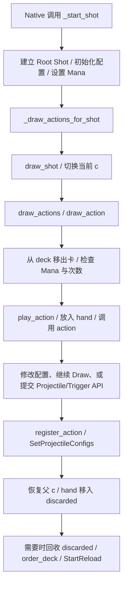

# Noita 法术编程：REA 实机文件研究与 Norn 差异分析

研究日期：2026-10-17。范围：理解本机 Noita 的法杖执行语义，为 Norn 后续讨论提供证据。本文是研究记录，不是已批准的改造计划。本轮没有修改 Norn 的 Gameplay、Scene、Prefab、SO 或存档。

## 1. 先说明研究结果与证据边界

**主要差异集中在执行语义：Noita 维护跨次抽牌状态，通过递归 Draw 构建带 Scope 的 Shot；Norn 当前每次从程序开头扫描，用 Draw Budget 生成命令，并在单机 Owned Wand 路径预先冻结整棵执行树。** 两者都具有 Interpreter 与 Runtime Bridge 的分层基础；改进讨论应先明确玩家编排的程序怎样运行，再讨论法术数量。

这次确实使用了 [morluto/rea](https://github.com/morluto/rea)，不是仅阅读 REA 的 README，也没有把普通源码阅读包装成反编译。具体分工如下：

| 手段 | 本轮实际完成 | 可以证明的内容 |
|---|---|---|
| REA 6.5.0 `inspect-artifact` | 检查本机 `noita.exe`，保留 Evidence JSON 与 SHA-256 | 检查对象及格式身份 |
| REA + Rizin 0.9.1 | PE metadata、字符串、Lua 注册位置和 Native callback 的 Assembly 窗口 | Lua 与 Native Binary 的连接位置 |
| 自编只读 WAK parser | 校验目录表、文件范围，提取 75 个相关文件到隔离目录 | 原版 Lua、generated 配置、少量 XML 的具体实现；此步骤不属于 REA |
| 原版 Lua + 隔离 Host | 运行 14 组探针，28 条断言通过 | Lua 状态变化、调用顺序、Mana 与次数更新、提交的 Scope |
| Norn 当前 C# 与已有测试阅读 | 检查实际生产实现及规则测试 | 当前实现的静态语义；不代表本轮跑过 Unity Test Runner |

隔离 Host 使用本机 Lua 5.4.2，提供 Noita 风格的 `dofile_once` 和必要 Native API Stub。Noita Binary 导入 `lua51.dll`。本轮覆盖的基础 table、函数和控制流在该 Host 上运行成功，但这不能证明 LuaJIT/Lua 5.1 的所有细节完全等价。

**没有完成的部分：** C++ Shot 容器的完整恢复、Native 的配置应用算法、真正碰撞和物理、屏幕伤害、最低施法帧数、实际 FPS、Unity Profiler。本轮没有启动 Noita 游戏进程或执行游戏内 Mod。Scope 探针中的 `BeginProjectile` 只是记录 API 调用，不会实际生成投射物。

### 本机版本身份

- 游戏目录：`F:\SteamLibrary\steamapps\common\Noita`。
- 本地 Steam Build ID：`17130612`；它是本机安装版本，不宣称是当前最新发行版。
- `_version_hash.txt`：`9dbd52ced019a643169a2db02f46c77f8766c6e5`。
- `noita.exe`：15,460,864 bytes，PE32 / x86，MSVC 相关 metadata。
- EXE SHA-256：`808d2a0ab51ea0b46e9ad2aeb3327a4b0ce3feae04f32ba26326bf585b5779bd`。
- WAK SHA-256：`c95a0c01a55ec29267afef6bbec8a0cae0ba2b350638e2203674ed4dfb9227c3`。

REA 使用临时 Node 24.22.0 运行，没有替换系统 Node 20，没有运行 `rea setup` 或修改 Codex MCP 配置。Ghidra/IDA 没有配置，Hopper 的本轮 Windows 路径不可用，因此改用 REA 支持的便携 Rizin 静态分析路径。Rizin 来自 [官方 Release](https://github.com/rizinorg/rizin/releases/tag/v0.9.1)，下载包已核对官方公布的 SHA-256。

## 2. Noita 的执行模型：卡牌程序构建一次 Shot

### 2.1 先分清三个东西

1. **法术定义 `actions`**：`gun_actions.lua` 中的 table。每项包含 `id`、`type`、`mana` 等数据，以及真正执行语义的 `action()` 函数。`type` 描述分类；具体行为由函数实现。
2. **法杖抽牌状态**：`deck` 表示尚未读取的卡，`hand` 表示当前施法中正在使用的卡，`discarded` 表示已经结束使用、可在重新装填时回收的卡。
3. **Shot 的配置 Scope**：`c` 指向当前 Shot 的配置 table，保存伤害增量、速度、Spread、`fire_rate_wait` 等值。Trigger 子 Shot 会切换到另一个配置 table，完成后恢复父引用。

`_add_card_to_deck()` 还会创建每张卡的 Runtime table，带有 `inventoryitem_id`、`uses_remaining`、`deck_index` 和识别状态。定义与具体实例分离，因此同一种法术的两个实例可以具有不同剩余次数。

这里的 `hand` 也承担一个重要安全边界：当前抽取链正在执行的卡没有立刻进入 `discarded`。Wrapping 时回收的是 `discarded`，不能把实现简化成“索引到末尾就对整个法杖取模”。

### 2.2 一次施法的实际调用链



图中的 Native 调用入口由脚本导出函数、EXE 中对应名字和 API 注册 Assembly 相互支持；Native 调度器内部的完整执行过程仍未恢复。

普通投射物会提交自己的生成描述，然后结束这张卡。Modifier 常见的实现是“修改 `c`，再调用 `draw_actions(1, true)`”。Multicast 例如 `BURST_2` 会调用 `draw_actions(2, true)`。所以 Modifier 与 Multicast 是实际控制抽牌过程的函数，不只是预先扫描数组时加一个数字。

**对玩家的意义：** 基础 Draw 为 1、装入 A/B 两张普通投射物时，第一下用 A，第二下用 B；完成这一轮后再 Reload。卡牌排列既影响当前攻击，也影响之后几次操作。

### 2.3 Modifier 的作用域由 Shot 组织

`draw_shot()` 先保存父 `c`，令 `c = shot.state`，执行抽牌，最后统一 `register_action(shot.state)` 与 `SetProjectileConfigs()`，再恢复父 `c`。

这与 Norn 当前“遇到一个 Emit 就立刻 Bake 一份值快照”存在实质区别。探针执行：

```text
BURST_2 → LIGHT_BULLET → DAMAGE → LIGHT_BULLET
```

记录到两个 Projectile API 调用引用同一个 Scope；第一个 Begin 时伤害增量为 0，第二个为 0.4，但最终该 Scope 统一提交的伤害增量为 0.4。

**直接证实的是共享可变 Scope 和最终提交时序。** 由此可以解释同一 Shot Group 内 Modifier 不宜仅理解成“文本位置之后的快照”。若要把结论扩大为每种投射物最终受多少伤害，仍需补 Native 配置应用或游戏内命中验证；本轮 Stub 没有模拟这一步。

### 2.4 Trigger 当场构建子 Shot，未来释放结果

`add_projectile_trigger_hit_world()` 的核心顺序是：开始父 Projectile → 开始 Trigger → `draw_shot(create_shot(action_draw_count), true)` → 结束 Trigger → 结束父 Projectile。

这意味着在父次施法期间，子指令就已经被抽取、执行和扣费。实际释放子投射物的时间由 Native Trigger 决定。Timer 也是同样的构建逻辑，只是在 API 中额外传递帧数。

`create_shot()` 会调用配置初始化，**不会在这段 Lua 中自动把父 `c` 全量复制给子 Shot**。例如：

```text
DAMAGE → LIGHT_BULLET_TRIGGER → LIGHT_BULLET
```

探针记录：父 Scope 的伤害增量为 0.4，子 Scope 为 0；初始 Mana 100，父次解释结束时已剩 80。这里支付了 Modifier 5、Trigger 10、子投射物 5。没有等待命中事件。

子 Shot 内的 Modifier 也不会通过 `c` 引用泄漏回父 Scope。父、子 Scope 的 `fire_rate_wait` 分开记录；`current_reload_time` 则是另一项共享状态，不能把所有时间字段都视作局部变量。

## 3. 产生组合深度的其他规则

### 跨次 Draw、Wrapping 与 Shuffle

`order_deck()` 在 Shuffle 模式下重排，在非 Shuffle 模式下按 `deck_index` 排序。抽牌代码遇到空 `deck`，只有在调用允许 `instant_reload_if_empty` 且没有禁止继续抽牌时，才会回收 `discarded` 并继续。根层 Draw 与递归 Draw 传入的选项不同。

探针法杖 `[LIGHT_BULLET, DAMAGE]`：第一下只发普通弹，并将它放入 `discarded`；第二下抽到 `DAMAGE`，它要求再抽一张，因 `deck` 已空而回收上一次的普通弹，形成强化弹。当前 `hand` 中的 `DAMAGE` 没有被一起回收。这是 Wrapping 的一个可重现最小例子，不等于所有复杂 Wrapping 都已研究。

Shuffle 会让排列的可靠性成为法杖属性的一部分，进而改变玩家对组合的预期；它不只是让表现随机。探针固定为非 Shuffle，本轮没有验证 Noita RNG 等价性。

### Mana 不足、负 Mana 与次数

普通抽牌中，付不起某卡时，Noita 将它放到 `discarded` 并返回失败；外层 Draw 会继续尝试之后的卡。探针以 5 Mana 读取 `[LIGHT_BULLET_TRIGGER, LIGHT_BULLET]`：10 Mana 的 Trigger 被跳过，5 Mana 的普通弹仍执行，最终 Mana 为 0。

`MANA_REDUCE` 的数据是 `mana = -30`。脚本扣费采用减法，因此它实际上增加 Mana；探针从 0 开始，之后发射 5 Mana 普通弹，最终得到 25。实际 Mana 上限如何由 Native 管理不在本轮验证范围内。

0 次卡同样被跳过；有限次数卡在收尾阶段根据识别状态、实际产出和 `custom_uses_logic` 等条件更新。次数还经过 Native 回调 `ActionUsesRemainingChanged`，回调可以取消减少。因此不能把 Noita 的所有消耗规则概括成“执行一张就必定扣一次”。

### Cast Delay 与 Recharge Time

脚本维护当前 Scope 的 `c.fire_rate_wait` 和另一项 `current_reload_time`；`RECHARGE` 等法术会分别修改这两者。前者描述一次 Shot 的施法节奏，后者参与 Reload。它们共同使“单发速度”和“整轮周转速度”成为不同的组合维度。

本轮只确认提交的数值和 `StartReload` 调用，没有恢复 Native 最低帧数、重叠计时或最终可用时间的全部公式，不能据此直接给出准确 DPS 计算器。

### Always Cast 和特殊指令

`_play_permanent_card()` 有独立入口；普通 Modifier 的 `draw_actions(1)` 在永久卡上下文下还具有特殊处理。本轮探针中永久 `DAMAGE` 不额外抽出第二发，且这一路径没有扣它的正 Mana 成本。该入口的外部调用顺序由 Host 按脚本接口模拟，尚未游戏内确认。

动作函数的表达能力还容纳复制、条件控制等行为；源码中可以找到 `DIVIDE_*`、`IF_*` 等定义。这不构成“已验证全部高级法术”或“Turing Complete”的证据。本轮没有运行这些高级动作，也没有给出它们的完整规则。

## 4. 与 Norn 当前生产代码逐项对照

这里以 2026-10-17 工作区源码为准。早期 AGENTS/学习文档中“Mana 还是占位值”“Trigger 捕获整个剩余后缀”的描述不能代表当前单机实现。

| 维度 | Noita 本机实现与本轮证据 | Norn 当前实现 | 玩家或设计影响 |
|---|---|---|---|
| 跨次位置 | `deck / hand / discarded`；14 组探针中包含跨次例子 | `EvaluateCore` 每次从 `i = 0` 开始；无此类跨次抽牌状态 | 同一排列是否会形成连续几次不同攻击 |
| 停止读取 | Root Draw 完成后停下，Modifier/Multicast 递归驱动后续 Draw | 扫描到末尾；预算耗尽的 Emit 跳过，后续 Multicast 仍可重新开启预算 | 后置 Multicast 是否参与当前这一击 |
| Multicast | 动作调用 `draw_actions(N, true)`，参与递归抽牌 | `drawBudget += ExtraDraws` | 表面相似的多重发射可能有不同嵌套、停止和 Wrapping 行为 |
| Modifier | 同一 Shot 使用共享 `c`，末尾统一提交 | `CastModifierState` 为不可变值；每次 Emit 立刻 Bake | Group 内前后摆放能否只影响后续产出 |
| Trigger Scope | `create_shot` 初始化新配置，保存/恢复父 `c` | `PayloadMods` 继承进入父 Trigger 时的 Modifier 快照 | 父强化是否自动进入子层 |
| Payload 边界 | 消费后续要求数量的 Draw，允许由动作递归扩展 | `FindActionEnd` 解析“后续一个完整 Action”，可以包含 Multicast 和嵌套 Trigger | Norn 已有局部 Action 边界，不能再称为吞掉整根杖 |
| Payload 准备 | 父次解释时执行子动作并提交 Trigger 构建 API | Owned Wand 的 `CastExecutionPlan.TryBuild` 预先冻结全树命令 | 两者都已包含预构建思想；Norn 并非全部命中后再读取可变程序 |
| Payload Mana | 普通 Trigger 在父次抽牌时支付子动作成本 | `PrepareRoot` 检查根层，子层 `PrepareLayer` 在触发时检查原杖 Mana | 命中前的 Mana 恢复或消耗能否影响 Payload 成功 |
| 有限次数 | Lua 收尾和 Native 回调协同 | 根事务预留全树有限次数，后续每层预算只可尝试一次 | 未命中、提前销毁、失败时的资源语义不同 |
| Mana 不足 | 跳过该卡，尝试后续卡 | Pure Evaluator 发生 Fizzle 后中止；Owned 路径还会先预检本层总成本 | “跳过昂贵卡”能否形成稳定降级方案 |
| 负 Mana | 原版卡存在负成本，普通抽牌可增加 Mana | Pure 成本钳为非负；Owned Plan 明确拒绝负 Mana | Add Mana 类组合需要明确资源语义，不能仅新增一个图标 |
| 法杖节奏 | Scope 的 Cast Delay 与共享 Reload，法术可分别调整 | `WandDefinition / WandRuntimeState` 当前有每杖 Mana、恢复和固定 CastCooldown | 卡序对持续输出节奏的影响范围不同 |
| 安全限制 | 可见递归检查与特殊动作约束，尚未穷尽 Native 限制 | 深度 16、全树产出 64 等明确限制 | 追求组合深度时仍需控制 Runtime 成本 |

### Norn 已有的基础应准确保留

`CastExecutionPlan` 递归构建子层时，传入 `cmd.PayloadMods`，证明目前选择了继承修正的语义。`CastResourceService` 同时处理具体卡实例、原杖资源、资格和次数，并通过准备/提交事务避免失败后错误扣资源。`SpellCaster.RunOwnedCast` 消费冻结的 `CastExecutionLayer`，把纯数据转成 Unity 对象。

旧的非 Owned 路径仍存在，可能通过回调重新求值 Payload；因此研究当前玩家 Owned Wand 时，不能只看旧 `WirePayload` 就断言所有 Trigger 都会在命中时重新解释原 SO。

这些结构已经覆盖了 Data、Pure Logic、资源事务和 Runtime Bridge。后续若选择靠近 Noita，核心工作应围绕抽牌状态、Scope 和资源时机进行一致调整，并保留当前冻结和事务机制所提供的安全性。

## 5. 14 组可重复实验与实际观察

除特别说明，初始 Mana 为 100，Root Draw 为 1，非 Shuffle；两次点击间没有加入 Mana 恢复。名字为原版 `action_id`，数字均为脚本层结果。

| 探针名 | 输入或条件 | 记录结果 |
|---|---|---|
| `cycle_two_clicks` | 普通弹 A、普通弹 B，连续两次 | 第一次 A、第二次 B；Mana 95 → 75；第二次请求 Reload |
| `stop_after_one` | 普通弹、双重、普通弹、普通弹 | 本次只执行第一张；后置双重仍在 deck |
| `modifier_before_group` | 增伤、双重、普通弹、普通弹 | 两弹同 Scope，最终增量 0.4，Mana 85 |
| `modifier_inside_group` | 双重、普通弹、增伤、普通弹 | 第一次 Begin 增量 0，第二次 0.4，最终只提交一个 0.4 Scope |
| `modifier_before_trigger` | 增伤、Trigger、普通弹 | 子 Scope 增量 0，父 0.4；Mana 80 |
| `trigger_local_scope` | 双重、Trigger、增伤、普通弹、普通弹 | 子 Scope 增量 0.4、delay 8；父增量 0、delay 6；Mana 75 |
| `timer_builds_now` | Timer、增伤、普通弹 | 当前调用已构建 Timer(10 frames) 和子层；Mana 80 |
| `wrapping_previous_discard` | 普通弹、增伤，连续两次 | 第一次普通弹；第二次增伤递归 Draw 回收普通弹；Mana 95 → 85 |
| `mana_skip` | 5 Mana；Trigger、普通弹 | Trigger 跳过，普通弹仍执行；Mana 0 |
| `negative_mana` | 0 Mana；Add Mana、普通弹 | Mana 25；Scope delay 13 |
| `zero_uses_skip` | 0 次 Bomb、普通弹 | Bomb 跳过，普通弹执行；Mana 95 |
| `always_cast_modifier` | 永久增伤；普通弹、普通弹 | 只 Draw 一发，增量 0.4；Mana 95 |
| `finite_trigger_child` | Trigger、2 次 Bomb | 未发生碰撞前子卡已减至 1 次；Mana 65 |
| `two_root_draws` | Root Draw=2；三个普通弹 | 执行两张，第三张留在 deck；Mana 90 |

验证脚本对上述输出执行 28 条明确断言。它没有自行重写 `draw_action`、`draw_shot` 或法术动作，执行的是本机提取出的原版函数。Native API Stub 仅负责观察边界，因此结果不能当作 Noita 游戏内集成测试。

## 6. REA 的 Native 证据具体落在哪里

所有地址均是本地 EXE、Image Base `0x00400000` 下的静态 VA；不直接当作其他版本或运行进程的地址使用。

| Lua 名字 | 字符串 VA | 注册窗口 | Native callback 候选入口 |
|---|---|---|---|
| `RegisterGunAction` | `0x010386d0` | `0x00b29584` 起 | `0x00b27ff0` |
| `SetProjectileConfigs` | `0x0103877c` | `0x00b298d4` 起 | `0x00b287e0` |
| `BeginTriggerHitWorld` | `0x010386e4` | 已定位字符串指针引用 `0x00b296c5` | 本轮未继续恢复 |
| `_start_shot` | `0x01038804` | 已定位字符串指针引用 `0x00b29de1` | 它是 Lua 导出入口名字，不能把字符串引用误认为其 C++ 实现 |

两组已检查的注册窗口同时出现对应名字、函数地址、`lua_pushcclosure` 和 `lua_setfield` 调用，支持将脚本 API 名称连接到该 Binary 的 Native callback。callback 只读取了有限 Assembly 窗口，**没有把它们完整还原为 C++ 源码，也没有据此给内部容器强行命名**。

Rizin 字符串扫描报告过 `.text` 区间超过默认最大扫描区域的警告。已经定位到的目标字符串来自 `.rdata`，但该次结果不能作为整个 EXE 字符串已穷尽的证明。初期任意字节窗口的首尾还存在指令边界问题，后续改从明确的 `push` 边界取 `pdj` 窗口，保留两组原始证据供复核。

## 7. 这份研究给后续设计提供什么判断依据

首先需要选择玩家期望的规则，再决定是否改变 Interpreter。下面是待讨论的问题，不是要求照搬 Noita 的清单。

- **一根杖是否需要形成跨次程序？** 若每次按键重新运行完整排列，当前模型更直观；若希望 A → B → 强化 C 形成持续节奏，需要显式的跨次抽牌 Runtime State。只扩展 `ExtraDraws` 无法产生这个状态。
- **Modifier 影响后续 Emit，还是整个 Shot Group？** 前者易于按顺序预测，后者让 Multicast/Trigger 的作用域结构更重要。UI 预览和 Trace 必须清楚展示选择的规则，避免玩家只能靠试错猜括号。
- **Trigger 子层是否继承父修正？** Norn 当前继承，Noita 的这段 Lua 创建新配置。两种规则都能成立，但伤害放大、Homing、Gravity 等字段可能要分别定义；不能无条件一键改成“全部继承/全部清零”。
- **资源何时支付，失败如何降级？** Norn 的次数预留、原杖归属和未来 Mana 支付是一套明确设计。若改为父次预付全部 Mana，必须重新讨论切杖、未命中、父物销毁及材料产出的行为，防止只改 Evaluator 就破坏事务。
- **是否接受 Wrapping、Shuffle 与负成本的复杂度？** 它们能形成更多组合，也会增加预算、预览、调试和说明成本。应分别确定设计意图，再给深度、指令步数和总产出设置护栏；本轮不建议把现有安全上限直接撤掉。

对架构最有价值的经验是：将“牌/程序实例状态”“当前 Shot Scope”“构建完成的攻击描述”“未来触发时的 Runtime 执行”分清。Norn 已有 Pure Evaluator、冻结计划和 Unity Bridge，可以围绕这些边界评估新语义，暂时没有证据支持为此引入 Lua 或放弃现有 C# 分层。

材料交互仍属于独立的世界规则底座：法术产生的 Projectile、状态和材料输出进入已有 Combat / ElementWorld 边界。增加抽牌语义不会自动补齐材料行为、Simulation 或 Rendering，也不应让世界系统反向依赖 UI。

## 8. 建议阅读顺序与证据文件

### 先读 Noita 的三段核心，再对照 Norn

1. [Noita gun.lua：create_shot / draw_shot](<C:/Users/zhy/.codex/visualizations/2026/10/17/01a14a68-af60-7620-9b5f-af2cb638f9be/noita_research/extracted/data/scripts/gun/gun.lua:146>)：回答“谁拥有 c，子层怎样建立和恢复 Scope”。
2. [Noita gun.lua：draw_action / draw_actions](<C:/Users/zhy/.codex/visualizations/2026/10/17/01a14a68-af60-7620-9b5f-af2cb638f9be/noita_research/extracted/data/scripts/gun/gun.lua:236>)：回答“何时停下，Mana 不足之后怎样继续，Wrapping 回收哪些卡”。
3. [Noita gun.lua：Trigger 构建](<C:/Users/zhy/.codex/visualizations/2026/10/17/01a14a68-af60-7620-9b5f-af2cb638f9be/noita_research/extracted/data/scripts/gun/gun.lua:335>)，以及 [gun_actions.lua：DAMAGE](<C:/Users/zhy/.codex/visualizations/2026/10/17/01a14a68-af60-7620-9b5f-af2cb638f9be/noita_research/extracted/data/scripts/gun/gun_actions.lua:5573>)：回答“动作如何递归拉取下一条，子法术何时执行”。
4. [Norn CastEvaluator](<F:/Develop Project/RPG/RPG/Assets/_Project/Scripts/Skills/CastEvaluator.cs:155>)：看扫描循环、预算为 0 的分支、`FindActionEnd` 与 `BakeEmit`。不用背字段，重点看哪些状态只活在本次调用内。
5. [Norn CastExecutionPlan](<F:/Develop Project/RPG/RPG/Assets/_Project/Scripts/Skills/CastExecutionPlan.cs:31>) → [CastResourceService](<F:/Develop Project/RPG/RPG/Assets/_Project/Scripts/Run/Spells/CastResourceService.cs:54>) → [SpellCaster.RunOwnedCast](<F:/Develop Project/RPG/RPG/Assets/_Project/Scripts/Character/Spells/SpellCaster.cs:237>)：看冻结全树、根/子层资源支付和 Unity 对象生成如何分开。
6. [Norn 已有 Evaluator 规则测试](<F:/Develop Project/RPG/RPG/Assets/_Project/Tests/Skills/CastEvaluatorTests.cs:239>)：重点读 `DamageMod_AfterEmit_DoesNotBoostIt`、`Multicast_BudgetUnfilled_IsDiscarded_NoWrap`、`Multicast_AfterEmit_ReopensBudget`。这些测试说明当前语义是明确约定，不能在修改时默默改变。

### 隔离研究目录

`C:\Users\zhy\.codex\visualizations\2026\10\17\01a14a68-af60-7620-9b5f-af2cb638f9be\noita_research`

| 文件 | 用途 |
|---|---|
| `extraction_manifest.json` | 每个提取文件的 WAK offset、size、SHA-256 与版本身份 |
| `extract_selected.py` | 校验目录表与范围，只提取研究文件；不执行游戏 |
| `run_rea.py` / `rea_*.command.json` | 版本固定的 CLI 封装及实际参数、退出码 |
| `rea_artifact.json` / `rea_native_info.json` | REA 原始身份与 PE Evidence |
| `rea_native_strings.json` / `native_binding_strings.json` | 原始字符串 Evidence 与聚焦结果 |
| `rea_binding_*_aligned.json` | 对齐后的 Native 注册窗口 Evidence |
| `rea_configs_callback.json` / `rea_register_callback.json` | 有限 callback Assembly 窗口 |
| `probe_gun.lua` | 原版脚本 Host、明确 Stub 和 14 组输入 |
| `verify_probes.py` | 执行与验证探针的单一入口 |
| `lua_probe_results.jsonl` / `lua_probe_verification.json` | 原始事件、28 条断言与验证范围 |

复跑脚本层实验：

```powershell
python 'C:\Users\zhy\.codex\visualizations\2026\10\17\01a14a68-af60-7620-9b5f-af2cb638f9be\noita_research\verify_probes.py'
```

提取出的游戏脚本、Binary 和便携工具均留在本地隔离目录，没有加入项目文档目录或提交到 Git。临时 npm 缓存未来可能被系统清理，届时需要重新获取固定版本 REA，并调整 `run_rea.py` 的模块路径。本研究不向 Codex memory 文件写入内容。
