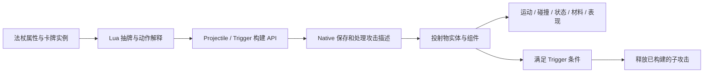

# Noita 法术编程系统完整拆解与源码学习

创建日期：2026-10-17。目标读者：熟悉少量 Unity/C#，希望从基础理解 Noita 法杖执行系统的开发者。

研究对象：本机 Steam Build `17130612`，版本标记 `9dbd52ced019a643169a2db02f46c77f8766c6e5`。本机版本可能与其他发行版不同，本文的源码与数值均按这个版本讲解。

本文完整展开法术从配置、抽牌、构建 Shot、提交 Native，到未来触发和世界对象的主链，并拆解若干代表性高级指令。它适合连续阅读，也能作为查阅手册。上一篇 [REA 研究与 Norn 差异分析](<F:/Develop Project/RPG/RPG/Assets/_Project/Docs/2026-10-17 Noita法术编程REA研究与Norn差异分析.md>) 负责横向对照；这一篇重点解释 Noita 本身。

## 阅读前：你最终要理解什么

学完以后，你应当能看一组法术排列，回答以下问题：本次读取哪些卡，下次从哪里继续；哪些卡共享强化，哪些属于子层；Mana 和次数在什么时候变化；为什么顺序相似的两个组合会产生不同结果；最终的投射物、额外组件与材料世界分别由哪一层负责。

建议分四轮读：第一轮读第 1—4 节，建立概念和数据模型；第二轮读第 5—10 节，学会手工运行；第三轮读第 11—13 节，把 Runtime 对象和高级指令接上；第四轮读第 14—17 节，沿源码和实验复核。章节后的理解问题都附有答案，可以先自行推演，再核对。

### 证据怎样阅读

本文采用三种说明：

- **源码确认**：本机原版 Lua、XML、随游戏附带的 Modding 文档可直接支持。
- **探针确认**：在隔离 Lua Host 中执行原版函数，记录数据和 Native API 调用，断言验证通过。
- **Native 待核验**：需要继续反编译或游戏内测量，本文只说明接口及合理的结构理解。

隔离 Host 使用 Lua 5.4.2，Noita Binary 导入 `lua51.dll`。本轮涉及的基础语法运行成功；这不代表 LuaJIT/Lua 5.1 的全部行为、Random 序列或引擎时序已经等价复现。Host 中的 `BeginProjectile` 等 API 是观察 Stub，不会生成真正对象。所有“最终 Scope 值”都指提交的数据，不直接等于屏幕伤害或实测射速。

## 1. 从玩家的一次操作，理解系统的整体职责

### 1.1 法杖在替玩家运行什么

玩家把卡放进法杖，实际上配置了两类信息：一类规定要产生什么，例如某种投射物、材料或效果；另一类规定怎样读取和组织其他卡，例如 Modifier、Multicast、Trigger、复制和条件指令。

运行这组配置时，系统还需要知道法杖当前读到哪里、哪些卡刚用过、剩余 Mana、哪些强化属于当前攻击组。这些属于会变化的 Runtime State。

因此，把法杖理解成一段程序时，需要同时想到三个部分：**卡牌定义表达指令，Runtime State 记录执行进度，解释过程把指令组织成攻击描述。** 场景里的投射物再根据这些描述运行。

在此基础上，法术组合可以通过几种方式增加表现力：改变接下来读取的指令；改变一组攻击共享的配置；创建另一个有独立配置的子攻击；引用其他指令的动作；根据世界输入选择分支。玩家研究的正是这些组合规则。

### 1.2 一次 Shot 可以产生多枚投射物

这里把一次受同一配置状态组织的攻击称为 Shot，把其中某一枚会飞行或存在于世界里的对象称为 Projectile。

| 概念 | 你应当想到的内容 | 简单例子 |
|---|---|---|
| 一次施法请求 | 玩家/引擎请求让法杖运行一次 | 按下一次施法键，或持续输入产生一次可用请求 |
| 顶层攻击描述（Root Shot） | 本次从法杖配置出发构建的顶层组 | 双重射击所组织的一组攻击 |
| 子攻击描述（Child Shot） | 由 Trigger 等机制建立的另一组配置 | 命中后释放的两枚弹 |
| 投射物（Projectile） | 一次具体的实体生成描述及其 Runtime 对象 | 一枚 Spark Bolt |
| 配置作用域（Scope） | 当前一组动作共同读写的配置状态 | 伤害增量、Spread、Cast Delay |

所以，Root Draw 为 1 不意味着屏幕上只能出现一枚弹。它表示顶层先请求一次有效抽牌；抽到 Multicast 或 Modifier 后，还可能递归抽取更多内容。

### 1.3 分清“构建攻击”与“世界执行”



这张图里的 Native 内部结构只在接口层得到部分验证。Lua 已经清楚展示：Trigger 在父次调用期间构建子 Shot，未来满足条件时再释放对应结果。这种区分能够解释“子弹还没出现，Mana 和次数已经发生变化”的现象。

**理解检查：** 双重射击一次产生两枚弹，应当理解成两个独立的法杖点击吗？答案是否定的：它可以是一个 Root Shot 中的两条投射物描述，期间共享一些状态。

## 2. 先认识磁盘上的文件，再认识 Runtime 中的对象

### 2.1 不同文件分别负责什么

| 文件或资源 | 主要职责 | 阅读时关注 |
|---|---|---|
| `noita.exe` | Native Engine，承接 Lua API、组件及游戏调度 | 引擎和脚本的连接边界 |
| `data.wak` | 游戏资源容器 | 文件身份与版本，不把它当作源代码语言 |
| `gun.lua` | 抽牌、Scope、Trigger 包装、收尾与导出入口 | 通用执行规则 |
| `gun_actions.lua` | 法术定义及其动作函数 | 某张卡究竟怎样修改或读取其他内容 |
| `gun_enums.lua` | 动作分类常量 | 分类用途以及与 Native enum 的同步要求 |
| `gun_generated.lua` | 法杖配置的初始化、拷贝和桥接 | Root Draw、Shuffle、Reload、容量 |
| `gunaction_generated.lua` | 攻击配置的初始化、拷贝和桥接 | 哪些字段属于 Shot 状态 |
| `gunshoteffects_generated.lua` | 如后坐力等施法效果配置 | 它与投射物属性的区分 |
| `gun_extra_modifiers.lua` | 额外修正动作 | 部分修正在普通卡动作之后应用 |
| `gun_collect_metadata.lua` | 运行元信息收集路径 | 展示/登记用途与真实发射的区分 |
| Projectile XML | 实体的组件配置 | 本体速度、寿命、伤害、碰撞与表现 |
| 附加 Entity XML / Lua | 为投射物增加能力 | Homing、特殊寿命逻辑、状态效果等 |

这些文件共同完成一项行为。只看 `gun_actions.lua` 能看到卡做什么，但看不到通用抽牌边界；只看 Projectile XML 能知道实体的基础能力，但看不到它为何在这次施法中获得额外强化。

### 2.2 一张定义、一个实例、一枚投射物，生命周期不同

以普通弹 `LIGHT_BULLET` 为例：

1. **定义**说明这类卡的名字、图标、Mana 成本，以及动作会使用哪份 Projectile XML。
2. **卡牌实例**记录法杖里的具体那张卡，例如实例 ID、槽位顺序、剩余次数、是否已识别。
3. **Shot 配置**记录本次组织攻击过程中形成的属性，例如当前伤害增量。
4. **Projectile 实体**在世界中运行，具有自己的位置、速度、生命周期及组件。

两个槽位都放普通弹时，它们可以共享同一份定义，但代表两个可分别管理的实例。一次 Multicast 又可能让两张卡在同一个 Shot Scope 内工作。不能因为共享定义，就认为实例和飞行对象也是同一个。

在 Unity 中，可以借用 `ScriptableObject` 定义、Runtime Item、一次施法配置、Prefab Instance 这四个职责来建立类比；Noita 的具体实现仍是它自己的 Lua table、实体配置和 Native 系统。

### 2.3 `actions` 中既有数据，也有函数

一个法术定义通常包含 `id`、`name`、`sprite`、`type`、`mana`、可选 `max_uses`，以及 `action` 函数。部分字段服务于生成和内容分布，例如 `spawn_level`、`spawn_probability`、`spawn_requires_flag`；它们不等于当前施法时的伤害公式。

动作分类包括 Projectile、Static Projectile、Modifier、Draw Many、Material、Other、Utility 和 Passive。分类会参与通用处理，例如 `play_action()` 根据分类判断是否产生了投射物类内容；具体抽牌、复制或参数修改仍由动作函数决定。

这是一种“内容数据 + 可调用行为”的扩展方式。它能灵活表达例外，也让行为更容易读取世界状态或操作共享集合。不能据此认为所有规则天然都是 Pure Function。

## 3. 阅读源码前，需要掌握的 Lua 基础

### 3.1 table 同时承担几种角色

Lua 的 table 可以像列表一样存连续元素，也能像字典一样按字段名存值。例如，抽牌集合是连续元素列表，Shot 的 `state` 是包含伤害、速度等字段的记录对象。

读取 `deck[1]` 表示取队首那张卡；`#deck` 表示列表长度；`table.remove(deck, 1)` 删除队首，后续元素向前移动；`table.insert(hand, action)` 把同一张卡的引用放进当前使用集合。

这里实际发生的是引用在集合之间转移。普通抽牌并没有为这张卡重新创建一份定义和函数。它从 `deck` 移出后，被放入 `hand`，收尾时再按规则进入 `discarded`。

### 3.2 赋值一个 table 引用，不会自动复制内容

当代码保存 `old = c`，再令 `c = child.state`，它保存的是原 table 的引用。之后恢复 `c = old`，就能重新访问父 Scope。

如果两个动作都通过同一个 `c` 修改伤害增量，它们操作同一份状态。若代码想得到一份独立数据，必须新建 table 并初始化或复制字段。理解这一点，才能理解 Modifier 的共享和 Trigger 的隔离。

同样，复制卡牌实例的 `action` 字段，只是让新实例引用已有函数；并没有复制一份函数源代码。它类似 C# 中两个对象持有同一个可调用入口。

### 3.3 函数可以调用函数，调用方会等待返回

Modifier 的动作可以调用 Draw；Draw 又执行下一张卡；如果下一张是 Multicast，它再次调用 Draw。最内层执行完后，程序逐层返回到仍未结束的外层调用。

这种结构称为调用栈（Call Stack）。外层 Multicast 的循环变量和剩余迭代仍然存在，因此内层多抽了几张，并不会自动抹掉外层尚未完成的 Draw。

后面“双重里面再放双重”的例子，主要依赖这一条规则，不需要先掌握编译原理或虚拟机实现。

## 4. 执行状态：哪些跨次保留，哪些每次重建

### 4.1 三个抽牌集合

| 状态 | 具体类型/形状 | 表达什么 | 何时变化 |
|---|---|---|---|
| 尚未读取的卡（`deck`） | 卡牌 Runtime table 的列表 | 接下来可以普通抽取的卡 | 抽取、分支跳过、回收及排序时 |
| 本次正在使用的卡（`hand`） | 同类列表 | 本次尚未收尾的抽牌链 | `play_action` 放入，收尾清空 |
| 已经结束使用的卡（`discarded`） | 同类列表 | 可被 Reload/Wrapping 回收的卡 | 收尾、跳过及回收时 |

它们由 gun 脚本执行上下文持有。Lua 中表现为全局变量，不代表所有法杖永远无条件共享同一份状态；Native 如何切换和保存不同法杖上下文，本轮没有完整恢复。

**`hand` 的关键作用是延后回收。** 当前正在执行的卡留在这里，递归 Draw 读空 `deck` 时，通常只能回收先前的 `discarded`。这给 Wrapping 建立了边界。

### 4.2 一张卡的 Runtime table

`_add_card_to_deck()` 查找定义、创建实例 table、复制必要字段，再写入以下身份与状态：

| 字段 | 业务含义 |
|---|---|
| `inventoryitem_id` | 让 Native 知道是哪一张具体物品卡 |
| `deck_index` | 原始槽位顺序，非 Shuffle 回收时用于排序 |
| `uses_remaining` | 本实例剩余次数；普通路径约定负值可持续使用，0 被跳过 |
| `is_identified` | 是否已识别，影响收尾时的次数处理 |
| `action` | 这张卡的动作入口 |

`deck_index` 取的是插入前的 `#deck`，因此它从 0 起；Lua table 的列表访问仍从 1 起。一个用于保存原始顺序，一个用于当前列表下标，二者不要混用。

### 4.3 当前 Shot 配置与共享资源

| 状态 | 作用及生命周期 |
|---|---|
| 当前配置引用（`c`） | 指向正在构建的 Shot 的配置 table；进入子 Shot 时切换，结束后恢复 |
| `root_shot` | 本次顶层描述，`_start_shot` 重建 |
| 法杖基准配置（`state_from_game`） | Native 提供，Root Shot 开始时复制进去 |
| `gun` | 法杖结构配置，例如 Root Draw、Shuffle、Reload 和容量 |
| 当前 Mana（`mana`） | 本次脚本调用中的共享资源数值，父子 Draw 都会操作 |
| 当前 Reload（`current_reload_time`） | 可跨相关动作累积修改，独立于当前 `c` |
| 施法效果（`shot_effects`） | 例如 recoil，Root 开始时初始化 |
| `got_projectiles` | 本次是否经过投射物/材料类通用动作处理，参与收尾判断 |
| `reloading` / `start_reload` | 记录抽空牌堆和请求 Reload 的控制状态；不能仅按字面当作完整计时器 |
| `dont_draw_actions` | 某些复制/特殊动作临时禁止递归 Draw |
| `force_stop_draws` | 影响空牌堆时是否允许继续回收抽牌 |
| `current_action` | 最近设置的动作上下文，供动作及登记路径使用 |

因此，“子 Scope 独立”只覆盖它独立持有的配置，**不意味着子层拥有独立 Mana、独立牌堆和独立 Reload**。有些局部状态被隔离，有些执行状态按设计共享。

## 5. 从 Native 入口到第一次抽牌

### 5.1 初始化法杖与开始一次 Shot 是不同操作

`_clear_deck()` 清空三个集合，重置首次发射等标记。`_add_card_to_deck()` 用实际卡牌实例重建读取列表。这些函数服务于法杖上下文准备，不能把它们当作每次施法都必定调用的步骤；否则跨次抽牌进度就会丢失。

开始本次施法的入口 `_start_shot(current_mana)` 则会：

1. 检查 Native 是否已提供法杖基准配置。
2. 重置禁止抽牌等本次控制标记。
3. 创建 Root Shot，并让 `c` 指向它的配置。
4. 把法杖基准属性复制到 Root 的配置中。
5. 初始化施法效果，设置 `gun.actions_per_round` 为 Root Draw 数量。
6. 接收本次可用 Mana。
7. 若为首次发射，排序或 Shuffle，并设置基础 Reload。
8. 清除本次是否产出投射物的标记。

Root 的初始状态因此来自法杖，而非总是全零。例如本轮显式设置基准 Cast Delay 为 12，普通弹再加 3，最终提交的是 15。前一轮实验用零基准只是为了分离卡牌贡献。

### 5.2 Root Draw 为什么传 `false`

`_draw_actions_for_shot()` 让 Root 调用 `draw_shot(root_shot, false)`。普通 Modifier、Multicast 和 Trigger 子层则常传 `true`，表示它们请求更多指令时，可以在特定条件下回收 `discarded`。

这个选项改变空牌堆的处理规则。它不是“把 Cast Delay 立即设为零”，也不能仅按参数名将它理解成真实时间已经过去。

Root 解释完成后，代码登记施法效果；如果调用方允许结束时处理 Reload，则执行 `_handle_reload()`；随后清理本次的额外修正列表和相关标记。

Native 何时发出请求、怎样判断法杖已可再次使用、持续输入怎样被调度，仍在 Native 边界内。脚本导出接口与部分 Binary 引用已找到，完整输入和计时循环尚未恢复。

### 5.3 `draw_shot()` 实际建立了一个配置边界

它的结构可以概括为下面的教学伪代码：

```text
保存父配置引用
让当前配置指向本 Shot 的状态
按本 Shot 的 Root Draw 请求解释动作
登记本 Shot 的最终配置
调用 Native 的 SetProjectileConfigs
恢复父配置引用
```

这里没有为子层复制独立的 `deck / hand / discarded`。Scope 切换的是攻击配置，读取进度仍在共享的抽牌集合中推进。

## 6. 抽牌引擎：一张卡怎样被真正执行

### 6.1 单次抽牌 `draw_action()` 的决策顺序

用业务语言逐步还原：

1. 记录发生了一次抽牌尝试。这个计数包括未必产出投射物的尝试。
2. 若正在收集元信息，走相应短路路径。
3. 若 `deck` 已空，检查本次是否允许从 `discarded` 回收；允许时回收、排序并记下 Reload 请求，禁止时设置结束控制标记并返回。
4. 若有卡，移出 `deck[1]`。
5. 读取 Mana 成本；定义未填时使用脚本默认值 10。
6. 若付不起，把卡放入 `discarded`，通知 Mana 不足，返回失败。
7. 若实例次数为 0，同样放入 `discarded` 并返回失败，此时还没有真正扣 Mana。
8. 支付成本，交给 `play_action()`。

注意顺序：检查 Mana 在检查 0 次之前，但真正减 Mana 在两者检查之后。不能看到先读成本，就误以为 0 次卡仍必定扣资源。

### 6.2 `draw_actions(N)` 的 N 怎样计算

这个函数循环请求 N 次有效抽牌。一次抽牌返回失败时，它会继续尝试当前 `deck` 中的后续卡，直到成功或没有可尝试的卡。

这里的“成功”是抽牌控制层面的返回值，并不保证生成一枚 Projectile。某些控制指令只修改状态；在允许回收却没有可回收卡等情况下，也可能没有对应的攻击产出。

于是，N 既不能简单当作“扫描 N 个数组槽位”，也不能无条件当作“生成 N 枚弹”。它要与被抽到的动作一起解释。

### 6.3 `play_action()` 给普通路径提供公共处理

它会通知 Native 某动作开始执行，把实例加入 `hand`，设置当前动作信息，再调用动作函数。动作返回后，按类型处理额外修正和产出标记，最后增加通用的 Reload 增量。

本机脚本中的通用增量常量为 0。它的存在说明有公共收尾位置，不代表当前每张卡一定增加非零 Reload。

这个入口把“正常抽到一张卡”需要的公共步骤集中起来。后面复制指令直接调用别人的 `action()`，会绕过其中一些步骤，因而出现不同的成本和次数行为。

### 6.4 最简单的两次发射

法杖：`[LIGHT_BULLET, BULLET]`，Root Draw=1，Mana 从 100 开始，不加入恢复。

| 时点 | deck | hand | discarded | Mana |
|---|---|---|---|---:|
| 首次开始 | A、B | 空 | 空 | 100 |
| 抽 A 并执行 | B | A | 空 | 95 |
| 首次收尾 | B | 空 | A | 95 |
| 第二次抽 B | 空 | B | A | 75 |
| 第二次收尾并回收 | A、B | 空 | 空 | 75 |

第二次提交了 Reload 请求，回收后按原始顺序准备下一轮。两次调用的攻击配置分别重建，但抽牌状态在它们之间保留。

**理解检查：** A、B 采用同一投射物定义时，牌堆是否可以只保存一个“法术种类”？不可以：槽位顺序、实例 ID 和剩余次数仍需要各自保存。

## 7. 普通投射物、Modifier 和 Multicast 怎样组合

### 7.1 普通投射物定义做了哪些事

`LIGHT_BULLET` 的动作使用 `light_bullet.xml`，还会增加 Cast Delay、屏幕震动、暴击概率，并减少一些 Spread。它的 Mana 成本为 5。

这里同时存在两类数据：Projectile XML 里的本体基础配置，以及动作解释时对 Shot 配置的增量。把动作函数看作“只负责生成一个 Prefab”会漏掉这部分节奏和属性贡献。

另一个细节是提交顺序：普通弹动作先调用 Projectile 构建 API，再修改某些 Scope 字段；最终由外层统一登记 Scope。不能用某一行 `BeginProjectile` 调用时读到的字段，替代这一组动作最后提交的配置。

### 7.2 Modifier 既修改状态，也延续解释

`DAMAGE` 做两件核心事情：给当前伤害增量加 0.4，然后递归请求下一张卡。它还修改 Cast Delay、粒子和 recoil 等内容。

0.4 是内部伤害增量，不是“增加 40%”。本文不把它直接换算成 UI 伤害，因为最终叠加、倍率和显示换算还有 Native 环节。

例如 `[DAMAGE, LIGHT_BULLET]`：Root 先抽增伤；增伤改变状态并抽下一张；普通弹提交描述；返回增伤，再返回 Root。结果是一枚普通弹描述，以及包含增伤和两张卡时间贡献的 Scope。

这解释了为什么 Modifier 自己不需要把 Root 的 Draw 数直接加 1：它通过动作内的继续 Draw 来连接被修正内容。

### 7.3 Multicast 驱动新的抽牌请求

`BURST_2` 的动作请求 `draw_actions(2, true)`，自身 Mana 为 0。Root 抽到它之后，外层这次 Draw 进入它的动作，动作再完成两个内层 Draw。

组合 `[BURST_2, A, B]` 因而提交 A、B 两个描述。若改为 `[BURST_2, DAMAGE, A, B]`，第一个内层 Draw 抽到增伤，增伤继续抽 A；返回以后，双重的第二个内层 Draw 还会抽 B。

### 7.4 嵌套双重为何在这个排列中产生三枚弹

排列：`[BURST_2, BURST_2, A, B, C]`，A/B/C 均为普通弹。

```text
Root 请求 1 次
└─ 外层双重：请求 2 次
   ├─ 第 1 次：内层双重，请求 2 次
   │  ├─ A
   │  └─ B
   └─ 第 2 次：C
```

内层双重使用了外层的第一次抽牌机会，并在自己内部读出 A/B；外层仍有第二次机会，所以读出 C。实验确认三个 Projectile API 调用，成本 15，剩余 Mana 85。

这不是把两个“2”简单相乘。需要展开 Call Stack，查看谁仍有剩余循环次数，以及牌堆已被谁推进。

### 7.5 同一组内的共享配置

排列：`[BURST_2, A, DAMAGE, B]`。记录显示 A/B 的 Projectile API 调用都引用同一个 Scope；A 开始描述时伤害增量为 0，B 开始时为 0.4，整组最后只登记一次增量为 0.4 的配置。

源码与探针确认了共享状态和统一提交。Native 怎样将这个最终配置应用到每种实体，需要继续沿 `SetProjectileConfigs` 验证；本文不会把 Stub 日志当作最终命中伤害。

对程序阅读而言，结论已经很明确：Modifier 的影响必须结合 Shot Group 的边界判断，单看文本前后不足以解释整个提交过程。

## 8. Trigger：同一套抽牌过程中的子配置

### 8.1 Trigger 包装函数做了什么

命中型包装函数按如下顺序调用：开始父 Projectile 描述，开始 Trigger，建立并解释子 Shot，结束 Trigger，结束父 Projectile。

Timer 和 Death 包装也有对应的 Begin/End API。Timer 额外传递帧数。它们让同一条法术程序在构建时组织出嵌套结构。

下面是便于理解的攻击描述树，不是已恢复的 C++ struct：

```text
Root Shot
└─ 父 Projectile
   └─ Hit Trigger
      └─ Child Shot
         ├─ 子 Projectile A
         └─ 子 Projectile B
```

子层卡牌在父次调用中已经解释；它们的世界对象将在 Native 判断条件后释放。解释发生时间与实体出现时间不同。

### 8.2 子层配置怎样初始化

`create_shot()` 新建 Shot 和配置 table，并执行 generated 初始化函数。它不在这里复制当前父 `c`。进入子层前保存父引用，子层结束后恢复。

Root 的情况略有不同：创建后，还会额外复制 `state_from_game`。普通 Trigger 子层的创建没有执行同样的基准拷贝。

新增探针把 Root 的基准伤害增量设为 0.15、Cast Delay 设为 12：Root 普通弹最终是增量 0.15、delay 15；Trigger 的子普通弹提交增量 0、delay 3，父层仍保留基准。这证实了 Lua 配置初始化的差别；Native 是否还存在某些专门的父子传播字段，应逐项分析。

### 8.3 牌堆共享，配置分开

排列：`[BURST_2, TRIGGER, DAMAGE, A, B]`。

1. 双重的第一次 Draw 抽到 Trigger。
2. Trigger 建立子 Scope，子层 Draw 抽到增伤，增伤继续抽 A。
3. 子层完成，父 `c` 恢复。
4. 双重的第二次 Draw 抽到 B。

子层读掉了增伤和 A，父层不会再重复读取它们。A 的子 Scope 伤害增量为 0.4；B 所在父 Scope 为 0。两层共用 Mana 和同一 `hand`，收尾仍由外层执行。

这个例子比“Trigger 吞掉后面所有卡”更准确：子层消费多少，由它请求的 Draw 以及后续动作决定。若子层先读到 Multicast，就会消费相应的更多动作；若再遇到 Trigger，则继续嵌套。

### 8.4 父修正与子修正是两种排列

| 排列 | Lua 层确认的配置结果 |
|---|---|
| 增伤 → Trigger → 普通弹 | 父增量 0.4，子增量 0 |
| Trigger → 增伤 → 普通弹 | 父增量 0，子增量 0.4 |

两种排列都支付了相关动作成本，但强化处在不同 Scope。某些字段可能有专用的传播规则，不能从一个伤害字段推导所有字段一律隔离或继承。

### 8.5 Timer 的时间单位与早死行为

`LIGHT_BULLET_TIMER` 把 10 传给 Timer API，其含义是 10 frames，不是 10 秒。脚本在当前构建调用中完成子层解释并扣资源。

投射物提前死亡时 Timer 是否触发、碰撞与超时哪个先处理、同一帧多事件如何排序，属于 Native 生命周期细节。本轮没有运行真实 Projectile，因此不把 Norn 的计时事件规则直接套到 Noita。

## 9. Mana、有限次数和 Always Cast：资源怎样经过执行链

### 9.1 父子使用同一个 Mana 数值

Trigger 新建 `c`，但没有创建另一份 `mana`。子层抽牌调用的是同一套 `draw_action()`，因此直接从当前 Mana 减成本。

例如 `[DAMAGE, TRIGGER, A]` 从 100 开始：增伤花 5，父 Trigger 花 10，子 A 花 5，当前构建结束就剩 80。等待真实命中期间，脚本层并没有留着一张“未来再向玩家收取 5 Mana”的普通子卡账单。

Native 中 Mana 上限、恢复及其它特殊能力如何处理，需要看其组件和调度。随游戏文档确实列出了 `AbilityComponent` 的 `mana`、`mana_max`、`mana_charge_speed` 等字段，但这些字段本身不能证明完整恢复公式。

### 9.2 付不起一张，不一定中止整次构建

以 5 Mana 读取 `[TRIGGER(10), A(5)]`，第一次抽牌失败后，外层会继续尝试当前牌堆里的下一张 A，最终成功发射描述并剩 0。

失败卡没有进入 `hand`，而是进入 `discarded`；本轮仍可能继续发射较便宜的内容。因此不能把 Noita 的普通抽牌规则概括成“施法前汇总整段程序成本，付不起就完全失败”。

这也有设计后果：卡序可能表达资源不足时的降级方式。分析某根杖时，除了满 Mana 路径，还要看低 Mana 下实际选择了哪些卡。

### 9.3 负成本怎样增加 Mana

`MANA_REDUCE` 定义的 Mana 为 -30，普通路径采用“当前 Mana 减成本”的运算，因此会增加 30。它再继续 Draw。初始 0、后接 A(5) 的实验，结果为 25。

这只证明脚本层运算。最终是否钳在 Mana Max、哪些特殊动作保存或恢复 Mana、复制路径怎样处理，应分别沿对应源码确认。

### 9.4 有限次数主要在收尾处理

正常抽取成功的实例进入 `hand`，`move_hand_to_discarded()` 收尾时根据 `got_projectiles`、动作类型、识别状态和自定义规则处理次数。

普通路径中，次数大于 0、允许默认处理且已识别的卡会先尝试减 1，再通知 Native 的 `ActionUsesRemainingChanged`。Native 返回不允许减少时，Lua 会把这一点加回去。本轮专门把 Stub 设为否决，验证 2 次 Bomb 收尾后仍为 2。

减少到 0、且没有自定义次数逻辑的卡，不会在这次收尾中重新加入 `discarded`。这说明脚本读取集合里不再回收它；是否删除物品实体或怎样显示 0 次，由外部库存和 UI 处理，不能仅据此说实体被销毁。

### 9.5 Trigger 的有限子卡为何提前减少

子层卡也在父次解释期间进入同一个 `hand`。因此父次收尾时，已经能够处理它们的次数。

实验 `[TRIGGER, BOMB(2次)]`：没有发生真实碰撞，构建结束时 Mana 已剩 65，Bomb 次数回调已报告 1。Trigger 是否最终命中，不影响该探针中已经发生的脚本扣费。

`custom_uses_logic`、尚未识别的卡和直接复制动作都有额外条件，不能把这个普通例子推广成所有法术的统一扣次数公式。

### 9.6 Always Cast 是独立的执行入口

永久附着卡通过 `_play_permanent_card()` 执行。它建立特殊实例标记，设置为持续使用，再进行相应 Mana 增加处理和动作执行。

普通 Modifier 中的 `draw_actions(1)` 在这个上下文下会被特殊抑制，避免它额外拉出一张普通卡，改变法杖的基本 Draw 数。

本轮入口探针观察到：永久 `DAMAGE` 提供增伤，没有扣其正 Mana，也没有多发第二枚；永久 `MANA_REDUCE` 则通过专门路径增加 Mana，0 起步发 A 后仍是 25。Native 实际何时调用永久卡入口，本轮由 Host 按接口次序模拟，尚未游戏内验证。

## 10. 连续发射、Reload、Shuffle 与 Wrapping

### 10.1 Cast Delay 与 Reload 对应不同问题

一次 Shot 的 Cast Delay 关注这组攻击构建形成的发射节奏；Reload 关注完成当前牌堆周期后的重新可用时机。脚本分别维护 `c.fire_rate_wait` 和 `current_reload_time`，并通过不同位置提交。

`RECHARGE` 动作同时把前者减 10、后者减 20，然后继续 Draw。因为两项状态的所有者不同，放进 Trigger 子层会影响不同范围。

| 状态 | 主要保存位置 | 放在子层时的影响 |
|---|---|---|
| Cast Delay | 子 Shot 的 `c` | 修改子 Scope 的提交值，恢复父引用后不会直接变成父 delay |
| Reload | 共享的 `current_reload_time` | 后续父子登记和最终 Reload 都可能读到已修改值 |

探针 `[双重, Trigger, Recharge, A, B]` 提交的子 delay 为 -7、父 delay 为 6，两层读到的 Reload 都为 20。**-7 是提交值，不意味着世界中能以负时间射击。** Native 最低帧数、钳制和计时重叠尚未恢复。

### 10.2 收尾为什么先处理 `hand`

`_handle_reload()` 先处理本次使用的实例，让符合条件的卡进入 `discarded`。随后根据控制标记、空牌堆或回收请求，决定是否把 `discarded` 移回 `deck`、排序并调用 `StartReload()`。

这样本次正常用过的卡可以在下一轮被回收，而递归 Draw 发生时，它们还暂时留在 `hand`。回收时机因此区分了“继续本次抽牌”与“开始下一轮牌堆”。

`reloading` 在这份脚本中还承担抽牌结束控制；Native 的真正计时状态有额外字段。阅读时应看条件怎样使用它，不要仅凭名字推导等待全过程。

### 10.3 非 Shuffle 模式怎样恢复原顺序

回收到 `deck` 的卡按 `deck_index` 排序，从而回到原先槽位顺序。排序依赖实例上保存的原始索引，而不是它最后进入 `discarded` 的先后顺序。

Shuffle 分支则按照 Random 抽取剩余元素并构造新列表，种子使用游戏帧输入。它改变的是解释器下一轮实际读到的序列，因此直接影响组合可靠性。

本轮主要探针关闭 Shuffle；Host 的 Random 只用于支持接口，没有验证 Noita 的真实随机数实现和分布。

### 10.4 Wrapping 的最小完整例子

法杖 `[A, DAMAGE]`，Root Draw=1：

| 阶段 | deck | hand | discarded | 发生了什么 |
|---|---|---|---|---|
| 第一下开始 | A、增伤 | 空 | 空 | 抽 A |
| 第一下收尾 | 增伤 | 空 | A | A 成为可回收内容 |
| 第二下抽增伤 | 空 | 增伤 | A | Modifier 请求继续 Draw |
| 递归 Draw 回收 | A | 增伤 | 空 | 此处只回收先前 discarded |
| 再抽 A | 空 | 增伤、A | 空 | 使用增伤后的 Scope 描述 A |
| 第二下收尾 | A、增伤 | 空 | 空 | 回收并按槽位排序，请求 Reload |

这个过程让法杖尾部的 Modifier 接到了上一轮已使用的普通弹。它依赖不同集合和回收选项，不能用一个对全数组取模的游标准确替代。

### 10.5 当前 `hand` 不是即时回收来源

实验 `[BURST_2, A]`：双重第一次内层 Draw 用掉 A；第二次 Draw 时 `deck` 空、`discarded` 也空。当前 `hand` 中虽然有双重和 A，但不会因此自动再发一次 A。最终只有一个 Projectile API 调用。

这也说明“要求多抽”与“实际一定发够”不同。缺少可用内容时可以出现未填满的输出，不能无条件把 Multicast 当作复制现成投射物 N 份。

## 11. 从攻击描述落到真实实体与材料世界

### 11.1 基础属性在 Projectile XML 中

普通弹 `light_bullet.xml` 包含 `ProjectileComponent`：速度范围、寿命、基础伤害、碰撞后是否死亡、爆炸与地形配置等；还包含 Sprite、Particle、Light、Audio 等组件。

其中 `Base` 引用了 `base_projectile.xml`，而普通弹又覆盖了部分速度组件属性。因此，完整实体来自基础配置、专属 XML 和本次 Shot 的变化共同作用。

Noita 的实体/组件配置不应直接理解为 Unity 的 `MonoBehaviour` 更新顺序。可以比较职责，但物理、坐标单位、组件执行顺序与线程模型需要各自证据。

### 11.2 数值修正与附加行为是两条扩展方式

有些 Modifier 直接修改数字，例如 Gravity 改 `c.gravity`，Bounce 改反弹次数。另一些把附加 Entity 文件写入 `c.extra_entities`，让 Runtime 获得额外行为。

`HOMING` 的动作加入 `homing.xml` 及粒子文件；前者实际包含 `HomingComponent` 的目标/速度参数。这说明追踪能力有明确的组件载体，不需要在普通弹动作里把完整追踪算法写一遍。

`NOLLA` 则加入一个带 `LuaComponent` 的 Entity，后者引用 `data/scripts/projectiles/nolla.lua`。这展示了另一种扩展：先通过配置附加行为，再让对象生命周期中的脚本执行特殊逻辑。本轮只读到这一连接，没有继续审计该脚本及全部寿命边界，因而不在这里给出它的完整事件公式。

### 11.3 材料产出怎样进入世界

`MATERIAL_WATER` 动作选用 `material_water.xml`。这份 XML 的投射物类型为 `MATERIAL_PARTICLE`，并配置死亡时产生 `water`；动作还把 Wet 对应的游戏效果加入相关字段。

这条链可以拆成：动作选择输出与配置 → Native 创建/处理材料投射物 → 实体生命周期产生材料 → 世界材料系统继续运行。材料之后如何流动、受热或反应，属于世界 Simulation 的规则，不能仅凭抽牌系统解释完成。

同样，在普通弹 XML 中可以看到某些粒子明确配置 `create_real_particles="0"`。视觉粒子和真实材料不是同一种输出。观察到漂亮的轨迹，并不能直接证明它已经写入可参与世界反应的材料。

### 11.4 最终伤害至少跨越几层

理解最终伤害时，应依次检查投射物基础数据、Shot 提交的增量/倍率、附加组件、碰撞与伤害处理、目标状态，以及 UI 单位换算。

本文确认了其中的动作层、部分基础 XML 和配置提交接口。没有完成 Native 最终伤害漏斗的恢复，因此不会拿脚本的 0.4、XML 的 0.12 直接声称已验证某个屏幕伤害数。

## 12. 高级法术：复制、分支与自定义抽牌行为

### 12.1 直接调用一个动作，为何会改变资源语义

普通抽牌通常经过：从 `deck` 移出 → 检查 Mana/次数 → 支付 → 放进 `hand` → 设置动作上下文 → 调用动作。

复制类指令却可能直接读取另一张实例保存的 `action` 函数，再调用它。这会复用动作内容，但不必重走上述整个入口。

因此，分析复制法术时要逐项问：目标卡被移出牌堆了吗；目标的 Mana 检查被调用了吗；目标是否进入 `hand`；调用者是否手动处理次数；是否限制继续 Draw；动作是否读取当前上下文。不能仅根据“复制”二字推导统一结果。

### 12.2 用 `GAMMA` 完整看一次

本机 `GAMMA` 优先取 `deck` 的最后一张；没有时会考虑 `hand` 的最后一张；通过递归检查后直接调用目标动作。

排列 `[GAMMA, A]`：普通抽牌支付 Gamma 的 40 Mana；Gamma 直接执行 A 的动作，形成一个 Projectile 描述；A 本身仍留在 `deck`，没有通过自己的普通抽牌入口。

探针确认本次 `OnActionPlayed` 只记录 Gamma，Mana 剩 60，`deck` 仍有 A，Scope delay 为 18。这组数值里没有再通过 A 的普通抽牌路径收取 5 Mana。

把 A 换为次数为 0 的 Bomb，Gamma 的这条直接调用路径依然提交了 Bomb 的 Projectile API，也没有执行目标的普通次数回调。这是本机脚本探针观察，不是对全部复制法术或真实投射物效果作统一保证。

### 12.3 `ALPHA / TAU / OMEGA` 的阅读重点

| 指令 | 本机动作的结构重点 | 学习价值 |
|---|---|---|
| `ALPHA` | 依次考虑 discarded、hand、deck 中的首项，调用目标动作 | 指令的目标取决于执行时集合状态 |
| `TAU` | 保存 deck 前两项的引用，再依次调用 | 先保存引用与边执行边重新取目标可能不同 |
| `OMEGA` | 遍历多个集合，对部分目标临时关闭 Draw，并排除若干情况 | “复制所有”也需要控制递归与读取副作用 |

这些条目进行了静态阅读，尚未穷尽动态实验。具体例外以当前动作定义为准，不能把表格当作所有特殊组合的攻略。

### 12.4 `DIVIDE_2` 不只是再调用两遍

它会查找目标动作、按迭代参数控制复制次数，在部分调用期间禁止 Draw，保存/恢复一些时间状态，处理目标有限次数，并在外层调整 `deck / discarded`。最后还修改伤害增量和发射图案。

最小实验 `[DIVIDE_2, A]`：两个 Projectile API 调用，Mana 剩 65，最终 Scope 伤害增量为 -0.2，delay 为 20；`OnActionPlayed` 只经过 Divide 这张卡。

负伤害增量是提交数据，不直接意味着最终伤害为负。这个例子说明，一种复制语义可以同时定义输出数量、成本、时间恢复、卡牌移动和伤害代价。只在生成端把弹复制两枚，无法还原这些规则。

### 12.5 条件指令可以操作尚未读取的程序

`IF_HP` 从组件读取 HP 比例，扫描 `deck` 中的 `IF_ELSE / IF_END` 边界，将不选择的分支转移到 `discarded`，再继续 Draw。

例子：`[IF_HP, A, IF_ELSE, B, IF_END]`，A 为 5 Mana 的普通弹，B 为 20 Mana 的另一普通弹。

- HP=25、Max HP=100 时，比例为 0.25，探针执行 A，剩 95。
- HP=25.01、Max HP=100 时，进入另一分支，执行 B，剩 80。

被跳过分支没有通过普通抽牌收取那张投射物的成本。这里的阈值由当前代码的比较式确定，不能口头说成“血量低时”就忽略边界。

这段边界扫描遇到另一层某些 `IF_*` 会提前停止，因而不能直接当作支持任意嵌套语法的完整 Parser。本文的动态实验只覆盖上述平坦分支和阈值。

### 12.6 限制机制要按用途区分

`check_recursion()` 对标记为 recursive 的动作计数，本机默认限制为 2；这不是所有 Trigger 深度都统一限制为 2。Divide 还有基于 iteration 的控制，另有 `dont_draw_actions`、`force_stop_draws` 等机制。

这些限制分别约束复制调用、继续抽牌和特殊动作行为。本轮没有证明全系统的统一最坏复杂度。学习时可以借鉴“为每种会扩大工作量的路径设边界”的思路，但不能把某个局部常量当作整个系统的完整防护。

## 13. 用一根八卡法杖，把全过程串起来

### 13.1 输入条件

本节使用探针 `full_pipeline`，关闭 Shuffle，Root Draw=1，初始 Mana=100，基础 Reload=40，法杖基准 Cast Delay/伤害增量均为 0。

```text
槽 1  DAMAGE                增伤：Mana 5；当前 delay +5；继续抽 1
槽 2  BURST_2               双重：Mana 0；抽 2
槽 3  LIGHT_BULLET_TRIGGER  父 Trigger：Mana 10；父 delay +3；子层抽 1
槽 4  BURST_2               子层双重：Mana 0；抽 2
槽 5  LIGHT_BULLET          子弹 A：Mana 5；当前 delay +3
槽 6  LIGHT_BULLET          子弹 B：Mana 5；当前 delay +3
槽 7  RECHARGE              Mana 12；当前 delay -10；共享 reload -20；继续抽 1
槽 8  LIGHT_BULLET          父层另一弹 C：Mana 5；当前 delay +3
```

这里的槽号用于讲解原始顺序；牌堆移出元素后，当前列表下标会改变。

### 13.2 调用关系先画出来

```text
Root：抽 1
└─ DAMAGE：父配置增伤，继续抽 1
   └─ BURST_2：父层抽 2
      ├─ 第一次：Trigger
      │  └─ Child Shot：新配置，抽 1
      │     └─ BURST_2：子层抽 2
      │        ├─ A
      │        └─ B
      └─ 第二次：RECHARGE
         └─ 继续抽 C
```

最终构建了四个 Projectile 描述：父 Trigger、子 A、子 B、父层 C。它们不是四次独立法杖点击，其中 A/B 被放在 Trigger 的子结构里。

### 13.3 逐步追踪状态

| 步骤 | 当前动作/位置 | Mana | 父增量 / delay | 子增量 / delay | 共享 Reload |
|---|---|---:|---|---|---:|
| 0 | Root 初始化 | 100 | 0 / 0 | 未创建 | 40 |
| 1 | 增伤后 | 95 | 0.4 / 5 | 未创建 | 40 |
| 2 | 外层双重 | 95 | 0.4 / 5 | 未创建 | 40 |
| 3 | Trigger 开始 | 85 | 0.4 / 8 | 0 / 0 | 40 |
| 4 | 子层双重 | 85 | 0.4 / 8 | 0 / 0 | 40 |
| 5 | 子弹 A | 80 | 0.4 / 8 | 0 / 3 | 40 |
| 6 | 子弹 B，子层登记 | 75 | 0.4 / 8 | 0 / 6 | 40 |
| 7 | 恢复父层，执行 Recharge | 63 | 0.4 / -2 | 已完成 | 20 |
| 8 | 父层普通弹 C | 58 | 0.4 / 1 | 已完成 | 20 |
| 9 | Root 登记及收尾 | 58 | 提交 0.4 / 1 | 之前已提交 0 / 6 | 请求 Reload(20) |

父 Scope 的 delay 算式为 `5 + 3 - 10 + 3 = 1`；子 Scope 为 `3 + 3 = 6`。总 Mana 为 `5 + 10 + 5 + 5 + 12 + 5 = 42`。

### 13.4 为什么两次登记的 Reload 不同

子层完成时，后面的 Recharge 还没执行，所以它登记时读取共享 Reload=40。之后父层 Recharge 将共享值改为 20，Root 最后读取并提交 20，`StartReload` 也传 20。

这说明即使是同一个共享变量，也要区分“在什么时刻被读取并登记”。后续变量变化不会自动证明之前提交的 Native 数据也跟着变化。

### 13.5 构建结束后还要发生什么

本次所有已正常抽取的卡都已进入 `hand`，收尾将它们按规则移动并处理次数。Native 接手描述，产生顶层对象，并在对应事件满足时释放子 A/B。

真实的发射位置、方向、Spread、最低等待帧、碰撞和最终伤害仍由 Native 及实体组件完成。本节手工表与探针完全对齐的是构建阶段的数据；不能从表里的 delay=1 直接宣称已测出一帧射速。

## 14. 元信息、Native Bridge 和 REA 分别在做什么

### 14.1 `generated` 文件怎样连接两种语言

这些文件把配置字段展开成初始化、拷贝，以及向 Native 登记的调用。它们使脚本可以用一个 table 表达复杂配置，再通过确定的参数顺序传递。

`ConfigGunActionInfo_Init` 负责默认状态；`ConfigGunActionInfo_Copy` 复制已提供的数据；`ConfigGunActionInfo_PassToGame` 则调用 `RegisterGunAction`。它们是配置的具体桥接代码，不能仅凭名字理解成 C# Reflection。

### 14.2 `reflecting` 是元信息路径的标记

`gun_collect_metadata.lua` 加载通用逻辑后设置该标记，遍历定义，为每张卡创建临时 Shot 配置、设置当前动作、执行动作并登记结果。

Projectile 包装函数在这个状态下会走 `Reflection_RegisterProjectile` 等路径，而普通 Draw 也有对应短路。这样可以观察某张卡的基础动作贡献，而不正常运行整根杖的世界发射。

它不等于对任意完整组合做了准确预测。涉及复制、世界输入、父子结构和 Native 的动作，在这种收集模式下可能与真实施法不同。本文没有恢复整套 Tooltip UI 如何消费元信息，因而不把这段脚本当作完整 UI 计算器。

### 14.3 REA 找到了什么 Native 连接

REA 通过便携 Rizin 读取本机 PE metadata、字符串和 Assembly。两个对齐后的注册窗口确认名字、callback 地址、`lua_pushcclosure` 与 `lua_setfield` 的连接：

| API | 字符串 VA | 注册窗口起点 | callback 候选入口 |
|---|---|---|---|
| `RegisterGunAction` | `0x010386d0` | `0x00b29584` | `0x00b27ff0` |
| `SetProjectileConfigs` | `0x0103877c` | `0x00b298d4` | `0x00b287e0` |

VA 是本机静态 Image Base 下的地址，不直接等于另一版本或进程中的运行地址。这组证据说明 Lua API 确实连接了本 Binary 中的 Native 回调；有限 Assembly 窗口没有完整恢复内部 C++ 容器。

字符串扫描还有区域大小警告，不能宣称穷尽了 EXE 的所有字符串。关键目标位于已读取的 `.rdata`；初期任意字节窗口的边界问题，后续用对齐指令窗口复核。

### 14.4 这次没有把 REA 当作哪些工具

WAK 提取使用自编只读 parser；Lua 动态探针使用现有 Lua Host；Norn 对照使用源码阅读。REA 的实际工作是 Artifact 检查和 Native 静态分析。这些来源可以相互印证，但各自证明的范围应保留。

## 15. 怎样自己调试和验证一根法杖

### 15.1 从症状向内定位

| 玩家现象 | 第一层检查 | 后续检查 |
|---|---|---|
| 后面一张没发射 | 本次到底 Draw 到了吗 | Mana、次数、分支和牌堆是否提前结束 |
| 强化位置与预期不同 | 当前 Scope 属于哪层 | 最终登记值与 Native 配置应用 |
| Trigger 子弹没出现 | 构建时是否形成子结构 | 父对象生命周期、触发事件和实际释放 |
| 复制卡成本很奇怪 | 是否走普通 `draw_action` | 复制动作手工处理了哪些资源和集合 |
| 两次点击结果不同 | 前一次收尾后的 deck/discarded | Shuffle、Wrapping、资源恢复或世界输入 |
| 轨迹有水但世界没湿 | 是否真有材料输出 | Cosmetic Particle 与真实材料配置 |
| 推算射速不一致 | 提交的 delay/reload 是否正确 | Native 最低帧、调度及实际测量 |

先判断是“卡没执行”“描述没构建”“对象没生成”还是“对象运行后效果不同”，能够避免从画面直接猜 Interpreter 有问题。

### 15.2 一份有用的 Trace 应当包含什么

至少记录原始卡序与实例 ID、当前 deck/hand/discarded、普通动作执行顺序、Mana 前后值、Scope 身份、Projectile/Trigger API、最终配置登记，以及次数与 Reload 通知。

只打印“本次生成了 3 枚弹”，无法区分三张普通卡、嵌套 Multicast，或复制调用形成的三条描述。Trace 的作用是保留形成结果的原因。

### 15.3 本轮验证结果怎样理解

基础 14 组实验有 28 条断言；新增 14 组实验有 32 条断言，合计 **28 组场景、60 条断言**。新增覆盖嵌套 Draw、八卡完整链、子层 Reload、Gamma、Divide、HP 阈值、法杖基准、次数否决和最后一次使用。

这些是原版脚本在显式输入下的语义探针，未启动游戏进程。它们不能代替 Noita 集成测试，也不能证明 C++ 伤害、Random、物理和性能。

### 15.4 性能上能看到什么，暂时不能说什么

源码可见抽牌删除列表头、部分排序、创建 table 和递归调用，因而可以讨论列表移动、排序和递归工作的成本来源。是否已成为真实瓶颈，需要对实际运行进行测量。

Lua 的内存分配与 Unity C# 的 `GC Alloc` 也不能按同一数字直接比较。本文没有使用 Noita Profiler，也没有测得 Norn 整条施法链的分配数据，因此不声称本系统为零分配或某种性能实现一定优于另一种。

## 16. 把经验带回 Norn 时，应当保留哪些边界

这份拆解提供的是设计判断依据。Norn 当前已有 Pure Evaluator、不可变命令快照、冻结执行树和资源事务；这些职责对可测试性及失败回滚很有价值。

Noita 的经验可以按四个问题吸收：

1. **执行进度属于谁？** 是否希望卡序跨多次点击继续运行；需要时由具体法杖实例持有状态，避免 UI 或共享定义承担进度。
2. **配置在哪个边界统一生效？** 逐 Emit 快照和共享 Shot Scope 会产生不同组合规则，需让预览和 Trace 与实际执行一致。
3. **子程序怎样获得输入？** 父子修正、Mana、次数和材料预算应逐项定义；不能用一个“继承上下文”概括全部资源。
4. **未来对象运行是否还能读取可变程序？** 预构建结果有助于隔离飞行期间的编辑；Norn 已有冻结方案，无需因研究 Noita 就放弃。

Noita 动作可以直接读世界和操作集合，提供灵活性；Norn 的纯规则层更易做确定输入的测试。借鉴它的执行语义，不要求同时采用相同脚本语言或全局变量结构。

材料世界、伤害漏斗、对象生命周期和表现仍有各自责任。把卡序 Interpreter 做深，并不会自动产生更完整的材料 Simulation；这些系统应通过清楚的输出契约连接。

## 17. 源码阅读路线、复习题与本地研究文件

### 17.1 按问题读源码

以下链接指向本机隔离提取文件。推荐每次只读一段，并用本节问题检验理解。

| 顺序 | 阅读入口 | 要回答的问题 |
|---|---|---|
| 1 | [法杖结构配置](<C:/Users/zhy/.codex/visualizations/2026/10/17/01a14a68-af60-7620-9b5f-af2cb638f9be/noita_research/extracted/data/scripts/gun/gun_generated.lua:1>) | Root Draw、Shuffle 和基础 Reload 属于哪份数据 |
| 2 | [Shot 配置默认值](<C:/Users/zhy/.codex/visualizations/2026/10/17/01a14a68-af60-7620-9b5f-af2cb638f9be/noita_research/extracted/data/scripts/gun/gunaction_generated.lua:1>) | 哪些参数在新 Scope 重置 |
| 3 | [Root 开始入口](<C:/Users/zhy/.codex/visualizations/2026/10/17/01a14a68-af60-7620-9b5f-af2cb638f9be/noita_research/extracted/data/scripts/gun/gun.lua:454>) | Root 怎样复制法杖基准 |
| 4 | [单次 Draw 与重复 Draw](<C:/Users/zhy/.codex/visualizations/2026/10/17/01a14a68-af60-7620-9b5f-af2cb638f9be/noita_research/extracted/data/scripts/gun/gun.lua:236>) | Mana 失败后谁继续尝试下一张 |
| 5 | [普通动作公共入口](<C:/Users/zhy/.codex/visualizations/2026/10/17/01a14a68-af60-7620-9b5f-af2cb638f9be/noita_research/extracted/data/scripts/gun/gun.lua:202>) | 哪些工作被直接动作调用绕过 |
| 6 | [Shot 边界](<C:/Users/zhy/.codex/visualizations/2026/10/17/01a14a68-af60-7620-9b5f-af2cb638f9be/noita_research/extracted/data/scripts/gun/gun.lua:146>) | c 的引用怎样保存、切换、恢复 |
| 7 | [Trigger 包装](<C:/Users/zhy/.codex/visualizations/2026/10/17/01a14a68-af60-7620-9b5f-af2cb638f9be/noita_research/extracted/data/scripts/gun/gun.lua:335>) | 子层何时开始解释 |
| 8 | [收尾与次数](<C:/Users/zhy/.codex/visualizations/2026/10/17/01a14a68-af60-7620-9b5f-af2cb638f9be/noita_research/extracted/data/scripts/gun/gun.lua:389>) | 当前 hand 何时进入 discarded |
| 9 | [基础投射物定义](<C:/Users/zhy/.codex/visualizations/2026/10/17/01a14a68-af60-7620-9b5f-af2cb638f9be/noita_research/extracted/data/scripts/gun/gun_actions.lua:44>) | 动作除了指定 XML 还贡献哪些参数 |
| 10 | [Multicast](<C:/Users/zhy/.codex/visualizations/2026/10/17/01a14a68-af60-7620-9b5f-af2cb638f9be/noita_research/extracted/data/scripts/gun/gun_actions.lua:4018>)、[增伤](<C:/Users/zhy/.codex/visualizations/2026/10/17/01a14a68-af60-7620-9b5f-af2cb638f9be/noita_research/extracted/data/scripts/gun/gun_actions.lua:5573>) | 递归 Draw 怎样构成组合 |
| 11 | [Gamma](<C:/Users/zhy/.codex/visualizations/2026/10/17/01a14a68-af60-7620-9b5f-af2cb638f9be/noita_research/extracted/data/scripts/gun/gun_actions.lua:9674>)、[Divide](<C:/Users/zhy/.codex/visualizations/2026/10/17/01a14a68-af60-7620-9b5f-af2cb638f9be/noita_research/extracted/data/scripts/gun/gun_actions.lua:10063>) | 谁手工处理复制的资源与集合 |
| 12 | [HP 条件](<C:/Users/zhy/.codex/visualizations/2026/10/17/01a14a68-af60-7620-9b5f-af2cb638f9be/noita_research/extracted/data/scripts/gun/gun_actions.lua:10647>) | 跳过的分支如何改变 deck |
| 13 | [普通弹 Entity](<C:/Users/zhy/.codex/visualizations/2026/10/17/01a14a68-af60-7620-9b5f-af2cb638f9be/noita_research/extracted/data/entities/projectiles/deck/light_bullet.xml:1>)、[追踪附加组件](<C:/Users/zhy/.codex/visualizations/2026/10/17/01a14a68-af60-7620-9b5f-af2cb638f9be/noita_research/extracted_extra/data/entities/misc/homing.xml:1>) | 实际对象的行为载体在哪里 |
| 14 | [材料水 Entity](<C:/Users/zhy/.codex/visualizations/2026/10/17/01a14a68-af60-7620-9b5f-af2cb638f9be/noita_research/extracted_extra/data/entities/projectiles/deck/material_water.xml:1>)、[元信息收集](<C:/Users/zhy/.codex/visualizations/2026/10/17/01a14a68-af60-7620-9b5f-af2cb638f9be/noita_research/extracted/data/scripts/gun/gun_collect_metadata.lua:1>) | 世界输出与元信息路径怎样区分 |

不必记住所有字段、地址和 Mana 数值。最值得掌握的是状态所有者、调用顺序、Scope 边界和资源发生时机。

### 17.2 十个自测问题与参考答案

| 问题 | 参考答案 |
|---|---|
| 为什么 Root Draw=1 仍能构建多枚弹？ | 抽到的动作可继续递归 Draw，最终产出数由整条调用链决定 |
| 子 Shot 独立，是不是牌堆和 Mana 都复制了？ | 这里只创建独立攻击配置；读取集合与 Mana 仍共享 |
| 为什么两次点击可能读到不同普通弹？ | 第一次推进了 deck，并把用过的实例放入 discarded |
| 一张卡付不起后为什么另一张仍可执行？ | Draw 失败返回后，外层继续尝试剩余 deck |
| Trigger 子卡为什么未命中就扣次数？ | 子动作已在构建阶段进入 hand，并在父次收尾处理 |
| 为什么末尾 Modifier 可以接到先前普通弹？ | 它允许继续 Draw，空 deck 时能回收先前 discarded |
| 为什么双重少一张弹时不会必然复制当前弹？ | 当前实例在 hand，不能直接作为 discarded 回收 |
| Gamma 为什么可能不支付被复制动作的普通 Mana？ | 它直接调用动作函数，没有重走目标的普通抽牌支付入口 |
| 改子 delay 为什么不直接改父 delay，改 Reload 却可能影响父层？ | 前者在子 c 中，后者位于共享状态中 |
| 看到 Scope 伤害增量，能否直接断言屏幕伤害？ | 还需 Native 配置应用、实体伤害处理和显示换算证据 |

### 17.3 REA、Node、Rizin 和研究数据的实际路径

REA 采用临时 npm 缓存方式获取，版本为 6.5.0，未注册全局命令，也未执行 MCP setup。

**REA 包目录：**

```text
C:\Users\zhy\AppData\Local\Temp\norn-noita-rea-npm-cache\_npx\144b6a711b158914\node_modules\rea-agents
```

**REA CLI 入口：**

```text
C:\Users\zhy\AppData\Local\Temp\norn-noita-rea-npm-cache\_npx\144b6a711b158914\node_modules\rea-agents\scripts\rea.mjs
```

**该次调用使用的 Node 24：**

```text
C:\Users\zhy\AppData\Local\Temp\norn-noita-rea-npm-cache\_npx\144b6a711b158914\node_modules\node\bin\node.exe
```

**Rizin 0.9.1：**

```text
C:\Users\zhy\.codex\visualizations\2026\10\17\01a14a68-af60-7620-9b5f-af2cb638f9be\noita_research\tools\rizin\rizin-win-installer-clang_cl-64\bin\rizin.exe
```

**脚本、原始日志和 Evidence 目录：**

```text
C:\Users\zhy\.codex\visualizations\2026\10\17\01a14a68-af60-7620-9b5f-af2cb638f9be\noita_research
```

临时 npm 缓存可能被清理；当前路径已现场核对。研究脚本的 REA 模块路径写在 `run_rea.py` 中，缓存重建后需按新路径调整。本文不把它描述成已永久部署的全局工具。

手动查看 CLI 版本：

```powershell
$reaModules = 'C:\Users\zhy\AppData\Local\Temp\norn-noita-rea-npm-cache\_npx\144b6a711b158914\node_modules'
& "$reaModules\node\bin\node.exe" "$reaModules\rea-agents\scripts\rea.mjs" --version
```

复跑本轮扩展探针：

```powershell
python 'C:\Users\zhy\.codex\visualizations\2026\10\17\01a14a68-af60-7620-9b5f-af2cb638f9be\noita_research\verify_detailed.py'
```

### 17.4 证据索引与剩余边界

| 证据文件 | 用途 |
|---|---|
| `extraction_manifest.json` | 原始 75 个文件的 Archive offset、size、SHA-256 |
| `extra_extraction_manifest.json` | 本轮补读 4 个 Entity 文件的身份 |
| `lua_probe_results.jsonl` / `lua_probe_verification.json` | 原 14 场景、28 断言 |
| `lua_detailed_results.jsonl` / `lua_detailed_verification.json` | 28 场景的事件及新增 32 断言 |
| `probe_gun.lua` / `detailed_cases.lua` | Host Stub 与显式输入，未改原版函数 |
| `rea_native_info.json` | 本机 PE 与原文件身份 |
| `rea_binding_register_aligned.json` / `rea_binding_configs_aligned.json` | 两组对齐的 Lua 注册 Assembly Evidence |
| `rea_configs_callback.json` / `rea_register_callback.json` | 有限 Native callback 观察窗口 |

本机 EXE SHA-256 为 `808d2a0ab51ea0b46e9ad2aeb3327a4b0ce3feae04f32ba26326bf585b5779bd`；WAK SHA-256 为 `c95a0c01a55ec29267afef6bbec8a0cae0ba2b350638e2203674ed4dfb9227c3`。它们用于保证后续阅读的是同一版本材料。

仍需进一步核验：Native 的完整 Shot/Trigger 容器与调度，所有参数的父子传播，伤害与 UI 换算，最低帧数和时间重叠，真实 Random，以及所有高级动作组合。原版脚本和资源留在隔离目录，项目中仅增加本文；本轮没有修改 Norn 游戏代码、Scene、Prefab 或 SO，也没有启动 Noita 或写入其存档。
