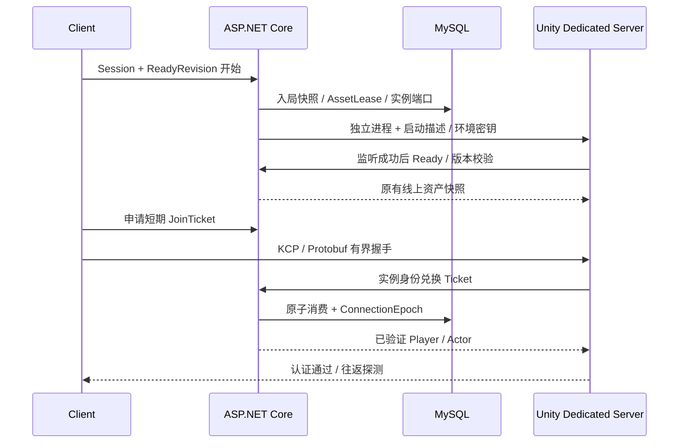

# Norn 联机系统开发解析（更新中）

> 整体状态：进行中。本文以 Visual Studio 的图形界面为例讲解手动搭建；菜单名可能随语言和版本略有变化。现有项目已经搭好，下面的“从零创建”是复现教程，不要求你在原目录重复创建或覆盖工程。

> 最新进度（2026-10-23）：N0、N1、N2本地阶段完成。N2最终结果与清理见本文末尾第4节及`docs/superpowers/evidence/multiplayer/n2-final/{acceptance,cleanup}.json`；58业务/91相关EditMode/6玩家路径PlayMode和两份可见原生Client通过。主菜单登录→据点F匹配→准备/队长开始→独立DS认证连接区已连通，仍没有权威角色与战斗。用户集中确认N2后才进入N3。加密分配、两条native启动错误、Linux/公网/IL2CPP/D3D12未通过。下方各Task的“当前”与不可用提示均代表当时状态，本段与末尾总表优先。

如果先想弄明白 Mirror、副本服、Class Library、Test 项目等基础概念，请先读独立的[双端开发基础指南](<F:/Develop Project/RPG/RPG/Assets/_Project/Docs/2026-10-21 双端开发基础指南（是什么、为什么、怎么操作）.md>)。本文件继续记录每个 Task 的实现、文件变化和验证证据。

> 2026-10-21 文档与协议排版补充：新增上述基础指南，按“是什么、为什么、怎么操作”讲解双端技术与 IDE/Editor 操作。`common.proto` 参考旧 MyMMO 的分区格式整理，字段/枚举值注释放在分号后，长篇原理转入指南；从 Schema 重新生成 `Common.cs`，没有手改生成代码。修改前后不含源码位置信息的 Schema Descriptor SHA-256 相同，业务测试 10/10 通过，生成可重复性校验通过。本次未重新运行 Unity Player 构建、KCP 多进程或 Profiler，不增加这些方面的验收结论；证据见 `docs/superpowers/evidence/multiplayer/proto-comment-format-2026-10-21/`。

## Task N0-1：业务服、共享协议和两端工程引用

本 Task 要解决的是“不同程序怎样理解同一条消息”。当前单机 Demo 仍由 Unity 运行；我们另外建立一个能够独立启动的业务服，再定义一组共享消息，让业务服与 Unity 使用相同的消息结构。这样，后面添加登录、组队和副本入口时，才能明确区分：程序是否启动、请求是否到达、数据是否能解析、版本是否兼容、业务是否允许执行。这些层次各有自己的错误，单纯看到项目编译成功，并不能证明通信已经完成。

我们保留已经确认的 `RPG / Server / Shared` 同级目录。`Server` 放 ASP.NET Core 业务服，`Shared` 放双方都能使用的纯 C# 消息契约，现有 `RPG` 是 Unity 工程，将来从它构建 Client 和 Dedicated Server 两种程序。协议项目不引用 UnityEngine，也不拥有账户、背包或战斗状态，因此业务服不需要安装或启动 Unity 就能使用这些消息。当前只完成基础 HTTP/Protobuf 链路与 Unity 内的协议验证；没有实现登录、MySQL、KCP、房间或真正的多人副本。

阅读时先区分“项目模板”“库”和“工具”：ASP.NET Core 是运行 Web 服务的框架，Class Library 是供其他程序调用的代码项目，Protobuf 是消息定义与序列化方案，protoc 是开发时生成代码的工具。它们处于不同层次。知道这几个对象各自负责什么，才能独立搭建，而不只是照着已有目录复制文件。

### 1. 三个项目是什么，共享库为什么不选 ASP.NET Core

当前已有三个 **.NET 项目**，并不意味着已经有三个服务器进程。Unity 工程也不是这三个项目之一。

| 项目 | 创建时选择的模板/类型 | 目标 | 最终用途 |
|---|---|---|---|
| `Norn.Business` | ASP.NET Core Empty，C# | `net10.0` | 有 `Program.Main`，启动 Web 服务，接收业务请求 |
| `Game.NetworkProtocol` | C# Class Library | `netstandard2.1` | 提供消息类型和版本约束；被业务服和 Unity 使用，本身不监听端口 |
| `Norn.Business.Tests` | xUnit Test Project，C# | `net10.0` | 由 Test Runner 运行，验证 HTTP 入口和错误处理 |

**共享库不是 ASP.NET Core 项目。** Class Library 编译后提供可被引用的程序集，没有业务服务入口；ASP.NET Core 项目在 C# 基础上加入 HTTP Hosting、Routing、Middleware、Dependency Injection 等能力，运行时会有独立进程。两者都能使用 C#，也都可以调用 Protobuf，但职责不同。把共享消息做成 Web 项目会引入无关框架依赖，并不能让消息“更能联网”。

```text
F:\Develop Project\RPG\
├─ RPG\                                    Unity 工程
│  ├─ Assets\ThirdParty\Networking\         Unity 使用的 Protobuf Runtime DLL
│  ├─ Assets\_Project\Editor\Networking\    Unity 验证菜单
│  └─ Packages\                             引用 Shared 的本地 Package
├─ Server\
│  ├─ Norn.Online.sln                        Solution：管理项目的入口
│  ├─ Norn.Business\                        可运行的业务服
│  └─ Norn.Business.Tests\                  集成测试
└─ Shared\Protocol\
   ├─ Game.NetworkProtocol.csproj            .NET 对共享源码的编译配置
   ├─ package.json                          Unity 对同一份源码的包描述
   ├─ Protos\common.proto                   人编写的消息定义
   ├─ Runtime\ProtocolCompatibility.cs      人编写的版本/预算约束
   ├─ Runtime\Generated\Common.cs           protoc 生成，人工不修改
   ├─ Runtime\Game.NetworkProtocol.asmdef   Unity 的程序集边界
   └─ Tools\protoc\34.2\bin\protoc.exe       开发时的消息编译器
```

`.sln` 像 IDE 中的项目目录册，不决定源文件必须放在哪个磁盘目录。`.csproj` 决定 .NET 编译哪些源码、针对什么 API、引用什么库；`.asmdef` 则决定 Unity 怎样划分和引用程序集。它们可以描述同一份 C# 源码，但由各自的构建系统读取。

共享项目由 .NET 编译时会产生 `Game.NetworkProtocol.dll`。Unity 当前采用本地 UPM **源码引用**，自己编译 `Runtime` 中的同一份源码，所以不要再把这个第一方 DLL 复制到 Unity。`Google.Protobuf.dll` 是另外一个第三方 Runtime，仍需要给 Unity 导入。

### 2. 版本分别是什么意思，为什么这样选

| 层次 | 本工程固定版本 | 选择原因与边界 |
|---|---|---|
| Unity Editor | `6000.3.16f1` | 沿用现有项目，避免为联机基础改动引擎 |
| URP | `17.3.0` | 沿用项目渲染依赖，与消息序列化无关 |
| .NET SDK | `10.0.402` | 用于编译/测试/发布 .NET 项目；当前工程固定此版本 |
| .NET / ASP.NET Core Runtime | `10.0.13` | 业务服使用 .NET 10 LTS 系列；SDK 版本与 Runtime 补丁号不同 |
| 共享库目标 | `.NET Standard 2.1` | 约束可调用 API，兼顾当前 Unity 与 .NET 10；它是 API 标准，没有独立的 LTS Runtime |
| 共享源码语言约束 | C# `9.0` | 限制手写代码使用双方可接受的语言特性，避免只在新 .NET 编译器中可用 |
| Protobuf C# Runtime | `Google.Protobuf 3.34.2` | .NET 和 Unity 对齐的已验证基线，不代表最新发行版 |
| Protobuf 编译器 | `protoc 34.2` | 与上述 C# Runtime 对应，生成器和库的版本编号形式不同 |
| Unity 的 Protobuf 补充依赖 | `System.Runtime.CompilerServices.Unsafe 6.1.2` | N0-2 实际 Unity 测试发现 ASCII 路径需要此独立程序集；NuGet 版本与程序集版本 `6.0.0.0` 不同，不能依赖 Editor 插件替 Player 提供 |
| 测试库 | xUnit `2.9.3`、Test SDK `18.11.0`、Adapter `4.0.1`、Mvc.Testing `10.0.13` | 当前固定组合，测试包不套用 .NET 的 LTS 标签 |
| 自己的项目/Package | `0.1.0` | 我们给自己工程的版本，不是第三方框架版本 |
| 应用协议版本 | `1` | 我们定义的消息兼容版本，不是 Protobuf 的版本 |

所以，“所有依赖都是官方最新 LTS”这个说法不成立：不同组件采用不同发布和支持方式。我们选择可复现、两端已验证的组合；升级时需要重新检查生成器、Runtime、Unity 插件兼容和测试，而不是只改一个 NuGet 数字。

当前验证使用放在 Unity 工程 `.tools/dotnet` 下的私有 SDK，系统原有 SDK 没有被替换。**私有 SDK 可用，不等于 Visual Studio 已自动识别它。** 如果你要通过 IDE 自己构建，打开 Visual Studio Installer，安装/更新到官方支持 .NET 10 的 Visual Studio，勾选“ASP.NET 和 Web 开发”工作负载，并在“单个组件”检查 .NET 10 SDK。现有 `Server/global.json` 还限制 SDK 选择；遇到版本不满足时先核对它和 IDE 实际可用 SDK，不要直接删除限制。

版本来源可查看 [.NET 10 下载页](https://dotnet.microsoft.com/en-us/download/dotnet/10.0)、[当前固定 Protobuf NuGet 版本](https://www.nuget.org/packages/Google.Protobuf/3.34.2)、[对应 protoc Release](https://github.com/protocolbuffers/protobuf/releases/tag/v34.2)。这些页面用于查看来源，不要求现在升级。

### 3. 在 Visual Studio 中从零创建三个项目

**先建立 Solution，再创建可运行项目。** 在 Visual Studio 选择“创建新项目”，搜索 `Blank Solution / 空白解决方案`，名称填 `Norn.Online`，保存位置安排为 `F:\Develop Project\RPG\Server`。不同模板会自动附加同名文件夹，创建前看最终路径；目标是让 `Norn.Online.sln` 直接位于 `Server`，避免多嵌套一层 `Server/Norn.Online`。如果只是打开现有工程，直接用“打开项目或解决方案”选择已有 `.sln`，不用重建。

在 Solution Explorer 右键 Solution → `Add / 添加` → `New Project / 新建项目`，搜索并选择 **ASP.NET Core Empty**。项目名称填 `Norn.Business`，位置指向 `Server`，Framework 选择 `.NET 10.0`。这个阶段不启用 Docker、身份验证或额外示例服务；我们先理解最少的启动和 HTTP 处理。模板可能带一个默认根路径响应，实际工程的端点定义以 `FoundationEndpoints.cs` 为准。

**再创建共享 Class Library。** 再次“添加新项目”，选择 C# Class Library，名称填 `Game.NetworkProtocol`，把项目位置安排为 `F:\Develop Project\RPG\Shared\Protocol`。检查预览，最终 `.csproj` 应直接在这个目录，避免自动多出同名子目录。不要选 `Class Library (.NET Framework)`。如果模板没有 `.NET Standard 2.1` 选项，先创建现代 C# Class Library，再右键项目 → `Edit Project File / 编辑项目文件`，将 `TargetFramework` 改为 `netstandard2.1`；这一步是编辑配置，不需要重新创建项目。

模板自带的 `Class1.cs` 没有业务意义，删掉它。在共享项目下右键 →“添加”→“新建文件夹”，建立 **`Protos`、`Runtime`、`Runtime/Generated`**。正式项目的主要编译设置如下：

```xml
<Project Sdk="Microsoft.NET.Sdk">
  <PropertyGroup>
    <!-- 这是可调用 API 的范围，不是给共享库启动一个 Runtime。 -->
    <TargetFramework>netstandard2.1</TargetFramework>
    <Version>0.1.0</Version>
    <LangVersion>9.0</LangVersion>
    <Nullable>disable</Nullable>
    <!-- 主动限定源码范围，避免把包里的工具或临时源码也编进来。 -->
    <EnableDefaultCompileItems>false</EnableDefaultCompileItems>
    <RestorePackagesWithLockFile>true</RestorePackagesWithLockFile>
    <TreatWarningsAsErrors>true</TreatWarningsAsErrors>
  </PropertyGroup>
  <ItemGroup>
    <Compile Include="Runtime/**/*.cs" />
    <PackageReference Include="Google.Protobuf" Version="3.34.2" />
  </ItemGroup>
</Project>
```

这段配置中 `PackageReference` 是安装 NuGet 包后形成的引用，获取方法见下一节。`EnableDefaultCompileItems=false` 后必须保留 `Compile Include`，否则你虽然看得到 `.cs` 文件，构建时却没有把它们编入程序集。

在首次构建共享项目之前，还应在 `.csproj` 同级通过“添加新项 → 文本文件”建立 `Directory.Build.props`，内容如下。它让 .NET 的中间源码和输出留在包目录之外；否则 Unity 可能把 `obj` 中自动生成的程序集信息当作包源码再次编译，产生重复定义。文件名是 MSBuild 的约定，放对目录就会在项目构建前被读取，不需要 C# 主动加载它。

```xml
<Project>
  <PropertyGroup>
    <!-- 路径从当前配置文件所在目录出发；输出集中在 Server，不进入 Unity 源码包。 -->
    <BaseIntermediateOutputPath>$(MSBuildThisFileDirectory)../../Server/.artifacts/Protocol/obj/</BaseIntermediateOutputPath>
    <BaseOutputPath>$(MSBuildThisFileDirectory)../../Server/.artifacts/Protocol/bin/</BaseOutputPath>
  </PropertyGroup>
</Project>
```

如果共享项目是从另一个 IDE 窗口独立创建的，回业务 Solution 右键 →“添加”→“现有项目”，选择 `Shared/Protocol/Game.NetworkProtocol.csproj`。**加入 Solution 只是让 IDE 管理它；还没有让业务服引用它。** 接着右键 `Norn.Business` 的“依赖项/Dependencies” →“添加项目引用/Add Project Reference” →“项目/Projects” → 勾选 `Game.NetworkProtocol` → 确定。源码仍留在 Shared，不会被搬进 Server。

最后在 Solution 中“添加新项目”，选择 `xUnit Test Project`，名称 `Norn.Business.Tests`，保存在 `Server` 下，Framework 选 `.NET 10.0`。在测试项目“添加项目引用”，勾选 `Norn.Business`。测试会沿业务项目引用链得到共享类型；无须复制一份消息源码到测试目录。

### 4. Protobuf 到哪里找，怎么装进 .NET

Protobuf 涉及三件不同的东西，不能只安装一个包就默认全部完成：

| 对象 | 从哪里来 | 安装/放在哪里 | 负责什么 |
|---|---|---|---|
| `.proto` Schema | 由开发者编写 | `Shared/Protocol/Protos` | 约定消息字段、类型、编号 |
| `protoc.exe` | 官方 GitHub Release 的编译器压缩包 | `Shared/Protocol/Tools/protoc/34.2` | 开发时把 Schema 生成 C# |
| `Google.Protobuf` Runtime | 官方 NuGet 包 | .NET 项目通过 NuGet 引用；Unity 导入兼容 DLL | 程序运行时执行编码、解码、反射和 ProtoJSON |

**给 .NET 安装 Runtime：** 在 Solution Explorer 右键 `Game.NetworkProtocol` 项目 → `Manage NuGet Packages / 管理 NuGet 程序包` → `Browse / 浏览`。Package Source 选 `nuget.org`，搜索完整名称 `Google.Protobuf`，确认包链接对应上表的官方 NuGet 页面；版本下拉框选 `3.34.2`，点击“安装”，按提示确认。完成后展开项目 `Dependencies → Packages`，应看到对应版本。这里必须选择项目，不是对某个 `.cs` 文件安装库。[NuGet 官方 GUI 安装说明](https://learn.microsoft.com/en-us/nuget/consume-packages/install-use-packages-visual-studio)

业务项目当前也直接调用 `ToByteArray`、`JsonFormatter` 等 Runtime API，因此它也显式引用 `Google.Protobuf`。当前 Server 使用 `Directory.Packages.props` 集中管理版本：这个文件保存版本，业务 `.csproj` 中仅保留包名。共享项目位于 Server 目录之外，自己显式固定版本。GUI 修改依赖后要检查这些文件，确保两边仍是 `3.34.2`；不要在启用 Central Package Management 的业务 `PackageReference` 上再添加一个 `Version`，那会和集中配置冲突。

从零复现这项集中设置时，在 Visual Studio 中右键 Solution →“添加 → 新建项 → 文本文件”，把文件保存为 `Server/Directory.Packages.props`，不是某个业务子目录下的同名文件。设置 `ManagePackageVersionsCentrally=true` 后，NuGet 从这里读取版本；例如下面是正式文件中 Protobuf 设置的摘录，完整文件还包含测试库版本，不要用摘录覆盖整个文件：

```xml
<Project>
  <PropertyGroup>
    <!-- Server 下的项目共用版本；外面的 Shared 不在这个目录的管理范围内。 -->
    <ManagePackageVersionsCentrally>true</ManagePackageVersionsCentrally>
  </PropertyGroup>
  <ItemGroup>
    <PackageVersion Include="Google.Protobuf" Version="3.34.2" />
  </ItemGroup>
</Project>
```

对应业务 `.csproj` 只写 `<PackageReference Include="Google.Protobuf" />`。共享 `.csproj` 则保留上一节带版本的写法。这个配置的意义是集中约束 Server 中多个项目的依赖，并不是通过 Solution 把所有磁盘目录都纳入管理。

测试项目通过同一个 NuGet 界面安装/核对 `Microsoft.AspNetCore.Mvc.Testing`、`Microsoft.NET.Test.Sdk`、`xunit` 和 `xunit.runner.visualstudio`，版本见第 2 节。前者用于搭建真实 ASP.NET Core 请求处理管线的测试宿主，后几项负责识别和运行 xUnit 测试。ASP.NET Core 项目本身由 Web SDK 引入框架支持，不要再寻找一个“ASP.NET Core 共享库包”替代项目模板。

**获取生成器：** 浏览器打开 [protobuf v34.2 官方 Release](https://github.com/protocolbuffers/protobuf/releases/tag/v34.2)，展开 `Assets`，选择 Windows x64 编译器压缩包 `protoc-34.2-win64.zip`，不是 Source code 压缩包。用资源管理器解压到 `Shared/Protocol/Tools/protoc/34.2`，检查里面有 `bin/protoc.exe` 和 `include/google/protobuf`。后者提供官方内置 Schema，当前简单消息还没用到，但以后导入 `Timestamp` 等类型时会需要。

只安装 `Google.Protobuf` NuGet 包，并不会为当前工程自动执行 `.proto → C#`。有些教程使用 `Grpc.Tools` 让构建时生成代码，那是另一种工具集成方式；Protobuf 不要求使用 gRPC。我们采用固定的独立 protoc，把生成结果放在唯一目录，让 .NET 与 Unity 编译同源文件。Trade-off 是改完 Schema 后要显式生成一次，优点是 Unity 无需执行 .NET 专属的生成步骤。

### 5. 怎样写 `.proto`，每个定义的作用是什么

在共享项目 `Protos` 文件夹右键 →“添加”→“新建项”→“文本文件”，命名 `common.proto`。没有 Protobuf 模板或语法高亮也能写，后缀必须是 `.proto`，不能变成 `.proto.txt`。现有文件是全部基础消息的正式定义；下面摘取请求消息说明语法，不能用这个摘录覆盖完整文件：

```proto
syntax = "proto3";                              // 普通标量有缺省值。
package norn.protocol;                           // Protobuf 逻辑命名空间。
option csharp_namespace = "Game.NetworkProtocol"; // 生成 C# 的 namespace。

// 基础连通性探测请求，不代表登录成功，也不携带线上资产权威。
message ProtocolPingRequest
{
    uint32 protocol_version = 1; // 应用协议版本，0 必须拒绝。
    uint64 sequence         = 2; // 请求关联序号，响应原样带回。
    string message          = 3; // UTF-8 文本，当前最多 256 字节。
}
```

`message` 定义数据结构，生成后得到 C# 类型 `ProtocolPingRequest`；`uint32` 对应 `uint`，`uint64` 对应 `ulong`，`string` 对应 C# `string`。字段 `protocol_version` 会生成属性 `ProtocolVersion`。

等号右侧的 `1/2/3` 是 **Field Number**，不是字段值或默认值。Protobuf 二进制根据编号识别字段，所以发布后不能把原来编号 2 的“请求序号”改成“玩家金币”。删除字段后应使用 `reserved` 保留其编号，并考虑保留旧名称，避免以后误复用。新增字段也要检查两端兼容；能够解析旧消息不代表旧客户端理解新业务。

当前 `common.proto` 还包含：`ProtocolPingReply`（探测回复）、`ProtocolErrorCode`（机器读取的错误分类）、`ProtocolError`（错误详情及期望协议版本）、`ServiceInfoReply`（服务身份及版本）。每个字段和枚举值都已补上中文注释。枚举的 `0` 值是 `Unspecified`，用于表示未指定，不能把它理解成业务成功。

Schema 只描述结构，不自动限制消息字节数、登录身份或伤害数值是否合理。`protocol_version=1` 也只是客户端传来的声明，不能代替认证。必须由接收方进一步校验。我们把这些约束写在 `ProtocolCompatibility` 与 HTTP 入口中，后续玩法校验仍归相应权威服务。

### 6. 不打开终端，怎样把 `.proto` 生成 C#

`protoc.exe` 是接受参数的编译器，没有自己的消息编辑窗口。双击它不会让你选择文件并完成生成。可以通过 Visual Studio 的 **External Tools** 给它做一个菜单入口，之后从菜单点击生成。[Visual Studio 官方 External Tools 说明](https://learn.microsoft.com/en-us/visualstudio/ide/managing-external-tools?view=visualstudio)

先在资源管理器确认 `Runtime/Generated` 文件夹存在。然后在 Visual Studio 打开 `Tools / 工具 → External Tools / 外部工具 → Add / 添加`，按下面填写当前工程的设置：

| 对话框字段 | 填写内容 | 为什么 |
|---|---|---|
| Title / 标题 | `Norn - Generate Shared Protocol` | 以后菜单显示的名称 |
| Command / 命令 | `F:\Develop Project\RPG\Shared\Protocol\Tools\protoc\34.2\bin\protoc.exe` | 选择已下载的编译器文件，可用浏览按钮 |
| Arguments / 参数 | 见下方文本 | 指明输入根目录、输出目录和要处理的 Schema |
| Initial directory / 初始目录 | `F:\Develop Project\RPG\Shared\Protocol` | 工具运行时的工作目录 |
| Use Output window / 使用输出窗口 | 勾选 | 在 IDE 里查看生成错误 |

把下面一整行填入 **Arguments 参数输入框**：

```text
--proto_path="F:\Develop Project\RPG\Shared\Protocol\Protos" --csharp_out="F:\Develop Project\RPG\Shared\Protocol\Runtime\Generated" "F:\Develop Project\RPG\Shared\Protocol\Protos\common.proto" "F:\Develop Project\RPG\Shared\Protocol\Protos\lab.proto"
```

路径中的引号用于保留 `Develop Project` 里的空格。`--proto_path` 是查找 Schema 的根目录，`--csharp_out` 是输出目录，最后一项是本次输入文件。以后拆成多个 `.proto` 时，要把需要生成的文件明确加入参数，不能以为这个入口会自动扫描全部 Schema；使用官方内置类型时，还需要增加对应 `include` 搜索路径。

保存设置后，选择 `Tools → Norn - Generate Shared Protocol`。成功时检查 `Runtime/Generated/Common.cs` 是否已更新；生成器成功可能没有文字输出，所以不能只看输出窗口是否为空。如果有错误，根据输出中的文件和行号改 `.proto`，再重新生成。`Common.cs` 开头带有自动生成标记，其中包含字段属性、`Parser`、编码方法与 Descriptor。

**只维护 `.proto`，不要人工修改 `Common.cs`。** 注释也优先写在 Schema，让 protoc 带进生成源码；否则下一次生成会覆盖人工修改。IDE 中安装语法高亮插件只能改善编辑体验，不能代替生成器。当前共享项目构建会编译已经生成的 `.cs`，不会因为 `.proto` 保存了就自动执行这一步。

### 7. 在 C# 里怎样使用 Protobuf，它怎样参与网络通信

从 `common.proto` 生成 C#，再成功安装 Runtime 后，就可以在引用共享项目的代码里使用消息。下面仅演示内存中的编码/解码，不会建立任何网络连接。`using` 放在 C# 文件顶部，其余语句放进一个现有方法或测试方法中；不要把它当作共享库的 `Program.Main`：

```csharp
using Game.NetworkProtocol;
using Google.Protobuf;

// 生成类保存一次请求的数据；版本与序号是业务约定，不由 Protobuf 自动填写。
ProtocolPingRequest request = new ProtocolPingRequest
{
    ProtocolVersion = ProtocolCompatibility.CurrentVersion,
    Sequence = 42,
    Message = "你好，Norn"
};

// Serialization：把 C# 消息编码成可交给 HTTP/KCP 的字节。
byte[] payload = request.ToByteArray();

// Deserialization：已知消息类型之后，用对应 Parser 恢复字段。
// 真实接收入口要先检查大小，并捕获畸形数据引起的解析异常。
ProtocolPingRequest decoded = ProtocolPingRequest.Parser.ParseFrom(payload);

// 结构能解析不等于业务能接受；协议版本等规则由接收方检查。
bool isCompatible = ProtocolCompatibility.IsSupported(decoded.ProtocolVersion);
```

Protobuf 负责 **对象 ↔ 字节**，HTTP 或未来 KCP 负责传输这些字节。二进制本身不会自动告诉你“该分发给登录还是聊天处理器”：当前使用 HTTP 路径选择消息类型，例如 `/api/system/ping` 的请求按 `ProtocolPingRequest` 解析；未来实时通道还需要明确的消息类型标识、分发、连接状态与安全边界，不能认为用了 Protobuf 就已经有消息分发系统。

本工程的真实请求链为：HTTP 请求 → ASP.NET Core 路由 → 检查 Content-Type 和字节预算 → `ProtocolPingRequest.Parser` → 校验应用协议版本与 UTF-8 文本预算 → 建立 `ProtocolPingReply` → `ProtobufHttpResult` 编码 → HTTP 响应。错误时返回正确的 HTTP 状态和 `ProtocolError`，例如版本冲突为 409、请求过大为 413、格式不支持为 415。HTTP 状态用于传输入口层，错误枚举用于程序识别具体原因，不能只返回一个看起来正常的 200。

`ServiceInfoReply` 通过 `JsonFormatter` 输出 ProtoJSON，方便浏览器查看。ProtoJSON 是 Protobuf 自己定义的 JSON 映射，尤其 `uint64` 通常表示成字符串，以免 JavaScript 数值精度丢失；不要任意替换成普通 JSON 序列化后假设含义完全一样。二进制 Ping 则设置 `application/x-protobuf`，浏览器地址栏发送 GET 并不能完成这个 POST 测试。[官方 C# 使用教程](https://protobuf.dev/getting-started/csharptutorial/)

`ToByteArray()` 在这个离散演示中会分配数组，它不是未来每帧实时通信的零分配实现。当前示例的 1024 字节总量和 256 字节文本限制也是 Ping 专用预算，不是今后所有背包/快照消息的统一大小。

### 8. 怎样把共享消息和 Protobuf Runtime 导入 Unity

**第一步，导入 Runtime DLL。** Unity 不会因为 .NET 项目装了 NuGet 就自动获得同一个包。浏览器打开第 2 节的 `Google.Protobuf 3.34.2` NuGet 页面，在包下载入口获取 `.nupkg`；它本质是 ZIP 格式，可用支持它的解压工具打开，或将下载副本改成 `.zip` 后解压。找到 `lib/netstandard2.0/Google.Protobuf.dll`，通过资源管理器复制或拖拽到 Unity 工程的 `Assets/ThirdParty/Networking/Protobuf`。同时保留包版本、来源说明和许可证，便于之后排查。只取适用的程序集，不要把整个 NuGet 包和多套 Framework DLL 全部拖进 Assets。

这里 DLL 选 `netstandard2.0` 与我们的共享库选 `netstandard2.1` 不矛盾：2.0 的依赖可供支持 2.1 API 的使用方引用，不意味着应该导入 NuGet 中的 `net5.0` 版本。选中 DLL 查看 Inspector，当前工程按 Runtime 用途启用 Editor/目标平台，并通过 Auto Reference 与 asmdef 配置解析依赖。Unity 自己生成和维护 `.meta`。

还需要导入 [System.Runtime.CompilerServices.Unsafe 6.1.2 官方包](https://www.nuget.org/packages/System.Runtime.CompilerServices.Unsafe/6.1.2)：同样下载 `.nupkg`、解压，取 `lib/netstandard2.0/System.Runtime.CompilerServices.Unsafe.dll` 放到上述 Protobuf 目录，并保留许可证与来源。这个依赖在 N0-2 的真实 Unity ASCII 编码测试中发现缺失；之前只测试中文路径不足以发现它。Unity 自带 Span/Memory 相关 API，不代表自带这个独立程序集，不要把 System.Memory 等另一整套 BCL 一起复制进来。当前固定的 Unsafe Runtime 仍需在原 Editor 重载与独立 Player 中分别验证，不能由“Editor 某个插件已经携带”推导出构建产物一定可用。

**第二步，将 Shared 注册成本地 UPM Package。** 在资源管理器打开 `Shared/Protocol`，建立 `package.json` 文本文件；当前内容可以直接参考正式文件，关键字段如下：

```json
{
  "name": "com.norn.network-protocol",
  "version": "0.1.0",
  "displayName": "Norn Network Protocol",
  "unity": "6000.3"
}
```

在 Unity 打开 `Window → Package Management → Package Manager`，从“添加”菜单选择 `Install package from disk / Add package from disk`，定位到 `Shared/Protocol/package.json`。选的是这个 JSON 文件，不是 `.csproj` 或整个 Server。界面名称可能随 Editor 版本略有差异，核心是从磁盘安装本地 Package。[Unity 官方操作](https://docs.unity3d.com/6000.3/Documentation/Manual/upm-ui-local.html)

当前 `Packages/manifest.json` 已使用相对地址 `file:../../Shared/Protocol` 记录该包。保留相对布局有助于换电脑恢复；如果通过界面导入后得到本机绝对地址，可在保留其他依赖的前提下对照现有项检查。只备份 Unity 仓库不会自动包含旁边的 Shared 和 Server，三者都要备份。

**第三步，建立/核对程序集边界。** 在 Unity Project 窗口展开本地 Package，选中 `Runtime` 文件夹，右键 `Create → Scripting → Assembly Definition`（部分版本在 Create 下直接显示 Assembly Definition），名称填 `Game.NetworkProtocol`。选中 `.asmdef` 后在 Inspector 勾选 `No Engine References`，避免协议库引用 UnityEngine；取消 `Auto Referenced`，让使用方明确声明依赖。勾选 `Override References`，在 `Assembly References` 中添加 `Google.Protobuf.dll`，再点击 `Apply`。这对应当前正式 `.asmdef` 的配置。

需要使用消息的程序集，在自己的 `Assembly Definition References` 列表点击 `+`，选入 `Game.NetworkProtocol` 并 Apply；直接使用第三方 API 的代码也要能解析 `Google.Protobuf`，若该程序集启用了 Override References，就在它的预编译程序集列表中显式添加该 DLL。不要为了方便把整个游戏模块接到业务服，或让共享库反向引用 Unity 玩法代码。

当前工程的 AI Assistant 包还内置了较旧的 Editor 用 Protobuf。现有验证菜单会检查**实际加载**的版本是否为 `3.34.2.0`，所以不仅要看 Assets 里有什么文件。发生重复类型、程序集冲突时，先查实际 DLL 与插件配置，不要随意修改 `Library/PackageCache`；也不要再导入一份 `Game.NetworkProtocol.dll`。

### 9. 怎样构建、启动、测试，以及当前到底验收了什么

在 Visual Studio 打开现有 `Server/Norn.Online.sln`，先用 `Build / 生成 → Build Solution / 生成解决方案`，查看 Error List 和 Output。它只把源码编译成产物，不会自动让服务器持续运行。

右键 `Norn.Business` → `Set as Startup Project / 设为启动项目`，选择项目运行配置，点击启动按钮或“开始执行（不调试）”。本机配置的监听地址为 `http://127.0.0.1:5080`；以进程实际输出为准，新模板可能有 `launchSettings.json` 覆盖端口，需要在项目调试配置中核对。进程运行后，浏览器访问 `/health/live` 应看到 `alive`，访问 `/api/system/info` 可查看服务信息。停止调试或关闭自己启动的服务进程后，这些地址就不再由它响应。共享 Class Library 不应设为启动项目。

打开 `Test / 测试 → Test Explorer / 测试资源管理器`，构建后点击“运行全部测试”。`WebApplicationFactory<Program>` 用测试宿主执行真正的路由、消息解析与响应，不需要你提前另外启动业务服，也不等于验证了独立 Linux 进程。当前测试包括中文/大序号往返、缺省/错误协议版本、截断数据、已知/未知长度的超大请求、UTF-8 预算和错误 Content-Type 等，共 10 个用例。

Unity 中等待编译完成后，点击 `Tools → Norn → Online → Verify Shared Protocol`。它验证 Unity 内的二进制与 ProtoJSON 往返、实际 Runtime 版本以及协议程序集没有 UnityEngine 引用，不会启动业务服或连接 KCP。你在 2026-10-20 23:12:46 已手动通过这项验证，归档报告记录 `6000.3.16f1`、`Google.Protobuf 3.34.2.0` 和协议版本 `1`。

当前已取得的证据包括：.NET Release 构建、10 个集成测试、独立 Kestrel 进程 HTTP/Protobuf 检查、依赖锁定恢复、发布产物收集，以及上述 Unity Editor 验证。**未验收** Dedicated Server 构建、Linux 运行、KCP 多人、MySQL 事务与 Profiler/GC。不要由“共享协议包验证通过”推导出“联机系统已经完成”。

以后部署前可右键业务项目 → `Publish / 发布` → 选择文件夹目标收集部署文件。Publish 只是整理产物，Linux 目标和 Runtime 供应方式仍要单独选择和验证；文件夹生成成功不等于已经部署到远端。开发阶段继续本机运行，不需要现在租服务器。

日常修改顺序是：修改 `.proto` 及其注释 → 点击 IDE 中配置的生成菜单 → 构建 Solution → Test Explorer 运行测试 → 等 Unity 编译 → 点击共享协议验证菜单。Protobuf 依赖升级还要同步检查 NuGet、Unity DLL、protoc 与版本锁定记录。

### 10. 现有代码怎么读，出错时先查哪里

下表中的路径均相对于外层 `F:\Develop Project\RPG`。其中前三个是 .NET 项目，后面的配置/脚本各有自己的归属。

| 文件 | 责任、技术及阅读重点 |
|---|---|
| `Server/Norn.Online.sln` | Solution 管理业务、共享和测试项目；不移动源码 |
| `Server/global.json` | 固定 SDK 选择；IDE 找不到指定 SDK 时先检查这里 |
| `Server/Directory.Packages.props` | Central Package Management，统一 Server 范围的 NuGet 版本 |
| `Server/Norn.Business/Norn.Business.csproj` | Web SDK、net10.0、共享 ProjectReference 与包引用 |
| `Server/Norn.Business/Program.cs` | 入口装配：CreateBuilder → Kestrel 限制 → Build → 映射端点 → Run；不在入口堆积业务规则 |
| `Server/Norn.Business/Bootstrap/FoundationEndpoints.cs` | 三个基础 HTTP 入口；异步限量读取、池化缓冲区、解析和版本检查 |
| `Server/Norn.Business/Bootstrap/ProtobufHttpResult.cs` | IResult 统一写 HTTP 状态、Content-Type 和 Protobuf 字节，允许离散请求分配 |
| `Server/Norn.Business/appsettings.json` | 本地监听和日志等配置；当前没有额外的 Development 覆盖文件，不在受版本管理的配置里保存密码 |
| `Server/Norn.Business.Tests/Norn.Business.Tests.csproj` | 测试目标、业务项目引用和测试依赖 |
| `Server/Norn.Business.Tests/FoundationEndpointsTests.cs` | xUnit + WebApplicationFactory 验证 HTTP 行为；自定义未知长度请求验证读取上限 |
| `Shared/Protocol/Game.NetworkProtocol.csproj` | Class Library；仅编译 Runtime 源码，固定兼容目标 |
| `Shared/Protocol/Directory.Build.props` | 提前把 .NET bin/obj 输出移到 Server 的产物目录，避免 Unity 把中间生成源码吸入包 |
| `Shared/Protocol/package.json` | 同一源码给 Unity 使用的 UPM 元数据，不会启动服务 |
| `Shared/Protocol/Runtime/Game.NetworkProtocol.asmdef` | Unity 程序集边界及第三方引用，禁用 UnityEngine 依赖 |
| `Shared/Protocol/Runtime/ProtocolCompatibility.cs` | 应用协议版本、Ping 字节预算；默认版本 0 不合法 |
| `Shared/Protocol/Protos/common.proto` | 唯一 Schema；消息、字段与兼容规则从这里维护 |
| `Shared/Protocol/Runtime/Generated/Common.cs` | protoc 生成类型；由两边各自的编译器编译，人工不改 |
| 各 .NET 项目的 `packages.lock.json` | 固定完整依赖解析结果，避免只有直接版本一样而间接依赖不同 |
| `RPG/Assets/ThirdParty/Networking/Protobuf` | Unity 实际使用的第三方 Runtime 与来源说明 |
| `RPG/Packages/manifest.json`、`packages-lock.json` | 本地 UPM 引用与 Unity 解析结果；锁文件由 Unity 维护 |
| `RPG/Assets/_Project/Editor/Networking/OnlineFoundationTools.cs` | 归属 Game.Project.Editor；菜单验证与报告输出，不进入客户端热路径 |
| `RPG/Assets/_Project/Editor/Game.Project.Editor.asmdef` | 使既有 Editor 程序集能引用共享消息 |
| `RPG/Tools/Networking/dependency-lock.json` | 本阶段工具、Runtime 及候选依赖的固定记录；候选不代表已经安装 |
| 三个仓库的 `.gitignore`、README | 区分源码、生成产物、缓存和秘密配置，说明独立备份边界 |

读取实现时，先看 `common.proto → ProtocolCompatibility.cs → Program.cs → FoundationEndpoints.cs → ProtobufHttpResult.cs → FoundationEndpointsTests.cs`。在 HTTP 入口中，`ArrayPool` 的数组必须在 `finally` 归还；即使检查失败提前 return，也不能泄漏租用缓冲。实际解析只使用已读取长度，不能把池中数组的多余空间一起当作消息。结构解析成功后仍须校验版本和业务预算，这是“数据格式”和“业务可信”之间的边界。

| 症状 | 先检查的证据 | 不宜直接采取的处理 |
|---|---|---|
| IDE 无法构建 net10.0 | SDK 安装、IDE 支持、global.json、Error List | 删除 SDK 锁定或随意改 TargetFramework |
| 找不到 Google.Protobuf 类型 | 对应项目 Dependencies 与 NuGet Restore 错误 | 从不明来源下载另一个 DLL |
| 新字段没有生成属性 | Schema 是否保存、protoc 是否成功、Common.cs 修改时间 | 直接手改生成 C# |
| Unity 缺共享消息/重复类型 | UPM 路径、asmdef 引用、是否重复导入第一方 DLL | 把 Server 整体复制进 Assets |
| Protobuf Runtime 版本不符 | Unity 验证报告、DLL Inspector 与插件依赖 | 修改 PackageCache 掩盖冲突 |
| Ping 返回 409/413/415 | 协议版本/实际字节量/Content-Type | 让服务端无条件返回 200 |

本次文档整理与注释补全沿用原来的项目、依赖和协议版本。Schema 的消息名、字段名、类型、编号及枚举值保持原样；生成源码的说明从 `.proto` 重新生成。修改后的回归结果见本次交接记录，之前的 Editor 报告保留其原验收时间。

**2026-10-21 文档与注释补全的实际回归：** 六个共享/服务端手写文件经去除注释后的内容比较，未发现代码或 Schema 定义变化；protoc 生成的不包含源注释信息的 Descriptor 在修改前后 SHA-256 都是 `6678c17ddf586f47575aed9d66e6b81ac06be099d9cb87aad983a55d425f0b98`。重新编译生成源码并运行已有集成测试，10/10 通过，报告为 `docs/superpowers/evidence/multiplayer/n0-1/comments-regression.trx`。Editor 工具本次也仅补注释，没有重新声称完成一次 Unity Editor 验收。

后续每个 Task 都会在这份文档里说明：为什么做、在 IDE/Editor 中怎样操作、改了哪些文件、有哪些可见结果、如何验证以及仍有什么边界。新写和实质修改的代码会加中文学习注释，`.proto` 也要解释消息与字段含义；自动生成文件通过修改 Schema 再生成来更新。

## Task N0-2：最小 KCP / Protobuf 副本服通信实验

本 Task 的目的，是把上一阶段的“双方都能理解消息”推进到“两个独立客户端真的能通过实时通道收发消息”。业务服已经能处理 HTTP，但这并不意味着 Unity 副本服已经存在，更不意味着多人移动、伤害或材料世界已经同步。我们先用一条简单的探测请求贯通独立客户端、UDP/KCP、Mirror 分发、Protobuf 解码、服务端校验与回复，把每一层都放到真实 Unity 编译器和不同进程中验证。只有这条链路稳定，后续接入角色与战斗时才有明确的排错起点。

这里新增 Game.Networking 和 Game.Multiplayer 两个程序集，分别负责网络适配与 Unity 场景装配。原来的 Game.Core、Game.Combat、Game.Run 等玩法模块不反向引用 Mirror，线上探测也不读取单机资产。实验采用独立服务器而非 Host：服务器进程不会因为某个玩家关闭客户端而结束，这正是之后四人合作副本所需的进程边界。当前只同步 Ping，不创建玩家角色，不执行线上伤害或结算；认证、加密、快照和 MySQL 仍有后续独立验收。

本次实现还发现一个基础依赖问题：仅用中文消息测试 Protobuf，会漏掉它在部分 ASCII 编码路径对 Unsafe 程序集的需求。我们先取得 Unity 中的真实失败，再补齐明确缺少的 Runtime，保留来源、摘要和许可证。这说明学习网络开发时，不仅要会写消息，还要理解程序究竟加载了哪些库、代码运行在哪个进程、某份通过报告能证明到哪一层。

### 1. 新增内容、版本和边界

| 内容 | 本次选择 | 原因与取舍 |
|---|---|---|
| Unity Networking Framework | Mirror `96.11.3` 官方固定 Release | 复用连接、消息分发和 KCP 接合，不自研整套 Framework；保留上游源码/.meta/许可证，排除 Examples/Tests |
| 实时 Transport | Mirror 自带 KcpTransport | UDP 上提供可靠交付能力；当前探测使用 Reliable 通道，不代表以后移动快照也都应可靠重传 |
| 消息体 | 原有 `Google.Protobuf 3.34.2` / `protoc 34.2` | 复用同源契约，既有请求字段不变；新增实时消息种类枚举 |
| 补充 Runtime | `System.Runtime.CompilerServices.Unsafe 6.1.2`，程序集 `6.0.0.0` | 采用官方维护包的固定 netstandard2.0 发行版，满足 Protobuf 要求的最低 4.5.2；实际 Unity 测试/Player 另验，不把整套 System.Memory/BCL 再复制进来 |
| Game.Networking | asmdef，Unity 工程内 C# 模块 | 负责 Envelope、Codec、Pool、连接适配；没有独立 .csproj 服务入口 |
| Game.Multiplayer | asmdef，Unity 工程内 C# 模块 | 将 SO 配置和网络管理器装进实验场景，决定 Client/Server 构建职责 |
| 界面/资源 | 开发用 IMGUI、纯色相机、配置 SO | 不需要你提供新美术或音频，便于直接观察连接和回复计数；不是正式游戏 UI 的性能/视觉方案 |

业务服仍为 .NET 10，Unity 仍为 `6000.3.16f1`，共享库仍为 `netstandard2.1`。**没有新建两个生产 Unity 工程。** Client 和 Dedicated Server 是同一套场景/源码的两种构建角色，`UNITY_SERVER` 决定服务器自动监听。测试时另建的最小验证工程只用于隔离编译和进程实验，不是新的游戏架构或需要维护的第四个业务项目。

### 2. 消息经过哪些层，为什么还需要 Envelope 和 Pool

```text
客户端创建 Ping 数据 → Codec 编码到预分配 Buffer
→ Envelope：消息种类 + 有界字节段
→ Mirror 消息头/批处理 → KcpTransport → UDP
→ 服务器 Mirror 分发 → Reader 检查长度 → Codec 解码/版本校验
→ 每连接预算与序号检查 → PingReply → 原链路返回
```

UDP 是底层 Datagram 传输；KCP 在它上面处理可靠性、确认和重传；Mirror 提供 Unity 网络程序的连接与消息生命周期；Protobuf 负责消息体的对象/字节转换。这里没有把 Mirror 内置握手与批处理头也改成 Protobuf。

`RealtimeMessageKind` 告诉接收方应按哪个消息类型解释 Payload。`ProtobufEnvelope` 自定义的头为 2 字节种类和 4 字节长度，再跟消息体；Mirror 自己的消息标识由 Mirror 添加，不重复手写。Reader 在读取消息体之前就拒绝未知种类、超过 1024 字节或比剩余数据更长的声明，避免根据不可信长度先分配大数组。`ArraySegment<byte>` 只是现有数组的窗口，不会自动复制；收到的窗口仅在当前回调中使用。

Pool 在初始化时建立固定数量的消息，收到数据时租用，处理后释放。`MergeFrom` 是“合并字段”，不是“先清空再赋值”；如果上次有文本、下次没有文本，不清理就会留下旧值。因此手写的 `ProtocolMessageReset.cs` 通过 partial 扩展清理普通字段和 UnknownFields。代价是它与固定 protoc 的生成字段名耦合，Schema 增字段或生成器升级时必须同步审查和回归，不能只运行生成器就结束。

Lease 是“这一轮租借”的凭据，包含池、槽位和代次。结构体复制后可能被重复 Dispose；代次检查使旧副本不能释放新租借。调用者仍必须遵守约定：不把消息对象引用存到下一帧，不把回调里的接收 Buffer 当作长期库存。此设计是主线程模型，不宣称可以直接从多个网络线程并发调用。

**池化不等于整体 Zero GC。** 文本解码、UnknownFields、第三方 Transport 和实验 IMGUI 仍可能分配。当前一秒一次的探测用于正确性验证；正式高频消息、EncryptionTransport 与完整帧的 GC/CPU 必须另行测量。

### 3. 在 Unity 中怎样审阅和操作

**先等待脚本导入与编译。** 切回 Unity，必要时选择 `Assets → Refresh`，查看 Console 是否有编译或程序集冲突。第三方来源可在 `Assets/ThirdParty/Networking/Mirror/NornIntegration.md` 和 Protobuf 目录 README 中查看。此阶段不要打开另一个 Editor 加载同一个项目。

**创建/打开独立实验场景。** 先自行处理当前场景的保存，再点击 `Tools → Norn → Online → Create Local Transport Lab`。工具生成配置与测试场景，若已存在则保留已有内容。通过 Project 窗口打开 `Assets/_Project/Scenes/Tests/MultiplayerAuthorityLab.unity`，选中 `OnlineLabRoot`，审阅 KcpTransport、NornNetworkManager、DedicatedServerBootstrap、OnlineClientBootstrap 和验收组件。正式 Hub/主菜单不会被加入联网组件。

在 `Assets/_Project/ScriptableObjects/World/Multiplayer/OnlineNetworkProfile.asset` 的 Inspector 中查看默认 UDP 端口 `7777`、容量 `4`、消息池容量 `8`、探测间隔 `1 秒`、Mirror 发送频率 `30`。发送频率不是“已经实现 30 Hz 权威战斗 Tick”；本阶段还没有正式玩法模拟。

**运行 EditMode 测试。** 打开 `Window → General → Test Runner`，选择 EditMode，找到 `Game.Networking.Tests`，运行其测试。Codec/Pool 测试覆盖中文与大序号、缺省/错误版本、畸形输入、容量、清理和 Lease；Envelope 测试使用真实 Mirror Writer/Reader，覆盖截断与长度伪造。单个 Editor 的测试通过，不能替代独立进程验收。

**分别构建两种程序。** 点击 `Tools → Norn → Online → Build Lab Windows Client`，输出 `Builds/OnlineLab/Client/NornClient.exe`；点击 `Build Lab Windows Dedicated Server`，输出 `Builds/OnlineLab/Server/NornServer.exe`。菜单仅使用实验场景，不修改全局 Build Scene List。Server 构建依赖 Unity Hub 为同一 Editor 版本安装的 Windows Dedicated Server Build Support；不要把普通 Client 加一个无画面参数就称为 Dedicated Server。

**自己完成可见验收。** 从资源管理器先启动 `NornServer.exe`，再把 `NornClient.exe` 启动两次。Server 默认没有游戏画面。两个客户端分别点击 `Connect Client`，应显示 Connected，Sent/Replies 每秒增长。关闭其中一个客户端，观察另一个的 Replies 是否继续增长；结束后关闭剩余客户端和你自己启动的 Server。不要只从 Editor 运行 Host 来替代这个步骤。

这里只允许本机回环连接，不需要现在配置公网、防火墙转发或租服务器。KCP 默认监听接口较宽，服务端又在连接准入时检查回环地址；这不是完整公网安全方案。界面写的 Connected 仅表示 Transport 连通，不是账号已经认证。

### 4. 每个脚本的职责与依赖

下列路径相对于内层 Unity 工程；Shared 下的文件位于旁边的共享项目。

| 文件 | 职责、技术与位置 |
|---|---|
| `Scripts/Networking/Game.Networking.asmdef` | 新网络基础层；Core/NetworkProtocol/Mirror/Transport 依赖，显式第三方 DLL 引用 |
| `Networking/Protocol/ProtobufEnvelope.cs` | NetworkMessage 外壳、自定义 Writer/Reader，先限长再读取借用窗口 |
| `Networking/Protocol/ProtoMessageCodec.cs` | 通过 Span 编解码，错误分类、版本/文本预算，失败路径释放 Lease |
| `Networking/Protocol/ProtoMessagePool.cs` | 固定容量预分配；租借代次、完整重置与重复释放保护 |
| `Networking/Runtime/ConnectionSession.cs` | 每连接序号、速率和计数；清理离线连接，不代表业务 Session |
| `Networking/Runtime/NornNetworkManager.cs` | Mirror 启停和收发回调；只允许本地探测，不生成角色或访问资产 |
| `Scripts/Multiplayer/Game.Multiplayer.asmdef` | 联机组合层；下层网络不反向引用该层 |
| `Multiplayer/Runtime/OnlineNetworkProfile.cs` | ScriptableObject 配置，初始化时传给 Networking 的纯参数 |
| `Multiplayer/Runtime/DedicatedServerBootstrap.cs` | 等组件 Awake 完成后装配；只有 UNITY_SERVER 构建自动监听 |
| `Multiplayer/Runtime/OnlineClientBootstrap.cs` | 本地实验按钮和计数；无 Host 入口，正式 Client UI 后续单独实现 |
| `Multiplayer/Runtime/OnlineLabProbe.cs` | 显式实验参数启用的自动进程探针，普通启动禁用；就绪/结束时写一次报告 |
| `Editor/Networking/OnlineSceneSetup.cs` | 既有 Game.Project.Editor 内的显式场景/SO 生成工具，保护用户场景 |
| `Editor/Networking/OnlineBuildTools.cs` | 两种 Windows 构建与 Build Report，不改正式场景清单 |
| `Editor/Networking/OnlineEditorRequests.cs` | Editor 明确请求白名单，复用菜单实现；编译、Play 或项目测试期间不接管，拒绝覆盖脏场景 |
| `Tests/Networking/ProtoCodecTests.cs` | 18 个消息正确性/池生命周期测试；同源 CLR 验证与 Unity 验证分开记录 |
| `Tests/Networking/ProtobufEnvelopeTests.cs` | 5 个真实 Mirror Reader/Writer 边界测试 |
| `Tests/Networking/Game.Networking.Tests.asmdef` | Editor 测试程序集，显式 NUnit/Protobuf/Weaver 依赖 |
| `Editor/Project/ProjectTestRunner.cs` | 扩充现有明确程序集白名单，允许新测试；不自动保存场景 |
| `Editor/Game.Project.Editor.asmdef` | 既有 Editor 装配层增加新模块和 Transport 引用 |
| `Shared/Protocol/Protos/common.proto` | 新增有中文注释的 RealtimeMessageKind，保留既有字段编号 |
| `Shared/Protocol/Runtime/Generated/Common.cs` | protoc 重新生成，不人工维护 |
| `Shared/Protocol/Runtime/ProtocolMessageReset.cs` | 生成消息的 partial 重置扩展，清除 UnknownFields |
| `Tools/Networking/dependency-lock.json`、初始化工具 | Mirror/Unsafe 版本、来源、摘要和依赖准备记录 |
| Protobuf/Mirror 来源 README、AGENTS/CLAUDE | 记录插件边界、新 Assembly 依赖与后续维护要求 |
| `ProjectSettings/ProjectSettings.asset` | Mirror/内置 Hosting 插件自动向 Standalone 加入 MIRROR 版本宏与 EDGEGAP_PLUGIN_SERVERS；原 APP_UI_EDITOR_ONLY 保留，没有创建或使用云服务 |
| `Assets/ScriptTemplates/` | Mirror 的上游 Editor 工具自动搬到 Unity 规定位置的脚本模板，保留原 GUID；属于插件编辑器集成，不是新业务服源码 |

表中 `Scripts`、`Editor`、`Tests` 均位于 `Assets/_Project`；`Networking`、`Multiplayer` 简写分别属于 `Assets/_Project/Scripts`。单机 Character/Combat/Run 的实现没有因这个实验新增 Mirror 依赖。

安装插件也可能触发它自己的 Editor 初始化，而不只是增加一个文件夹。这里已核对 ProjectSettings 的差异仅为上述编译宏追加；`ScriptTemplates` 是 Unity 顶层约定目录，不应误认为把业务服搬进客户端。我们自己的代码仍放在明确的模块中，上游模板由插件维护。

### 5. 实际验证、遇到的问题与剩余 Gate

纯协议测试先在 .NET 10 中编译同一份 Codec/Pool 与 NUnit fixture，观察到 16 个预期失败、2 个通过；接通实现后 18/18 通过。随后用同版本 Unity 的隔离最小工程验证实际编译器、Mirror Weaver 和 Mono Runtime；不是把 .NET 编译成功写成 Unity 成功。

Unity 初次执行发现 18 个 Codec 测试中 17 个通过，ASCII 回复用例因缺少 Unsafe 程序集失败。根因是 Protobuf 的不同文本编码路径依赖不同底层 API；Editor 内 AI 插件的可选依赖不等于 Player 自带 Runtime。补官方 Unsafe 后，18 个 Codec 加 5 个 Envelope 测试全部通过。当前 AI Assistant 还带有程序集版本不同的 Editor 专用 Unsafe，原工程重载后的选择和插件功能仍须单独关注，未修改 PackageCache 或声称已验收 AI 插件。

另外，Mirror 的 Weaver 只拿到直接引用列表，启用 Override References 的 asmdef 必须显式包含它检查 Transport 时用到的 BouncyCastle DLL；这个引用不表示已经开启加密。场景工具则处理了 Unity 禁止在未保存的 Untitled 场景旁新建 Additive 场景的限制：交互 Editor 要求先保存；隔离 batch 工程纯空初始场景才允许替换，不以保存用户场景绕过限制。

独立构建、多进程探测和原工程测试的最终结果见下表。Headless Grid 10 Hz、正式 Snapshot、认证/加密、Linux、MySQL、原单机玩家路径回归和 Profiler/GC 不由这组 Ping 测试替代。出现问题时按 Console/Weaver → Runtime DLL → UDP 端口与连接 → 消息种类/长度/版本 → 业务约束的顺序排查；不要删除版本检查或放开长度来“修通”。

原工程的 23 个 Networking EditMode 测试也已通过，Windows Client 构建成功且 Build Report 为 0 错误。测试器临时切换过空场景，通过原有安全入口恢复已保存 Hub；NornNetworkManager 销毁时还恢复 Mirror 修改的后台运行和目标帧率，避免从实验回到单机后遗留全局配置。Dedicated Server 构建和最终进程结果如下，分别记录“产生程序”与“错误项清零”的区别。

**本 Task 的首次自动验证记录（2026-10-21；构建错误收尾结果见第 6 节）：**

| 验证 | 实际结果 | 证据/边界 |
|---|---|---|
| 同源纯 Codec 的 CLR 验证 | RED 16 失败/2 通过 → GREEN 18/18 | 只证明消息与池的逻辑，不代替 Unity/KCP |
| 隔离最小工程 Unity EditMode | 23/23 | 真实 Unity 6000.3.16f1、Mono 与 Mirror Writer/Reader |
| 原工程 Unity EditMode | 23/23 | `unity-project-editmode.xml`，包含原工程的实际插件依赖环境 |
| 原 ASP.NET Core 回归 | 10/10 | `foundation-regression.trx`，原有 HTTP 行为保持 |
| 隔离工程 Client/Server 构建 | 两者 Succeeded、0 错误 | 分别为真实 Player/Server 构建角色 |
| 原工程 Client 构建 | Succeeded、0 错误 | `project-client-build.json` |
| 原工程 Dedicated Server 构建 | Succeeded，**记录 1 个错误项** | `project-server-build.json`；不能说零错误通过，见下文 |
| 隔离工程三进程 KCP | A 收到 6 次，B 收到 13 次 | A 退出后 B 与 Server 继续运行，B 退出后 Server 仍在 |
| 原工程三进程 KCP | A 收到 6 次，B 收到 14 次 | B 结束前最后回复间隔约 0.27 秒，两个客户端退出后 Server 仍存活 |
| Server 角色与 Graphics | DedicatedServer=true，Null Graphics Device | 由真正 Server 编译角色和运行时报告确认，非普通 Client 冒充 |
| 实例清理与交接 | 本次测试的三个进程均已清理 | 原 Editor 回到已保存 Hub，未替开发者执行可见 UI 验收 |

所有上述 JSON/XML/日志位于 `docs/superpowers/evidence/multiplayer/n0-2`。当前可启动的实验产物在 `Builds/OnlineLab/Client` 与 `Builds/OnlineLab/Server`，由**原工程**正式工具构建；不需要从临时验证目录找程序。自动探针使用无画面 Client 来验证消息，开发者仍应按第 3 节启动可见窗口观察按钮和计数。

原工程 Server 构建日志出现既有第三方 `Assets/ANGRY MESH/Stylized Pack - Common/Shaders/ASE_Template_URPLit.shader` 的 `_SHADOWS_SOFT` 重复声明。模板中的 `ase_srp_cond` 是 Amplify 的注释标签，不是 Unity Shader 编译器的条件指令，直接导入模板时两组 pragma 都可能被读取；日志片段已保存为 `project-existing-shader-error.txt`。历史阶段也曾记录过此问题。本次没有扩大联网任务去修改该模板，保留 Server 报告的错误计数；构建产生程序且网络实测通过，仍不等于完整工程满足零错误 Server 构建验收。

当前状态是“通信实验实现及自动验证完成，开发者 Gate 待验收”，N0 整体继续进行中。下一次进入正式认证、玩法快照或 Headless 世界推进前，需要先审阅本次实验结果与已知问题，不能将当前 Ping 往返当成合作副本已实现。

### 6. 构建错误收尾：为什么增量构建零错误仍要重新导入

2026-10-21 用户要求继续按计划推进，并明确尚未完成可见窗口的手动验收，先处理本阶段问题。因此这次继续收尾 N0-2，不提前开发认证、Snapshot、Headless Grid 或 MySQL。要解决的具体问题是：此前原工程 Dedicated Server 虽然产生了可运行程序，Build Report 却记录了一个第三方 Shader 错误。联机实验的后续验证需要建立在可解释的构建结果上；服务器运行时不绘制画面，也不能作为忽略工程导入错误的理由。本次没有新增 .NET 项目、运行时模块、资源或框架版本，只处理模板兼容问题并补充一个可手动执行的 Editor 诊断入口。

调查中出现一个容易误判的现象：不修改 Shader 的首次增量 Server 构建已经返回 `Succeeded / Errors=0`，但源码里重复声明仍在。因为 Unity 会缓存导入与构建结果，这次报告不能证明问题消失。我们先用强制重新导入建立独立证据：`ShaderUtil.GetShaderMessages` 实际读到重复关键字错误，`ShaderHasError=true`；最小补丁后，用同样入口再次导入得到 `Errors=0 / ShaderHasError=false`。这条前后对照比“清 Console 后没再看到红字”更能说明修复起作用。两条过时 API 的 Warning 被保留，不能称为零警告或整个第三方资源包已完成升级。

**根因与取舍。** Shader 中的 Forward 和 GBuffer 各包含一条旧 `_ _SHADOWS_SOFT` 声明和一条含 LOW/MEDIUM/HIGH 的完整声明，重复发生在同一个 Pass 内。`ase_srp_cond` 是 Amplify 模板标记，对 Unity 是注释；它没有执行 `#if` 的版本过滤。当前工程使用 URP 17.3.0，且本地 URP 自带 Lit Shader 每个对应 Pass 都只保留完整集合。补丁仅移除两个旧声明块并写明中文原因，不改 Vertex/Fragment 数学、Material 属性、Shader 名称或 `.meta` GUID。代价是这份局部补丁针对当前固定版本；未来更新第三方包会覆盖源码，需要复查，不承诺模板仍兼容全部历史 URP。

没有选择的处理方式包括：清 Console（只改变显示）、删除 Library（会扩大重导入且没有修复源码）、删除整个第三方包（可能破坏引用），以及为了这次实验顺便迁移全部渲染 API（会引入额外视觉回归范围）。

| 本轮文件 | 职责、位置与使用的技术 |
|---|---|
| `Assets/ANGRY MESH/Stylized Pack - Common/Shaders/ASE_Template_URPLit.shader` | 第三方 Shader 源码，两个 Pass 各去掉一组旧关键字；保留当前 URP 的完整 Shader Variant 选择 |
| `Assets/_Project/Editor/Networking/OnlineBuildTools.cs` | 仍属 `Game.Project.Editor`，增加 `VerifyLabShaderImport`；使用 `AssetDatabase.ImportAsset` 的 ForceUpdate / ForceSynchronousImport 重新导入指定资产，再用 `ShaderUtil` 获取错误与 Warning 并输出 JSON |
| `Assets/_Project/Editor/Networking/OnlineEditorRequests.cs` | 增加一个固定白名单命令，调用与菜单完全相同的诊断，不接受任意方法或文件路径 |
| 总体执行方案第 17 节、双端基础指南第 10 节 | 前者限定本轮范围与回滚，后者解释 Keyword、Variant、Pass、Build Report 与菜单操作 |

Editor 诊断会创建字符串数组和 JSON，这是人工触发的一次操作，不进入 Client/Server 的每帧热路径。没有修改 `Game.Networking` / `Game.Multiplayer` 的运行时代码或任何协议字段。

**你可以怎样操作。** 等 Unity 编译完成后，点击 `Tools → Norn → Online → Verify Lab Shader Import`。成功时 Console 有验证通过信息；详细结果在 `Tools/Networking/.artifacts/shader-import.json`，应为本次时间、`HasErrors=false`、`Errors=0`。这只验证指定 Shader 的当前导入信息，不会启动副本服，也不代替整个工程的构建或视觉验收。随后使用原有两个 Build 菜单，再启动可见 Server/Client 做手动验收。

本轮新证据单独保存在 `docs/superpowers/evidence/multiplayer/n0-2-build-cleanup/`，不覆盖前面的历史构建报告。实际结果如下，开发者 Gate 仍未通过：

| 检查 | 本轮结果与范围 |
|---|---|
| 指定 Shader 强制导入 | RED：1 个重复关键字错误 → GREEN：0 错误；2 个弃用 Warning 保留 |
| 原工程 Windows Dedicated Server | Succeeded，Build Report 0 错误；不是隔离工程或普通 Headless Client |
| 原工程 Windows Client | Succeeded，Build Report 0 错误 |
| 新产物三进程通信 | A 收到 6 次回复后退出，B 收到 14 次；B 结束时最近回复约 0.31 秒前；Server 在两 Client 退出后仍存活 |
| 真实 Server 角色 | DedicatedServer=true，NullGraphicsDevice=true；无画面 Client 的 DedicatedServer=false |
| 进程与场景保护 | 本轮进程全部清理；46 个场景文件与全局 Build Scene List 的 Hash 保持不变 |
| 未重新执行的检查 | Unity EditMode、业务测试、完整单机玩家路径、视觉、Profiler/GC、Headless Grid 与远端安全不由本次检查替代 |

**验收脚本本身也需要查证。** 首次新产物探测误报 Server Ready 超时，但原始 Server 报告与日志表明它已经监听。检查发现当前工具环境会把 JSON ISO 时间直接转为 UTC `DateTime`，脚本再次 `Parse` 时经由字符串丢掉 Kind，按本地时区换算后错误地减去 8 小时。修正临时验收脚本的类型分支后重跑成功，没有修改游戏的时钟或网络代码；首轮失败及其 `AllOwnedProcessesExited=true` 也归档，不能把它记成游戏通信失败。

**仍未关闭的日志问题。** 本轮 Server 启动日志有两条 `Built-in Resource Error: dereference potentially before BuiltinResourceManager::InitializeAllResources()`，此前 `n0-2/project-probe-server.log` 也有相同条目。它们没有阻止本次 Ready / Ping，但这不足以证明其无害。当前没有能确认具体调用点的 native 堆栈；原工程还包含 App UI 等启动初始化，日志上的相邻位置不能单独证明它就是根因。保留为后续 N0 Headless 兼容与服务端依赖检查项，不通过删除 Package、修改 PackageCache 或过滤日志“清零”。因此这里的“0 错误”特指上述 Shader 导入与两次 Build Report，不表示 Server 运行日志没有任何错误文本，N0 整体仍在进行中。

**当前交给你的操作。** 资源管理器启动 `Builds/OnlineLab/Server/NornServer.exe`，再启动两份 `Builds/OnlineLab/Client/NornClient.exe`，各点 `Connect Client` 观察 Replies，关闭其中一个 Client 再观察另一个；测试结束关闭剩余 Client 与 Server。暂时不需要运行 ASP.NET Core 或安装 MySQL，因为这个实验尚未连接业务认证。可见窗口验收通过后，后续仍先补齐 N0 的兼容与性能子项，再进入账户/数据库阶段。

### 7. 委托 GUI 验收与启动依赖对照：已证明什么，哪些仍未知

用户随后明确要求“你自行验收”，因此本轮由 Codex 实际启动可见窗口、操作连接和退出按钮，并把过程与后台自动探针分开记录。这个区别很实际：探针直接调用 `StartClient` 可以证明网络链路，却没有经过窗口加载、按钮输入和界面状态反馈。我们需要证明玩家真的能够从 `Configured` 点到 `Connected`，看见 Replies 增长，再从 `Quit Client` 退出；退出一个进程后，另一个窗口里的计数还应继续变化。与此同时，这个结果仍然只覆盖传输实验，不会产生角色、背包、认证或多人玩法的验收结论。

本轮的另一个目标是收紧 Server 启动职责。Dedicated Server 来自同一个 Unity 工程，所有 Runtime Assembly 的全局启动方法都可能参与启动；只把 Hierarchy 留成实验 Root 与 Camera，不足以排除其他模块的静态初始化。我们对照了原工程和最小验证工程的 `RuntimeInitializeOnLoads.json`，发现 App UI 与单机过场黑幕都仍在原 Server 启动清单中。修正这些边界有明确意义，但它们是否造成原来的 native 资源报错，必须由单变量对照回答，不能把“发现多余初始化”直接写成“找到了报错根因”。

**实际 GUI 证据。** 两个 Client 都没有传自动连接探针参数，点击了各自的 `Connect Client`。A 的截图显示 Connected / Replies=17；B 在 A 退出前显示 Replies=66。通过 A 的 `Quit Client` 按钮退出，并确认 A 进程消失后，B 的截图显示 Replies=226，后续又增长到 272；再通过 B 的按钮退出，独立 Server 仍在运行。最后清理了本轮 Server。有效截图与窗口动作记录在 `n0-2-gui-startup/gui-gate.json` 中索引，N0-2 的委托 GUI 验收通过，不再等待用户重复操作。

截图过程也需要检查证据质量：窗口未取得前台时，桌面拷贝可能拍到其他窗口；因此我们核对了前台句柄与本次登记的进程，只采纳明确显示游戏界面的截图。按钮动作走了正常窗口鼠标事件与 IMGUI，不通过调用游戏内方法伪装成点击；出现焦点或鼠标投递问题时，先验证工具，没有据此修改游戏逻辑。

| 对照 | Server 启动方法数 | App UI / 黑幕入口 | Built-in Resource 报错数 |
|---|---:|---|---:|
| 原构建 | 57 | 3 / 1 | 2 |
| 仅追加 App UI Editor Only 宏 | 54 | 0 / 1 | 2 |
| 再禁止 Server 安装过场黑幕 | 53 | 0 / 0 | 2 |

这个表支持两个结论：启动边界调整确实生效；原来的两条 `BuiltinResourceManager::InitializeAllResources` 报错没有被这两种初始化移除，直接原因仍未知。没有继续靠猜测删包、升级引擎、过滤日志或修改其他启动代码。后续 N0 的 Headless 兼容检查需要继续保留原始日志，进一步区分工程的引擎/渲染输入与玩法初始化，不能把报错归因于 Mirror 或宣称它们已无害。

| 本轮正式源码变化 | 原理、责任与取舍 |
|---|---|
| `Editor/Networking/OnlineBuildTools.cs` | `Game.Project.Editor` 的 Server Build 通过 `extraScriptingDefines` 追加 `APP_UI_EDITOR_ONLY`。Server 与 Standalone 是不同 Named Build Target，原来的 Standalone 宏不会自动继承；使用一次构建的编译条件，避免为实验改动全局 Player Settings 或 PackageCache |
| `Scripts/UI/World/PortalTransitionFade.cs` | `Game.UI` 的全局 `Install` 仅在 `UNITY_EDITOR || !UNITY_SERVER` 编译。保留客户端/Editor 过场行为，真实 Server 不创建该 Canvas / Image；没有更改黑幕插值、事件响应、材质或单机状态权威 |

本轮没有新建 .NET 项目、Assembly 或协议类型，沿用原有 Unity / Mirror / .NET / Protobuf 固定版本。代码新增的是编译/启动边界，不增加每帧分配；这不代替 Profiler 的实测结论。Target、Subtarget、编译宏与全局初始化的“是什么、为什么、怎么操作”见独立基础指南第 11 节。

本轮证据位于 `docs/superpowers/evidence/multiplayer/n0-2-gui-startup/`。修正后的 Server / Client 均重新构建成功、Build Report 0 错误；Client 启动清单保留黑幕入口，Server 清单排除 App UI 与黑幕入口。最终新产物三进程回归 A=6 / B=14，A 退出后 B 继续收包，两 Client 退出后 Server 仍存活；本次进程全部清理。46 个 Scene、全局 Build Scene List 与 ProjectSettings.asset 的 Hash 均保持不变。

GUI Gate 已由用户委托执行通过，后续无需重复要求用户完成这次 Connect / Quit 操作。N0 的 Headless Grid、持续分配、认证后 Snapshot 与上述 native 报错仍单独保留；本轮没有用 EditMode/业务测试旧结果冒充重新执行，也没有声称完成完整单机过场、视觉或 Profiler 回归。

## Task N0-3：真实 Dedicated Server 的 CPU Grid 与 10 Hz 验证

本 Task 回答的是“服务器没有显卡和画面，现有材料世界是否还能运行”。上一个实验已证明两名客户端可以经 KCP 收发 Protobuf，并且一个客户端退出不会结束独立 Server；但网络能通信，并不说明世界能在服务器上初始化，更不说明水、火等 Gameplay 可以脱离客户端的 GPU 表现。因此本次把网络连接暂时留在原实验中，单独构建一个材料世界 Server：明确选择 CPU Grid，用真实的 Unity Update 和既有固定步长累加器推进，向世界写入一笔水，再观察时间、位置和数量。这使失败能够归到材料初始化、Tick 或记账，而不被登录、房间和网络复制混在一起。

实验复用现有 `Game.ElementField`，没有引入第二套材料 Solver，也没有改动正式 P7/P8 场景和 Profile。场景只有 Collider 地面、Interest Point、初始 inactive 的材料 Root 和诊断组件，不含 Camera、Light、Renderer 或 GPU Runtime。启动时先检查真正的 Server 编译角色、Null Graphics 和 Grid 配置，再激活世界，保证初始化读取的是完整装配。运行时通过正式队列提交 128 GMU 水，世界仍拥有唯一写权限；探针只读取 Tick、液体总量和空间查询。这个闭环为后续线上材料权威提供兼容性证据，但尚未建立多人 Interest、Baseline/Delta、统一 AuthorityTickDriver，也不会把本地单世界实验说成已实现联机玩法。

### 1. 架构位置、执行链与设计取舍

执行链为：Unity 菜单创建隔离 fixture/Scene → Server Subtarget 构建 → Editor 工具启动独立 exe → `HeadlessGridProbe.Start` 检查环境并激活世界 → `ElementWorldRuntime.Update` 累积时间并推进材料 → `LateUpdate` 采样 Tick/GC → 一次有界查询检查下落与守恒 → 写 JSON 并退出 → Editor 工具检查退出码和本轮报告。

这里没有让 `Game.Networking` 接管世界，也没有让 `Game.Multiplayer` 新增材料依赖。诊断组件与材料世界同属 `Game.ElementField`，场景和进程工具属于已有 `Game.Project.Editor`。世界增加的只有两个 `internal` 只读配置值，避免向其他 Assembly 公开可被改写的 Profile。组件负责实验观测，ScriptableObject 负责参数，Editor 工具负责装配与启动；这些角色与正式玩法权威仍分开。

| 采用的方式 | 原因与放弃的替代方案 |
|---|---|
| 独立 HeadlessGridLab + 克隆 P7 CPU Profile | 复用真实路由/材料配置并缩小实验容量；不修改正式场景，也不把已有 KCP 实验变成包罗所有系统的启动器 |
| 显式 GridLiquid | Server 从一开始就选择 CPU；不依赖设备能力触发 GPU fallback，避免部署机器差异改变实验含义 |
| 既有 Update 累加器 | 检查真实 Player 的自动推进；不循环调用 `TickForTests` 冒充真实运行，也不同时运行两个 Tick 驱动 |
| Collider 地面与 Interest Point | 提供阻挡和活跃区，无需美术资源；不通过创建可见平面、材质或 Camera 间接引入 Rendering |
| 预热后测量 + 1 Hz 容差 | 计入实际调度耗时，避免要求短窗口内浮点 Hz 恰好等于 10；它不是长时容量或最坏情况延迟证明 |
| 独立进程正反向检查 | 实测 `UNITY_SERVER`、Null Graphics、退出码与报告；Editor 单元测试不能替代这种构建角色验证 |

`World.asset` 的最大常驻 Chunk 为 64，兴趣半径 XZ/Y 均为 1 Chunk；`Liquids.asset` 限制活动格、待写入和稳定区容量。这些是有界小实验的配置，不是四人副本容量结论。液体仍沿用原来的 coarse/fine 映射和 GMU 记账规则；材料数量不能用“查询了多少细格”估算。

### 2. 本次新增与修改文件：各自负责什么

以下路径均相对 Unity 工程根目录；通过 IDE 的文件搜索即可定位。全部沿用 Unity 6000.3.16f1、URP 17.3.0、Mirror 96.11.3 与既有 Protobuf/.NET 固定版本；没有新建 .NET 项目、asmdef 或升级软件包。

| 文件 | 所在层、技术与责任 |
|---|---|
| `Scripts/ElementField/Diagnostics/HeadlessGridProbeProfile.cs` | `Game.ElementField`；ScriptableObject、SerializeField、Inspector 范围提示与运行时有限值/容量校验。保存预热/测量、目标帧率、Hz、128 GMU 注水和扫描范围；Inspector 提示不能代替运行时验证 |
| `Scripts/ElementField/Diagnostics/HeadlessGridProbe.cs` | 同 Assembly 的 MonoBehaviour；Start 验证并激活世界，LateUpdate 读真实时间/Tick 与 ProfilerRecorder。热路径只读值类型，不拼日志或创建数组；结束时才扫描、构造报告与写文件 |
| `Scripts/ElementField/Runtime/ElementWorldRuntime.cs` | 只新增 ConfiguredTickRate / ConfiguredWaterSimulationMode 两个内部只读值；没有改动 Update、Solver、写入规则或所有权 |
| `Editor/Networking/HeadlessGridSceneSetup.cs` | `Game.Project.Editor`；AssetDatabase 克隆 fixture，SerializedObject 设置私有序列化字段，EditorSceneManager 临时 additive 装配并保存新场景，恢复原活动 Scene。已有实验不覆盖，全部 .meta 由 Unity 生成 |
| `Editor/Networking/HeadlessGridVerification.cs` | Editor 非阻塞子进程工具；ProcessStartInfo 直接启动无窗口 Server，不经 shell。先检查期望 20 Hz 的拒绝，再检查正常 10 Hz；轮询退出码、UTC 文件时间和 JSON，45 秒超时/Domain Reload 时只清理自己登记的进程 |
| `Editor/Networking/OnlineBuildTools.cs` | 复用已有 BuildPipeline，增加 Grid Server 菜单及可指定的实验 Scene/输出名。显式传入单 Scene，不改全局 Build Scene List；仍使用真正 Server Subtarget 与既有 Server 编译宏 |
| `Editor/Networking/OnlineEditorRequests.cs` | 增加 create-grid-lab / build-grid-server / verify-grid-server 固定白名单；自动验收走与人工菜单相同的方法，拒绝 Dirty Scene，不接受任意方法或文件执行 |
| `Scenes/Tests/HeadlessGridLab.unity` | 新隔离场景；地面仅 BoxCollider，材料 Root 初始 inactive，探针保存明确引用；不是联机大厅或正式副本 |
| `Tests/Fixtures/Networking/HeadlessGrid/{World,Liquids,Probe}.asset` | 前两项克隆既有 CPU 配置并限制容量，后一项为实验参数。保留真实材料目录/路由及既有 FixedSolid/Gas Profile 引用，不复制正式资源后另造规则 |
| `AGENTS.md` / `CLAUDE.md`、总体执行方案、两份学习文档 | 固化“每轮说明本轮完成、验证/限制、下一步”；在唯一计划中登记 N0-3，概念与菜单操作进入独立基础指南第 12 节 |

### 3. 调试中发现的问题与证据边界

首次编译时，探针错误假定世界已有公开 `Profile` 属性；Unity 编译直接指出不存在该 API。修正时没有为方便诊断暴露可变配置，而是补两个同 Assembly 内部只读值，继续保持封装。编译通过只能确认类型和引用正确，随后仍需实际 Server 验证初始化与行为。

首轮真实正反向检查通过后，复核发现原来的下落条件仅比较世界细格 Y。液体分辨率更粗，一个粗格可能覆盖相邻细格，所以在注入粗格的下半部查询到水也可能满足旧条件。最终改为用现有 `WorldCellToLiquidCell` 映射比较**液体粗格 Y**，必须在严格更低的粗格观察到水；报告额外保存 InjectionLiquidCellY / ObservedLowerLiquidCellY。首轮证据放在 `first-run`，最终结果以修正后重新 Build 和 Run 为准，不把早期结果覆盖成没有发生过的问题。

原有两条 native `Built-in Resource Error` 继续在新 Server 中出现；它们与已通过的材料检查分别登记。现在只能确认本次初始化、Tick、注水和退出完成，不能由此断言 native 错误无害或已找到根因。全帧 GC 采样与世界既有 Tick 计数只覆盖这个小场景，不覆盖 KCP/加密/多客户端 Snapshot，也不提供分配调用栈或长时延迟分位数。

### 4. 最终实测、操作交接与下一步

最终证据归档到 `docs/superpowers/evidence/multiplayer/n0-3-headless-grid/`；以下为本轮实际执行，不沿用旧测试数量或把增量构建当作运行验收。

| 检查 | 本次结果与边界 |
|---|---|
| 最终 Windows Dedicated Server 构建 | Succeeded / Build Report Errors=0；真实 Server Subtarget，Unity 6000.3.16f1 |
| 负向真实进程 | 配置 10 Hz，要求 20 Hz，得到 ConfiguredTickRateMismatch / Passed=false / 退出码 1，符合预期 |
| 正向真实进程 | DedicatedServer=true，GraphicsDevice=Null，WorldInitialized=true，Configured/EffectiveBackend 均 GridLiquid，退出码 0 |
| 固定步推进 | 测量 4.0025559 秒、40 Tick、9.993614 Hz；预热加测量总计 60 Tick |
| 水的变化与守恒 | 注入 128 GMU，总量 128，Pending=0；注入液体格 Y=5，下方观察到水的液体格 Y=0，收紧判定后仍通过 |
| GC 观察 | 独立 ProfilerRecorder 有效，120 个测量帧的全帧分配峰值 0 B。原 World/Grid 日志记录过 0/60，但 N0-4 的已知分配校准证明其 .NET 计数方法在当前 Runtime 无效，不能据此证明局部 Tick 零分配；没有网络/加密或长时容量结论 |
| 相关 EditMode 回归 | 24/24，覆盖 ElementFieldRuntimeTests、ElementWorldSimulatorTests、WaterSimulationCompatibilityPolicyTests、MaterialPhaseIntegrationTests；原始 XML 与 JSON 一并归档 |
| 文件与 Editor 保护 | 50 个既有文件 Hash 不变，含原有 46 Scene、全局 Build Scene List、ProjectSettings 与原 P7 两份 Profile；全部本次 Grid Server 已退出，原 Editor 保持非 Play、非 Dirty 的 MultiplayerAuthorityLab |
| 仍未关闭 | 每次 Server 启动仍有 2 条既有 native Built-in Resource 报错；没有将其过滤、忽略或宣称已无害 |

你可以按基础指南第 12 节依次点击三个菜单：Create Headless Grid Lab → Build Headless Grid Windows Server → Run Headless Grid Verification。前两个负责准备与构建，最后一个只运行已经构建的程序；改过脚本/配置必须重新 Build。工具完成后，打开 verification.json 确认本次时间和总结果，再读 positive.json 的具体证据，不能只看 Console 最后一条文字。

本轮完成的是 N0-3 Headless Grid 子项，整个联机基础阶段仍标为进行中。下一步优先继续 N0 的高频 Codec/KCP 容量、GC 与帧调度测量，单列 EncryptionTransport 分配基线及 native 启动错误；随后补齐认证后的有界 Snapshot 验证。账户、MySQL 持久化与正式多人 Gameplay 仍按后续阶段推进。本轮没有新建业务项目或升级版本，也没有提交、推送或替用户保存/丢弃场景。

## Task N0-4：四客户端高频 Codec/KCP 的容量、分配与帧调度基线

本 Task 要把“能够连通”推进到“知道当前链路在持续工作时付出什么成本”。上一轮无画面 CPU Grid 的 0 B 结果只来自一个不运行网络负载的小世界，不能用于证明 KCP、Protobuf 或将来的加密同样没有分配。因此本次建立独立的 TransportLoadLab，实际构建一个 Dedicated Server 和普通 Client 程序，在本机启动四个客户端，每个持续发送 30 条请求/秒。先使用只有版本和序号的数值消息，再加入固定中文文本，比较相同 Codec/Transport 上不同数据形状的成本。A 提前退出，其他三人仍需持续收取新回复，最后四人全部退出，服务器继续到自己的报告时间。

这次实验不创建玩家角色、账号或库存，不把 Ping 改名为 Gameplay Snapshot，也不将满四个连接说成完整四人副本容量。它验证的是当前真实网络底座，帮助我们在正式模拟改造之前识别持续分配、调度和预算问题。场景不含实验 IMGUI 或 Camera，避免每秒更新计数文字干扰网络观测；Global Runtime 初始化仍然存在，所以同时记录局部 Codec 和稳态全帧数据。任何功能通过与零分配失败都必须同时保留，不能因为消息回复正常就越过 N0 Gate。协议、.NET、Unity、Mirror 和 URP 版本全部沿用此前固定值，没有安装新依赖或引入 native Socket 实现。

### 1. 真实 Runtime 链路与测量边界

执行链为：Editor 菜单创建隔离 Scene/fixture → 分别构建 Server 与 Client → Run 工具启动 Server，Ready 后启动 A/B/C/D → `TransportLoadProbe.Start` 读取 SO 并装配原 NornNetworkManager → Manager 的 Update 按 realtime 发送 → Codec 写入复用 Buffer → Mirror Envelope / Batch → KCP / UDP → Server Handler → ConnectionSession 检查序号与 Token → Codec 解析并编码回包 → Client Handler 验证并计数 → Probe 结束时写报告并退出 → Editor 工具核对报告、退出码和先后关系。

`Game.Networking` 继续只负责网络基础能力；计数器没有读取玩法状态。`Game.Multiplayer` 负责本地实验组合与进程生命周期。`Game.Project.Editor` 创建资产、构建与管理自有子进程。没有新增 asmdef 或领域依赖，也没有把 EventBus 当成跨进程消息系统。Schema 和共享协议生成文件没有变化。

Codec 范围最终使用通过正向校准的 `GC.Alloc` 当前线程事件记录器，以及 `Stopwatch.GetTimestamp` 耗时差值；它不包含之后的 Mirror Send 或 Socket，也不包含其他线程。全帧使用独立 ProfilerRecorder；Server 的稳态 GC 窗口在首次 Client 断开前停止，将连接生命周期的离散分配和持续负载分开。功能和帧间隔继续观察到 Server 结束，以验证进程独立性。FrameInterval P95/P99 包含调度等待，不是 CPU Tick 时间，也不是请求 RTT；目前没有对网络完整调用栈和整场游戏 CPU 作结论。

### 2. 先失败再修正：逐包间隔为何误伤合理批到达

旧 `ConnectionSession` 用 `now >= NextAllowedAt` 判断每包之间至少隔 50 ms。即使客户端按固定频率发送，网络聚合也会使多个消息在同一个回调帧到达，这时第二个消息就会被拒绝。旧实现也没有显式拒绝 NaN 时间，浮点比较可能使序号状态被错误推进。

新增 4 个测试先在旧实现上全部失败，原始证据保存在 session-red.xml/json。修复采用 Token Bucket：`tokens=min(Burst, tokens+经过秒数×Rate)`，有一个 Token 才接受一条。桶容量有界，等待不能无限积累，预算属于每个连接；重复或逆序序号、无效/回退时钟直接拒绝。默认低频实验为 20/s、Burst=4，四客户端负载配置为请求频率两倍的接收预算（默认 60/s）、Burst=8。它允许短暂聚合，不取消限流，也不是正式库存/施法的业务配额。

发送侧也从 `next=now+interval` 改为累计目标时刻，避免每次晚一帧就永久漂移。每帧最多补发三条；更长卡顿超出的机会记入 SkippedProbes，然后跳到新的有界目标，不通过无限补发掩盖过载。已有单次手动 TrySendProbe 和默认中文文本仍保留。

### 3. 逐文件责任与操作入口

| 新增/修改路径（相对 Unity 根目录） | 责任、技术与取舍 |
|---|---|
| `Scripts/Networking/Runtime/ConnectionSession.cs` | 固定容量 Token Bucket、每连接序号与时间校验；纯 C# 数值计算，无每包对象、LINQ 或字符串诊断 |
| `Tests/Networking/ConnectionSessionTests.cs` | 覆盖同帧 Burst/容量耗尽与补充、重复不扣 Token、NaN/Infinity/回退时间、连接独立与 Clear/Attach；先看见旧行为失败再修复 |
| `Scripts/Networking/Diagnostics/CodecAllocationMeter.cs`、`Tests/Networking/CodecAllocationMeterTests.cs` | 对 GC.Alloc 当前线程事件作固定容量隔离采样；已知 1 KiB 分配与空范围测试先 RED 再修正，启动正向校准不放进稳态采样，invalid/-1 不能写成可信 0 B |
| `Scripts/Networking/Runtime/NornNetworkManager.cs` | 增加可配置探测文本/接收预算、有界补发、连接数量统计；显式 BeginCodecMeasurement 后才记录 Codec 调用分配/耗时，默认实验不自动开启测量 |
| `Scripts/Multiplayer/Diagnostics/TransportLoadProfile.cs` | ScriptableObject，端口 7788、30 Requests/s、60 FPS 目标、30 Send Rate，预热 3 秒与各角色测量长度；Inspector 提示以外仍做有限值/上限校验 |
| `Scripts/Multiplayer/Diagnostics/TransportLoadProbe.cs` | 仅显式角色参数启用；区分 UNITY_SERVER 与普通无画面 Client，固定数组采样，结束才排序/写 JSON，功能与 ZeroAllocationPassed 分开 |
| `Editor/Networking/TransportLoadTools.cs` | 创建 Scene/fixture、调用已有 BuildPipeline、非阻塞管理两轮五进程；检查新文件时间与退出码，超时/重载清理自有进程。没有自动关闭 Editor、接管 Dirty Scene 或保存用户内容 |
| `Editor/Networking/OnlineBuildTools.cs` | 复用现有 Build 方法供同 Editor Assembly 调用；Server Subtarget / 宏 / 显式单 Scene 策略继续保留 |
| `Editor/Networking/OnlineEditorRequests.cs` | 增加 create-load-lab / build-load-server / build-load-client / verify-transport-load 白名单，与人工菜单调用相同工具 |
| `Scenes/Tests/TransportLoadLab.unity` | 新隔离场景，仅 KcpTransport、NornNetworkManager 与负载探针；不修改旧 GUI Lab、Grid Lab 或正式 Hub/P7/P8 |
| `Tests/Fixtures/Networking/TransportLoad/Profile.asset` | 默认实验参数，独立于旧 OnlineNetworkProfile；Scene 和所有新 .meta 由原 Unity Editor 创建 |

你可以在 Unity 的 `Tools → Norn → Online` 依次使用 Create Transport Load Lab、Build Transport Load Windows Server、Build Transport Load Windows Client、Run Transport Load Verification。详细“是什么、为什么、怎么点击与看报告”见独立基础指南第 13 节。改过脚本或 Profile 后先重建，两轮运行只使用已有 exe；不要在运行期间改代码触发 Domain Reload，再把中断报告当作通过。

工具的总报告位于 `Tools/Networking/.artifacts/transport-load/verification.json`，numeric/text 下各有五个进程报告和日志。State=Finished 只代表完成两轮采集；FunctionalPassed 与 ZeroAllocationPassed 分开读。Server 的 MaximumConnectedClients=4 证明四个连接同时存在，ConnectedClients=0 / DisconnectedClients=4 以及报告时间关系证明没有随 A 或最后一个 Client 自动退出；它仍不代表模拟了四个 Wizard、世界同步或战斗。

### 4. 测量工具也会出错：为什么撤回首轮 Codec 的字节零值

首轮两种消息都能收发，数值 Client 的稳态帧峰值为 68 B，Server 达到 4228 B；文本轮帧分配也明显存在，但 Codec 的 `.NET` 字节差值始终为 0。不能因为希望得到零分配就接受这个反常结果。我们增加一个明确的 1 KiB 数组分配校准，旧方法仍读到 0，测试报告为 Expected>=1024 / Actual=0。它证明的是**当前 Unity Runtime 中该计数方法不可用**，没有证明字符串不分配，也没有证明所有 .NET 平台都这样。

最终按 Unity 官方 GC.Alloc / CollectOnlyOnCurrentThread 示例采集分配事件。记录器只在启动时创建一次，固定 native 容量 128；每次 Codec 前 Reset/Start，之后 Stop/read Count，关闭按整帧合并才能在一帧中隔离不同操作。启动时先在独立控制范围分配数组，必须捕获事件；容量耗尽或不可用返回 invalid / -1。正式测量在预热后开始，控制分配不污染稳态窗口。报告改为事件数而不是字节数；数值轮可观察零事件，文本轮必须观察到正事件，工具才采纳这次测量。校准与空范围测试、Session/Codec/Envelope 回归共 28/28 通过，最终结论还需来自重新构建的真实 Player。

首轮的 JSON/log 保留在证据目录 `first-run`，其中 CodecAllocatedBytes=0 已明确作废；全帧观察与功能行为仍是首轮实际记录。同一 `.NET` API 也用于原材料 World/Grid 的每 Tick 诊断，所以 N0-3 旧日志的 0/60 也撤回局部零分配证明力。N0-3 独立 ProfilerRecorder 的 120 帧峰值 0 B、Grid 初始化/10 Hz/下落/守恒仍保留。本轮没有通过让 ElementField 引用 Networking 来硬接这个诊断工具；旧材料诊断如何统一校准属于后续有边界的修正。

这个案例的学习重点是：API 有定义、能编译、能返回数字，仍不代表这个数字在当前 Runtime 有效。性能计数至少要有能检测到已知成本的 positive control，再看真实负载；无效读数应写成未知，而不是 0 B。计数器能指出某段范围存在分配，但没有完整调用栈时，不把某一个候选 API 宣布成所有分配的唯一根因。

## Task N0-5：沿实际分配边界修正 Windows KCP 路径

本 Task 从上一轮的真实失败出发：数值 Protobuf 已经复用对象，Codec 读到零事件，但 Client 每帧仍出现约 68 B、Server 峰值超过 3 KiB。这说明继续给消息对象加 Pool 无法解释和消除剩余成本。我们先把测量范围扩大到 KCP Early/Late 回调，再用真实 UDP 收发测试隔离 Socket 入口，保留失败证据，最后才替换 Raw IO。优化目标仍是本机 Windows 的有界实验，不提前声称跨平台或公网容量达标。

测试揭示两个彼此独立的来源：托管 Socket 的地址/异常路径，以及 `Enum.IsDefined(Type, object)` 每次 Header 验证的 Boxing。旧 Header 实现执行 16 次就捕获 16 次分配；替换为合法 byte 值比较后，仍遍历全部 256 值检查拒绝语义。第一版适配器还漏掉 RuntimePlatform.WindowsServer，造成 Client 启用了 native IO、真正 Server 却没有；真实进程的 UsesNativeSocket 报告找出了这个缺口。这个过程说明局部测试、平台判断与最终构建运行必须连起来看，不能只凭源码推断 Player 行为。

### 1. 文件、Assembly 与调用链

| 新增/修改文件 | 职责、关键技术与边界 |
|---|---|
| `Networking/Transport/WindowsDatagramIo.cs` | Game.Networking；DllImport/同步 nonblocking Winsock、固定 byte[]、sockaddr_in 字节序与 WSAEWOULDBLOCK。只借用原 Socket.Handle，不创建/销毁 Socket；nonzero offset 使用固定 scratch 复制，没有 unsafe 或自带 native DLL |
| `Networking/Transport/NornKcpTransport.cs` | Game.Networking；派生 KcpTransport，RawReceive/RawSend 接入上述 helper。Server 预创建 8 个 IPEndPoint 槽，只有未被活跃连接引用时才能复用，防止不同客户端共享同一个可变地址；非 Windows 沿原实现 |
| `Networking/Diagnostics/CodecAllocationMeter.cs` | 原有采样器允许固定容量参数；Codec 128、Transport 4096，仍要求校准和容量有效，嵌套记录器空范围测试排除观察器自身分配 |
| `Networking/Runtime/NornNetworkManager.cs` | 仅暴露传输诊断标量、配置实验丢包；没有添加 Gameplay Authority 或绕过其他模块 |
| `Tests/Networking/WindowsDatagramIoTests.cs` | 真 Socket 的双向往返、非零 offset、预热后 128 轮已校准分配检测与 WindowsServer 平台测试 |
| `Tests/Networking/KcpHeaderTests.cs`、测试 asmdef | 合法 Header 无 Boxing 和 256 byte 输入等价检查；显式引用现有 kcp2k，没有新建生产 Assembly |
| `Mirror/Transports/KCP/kcp2k/highlevel/KcpServer.cs` | 本地补丁只把 newClientEP 改为 protected，恢复派生 RawReceiveFrom 的可用扩展边界 |
| 同目录 `KcpHeader.cs`、`Mirror/NORN_LOCAL_PATCHES.md` | 去除 Enum.IsDefined 装箱，登记 upstream 版本和本地差异；Wire/ARQ/Cookie 算法保持原语义，升级必须重新应用并验证 |
| `Scenes/Tests/TransportAllocationLab.unity`、`Editor/Networking/TransportLoadTools.cs` | 新增优化装配及 Build 菜单；原始基线 Scene 不覆盖。复用相同 Profile 和 numeric/text 负载，保证有对照 |
| `Networking/Diagnostics/DatagramLossGate.cs` 与对应测试 | 显式开启后每 20 个发送 Datagram 丢 1 个，默认关闭；固定整数状态、无随机数/队列分配，实际 DroppedDatagrams 必须为正才采纳故障注入 |
| `Multiplayer/Diagnostics/TransportLoadProbe.cs` | 增加本次进程 CPU 时间的边界取样、原始丢包数和传输范围结果；CPU 总量覆盖所有线程，不是单 Tick 主线程耗时 |

调用链是 `NornNetworkManager → Mirror batch → NornKcpTransport → kcp2k → WindowsDatagramIo → ws2_32 → OS`；接收反向经过同一链。适配器只替换最底层，Reliable 的重传仍由 KCP 执行。放弃整个重写 KCP，是为了保留成熟算法并缩小维护范围；代价是 Windows 地址/封送边界需要自己测试，Linux 和 IL2CPP 后续必须另验，不能照抄性能结论。

### 2. RED、GREEN 与真实多进程结果

证据目录 `docs/superpowers/evidence/multiplayer/n0-5-socket/` 保留 socket-red、header-red、平台漏判时的 platform-miss 与最终 final，不覆盖失败历史。最终优化构建（Server 16:42、Client 16:44）均 Succeeded / Errors=0；四 Client 数值轮功能及 ZeroAllocationPassed 全部通过。Server 14.0079 秒服务 1089 条，Codec 2178 operations / 0 events，Transport 稳态 732 calls / 0 events，366 个稳态帧峰值 0 B。Server P95/P99 帧间隔 16.9266/17.5452 ms，这些是帧间隔而不是 CPU Tick。

文本对照功能也全部通过且明确检测到分配：Server Codec 1083 events、全帧峰值 144 B；Client Codec 180/300/300/299 events，全帧峰值 72–108 B。数值零值和文本正值来自相同有效采样器，不能把文本结果包装成高频字符串零分配。连接/断开是离散生命周期，稳态帧窗口在第一次断开前截止；功能窗口继续检查其他 Client 和 Server 存活。此轮没有角色、投射物、材料复制或世界分页，不能作为完整四人副本容量证明。

### 3. Headless Rendering 对照与恢复原则

新增 `Editor/Networking/ServerRenderingBuildScope.cs`，仅在一次 Server Build 中暂时隔离默认/各 Quality 的 RenderPipelineAsset，并进一步对照独立的 URP Global Settings 注册。Dispose/finally 恢复强引用、Quality 等级和原 Graphics/Quality 文件字节；原设置 Hash 单独核对。Client Build 保留原 Rendering 配置，全局 Scene List 不改。

第一轮只移除默认和 Quality RP 后，native Built-in Resource 报错仍是两条，因此这一假设被排除，不能说“Server 不用 URP，所以问题已修复”。同样，前面移除 App UI 启动方法和黑幕 Install 只修正了不必要的启动边界，不能把它们当已确认根因。接下来的单变量对照必须继续留存原日志，不能过滤错误或用普通 Headless Client 冒充 Dedicated Server。

### 4. 人工复现与限制

按基础指南第 14 节使用 Create/Build Optimized 两种产物，再 Run Transport Load Verification。丢包实验单独点击 Run Packet Loss Verification，使用刚构建的支持该参数的产物；功能率、最后回复年龄、实际 Datagram 丢弃与 GC 分别判断，不只看总 State。5% 是发送侧每 20 包的确定性模型，不模拟真实互联网的突发丢包、RTT、Jitter、乱序或 MTU 变化。世界大页和控制队列竞争仍属于 N5 验收，本阶段不假装已执行尚未实现的分页链路。

## Task N0-6：临时开发认证与有界数值 Snapshot

本 Task 要建立正式联机开发之前的最小身份边界。前面的 Ping 允许未登录连接探测通路，但“我能发到你的端口”不应等价于“我可以控制一个角色”。N0 还没有 MySQL、账号与正式 JoinTicket，因此本次只建立明确标记的本地开发认证：工具每轮生成 32-byte 测试凭据，Server 在短时有效期内核对协议、凭据和 Nonce，成功后分配临时 ActorId。这个身份属于 Server 的连接上下文，不从 Client 自报字段取得，也不持久化为玩家账号。

认证后新增一条 15 Hz 数值 Snapshot 通道，用临时身份、实验 Tick 和已接受的 Ping 序号验证数据归属及新旧关系。它不包含 Transform、HP、背包或施法，不提前接管原单机 Authority。我们既运行错误版本、错误凭据和认证前发消息的真实负向进程，也启动四个合法 Client 检查持续通信、一人退出其他人继续、对象复用及全帧分配；只有正反向都通过，才能说身份边界实验成立。

### 1. 从 Schema 到 Runtime 的文件链

| 新增/修改文件 | 职责、Assembly 与技术 |
|---|---|
| 同级 `Shared/Protocol/Protos/lab.proto` | 唯一 Schema 新文件；AuthRequest/AuthReply/Snapshot 的每个字段有中文行尾解释。保留 common.proto 旧编号/含义，采用独立 package，仍生成到 Game.NetworkProtocol namespace |
| 同级 `Shared/Protocol/Runtime/Generated/Lab.cs` | protoc 34.2 自动生成；Client/Server/业务 Class Library 编译同源，禁止手改 |
| 同级 `Shared/Protocol/Runtime/LabProtocolReset.cs` | partial class 扩展，清理 Snapshot 字段和 _unknownFields；不引入 Unity 依赖，没有新建 .NET 项目 |
| `Networking/Authentication/LocalLabAuthenticator.cs` | Game.Networking；Mirror NetworkAuthenticator、限长 Envelope 序列化、4 个等待槽、5 秒握手超时、60 秒凭据期限、8 个 Nonce 固定防重放表。连接边界解析/身份对象允许一次性分配，不把这些对象放进稳态循环 |
| `Networking/Authentication/LocalLabSnapshotChannel.cs` | Game.Networking；Server 固定 15 Hz，两个预创建消息和 64-byte 缓冲，Ready 后才发 Unreliable Snapshot；Client Reset/MergeFrom、检查自己的 ActorId/版本/确认序号，丢弃旧 Tick。没有反向依赖 Character/Run/Rendering |
| `Networking/Runtime/NornNetworkManager.cs` | 自动 Ping 增加 isAuthenticated 条件；Session 在 ServerAccept 后绑定，显式统计未认证探测拒绝；只向 Snapshot Channel 提供已接受序号的只读查询和生命周期钩子 |
| `Multiplayer/Diagnostics/TransportLoadProbe.cs` | Game.Multiplayer；仅参数明确开启 auth 时装配凭据与故障；报告区分 ExpectedAuthRejection、Authenticated、ActorId、Snapshots 与稳态 GC。无 auth 参数时关闭实验认证器，保持纯传输对照可复用 |
| `Editor/Networking/TransportLoadTools.cs` | Game.Project.Editor；创建临时凭据文件、先三种负向后四种正常进程、核对 Server 拒绝原因和 ActorId 唯一性、最终/失败/重载清理；不把凭据打印到日志 |
| `Scenes/Tests/AuthenticatedTransportLab.unity` | 独立实验装配；已有 load Profile 复用，不改原 GUI 场景或正式场景 |
| `Tests/Networking/LocalLabProtocolTests.cs` | Snapshot Reset 同时清理旧身份/UnknownFields；声明长度 65 bytes 在 Protobuf Parser 前拒绝，保证 64-byte 上限不是只写在注释里 |
| `OnlineEditorRequests.cs`、两份文档与计划 | 固定菜单白名单、实际步骤与证据记录；Visual Studio protoc 参数更新为 common.proto + lab.proto 两个输入，人工流程使用 IDE/Editor |

运行链是 `KCP 连接 → Mirror NetworkAuthenticator → Server 校验 → ServerAccept/ClientAccept → Ready → 15 Hz Snapshot → Client 验证并复用数据`。Ready 屏障有实际意义：Reliable 认证应答与 Unreliable Snapshot 不保证跨通道相同到达顺序，不能在发送应答那一刻就假设 Client 已经处理完身份。Client 上传 ServerSnapshotEnvelope 永远不被应用；认证前 Mirror 拒绝，认证后处理器仍断开。正式 Gameplay 后续应使用自己的 Intent/Authority 路径。

### 2. 为什么不用真实账号、JWT 或 Client 自报 ActorId

N0 只验证选型兼容与边界，把真实密码存储、账号恢复和正式 Ticket 先塞进来会混淆阶段，也会缺少数据库事务与生命周期设计。开发凭据方案成本低、可重复，但只能在受控 loopback 用：它不能证明账号所有权，短期 Nonce 表也不等价于持久化重放防护。N1/N2 会替换身份来源和准入凭据，复用 Mirror 的认证挂接位置，不能把临时 ActorId 当作永久 PlayerId。

Snapshot 使用平坦数值字段，是因为本阶段已实测非空 string 会分配；没有选择每 Tick 新建消息或直接上传 Client Transform。Reset 不只是清默认值，还要清 UnknownFields，防止新旧 Schema 混用时意外残留。64 bytes 是当前实验的硬上限，不是正式世界 Snapshot 的容量；正式实体/世界分页需要独立设计和验收。

### 3. 本次真实结果与解释

证据在 `docs/superpowers/evidence/multiplayer/n0-6-auth-snapshot/`。36/36 Networking EditMode 测试通过，覆盖此前 Codec/Session/Socket/Header 和新增 Snapshot/LossGate。Server 与 Client 重新 Build 均 Succeeded / Errors=0。三种错误 Client 均 ExpectedAuthRejection=true、Authenticated=false、Snapshot=0；Server 分别记录 RejectedVersions=1、RejectedCredentials=1、RejectedPreAuthProbes=1。

| 有效 Client | 临时 ActorId | 总 Snapshot（含预热） | 测量 Snapshot/s | 最大 Schema 消息体 | 稳态全帧峰值 |
|---|---:|---:|---:|---:|---:|
| A | 2 | 135 | 14.9936 | 10 bytes | 0 B |
| B | 4 | 195 | 14.9952 | 10 bytes | 0 B |
| C | 1 | 196 | 14.9950 | 10 bytes | 0 B |
| D | 3 | 195 | 14.9939 | 10 bytes | 0 B |

ActorId 的次序由到达顺序决定，不要求 A=1；要求不同且由 Server 分配。10 bytes 只指本次 Protobuf Snapshot body，不包含 Mirror/KCP/UDP/IP Header，不能当作真实带宽。五进程 AuthFunctionalPassed / AuthZeroAllocationPassed / RejectionsPassed 全部 true，A 比其他 Client 提前退出超过 2 秒，Server 晚于最后 Client 超过 1 秒，工具按 UTC 报告时间核对。Server 测量 14.0179 秒服务 1074 条 Ping，帧间隔 P99 17.4244 ms；Process CPU 时间差 93.75 ms，覆盖全部线程且有 OS 采样粒度，个别短测 Client 读到 0 也不等于完全不消耗 CPU。

### 4. 你怎样审阅和复现

基础指南第 15 节给出 Create → Build Server/Client → Run 的具体菜单。先查看 Scene 的 Root 组件和 manager.authenticator 引用，再在 VS 阅读 lab.proto、LabProtocolReset 和认证器；接着沿 Manager 的 StartServer/StartClient 钩子找到 Snapshot Channel。最后在 Test Runner 的 EditMode 运行 Game.Networking.Tests 各 fixture，并对照原始 JSON 的正反向字段。

若认证一直超时，先看 Client 是否实际处理了 OnClientAuthenticate、凭据文件是否由本轮工具生成，再看 Server 拒绝计数，不能为了连通把认证改为默认通过。若连上但没有 Snapshot，检查 isAuthenticated、Ready、身份上下文和合法序号，再看接收端的 InvalidSnapshots；不能直接跳过身份检查。当前不是正式角色复制或线上背包，下一步仍先完成加密基线与 N0 总复核。

## Task N0-7：丢包回归、加密基线与本地基础阶段收尾

本 Task 把之前分别通过的测试连接成最终验收链：同一批真实 Windows Server/Client 产物先做丢包，再做普通数值与文本对照，然后验证开发认证和有界 Snapshot，最后启用带公钥指纹校验的 EncryptionTransport。目的是知道当前基础在什么条件下成立、哪些风险仍然存在，而不是让所有报告字段都变成 true。正常数值和认证后 Snapshot 必须满足当前稳态零分配；文本作为 positive control 应检测到分配；加密按已批准方案保存真实基线，未整改前保持远端 Gate 未通过。

这轮还验证了优化中容易忽略的另一类成本：缓存虽然有数量上限，如果启动时没预留容量，遇到抖动仍会在 Update 范围内分配。第一次双向确定性 5% 丢包功能通过，但 Server 的 3 次事件、320 B 峰值没有被忽略。我们捕获真实 Player 的 GC.Alloc 调用栈，再写最小有界 Burst 测试重现，确认时间插值 SortedList 的扩容；把容量提前到连接建立时分配后，回到关闭重型采集的正常进程重测。它说明“有 Pool”和“预热过”都不能单独证明未来所有负载无分配，必须把实际容量、时序、平台与采样范围说清楚。

### 1. 这次补充的文件与 Runtime 边界

| 新增/修改文件 | 为什么需要，使用什么技术 |
|---|---|
| `Tests/Networking/MirrorTimeBufferTests.cs` | 构造真实 Mirror NetworkConnectionToClient，已有两项后再输入到默认 32 项上限；先 RED=6 个 GC.Alloc 事件，再 GREEN=0。测试直接运行上游实现，不复制其算法 |
| `Mirror/Core/NetworkConnectionToClient.cs` | 第三处明确登记的本地补丁：时间插值 SortedList 连接建立时预留 64 项，保留默认上限和插值算法；不是扩大为无限队列 |
| `Networking/Runtime/NornNetworkManager.cs` | 在启动边界预留公开 Client 时间缓存，拒绝超出本地实验的配置；新增开发加密装配，将 EncryptionTransport.Inner 指向同一个 KCP，强制 List 指纹匹配，不以 Off 通过 |
| `Core/Settings/UserSettingsService.cs` | 仅限制自动 RuntimeInitializeOnLoadMethod 的 Server 编译边界；Dedicated Server 不加载个人全屏/音量设置、不应用 Screen/AudioListener，Editor/Client 原行为保留。它没有消除 native 报错，不能被写成原始错误根因 |
| `Multiplayer/Diagnostics/TransportLoadProbe.cs` | 增加显式加密/错误指纹/丢包/调用栈参数、Server 公钥摘要 Ready 数据、边界 CPU 采样和分配报告；仅 full-trace 诊断轮开启 Profiler binary log 与 allocation callstacks，正常轮不开重型采集 |
| `Editor/Networking/TransportAllocationTraceTools.cs` | 离线 LoadProfile / RawFrameDataView / GetSampleCallstack / ResolveMethodInfo 导出 TSV；暂存并恢复已有 Profiler 缓存与 Recording 状态，不接管 Scene/Play。未采到事件会明确拒绝定位结论 |
| `Editor/Networking/TransportLoadTools.cs`、`OnlineEditorRequests.cs` | 增加正常丢包、独立 trace、加密和错误指纹菜单/固定白名单；指纹来自本工具刚启动的 Server 报告，不是远端生产信任来源；归档总结果与本次进程报告 |
| `Editor/Networking/ServerRenderingBuildScope.cs` | 显式诊断 Build 的默认/Quality RP 与完整 Error stack 对照；finally 恢复引用、Quality 等级和三份 ProjectSettings 原字节。URP Global Settings 移除已撤回，常规 Server Build 使用原项目 Rendering 输入 |
| `Editor/Networking/ServerClientResourcesBuildScope.cs` | 单变量诊断：AssetDatabase.MoveAsset 把纯 Client Resources 临时放入 Editor 文件夹，保留所有 GUID，finally 原路恢复；恢复标记写在 Temp。没有删除 Resources，也未设为默认构建行为 |
| `OnlineBuildTools.cs` | 明确实验 Scene/Subtarget；Rendering Comparison / Without Client Resources 仅是显式诊断菜单，普通 Grid/Load/Auth 构建不启用。Build Report 记录隔离输入，避免把不同输入混作同一个构建 |
| `Tools/Networking/dependency-lock.json`、`Mirror/NORN_LOCAL_PATCHES.md` | 保留 upstream 包 Hash，额外锁定三个本地补丁 Hash 和内置 BouncyCastle 2.4.0.0 的 Hash；升级要同时核对差异和回归，不能把有补丁的源码叫未修改发布包 |
| 总体计划、基础指南、进度账本、N0 原始证据目录 | 保存结果、原理、菜单操作、回滚方式和限制；未新建业务项目、未升级既定版本、未提交/推送 |

### 2. 丢包的定位链与错误尝试

初次正常丢包轮四个 Client 都是零事件，Server 有 3 次事件/320 B 峰值。重型 trace 的首批调用栈进入 `NetworkConnectionToClient.OnTimeSnapshot → SnapshotInterpolation`，另外也看到诊断过载时 KCP AckList 的增长。这个重型轮因记录成本触发限流、断开并产生 Unknown connectionId 后续日志，已经原样保存在 `n0-7-loss/trace-overhead-failure`；它只用于定位，不能用来宣称正常容量，也不能为让 trace 通过而撤销 Token Bucket。

最小时间缓存测试在旧实现产生 6 次扩容事件，确认了可控根因；修正后该测试和全部相关回归通过。最终正常丢包轮五进程 FunctionalPassed / ZeroAllocationPassed 都 true，Server 实际丢 223 个 Datagram，A/B/C/D 分别丢 30/43/44/46 个，客户端回复率 29.962–29.986/s，P99 帧间隔约 17.15–17.25 ms；Server P99 17.455 ms。各进程 Codec/Transport 稳态事件均 0，全帧峰值 0 B。它覆盖本机小消息、确定性 5% 丢包，**不覆盖** trace 过载、任意长 RTT、突发丢包、世界大页或正式战斗。

### 3. 加密的真实结果与 trade-off

加密基线轮错误指纹 ExpectedEncryptionRejection=true、回复为 0；正确指纹四 Client 正常通信并保持 A 先退出、其他 Client 与 Server 继续。Server 和所有 Client 的 EncryptionEnabled / FingerprintValidationEnabled 实际开启，绝非默认 Off。N0 使用每次 Server 启动生成的临时密钥，公钥指纹从受控本机报告取得；N2/N8 正式流程需要 HTTPS 业务端提供可信期望值和相应实例生命周期，不能把本地文件当作正式服务器认证方案。下表是 17:23 的 Rendering 输入对照基线；恢复默认构建输入后的最终结果见本文件最后的 N0 总复核和 n0-final 原始报告。

| 角色 | 稳态帧 GC 峰值 | Transport 范围累计分配事件 | 测量区间 Process CPU 时间 | P99 帧间隔 |
|---|---:|---:|---:|---:|
| Server | 38,308 B | 69,459 | 62.5 ms | 17.4851 ms |
| A | 9,072 B | 15,716 | 140.625 ms | 17.2571 ms |
| B | 11,268 B | 25,346 | 46.875 ms | 17.2505 ms |
| C | 11,332 B | 26,049 | 78.125 ms | 17.2210 ms |
| D | 11,268 B | 25,111 | 62.5 ms | 17.2730 ms |

事件不是 bytes；Transport 计数围绕 KCP 回调，所以覆盖其中的接收解密/回调，但不能独自覆盖所有在 Manager Update 发生的发送加密。全帧 GC 提供更广观察范围，Codec 此轮仍为 0 事件。Process CPU 时间覆盖进程所有线程、测量长度因角色不同且 OS 有粒度，不能把这张表当成精确的加密单次耗时或服务器每 Tick CPU P99。

结论是 EncryptedFunctionalPassed=true、EncryptedZeroAllocationPassed=false。保留成熟 EncryptionTransport 是为了先验证可信指纹与功能，代价是当前明确的持续分配；N8 必须整改或采用经过验证的成熟等价实现，重做同条件测试。N0 不通过取消加密来绕过远端要求，也不把当前组件当成已满足全部上线指标。[官方分配说明](https://mirror-networking.gitbook.io/docs/manual/transports/encryption-transport)

### 4. 证据保护、启动异常与下一步

最终总复核集中到 `docs/superpowers/evidence/multiplayer/n0-final/`：66 项 EditMode（Networking 37、世界 24、设置 5）、业务测试 TRX 10 项、真实 Kestrel Protobuf/错误版本/超大请求、协议和依赖报告、四组进程结果。14 个下载/Runtime/补丁 Hash 检查通过，Shared 根/Runtime 没有 bin/obj 污染，Unity Assets 无第二份 Game.NetworkProtocol.dll；50 个原有保护文件保持原 Hash，Graphics/Quality 与全部临时移动 Resources 恢复。protoc 的 Tools/.../bin 是合法工具目录，不能误报为 .NET 编译污染。

native Built-in Resource 启动报错仍有两条。先后移除 App UI/黑幕的启动入口，隔离默认/Quality RP 和 URP Global Settings、临时排除纯 Client Resources、开启完整 Error stack，以及隔离 UserSettings 自动入口，均没有将它清除；这些是已排除的假设，不是已确认根因。后续 Grid 总回归还发现，移除 Global Settings 会触发 URPPreprocessBuild 的 RenderGraphSettings 缺失拒绝；之前增量构建可用不等于这个输入长期受支持。已撤回该移除，并把输入隔离从普通 Build 收回到显式诊断菜单，最终常规构建使用项目原 Rendering 配置，不使用缓存或忽略检查绕过。失败 Build/Editor 原日志位于 n0-9-startup/rendergraph-rejection。

当前实测的启动、通信、身份拒绝、Grid/Tick/守恒和稳态预算都通过，**不能据此证明 native fallback 无害**。该异常保留到后续 Dedicated Server 兼容性清单，在正式 Gameplay/远端验收前继续定位；本地基础实验通过不等于整个 Unity Server 无错。

构建保护还发现一个真实工具缺陷：只恢复磁盘字节不够，原诊断 Scope 用普通托管引用保存 RP，Unity 卸载 native Asset 后可能留下失效引用；后续 Save 会把 Mobile 的 RP 写成 null。同时 Unity 自动升级 Quality YAML 版本也会改变字节。旧文件没有简单用 Git 覆盖，我们按已记录 SHA256 核对出完全相同的原始设置字节（6814d6cc…），恢复后再次验证；这保留了用户实验前的真实配置。

最终 Scope 改为从保存的 Quality YAML 记录每级 RP 的 GUID/路径，恢复时重新 LoadAssetAtPath，再恢复原等级和文件原字节；普通 Client/Server Build 也有这个保护，但不隔离 Rendering 输入。Restore Saved Rendering References 菜单用于显式同步已保存设置与 Editor 内存，并输出默认/各级 RP 路径供核对。这里的分配都在 Editor 离散操作，不属于 Runtime 热路径。C# 引用存活和 Unity native Asset 存活是两回事，不能用 GC 的直觉代替资源生命周期验证。[Unity 的 UnloadUnusedAssets 说明](https://docs.unity3d.com/6000.3/Documentation/ScriptReference/Resources.UnloadUnusedAssets.html)

本阶段没有创建账号表、存储密码、连接 MySQL、签发正式 JoinTicket 或迁移单机资产。线上资产与单机存档隔离的决定继续保留。下一阶段按总体计划 N1 建立账号/线上 Profile/MySQL 事务，继续用 GUI/IDE 说明配置与验证；本文件作为整个联机阶段的解析仍标为“更新中”。

## Task N0-8：补齐批次缓存的冷路径，并重新进行最终复核

这次收尾从一条很小的异常开始：正常数值轮的四个 Client 都为零分配，Server 却出现一次 Transport 分配、全帧峰值 64 B。不能因为占用小就忽略，也不能多跑几轮取一次零值作为修复。完整调用栈采集最初在稳态中途开启，其启动停顿制造了额外积压和断开，无法代表原始负载。于是把 Profiler 的启用提前到 Server Ready、Client 连接之前，再取得一次功能完成的诊断记录。该记录包含退出清理和后续通信的分配，必须结合生命周期阅读；其中实际定位到 `Batcher.AddMessage → Queue.Enqueue → Queue.SetCapacity` 的 64 B。这为最小重现提供了具体方向，但它不是对旧轮每一个事件的一一回放。随后用真实上游 Batcher 输入三个不同 Timestamp，旧实现稳定出现一次分配；修正构造容量后变成零，并验证三个批次仍能独立取出。最后还必须关闭重型 Profiler，以同一正常配置重建和重测，才能作验收结论。

### 1. 修改了什么，为什么没有重写发送逻辑

| 文件 | 职责与取舍 |
|---|---|
| `Assets/ThirdParty/Networking/Mirror/Core/Batching/Batcher.cs` | 第四处明确维护的本地补丁：Queue 构造预留 4 项，即原本第一次 Enqueue 才申请的容量。一般预热只有当前 batch，GetBatch 直接取走，不一定访问 Queue；跨 Timestamp 的待发送批次才使用 Queue。提前几十 bytes 的连接边界成本，换来该容量内不在收包回调扩容。没有改变 batch 内容、Timestamp、顺序、Flush 时机；超过容量仍保留上游增长行为，不承诺无限积压零分配 |
| `Assets/_Project/Tests/Networking/MirrorTimeBufferTests.cs` | `Game.Networking.Tests` 直接构造 Mirror Batcher。先预热 WriterPool/方法，再对另一个新 Batcher 的三个 Timestamp 计数；旧实现 RED=1，新实现 GREEN=0，同时断言能取出三个批次。它验证的是容量与批次语义，而非照抄实现的字段值 |
| `Assets/_Project/Scripts/Multiplayer/Diagnostics/TransportLoadProbe.cs` | `Game.Multiplayer` 的诊断参数在 Start、建立连接前启用二进制 Profiler 和 Allocation Callstacks。诊断专用 Burst=64、正常验收仍为 8，两者限速仍 60/s；前者防止采集停顿立即触发拒绝，不能冒充正常容量数据 |
| `Assets/_Project/Scripts/Networking/Runtime/NornNetworkManager.cs` | `Game.Networking` 的 Update 补发循环与跳过判断改用同一个 `now`。原先循环条件读一次时钟，循环结束再读一次；如果下一次截止时间在二者之间到达，即使没用完三次预算也可能被误记为跳过。仍最多补发三条，真实积压仍统计/丢弃，服务端 Token Bucket 和 SkippedProbes=0 验收条件均未放宽 |
| `Assets/_Project/Editor/Networking/TransportAllocationTraceTools.cs`、`OnlineEditorRequests.cs` | `Game.Project.Editor` 增加纯数值采集/读取的显式入口，避免总是附带文本轮；原有 Profiler 缓存和录制状态在 finally 中恢复 |
| `Tools/Networking/dependency-lock.json`、`Mirror/NORN_LOCAL_PATCHES.md` | 登记第四处源码差异及 SHA256，原 upstream 包 Hash 和版本均不改。更新 Mirror 时必须复核这四处差异 |

### 2. 如何自己检查，不混淆分配事件与生命周期

在 `Window → General → Test Runner → EditMode` 找到 `MirrorTimeBufferTests`，运行两个测试；本次连同 Networking、世界和设置相关回归共 67/67 通过（Networking 38、世界 24、设置 5）。RED 原始报告保存在 `n0-10-control-allocation/batcher-red`，完整诊断数据保存在 `startup-trace`。调用栈中的 `DestroyOwnedObjects` 是断开清理，一次性分配与稳定通信预算分开；`Queue.SetCapacity` 则表示容器有了新的 backing array，池化 Writer 并不会阻止容器自身扩容。

使用 `Capture Numeric Transport Allocations` 等待结束，再用 `Read Numeric Allocation Trace` 导出 TSV；正常验收应重新使用 `Run Transport Load Verification`，不要把 Capture 的帧峰值当成正常数据。Profiler 的 Recording 开关和 Callstacks 不只是显示设置，它们会产生真实采集成本；开启时机、采样窗口、正向校准以及旧结果是否被覆盖，都需要跟着证据一起交代。最终复核结果记录在后续总表，不以诊断轮的成功代替正常 Gate。

首次修复 Batcher 后，正常数值轮五进程均零分配，但文本轮 B 的累计 SkippedProbes=1 导致功能拒绝；它仍有 299 次回复、29.8696/s、最后回复距退出 0.00277 秒。原始结果在 `n0-10-control-allocation/text-scheduling-failure`，没有删掉失败或把回复率足够当成全通过。源码检查发现上述两次时钟读取间的误计窗口，修正为一致时间快照；历史报告没有跳过发生的精确时刻，因此不能断言这 1 次必然全部由该窗口引起。真实 OS 长停顿也可能超过三条补发预算，修正后仍应报失败；接着用真实进程功能与性能回归检验。

### 3. N0 最终本地验收结果：2026-10-21 21:16

**N0 本地选型/基础验收完成，整个联机系统仍在开发中。** 总入口是 `docs/superpowers/evidence/multiplayer/n0-final/acceptance.json`，LocalN0Passed=true。它由每一轮独立报告汇总，不把最后加密轮的总 JSON 当成此前所有轮次的结果。最终 Server 21:10:28、Client 21:12:01、Grid 21:15:33 重建，三份 Build Report 均 Succeeded / Errors=0，均保留原 Rendering/Resources 输入。

| 项目 | 实际结果 | 证据目录/文件 |
|---|---|---|
| 业务与协议 | 业务 10/10；真实 Kestrel Protobuf、版本不符和超大请求拒绝；Unity binary/ProtoJSON/纯契约通过；两个 Schema 生成校验两次一致 | business-tests.trx、foundation-report.json、unity-protocol-report.json、protocol-repeatability.txt |
| Unity 相关回归 | 67/67；Networking 38、世界 24、设置 5；补发时间快照改动后重新运行 | editmode-results.xml / editmode-report.json |
| 数值四 Client | 五进程 Functional/ZeroAllocation 都 true；各进程 Codec/Transport 稳态事件 0、全帧峰值 0 B；回复率约 29.78–30.06/s，Skipped=0 | load/numeric |
| 文本 positive control | 五进程功能通过；Codec 均检测到分配，Server 1,078 次、A/B/C/D 为 180/301/300/300 次；各进程 ZeroAllocation=false、Skipped=0，符合预期 | load/text |
| 双向确定性 5% 丢包 | 五进程功能和稳态零分配通过；实际丢弃 Server=183，A/B/C/D=41/51/47/63；回复率约 29.97–30.13/s | loss/loss-numeric |
| 认证与 Snapshot | 三种负向分别计数 1；四个不同 ActorId，约 14.98–14.99 Hz、最大实际消息体 10 bytes / 上限 64；五进程稳态 0 B；一人先退出其他人继续 | auth/auth-numeric |
| 加密与指纹 | 正确指纹通信/错误指纹拒绝通过；持续分配未通过，下表列出实际基线 | encryption/encrypted-numeric |
| Headless Grid | Null Graphics / GridLiquid；40 Tick / 4.002676 s，9.993314 Hz；128 GMU、Pending=0、Y=5→0；120 帧峰值 0 B；要求 20 Hz 的负向拒绝 | grid/headless-grid |
| 依赖与保护 | 15 个 Hash 通过；Shared 无 bin/obj 输出污染，Assets 无第二份第一方协议 DLL；50 个原有保护文件未变，Rendering/Resources 原字节与内部 RP 引用恢复 | dependency-and-source-audit.json、rendering-references.json |

正常数值窗口为四连接预热后至首次退出前的稳态观察；生命周期另由 A 提前退出、B/C/D 随后退出、Server 最后完成来检验。基线不包含 GUI、角色、物理战斗或真实材料世界网络复制。只对本机 Windows 小消息实验成立，不承诺无限缓存、任意 RTT/Jitter 或所有 Gameplay 零分配。

| 加密角色 | 全帧 GC 峰值 | Transport 累计事件 | 边界 Process CPU 时间 |
|---|---:|---:|---:|
| Server | 38,308 B | 64,632 | 62.5 ms |
| A | 11,268 B | 15,830 | 15.625 ms |
| B | 11,268 B | 26,362 | 46.875 ms |
| C | 11,268 B | 25,034 | 78.125 ms |
| D | 11,268 B | 25,776 | 31.25 ms |

加密轮 Codec 仍 0 事件，分配落在更外层；Transport 事件数不是 bytes，CPU 是不同长度区间内所有线程的 OS 累计值，不能横向当成单次加密耗时。当前 EncryptedZeroAllocationPassed=false、RemoteGatePassed=false。两条 native Built-in Resource Error 在最终 Server 日志仍存在；一系列对照尚未确认根因，保留为正式 Gameplay/远端前的兼容风险，不能说成“只是无害警告”。本地 N0 通过只表示计划列出的六项局部实验得到证据，加密整改允许按既定 N8 处理。

没有新建第四个 .NET 项目，也没有升级版本：Unity 6000.3.16f1、URP 17.3.0、Mirror 96.11.3（四处登记的本地补丁）、.NET SDK 10.0.402 / Runtime 10.0.13、共享库 netstandard2.1、Google.Protobuf 3.34.2 / protoc 34.2 均延续原锁定。各工具/库不统一使用“最新 LTS”这个名称；版本理由与官方来源仍看 Task N0-1 和 dependency-lock。

下一步按 N1：先核对本机 MySQL 开发环境，建立独立线上 Schema、版本化迁移、Accounts/Online Profile、PasswordHasher 与真实数据库事务测试。重点验证单机档从未导入、并发版本只能提交一次、重复 commandId 返回同一结果、重启后线上数据仍存在。届时继续在 Visual Studio/数据库 GUI/Unity Editor 说明操作与文件职责，本文件维持“更新中”。

## Task N1-1：真实 MySQL、账户 Session 与原子库存事务

这一步开始让“登录身份”和“长期资产”真正落到业务服与数据库中。N0 的 KCP 连接和临时 ActorId 并不是线上账号；现在必须由业务服验证密码、签发临时凭据，再根据该凭据从数据库确定角色身份，而不是接受客户端自报的 PlayerId。新角色的金币和物品由服务端规则产生，注册请求根本没有上传存档的字段。这样即使玩家修改了本地单机档，也无法把其金币或装备导入线上。与此同时，真实网络会重试、两个请求也可能同时操作同一资产，所以“先读后写”还不够；我们用角色行锁、版本号、唯一约束和幂等收据，把一次物品移动限制在一个短事务里。最终既要检查返回结果，也要在 SQL 失败后直接查数据库确认没有半写入。本 Task 已运行 15 项新增真实 MySQL 测试与原 10 项基础测试，25/25 通过；Unity 可见界面与真实进程重启验收仍由后续 Task 补齐，不能从这些测试推断已经全部完成 N1。

### 1. 环境、项目与文件责任

本机原 MySQL 8.0.33 服务保留。Norn 使用官方 MySQL **8.4.13 LTS ZIP**，单独放在忽略的 `.tools/mysql`，数据/本机凭据放在 `.tools/local-mysql`，只监听 `127.0.0.1:13384`。开发库 `norn_online_dev` 与集成测试库 `norn_online_test` 分开。没有创建系统服务、没有写入旧实例；运行账号只具有两个 Norn Schema 的 SELECT/INSERT/UPDATE/DELETE，迁移账号另有 DDL 权限，控制账号只有 SHUTDOWN。服务进程/启动时间/可执行路径被登记，停止时核对身份，不按 mysqld 进程名查杀。

| 新增/修改文件 | 职责、位置与关键技术 |
|---|---|
| `Server/Directory.Packages.props`、`Norn.Business.csproj`、各 packages.lock.json | 原三个 .NET 项目不变，业务项目新增 MySqlConnector 2.6.2 与 Dapper 2.1.79；前者提供连接/事务/async IO，后者做参数绑定与行映射，不代替事务设计。Migrations SQL 作为 EmbeddedResource 随程序发布 |
| `Shared/Protocol/Runtime/Business/OnlineContracts.cs` | 纯 netstandard2.1 HTTP DTO，public fields 同时适配 JsonUtility 与 System.Text.Json.IncludeFields；注册无资产输入、移动无角色归属输入。它不是 ASP.NET Core 项目，也不是另一份 .proto |
| `Shared/Protocol/Runtime/Business/ContentManifest.cs` | 三端同源的物品身份清单/摘要规则；Ordinal 排序、长度前缀 UTF-8 与 SHA256，不受 JSON 空格或机器文化设置影响；重复/非法 ContentId 拒绝 |
| `Infrastructure/OnlineOptions.cs`、`OnlineDatabase.cs` | 显式启用开关、连接池与独立工作连接。关闭模块不要求 DB 配置；每个事务借用自己的 MySqlConnection，绝不跨请求共享连接 |
| `Infrastructure/SchemaMigrator.cs`、`Migrations/001_online.sql` | 版本表/脚本 Hash/GET_LOCK；八张表约束身份、归属、位置、版本和收据。DDL 失败不写成功版本；MySQL DDL 会隐式提交，不能声称整段迁移自动原子回滚 |
| `Infrastructure/OnlineFailure.cs` | 稳定公开错误 Code 与 HTTP 状态，避免把 SQL、连接串或 Token 回显给用户 |
| `Content/ContentManifestValidator.cs` | 业务启动加载正式清单，检查 Hash/初始物品/版本，拒绝未知内容。业务端不引用 Unity SO，不信任 Client 上传物品配置 |
| `Features/Accounts/AccountService.cs` | ASP.NET Core PasswordHasher、账户规范化唯一键、注册事务、随机 Session Token、摘要与到期时间；无账号与错密码返回同类失败，登录有全局有界 Rate Limiter |
| `Features/Accounts/SessionAuthenticationHandler.cs` | AuthenticationHandler 通过摘要 JOIN 得到 CharacterId/Username 并建立 Claims；PlayerId 只从认证上下文取得。注销删 Session，过期按服务端 UTC 拒绝 |
| `Features/Accounts/AccountEndpoints.cs`、`Program.cs` | HTTP 路由/DI/严格 JSON/身份与配置装配，业务异常映射。配置在 Build/Provider 覆盖完成后绑定；未启用线上时继续支持无 DB 的 N0 基础端点 |
| `Features/Inventory/InventoryService.cs` | Profile 在同一个 Repeatable Read 事务读取，防止 Version/位置混成不同时刻；移动使用角色行锁、版本比较、权限/内容/位置检查、收据与 Commit |
| `Norn.Business.Tests/{OnlineFactory,OnlineAccountsTests,OnlineProfileTests,InventoryTransactionTests}.cs` | Test Host 真实调用路由并连接专用 MySQL test Schema；环境缺失明确失败，绝不降级为内存假库。MutableOnlineClock 只替换时间，数据库/密码/事务保持真实 |
| `Editor/Networking/ContentManifestExporter.cs` | Game.Project.Editor 从正式 ItemDefinition 目录导出 61 项，排除 Tests/Compatibility，输出 Resources/Online/ContentManifest.json；构建前再计算并拒绝过期清单，Client 与 Dedicated Server 使用同一资源 |
| `Tools/Networking/Start-LocalDatabase.ps1`、`Stop-LocalDatabase.ps1` | 内部维护的本地生命周期工具；只操作已初始化/登记的 Norn 实例，关闭使用认证 SHUTDOWN，GUI 操作见基础指南 |

### 2. 一次请求的完整链路与 trade-off

注册：严格解析 Username/Password → PasswordHasher 加盐派生 → 一个 Transaction 写 Accounts/Characters/Wallets/两件固定初始物品/位置 → Commit。初始金币为 0，初始 ContentId 为正式清单里的 `wandtest.wand.a` 与 `wandtest.fire`。它们只是新线上实例，不继承单机实例 ID、强化、程序或余额。

登录：验证应用版本/ManifestHash → 规范化账号查询 → PasswordHasher 验证（未知账号也做 dummy hash 校验）→ 系统 RNG 生成 32-byte 随机 Token → DB 存 SHA256 摘要与30分钟期限 → Client 只在内存持有原 Token。这里 SHA256 用于随机高熵 Token 的索引摘要，**密码本身使用 PasswordHasher，不能用裸 SHA256 存密码**。选 opaque DB Session 而非 JWT，便于立即撤销；代价是请求认证需要查数据库，分布式限流/清理与远端 HTTPS 信任按后续阶段补齐。

移动：Token → Claims 的 CharacterId → 开 Transaction → `SELECT Version ... FOR UPDATE` → 先查 `(CharacterId,CommandId)` 收据 → 再校验 expectedVersion → 验证归属/内容/目标空槽 → 修改位置、物品 Revision、角色 Version → 写相同请求摘要/结果收据 → Commit。相同键同内容即使携带旧版本仍返回第一次结果，相同键异内容返回 CommandConflict。行锁只覆盖短暂 SQL 工作，不跨整局副本；不同角色仍可并发。当前 N1 的 Slot 是背包/仓库的实例位置，不等于已经实现 Game.Run 的形状格子或法杖编辑。

### 3. RED/GREEN、Debug 与当前边界

首个测试期望未认证 Profile=401，旧程序实际404；整组15个新增验收在接入前均失败，原始 TRX 保留。接入后先发现配置过早缓存 Enabled=false，改为容器建好后绑定；随后15项N1通过，但原10项全部500，追踪到 ASP.NET 自动 Authentication Middleware 会构造 Handler/DB。关闭模块时数据库构造不再要求连接串、Handler 明确 NoResult，最终25/25通过。这说明新功能测试通过也必须保留旧功能回归，不能只过滤到绿色那组。

测试实际覆盖：密码/Token摘要不等于原文、账号大小写唯一、错误密码/不存在账号一致拒绝、到期/注销 Session、清单版本错误、本地 LocalSave 字段拒绝、重新建立业务 Host 后资产仍在、并发两次移动只提交一次、同键重试原结果、异内容/旧版本/他人物品/未知内容拒绝、目标满位不消耗版本。中途失败测试将真实测试物品 Revision 置为 UINT_MAX，使第二次 UPDATE 溢出，确认此前位置 UPDATE、角色版本及收据全部回滚，不是模拟返回失败。

MySQL 初始化还发现：root@localhost 与只用 IP/skip-name-resolve 的 TCP 账号匹配不同，且 mysqladmin ping 在认证拒绝时也可能返回“进程存在”的成功状态。运行账号 `norn_app@127.0.0.1` 实际 SELECT 已成功；就绪必须以认证查询为准，不能以端口打开或 ping 返回0代替。**初次补控制账号的“重启成功”判断后来被撤回：当时记录的是 Windows monitor PID，实际 worker 没停，新 launcher 失败后查询连到旧 worker，不能证明控制账号创建成功。** 最终修复、真实 SHUTDOWN 与持久性结果见 Task N1-2；旧8.0.33从未停止。安装包来源/MD5/本地SHA256与测试TRX在 `n1-1-business`；MD5只用于文件完整性，不称作加密签名。

N1仍进行中：可见 Unity 主菜单/Overlay、完整 Client/业务进程重启、单机文件 Hash 和界面空闲 Profiler 需要后续验收。N0的加密持续分配、两条native启动错误、Linux/公网风险继续保留，没有在本Task解决。

## Task N1-2：可见账户界面、真实重启与学习入口

> 本节记录2026-10-21的首版实现/失败证据。主菜单“联机模式”入口已按2026-10-22用户裁定撤销；当前产品流程以Task N1-3和基础指南为准。OnlineLobby只保留为独立资产诊断界面。

这一步把后端接口接到玩家真正能点击的 Unity 界面。之前测试中的 Test Host 能证明数据库事务，却不能证明按钮绑定、Input System、Prefab 引用、UnityWebRequest 和界面生命周期正确；因此我们既保留真实 MySQL 的业务测试，也构建独立 Client 做完整玩家路径。正式入口是主菜单新增的“联机模式”，打开一个组合 Prefab；左侧注册/登录，右侧显示线上角色和物品，移动按钮只发送意图，成功后重新读取服务端快照。返回时销毁组合对象和内存身份，原菜单重新显示，全程不进入单机 Hub，不启动单机库存 Session。采用 Overlay 是为了沿用现有菜单而不增加正式 Scene 或修改全局 Build Scene List；独立测试 Scene 则方便定位 HTTP 与 UI，避免把测试探针装进正式主菜单。学习时应先看可见路径，再沿 Core 事件、HTTP Adapter、业务端点和 SQL 事务找实现，不必从所有工具脚本开始阅读。

### 1. 新增/修改文件与架构位置

下表路径默认相对内层 Unity RPG；Server/Shared 为同级目录。继承 N1-1 的三个 .NET 项目，**没有新增微服务或新的 .NET 测试项目**。

| 文件 | 职责、原理与集成方式 |
|---|---|
| `Scripts/Core/Online/OnlineLobbyEvents.cs` | 请求、只读物品投影、状态通知和关闭事件；struct/IGameEvent 经 EventBus 连接 UI 与组合层。Core 不认识 HTTP、Mirror、数据库或共享 DTO |
| `Scripts/Networking/Business/BusinessHttpClient.cs` | UnityWebRequest 的唯一业务 HTTP Adapter；HTTPS 允许正常远端，明文 HTTP 仅允许 loopback；拒绝带凭据/Query 的 BaseUrl。设置 JSON、Token/版本 Header 与 8 秒超时，不处理玩法权威 |
| `Scripts/Multiplayer/Accounts/OnlineServiceProfile.cs` | SO 仅保存服务地址，默认本机5080；不保存账号、密码或连接串 |
| `Scripts/Multiplayer/Accounts/OnlineAccountClient.cs` | 组合层持内存 Token/快照；一次只处理一个请求，Coroutine 等待异步 HTTP；移动后重新读 Profile。OnDisable 显式 Abort/Dispose 请求、停止 Coroutine、清内存身份。关闭请求不代表数据库已回滚，重新进入必须刷新 |
| `Scripts/UI/Online/OnlineLobbyController.cs` | UGUI/InputField/Button/ScrollRect 展示；只依赖 Core 事件，不引用网络实现。预建24行，响应时更新文字；密码遮蔽、登录后清输入，关闭按钮始终可用。字体用现有系统 CJK 字体，销毁自己创建的 Font |
| `Scripts/UI/DemoMainMenuController.cs` | 新增 Prefab 引用、StartOnline 与关闭事件接收；隐藏/还原原面板，单机 StartGame 仍进入原 Hub。避免把 Controller 自身也 Disable，否则会收不到返回事件 |
| `Scripts/Multiplayer/Diagnostics/OnlineAccountProbe.cs` | 仅独立测试 Scene 装配、显式参数启用；走相同 Core 意图/HTTP 链，核对错误密码、旧版本、持久化身份和注销。GC 使用全帧 ProfilerRecorder，先1 KiB正向校准，预热后测120帧；普通玩家不自动运行 |
| `Editor/Networking/OnlineAccountTools.cs` | 显式创建组合 Prefab、SO、独立 Scene 和主菜单按钮；保留 SceneSetup、拒绝 Dirty/Play，已有 Prefab 不覆盖。两个 Build 菜单分别构建 Lab 和含原启用 Scene 的主菜单 Client |
| `Editor/Networking/OnlineBuildTools.cs` | Build 可传明确场景数组；原全局 EditorBuildSettings 不修改。继续保留原 Rendering/Resources 输入，Client 与 Dedicated Server 构建前验证同一 Manifest |
| `Editor/Networking/OnlineLocalServices.cs` | GUI 管理本机数据库/Publish业务进程；PID+UTC启动时间+Executable核对身份。MySQL 用 --no-monitor，认证 SHUTDOWN 后非阻塞等待实际进程退出；不查杀系统服务 |
| `Editor/Networking/OnlineEditorRequests.cs` | 既有内部工具白名单补充导出、UI创建、两种构建和本地启停；不向任意字符串开放执行入口 |
| `Tests/Networking/BusinessHttpPolicyTests.cs` | 新增8项：URI允许/拒绝与Manifest排序稳定、修改/重复检查；加原67项后75项相关EditMode |
| `Prefabs/UI/Online/OnlineLobby.prefab` | 根Canvas/Http组合组件/UI，形成可复用装配边界；没有新的EventSystem，复用所在场景输入系统 |
| `ScriptableObjects/World/Multiplayer/OnlineServiceProfile.asset` | 本机非敏感地址配置；生产地址部署时替换，不在脚本散落 URL |
| `Scenes/Tests/OnlineAccountLab.unity` | 独立Camera、InputSystem EventSystem、同一Prefab和显式Probe；不加入全局Build Scene List |
| `Scenes/P7_MainMenu.unity` | 批准范围内只新增联机按钮/Prefab引用；保存前有原始副本与Hash，清理一条已废弃的旧未使用序列化字段。原 Play/Settings/Quit 绑定保留 |
| `Server/Properties/PublishProfiles/LocalOnline.pubxml` | VS Publish 到 Server/.artifacts/publish/online；运行DLL与bin/test输出分离，解决 Windows DLL文件锁影响编译/测试的问题 |

业务端还补了限流拒绝用例，最终业务测试26/26。版本延续：Unity6000.3.16f1、URP17.3.0、SDK10.0.402/Runtime10.0.13、Shared netstandard2.1、Protobuf3.34.2/protoc34.2、Mirror96.11.3；新增数据库仍为MySQL8.4.13、MySqlConnector2.6.2、Dapper2.1.79。MySQL8.4是LTS产品线；Dapper/Driver/Protobuf不能统称“官方最新LTS”。锁版本用于兼容和可复现，升级要单独复验。包来源/Hash/License在 dependency-lock.json，各NuGet锁图在对应项目 packages.lock.json。

### 2. Debug：失败证据、根因与修复边界

**进程活着不等于数据服务已重启。** 原MySQL启动工具记录了默认Windows monitor，误将它退出当作worker退出；第二次启动实际因ibdata1占用失败，旧worker仍可回答SELECT，造成“补账号成功”的假阳性。用数据库的@@pid_file/@@datadir/@@port、实际监听PID、可执行路径和精确启动时间相互核对后确认。旧控制账号不存在，业务已停且无写请求，只对明确核对的Norn私有worker做一次强制恢复，补控制账号并验证其实际认证/唯一SHUTDOWN权限。之后启动加 --no-monitor，PID file与登记PID一致；再完整执行认证SHUTDOWN→旧worker确实退出→新worker启动→认证SELECT，才记正常重启通过。该一次恢复不包装成正常关闭，原系统MySQL服务持续Running。官方机制见[MySQL Windows安装说明](https://dev.mysql.com/doc/refman/8.4/en/windows-installation.html)。

**窗口条件会影响自动化。** 首批Probe有RequestTimeout，真实HTTP调用却能注册成功；清除已授权诊断子进程的继承代理仍失败，因此没有把代理当根因。新Lab明确runInBackground=true、targetFrameRate=60并增加阶段日志后，全链路通过；旧Lab在前台按钮操作同样可成功。这里只能确定自动化生命周期/观察条件需要明确，不能从多个变量同时修正的结果断言某一个变量是唯一根因。日志只记方法/路径/状态，不记请求体、Header或Token。

**Rendering故障另列。** 一次默认D3D12可见Client发生Unrecoverable GPU device error；原始crash保留rendered-crash。最终可见链路使用进程参数强制D3D11通过，没有改全局Graphics设置，未宣称D3D12已修复。GUI截图还纠正了自动化自身DPI坐标，以及原主菜单Constant Pixel Size与新面板Scale With Screen Size的差异；没有为截图方便改变正式UI缩放设置。

**运行产物与测试输出分离。** 早期直接运行bin中的业务DLL，Windows文件锁导致后续test复制失败。改成VS Publish独立目录，保持测试编译产物自由更新。路径身份检查先规范化混合斜杠，仍保留PID/启动时间/Executable三项约束，不放宽为按名称结束进程。端口预检只看LISTEN，避免TIME_WAIT让临时Exclusive绑定探针误报；最终Ready仍以认证数据库查询裁决。

### 3. 实际验收与范围

真实顺序为：独立Client首轮注册/错误密码拒绝/登录/物品移动到版本2/旧版本拒绝→退出Client→停止业务→修复MySQL工具并完成一次正常数据库SHUTDOWN/重启→重启Publish业务→新的可见D3D11 Client登录→核对原PlayerId/InstanceId/位置/版本2→注销204。`first.json`为首轮Null Graphics功能/GC结果，`resume.json`为可见D3D11恢复/注销/GC结果，不能混称同一模式。可见恢复轮1KiB校准有效、120空闲帧峰值0B；注册/JSON/界面刷新是离散操作，允许分配，不声称HTTP请求全程Zero GC或长时间性能通过。

另以实际鼠标/键盘操作验证独立Lab的注册、登录、移动，数据库角色Version从1到2、Gold仍为0；正式主菜单Build也执行实际联机入口/返回检查，截图与最终Hash复核归档在 `docs/superpowers/evidence/multiplayer/n1-2-client`。业务重启后的26项真实数据库测试通过；最终75项相关EditMode通过。它们不是整个项目所有测试，也没有把Test Host冒充独立进程。

后续最终汇总以同目录 acceptance.json、主计划N1交接节为准。线上槽位仍只是实例位置，SafeHub目前是服务端固定出生标识；没有虚构在线移动世界坐标的实现。下一阶段N2才接房间、四人准备、Dedicated Server进程调度、Lease/Epoch和JoinTicket。N0加密分配/native启动错误、D3D12兼容性、Linux/公网/IL2CPP/长时压力仍未通过；整个联机解析保持“更新中”。

## Task N1-3：登录主菜单与副本门玩法选择（2026-10-22）

本轮依据用户的新要求纠正玩家入口：主菜单直接注册/登录，单机也必须登录；进入据点后，在P7/P8及远征门按F选择单机或匹配。这里最关键的变化不只是移动按钮，而是区分两种生命周期。菜单UI应该随Scene销毁，登录Session却要跨Scene保留；如果继续把Token放在临时面板根上，进入据点后就失去身份，而对整个Canvas使用DontDestroyOnLoad又会把输入框和按钮一起带进战斗。因此我们创建独立Application服务根，只让账号组合组件跨Scene；UI通过Core事件读取投影，不接触Token。传送门也不能在弹框前就保存、消耗或切Scene，必须先持有一次Pending选择，选单机后重新核对角色与范围，再进入原保存/转场链。取消只释放自己的暂停理由，匹配不执行单机回调。当前N2房间服务尚未实现，匹配明确提示暂不可用。此修改不改变原资产隔离：单机仍使用本地库存/模拟，线上实例仍由业务服/MySQL拥有，登录本身不会把单机物品上传。真实业务登录与生产场景/F键调用链已经通过PlayMode验证，具体证据和剩余平台边界见下文。

### 1. 玩家流程与为什么这样分层

主菜单：账号输入→注册或登录→业务返回Session与线上Profile→“进入据点”再次查询Profile→业务确认成功才调用原SceneTransition。即使已有Token，本次网络失败也不能进入；因此用户选择“单机也必须登录”的代价就是业务服不可用时无法从正式菜单开始单机。客户端的到期检查只服务UX，不能代替服务端AuthenticationHandler。原MainPanel自身的Image是美术背景，最终只停用其中旧导航按钮，不整根隐藏；保留背景且没有旧Play入口。正式菜单使用登录提示，资产位置/内存Token等诊断语只留Lab。

据点：Character的Input System采集F→PortalInteractionRegistry选择符合空间条件的门→Run的DungeonEntryChoiceGate申请独立Pause Reason→Core通知UI显示选项→UI只发布选择。选单机时Gate先结束选择/释放自己的暂停，再重新CanInteract并调用门原有TryEnter；真正的保存失败依然由旧流程拒绝，不能用一个UI按钮绕过。选匹配则发独立DungeonMatchRequestedEvent，当前响应暂不可用，既不出发也不改携装。返回门、撤离门、P8重试没有接入这个入口Gate。

Application Session不依赖Game.Run。菜单、据点和副本只是它的消费者，UI的OnDisable只解绑事件/清输入框，不清全局身份；注销/服务销毁才清Token。Observe是一条只读重放请求，让后创建的UI拿到最新投影，因为普通EventBus不自动缓存历史事件。这个做法比UI直接引用Multiplayer单例多一层事件，却保留了Core最低依赖与UI无网络写权限。

### 2. 逐文件责任与重要API

| 新增/修改文件 | 责任、集成位置与trade-off |
|---|---|
| `Core/EventBus.cs` | 增加只读HasSubscribers；没有Presentation接收者时Gate直接拒绝且不暂停，避免空白界面锁死。Publish本身仍按struct同步分发 |
| `Core/Online/OnlineLobbyEvents.cs` | Observe/EnterHub、菜单命令、业务验证后的HubReady通知。不是传给服务器的身份凭据，也不赋予Core玩法权威 |
| `Core/Online/DungeonEntryEvents.cs` | 模式枚举、带PortalId/Actor的选择请求/提交/关闭及匹配意图/状态，跨模块不引用Run或UI实现 |
| `Multiplayer/Accounts/OnlineAccountBootstrap.cs` | 菜单组合器，在inactive独立根上先注入SO再启用，避免AddComponent立即Awake时读到空Profile；只创建唯一Application实例 |
| `Multiplayer/Accounts/OnlineAccountClient.cs` | 正式实例DontDestroyOnLoad；诊断Lab实例仍随Scene释放。Token只内存、Expire只读判断、Observe重放；EnterHub必须本次Refresh成功才发Ready，不能沿用旧缓存放行。匹配只给未开放/失效提示，N2再接Room |
| `UI/Online/AccountMenuController.cs` | 新生产主菜单的UGUI；注册/登录/注销/进入/设置/退出，密码遮蔽并在认证后清空；按钮状态来自只读投影，网络错误必须保留可见，不能被通用欢迎文字覆盖 |
| `UI/DemoMainMenuController.cs` | 旧StartGame回调也改为请求业务确认，避免留下离线旁路；成功通知后才调原SceneTransition。主菜单打开AccountMenu，设置页关闭后返回认证界面 |
| `Run/Runtime/DungeonEntryChoiceGate.cs` | 预建普通C#状态对象，统一Pending、同门/同Actor、暂停、重新资格检查和生命周期释放。Match不调用单机委托；Disable可关闭悬挂弹窗 |
| `Run/Core/RunPauseReason.cs` | 新增独立DungeonEntryChoice bit，不改变旧值；取消不能清掉Inventory/Guide/SceneTransition的理由 |
| `Run/Runtime/SinglePlayerRunCoordinator.cs` | 只增加申请/释放选择暂停的窄入口；Phase、保存、结算、World加载仍为原实现 |
| `Run/Hub/HubPracticePortal.cs`、`HubExpeditionPortal.cs` | 进入门Interact先申请选择，原TryEnter保留；练习返回门直接原返回，不多弹一次。远征目标仍取配置SO的ScenePath，不让UI决定服务器地图 |
| `UI/Online/DungeonEntryDialogController.cs` | 常驻但默认隐藏的UGUI Presentation，监听选项/身份/关闭/匹配状态；不管理Time.timeScale、不LoadScene。Server构建排除Client安装入口，避免给Dedicated Server创建Canvas |
| `Editor/Networking/OnlineAccountTools.cs` | 显式创建新AccountMenu/Resources下Dialog Prefab，移除上次新增OnlineButton并绑定新菜单引用；保留原美术/设置/退出与全局Build Scene List，不改Hub/P7/P8 Scene |
| `Editor/Networking/OnlineEditorRequests.cs` | 加显式refresh-source入口；外部编辑后先导入，防止旧Assembly或0个测试被误认作新代码通过 |
| `Multiplayer/Diagnostics/OnlineAccountProbe.cs` | 分配计量变为严格Gate，校准/120帧/0B任一不符即失败；报告记录GraphicsDevice。仍只在Lab和显式参数下运行 |
| `Tests/Run/{DungeonEntryChoiceGateTests,AccountEntryNavigationTests}.cs` | 7项Gate边界+1项旧主菜单回调必须申请业务验证；测试不启动副本或写玩家档 |
| `Tests/RunPlayMode/DungeonEntryFlowPlayModeTests.cs`、其asmdef | 集成测试明确引用Multiplayer，仅测试程序集跨领域，生产依赖表不变。真实HTTP登录/失效拒绝，生产MainMenu→Hub→P7/P8→Hub；单机IProfileFileSystem注入MemoryFiles，账号/密码算法/DB不替换 |
| `Prefabs/UI/Online/AccountMenu.prefab`、`Resources/Online/DungeonEntryDialog.prefab` | 新生产菜单与玩法对话框，Unity生成meta。原OnlineLobby/Lab只做资产诊断，主菜单不再引用它 |

没有创建第四个.NET项目，也没有新增包或升级版本。Unity/URP、.NET、Protobuf、Mirror和MySQL/Driver/Dapper沿用N1-1锁定版本；本轮是生命周期/导航整合，不靠换版本解决设计问题。Listener/委托/数组只在Awake或离散交互中建立，没有新增Update轮询或每帧字符串。空闲GC另看最终真实Client报告，不从源码“看起来没new”推断0B。

### 3. 测试、失败记录与操作交接

Gate先用可编译空实现得到2通过/5失败；实现后7项Gate+1项菜单边界8/8。再连原Networking/世界/设置回归共83/83 EditMode。真实MySQL业务26/26保留。两条完整PlayMode路径分别覆盖P7/P8：未登录不能开始、错密码401、正确登录/清密码、业务确认进入、Session实例ID不变、F显示选择、Match不出发/不改版本、Cancel恢复输入和Cursor、Single走原转场、返回仍保留Session。另一个负向用临时SO副本将Client指向未监听loopback端口，已有Token仍不能放行；不停止真实业务服，不更改原SO。两条路径和1个负向分别保存报告，不能将最后单个测试报告当作全部3项。

首次新测试尚未导入时Test Runner给出0项；未记为通过。改用显式Assets Refresh后才运行RED。刷新工具最初尝试窗口快捷键未获得前台便拒绝发送，没有对其他窗口输入；随后用既有维护入口的空迁移做一次无文件移动的Refresh，并补正式refresh-source入口。PlayMode结束到Editor退出Play有一段过渡，同时排队的EditMode被安全检查Blocked；待退出后重新提交83项通过，没有清除安全检查。后端新账号/事务原始失败、MySQL monitor恢复和D3D12 crash继续保留，不因入口修正抹掉历史。

人工点击步骤集中在[双端开发基础指南](<F:/Develop Project/RPG/RPG/Assets/_Project/Docs/2026-10-21 双端开发基础指南（是什么、为什么、怎么操作）.md>)第22–25节。实现证据在 `docs/superpowers/evidence/multiplayer/n1-entry`，最终N1汇总另见n1-final。当前匹配仍未创建Room/JoinTicket/副本进程，不属于N1已完成项；N2沿同一传送门意图继续。N0加密分配、native启动错误、D3D12与Linux/公网/IL2CPP限制继续单列。

**N1最终本地交接（2026-10-22）：** `n1-final/acceptance.json` 的LocalN1Passed=true。最终业务26/26、EditMode83/83、PlayMode3/3；主菜单Client、Lab Client、Windows Dedicated Server三份最终Build Report均Succeeded/Errors0，原Rendering/Resources输入保留，三份Player的Protobuf DLL Hash一致。三个resources.assets均找到同一61项清单Hash；它不等于N2正式副本握手已完成。可见原生菜单的实际注册/登录、背景保留与密码清空截图已审阅；一次误在Splash输入不记通过，工具增加初始化Ready检查后重新执行。

最新实际重启链为：首轮原生Client注册/登录/移动到版本2后退出→业务停止→私有MySQL worker2648认证SHUTDOWN并退出→worker3568启动、PID file匹配且认证Ready→新业务进程ready200→新可见D3D11 Client恢复同PlayerId/InstanceId/位置/版本2并注销204。首轮Null Graphics和恢复轮D3D11均通过1KiB正向校准、120空闲帧峰值0B；只代表诊断UI稳态窗口。原50保护文件只改主菜单，其余49、4项设置和5个单机档均不变。最终Editor非Play/场景干净，回到MultiplayerAuthorityLab；本任务进程已退出、5080/13384无监听，原系统MySQL仍运行。详细映射见n1-final/README.md和cleanup.json。

本轮没有使用SubAgent、没有提交/推送；按代码Review检查项自查了身份/事务/UI生命周期，并修正可见QA发现的MainPanel背景隐藏、正式菜单诊断文案和异步数据库关闭回调可能误删新实例记录的问题。VS界面点击发布没有代验；真实构建/发布由锁定私有SDK执行，人工IDE依赖和操作已单列基础指南。整个联机系统仍在开发，下一步N2实现实际房间、四人准备、Lease/Epoch、独立进程Ready与JoinTicket，正式匹配入口仍保留在传送门。

## Task N2-1：房间权威、准备版本与入局资产预留

这一Task先解决“几个人是否真的能安全地开始同一局”，再把副本进程接上。玩家按F选择匹配只是表达意图；业务服必须确认每名成员的身份、席位、准备版本和线上装备状态，才能允许副本接管资产。否则两人同时抢最后一个席位、重复点击开始、准备后移动装备，都会让客户端显示与服务器实际入局数据不一致。本轮建立MySQL持久化的Room与Run：Room表示成员关系与准备状态，Run表示某一次尝试；开局预留在一个短Transaction中保存入局Profile并建立每角色唯一的AssetLease，重复调用返回同一个Run。失败回调必须同时匹配RunId和RoomEpoch，先使旧Epoch失效，再解除对应租约；因此上一局迟到的错误处理不会释放下一局的装备。这里的资产仍是独立线上Profile，不读取或上传单机存档。当前没有真实实例调度与入场认证，正式匹配继续显示暂不可用，房间HTTP默认关闭；这是完整N2中的第一步，不能把Starting记录误读为玩家已进入联机副本。

### 1. 本轮文件与调用链

下表Server和Shared均在外层`F:/Develop Project/RPG/`，没有将ASP.NET业务源码放进Unity。仍是原有三个.NET项目，没有新增微服务。版本全部沿用N1锁定值：SDK10.0.402、.NET/ASP.NET10.0.13、Shared netstandard2.1、Google.Protobuf3.34.2/protoc34.2、MySQL8.4.13、MySqlConnector2.6.2、Dapper2.1.79、Unity6000.3.16f1/Mirror96.11.3。本轮没有升级依赖、增加NuGet包或变更锁图。

| 新增/修改文件 | 所属位置、职责与技术 |
|---|---|
| `Shared/Protocol/Runtime/Business/RoomContracts.cs`（新增） | Game.NetworkProtocol纯消息：CreateRoomRequest、RoomReadyRequest、RoomReply、RoomMemberReply。公共字段适配JsonUtility/IncludeFields；不含Token、Unity或数据库行为。这是HTTP JSON契约，没有新增实时proto |
| `Server/Norn.Business/Migrations/002_rooms.sql`（新增） | 7张增量表：RoomMutationGate、Parties、PartyMembers、Runs、RunMembers、AssetLeases、RunLifecycleEvents。CharacterId主键限制每人一个房间/一个租约；RoomId+Seat唯一且Seat为0–3。不改001已应用Hash |
| `Features/Rooms/RoomTransactions.cs`（新增） | Room写Transaction、Gate锁顺序、只读投影与成员检查。异常时Dispose回滚，不跨HTTP/子进程启动持锁 |
| `Features/Rooms/RoomService.cs`（新增） | 创建/加入/读取/当前房间/Ready/退出。成员变化清全员Ready并推进Revision；Open房间队长离开转交剩余最低Seat成员；Starting禁止用大厅退出接口绕过资产租约 |
| `Features/Rooms/RoomEndpoints.cs`（新增） | Session与Manifest检查；从Claims取本人PlayerId。POST rooms、GET rooms/current、GET rooms/{id}、POST members/ready、DELETE members/me；不公开Prepare/FailStart |
| `Features/Runs/RunEntryService.cs`（新增） | 内部Prepare校验2–4人/全员Ready/队长/Revision，按角色排序锁行，复核资产版本，保存快照与租约。FailStart条件失效Epoch、解除对应租约并写固定Code审计；RunReservation不代表服务器Ready |
| `Infrastructure/OnlineOptions.cs`（修改） | RoomsEnabled默认false；DungeonIds默认p7/p8/raid配置键，禁止Client指定任意Scene路径。后续由启动Profile受控映射Scene |
| `Program.cs`（修改） | 原组合根注册Service，仅显式启用Rooms时映射房间HTTP。DI注册不会自动创建副本进程 |
| `Features/Inventory/InventoryService.cs`（修改） | 同Transaction复用ReadSnapshotAsync；新移动在角色锁下检查租约，已提交同幂等键收据仍优先返回，重试不重复写入 |
| `Norn.Business.Tests/OnlineFactory.cs`（修改） | 测试显式启用Rooms，另测关闭功能；严格限制独立13384的test Schema，使用真实MySQL |
| `Norn.Business.Tests/RoomAdmissionTests.cs`、`RunEntryTests.cs`（新增） | 7项房间HTTP与9项入局事务测试。通过DI调用内部开局，不为方便测试新增危险HTTP接口 |
| `Server/README.md`（修改） | 同步42项测试和功能开关边界，帮助从Server仓库入口找到当前状态 |

后续调用链为Portal匹配组合层→带Session/Manifest的HTTP→RoomEndpoints→RoomService→RoomTransactions→MySQL。Launcher调用Prepare，提交后才启动进程；失败按同RunId/Epoch取消。本轮没有修改Unity生产程序集依赖、Scene、Prefab或全局Build Scene List；只重新导入Shared源。

### 2. Transaction、Lease与Epoch为什么分开

Transaction只覆盖短请求处理；AssetLease是持久化记录，表示角色资产写权限暂归某个Run/Epoch。不能整场副本保持一个SELECT FOR UPDATE连接。N2-1保守锁整份线上角色资产，代价是入局期间不能整理仓库；这样先不引入逐物品托管。快照包括原有物品位置/Revision、Gold、Version和ManifestHash，后续副本只能领取携带区域的玩法权威，不据此获得修改仓库的接口。

所有Room写先取数据库Gate行锁，再处理Party，最后按角色ID排序锁角色。Inventory只取角色锁，不反过来等Gate，因此没有“Room等角色，Inventory等Room”的循环。相比内存lock，数据库锁跨业务Host有效；相比细粒度匹配队列锁，它串行化全部房间写，吞吐低，但本机小规模首版容易验证。以后按队列拆Gate，不能只删锁。

ReadyRevision保护“看见的成员/准备状态”，RoomEpoch保护“哪个Run/实例有权提交”。失败后重新Open、清全员Ready并推进两者；下一次Prepare生成新RunId和更大Epoch。启动前从未挪动/消耗装备，所以失败恢复只解除租约，不能再发一套快照装备。N6局中变化后的恢复还需结合结算状态。N2-1没有Heartbeat或超时自动释放器，因此Prepare保持内部接口，房间功能默认关闭，避免半成品被误用于真实入局。

### 3. 实际验证与未完成边界

Room首次6项RED因路由缺失失败，随后6/6GREEN；入局8项在空Service下失败，实现后8/8GREEN。自查发现创建成功但HTTP回包丢失时，重试只返回AlreadyInRoom却无法找回RoomId；补测试先观察400，再增加GET rooms/current。再补四人实际准备/预留/取消边界覆盖，最终业务回归42/42（原26+新16）、0跳过，真实MySQL事务。坏ContentId测试按排序选后处理成员，证明前一成员已写入的快照/租约也整体回滚。成功测试在断言后按匹配Epoch取消自己的预留；历史测试记录保留在隔离test Schema，不清空数据库。

Host重启测试只证明Room/Run/资产预留持久化，不等于接管仍运行的DS。Ticket防重放、实例PID/端口/Ready、Heartbeat/租约到期、队长退出后另一Client继续，都留N2-2真实验证。没有新增Unity热路径，不用N0旧0B推导本轮JSON/SQL零分配，没有新Player构建。Publish包含002增量迁移，开发库按正常AutoMigrate升级；不应直接运行只认001的旧程序，停用房间应关闭RoomsEnabled并保留数据。

证据集中在`docs/superpowers/evidence/multiplayer/n2-1/`，Editor回归和最终状态在验收清单补记。人工作法见基础指南第26节。下一Task接RoomLauncher、45秒Ready超时、实例Heartbeat和JoinTicket，再接传送门房间UI；N2整体保持未完成。

**最终本地回归：** 42/42业务、83/83相关EditMode、3/3完整PlayMode通过。PlayMode使用新Publish业务服与开发库，走真实登录和P7/P8门选择/单机/返回，隔离本地存档；不是联机玩法验收。真实开发库迁移版本为1、2，总表15张，AssetLeases为0，默认房间路由404符合关闭配置，health/ready为200。原49个其他保护文件、4项设置、5个单机存档未变，Shared无Unity/数据库反向引用、无重复DLL、无bin/obj污染；001和中央包版本配置与N1副本一致。N1未保存自动生成lock图的历史副本，因此本轮仅保存当前lock Hash和原修改时间，不声称做了不存在的历史Hash比较。协议生成检查仍是原2个C#文件一致。最终进程清理与Editor交接状态见acceptance.json/cleanup.json。

## Task N2-2A：独立实例生命周期与真实账户入场

这一步把数据库中的Starting记录变成真正运行的Unity Dedicated Server进程，并让真实线上账户通过一次性JoinTicket进入它。这里必须区分三个结果：Process.Start只代表操作系统创建了进程；Ready代表副本已监听、版本一致并领取入局快照；认证成功则要求业务服原子兑换Ticket后，Mirror才接受该连接。如果把三个结果混为一谈，启动失败时会过早锁资产，普通Transport连接也会被误当成已登录玩家。本轮加入受控端口分配、PID/启动时间/路径登记、Ready/Heartbeat、条件回收和Ticket兑换；业务服重启不会顺带杀掉副本，新业务进程从MySQL检查并接管原实例。实例与玩家的身份凭据分开，Ticket和实例密钥都只存摘要，副本只在内存持有自己的密钥，不继承业务数据库配置。Unity新增隔离RoomLifecycleLab验证实际进程和连接，尚未把房间成员/准备界面接到正式传送门；因此这是N2-2的控制与认证子步，整个N2和正式匹配仍未完成，没有新增主菜单联机入口。

### 1. 文件职责、项目与运行链路

仍使用原来三个.NET项目及Unity现有Game.Networking/Game.Multiplayer/Game.Project.Editor程序集，未新增微服务或.NET项目。SDK10.0.402、.NET/ASP.NET10.0.13、Shared netstandard2.1、Protobuf3.34.2/protoc34.2、MySQL8.4.13、MySqlConnector2.6.2、Dapper2.1.79、Unity6000.3.16f1、Mirror96.11.3全部沿用锁定版本。本轮增加Schema，不升级依赖。

下表Server/Shared指外层同级目录；Scripts/Editor/Tests均在内层Unity的`Assets/_Project`。

| 新增/修改文件 | 位置与责任、使用技术及边界 |
|---|---|
| `Shared/Protocol/Runtime/Business/InstanceContracts.cs` | 新增纯C# HTTP DTO：非敏感启动描述、Ready/Heartbeat、快照、Ticket和认证身份。密钥不属于启动JSON，不引入ASP.NET或Unity依赖 |
| `Shared/Protocol/Protos/join.proto`、`Runtime/Generated/Join.cs` | 新增一次性实时入场请求/回复；字段同行中文注释，protoc自动生成C#。握手有离散分配，不放每Tick池；原pooled字段不变，不需要手改ProtocolMessageReset或任何Generated文件 |
| `Server/Norn.Business/Migrations/003_instances.sql` | 扩展Room/Run状态和ConnectionEpoch；新增ServerInstances、JoinTickets两表。ActivePort唯一，释放后NULL但保留历史UdpPort；不改001/002 Hash |
| `Infrastructure/RoomInstanceOptions.cs`、`OnlineOptions.cs` | 可信部署配置与显式开关：Build路径/工作目录/端口范围、最大4实例、45秒Ready、15秒Heartbeat、120秒Lease、60秒Frozen。当前控制面限制loopback |
| `Features/Rooms/RoomInstanceService.cs` | Gate保护短SQL事务，分配实例/端口、校验实例密钥/进程/版本、Ready返回有界入局快照、续租、60秒Ticket签发与一次性兑换、条件Epoch回收。ConnectionEpoch递增，ActorId来自Seat+1，不信Client自报 |
| `Features/Rooms/RoomLauncher.cs` | Prepare提交后，以ProcessStartInfo.ArgumentList启动唯一子进程；密钥只进环境，剔除业务连接串/Online配置。重复请求不重新Start；覆盖Prepare后、Allocate前崩溃留下的预留 |
| `Features/Rooms/InstanceProcesses.cs` | PID+UTC启动Ticks+归一化Exe路径核对；停止时先持有OS进程Handle，避免核对后重新Open PID的复用窗口。不结束自身业务进程，不扫同名程序 |
| `Features/Rooms/RoomInstanceSupervisor.cs` | BackgroundService每2秒检查持久化实例，重接管存活DS、回收超时/退出实例、处理未启动预留；Host停止时不Kill子进程。未启用Online时不提前构造Manifest/数据库 |
| `Features/Rooms/InstanceEndpoints.cs`、`RoomEndpoints.cs` | 新增玩家start/instance/ticket端点与实例ready/heartbeat/admit端点。玩家仍校验Session+Manifest；实例用独立Header密钥且仅loopback。Client没有释放别人租约的接口 |
| `Program.cs` | 原组合根注册Service/HostedService，只有显式Rooms+Instances开关同时开启才映射实例端点，N0关闭模块仍能运行 |
| `Norn.Business.Tests/{OnlineFactory,RoomInstanceTests,RoomLauncherTests}.cs` | Factory为DB测试显式开实例并停自动Supervisor，手动推进服务端Clock；新增7控制契约+3启动测试。实例契约中用实际测试Host PID模拟可信控制调用，不把它叫Unity进程；真实Unity另测 |
| `Scripts/Networking/Authentication/JoinTicketEnvelope.cs` | Mirror有界Envelope与4席ConnectionEpoch门禁。先检查长度≤512，再借用缓冲段；旧/重复Epoch拒绝，不为恶意长度new数组 |
| `Scripts/Networking/Protocol/RoomProtocolEnvelope.cs` | 正式房间的独立外层MessageId 41798，避免旧ProtobufEnvelope与内置ObjectDestroyMessage碰撞44385；复用原有Kind/Payload有界规则，不覆盖内置处理器 |
| `Scripts/Networking/Authentication/JoinTicketAuthenticator.cs` | 4个Pending握手槽、10秒超时；HTTP兑换成功后才ServerAccept。迟到旧认证回复拒绝，新Epoch断开旧连接；HTTP在途进入Frozen时明确拒绝未认证连接 |
| `Scripts/Networking/Authentication/InstanceControlHttp.cs` | 实例HTTP Adapter，独立密钥Header与8秒超时，只访问可信loopback ready/heartbeat/admit路径，不保存账户密码 |
| `Scripts/Networking/Runtime/RoomNetworkManager.cs` | 与N0 Manager分离的真实账户连接适配；不创建Gameplay角色。使用原有池化Ping Codec验证往返，4个认证席位外保留4个临时握手位置以支持满员重连；CanSimulate同时要求业务Ready、Server活动且未Frozen |
| `Scripts/Multiplayer/Runtime/RoomInstanceBootstrap.cs` | UNITY_SERVER读取启动描述/环境密钥，校验内置Manifest、监听后Ready并领取快照；Coroutine续租，单调时钟控制Frozen。稀疏状态报告不写Secret/Ticket，尚未运行N3玩法Tick |
| `Scripts/Multiplayer/Runtime/OnlineInventorySession.cs` | 保存DS入局身份快照，提供只读查询；不复用单机InventorySession、不暴露客户端资产写入方法 |
| `Scripts/Multiplayer/Diagnostics/RoomAdmissionProbe.cs` | 只有隔离Scene、显式私有文件才启用；真实Ticket连接、往返计数与拒绝报告。每秒JSON/文件分配属于诊断，不能拿此场景验Zero-GC |
| `Editor/Networking/RoomLifecycleTools.cs`、`OnlineEditorRequests.cs` | 显式创建RoomLifecycleLab、构建Client/Windows Dedicated Server及菜单白名单，不覆盖已有Scene、不改全局Build Scene List |
| `Editor/Networking/OnlineLocalServices.cs` | 普通业务启动显式关闭房间/实例，新增Diagnostic启动菜单显式开启并传入受控Build路径。停止业务不会结束仍存活DS |
| `Tests/Networking/JoinAdmissionTests.cs` | 新增4项EditMode：旧Epoch、越界/截断长度、合法缓冲段往返、正式消息与Mirror内置ID不冲突；前三项先RED再GREEN，ID冲突另先观察44385的实际失败 |
| `Scenes/Tests/RoomLifecycleLab.unity` | 新增隔离诊断场景，Manager/Authenticator/Bootstrap/Probe与简单Camera；不复制正式P7/P8/Hub，不需要用户新资产 |

整体链路如下。N3会把角色/移动/战斗挂在已认证身份与CanSimulate之后，本轮没有偷用单机角色或存档冒充联机。



### 2. 设计取舍与必须理解的边界

Opaque Ticket选择数据库兑换，放弃此阶段纯HMAC自验证：2–4人连接时多一次HTTP可接受，换来立即失效、单次消费、角色绑定和ConnectionEpoch的一处权威；不是每个输入包都访问数据库。Ticket60秒有效，替换未使用票会使旧票失效，重复兑换只允许一份事务成功。Nonce仅关联请求/回复，防重放靠数据库消费状态，不能用Nonce代替授权。

实例密钥与玩家Session不是同一凭据。业务服只存实例密钥Hash，启动者把明文一次传入子进程环境；启动JSON/日志/命令行没有它。ProcessStartInfo默认复制父环境，因此要主动删除业务连接串/迁移配置，不能认为“没有写到Arguments就不会继承”。子进程文件是已构建的Unity程序，远端未来只部署其完整构建目录，不安装Unity Editor；本轮尚未验证Linux，路径与Raw IO仍是Windows loopback。

Heartbeat和Frozen也不是玩家暂停。副本每15秒续租；连续60秒未成功就关闭新准入和CanSimulate，连接管理/Ping仍可以继续。120秒Lease到期后业务服推进Epoch并恢复当前阶段未变更的资产，旧实例即使网络恢复也不能续租。本轮没有局中资产修改，因此异常退出只解除原位资产托管；N6必须结合结算状态恢复，不能沿用这段代码发放或覆盖已结算物品。

### 3. 验证、Debug与下一步

测试先看到7项实例控制空实现失败、3项启动失败，再分别通过；当前完整业务52/52。Unity有界握手3项先失败后通过；再加实际处理器与Mirror内置消息的ID冲突RED→GREEN测试，加入原83项得到87/87。45秒Ready和120秒到期是可控服务端Clock的真实MySQL边界测试，不冒充实际等待。无效Build路径与真实UDP端口占用验证预留恢复；双方装备没有搬走或重新发一套。

首轮原生Dedicated Server和两个D3D11 Client已通过Ready/快照、不同Actor、持续Protobuf往返、消费票重放拒绝、重连同Actor但ConnectionEpoch增加/断旧连接、队长Client退出另一人继续、真实业务重启后同一DS续租并接纳新Ticket。另一次真实约66秒业务中断触发Frozen，120秒内恢复后解除。Native Client为工具启动的隐藏诊断窗口，没有据此宣称正式房间UI或可见主菜单匹配验收通过；原两条Built-in Resource启动错误仍出现，公网加密/GC、Linux/IL2CPP/D3D12限制保留。

自查发现环境默认继承问题，新增测试在旧实现中实际匹配到NORN_N1_CONFIG而失败；剔除业务环境后通过。另两项Review修正是Ready前的Tick门禁与Frozen期间在途握手释放后仍需断开；因此重新构建最终Server/Client并复验，不能只引用旧产物结果。Native报告以新进程时间戳为准，重启探针前清除其上一轮报告，避免旧Passed假阳性。没有改用户单机档、全局场景列表或原Rendering/Resources输入。

最终数据、Build时间、原生检查点与清理见`docs/superpowers/evidence/multiplayer/n2-2/acceptance.json`及README；首轮保留native-first，最终轮另存native。下一子步N2-2B将Portal匹配意图接自动组房、成员/Ready展示、开始/取消与认证后转场；当前游戏匹配继续暂不可用，N2整体不勾完成，也不进入N3权威角色开发。

**最终验收与交接：** 52/52业务、87/87相关EditMode、3/3既有玩家路径PlayMode通过。最后三项走真实业务登录、Hub、F门选匹配仍不可用/取消/单机、P7/P8进入与返回；MemoryFiles隔离单机存档，不能称为正式匹配验收。最终Server于2026-10-22 03:53:52 UTC、Client于03:55:05 UTC构建成功，均Errors=0且保留原Rendering/Resources输入。最终原生轮的同一DS在这两个构建之后Ready，并完成双账号/票重放/重连断旧/队长退出/业务重启/约66秒中断后Frozen与恢复；报告的CanSimulate门禁与无处理器覆盖告警都已核对。开发库迁移1/2/3、17表，退出后AssetLeases与ActivePort均为0；普通业务服Ready200、房间路由404。没有新增GC测量，不能引用N0的0B宣称这些HTTP/诊断路径无分配。

**设置保护Debug记录：** 最后三项PlayMode之后保护审计发现QualitySettings.asset Hash变化。逐项Diff显示Quality条目的serializedVersion由4变5，新增默认meshLodThreshold=1与Nintendo Switch 2平台项，并重排YAML换行；原画质数值和Render Pipeline GUID未变。变化符合Unity设置序列化升级，但没有定位到精确触发保存的调用，不能归因成某个画质函数的错误。没有用Git版本覆盖现场，而是核对已有测试前快照SHA256与N1保护基线完全一致后恢复原字节；Editor干净状态复核与最终审计再次通过。恢复记录见quality-settings-restore.json。49个其他保护文件、4项设置、5个单机档最终一致，001/002与包版本配置未改，Shared无重复DLL或bin/obj污染。

本任务自己的业务服、私有MySQL、原生Client和DS已退出，5080/13384无监听，原系统MySQL仍Running；原Editor保持非Play、干净的MultiplayerAuthorityLab。工具发出Stop成功只代表发起停止，因此清理还核对了进程身份、记录消失与端口，结果见cleanup.json。N2-2B在打开Portal匹配前还必须给长期实例的Ticket申请频率/消费历史数量设边界；当前单次消费安全不等于无限运行的存储已经有上限。两条原生Built-in Resource错误、公网加密分配、Linux/IL2CPP/D3D12仍未通过。下一步接现有F门意图和房间UI，不向主菜单添加联机入口。

**MessageId冲突Debug记录：** 最终复验日志出现RegisterHandler替换告警，不能因为Ping正常就忽略。对照Mirror的完整类型名FNV-1a折叠算法，旧ProtobufEnvelope与ObjectDestroyMessage同为44385；因此不是多调用一次StartClient或网络丢包，而是不同消息覆盖同一字典键。新增测试从真实OnPing处理器参数取得生产Envelope类型，与Mirror全部内置NetworkMessage类型比较，实际RED明确报出冲突。拒绝用ReplaceHandler消音，也不改第三方Hash算法；正式链改为独立RoomProtocolEnvelope（41798），握手消息ID为49413/21812，测试转GREEN。旧N0 Lab协议与无实体往返证据保留，不能把它用于正式实体同步；N3将使用本轮正式链。另一轮Native因25秒观察窗口过早失败，随后两个Client实际认证且持续收包；工具观察窗口改45秒并清旧报告，不改变任何安全超时。失败轮放native-before-envelope-fix，不能混入最终通过汇总。

## Task N2-2B：从F门进入房间、认证与返回据点（本地验收完成）

前面完成的是可以安全运行的服务器能力，这一Task把它接成玩家能够使用的入口：主菜单只登录和注册，进入据点后在P7/P8或远征门按F，选择匹配，看到同一副本的成员，自己准备，再由队长开始。玩家没有手工复制RoomId、Token或Ticket的步骤，业务服也不相信按钮是否变灰，而是在Transaction中重新验证席位、ReadyRevision和线上资产版本。这个阶段最容易出错的地方是生命周期：一个请求超时不等于服务器没有执行，取消弹窗不等于已经退出房间，切Scene也不能把据点尚未保存的单机整备丢掉。因此本轮先补原子组房和Ticket预算，再用Core事件把Run、UI和Multiplayer组合起来。独立账号资产一直留在业务服，原据点Scene在连接期间停用并保留，返回时恢复同一批本地对象，避免读取或上传单机存档。N2的目标止于房间、准入和实例生命周期，连接测试区没有假玩家、假战斗或直接复制的单机P7/P8；真实权威角色、移动和战斗属于N3及后续任务。

### 1. 文件变化与完整调用链

没有新增.NET项目或NuGet/Unity第三方依赖。仍是Norn.Business（ASP.NET Core/net10.0）、Game.NetworkProtocol（Class Library/netstandard2.1）、Norn.Business.Tests（xUnit/net10.0）三个项目，具体版本沿前述锁定表。Shared只改RoomContracts的状态说明；join.proto和三份Generated保持N2-2A结果，不手改生成代码。

| 新增/修改文件 | 责任、程序集与技术 |
|---|---|
| `Server/Norn.Business/Migrations/004_room_lobby.sql` | 新增IsMatchmaking、LastSeenUtc、LastTicketUtc；增量DDL不改001–003，不删除角色或库存 |
| `Features/Rooms/RoomMatchmakingService.cs` | 新增同Dungeon原子组房、当前房间重试、90秒Open大厅Presence清理与队长转交；同一数据库Gate下分配席位 |
| `Features/Rooms/{RoomEndpoints,RoomInstanceService,RoomInstanceSupervisor}.cs`、`Program.cs` | 新增match/presence HTTP与DI组合；Supervisor清大厅但不碰运行中租约；Ticket最短5秒，每成员最多一条，包含已消费票 |
| `Server/Norn.Business.Tests/{RoomMatchmakingTests,JoinTicketBudgetTests,DatabaseTestIsolation}.cs` | 4项匹配/失联/Starting保护与2项票预算测试；共享真实Schema的Fixture串行，业务并发用例仍显式Task.WhenAll |
| `RoomInstanceTests.cs`、`Server/README.md`、`Shared/.../RoomContracts.cs` | 原重连测试遵守5秒预算，版本/功能与状态注释同步；没有改变原防重放断言 |
| `Scripts/Core/Online/OnlineRoomEvents.cs` | 新增不含秘密的Action、Phase、成员只读View、取消释放与认证入场事件。Core不知道Mirror、Run、UI或数据库 |
| `Scripts/Run/Runtime/DungeonEntryChoiceGate.cs` | 匹配挂起时拒绝重复匹配/单机切换；业务取消确认或真实入场事件后才释放自己的Pause Reason |
| `Scripts/Multiplayer/Rooms/OnlineRoomProfile.cs` | 数据驱动门路径到p7/p8/raid的映射、连接Prefab/Scene引用；客户端不能把任意Scene字符串提交给业务服 |
| `Scripts/Multiplayer/Rooms/OnlineRoomClient.cs` | 新增Application级房间组合。Coroutine发HTTP/准备/开始/轮询/取票/连接，统一处理错误和重试；认证后不持续轮询大厅 |
| `Scripts/Multiplayer/Accounts/{OnlineAccountClient,OnlineAccountBootstrap}.cs` | Session根同时装配RoomClient；内部创建已授权请求，UI拿不到Token字符串；移除N1固定“匹配不可用”应答 |
| `Scripts/Networking/Authentication/JoinTicketAuthenticator.cs` | StopClient清认证标记与旧身份，防止把上一次认证结果当新连接成功；实际准入规则不变 |
| `Scripts/Networking/Runtime/{ConnectionSession,RoomNetworkManager}.cs`、`Tests/Networking/JoinAdmissionTests.cs` | 重连复用槽后按当前connectionId检查后续消息，再推进序号与Token Bucket；新增旧消息污染测试，旧N0重载保留 |
| `Scripts/UI/Online/DungeonEntryDialogController.cs` | 原F门弹窗增加成员/队长/Ready/开始/取消/重连；只发Core意图、显示只读结果，不调用LoadScene或保存 |
| `Editor/Networking/{RoomLifecycleTools,OnlineAccountTools,OnlineEditorRequests,OnlineLocalServices}.cs` | 显式创建/升级资源和连接Scene，完整Client构建显式加入新Scene，不改全局Build Scene List；本机普通业务启动开放N2，远端默认配置仍关闭 |
| `Resources/Online/{RoomClientProfile.asset,DungeonEntryDialog.prefab}`、`Prefabs/Online/RoomConnection.prefab`、`Scenes/Online/OnlineRoom.unity` | Profile数据、原弹窗升级、独立连接组件与连接测试Scene。Unity生成meta，原菜单及Hub/P7/P8场景不重写 |
| `Tests/Run/DungeonEntryChoiceGateTests.cs` | 新增匹配中禁止单机/重复请求、迟到他门事件、认证释放三项；实际RED8通过2失败，再GREEN10通过 |
| `Tests/RunPlayMode/DungeonEntryFlowPlayModeTests.cs`、其asmdef | 真实登录/F/匹配取消/原单机往返、真实DS认证重连与保留Hub、未知HTTP结果取消；测试程序集可引用Protocol/Mirror，生产程序集没有反向依赖 |
| `Scripts/Run/Diagnostics/PortalRoomAcceptanceProbe.cs`、`SinglePlayerInventorySession.cs`的内部诊断初始化 | 显式Development参数才建立探针，注入MemoryFiles保护真实档，只定位角色并记录Core状态；不伪造F或认证。单机Session只增复用原Catalog/Seeds的内部初始化方法 |

调用链为：Input System的F→原Portal/Run Gate→Core匹配意图→Multiplayer房间组合→HTTP/Session/Manifest→业务Gate/MySQL成员与资产预留→独立DS Ready→一次性Ticket→Mirror认证→Core入场确认释放本地门暂停→Additive连接Scene。UI始终在旁边显示结果，不成为这条权威链的裁判。在线展示区还没有N3角色，因此不能说“P7/P8联机战斗已经完成”。

### 2. 取舍、Unity生命周期与错误处理

**匹配选短Transaction，不让Client先看空位再Join。** 同Dungeon取最早Open队列房间，四人满员另建；当前已有房间先恢复，重复HTTP不会多占一席。没有引入MMO匹配中心、评分或地域算法。LastSeenUtc只属于大厅，90秒无Presence可移除其成员并清Ready/转队长；Starting和Running不受大厅失联扫描回收，仍由独立实例的Epoch/Lease裁决。用更短大厅心跳换取不永久滞留席位，不把临时网络掉线当资产结算。

**Ticket选一条覆盖存储，不保留无限消费历史。** LastTicketUtc写在RunMembers，Host重启不会重置最短5秒预算；同一成员领取新票前删除原票，无论原票是否消费，每实例最多四条。被删除的旧Hash查不到仍拒绝，防重放不要求永远保存所有旧票。业务审计关注Run/生命周期，票明文不进日志/文件/命令行。限频429显示等待重试，不在Update里反复申请。

**Coroutine不是后台线程。** Unity主线程逐帧推进IEnumerator，UnityWebRequest等待网络；WaitForSecondsRealtime用真实时间，因此选择框将Time.timeScale设0也不会停止房间请求。控制面JSON、HTTP、成员文本与少量Coroutine属于离散UI/轮询分配，不混进Gameplay Tick；认证后停止HTTP大厅轮询，Ping仍使用既有有界池。GC验收必须暂停显式诊断报告IO并正向校准全帧计数，不能凭“代码没有new”判断通过。

**保留据点换取安全往返。** OnlineRoomClient记录原Scene和各Root的activeSelf，停用后Additive加载连接Scene；断开时卸载连接Scene、恢复原Root激活位。这样Scene Preview与未保存整备不会因重新加载Hub而重置，也不把本地库存拿给服务器。代价是保留Hub内存，原组件OnDisable会按自身规则释放瞬态资源，不能宣称整个单机世界的任意在途效果无损续跑。N3接真实Dungeon加载时还需明确资源与World模拟的冻结/退出规则。个人打开在线UI不设置全局暂停，连接也要求Application.runInBackground，退出匹配后恢复原值。

**超时不伪装取消成功。** 已知部署404/405或权威拒绝可返回玩法选择；未知网络结果进入错误页，暂不允许单机，重试找回当前房间或确认退出。取消Open房间等待真实DELETE成功；Starting期间不允许某一成员取消并杀掉全队实例。已入场“断开并返回据点”只断本机KCP，原席位暂保留，方便从同一门重连；资产仍由该Run托管，不能由Client调用裸解锁。所有人离开后DS按180秒空闲退出，Supervisor恢复本阶段尚未改变的资产；不代表已实现N6局中战利品结算。

### 3. Debug证据与验收进度

最初5项新业务用例实际RED：match路由不存在返回405、未限制立即重取票、消费票数量由1增长到2；实现后5/5，再补Starting不被大厅过期清理，完整58/58。全量回归曾出现“应只过期1个却返回2个”，数据库两条实例的时间仅差微秒，证实不同xUnit Fixture共用Schema并行运行，某测试的Clock推进扫描到了另一测试的合法实例。拒绝修改生产Expire只回收一条或放宽断言；增加测试Assembly的串行配置，各并发交易测试内部的Task.WhenAll保留，完整58/58通过。失败TRX保留，未清库掩盖记录。

未知HTTP结果的PlayMode又实际暴露取消竞态：第一次确认请求等待时收到第二次取消，旧请求失败后的赋值覆盖新意图。先消费本次取消再等待，保留在途新意图；独立负向复验1/1。它验证断网时保持选择、恢复业务地址后确认退出、TimeScale恢复，不冒称模拟了所有公网回包丢失顺序。Gate最终10/10，相关EditMode90/90；原完整4项回归已通过，加入上述负向后完整5项与原生GUI最终证据在n2-final汇总补记。测试只清理自己记录的实例PID/UTC ticks/路径，不按进程名Kill；真实单机档由MemoryFiles隔离。

**最终代码自查的两项修正：** 第一项不是再认证一次，而是每条消息都确认当前连接绑定。旧连接已要求断开、但迟到包仍可能到达时，如果只按ActorId取复用槽，会把新连接的LastSequence推进到99，导致新连接的序号1被拒。新测试在可编译旧行为下实际Expected False/Actual True；ConnectionSession新增带connectionId的重载，先验证绑定再调用原速率/序号逻辑，RoomNetworkManager真实处理器明确传入连接ID。测试转GREEN，原N0的二参数重载和第三方Mirror代码没有修改。ConnectionEpoch负责认证先后，当前连接绑定负责消息处理时仍有资格，两者不能相互替代。

第二项是Session在大厅中到期的UX：原实现会显示“登录已失效”但仍保持选择暂停，负向PlayMode实际超时在Lobby。现在清理本机身份、关闭选择并恢复输入；未确认的Open席位由90秒Presence机制回收，不用失效Token发送假DELETE，也不由Client解除Run资产。测试只推进Client的到期字段，不冒充实际等了30分钟；服务端Session到期仍由原真实MySQL测试覆盖。真实单机门仍要求登录，没有离线绕过。最终相关EditMode为91/91，完整玩家路径为6/6，业务58/58，Schema生成3文件一致。ActorId/ConnectionEpoch只读属性也使用Unity对象的显式null判断，避免已销毁托管引用展示旧身份。

本轮第一份完整Menu Client的Build Report为2026-10-22 08:05:24 UTC、Succeeded/Errors0；Editor日志记录构建约38分32秒，主要耗时在资产写入与Shader处理。等待工具曾把JSON解析出的UTC DateTime与转换成本地时间的字面量比较，误判完成状态，已核对原始报告纠正；它不是业务Lease或实例身份算法的修改。之后继续使用普通Build，由Unity的[增量构建规则](https://docs.unity3d.com/kr/current/Manual/build-scripts-only.html)决定复用内容；没有强制忽略待构建资源，也没有用手工复制DLL代替构建。最终产物、原生GUI、GC及清理状态在后续验收汇总确认。

**原生GC失败→调用栈→修复：** 首轮两份可见Client完成真实注册/登录/F匹配/入场，Actor分别为1、2；一方返回原Hub，另一方Replies继续，原门重新匹配后Actor保持且ConnectionEpoch升到2。但两个经1KiB正向校准的120帧窗口均有736B峰值，不能因功能通过而勾选性能。重复采样排除窗口操作后仍相同，使用新增`Editor/Networking/PortalProfilerTools.cs`选择实际Player而非Editor，采集8秒GC.Alloc调用栈。3470条事件中，重复的GUILayout事件量化为每帧4×(144+40)=736B，栈指向GUILayoutUtility.Begin/GUILayoutGroup构造；不指向KCP发包或Protobuf解码。另有探针IO/状态观察的离散分配，它们在正式稳态窗口中暂停，不把诊断报告本身算成网络热路径。

根因是RoomNetworkManager与KcpTransport继承的OnGUI：面板开关为false仍会先进入自动布局准备。正式界面使用UGUI，所以只在正式Manager的Awake把自身和transport的useGUILayout关闭，并关闭两个调试统计开关；不改Mirror源码，不全局禁用GUI。`PortalProfilerTools`仅属于Game.Project.Editor，临时连接真实Player，保存并恢复原Profiler连接/采样设置与帧数据，输出事件与栈，不进入Player。调用栈采样有额外开销，因此只用于定位，最终性能用正常窗口另测。原始约20MB数据保留在Tools内部产物目录，公开证据保存TSV及采集完成信息；首轮功能与736B报告放native-before-layout-fix，禁止拿它们冒充修复后通过。

同一轮发现Transport的DualMode在Prefab中仍为true。虽然Configure后来设false，底层Raw IO实现可能已在Awake选定，不能只看最终字段判断路径。因此`RoomLifecycleTools.SetupPortal`把正式RoomConnection及隔离RoomLifecycleLab的序列化DualMode在初始化前设false；Core只读View和PortalRoomAcceptanceProbe增加实际NativeSocket布尔值，不增加授权数据。这个优化明确只面向已验证的Windows IPv4 loopback；远端并未因此完成。修复后再跑相关91项EditMode和全部6项PlayMode，均零失败；最终原生结果另列，不能把Editor测试当作Raw IO或全帧零GC的证明。

原生输入工具也有两处边界：DPI/全屏回退导致首张截图拍到错误内容，随后只对自己登记的窗口设置DPI上下文、取得前台后输入并重新截图；F在焦点变化后要求先释放，工具明确释放并等待再发送扫描码，未改游戏输入宽容规则。窗口和密码文件只属于本任务测试账号，公开日志不打印Token/密码。第一轮准备步骤未独立保存检查点，故只保留为功能诊断，最终轮另取双方Ready及显式Start证据。

**修复后最终原生产物与性能证据：** Menu Client于17:18:14 UTC、Room Dedicated Server于17:19:49 UTC重新正常构建成功，两份Errors均为0，未隔离原Rendering/Resources。两份新Client从实际主菜单注册登录，经据点F→同一P7匹配，先保存双方未准备，再分别准备，保存全员准备且队长CanStart=true，最后显式点击开始。两端进入OnlineRoom，实际Actor1/2、同一Room、消息往返持续；NativeSocket均true。暂停探针报告IO/观察后，两端Recorder均通过1KiB正向校准，有效完整120帧峰值均0B，证明这次GUILayout修复在实际Player窗口有效。它只覆盖Windows/D3D11连接稳态，不覆盖大厅HTTP、UI交互、场景进入、Server Heartbeat或后续Gameplay。A返回原Hub时B继续，A原门重新匹配后仍Actor1、ConnectionEpoch从1升到2，真实数据见native-portal的分项JSON。

### 4. N2整体收尾、版本与接下来的开发

N2现在完成的是“让正确的人进入正确的独立进程，并在失败后守住资产和生命周期”。它包括N2-1的房间/事务，N2-2A的实例/准入，以及本Task的产品入口和完整往返。最终`acceptance.json`中N2Complete、LocalN2FunctionalPassed、CleanupPassed均为true，RemoteGatePassed和AuthoritativeActorsMovementCombatImplemented仍为false。时间戳统一为UTC，最终17时段产物对应北京时间2026-10-23凌晨，不把本机日期与报告日期混为一谈。

| 验收面 | 本轮实际结果与边界 |
|---|---|
| 真实数据库业务 | 58通过、0失败、0跳过；新增匹配/票预算及旧实例/重放/超时/并发原回归。四人预留/第五人拒绝由真实MySQL测试覆盖，原生窗口最终为两人 |
| Unity测试 | 相关EditMode91通过，玩家路径PlayMode6通过；包括实际P7/P8匹配取消后的原单机往返、真实DS认证重连/原Hub保留、未知网络取消、登录到期。不是全工程所有测试 |
| 两份最终Build | Menu Client与Windows Dedicated Server均Succeeded/Errors0；原Rendering/Resources保留，全局Build Scene List未改 |
| 实际窗口 | 两个不同账号真实注册登录，F/UGUI匹配、分别准备、队长Start、认证Actor1/2与持续Replies；A返回时B继续，同门重入Epoch2；A进程退出后B仍继续 |
| 真实故障恢复 | 停自己的业务进程后DS Frozen=true/CanSimulate=false；重启普通本机业务后原PID54652、UTC启动ticks与InstanceId不变，Heartbeat从8到9恢复，Frozen=false/CanSimulate=true。没有Gameplay Tick，不能称为战斗冻结/恢复已测 |
| GC Alloc | 两端实际Raw IO、1KiB正向校准成功、Recorder有效，各完整120帧峰值0B；736B失败轮与真实调用栈留档，未用历史0B替换 |
| 协议与保护 | 3份Generated与Schema重生成一致；001–003及包版本锁未改，开发库迁移1–4共17表。50项历史保护文件除N1主菜单外未变，本Task设置/原主菜单与5份真实单机档Hash保持；无重复共享DLL或Shared bin/obj污染 |
| 清理 | 开发库AssetLeases=0、活动实例端口=0；自己的2 Client/DS/业务/私有MySQL共5个身份已退出，5080/13384及房间UDP端口无监听，原系统MySQL仍Running。Editor非Play且干净，实际为P7_MainMenu，不冒称回到某张Lab |

本轮没有新建.NET项目、升级第三方依赖或安装新技术栈。复核的固定版本如下；它们是工程已锁定并验证的版本，**不是本轮重新宣称所有组件均为官网最新LTS**，Mirror/Protobuf等也没有统一的LTS制度。

| 组件/项目 | 当前版本 | 为什么保留 |
|---|---|---|
| Unity工程及Client/DS | 6000.3.16f1，URP17.3.0 | Client和Server保持同一引擎/内容基础，避免边开发准入边引入升级差异 |
| Norn.Business / Tests | net10.0，SDK10.0.402，ASP.NET/.NET Runtime10.0.13 | 沿用已验证的.NET10 LTS路线；global.json禁止漂移，Test项目不部署为服务器 |
| Shared Game.NetworkProtocol | netstandard2.1、源码UPM0.1.0 | 同一份纯契约可被Unity和业务服编译；不用ASP.NET依赖，也不复制第二份DLL进Unity |
| 实时网络/序列化 | Mirror96.11.3，Google.Protobuf3.34.2，protoc34.2 | 保留4个已声明Mirror补丁与Hash；本轮布局开关在自身Manager配置，不新增第三方补丁 |
| 数据库/访问 | MySQL8.4.13，MySqlConnector2.6.2，Dapper2.1.79 | 保持现有真实事务/迁移和包锁，不为房间功能切数据库或引入另一套ORM |
| Test工具 | xUnit2.9.3、runner4.0.1、Test.Sdk18.11.0、Mvc.Testing10.0.13 | 复用现有Test Explorer与真实HTTP宿主；并发业务仍在测试内部显式执行 |

收尾自查按入口/权限/事务/认证/资源与进程生命周期/版本/证据逐项对照计划，没有使用SubAgent或独立审查者，也没有commit/push。原QualitySettings出现的版本字段、meshLodThreshold、Switch2和YAML换行变化先核对diff，再恢复本任务已Hash核验的原始字节；不对整个Git工作区执行回滚，既有其他修改保留。首次原生注册曾在启动画面阶段过早输入，得到400；待实际菜单出现后重新填入并注册成功。它保留在日志，不当成注册首次即成功，也没有修改产品验证放宽用户名规则。

接下来是N3：先阅读现有CharacterController/States与AI，把线上Authority、Prediction、Replica职责写成详细实施计划，再抽出唯一运动推进入口；实现Actor登记、输入序号/Epoch、服务器确认后的本地重放、远端Interpolation、多玩家目标选择及断线清输入。必须防止现有Update Move与新Tick双重推进，并以真实双窗口走/跳/Dash/坡面、菜单与0/100/200ms等注入档位验收。N3不是接着实现全部法杖/伤害；权威战斗N4、材料共享N5、可靠结算N6继续分阶段。**当前停在N2集中确认处，不开始上述N3实现。**
