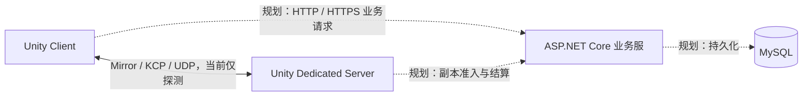

# Norn 双端开发基础指南：是什么、为什么、怎么操作

> 读者前提：会使用 Unity、写过一些 C#，但没有独立搭建过客户端与服务端。这是一份持续补充的基础指南，解释技术概念与手动操作；每个 Task 做了什么、改了哪些脚本、验证到什么程度，继续记录在[联机系统开发解析](<F:/Develop Project/RPG/RPG/Assets/_Project/Docs/2026-10-20 联机系统开发解析（更新中）.md>)中。
>
> 本文操作基于现有工程。已有文件、包和项目不需要重复创建；“从零怎样做”用于理解与复现，建议在另外的练习目录尝试。

> **当前阅读位置：** N2的玩家操作见第28节。前文提到“匹配暂不可用”的N1/N2-2A说明属于当时阶段；第28节解释本机N2房间/入场，真实角色和战斗尚未开放。具体最终验收结果仍以开发解析与n2-final证据为准。

## 1. 先把“服务器”拆成不同概念

你租到的 Linux Server 是一台运行 Linux 的机器；业务服、副本服、MySQL 则是运行在机器上的不同程序。开发语言决定怎样编写程序，框架提供不同能力，操作系统负责启动进程。最终都能部署到 Linux，不代表它们的功能、运行环境或构建产物相同。

| 名词 | 是什么 | 本工程中的例子 |
|---|---|---|
| Machine / 主机 | 提供 CPU、内存、磁盘、网络的计算机 | 当前开发电脑，未来租用的云服务器 |
| Process / 进程 | 一个正在运行的程序实例，有自己的内存与生命周期 | 业务服进程、副本服进程、两个客户端进程 |
| Runtime / 运行环境 | 执行程序所需的运行时能力 | .NET Runtime、Unity Player Runtime |
| Framework / 框架 | 帮助我们组织程序、实现常见能力的代码 | ASP.NET Core、Mirror，各自负责不同领域 |
| Library / 库 | 被其他程序引用的代码，不一定能独立启动 | 共享协议库、Google.Protobuf |
| Protocol / 协议 | 通信双方约定的数据与交互规则 | UDP、KCP，以及我们定义的应用消息契约 |
| Database / 数据库 | 管理持久数据的系统 | 规划中的 MySQL |

“双端开发”强调客户端和服务端职责分离，不代表最终只能有两个程序。本项目规划中，客户端、业务服、副本服、数据库都是不同角色；本地开发时可以全部运行在一台电脑上，以不同进程和端口区分。



`Shared/Protocol` 没有画成一个网络节点，因为它是编译时使用的共享源码，不是在后台启动、等待连接的服务。目前业务服已有独立 HTTP 探测接口，但 Unity 客户端的业务登录链尚未接入；实时实验已有 Mirror/KCP/Protobuf 探测，不包含角色、战斗或资产同步。

## 2. Unity Dedicated Server 和 Mirror 到底是什么关系

### 是什么：一个是构建运行方式，一个是网络框架

**Unity Dedicated Server** 是 Unity 支持的专用服务器构建目标。它使用 Unity 的运行环境执行场景、组件和 C# 逻辑，并针对服务端用途减少部分显示相关开销。**它不是“安装在每个玩家电脑里的后台业务服”，也不要求远端机器安装 Unity Editor**。开发电脑负责构建，部署机器运行构建产物。[Unity Dedicated Server 官方说明](https://docs.unity3d.com/6000.3/Documentation/Manual/dedicated-server.html)

**Mirror** 是 Unity 使用的开源网络框架。它作为代码进入客户端和副本服构建，提供连接管理、消息收发，以及 `NetworkIdentity`、`NetworkBehaviour` 等网络对象工具。它不是另一个单独部署的服务器程序，也不是云服务器租赁服务。[Mirror 官方概览](https://mirror-networking.gitbook.io/docs/manual/general)

| 层次 | 我们选择什么 | 负责什么 |
|---|---|---|
| 运行环境 | Unity Dedicated Server | 执行服务器场景、组件与 Unity API |
| 网络框架 | Mirror | 管理连接、注册处理器、组织网络消息与网络对象 |
| Transport | Mirror 的 `KcpTransport`，内部使用 kcp2k | 在 UDP 上提供 KCP 通信能力 |
| 消息定义与编码 | Shared 中的 Protobuf | 定义消息字段，把对象与字节互相转换 |
| 游戏规则 | 我们编写的 C# | 决定准入、移动、命中、伤害、副本状态等权威行为 |

它们需要配合使用。Mirror 能让两个程序通信，却不会自动把现有单机角色改造成服务端权威角色；命中校验、敌人 AI、客户端表现和玩家退出后的处理仍然要由我们设计、实现。

### 为什么采用这套组合

副本玩法可能需要复用 Unity 场景、碰撞和已有 C# 游戏逻辑；Dedicated Server 可以让玩法继续使用这些引擎能力。Mirror 则让我们从成熟连接与 Transport 能力开始，不必先实现整个网络框架。代价是引入 Unity 服务端的构建、资源和生命周期管理，也要理解 Mirror 的约束。

纯 .NET 副本服也能实现玩法，但无法直接把 Unity 场景和 `MonoBehaviour` 当成 ASP.NET Core 的运行内容；需要抽取纯规则，并另行选择或实现物理、场景表达等能力。当前选择 Unity 副本服，是为了降低现有玩法迁移成本。

**Host 与 Dedicated Server 需要区分。** Host 让一个程序同时承担客户端与服务器角色，关闭该程序通常就失去服务器。Dedicated Server 作为独立进程运行，某个玩家退出不会顺带关闭这个进程；不过“剩余玩家继续玩”还需要正确的离线、角色清理与房间规则。目前仅验证了探测客户端退出后，另一客户端仍能通信。

### 怎么操作：从工程里找到它们

1. Unity 的 Project 窗口打开 `Assets/ThirdParty/Networking/Mirror`。这是已经导入的 Mirror 源码，不要再重复导入另一份。
2. 打开 `Assets/_Project/Scenes/Tests/MultiplayerAuthorityLab.unity`，选择 Hierarchy 中的 `OnlineLabRoot`，在 Inspector 查看 `NornNetworkManager`、`KcpTransport` 与实验用 Bootstrap 组件。
3. 查看 `Assets/_Project/ScriptableObjects/World/Multiplayer/OnlineNetworkProfile.asset`。当前实验使用本机地址与 UDP 端口 `7777`；Profile 保存实验配置，Manager 执行连接行为。
4. 如需在独立练习工程中导入，先从 [Mirror 官方 Releases](https://github.com/MirrorNetworking/Mirror/releases) 找到项目固定的 `96.11.3`，下载对应 Unity Package；Unity 选择 `Assets → Import Package → Custom Package`。本工程排除了 Examples/Tests，并保留上游 `.meta`，不能把整个样例包直接覆盖进正式工程。

`Game.Networking` 封装通信能力，`Game.Multiplayer` 组合实验场景。它们都不能因此越过正式玩法模块，直接获得账户或背包的权威状态。

## 3. 三个 .NET 项目、一个 Unity 工程，各自是什么

### 是什么：目录、Solution、Project、Assembly 是不同层次

```text
F:\Develop Project\RPG\
├─ RPG\                               Unity 工程，构建 Client / Dedicated Server
├─ Server\Norn.Online.sln              Visual Studio Solution，组织三个 .NET 项目
│  ├─ Norn.Business\                  ASP.NET Core 业务服
│  └─ Norn.Business.Tests\            自动化测试项目
└─ Shared\Protocol\                   共享协议 Class Library，同时是本地 UPM Package
```

| 对象 | 作用 | 是否独立运行、监听网络 |
|---|---|---|
| `Norn.Business` | 运行 HTTP 服务，处理业务请求 | 是，启动后有业务服进程 |
| `Game.NetworkProtocol` | 定义共同消息、协议版本和消息清理约束 | 否，被其他程序编译或引用 |
| `Norn.Business.Tests` | 自动执行测试，检查业务服入口 | 由 Test Runner 临时运行，不作为线上服务部署 |
| Unity `RPG` | 游戏场景与玩法源码 | 构建后可以分别运行客户端、副本服 |

**Class Library 不使用 ASP.NET Core 项目模板。** 两者都写 C#，但共享库只需要“别人能引用我”的能力；Web 项目还需要启动入口、HTTP Hosting、Routing 等能力。共享协议如果依赖 Web 框架，会把 Unity 不需要的东西带进来。

业务服也不是简单地把客户端数据写进数据库。规划中它拥有账户、线上资产、仓库和结算规则，必须校验调用者身份、物品归属与操作合法性；副本服拥有一次副本里的实时玩法状态。客户端说“我获得了装备”并不足以让业务服直接发装备，这需要可信的副本结算流程。

### 为什么既有 `.csproj`，又有 `.asmdef` 和 `package.json`

它们描述的是不同构建系统怎样使用同一份源码：

| 文件 | 谁读取 | 要解决的问题 |
|---|---|---|
| `.sln` | Visual Studio / .NET 工具 | 把相关项目组织在一个 Solution 中 |
| `.csproj` | .NET 构建系统 | 目标 API、源码范围、项目引用、NuGet 依赖 |
| `.asmdef` | Unity | Unity 内的 Assembly 边界和依赖关系 |
| `package.json` | Unity Package Manager | 本地 Package 的身份、版本、目录入口 |

当前业务服通过 `ProjectReference` 使用共享项目；Unity 通过本地 UPM Package 编译共享源码。因此，**不要再把第一方 `Game.NetworkProtocol.dll` 复制进 Unity**，否则容易出现同名类型重复。第三方 `Google.Protobuf.dll` 则是另一回事，仍要作为 Runtime 依赖提供。

### 怎么操作：在 IDE 中正确打开与检查

1. Visual Studio 选择 `File → Open → Project/Solution`，打开 `F:\Develop Project\RPG\Server\Norn.Online.sln`。查看 Solution Explorer，确认三个项目都在。
2. 右键 `Norn.Business → Set as Startup Project`，使用 IDE 的启动按钮运行业务服；不要把共享库设成服务器启动项目。
3. 展开业务项目的 `Dependencies → Projects`，确认引用了 `Game.NetworkProtocol`。如果从零练习，右键 `Dependencies → Add Project Reference`，勾选共享项目；仅把两个项目放进同一个 Solution 并不等于引用。
4. 查看共享项目的 `TargetFramework` 为 `netstandard2.1`，业务和测试为 `net10.0`。可右键项目选择 `Edit Project File` 阅读配置。
5. 新建练习共享库时，选择现代 C# `Class Library`，不要选择旧的 `.NET Framework` 模板。Unity 自动生成的 IDE `.csproj` 不适合作为长期手工配置入口；Unity 侧的依赖应维护在 Package、Plugin 和 `.asmdef` 中。

如果 IDE 提示不支持 `net10.0`，先用 Visual Studio Installer 检查适配 .NET 10 的 IDE 与开发组件。本项目有供自动化使用的私有 SDK，不表示任意版本 Visual Studio 都会自动使用它。

## 4. Test 项目是什么，为什么要测试“这个项目”

### 是什么：一组可重复执行的行为检查

`Norn.Business.Tests` 是我们写测试代码的项目，主要被测对象是 `Norn.Business`。它使用 xUnit 定义测试，用 Test SDK 和 Visual Studio Adapter 让 IDE 发现并执行测试。测试代码也可能写错，因此测试通过只能证明“这些检查目前通过”，不能证明所有需求都已完成。

当前工程中的 `FoundationEndpointsTests` 使用 `WebApplicationFactory<Program>` 创建测试宿主，通过 `HttpClient` 执行真实路由、解析和响应逻辑。它不要求先手动启动业务服，也不需要占用正式业务端口。虽然 IDE 模板可能叫 Unit Test Project，这些跨 HTTP 处理链的用例实际上属于 **Integration Test**；测试范围由检查内容决定，不由模板名称决定。

| 常见标记/依赖 | 是什么、为什么需要 |
|---|---|
| `[Fact]` | 一条没有输入参数组的 xUnit 测试 |
| `[Theory]` 与 `[InlineData]` | 同一规则用多组输入验证，例如版本 `0` 和 `2` 都应被拒绝 |
| `Assert` | 把预期写成机器可检查的条件，失败时报告差异 |
| `Microsoft.NET.Test.Sdk` | 将测试项目接入 .NET 测试运行机制 |
| `xunit.runner.visualstudio` | 让 Visual Studio 测试工具发现并运行 xUnit 用例 |
| `Microsoft.AspNetCore.Mvc.Testing` | 为 ASP.NET Core 应用提供集成测试宿主 |

例如下面是帮助理解的最小 **Unit Test**，不是本次新增的生产代码：

```csharp
using Game.NetworkProtocol;
using Xunit;

namespace Norn.Business.Tests;

public sealed class ProtocolBasicsExample
{
    [Fact]
    public void MissingVersionMustBeRejected()
    {
        // proto3 未填写普通 uint32 字段时读取到 0，不能把它视为合法版本。
        bool accepted = ProtocolCompatibility.IsSupported(0);
        Assert.False(accepted);
    }
}
```

它只检查纯函数。实际 `Ping_IncompatibleVersion_IsRejected` 还检查请求经过 HTTP 入口后，是否真的得到 `409` 与 `VersionMismatch`，因此覆盖了更多集成环节。[xUnit 官方入门（Microsoft Learn）](https://learn.microsoft.com/en-us/dotnet/core/testing/unit-testing-csharp-with-xunit)

### 为什么不能只看“编译成功”和“我能点进去”

编译器会检查类型与语法，但不知道我们规定“缺失版本必须拒绝”“中文不能截断”“请求超过预算必须报错”。手动测试正常请求，也很容易遗漏畸形数据。自动化测试把这些要求固定下来，后续修改解析、协议或依赖时，可以快速发现 Regression。

当前测试关注 HTTP 探测入口，包括 Unicode/大序号保真、版本拒绝、畸形消息、大小限制与 Content-Type。它们没有证明 MySQL、玩家登录或多人战斗可用。MySQL 尚未接入，因此这些测试目前不需要数据库。

### 怎么操作：运行、读懂结果、定位问题

1. 在 Visual Studio 打开业务 Solution，选择 `Build → Build Solution`，先处理编译失败。
2. 选择 `Test → Test Explorer`，找到 `Norn.Business.Tests`，点击运行该项目的测试。无需先启动业务服，也不要把测试项目当业务服务器启动。
3. 全部绿色表示这些用例通过。出现失败时选中用例，先读错误信息的 Expected / Actual，再双击跳转源码；区分“需求不满足”与“测试环境没有启动成功”。
4. 先阅读 `Ping_RoundTrip_PreservesUnicodeAndLargeSequence`：看它构造了什么请求、执行了什么操作、断言了哪些字段。再读版本错误用例，比较成功与拒绝路径。

Unity 的测试是另一套入口：`Window → General → Test Runner → EditMode`，当前网络测试 Assembly 为 `Game.Networking.Tests`，使用 NUnit 的 `[Test]`。Visual Studio 的业务测试通过，不代表 Unity 测试也运行过；Unity 测试通过，也不代表真实多个进程已互联。

| 验证方式 | 能帮助回答什么 | 仍不能据此推出什么 |
|---|---|---|
| Unit Test | 一个纯规则、Codec 是否满足输入输出约定 | 真实端口、场景和进程是否正常 |
| Integration Test | 路由、解析、响应等模块组合是否正确 | 远端网络、多人玩法是否正确 |
| 多进程通信实验 | 独立 Server 与 Client 是否真的通信 | 移动、命中、资产系统已完成 |
| Editor / Player 手动流程 | 玩家实际操作是否得到正确反馈 | 所有边界条件都覆盖 |
| Profiler | 指定场景与采样条件下的 CPU、GC Alloc 等 | 所有机器、负载都满足性能指标 |

## 5. Protobuf：要下载哪些东西，怎样从定义走到消息

### 是什么：Schema、生成器、Runtime 各司其职

| 对象 | 作用 | 我们维护什么 |
|---|---|---|
| `Protos/common.proto` | Schema，声明消息结构与字段编号 | 人工编辑，包含中文业务注释 |
| `protoc.exe` | 开发时把 Schema 编译为指定语言源码 | 固定版本的工具，不随游戏运行 |
| `Runtime/Generated/Common.cs` | 生成的 C# 消息类型和编码代码 | 重新生成，不人工修改 |
| `Google.Protobuf` | 生成代码在运行时依赖的库 | 两端提供匹配版本 |

我们采用统一 Schema，是为了避免客户端和服务端分别手写一套字段后逐渐不一致。Protobuf 解决结构化数据编码问题；连接建立、登录、加密和消息分发不是它自动提供的能力。[官方 C# 基础教程](https://protobuf.dev/getting-started/csharptutorial/)

### 怎么操作一：获取与引用 Runtime

**.NET 侧：** 在 Visual Studio 右键共享项目 → `Manage NuGet Packages` → `Browse`，包源选择 `nuget.org`，搜索 `Google.Protobuf`，核对官方包身份并选择固定版本 `3.34.2`，安装后在 `Dependencies → Packages` 查看。已有工程已经配置好了，检查 Installed 即可；不要顺手更新全部依赖。[NuGet 图形界面操作](https://learn.microsoft.com/en-us/nuget/consume-packages/install-use-packages-visual-studio)、[固定版本包页面](https://www.nuget.org/packages/Google.Protobuf/3.34.2)

业务项目与测试项目在 `Server/Directory.Packages.props` 集中管理相关包版本；共享项目位于该目录之外，使用自己的显式版本引用。IDE 的 `using Google.Protobuf` 只是让类型名可见，不会下载或安装包。

**Unity 侧：** 本工程没有自动继承业务项目的 NuGet 依赖。下载上述固定版本 `.nupkg`，用解压工具打开，取 `lib/netstandard2.0/Google.Protobuf.dll` 放入 `Assets/ThirdParty/Networking/Protobuf`；保留来源与许可证。该版本对应的补充依赖 `System.Runtime.CompilerServices.Unsafe 6.1.2` 也已导入。只放适用的一套 DLL，不要把包里的多套目标框架与整套系统库复制进来。

`netstandard2.0` 的 Runtime DLL 可以被我们的 `netstandard2.1` 共享库使用，这不是版本冲突。Unity 插件检查还要考虑 Player：某个 Editor AI 插件带了依赖，不代表它会进入最终游戏或副本服。

### 怎么操作二：编辑 Schema，点击生成 C#

生成器从 [Protobuf 官方 v34.2 Release](https://github.com/protocolbuffers/protobuf/releases/tag/v34.2) 获取，对 Windows 选择对应架构的预编译 protoc ZIP，而不是 `Source code`。本工程已放在 `Shared/Protocol/Tools/protoc/34.2/bin/protoc.exe`，不必重新下载。

在 Visual Studio 的 `Tools → External Tools → Add` 注册生成入口，Command 浏览到这个 `protoc.exe`，Arguments 指定 Schema 根目录、C# 输出目录和输入文件，勾选输出窗口。当前路径的完整输入框内容见[开发解析 Task N0-1 第 6 节](<F:/Develop Project/RPG/RPG/Assets/_Project/Docs/2026-10-20 联机系统开发解析（更新中）.md>)，可以直接复制到 IDE 配置框。

日常修改按这个顺序操作：

1. 打开 `Shared/Protocol/Protos/common.proto` 或实验用的 `lab.proto`，编辑定义并保存。
2. 在 Visual Studio 点击已配置的 `Tools → Norn - Generate Shared Protocol`。
3. 查看输出错误与 `Runtime/Generated/Common.cs`、`Lab.cs` 的更新。当前工程不会因为保存 `.proto` 就自动生成 C#。
4. 构建业务 Solution 并运行测试；回到 Unity 等待重新编译，再执行 `Tools → Norn → Online → Verify Shared Protocol`。

共享源码通过本地 UPM 导入 Unity，可在 `Window → Package Management → Package Manager → + → Install package from disk` 选择 `Shared/Protocol/package.json`。现有工程已引用，先检查 Package，避免复制第二份源码或第一方 DLL。

### 怎么操作三：读懂字段与编码，不混淆数字的含义

本项目 Schema 使用下面的排版：分区标题归类，message/enum 的用途说明在上方，字段与枚举值注释紧跟分号，并在同组内对齐。

```proto
////////////////////////////////////////////////////////////////
//  连通性探测 / Protocol Ping
////////////////////////////////////////////////////////////////

// 基础探测请求，不代表登录成功。
message ProtocolPingRequest
{
    uint32 protocol_version = 1; // 应用协议版本，缺省 0 必须拒绝。
    uint64 sequence         = 2; // 请求关联序号，回复时原样带回。
    string message          = 3; // 探测文本，UTF-8 最多 256 字节。
}
```

`= 1` 是字段编号，不是“这个字段的默认值为 1”。`protocol_version` 的实际值由发送代码填写；普通 proto3 `uint32` 没有填写时读取为 `0`。不同 message 可以重复使用字段编号，但同一个 message 内不能重复，已经发布的编号不能换成其他业务含义；删除字段时使用 `reserved` 保留编号和旧名称。

| 数字 | 代表什么 |
|---|---|
| `.proto` 的 `= 1` | 该 message 内的字段编号 |
| `ProtocolVersion = 1` | 我们的应用兼容版本 |
| `RealtimeMessageKind` 枚举值 | 实时消息的种类，用于分发 |
| `sequence = 42` | 某次请求的关联序号，单独使用不提供身份认证 |
| `Google.Protobuf 3.34.2` | 第三方 Runtime 包版本 |
| `protoc 34.2` | 开发工具版本 |

生成后的 C# 用消息对象存字段，调用 `ToByteArray()` 得到字节，接收方在确定消息类型后调用对应 `Parser.ParseFrom()`。编码本身不会发送网络请求；解析成功也不表示拥有执行该操作的权限。基础用法示例见开发解析 Task N0-1 第 7 节，实时入口则使用已有 Codec 与消息池，不把一次性数组演示搬进每帧热路径。

## 6. UDP、KCP、Mirror、Protobuf 为什么能同时使用

它们位于不同层次，不是在四个方案里只能选择一个。

```text
玩法消息对象
    ↓ Protobuf 编码
Protobuf 字节 + 应用消息类型等 Envelope 信息
    ↓ Mirror 消息处理 / KcpTransport
KCP：在 UDP 上实现确认、重传等可靠传输机制
    ↓ UDP 数据报
操作系统网络栈与网络
```

UDP 提供数据报传输，不保证送达和顺序；**KCP 是运行在 UDP 等数据报通道之上的可靠传输协议实现，不是操作系统另提供的一种 Socket 类型**。**Mirror 的 `KcpTransport` 使用 kcp2k 接入它**。因此之前说的“UDP + KCP”并不矛盾。[Mirror KCP Transport 官方说明](https://mirror-networking.gitbook.io/docs/manual/transports/kcp-transport)

选用它是为了使用已有游戏网络栈，并保留以后按消息特点选择可靠或不可靠通道的空间。**它不保证所有网络条件下都比 TCP 快**；重传、带宽、MTU 和队列依然需要测量。当前 Ping 使用可靠通道，不代表未来每帧位置都必须可靠重传。

业务服的 HTTP/HTTPS 与副本服的实时传输可以不同。浏览器、账号与背包接口不需要为了“统一技术”全部走 KCP；KCP 本身也不提供我们需要的账户认证或完整加密方案。

## 7. Build、Run、Publish：本地怎样打开，远端运行什么

### 是什么、为什么区分

Build 把源码编译、打包成目标程序；Run 是启动程序；Publish 是准备适合部署的业务服输出。Unity 构建还会处理场景、资源和目标平台；.NET 发布则按目标 Runtime 和部署方式组织输出。两者不是同一个构建流程。

**业务服构建产物不能代替 Unity 副本服。** Unity Windows Server 构建也不能直接复制到 Linux 运行；以后部署 Linux 时需要对应的 Unity Server 模块与构建。业务服选择 framework-dependent 发布时，远端要有匹配的 .NET Runtime；选择 self-contained 则随应用提供所需 Runtime。Unity 副本服部署其 Player 构建产物，不在远端安装 Editor 来“打开工程”。

### 怎么操作当前本地实验

1. 在 Unity 打开实验场景，检查 Console 与 Profile。场景已存在时直接打开，不必再次点击创建菜单。
2. 从 `Tools → Norn → Online` 分别选择 `Build Lab Windows Client` 和 `Build Lab Windows Dedicated Server`。菜单使用实验场景，不需要改正式游戏的全局 Build Scene List。
3. 在资源管理器打开 `Builds/OnlineLab/Server`，先启动 `NornServer.exe`；再到 `Builds/OnlineLab/Client` 启动两次 `NornClient.exe`。
4. 两个客户端各点 `Connect Client`，观察 `Sent / Replies` 计数。退出其中一个客户端，确认另一个仍收到回复。
5. 测试结束关闭自己启动的客户端与副本服。没有明显游戏窗口并不等于副本服未启动，可在任务管理器查看进程，再结合客户端回复和日志判断。

Editor 的 Play 是运行当前编辑器场景，不会因此自动新建独立副本服进程。`127.0.0.1` 永远表示“当前这台电脑”，不是任意远端机器。本实验主动限制 loopback，未来远端访问还需要单独设计公开地址、端口、防火墙与认证，不能只改一个 IP 就声称部署完成。

## 8. MySQL 放在哪，哪些数据该存进去

我们已经确定使用 MySQL，但当前仍未接入数据库。可以先让 MySQL 与业务服在同一台开发电脑上运行，它们依然是不同进程；后期是否拆机，取决于资源竞争、备份恢复和运维需求，不取决于目录是否叫 Server。

持久数据需要由受信任的服务端流程写入。规划中的业务服负责账户、角色资产、仓库与结算等规则；副本服保存实时运行状态，并通过明确的结算与持久化流程提交结果。不是每次移动都写一次 SQL，也不应让客户端或公开暴露的游戏端直接操作数据库。

首版线上资产与单机存档隔离：本地存档里的货币和装备不能直接被视为线上合法资产。具体表结构、事务、幂等结算与断线恢复尚未实现，后续接入时会继续补充对应原理和 GUI 操作。

## 9. 版本怎样读，哪里排查问题

这里记录的是本工程固定基线，不是“永远使用官网最新版本”。

| 组件 | 当前固定值 | 应该怎样理解 |
|---|---|---|
| Unity | `6000.3.16f1` | 沿用现有游戏工程 |
| .NET SDK | `10.0.402` | 编译、测试、发布工具；不是 Runtime 补丁号 |
| .NET / ASP.NET Core Runtime | `10.0.13` | 业务服运行环境 |
| Shared TargetFramework | `netstandard2.1` | 可调用 API 契约，不是独立服务端 Runtime |
| Mirror | `96.11.3` | 固定的网络框架版本 |
| Google.Protobuf / protoc | `3.34.2` / `34.2` | Runtime 与生成器采用不同编号形式 |
| 自己项目版本 / 应用协议版本 | `0.1.0` / `1` | 两个由我们维护、含义不同的版本 |

| 现象 | 先检查什么 | 为什么 |
|---|---|---|
| `.proto` 改了，C# 没新字段 | 是否保存并点击生成入口，生成路径是否正确 | 编辑 Schema 不等于生成完成 |
| 共享库无法启动 | 是否把 Class Library 当成 Startup Project | 它没有服务器入口 |
| Test Explorer 没发现测试 | 编译错误、测试依赖与适配的 IDE/SDK | 先区分未发现和执行失败 |
| 业务测试通过，Unity 仍报错 | Unity 的 DLL、UPM 与 asmdef 依赖 | 两套构建系统有各自的依赖配置 |
| 客户端连接失败 | Server 进程、loopback 限制、UDP 端口与日志 | 协议能解析不等于网络连接已建立 |
| 能收到 Ping，但没有其他玩家 | 当前是否只运行探测实验 | 传输连通不自动生成角色复制 |

建议源码阅读顺序：[共享 Schema](<F:/Develop Project/RPG/Shared/Protocol/Protos/common.proto>) → [协议版本约束](<F:/Develop Project/RPG/Shared/Protocol/Runtime/ProtocolCompatibility.cs>) → [业务入口测试](<F:/Develop Project/RPG/Server/Norn.Business.Tests/FoundationEndpointsTests.cs>) → [实时连接 Manager](<F:/Develop Project/RPG/RPG/Assets/_Project/Scripts/Networking/Runtime/NornNetworkManager.cs>)。先知道每个文件负责哪一层，再沿一次请求读执行过程；不需要一开始就读完 Mirror 的全部实现。

## 10. 为什么 Server 构建也会出现 Shader 错误

### 是什么：构建检查与运行时绘制是两件事

Dedicated Server 不需要给玩家绘制画面，但构建仍然在同一个 Unity 工程中处理资产和依赖。构建阶段遇到 Shader 的导入、关键字检查等错误，并不与运行时使用 `Null Graphics Device` 矛盾。不能因为“服务器不画画面”，就认定构建中出现的 Shader 错误可以忽略。

| 概念 | 初学时怎样理解 |
|---|---|
| Shader | 描述 GPU 如何处理顶点、计算像素等工作的程序；这里是已有第三方资源的 Shader 模板 |
| Vertex / Fragment | 前者处理顶点与坐标变换，后者计算覆盖到的片元结果；本次问题并不需要修改这些计算 |
| Pass | 一段用于特定渲染用途的配置与程序，例如 Forward 和 GBuffer；不同 Pass 可以分别声明自己的关键字 |
| Shader Keyword | 编译或运行时选择功能的开关，例如是否使用软阴影 |
| Shader Variant | 同一 Shader 针对某组关键字编译得到的版本，过多组合会增加构建成本 |
| `#pragma multi_compile_fragment` | 声明 Fragment 阶段需要编译的一组关键字变体；同一行的选项表达不同选择，不是要求所有选项同时开启 |

例如 `_ _SHADOWS_SOFT _SHADOWS_SOFT_LOW _SHADOWS_SOFT_MEDIUM _SHADOWS_SOFT_HIGH` 表示一组软阴影相关选择，单独的 `_` 表示这一组没有启用这些关键字。若同一个 Pass 又用另一条 pragma 声明 `_SHADOWS_SOFT`，Unity 会报告重复关键字。不同 Pass 各有一条声明则正常。[Unity Shader Keywords 官方说明](https://docs.unity3d.com/6000.3/Documentation/Manual/SL-MultipleProgramVariants-declare.html)

### 为什么修复源码，而不是清 Console 或删除整个资源

这次旧模板把多个 URP 版本的声明放在 `/*ase_srp_cond...*/` 标记之间。这些标记供 Amplify 模板工具处理，对 Unity 的 Shader 编译器而言只是注释，不具有 `#if` 的条件编译效果。当前工程明确固定 URP 17.3，可以保留该版本所需的一组完整关键字，去掉同 Pass 的旧重复声明。修改的是当前工程的局部兼容补丁，不能推导为模板已适配所有历史 URP。

清 Console 只清显示记录，不改变源码；删除整个资源包会扩大改动范围，也可能破坏其他 Material 引用。重新构建验证应看新的结果，不把之前残留在 Console 的错误条数当成本次结果。

### 怎么操作：读懂本工程构建报告

1. 在 Unity Console 中双击错误，定位 Shader 文件和关键字，先区分重复声明、找不到 include 与真正的语法错误。
2. 修改后等待 Unity 导入；必要时在 Project 中右键**这一份** Shader → `Reimport`，不需要先删除整个 Library。
   本工程还提供 `Tools → Norn → Online → Verify Lab Shader Import`，强制导入这份已知模板并输出 `Tools/Networking/.artifacts/shader-import.json`；`HasErrors=false / Errors=0` 表示这一次没有 Shader 错误，`Messages` 仍会保留 Warning。
3. 从 `Tools → Norn → Online` 分别构建 Windows Dedicated Server 与 Client，查看本次 Console 和输出产物。
4. 用文本编辑器打开 `Tools/Networking/.artifacts/server-build.json` 与 `client-build.json`，核对 `RecordedAtUtc` 是否是本次时间，再同时看 `Result` 和 `Errors`。

`Result = Succeeded` 表示 Unity 报告生成了构建产物；`Errors = 0` 才表示该次 Build Report 没有记录错误项。它们仍不证明所有玩法、视觉或性能都已验收。当前实验程序需要继续经过通信测试和开发者的可见窗口操作，性能则需要单独的 Profiler 证据。

## 11. 同一个 Unity 工程，为什么 Client 和 Server 的启动行为会不同

### 是什么：平台、构建角色和编译条件需要分别理解

| 概念 | 本工程的例子 | 影响什么 |
|---|---|---|
| Target | Windows x64，后续还有 Linux | 可执行文件、平台 API 与底层运行环境 |
| Subtarget | Player / Dedicated Server | 同一平台上的客户端或专用服务器角色 |
| 内置编译符号 | `UNITY_EDITOR`、`UNITY_SERVER` | Unity 根据编译环境提供，用来保留适合该环境的代码 |
| 自定义 Scripting Define Symbols | `APP_UI_EDITOR_ONLY` | 包或项目自行约定的编译条件，不会自动获得业务含义 |
| Named Build Target | `Standalone`、`Server` | Player Settings 等配置区分目标的身份，不能假设两者的自定义宏相同 |

`UNITY_SERVER` 是编译期条件，和运行时 `Application.isBatchMode` 不同：客户端加 `-batchmode -nographics` 也可以无画面启动，但不会因此变成专用服务器。项目仍需通过真正的 Server 构建验证。`#if` 决定代码是否参与编译，运行时 `if` 决定已经编译的代码走哪条分支。

### 为什么场景里没有 UI，它还可能在 Server 启动

通常 `MonoBehaviour.Awake` 需要对应对象被加载、实例化；但 `RuntimeInitializeOnLoadMethod` 标记的静态方法是另一种入口：Unity 会把它登记在 Player 的启动清单，在指定阶段直接调用。场景中没有这个组件，并不阻止静态启动方法自己创建 GameObject。

本工程的 `PortalTransitionFade.Install` 就是例子：它为单机/客户端安装跨场景黑幕，再由 `Awake` 创建 Canvas / Image。Headless Server 不需要这层表现，因此需要明确的 Server 边界，而不是只从实验 Scene 的 Hierarchy 删除 UI。我们排查时也读取实际构建的 `NornServer_Data/RuntimeInitializeOnLoads.json`，检查哪些方法真正进入了启动清单。

第三方 App UI 也有启动方法。它的 asmdef 使用 `UNITY_EDITOR || !APP_UI_EDITOR_ONLY`：在 Editor 中保留；在 Player 编译中，如果启用该自定义宏，就排除这套 Runtime Assembly。现有 Standalone 配置已有这个宏，而 Server 是另一份配置，因此二者的打包结果可能不同。判断问题要看源文件、编译条件、输出清单与实际日志，不能仅凭报错刚好出现在某条初始化日志旁边就归因。

### 怎么操作：查看设置、读懂本项目的构建入口

1. Unity 打开 `Edit → Project Settings → App UI`，查看 `Editor Only` 的含义：它限制第三方 App UI 的 Player Runtime，并不是关闭整个 Unity UI，更不等于关闭我们使用的 UGUI。
2. 在对应 Build Profile 的 Player Settings 中查看 Scripting Define Symbols，核对当前选的是普通 Player 还是 Dedicated Server 配置。不要直接把 Client 的所有宏复制给 Server；某些宏可能启用仅客户端适用的代码。
3. 打开 `Assets/_Project/Editor/Networking/OnlineBuildTools.cs`，看 `BuildPlayerOptions` 的 `subtarget` 与 `extraScriptingDefines`。当前实验 Server 构建额外传入 `APP_UI_EDITOR_ONLY`，仅影响这一次 Player 编译，不把它当作账号认证、加密或网络连接能力。[Unity extraScriptingDefines 官方说明](https://docs.unity3d.com/6000.3/Documentation/ScriptReference/BuildPlayerOptions-extraScriptingDefines.html)
4. 使用已有 `Tools → Norn → Online → Build Lab Windows Dedicated Server` 菜单重新构建。验证时同时核对 Build Report、启动清单和新进程日志；旧输出目录里留有某个 DLL 文件，不足以证明它当前一定被加载和执行。

一个编译宏只能解决相应依赖的编译条件。整个 Server 的表现依赖清理、玩法 Headless 兼容、CPU/GC、Linux 与远端安全仍需要各自验证，不能因为加上 `UNITY_SERVER` 或某个宏就宣称完成。

## 12. Headless Grid：服务器没有画面，材料世界如何继续运行

### 是什么：Headless、CPU Grid、Frame 和 Tick

Headless 表示程序不需要图形显示设备与窗口。Dedicated Server 是构建角色，Headless 是运行环境，两者不能互相代替。本工程同时检查真正的 `UNITY_SERVER` 构建与 `GraphicsDeviceType.Null`，然后验证材料模拟能实际初始化和推进。Unity 的专用服务器仍有 GameObject、Transform、Collider 和脚本生命周期；没有 Renderer 并不等于没有游戏世界。[Unity Dedicated Server 官方说明](https://docs.unity3d.com/6000.3/Documentation/Manual/dedicated-server.html)

CPU Grid 是把材料数量存储在网格中，由 CPU 按规则计算变化。它与客户端 GPU 粒子表现是两条不同路径。本实验显式选择 `GridLiquid`，不先要求 GPU 后再依赖 fallback；这样部署机器有没有显卡都不改变实验选择。Collider 地面用于空间阻挡，Interest Point 用于确定活跃区，两者都不负责绘制画面。

| 概念 | 本实验数值与含义 |
|---|---|
| Frame | 进程执行一轮 Update 的机会，目标 30 FPS；实际会受调度、负载影响 |
| Material Tick | 材料世界推进一个固定时间步，配置 10 Hz，即每步对应 0.1 秒 |
| Accumulator | 每帧累积 `deltaTime`，达到固定间隔才推进 Tick；一次 Frame 可能没有 Tick，也可能补跑多个 |
| Warmup / Measure | 先预热 2 秒，再测量约 4 秒，降低初始化对稳态观察的影响 |
| GMU | 本项目既有材料数量记账单位；本实验写入 128 GMU 水，不将它说成 128 个粒子或 128 格 |

例如每帧约 1/30 秒，累积三帧才接近一个 0.1 秒材料步。固定的是模拟时间步，操作系统不会保证每 100 ms 准点回调，所以要用实际经过时间和 Tick 增量计算 `MeasuredHz`，并允许有界测量误差。这一实验仍沿用现有 `ElementWorldRuntime.Update`，后续正式联网的统一 AuthorityTickDriver 尚未接入，不能同时再手动推进同一个世界。

### 为什么既看 Tick，又看水量与位置

只有 `WorldTick` 递增，可能只说明计时器在走。实验还必须通过正式写入队列注入水，观察注入点下方实际出现水，并确认 `LiquidGmu=128`、`PendingGmu=0`。前者证明模拟结果发生变化，后者证明这笔水没有遗失或凭空增加。液体粗格可能对应多个世界细格，不能把每个细格查询出的数量相加当作世界总量；总量从液体系统的只读记账入口取得。

反向检查则故意要求 20 Hz，而场景配置仍为 10 Hz。它应输出 `ConfiguredTickRateMismatch`、`Passed=false` 并以退出码 1 结束。验证工具把这个**符合预期的拒绝**记为反向检查通过，随后才启动正常 10 Hz 检查。退出码 0/1 供外部工具区分通过/失败，不是网络消息编号。

### 怎么操作：全部从 Unity 菜单完成

1. 等 Unity 编译结束，处理自己的未保存场景并退出 Play Mode。工具会拒绝接管 Dirty Scene，不替你保存或丢弃。
2. 点击 `Tools → Norn → Online → Create Headless Grid Lab`。Project 中会出现 `Scenes/Tests/HeadlessGridLab.unity` 和 `Tests/Fixtures/Networking/HeadlessGrid`；已存在时不会覆盖，正式场景与全局 Build Scene List 不改变。
3. 在 Project 中选择 fixture 下的 `World.asset`，Inspector 可见 `Tick Rate=10`、`Water Simulation Mode=GridLiquid`。`Liquids.asset` 控制网格容量；`Probe.asset` 控制预热、测量、注水及扫描范围。它们是实验配置，原 P7 配置不受修改。不要随意改变这些数值后仍引用本文默认验收结果。
4. 点击 `Build Headless Grid Windows Server`，产物位于 `Builds/OnlineLab/HeadlessGrid`。核对 `Tools/Networking/.artifacts/grid-server-build.json` 的本次时间、`DedicatedServer=true`、`Result=Succeeded` 和 `Errors=0`。
5. 点击 `Run Headless Grid Verification`。工具会在后台顺序运行两个独立 Server，不需要点击 Play，也没有游戏画面。Editor 保持可操作；验证时等待结束再改代码，Domain Reload 会中断本工具的子进程，并把本轮记为 Interrupted。
6. 用 IDE 打开 `Tools/Networking/.artifacts/headless-grid/verification.json`，本次 `State=Finished / Passed=true / NegativePassed=true` 表示两轮检查符合预期。再查看 `wrong-rate.json` 与 `positive.json` 的具体原因、Hz、水量和后端；原始启动日志是同目录的 `.log` 文件。若失败，先读 `Error` 和日志，不能只看上次的成功文件。

修改脚本或 fixture 后需要重新 Build，Run 菜单只运行已有产物，不会把 Editor 内的最新配置自动传给旧 exe。双击这个测试 Scene 只是审阅装配；普通 Editor Play 没有显式实验参数，探针不会启动世界或自动退出 Editor。服务器初始处于 inactive 的世界 Root 是有意设计：让探针先确认角色和配置，再激活世界，避免 `Awake` 抢先读取未装配好的对象。

`FrameGcRecorderValid` 表示 Profiler Recorder 是否可用，`MaximumFrameGcBytes` 是测量窗口内观察到的全帧分配峰值。它不提供分配调用栈，也不是单个材料 Tick 的专属计数；即使某次为 0，也不能证明尚未运行的 KCP、加密、多人世界复制都为 0。JSON、报告对象和结束扫描发生在终止边界，不能把这些离散工作与持续热路径混为一谈。[ProfilerRecorder 官方说明](https://docs.unity3d.com/6000.3/Documentation/ScriptReference/Unity.Profiling.ProfilerRecorder.html)

## 13. 高频负载、Token Bucket 与 GC：为什么通信成功还不够

### 是什么：Codec、Transport 和全帧是三个观察范围

Codec 把消息对象写成字节、把字节读回消息；Transport 负责在进程之间传送这些字节；全帧还包括 Unity、连接管理、其他脚本和工具。这三个范围不能互相代替。例如消息对象虽然放回 Pool，Protobuf 解码非空 `string` 仍可能产生新字符串；即使这条消息全部是数值，Socket API 也可能分配地址对象。是否用了对象池，不能直接回答是否达到了 0 B GC Alloc。

本实验复用当前 Ping Schema：数值轮只发送 ProtocolVersion / Sequence，Message 为空；文本轮增加固定中文文本。没有创建新网络协议，也没有将 Ping 称为角色 Snapshot。两轮具有不同数据形状，便于定位字符串解析的成本；数值轮的结论不适用于所有 Protobuf 消息，嵌套对象、RepeatedField、UnknownFields 等仍要分别测量。

| 报告字段 | 表示什么，不能误读成什么 |
|---|---|
| FunctionalPassed | 这个进程完成了连接、请求/回复率与存活检查；不表示账号已认证或性能通过 |
| CodecOperations / CodecAllocationEvents | 预热后编码/解码调用次数，以及 GC.Alloc 当前线程事件数；事件数不是 bytes，也不是网络总分配 |
| CodecAllocationCounterValid / CodecCalibrationEvents | 记录器是否通过已知分配的正向校准；不可用或单次超出固定 128 条容量时，不能把读数当作零分配证据 |
| DotNetControlBytes | 同一 1 KiB 控制分配在 .NET API 上的读数；当前 Unity Runtime 读到 0，因此该方法未用于最终 Codec 结论 |
| MaximumCodecMicroseconds | 单次观测到的 Codec 调用耗时峰值；不是整个 Server Tick 的耗时 |
| MaximumSteadyFrameGcBytes / SteadyFrames | 稳态窗口中观察到的全帧分配峰值与采样帧数；Server 在首次断开前停止该窗口，连接/退出的离散工作另看功能结果 |
| FrameIntervalP95Ms / P99Ms | 把帧间隔从小到大排序后约 95% / 99% 所在的位置；包含调度等待，不是 CPU 计算耗时或网络 RTT |
| ZeroAllocationPassed | 当前实验功能完成、记录器有效、Codec 与稳态帧均未观察到分配；仍只覆盖这次数据、平台、进程和持续时间 |
| SkippedProbes | 卡顿超出最多三条补发预算后的发送机会损失；不会靠无限补发掩盖过载 |

`GC.GetAllocatedBytesForCurrentThread()` 在 .NET 的 API 定义中返回当前线程累计托管分配量，不是存活对象大小，也不包含 native 内存。但是能编译不等于当前 Unity Runtime 实现了有效计数：本工程用明确的 1 KiB 数组分配校准时仍读到 0，所以不能用这里的零值证明性能。[Microsoft API 说明](https://learn.microsoft.com/en-us/dotnet/api/system.gc.getallocatedbytesforcurrentthread)

最终改用 Unity 官方的 `GC.Alloc` 当前线程事件采集方式，在 Codec 调用前 Reset/Start，返回后 Stop/read Count；不启用按整帧合并，以隔离同一帧中的不同调用。启动时先故意分配控制数组，必须捕获到事件才能认为记录器有效，随后经过预热才开始正式测量。采集缓冲固定容量，热路径不创建 recorder 或扩容；报告说“事件”时绝不改口为“字节”。[Unity 当前线程采集示例](https://docs.unity3d.com/6000.3/Documentation/ScriptReference/Unity.Profiling.ProfilerRecorderOptions.CollectOnlyOnCurrentThread.html)

### 为什么限流要允许一小段 Burst

假设客户端平均每秒发 30 条，正常约每 33.3 ms 一条。但线程调度、Mirror Batch 和 KCP 交付可能使几条消息在同一帧抵达。若服务端要求每两次回调必须间隔 50 ms，正常流量也会被断开。

Token Bucket 的做法是：以固定速度补充 Token，每条消息消耗一个，桶有最大容量。负载实验每连接补充 60 Token/s、容量 8，允许有界的瞬时聚合；Token 耗尽仍拒绝，等待也不能积攒超过 8 个。每个连接有自己的桶，不能拿别人的预算。默认低频实验仍用 20/s、容量 4；这些是诊断配置，不是正式施法、聊天、库存消息都可以共用的最终策略。

限流与去重也不同：Sequence 必须递增，重复/逆序请求被拒绝且不消耗新 Token；时钟使用单调的 realtime，回退、NaN 或 Infinity 不能让预算失效。Reliable 传输会重传数据包，但不会因此免除应用层的预算与业务幂等性设计。

### 怎么操作：从四个菜单运行两组五进程实验

1. 等待编译结束，处理未保存场景并退出 Play Mode。
2. 点击 `Tools → Norn → Online → Create Transport Load Lab`，生成独立的 `Scenes/Tests/TransportLoadLab.unity` 和 `Tests/Fixtures/Networking/TransportLoad/Profile.asset`。已有场景不覆盖，原来的通信实验和材料实验继续保留。
3. 在 Inspector 选中 Profile 查看端口 7788、30 Requests/s、60 FPS 目标和 30 Send Rate。Requests/s 是应用发消息的频率，Send Rate 是 Mirror 批处理发送频率，FPS 是进程循环目标；它们不必相同。预热 3 秒后，A 测 6 秒，B/C/D 各测 10 秒，Server 测 14 秒。
4. 分别点击 `Build Transport Load Windows Server` 和 `Build Transport Load Windows Client`。核对 `Tools/Networking/.artifacts/load-server-build.json`、`load-client-build.json` 的本次时间、Result 和 Errors。改脚本或 Profile 后必须重新 Build。
5. 点击 `Run Transport Load Verification`。工具先启动 Server，Ready 后启动四个 Client；它们都是后台无画面进程，只有 Server 是真正 Dedicated Server。不要用任务管理器是否看见窗口判断 Client 是否运行。工具依次运行 numeric / text 两轮，超时或 Editor 重载时只清理自己启动的进程。
6. 打开 `Tools/Networking/.artifacts/transport-load/verification.json`：State=Finished 说明两轮实验采集完成；分别看 Numeric/TextFunctionalPassed 与 Numeric/TextZeroAllocationPassed，不能看到 Finished 就当作性能通过。再读 numeric、text 子目录中各进程 JSON 与日志，比较分配、帧间隔及 A 退出后其他进程的报告时间。

此场景没有实验 IMGUI、Camera 或玩家角色，避免计数文字更新污染网络测量。实验仍运行 Unity 的全局启动方法，因此全帧计数还需要结合局部测量和源码判断。四客户端 ×30/s 是本机小消息基线，没有模拟远端 RTT、抖动、丢包、巨大世界分页、敌人或投射物负载；不能据此宣布服务器已具备完整四人副本容量。

当前两轮使用原始 KCP，不含 EncryptionTransport。本阶段仍限制本机 loopback；加密与公钥验证属于独立能力。Mirror 的 EncryptionTransport 文档目前仍注明加密实现分配较重，这属于官方已知风险，不能当作本轮已经实测的数据，也不能通过启用加密组件就认为分配问题自然消失。[Mirror 官方说明](https://mirror-networking.gitbook.io/docs/manual/transports/encryption-transport)

## 14. Windows Raw IO：为什么装了 KCP 还要观察 Socket

### 是什么：三层代码各自负责不同工作

**KCP 是可靠传输算法，决定确认、重传和窗口；kcp2k 是 C# 集成，调用 Socket 把 Datagram 送到操作系统；Mirror 则把连接、消息和 Unity 生命周期接起来。**某一层实现有分配，不能推出整条技术路线无效，也不能靠给另一层加对象池解决。

本地优化实验使用 `NornKcpTransport : KcpTransport`，保留 KCP 的包格式、Cookie、重传和连接管理，只在 Windows IPv4 loopback 替换最底层 Raw IO。`WindowsDatagramIo` 通过 `DllImport` 调用 Windows 自带的 `ws2_32.dll`，不是下载了一个新的商业插件，也不是重写 UDP。Socket 仍由 kcp2k 创建、配置为 nonblocking 和关闭；适配器只在同步调用期间借用 Handle。nonblocking 没有数据时正常返回 WSAEWOULDBLOCK，不能每帧创建一个异常对象表示这种正常状态。

`byte[]` 是预分配的固定 MTU 缓冲。发送段可能从数组中间开始，因此先复制到固定 scratch，再进行同步数组封送；这增加一次有界内存复制，换来不暴露 unsafe 指针的实现。Windows 的 `sockaddr_in` 用 16 bytes：family 使用主机字节序、端口用网络大端、IPv4 地址按网络字节顺序。只有明确的 `127.0.0.1` 地址会被当前适配器接纳，所以它不能直接拿去承接公网客户端。WindowsServer 与 WindowsPlayer 还是两个不同的 RuntimePlatform；漏掉前者，会导致 Client 优化了但 Dedicated Server 仍走普通 Socket。

另一个独立分配点是 KCP Header 验证：`Enum.IsDefined(Type, object)` 的第二个参数为 object，传入 byte 就需要 Boxing。这里只有五个合法 Header，显式比较能保持原 wire format 和非法值拒绝语义。测试遍历全部 256 个 byte，确保不是为了 Zero GC 放松输入验证。第三方两处本地差异在 `Assets/ThirdParty/Networking/Mirror/NORN_LOCAL_PATCHES.md` 登记；升级 Mirror 时必须重新核对和验证，不能覆盖后继续引用旧性能结果。

### 怎么操作：保留原始实验作为对照

1. 点击 `Tools → Norn → Online → Create Optimized Transport Lab`，生成 `Scenes/Tests/TransportAllocationLab.unity`。原 `TransportLoadLab` 继续保留，方便比较原始 Socket 路径。
2. 分别点击 `Build Optimized Transport Windows Server`、`Build Optimized Transport Windows Client`。它们覆盖的是专用负载输出目录中的 exe，不覆盖正式单机程序。
3. 点击 `Run Transport Load Verification`，它运行刚刚构建的产物。查看每个 JSON 的 `UsesNativeSocket`、`TransportAllocationCounterValid`、`SteadyTransportAllocationEvents`、`MaximumSteadyFrameGcBytes`，同时看功能结果。文本轮仍然应捕获字符串分配，用来防止把失效计数器误当优化成功。

Transport 测量围住 Early/Late 回调，比 Codec 观察范围大，使用固定 4096 事件容量；Codec 默认固定 128。容量不足会使结果无效，不会静默截断成零。预热、连接建立和断开分开看；这不是 Linux、IL2CPP、远端压力或完整 Gameplay 的性能结论。

## 15. 开发认证和 Snapshot：连接后为什么还不能立即玩

### 是什么：连接、身份、Ready 是三道不同的门

UDP/KCP/Mirror 握手完成，只说明有通信通道。`NetworkAuthenticator` 是 Mirror 留给项目的身份认证接口：Server 收到请求，验证后调用 ServerAccept；Client 验证应答后调用 ClientAccept。随后 Mirror Ready 表示客户端已经完成相应准备。当前临时认证只用于 N0，使用每次实验生成、60 秒到期的 32-byte 测试凭据；工具把它放在短生命周期本地文件中，不写进日志或源代码，结束/失败/重载时清理。它不是账号密码、数据库登录，也不是 N2 正式 JoinTicket，不能作为上线方案。

`LocalLabAuthenticator` 在 Server 分配临时 ActorId 并绑定到该连接的 authenticationData。Client 不能在请求里随意指定自己的权威身份。Nonce 是本次请求的关联及短期防重放值；固定容量的已用值表满了会拒绝，不无限增长。认证消息属于连接边界，可以产生一次性分配；持续 Snapshot 需要另一条复用数值对象的路径。

`LocalLabSnapshotChannel` 在 Server 以 15 Hz 发送最多 64-byte 的平坦 Protobuf 消息，字段只有 ProtocolVersion、ActorId、ServerTick 和 LastAcceptedProbeSequence。ServerTick 是实验时钟，不是已经实现了正式 RPG 权威模拟；序号确认表示服务器接受了哪些 Ping，也不是数据库提交收据。收到 Snapshot 后 Client 检查版本、自己的 ActorId、Tick 和确认序号；旧 Unreliable Tick 直接忽略，错误身份或非法确认则断开。只有认证且 Ready 的连接可以接收，避免 Unreliable 快照比 Reliable 认证应答更早被应用。

### Protobuf 在哪里改，为什么要 Reset

共享 Schema 新增在同级 `Shared/Protocol/Protos/lab.proto`，与 `common.proto` 放在一起，生成到唯一的 `Runtime/Generated/Lab.cs`。这是同一个 Class Library/UPM Package 内的新文件，**没有新建 ASP.NET Core 项目**。修改 Schema 的人应先阅读字段行尾中文注释，添加新编号，保留已删除编号；然后用第 5 节配置的 Visual Studio `Tools → Norn - Generate Shared Protocol` External Tool 重新生成（参数现在列出两个 proto 文件，见开发解析 Task N0-1 第 6 节），回到 Unity 用 `Tools → Norn → Online → Verify Shared Protocol` 检查，不能手改生成的 C#。

复用 Protobuf 对象之前需要清理上一次的字段和 UnknownFields。否则新消息省略默认值时，旧身份/序号可能残留。`Runtime/LabProtocolReset.cs` 是 partial class 扩展，与生成类一起编译，允许我们维护 Reset 而不修改生成产物。增加 Schema 字段时必须同步 Reset，并在 Unity Test Runner 运行 LocalLabProtocolTests。所有消息、枚举、字段的解释放在 Schema 中；字段注释紧跟字段同行，生成代码由工具维护。

### 怎么操作：先验证拒绝，再验证四人正常通信

1. 点击 `Create Authenticated Transport Lab`，查看 `Scenes/Tests/AuthenticatedTransportLab.unity`。Root 上包括 NornKcpTransport、NornNetworkManager、TransportLoadProbe、LocalLabAuthenticator 和 LocalLabSnapshotChannel；Inspector 的 authenticator 指向同一个 Root 的认证器。
2. 点击 `Build Authenticated Transport Windows Server` 和 `Build Authenticated Transport Windows Client`。
3. 点击 `Run Authenticated Snapshot Verification`。工具先启动错误版本、错误凭据、认证前发 Gameplay Ping 三种 Client，要求全部被拒绝且收到 0 个 Snapshot；再启动四个有效 Client，要求身份不同、回复及 Snapshot 连续增长，A 退出后其他人继续。
4. 查看 `transport-load/verification.json` 的 AuthFunctionalPassed、RejectionsPassed 和 AuthZeroAllocationPassed，再查看 `auth-numeric` 下负向与四 Client 原始报告。认证负向的 ExpectedAuthRejection=true 表示按预期拒绝，不能误读为认证成功。

## 16. EncryptionTransport：加密和服务器身份校验为什么必须一起看

EncryptionTransport 是包装器：Mirror 消息先进入加密层，再通过内部 KCP/UDP 发送。加密不等于知道对方是谁；若接受任何公钥，中间人仍可能冒充 Server。N0 的受控本机实验从自己刚启动的 Server 报告读取**公钥指纹**，Client 使用 List 模式强制匹配，并额外测试故意错误指纹必须被拒绝。指纹不是私钥，正式远端将由 HTTPS 业务服交付可信期望值；本地报告文件的方式不替代正式信任链。

先构建优化负载场景，再点击 `Run Encrypted Transport Verification`。工具运行错误指纹 Client，再运行四个正确指纹 Client。查看 `encrypted-numeric` 日志/报告和总结果中的 EncryptedFunctionalPassed、RejectionsPassed、EncryptedZeroAllocationPassed。后者必须按实测报告，不能因为“官方库支持加密”就假定 0 B。

当前固定版本的官方文档已注明加密实现存在较重分配。因此 N0 的目标是记录启用加密后的真实功能、CPU/帧调度与 GC 基线；整改是 N8 的远端 Gate。N0 完成仍不能宣布公网版完成，也不会自动替你购买或部署服务器。[Mirror EncryptionTransport 文档](https://mirror-networking.gitbook.io/docs/manual/transports/encryption-transport)

## 17. 丢包、插值缓存与 Profiler 调用栈

`Run Packet Loss Verification` 在双向发送处每 20 个 Datagram 丢弃 1 个，让 KCP 自己恢复 Reliable 消息。它不会把应用请求悄悄改成不需要回复，也没有把丢弃计数当成成功条件的替代品；必须同时看实际 DroppedDatagrams、回复频率、最后回复年龄、一人退出后的存活，以及各层 GC。它只是本机确定性丢包模型，RTT/Jitter/乱序和大世界页仍另验收。

这里还有两个都叫 Snapshot、却属于不同层的对象：Mirror 的 `TimeSnapshot` 帮助平滑时间线，项目的 `LocalLabSnapshot` 承载临时身份/实验 Tick。丢包首轮的 Server 3 次分配来自前者相关的缓存增长，不是后者的数值 Protobuf 解析。预热只代表见过某种负载，不能保证未来抖动不会需要更多槽位。修正是在连接/启动边界为有界 SortedList 预留 64 项，而不是把缓存上限取消；代价是每连接提前占用少量内存，换来既定容量内的热路径稳定。

若还要定位新的分配，可以用 `Capture Packet Loss Allocations`，再用 `Read Packet Loss Allocation Trace` 导出调用栈。前者要求重新构建支持该诊断参数的 Server；工具生成 `Builds/OnlineLab/TransportLoad/Server/ProbeReports/loss-numeric/allocations.raw`，后者写出 `transport-load/loss-allocation-stacks.tsv`。Editor 读取时暂存已有 Profiler 缓存及录制状态，读取后恢复；不进入 Play、不保存/切换用户 Scene。也可以打开 `Window → Analysis → Profiler`，Load 该 raw 文件，在 CPU Usage 中展开 GC.Alloc 看调用者。

完整 Allocation Callstacks 有明显观察开销，会改变帧调度，甚至触发原来正常流量的限流。本次确实出现了诊断轮过载和断开，因此原样保留失败数据，只用于定位，最终预算取关闭该重型采集后的正常轮。不要把诊断轮失败隐藏，也不要为了让它通过而关掉输入校验。新的有界缓存测试先得到 6 次扩容事件，再修正为 0，最终真实丢包五进程也都恢复到稳态 0 B。

## 18. N0 结束时怎样理解“完成”

N0 的验收范围是工程/协议同源、真实 Dedicated Server、独立多 Client、错误版本/凭据拒绝、有界 Snapshot、小场景 Headless Grid 和基础传输预算。它不包含账号密码、MySQL 表、正式 JoinTicket、角色/战斗/背包/材料世界网络复制；这些按 N1–N8 继续。

最终结果和原始证据入口以总体计划及开发解析最后的总复核表为准。加密分配已实际测出，远端 Gate 未通过；启动日志仍有两条尚未定位的 native Built-in Resource Error。我们测试过默认/Quality RP、URP Global Settings、Client Resources 和启动边界，未将失败假设当成根因，也没有过滤日志。这些限制必须跟着后续阶段走，不能把 N0 的功能通过说成整个 Server 无错或已适合公网部署。

## 19. 为什么预热过还有 64 B，怎样读最终报告

Object Pool 只管池中的对象。Mirror 的 Batcher 虽然借用了池化 Writer，内部保存待发送批次的 Queue 仍可能第一次入队才分配数组。常见的一个 Timestamp 立即 Flush 不会碰这个 Queue；三个 Timestamp 等待同轮发送就会触发。我们为它在构造时预留原本首次增长的 4 项，承担每个 Batcher 少量提前内存；没有改协议或取消缓存上限。`MirrorTimeBufferTests` 的新测试旧实现分配 1 次，修改后 0 次，并检查三个批次都能取出。超过预留容量仍可能增长，不能把这次小消息验收推广到所有流量。

想定位纯数值轮，点击 `Tools → Norn → Online → Capture Numeric Transport Allocations`，完成后点击 `Read Numeric Allocation Trace`；文件为 Server 的 `ProbeReports/numeric/allocations.raw` 和工具目录的 `numeric-allocation-stacks.tsv`。Profiler 在 Ready 前开启，避免启动采集的停顿落入稳态；诊断 Burst=64、正常轮=8，速率上限同为 60/s。这个差异只用于诊断，正式预算要关闭重型采集再用正常 Verification 菜单。退出清理的 `DestroyOwnedObjects` 分配也不能当作稳定通信分配。

每次 Verification 会覆盖工具目录里的 `verification.json`，所以最后一次加密轮的 NumericFunctionalPassed=false 不意味着前面的纯数值轮回归失败，它只说明这一轮没有执行该项目。最终各轮分别归档在 `docs/superpowers/evidence/multiplayer/n0-final/{load,loss,auth,encryption,grid}`；看各自记录的时间、State、功能结果、分配结果与原始进程数据。文件存在和 State=Finished 都不等于性能验收通过。

## 20. MySQL、MySqlConnector、Dapper 分别做什么

MySQL 是独立进程，负责存数据与事务；MySqlConnector 是业务项目通过 NuGet 引用的 ADO.NET Driver，提供 MySqlConnection/MySqlTransaction/async IO；Dapper 把参数化 SQL 与 C# 对象/结果行连接起来。装 Dapper 不会自动安装数据库，也不会自动解决并发和回滚。本工程已有三个 .NET 项目，数据库不是第四个 C# 项目。

在 Visual Studio 打开同级 Server/Norn.Online.sln，右键解决方案 → Manage NuGet Packages，源选择 nuget.org。业务项目添加 MySqlConnector 2.6.2、Dapper 2.1.79；本工程用 Central Package Management，版本在 Directory.Packages.props、引用在 Norn.Business.csproj，还原结果在 packages.lock.json。不添加 Oracle 的另一个 MySql.Data Driver 来混用相似类型。两端共享库不依赖这两个数据库包，Unity 也不直接连接数据库。

当前电脑已有8.0.33服务，Norn另外配置8.4.13 LTS、127.0.0.1:13384，不升级或覆盖旧库。数据库 GUI（MySQL Workbench、DataGrip等）中新建连接：Host=127.0.0.1、Port=13384，用户名 norn_app 查看/操作 Norn 开发数据；建表迁移使用 norn_migrate，不给 Runtime root 权限。密码请从本机忽略目录 `.tools/local-mysql/connections.private.json` 自行查看并放入 GUI 密码管理器，不贴到聊天、代码或截图里。展开 norn_online_dev 看真实开发数据，norn_online_test 仅供集成测试；不要把已有个人库填成测试库。

从零安装时访问 [MySQL 官方8.4下载页](https://dev.mysql.com/downloads/mysql/8.4.html?os=3)，Windows选8.4 LTS Installer/ZIP，不能把 Innovation 大版本当作本计划版本。Installer/Configurator 中选择独立目录、端口13384、只允许本机连接；在 GUI 为 Norn 单独创建 Schema 与运行/迁移账号。现有实例已经配好，不要求你重复初始化。普通 GUI 启停在 Unity `Tools → Norn → Online → Start/Stop Local Database`，业务服对应 Start/Stop Local Business Server；启动后浏览器访问 `http://127.0.0.1:5080/health/ready`，返回ready才说明业务账号确实连上DB，/health/live只表示HTTP进程存活。

## 21. Transaction、Version 与 commandId 为什么一起存在

Transaction 让一次移动的位置、实例版本、角色版本和收据一起提交，异常时一起回滚。Version 防止两名调用者读到相同旧状态后都覆盖成功：本工程先锁角色行 FOR UPDATE，再比较 expectedVersion，两个并发请求只允许一个从版本1提交到2。commandId 处理网络重试：第一次已经提交但回包丢失，携带同一个键/同一请求重发，应返回第一次的结果；不能再移动一次，也不能先按旧版本拒绝而让 Client 永远不知道第一次是否成功。

在数据库 GUI 中可沿 Accounts→Characters→Items/ItemLocations→InventoryCommands 查看。一件实例只有一个位置，同角色同区域同Slot有唯一约束，Characters.Version随成功移动增长。PasswordHash保存框架派生结果，AuthSessions.TokenHash是随机Token摘要；不要把二者误解成可直接拿来登录的明文密码。密码/Token不要复制进教学截图。

在 Visual Studio Test Explorer 运行 OnlineAccountsTests、OnlineProfileTests、InventoryTransactionTests。它们需要已启动的独立 MySQL test Schema，测试配置只从本机私有路径注入；缺环境会失败，不退回假数据库。并发、幂等、越权和中途SQL失败必须查真实数据库结果，不能只断言一个 Mock 方法被调用。加入限流用例后，含原基础测试共26项；详细错误链见开发解析。

## 22. 不用终端，怎样启动并操作现在的线上界面

第一次先在 Visual Studio 打开外层Server里的Norn.Online.sln。右键Norn.Business → Publish → 选择现成的LocalOnline Folder Profile，检查Target Location为 `Server/.artifacts/publish/online`，Configuration=Release，Target Framework=net10.0，再点击Publish。这一步把业务程序连同依赖整理到可运行目录；不把解决方案或源文件直接当服务器进程。以后改了业务代码要重新Publish，先停止旧业务进程再发布，以免Windows锁定目标DLL。没有另建一个ASP.NET Core“共享库”：Shared/Protocol始终是纯Class Library，UI/业务接口共用其中的DTO。

注意IDE环境：项目工具使用RPG/.tools/dotnet里的私有SDK，ZIP解压不会自动让Visual Studio识别它。本次自动验证通过的是锁定SDK的构建/发布，不代表已经代你点击过VS Publish。若VS提示找不到SDK，检查它是否支持net10.0及ASP.NET工作负载；需要时从Microsoft .NET官网选择同版本10.0.402的Windows x64 SDK Installer并列安装，重启VS。Server/global.json禁止版本漂移，不能为了消除提示随便改成系统8.0，也不能把Shared改为net10.0。当前业务已Publish，可直接通过Unity菜单启动；未改后端代码时不必重复发布。

回到Unity，依次点击 `Tools → Norn → Online → Start Local Database` 和 `Start Local Business Server`。浏览器打开 `http://127.0.0.1:5080/health/ready`，看到ready后再登录。Unity菜单启动读取本机忽略目录的私有配置，不要把连接串填到OnlineServiceProfile或Client Inspector。退出时先Stop Local Business Server，再Stop Local Database；后者Console最终确认实际MySQL进程退出才算完成，不是刚发出请求就完成。若从源码新建UI，使用Create Online Account UI生成账号菜单/副本选择Prefab；已有资产不需反复创建。

打开 `Assets/_Project/Scenes/P7_MainMenu.unity` 并进入Play，主菜单直接显示登录/注册。用户名用3–24位字母/数字/下划线、密码10–128字符；注册后登录，再点“进入据点”。该按钮还会向业务服确认一次Session；未登录、断网或认证失效均不能从正式菜单进入，**单机也必须先登录**。进入据点后，到P7/P8或远征传送门范围内按F，在提示框选“单机进入”“匹配”或“取消”。单机沿原保存/过门流程，匹配只发送业务意图；N2尚未接入房间服务时会明确提示暂不可用，不会偷偷进入单机。返回门/撤离门继续承担原职责，不再选择进入模式。

要学习N1线上资产事务，单独打开 `Scenes/Tests/OnlineAccountLab.unity` 或构建Lab Client。那里保留注册/登录/资产列表/移动的诊断界面；新账号金币0、两件服务端初始实例，移动后Version增长。它不是正式主菜单，也不是进入联机副本的入口。当前N1背包/仓库只演示实例位置，不是已有单机格子编辑器的网络版；不要把测试界面的结构当作最终产品导航。

需要独立exe时点击 `Build Online Account Windows Client`（隔离检查场景）或 `Build Online Main Menu Windows Client`（含原启用场景、首场主菜单）。全局Build Scene List不改；输出分别在Builds/OnlineAccounts/Lab与Menu。默认D3D12曾有GPU device error，本轮可见验收用D3D11进程参数通过；这不是已修复D3D12。若人工复现，可在Windows为exe建立快捷方式，属性→目标末尾添加 `-force-d3d11`，不用修改全局Graphics设置。Editor本身没有被关闭或替换。

清单过期先点 `Export Content Manifest`，查看Resources/Online/ContentManifest.json；它从正式SO导出，不从玩家存档导出。修改正式ContentId/Kind/显示名后需要重新导出并让业务服重新加载/Publish配套清单。构建前会检查是否过期。清单Hash是N1的身份/版本兼容判断，不是完整地图、技能数值或客户端防作弊签名。

## 23. Test项目怎样在Visual Studio里运行，报告怎样看

Norn.Business.Tests是测试代码的项目，使用Test Host发HTTP并查真实MySQL；它不会部署为第四个服务。先启动Norn数据库，再在VS的 `Test → Configure Run Settings → Select Solution Wide runsettings File` 选择本机 `.tools/local-online/Norn.Online.runsettings`。这个已准备的XML只指定私有配置与Manifest路径，不包含密码；换电脑时用编辑器修正路径。打开 `Test → Test Explorer`，运行Norn.Business.Tests，当前N2预期58通过（N1为26，N2-1为42，N2-2A为52）。test Schema是norn_online_test，工具会拒绝把开发库作为这个测试库；不要手改成自己的数据库。

Unity打开 `Window → General → Test Runner → EditMode`，运行Game.Networking.Tests及本阶段列出的世界/设置/Run入口回归；当前相关范围共91项（N1/N2-1为83，N2-2A加4，N2-2B再加4）。不要把91说成整个工程全部测试。业务测试的并发/回滚验证、可见Client按钮路径、真实进程重启、Profiler空闲计量分别证明不同事情，需要结合看。

报告字段false有时意味着该轮没有执行：first.json不检查重启恢复，resume.json不重新注册/错误密码；看Resume、时间戳与该轮的必需字段。GC校准必须先看到已知1KiB数组分配，否则“0”可能只是无效计数。最终恢复轮是可见D3D11、120空闲帧0B；按钮响应的字符串/JSON分配与空闲热路径分开。原始失败保留，不通过删除旧报告制造全绿。

## 24. 为什么数据库会有两个进程，为什么停止也需要验收

Windows MySQL默认用monitor看护实际Server，以支持SQL RESTART。启动进程的PID不一定是持有ibdata1和端口的worker，所以停止launcher并不证明数据库停止。本项目的本地开发不需要SQL RESTART，因此启动加 --no-monitor，让登记PID直接对应实际Server；用PID file、端口、路径和精确启动时间交叉检查。停止通过只具SHUTDOWN权限的控制账号，让InnoDB正常Flush，不按mysqld名字结束所有实例。

这不只是工具细节：有错误的验收条件，再多“通过”也无法证明重启后数据仍在。正确检查应是旧worker退出、新worker身份变化、认证SELECT成功，再用新Client核对原资产。具体失败/修复记录见联机开发解析Task N1-2，基础指南只保留判断方法。关库未获确认时，先看本机mysql.log与控制账号权限，不能直接删除数据目录重建。

## 25. 登录、单机、匹配为什么是三个不同概念

登录回答“你是谁”，单机/匹配回答“这次副本怎样运行”。按当前产品要求，两种玩法都先登录，但登录并不会把单机战斗变成服务器计算，也不会把本地装备上传。单机仍沿现有本地模拟和单机存档；匹配完成后才应从线上Profile建立独立角色/资产，由Dedicated Server权威模拟。当前N1只实现身份和入口，Room/JoinTicket/副本调度要到N2，因此匹配明确暂不可用。

Session是登录后在内存持有的凭据，不等于TCP/KCP连接。主菜单的AccountMenu是Scene UI，会在进入据点时销毁；OnlineAccountBootstrap创建的独立OnlineAccountSession使用DontDestroyOnLoad跨Scene，保留Token。不能对整个菜单Canvas使用DontDestroyOnLoad，否则其子对象输入框也会跟进战斗。该API只作用于Root GameObject或其组件，具体见[Unity 6.3 API](https://docs.unity3d.com/6000.3/Documentation/ScriptReference/Object.DontDestroyOnLoad.html)。Bootstrap先在inactive根上注入Profile再激活，是利用首次激活时才调用Awake的行为，见[Awake执行条件](https://docs.unity3d.com/6000.3/Documentation/ScriptReference/MonoBehaviour.Awake.html)。菜单重新显示时用Observe请求读最新只读投影，UI仍通过EventBus工作，不直接修改身份。

在Unity Project里找到 `Prefabs/UI/Online/AccountMenu.prefab`，Inspector看用户名/密码与按钮引用；它引用非敏感OnlineServiceProfile，由Bootstrap组合业务Client。再看 `Resources/Online/DungeonEntryDialog.prefab`：Canvas默认隐藏，收到合格传送门请求才显示。Run的DungeonEntryChoiceGate持有本次选择和独立Pause Reason，UI只发布单机/匹配/取消；因此取消只解除自己的暂停，选单机仍由原门校验/保存/转场。你在代码里应按F输入→Registry→门/Gate→Core事件→Dialog→选择事件→原TryEnter的顺序阅读。

编辑登录界面时双击AccountMenu进入Prefab Mode。MainMenu Scene原MainPanel保留美术Image和旧兼容绑定，运行时仅隐藏其旧按钮，再创建新账号Prefab；因此Edit Mode里仍能看到原Play对象，不代表打包后存在离线入口。不要继续修改旧Play按钮来调整登录布局。

单机也必须先登录的实际代价是：业务服或网络不可用时，正式主菜单不能进入据点。缓存Token存在不表示本次认证成功，所以“进入据点”还会查询一次Profile；失败后应停留在菜单并显示错误。Editor直接打开Hub属于作者测试路径，不能拿它当作打包产品的登录验收。完整调用链与测试/平台限制集中在联机开发解析Task N1-3。

要运行完整的DungeonEntryFlowPlayModeTests，先启动本机数据库/业务服，并使用专用测试账号。当前 `.tools/local-online/account-probe.private.json` 已由验收工具准备；在新电脑可先注册一个测试账号，用IDE在此Git忽略文件中填写大小写一致的Username、Password两个JSON字段，不要使用或提交正式账号。该测试读取真实业务身份，只把单机IProfileFileSystem换成MemoryFiles，所以能走P7/P8保存/返回而不写玩家单机档。原业务xUnit测试使用独立test Schema，两者的测试范围不同。

## 26. Room、Run、ReadyRevision和AssetLease分别是什么，怎样学习这部分

**Room是组队关系，Run是一次副本尝试。** 两个人进入同一个Room，界面可以显示队长、成员、是否Ready。点击开始后建立一个Run；如果副本进程启动失败，可以保留原Room重新准备，下一次有不同RunId。不要用Unity Scene名、Transport connectionId或本机GetInstanceID代替这些业务身份。RoomId由业务服生成，PlayerId来自登录Session，界面不能提交一个他人PlayerId来替其准备。

**Ready不是一个永远有效的勾选框。** ReadyRevision是房间状态的版本号。例如A准备后房间Revision变成3，B加入后变成4并清除所有人的Ready；A此前看到的Revision3不能拿来开始当前4版本的房间。每次Ready还绑定InventoryVersion：如果准备后把线上装备移到仓库，开局必须拒绝旧版本，刷新后重新准备，不能让副本读取到一套与玩家确认时不同的装备。两种Version分别回答“成员/Ready是否仍相同”和“资产是否仍相同”。

**AssetLease不是保持一个数据库连接，也不是把装备搬到另一个表。** 它是一条以CharacterId为主键的持久化记录，写明RunId和RoomEpoch。业务服处理新的资产写入时先锁角色行，再检查这条记录；入局事务也锁同一角色行，因此移动与开局竞争时，只会有一种结果先提交。入局期间整份线上角色资产暂时锁定，换来了简单明确的权限边界。读取Profile仍可进行；已经成功过的移动重试返回原收据，不再执行第二次。Transaction在预留提交时已经结束，不整场占用行锁。

**RoomEpoch防止旧回调修改新一局。** 比如RunA/Epoch1启动失败，业务服恢复后又开始RunB/Epoch3；此时RunA的失败通知迟到，也只能尝试释放RunA/Epoch1对应租约，不能解锁RunB。数字中间有空档没有问题，要求是单调推进、旧资格失效。后续Heartbeat、实例认证和结算也要检查同一个fencing token。本轮仅实现启动前预留/条件取消，尚未实现自动到期回收或真实副本的Heartbeat，不要手工调用Prepare制造长期Starting记录。

你可以按下面的人工作法阅读和验证，不需要先学终端：

1. 在Visual Studio打开外层Server目录中的`Norn.Online.sln`。Solution Explorer里先看Shared Class Library的`Runtime/Business/RoomContracts.cs`，辨认请求与应答；它只有数据，没有ASP.NET Controller、Main或服务器监听。
2. 打开Norn.Business的`Features/Rooms/RoomEndpoints.cs`，从POST rooms追到RoomService，再到RoomTransactions。看Player来自Claims、RequireAuthorization与Manifest检查的位置；继续看`Migrations/002_rooms.sql`中的PRIMARY KEY、UNIQUE和CHECK，它们是数据库兜底，不是UI按钮禁用逻辑。
3. 打开`Features/Runs/RunEntryService.cs`，按Prepare→排序锁角色→复核版本→读取快照→写RunMembers/AssetLeases→提交阅读。再看FailStart为什么同时检查RunId和Epoch，以及InventoryService为什么先查成功收据再查租约。
4. Unity菜单`Tools → Norn → Online → Start Local Database`启动隔离数据库。在VS按第23节选择runsettings；Test Explorer搜索RoomAdmissionTests与RunEntryTests，分别运行，合计16项。再运行整个Norn.Business.Tests，当前预期52项（含下一节的10项实例/启动测试）。双击测试结果可跳到断言处，失败时先看Expected/Actual与Code，不直接改断言让它通过。这里操作不需要打开Unity Play Mode。
5. 想观察Schema时，在你熟悉的MySQL图形客户端新增连接，Host填127.0.0.1、Port填13384，使用本机私有开发账号，选择norn_online_test观察测试Room/Run/审计。不要选择原系统MySQL，也不要删除SchemaMigrations或直接清空AssetLeases。开发库norn_online_dev与测试库独立；表结构由程序AutoMigrate管理，不手工复制SQL创建第二份定义。
6. 当前部署默认`Online:RoomsEnabled=false`，所以正式HTTP找不到房间路由是预期行为。测试Host会自行启用，不必改真实服务。若以后需要配置，VS中右键Norn.Business → Manage User Secrets，在Online配置节中添加RoomsEnabled布尔字段；当前阶段保持false，等真实实例与Ticket接好再启用。它是功能开关，不会自动创建Unity Server。不要把密码写进appsettings.json或提交Git。
7. 修改服务端后仍使用既有LocalOnline Publish Profile发布到本地目录，先停本工具业务服再Publish，随后从Unity菜单启动并打开`http://127.0.0.1:5080/health/ready`检查。新程序带002迁移，不需要在图形客户端手点执行SQL。MySQL DDL可能隐式提交，因此迁移失败不能当作整段已回滚；看错误与SchemaMigrations，再按新版本修复，不重写已应用001。

本轮没有新增Unity Scene/Prefab或Inspector操作，也没有真实房间UI可以在游戏里验收。主菜单登录、F门选单机/匹配的产品位置保持不变；匹配当前仍提示暂不可用。等下一段接入RoomLauncher、Server Ready和JoinTicket后，再沿同一入口查看房间成员与准备状态。具体实施过程、文件变化和每次证据请看开发解析Task N2-1，基础指南只解释概念与操作。

## 27. 实例启动、Ready、Ticket和Mirror认证为什么不是同一件事

RoomLauncher是业务服中负责拉起进程的类，不是新服务器项目。它启动已构建的Unity Dedicated Server可执行文件，同时传入不含秘密的启动描述；实例密钥另经环境变量传递。就像打开游戏exe不需要同时打开Unity Editor，远端以后部署Server构建目录也不需要安装Editor。但可执行文件必须带着_Data等配套目录，且Windows构建不能直接当Linux构建使用。

进程被创建后还需加载程序集、场景和Transport，因此Process.Start返回不代表可入场。副本校验自己的ContentManifest、开始监听，再带独立实例身份向业务服发送Ready；业务服核对PID、UTC启动Ticks、版本和当前Epoch，返回原来锁定的线上快照。只有此后玩家才能领取60秒JoinTicket。Ticket到达副本后，副本再向业务服兑换，业务服在一个Transaction中标记已消费并递增ConnectionEpoch；Mirror这时才接受连接。用户名密码属于登录业务，不随每次KCP包发送，也不交给副本进程。

Mirror提供连接、消息注册与认证回调，游戏仍需编写身份规则。NetworkAuthenticator中的ServerAccept只应在业务验证后调用；Transport连接成功不能直接让它通过。同账号的新票认证成功时，旧连接被断开，ActorId保持本Run内一致而ConnectionEpoch递增。Nonce只是把应答关联到请求，不负责证明账号。四个实际席位之外保留临时握手连接，是为满员时让新连接替换旧连接，不是允许八人玩。

业务服重启时，MySQL中的实例登记和租约还在，独立副本也继续运行；新业务服检查原PID/启动时间/路径后接管。只看PID不够，因为操作系统可能把已退出进程的ID分配给另一个程序；停止程序时还要持有同一进程Handle，避免先核对、后重新打开PID的时间窗口。本项目不会按Unity.exe或NornRoomServer.exe名字批量结束进程。

Heartbeat是副本每15秒向业务服续租，不是每帧同步角色。连续60秒续租失败时，副本进入Frozen，关闭新的入场与后续Gameplay Tick门禁；连接管理和诊断Ping仍可继续。若120秒租约过期，业务服先让旧Epoch失效，再处理资产恢复。Frozen不使用玩家的Time.timeScale暂停，因为某一玩家打开菜单不能暂停其他人。现在尚无N3 Gameplay Tick，观察CanSimulate=false只能证明门禁，不代表已经验证权威角色停止移动。

还有一个容易忽视的协议层：Protobuf描述消息体；Mirror外层NetworkMessage另有16位MessageId。Mirror根据完整类型名计算该值，两个不同类型可能碰撞。旧ProtobufEnvelope与Mirror.ObjectDestroyMessage都得到44385，Ping能通也不代表未来实体销毁正确。正式RoomProtocolEnvelope使用41798并由EditMode测试检查与全部Mirror内置消息无冲突；它复用原有Kind/限长Payload序列化，不通过覆盖内置Handler压掉警告。改外层类型时两端都必须重建，不能只更新其中一端。

### 在IDE和Editor中怎样操作

1. 在VS Solution Explorer依次打开RoomLauncher、RoomInstanceService、RoomInstanceSupervisor，看“创建进程”“Ready/兑换/续租”“重启后看护”三种责任。继续看003_instances.sql：ServerInstances是持久化登记，JoinTickets存摘要与消费时间，不存明文票。
2. 打开Shared的Protos/join.proto，从JoinTicketRequest追到Networking的JoinTicketAuthenticator、RoomProtocolEnvelope与RoomNetworkManager。注释在字段同行，生成的Join.cs不要手改；原有生成流程会生成三份C#文件，包版本没有升级。
3. 在VS Test Explorer运行RoomInstanceTests与RoomLauncherTests，共10项；全部业务测试当前52项。TimeProvider允许测试快速推进服务端时间，45/120秒测试不需要让你坐着等待，也不能被描述为真实等待验收。实际原生中断证据另在开发解析与验收目录。
4. Unity退出Play并处理好自己的未保存内容后，点击Tools → Norn → Online → Create Room Lifecycle Lab。工具只创建不存在的Assets/_Project/Scenes/Tests/RoomLifecycleLab.unity，不覆盖原Hub/P7/P8。打开Scene可检查OnlineRoom上的Transport、RoomNetworkManager、JoinTicketAuthenticator、RoomInstanceBootstrap、RoomAdmissionProbe；这几个组件职责不同，不是重复的服务器。
5. 分别点击Build Room Dedicated Server (Windows)和Build Room Client (Windows)。产物在Builds/OnlineRooms/Server与Client；确认对应Build Report为Succeeded且Errors=0。只创建Scene不等于已经构建exe，不手动把测试Scene加入全局Build Scene List。
6. 服务端改动仍用VS的LocalOnline Publish Profile发布；先停旧业务服，避免运行中的DLL被Windows锁住。启动本机数据库后，如需诊断实例，明确点击Start Local Room Business Server (Diagnostic)。不要把它和普通Start Local Business Server混用：普通菜单显式关闭Rooms/Instances，诊断菜单才开启。若普通业务服已在运行，先用Stop Local Business Server停止自己的那一个，再选择诊断菜单。
7. 单独打开RoomLifecycleLab或双击Client exe不会自动登录/组队。当前Native Probe需要验收工具准备的私有一次性Ticket配置，它不是给玩家手工复制Token的产品流程。正式使用将由下一子步的Portal房间UI完成；不要把Server密钥写到Inspector、共享库或Client配置中。当前不需要你手工搭建额外Prefab，也不要求在游戏菜单添加联机按钮。

这部分不需要新模型、音效、贴图或字体。本阶段仍只验证Windows loopback；HTTP/KCP凭据不是已经加密的公网方案，N0加密分配及Linux/IL2CPP验证仍有独立Gate。游戏中主菜单登录、F门选择玩法保持不变，匹配暂不可用，下一子步接成员/Ready/取消与认证后转场。

## 28. 现在怎样从副本门进入房间，为什么还没有联机战斗

N2把房间和连接流程连起来，N3才让服务器运行真实角色。当前选择P7/P8匹配会按对应DungeonId组队，进入联机连接测试区；它不会先加载单机P7/P8并假装别的玩家已经同步。你可以验证成员、准备、独立Server、认证、断开和重连，不能在这个区域施法刷怪。这个划分让我们先解决“谁有权入场、异常时资产归谁”，再开发“角色如何移动和战斗”。

### 在Unity、Visual Studio和游戏里操作

1. Unity退出Play，处理好自己的未保存内容。点击`Tools → Norn → Online → Setup Portal Room Entry`。它建立RoomClientProfile、RoomConnection Prefab、OnlineRoom Scene并升级原来的F门弹窗；不会改主菜单和Hub/P7/P8的正式场景，也不会把新Scene塞进全局Build Scene List。重复调用会更新这份专用弹窗，请先备份你自己对它做的视觉定制。
2. 在Project中打开`Assets/_Project/Resources/Online/RoomClientProfile.asset`。Inspector里的Portals把门使用的Scene路径映射到业务键p7/p8/raid；Connection Prefab指向RoomConnection，Connection Scene是OnlineRoom，Hub Scene是原据点。这里没有Token/服务器密钥，也不需要给客户端填数据库连接串。
3. 点击`Build Room Dedicated Server (Windows)`。构建后到`Builds/OnlineRooms/Server`查看exe和配套_Data目录；Unity Editor不是以后部署时要上传的内容。当前Server运行的是准入/连接阶段，后续会装配真正的权威Dungeon。构建成功与Server Ready是不同检查。
4. 在VS打开外层Server的`Norn.Online.sln`，先运行整个Norn.Business.Tests，当前58项；其中RoomMatchmakingTests四项、JoinTicketBudgetTests两项。不同Fixture共用一个test Schema，因此测试项目禁止类间并行；某项内部用Task.WhenAll验证并发业务仍然存在。不要删数据库来处理“某项看到了另一项记录”的问题。
5. 停本工具的旧业务服，再用VS的LocalOnline Publish Profile发布。Unity菜单依次点`Start Local Database`和`Start Local Business Server`，在浏览器确认health/ready就绪。本机普通菜单现在也显式启用N2房间/实例；Diagnostic菜单仍可做隔离验证。部署配置的默认RoomsEnabled/Instances.Enabled仍为false，未来远端要单独配，不能把这台电脑的本地路径照搬过去。
6. 点击`Build Online Main Menu Windows Client`，从`Builds/OnlineAccounts/Menu`运行两份Client。构建工具会显式包含新连接Scene及现有启用Scene；不要求你修改全局Scene列表。首次只需要原有UI/字体资产，不需要下载新模型、音效或Protobuf库。
7. 两份Client分别注册/登录不同账号，进入据点，在同一个副本门范围按F→匹配。第一位创建房间，第二位自动加入；双方都会看到成员与队长。若P7和P8不同队列，不会匹到一起。新成员加入会清准备，双方各点准备；至少两人、最多四人且全员准备后，队长才能点开始。非队长的按钮变灰只是提示，真实权限仍由业务服验证。
8. Server监听并Ready后，Client自动申请60秒一次性Ticket，并通过Mirror认证；正常操作不复制Ticket。成功后进入连接测试区，据点原Scene停用并保留。断线可以点重连，重新取票最短间隔5秒；Actor身份在本局保持一致，旧连接资格失效。点“断开并返回据点”只退出本机连接，其他人继续；原席位保留至该实例结束，可从同一门再连接。
9. 尚在大厅时点取消匹配，必须收到业务退出确认才关闭。网络结果未知会保留错误页，重试恢复房间或确认取消，不会默默切单机。大厅超过90秒没有Presence会清理；Starting/Running不走这个清理器，防止把掉线误当结算。全部Client离开后，DS在180秒空闲期后退出，业务按本局Epoch恢复N2尚未改动的资产。
10. 验证结束先关Client，后停自己的业务服，再停私有MySQL；停止业务服本身不会结束DS。实际Server/Client进程与数据库记录属于不同层，不要在任务管理器按Unity名字批量结束，更不能停止原系统MySQL。自动验收工具会核对自己创建的PID/UTC启动Ticks/路径并清理。

### 这些文件为什么分在不同项目里

RoomClientProfile是ScriptableObject数据，OnlineRoomClient是Multiplayer组合，JoinTicketAuthenticator是Networking适配，DungeonEntryChoiceGate属于Run，弹窗属于UI。它们通过Core的意图/只读View事件沟通，UI不用引用Mirror或Server项目；共享库只描述数据，仍不是ASP.NET Web项目。Session根跨Scene，Token不随菜单Canvas销毁，也不进入Core事件。改房间外观主要看弹窗Prefab/Controller，改匹配规则看RoomMatchmakingService，改准入看RoomInstanceService/Authenticator；不要把所有责任都塞进NetworkManager。

连接期间用Additive保留Hub，是为了返回时保持同一个单机Session和整备状态，代价是内存占用更高。禁用Root触发OnDisable，原组件可能清理瞬态效果；保留Scene不等于任何世界效果都能原封不动续跑。联机只使用独立线上角色，单机物品没有上传。测试工具额外注入MemoryFiles保护你的真实存档，它是验收隔离措施，正常玩家仍走原有存档系统。

控制HTTP和UI文本本来就可能分配；只有认证后的连接稳态窗口才单独测GC，不拿.NET不可靠的字节计数或历史N0报告代替。具体失败记录、文件逐项变化、最终构建时间与Profiler范围，请看开发解析Task N2-2B及n2-final证据。本机通过不能推导公网加密、Linux、IL2CPP、D3D12或联机战斗已经完成。

还有两个需要一起理解的细节。ConnectionEpoch决定哪一次认证更新，消息处理还要核对当前Transport连接绑定：上一连接的迟到消息不能推进新连接的序号。Session在大厅到期则应恢复输入并要求重新登录，剩余席位由服务器超时回收；客户端没有权限直接解锁某局资产。Unity PlayMode的当前6项玩家路径测试覆盖了这些UI生命周期边界及原P7/P8往返，具体键鼠/可见窗口另看原生验收。不要把测试项目里的Reflection推进到期字段当作产品操作，也不要手工改真实数据库的Session过期时间。

### 怎样用Profiler判断连接稳态有没有GC Alloc

打开Unity的`Window → Analysis → Profiler`，在目标下拉框选择实际运行的Windows Player，而不是Editor。两份Client名称可能相同，要结合进程和连接标识确认；不能把另一份Client的数据当成当前窗口。选择CPU Usage的Timeline或Hierarchy，打开GC.Alloc的Call Stacks，等待连接稳定后采样，点选`GC.Alloc`查看调用栈。窗口切换、HTTP、进入场景和文本更新都是额外工作，必须说明采样包含哪些操作。详细调用栈采集有诊断开销，不用它测最终容量；定位后再关闭调用栈记录，使用正常窗口复验。

`OnGUI`属于IMGUI，和本项目正式界面的UGUI Canvas不是同一套系统。即使方法里判断“统计面板关闭”后什么都不画，Unity仍可能在进入方法之前创建自动布局对象。因此本项目只对正式RoomNetworkManager和KCP Transport关闭`useGUILayout`，并关闭它们的调试面板；这不会关闭Canvas。不要对所有组件全局关布局，也不要删除第三方包里的OnGUI来掩盖调用栈。以后要重新开启IMGUI统计，需重新检查布局依赖与分配。

Transport Inspector的`Dual Mode`也是运行配置。当前本地Raw IO仅支持Windows IPv4 loopback，因此连接Prefab在Awake之前就设为关闭；若等组件初始化后才改值，底层实现可能早已选定。诊断报告记录实际`NativeSocket`状态，而不是仅看Inspector推测已走快速路径。该设置没有证明Linux、公网或IPv6可用，未来部署必须重新验证。
