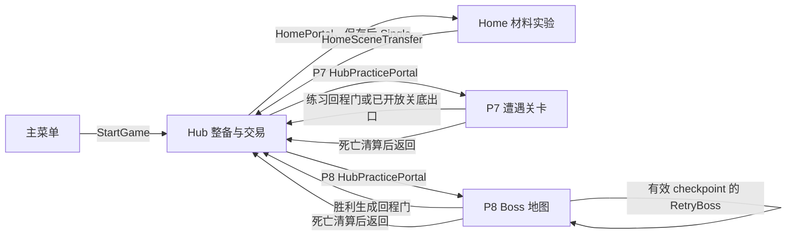
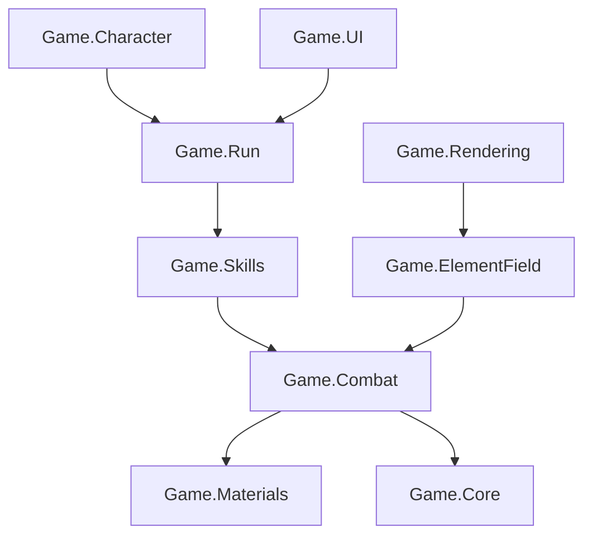
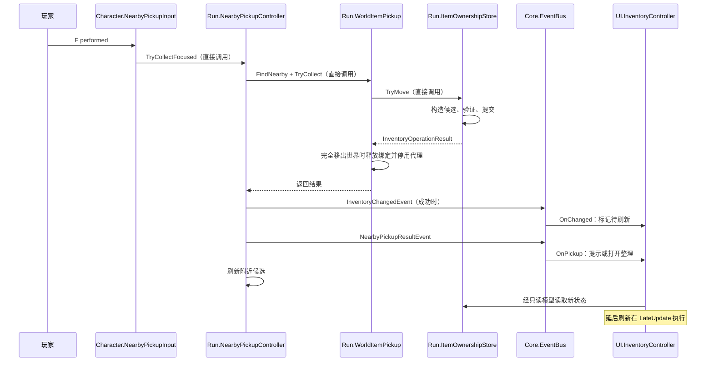

# A1～A3：全局架构、场景流程与一次拾取的完整实现

生成日期与源码核对日期：2026-10-20。  
目标读者：刚接手 Norn 的 Unity/C# 程序员。  
所属阶段：A 阶段，A1、A2、A3 合并资料。  
学习范围：建立正式玩家入口与状态生命周期地图，理解 Assembly 与权威数据边界，完整追踪一次拾取的实现。  
核对方式：读取当前生产脚本、asmdef、已保存 Scene/Prefab/ScriptableObject 和相关测试源码；本次没有运行 Unity Test Runner、人工试玩、Build 或 Profiler。  
学习计划：[Norn 项目代码与架构学习计划](</F:/Develop Project/RPG/RPG/Assets/_Project/Docs/Norn搜打撤、法术编程/2026-10-20 Norn项目代码与架构学习计划.md>)。  
资料模板：[Norn 学习资料模板](</F:/Develop Project/RPG/RPG/Assets/_Project/Docs/Norn搜打撤、法术编程/2026-10-20 Norn学习资料模板.md>)。

## 0. 怎样使用这份资料

接手这个项目时，最容易遇到的问题是：能找到很多与某功能同名的脚本，却无法判断谁真正拥有数据、哪个入口正在正式运行、场景卸载以后哪些对象还存在。例如，搜索 Run 会同时看到关卡遭遇进度、搜打撤局次、玩家库存、P7/P8 携带上下文；它们处理的是不同层面的状态。直接把这些类都理解成“整局管理器”，后面阅读存档和法术代码就会混乱。

本资料先把场景、长期资产和局部状态连接起来，再选“拾取一件地面物品”这个足够小的功能，看完整的输入、规则、数据提交、世界结果和 UI 同步。读完应能完成四件事：

1. 画出主菜单、Hub、Home、P7、P8 的实际进入与返回路径，区分 P7/P8 与通用 Raid。
2. 面对一份新需求，判断应先去哪个 Assembly、哪个状态 Owner，而不先往 UI 或角色 Controller 中塞逻辑。
3. 从 F 键或背包拖拽入口跟到真实物品位置变化，并解释失败为何不会吞掉地面物品。
4. 用状态变化说明设计，不依赖背诵全部类型名。

阅读顺序：[A1 场景与玩家流程](#a1) → [A2 全局架构与状态权责](#a2) → [A3 拾取实现](#a3)。第一次先读正文，第二次按各节源码表打开文件。背包几何算法、完整存档恢复、商店事务和新版法术解释器分别留到 B/C 阶段；这里解释它们与当前流程的连接契约。

全文中的英文标识符用于定位源码。带“教学示例”字样的身份与状态用于简化阅读，不是正式存档中的固定值。所有操作步骤描述当前代码的预期行为，不表示本次已经手动执行过。

## A1

### 1.1 先把游戏理解成“场景环境 + 玩家资产 + 当前活动”

场景环境包含地形、敌人、灯光、触发区域、材料模拟和画面表现。玩家资产包含具体物品、物品归属、钱包和保存记录。当前活动包含清到第几个房间、是否进入 Boss 战、是否正在撤离、是否处于转场。三者的生命周期不同。

当玩家从 Hub 进入 P7，旧 Hub Scene 会被 Single 模式替换，但已经保存的物品不能随旧 Scene 销毁。当一枚投射物在旧地图中尚未命中，转场也不能把这枚场景对象直接变成新地图中的攻击。项目因此将“纯资产与需要连续保留的运行快照”同“依赖具体 Scene 的对象”分开处理。

| 层面 | 代表内容 | 谁负责 | 生命周期直觉 |
|---|---|---|---|
| 玩家资产聚合 | 物品、钱包、商店状态、局次记录 | `SinglePlayerProfile` 与 `ItemOwnershipStore` | 通过 Repository 保存和恢复，逻辑身份可以跨 Scene 保持 |
| 当前 Scene 的运行服务 | 只读库存、法杖资源、拾取、输入连接 | `SinglePlayerInventorySession` 等组件和服务 | 新 Scene 可能重新装配，不应持有已经销毁的旧组件 |
| 跨 Scene 移交上下文 | Repository、目标地图、回程位置、法杖连续性快照 | `HubPracticeSession` 或 `HomeSceneTransfer` | 只在这次跨场景活动需要时保留，完成后释放 |
| 地图局部状态 | 房间进度、Boss 阶段、敌人、材料世界、Projectile | 关卡 Controller、Character、ElementField 等 | 通常随地图创建和释放，不等同于资产续玩档 |

这里的“同一份玩家资产”首先指同一个逻辑身份和一致的数据来源，不要求从头到尾保留同一个 C# 对象引用。跨 Scene 重新从同一个 Repository 反序列化，会得到新的 Profile/Store 对象；物品的 InstanceId 和资产内容才是需要连续保持的契约。

### 1.2 五个正式 Build Scene 分别做什么

当前 [EditorBuildSettings.asset](</F:/Develop Project/RPG/RPG/ProjectSettings/EditorBuildSettings.asset>) 启用了下面五张图。这里是构建清单；实际跳转目标还要看脚本和 Scene 接线。

| Scene 文件 | 玩家职责 | 优先定位的对象或组件 |
|---|---|---|
| [P7_MainMenu.unity](</F:/Develop Project/RPG/RPG/Assets/_Project/Scenes/P7_MainMenu.unity>) | 主菜单、设置、开始游戏 | `MainMenuCanvas` 上的 `DemoMainMenuController`，以及 `DemoSceneTransitionController` |
| [SinglePlayer_Hub.unity](</F:/Develop Project/RPG/RPG/Assets/_Project/Scenes/SinglePlayer/SinglePlayer_Hub.unity>) | 整备、仓库、商店、研究、进入 Home/P7/P8 | `SinglePlayerInventory`、`HomeEntrance_家门`、`远征点 · P7`、`远征点 · P8` |
| [SinglePlayer_Home.unity](</F:/Develop Project/RPG/RPG/Assets/_Project/Scenes/SinglePlayer/SinglePlayer_Home.unity>) | 材料实验、试法、采集、投放及返回 Hub | `SinglePlayerInventory`、`HomeExit_返回据点`、材料世界相关组件 |
| [P7_DemoRun.unity](</F:/Develop Project/RPG/RPG/Assets/_Project/Scenes/P7_DemoRun.unity>) | 连续遭遇、探索、战斗、掉落与关底奖励 | `DemoRunRoot`、各 `DemoEncounterController`、`PracticeModernInventoryBootstrap_新版库存入口` |
| [P8_BossField.unity](</F:/Develop Project/RPG/RPG/Assets/_Project/Scenes/P8_BossField.unity>) | Boss 入场、战斗、重试与胜利回程 | `BossSafeZoneRoot`、`BossEncounterRoot`、`PracticeModernInventoryBootstrap_新版库存入口` |

Scene 名中的 P7/P8 是开发期命名，不能据此推断正式玩家必须先 P7 再 P8。目前 Hub 分别提供两个入口。P7 的旧名为 `P8_StageExitPortal` 的场景对象也不能证明出口会加载 P8：实际行为由它挂载的 `StageExitPortal` 决定，当前该组件请求返回 Hub。



图中的返回都要经过相应资产提交规则。到达 Scene 不等于结算成功，关卡胜利也不等于自动领取所有奖励。

### 1.3 主菜单怎样真正进入 Hub

源码入口是 [DemoMainMenuController.cs](</F:/Develop Project/RPG/RPG/Assets/_Project/Scripts/UI/DemoMainMenuController.cs>) 的 `StartGame()`。按钮调用它，Controller 检查淡入淡出组件存在后，执行 `_sceneTransition.LoadScene(_hubSceneName)`。当前 `_hubSceneName` 默认值为 `SinglePlayer_Hub`。

接着阅读 [DemoSceneTransitionController.cs](</F:/Develop Project/RPG/RPG/Assets/_Project/Scripts/UI/DemoSceneTransitionController.cs>)：

1. `LoadScene()` 用 `_isTransitioning` 阻止重复启动加载。
2. `LoadSceneRoutine()` 先拦截界面交互并淡出，再整理暂停、Cursor 和用户设置。
3. 调用 `SceneManager.LoadSceneAsync`；未指定模式时使用 Single。Editor 遇到存在的完整 Scene 路径时，使用对应的 Editor 加载 API。
4. 新 Scene 自己的淡入组件负责显示画面，因此这里不需要永久保留旧 Scene 的 Fade Controller。

淡出使用 `Time.unscaledDeltaTime`。原因是 Gameplay 可能已经暂停，普通 `deltaTime` 会变为零；如果 Fade 也靠它推进，黑屏过渡就可能停住。

当前主菜单 YAML 还能看到旧 `_gameplaySceneName: P7_DemoRun` 字段，但现在的脚本读取 `_hubSceneName`。阅读旧序列化文本时，要先确认字段仍被当前类型使用。相关架构测试通过 `SerializedObject` 检查当前字段，而不是用旧字符串推断入口。

### 1.4 Hub 的库存怎样初始化

首先打开 [SinglePlayerInventorySession.cs](</F:/Develop Project/RPG/RPG/Assets/_Project/Scripts/Run/Runtime/SinglePlayerInventorySession.cs>)，依次看 `Start()`、`ConfigureAndInitialize()`、`Initialize()`。这个组件装配当前 Scene 的玩家资产服务。

| 步骤 | 入口与实际工作 | 设计原因 |
|---|---|---|
| 1 | `Start()` 选择保存目录和文件系统 | 正式保存、隔离 Sandbox、Editor Preview 需要不同持久化范围 |
| 2 | `ConfigureAndInitialize()` 通过 Catalog 创建配置索引 | 先确认 ContentId 和规则合法，再接受玩家资产 |
| 3 | Repository `TryLoad()` 读取已有 Profile | 只有明确 Missing 才从 StartingInventory 建新档；损坏或不支持的档不能静默变成新档 |
| 4 | 如有 `PendingRaid`，调用恢复日志处理 | 异常关闭留下的资产记录要有裁决，不直接恢复旧地图世界 |
| 5 | `Initialize()` 保存 Profile/Repository 并创建各服务 | 库存读模型、法杖、快捷位、资格、施法事务、材料、容器共享当前资产聚合 |
| 6 | 恢复适合当前世界的地面代理并发布库存变化 | UI 与输入读取同一套资产，避免各自初始化一份库存 |

Hub 与 Home 当前都引用下面两份资产：

- [Catalog.asset](</F:/Develop Project/RPG/RPG/Assets/_Project/ScriptableObjects/World/Hub/Inventory/Catalog.asset>)：允许识别哪些物品配置及其规则。
- [StartingInventory.asset](</F:/Develop Project/RPG/RPG/Assets/_Project/ScriptableObjects/World/Hub/Inventory/StartingInventory.asset>)：没有存档时创建哪些初始实例、位置和资源。它是作者模板，当前真实库存应从 Session 的读模型查看。

`Initialize()` 会创建 `InventoryReadModel` 并为本次读模型生成 `InventoryId`。这个 ID 用于筛选属于当前运行会话的事件；它不等于玩家稳定身份，也不等于物品 InstanceId。

### 1.5 先识别 Editor Preview，避免把重置误判成存档丢失

当前 Hub/Home 的 Session 序列化字段 `_editorProfileMode: 0`，对应 [EditorScenePreviewFileSystem.cs](</F:/Develop Project/RPG/RPG/Assets/_Project/Scripts/Run/Runtime/EditorScenePreviewFileSystem.cs>) 中的 `ScenePreview`。Preview 仍使用真正的 Repository、JSON 和提交规则，但“文件”存放在内存 `Dictionary<string,string>` 中。

| 运行模式 | 资产写到哪里 | Scene 往返 | Stop 后再 Play |
|---|---|---|---|
| 当前 Editor Scene Preview | `EditorScenePreviewFileSystem` 的内存文件表 | 同一次 Play 可以通过原 Repository 保留 | `SubsystemRegistration` 清空，重新从模板开始 |
| Editor Saved Profile（枚举 `SavedProfile = 1`） | 实际文件系统 | 通过保存和恢复保留 | 有合法磁盘存档时继续读取 |
| 正式 Build | 实际文件系统 | 同上 | 从磁盘恢复，具体成功范围受保存边界约束 |

常规目录由 `Application.persistentDataPath/SinglePlayer` 组合；Sandbox 还会追加隔离子目录。Preview 的路径字符串也可能长得像文件路径，不能仅凭字符串判断已经写盘，应看 Session 的 `IsScenePreview`、`ProfileModeDescription` 和实际文件系统实现。

这些是学习时需要辨认的模式，不需要为了阅读本节修改正式 Inspector。保存机制详见后续 B6。

### 1.6 F 交互为什么不会同时拾取和传送

三个输入职责在 Character 中分开处理：站点交互、门交互、附近物品拾取。它们都可能使用 F，因此需要显式的上下文优先级。

| 入口 | 先读的判断 | 后续行为 |
|---|---|---|
| [HubInteractInput.cs](</F:/Develop Project/RPG/RPG/Assets/_Project/Scripts/Character/Interaction/HubInteractInput.cs>) | 是否有可用站点 | 提交仓库、商店或研究等交互意图 |
| [PortalInteractInput.cs](</F:/Develop Project/RPG/RPG/Assets/_Project/Scripts/Character/Interaction/PortalInteractInput.cs>) | 无站点占用、焦点有效、未暂停、已松开旧按键、存在可交互门 | 发布 `PortalInteractionRequestedEvent` |
| [NearbyPickupInput.cs](</F:/Develop Project/RPG/RPG/Assets/_Project/Scripts/Character/Interaction/NearbyPickupInput.cs>) | 无站点占用、无可交互门、附近有物品 | 调用附近拾取控制器，详见 A3 |

门输入在重新启用、获得焦点或暂停时要求先松开 F。这个 `_waitRelease` 状态避免玩家在前一张图按着 F，刚进下一张图就再次传送。它不是加载失败；调试真实键鼠时要先让 Game View 获得焦点并松开按键。

门的可用性来自 [PortalInteractionRegistry.cs](</F:/Develop Project/RPG/RPG/Assets/_Project/Scripts/Run/Runtime/PortalInteractionRegistry.cs>)。门在 `OnEnable` 注册，在 `OnDisable` 注销。Registry 使用 Actor 与目标门 ID 找到对象，再次调用 `CanInteract()`，最后执行 `Interact()`。`Contains()` 使用 Collider 的 `ClosestPoint` 判定接近范围，当前入口并不依赖“碰到 Trigger 就立即切 Scene”。

### 1.7 Hub → P7/P8：把资产送入新 Scene，而不是携带旧人物对象

先读 [HubPracticePortal.cs](</F:/Develop Project/RPG/RPG/Assets/_Project/Scripts/Run/Hub/HubPracticePortal.cs>) 的 `TryEnter()`，再读 [HubPracticeSession.cs](</F:/Develop Project/RPG/RPG/Assets/_Project/Scripts/Run/Hub/HubPracticeSession.cs>) 的 `TryBegin()`、`Load()`、`OnLoaded()`。

这里的 Practice 是类的现有命名。正式 Hub 的 P7/P8 门确实使用这条链，不能因为名字就当成无关测试代码，也不能因此套用通用 Raid 的结算规则。

| 时刻 | 关键动作 | 资产与对象发生什么 |
|---|---|---|
| 门请求被接受前 | 校验当前上下文、目标 Scene、HubReady、资格、工作区 Prefab | 拒绝时不创建第二个上下文，也不偷偷发新装备 |
| 离开前 | `SaveForPortalDeparture()` 构建并保存离图候选 | 保存失败停留原 Scene；清理在候选中考虑，不能提前吞掉现场资源 |
| 保存成功后 | 创建 `HubPracticeSession`，记录 Repository、返回位置、快捷选择、法杖连续性快照 | 新增一个需要跨 Scene 保留的轻量上下文，并冻结异步窗口中的操作 |
| 加载前后 | `DontDestroyOnLoad` 保留上下文，Single 加载目标 | 旧 Hub 玩家、库存组件和世界对象随旧 Scene 释放；新图已有自己的玩家 |
| `sceneLoaded` | 从同一 Repository `TryLoad()` | 获取最新保存代数；不是再调用 StartingInventory 给新玩家一套物品 |
| 新图装配 | 创建 `PracticeInventoryWorkspace`，配置 Session 与拾取，再接实际玩家 | 新的运行服务围绕恢复出的资产建立；输入和 UI 重新绑定 |
| 装配完成 | 激活地图投放、连接关卡内容、恢复适合保留的法杖状态 | 真实物品身份连续，旧地图的飞行攻击和材料世界不被带过来 |

工作区来自 [PracticeInventoryWorkspace.prefab](</F:/Develop Project/RPG/RPG/Assets/_Project/Prefabs/SinglePlayer/PracticeInventoryWorkspace.prefab>)。核心装配代码在 [PracticeInventoryWorkspace.cs](</F:/Develop Project/RPG/RPG/Assets/_Project/Scripts/Run/Hub/PracticeInventoryWorkspace.cs>) 的 `Configure()`：查找并复用目标图暂停协调器，配置附近拾取，初始化库存，恢复资格，再在有 `DungeonRunContent` 时连接掉落内容。

Run 无需引用 Character 或 UI 的具体类型。输入绑定由 Character 的 [PracticePlayerInventoryBinding.cs](</F:/Develop Project/RPG/RPG/Assets/_Project/Scripts/Character/Interaction/PracticePlayerInventoryBinding.cs>) 完成，界面绑定由 UI 的 [PracticeInventoryWorkspaceBinding.cs](</F:/Develop Project/RPG/RPG/Assets/_Project/Scripts/UI/Inventory/PracticeInventoryWorkspaceBinding.cs>) 完成。下一节解释这个依赖方向。

### 1.8 返回、清场、死亡与 Boss Retry 分别走哪条链

**正常回程。** `HubPracticeSession.ReturnToHub()` 先调用工作区 `SaveForLeaving()`，最终进入 Session 的 `SavePracticeForLeaving()`。候选清理本图未带走的地面资产及其子项、结束旧世界相关资源，并保留合法携带。保存成功才允许 Single 返回 Hub。读取失败不能用一份初始新档覆盖问题。

**P7 清场出口。** [StageExitPortal.cs](</F:/Develop Project/RPG/RPG/Assets/_Project/Scripts/Run/Runtime/StageExitPortal.cs>) 收到匹配的 `EncounterCompletedEvent` 后开放。当前 P7 保存配置的 `_encounterIndex` 为 3。玩家还要在可交互范围按 F，出口才调用已有 `HubPracticeSession.ReturnToHub()`。它没有“领取完整法术库再去 P8”的分支；有限随机奖励由另外的奖励机制处理，B9 再深入。

**P8 胜利。** 携带上下文在收到 `RunStateChangedEvent` 后，还要确认当前 `BossEncounterController.State` 确实 Completed，才执行 `SpawnReturnGate()`。因为这个全局事件本身没有 SceneId，必须再核对实际 Boss 权威，避免其他关卡的 Completed 被误认成当前胜利。生成门时会找玩家附近可站立、较空的位置，不直接把门固定在可能无法到达的 Boss 死亡点。

**死亡回程。** `HubPracticeSession.OnPlayerDeath()` 比较真实玩家 Health ID，之后 `ReturnAfterDeath()` 构建退出候选，交给 [PracticeDeathSettlement.cs](</F:/Develop Project/RPG/RPG/Assets/_Project/Scripts/Run/Hub/PracticeDeathSettlement.cs>) 清算，再可靠保存。当前规则保留装备背包本体、仓库和钱包，其他携带资产按规则移除；“保留背包本体”不会递归保护里面全部内容。保存失败保留原数据并重试，不先加载 Hub 假装成功。

**Boss checkpoint。** [BossEntryTrigger.cs](</F:/Develop Project/RPG/RPG/Assets/_Project/Scripts/Run/Runtime/BossEntryTrigger.cs>) 通过携带上下文捕获实际资产 checkpoint，成功后才能开始遭遇。`CaptureBossCheckpoint()` 保存并克隆有效候选，同时记下资格和持物选择。

**显式 Retry。** `RetryBoss()` 只有在 checkpoint 存在、当前未加载、未回程、未进入死亡清算等条件下才接受。它保存 checkpoint 候选后重新加载当前 Boss Scene，由 Scene 重建世界、敌人和人物状态。失败时不冻结并抹掉当前现场。当前死亡路径会启动自动清算回 Hub，不能把 Retry 描述成“任何死亡以后都能无条件恢复 checkpoint”。

暂停菜单的 [DemoPauseMenuController.cs](</F:/Develop Project/RPG/RPG/Assets/_Project/Scripts/UI/DemoPauseMenuController.cs>) 中，`RestartRun()` 当前请求回 Hub，`RetryBoss()` 请求上述 checkpoint 路径，`ReturnToMainMenu()` 在有携带上下文时先保存再导航。方法名与 Inspector 绑定保留，不应仅凭名称解释其现有行为。

### 1.9 Home：共享财产，使用和平转场

Hub/Home 门的组件是 [HomePortal.cs](</F:/Develop Project/RPG/RPG/Assets/_Project/Scripts/Run/Hub/HomePortal.cs>)。它同样复用 F 门交互 Registry，实际加载交给 [HomeSceneTransfer.cs](</F:/Develop Project/RPG/RPG/Assets/_Project/Scripts/Run/Hub/HomeSceneTransfer.cs>)。

流程为：`TryTravel()` 校验路径 → `SaveForPortalDeparture()` → 保留 Repository、回程位置和资源快照 → Single 加载 → `OnLoaded()` 重新读取最新 Profile → 初始化目标 Session、恢复选择与法杖连续性 → 将新玩家放到目标位置。设置玩家位置时暂时禁用 CharacterController，再恢复其原 enabled 状态，避免控制器在传送边界继续参与旧位置的几何处理。

Home 这条链没有创建 Raid。它当前仍通过协调器的 HubReady 等条件判断“可进行和平整备操作”，所以 `HubReady` 在这里表示一种可操作阶段，不能只按字面理解成角色一定站在 Hub Scene。

当前两个 Scene 的关键许可不同：

| Session 字段 | Hub | Home | 影响 |
|---|---|---|---|
| `_worldSceneKey` | `hub.map1` | `home.map1` | 同一资产体系下区分世界地面记录和场景上下文 |
| `_useSpellProgrammingV2` | 开启 | 开启 | 玩家法杖使用新版程序链 |
| `_allowWorldExperiments` | 关闭 | 开启 | Hub 不允许把材料投进世界，Home 提供世界实验玩法 |
| `_allowWarehouse` | 开启 | 关闭 | Home 不因共享 Profile 就拥有远程仓库写权限 |

这些许可由 Gameplay 服务在操作时检查。隐藏一个按钮不足以保证规则；代码直接提交命令时也必须被同样约束。

### 1.10 通用 Raid 为什么要另画一条图

通用搜打撤机制由 [SinglePlayerRunCoordinator.cs](</F:/Develop Project/RPG/RPG/Assets/_Project/Scripts/Run/Runtime/SinglePlayerRunCoordinator.cs>) 的 `Depart()`、`LoadWorld()`、`Finish()`、`ReturnHub()` 协调。当前 [Raid.asset](</F:/Develop Project/RPG/RPG/Assets/_Project/ScriptableObjects/World/Dungeon/Raid.asset>) 的 `WorldScenePath` 指向 [RaidWorldSandbox.unity](</F:/Develop Project/RPG/RPG/Assets/_Project/Scenes/Tests/RaidWorldSandbox.unity>)。它不在上述五图 Build 清单中。

```text
准备携带、保护与资格
→ 记录 PendingRaid 并保存
→ Additive 加载配置地图
→ 将原玩家根对象移入新 Scene，停用旧环境
→ 探索与条件撤离 / 死亡 / 放弃
→ 结算候选可靠保存
→ 玩家移回旧 Scene
→ 卸载本局世界，恢复原环境
```

对比 P7/P8：

| 比较项 | P7/P8 携带链 | 通用 Raid 链 |
|---|---|---|
| Hub 当前可见地图入口 | `HubPracticePortal` 分别配置 P7/P8 | 由独立 Raid 请求入口和 RaidDefinition 配置 |
| Scene 模式 | Single 替换 | Additive 加载，保留原 Scene 的必要对象 |
| 玩家对象 | 使用新地图已有玩家，重新装配库存连接 | 移动已有玩家根对象的 Scene 归属 |
| 关键上下文 | `HubPracticeSession`、工作区、checkpoint | `RaidState`、`PendingRaidRecord`、保护选择、撤离进度 |
| 结束条件 | 对应关卡回程、清场、Boss 胜利或死亡 | 配置的撤离条件和倒计时、失败结果 |
| 回程资产规则 | 练习携带保存 / `PracticeDeathSettlement` | `RaidSettlementService` |

代码存在、灰盒可验证、当前正式入口已接入，是三种不同结论。本节区分它们，B8～B11 再深入 Raid 的规则和事务。

### 1.11 直接 Play 地图为何也有库存

P7/P8 中都保存了 [PracticeInventorySceneBootstrap.cs](</F:/Develop Project/RPG/RPG/Assets/_Project/Scripts/Run/Hub/PracticeInventorySceneBootstrap.cs>)。`Start()` 发现已有 `HubPracticeSession.Current` 时直接返回，让正式携带链接管；没有上下文时才调用 `BeginDirectPractice()`。

这个直接入口只在 Editor 中建立隔离的内存 Repository，再使用同样的工作区装配路径。它没有重新建立旧版 RunSpellSession，也不会把直接 Play 的测试动作写进正式资产目录。

Bootstrap 的 `DefaultExecutionOrder(-900)` 使直接 Play 时的库存建立早于后续 Guide/输入的 Start。正式转场则在 `sceneLoaded` 回调里接管，早于目标 Scene 的 Start，避免目标 Session 再沿默认路径生成一份新档。

### 1.12 A1 的状态生命周期与排查入口

| 状态或对象 | 由谁持有 | 什么时候建立 | 什么时候释放或替换 |
|---|---|---|---|
| Profile/Store | 当前 Session；移交上下文也保留必要引用 | 加载或新档初始化 | 场景移交时从同一 Repository 恢复，采用候选时更新聚合 |
| 玩家 GameObject | 当前 Scene | Scene 加载或已有场景对象激活 | Single 时旧对象释放；通用 Raid 则显式移动 Scene 归属 |
| `HubPracticeSession.Current` | 跨 Scene 上下文 | Hub 进 P7/P8，或 Editor 直接 Play | 正常返回 Hub/主菜单后销毁；OnDestroy 注销 sceneLoaded |
| `HomeSceneTransfer.Current` | 和平转场上下文 | 首次进入 Home | 返回完成后销毁并注销回调 |
| 法杖 Mana/冷却/抽牌进度 | Run 的法杖服务 | Session 装配与实例同步 | 需要连续保留时移交快照；死亡/重试按生命边界处理，不迁移旧 Projectile |
| 材料世界、敌人与飞行对象 | 当前地图和相关系统 | 当前 Scene 建立 | 场景结束走各自释放链；资产保存不等于保存完整世界模拟 |

新接手时按以下顺序读源码：

| 顺序 | 文件和入口 | 阅读目的与下一跳 |
|---|---|---|
| 1 | `DemoMainMenuController.StartGame` → `DemoSceneTransitionController.LoadScene` | 确认游戏第一步实际加载哪里，为什么 Fade 不受暂停冻结 |
| 2 | `SinglePlayerInventorySession.Start/ConfigureAndInitialize/Initialize` | 确认资产从哪里来，区分 Missing、加载失败和 Preview |
| 3 | `HubPracticePortal.TryEnter` → `HubPracticeSession.TryBegin/OnLoaded` | 追踪正式 P7/P8 的移交；找新 Scene 工作区创建点 |
| 4 | `PracticeInventoryWorkspace.Configure` | 观察资产、实际玩家、暂停、输入与 UI 怎样通过各自模块接起来 |
| 5 | `HomePortal.Interact` → `HomeSceneTransfer.TryTravel/OnLoaded` | 比较和平转场与 P7/P8；解释共享资产为何不等于共享仓库权限 |
| 6 | `HubPracticeSession.ReturnToHub/ReturnAfterDeath/RetryBoss` | 分别说明正常返回、死亡、checkpoint，避免只背“换场景就保存” |

本节需要记住的是场景路线和移交边界。无需记忆每个 Inspector fileID、GUID、传送坐标或临时 GameObject 名。

## A2

### 2.1 从文件夹走到 Assembly，再走到运行职责

Unity 的 Assembly Definition（asmdef）决定哪些脚本一起编译，以及能引用哪些其他程序集。文件夹提供导航，asmdef 才提供编译边界。某个脚本位于 Character 下，就应遵守 Game.Character 的依赖；把类名写成 Manager 并不能改变它能访问什么。

项目中的九个主要玩法 Runtime Assembly 之外，还存在输入配置相关的 `Game.Input`、Editor 工具程序集和测试程序集。因此“九模块”描述主要玩法分工，不代表全项目只有九个 asmdef。

| 目录入口 | 主要内容 | 新接手时的读法 |
|---|---|---|
| [Scripts](</F:/Develop Project/RPG/RPG/Assets/_Project/Scripts>) | 九个玩法模块的代码和 asmdef | 先定 Owner，再进入对应模块的 Data/Core/Runtime 或领域子目录 |
| [ScriptableObjects](</F:/Develop Project/RPG/RPG/Assets/_Project/ScriptableObjects>) | 物品、法术、法杖、世界与输入配置 | 用当前 Scene/Prefab 引用确认实际使用哪份 SO，不按相似文件名猜 |
| [Scenes](</F:/Develop Project/RPG/RPG/Assets/_Project/Scenes>) | 正式地图、Tests、Prototypes 和来源场景 | 先确认正式入口和 Build Settings，再看 Review 或原型 |
| [Prefabs](</F:/Develop Project/RPG/RPG/Assets/_Project/Prefabs>) | 工作区、世界交互和其他 Prefab | 重点看组件组合与字段引用；实际值还可能由 Scene Override 覆盖 |
| [Art](</F:/Develop Project/RPG/RPG/Assets/_Project/Art>) | 模型、材质、贴图、动画及相关 Prefab | 画面和资产效果从这里查，逻辑资产身份仍回到 Run/Skills |
| [Editor](</F:/Develop Project/RPG/RPG/Assets/_Project/Editor>) | 生成、迁移、接线和维护工具 | 在 `Game.Project.Editor` 中；工具能生成内容，不代表它在 Build 中运行 |
| [Tests](</F:/Develop Project/RPG/RPG/Assets/_Project/Tests>) | EditMode、PlayMode、Fixtures | 通过测试场景和断言理解契约，再确认是否有真实运行结果 |

Spell 资源目前按 Definitions、Items、Wands、Programs、Libraries 分责。法术规则 SO 与能放进玩家背包的法术物品 SO 分开：前者定义指令，后者将该指令接入物品、图标和库存规则。这不是重复持有两份法术资产，具体对应关系在 B1/C1 展开。

### 2.2 九个模块的当前依赖表

下面依据实际 asmdef 解析整理，“A 引用 B”表示 A 编译时可使用 B 的公开类型。包依赖单列，不与业务层级混在一起。

| Assembly 与配置文件 | 第一方玩法依赖 | 自己负责什么 | 不能顺手承担什么 |
|---|---|---|---|
| [Game.Core](</F:/Develop Project/RPG/RPG/Assets/_Project/Scripts/Core/Game.Core.asmdef>) | 无 | 日志、事件基础、共享轻量契约与请求/结果数据 | 不读取 Run 的 Profile，不引用角色、背包 UI 或物品 SO |
| [Game.Materials](</F:/Develop Project/RPG/RPG/Assets/_Project/Scripts/Materials/Game.Materials.asmdef>) | 无 | 稳定材料身份与共享材料定义 | 不拥有玩家库存，也不负责具体 Scene 的模拟对象 |
| [Game.Combat](</F:/Develop Project/RPG/RPG/Assets/_Project/Scripts/Combat/Game.Combat.asmdef>) | Core、Materials | 生命、伤害、Projectile、状态和战斗契约 | 不调用法术解释器，不直接修改 UI，不依赖 ElementField 的具体实现 |
| [Game.Skills](</F:/Develop Project/RPG/RPG/Assets/_Project/Scripts/Skills/Game.Skills.asmdef>) | Core、Combat | 法术定义、编译、求值、执行图、预览和执行结果 | 不给玩家发物品、不创建 Scene 对象、不直接支付库存 |
| [Game.Run](</F:/Develop Project/RPG/RPG/Assets/_Project/Scripts/Run/Game.Run.asmdef>) | Core、Combat、Skills | 玩家资产、法杖资源、材料事务、经济、持久化、局次和转场协调 | 不引用 Character Controller 或具体 UI 实现，不通过反向引用 Instantiate 角色行为 |
| [Game.Character](</F:/Develop Project/RPG/RPG/Assets/_Project/Scripts/Character/Game.Character.asmdef>) | Core、Combat、Skills、Run；另含 Game.Input | 玩家和敌人行为、输入、FSM、Animator、Unity 施法桥 | 不复制另一份钱包/库存，不把 UI 变成 Gameplay 必须依赖的组件 |
| [Game.ElementField](</F:/Develop Project/RPG/RPG/Assets/_Project/Scripts/ElementField/Game.ElementField.asmdef>) | Core、Combat、Materials | 材料世界、模拟、查询、转换、角色接触与世界写入 | 不由 Rendering 反向裁定材料数量，不直接拥有玩家 Profile |
| [Game.Rendering](</F:/Develop Project/RPG/RPG/Assets/_Project/Scripts/Rendering/Game.Rendering.asmdef>) | Core、Combat、ElementField、Materials | 消费只读状态的渲染与相机/准星等表现 | 不修改材料或生命权威，不依赖 Character 的实现 |
| [Game.UI](</F:/Develop Project/RPG/RPG/Assets/_Project/Scripts/UI/Game.UI.asmdef>) | Core、Combat、Skills、Run | 背包、仓库、商店、研究台和 HUD；发请求、读结果 | 不直接修改归属表，不通过 Character 查询角色私有数据 |

第三方包依赖例如 UI 的 `UnityEngine.UI`/`Unity.InputSystem`、Rendering 的 URP/Cinemachine、ElementField 的 `Unity.Collections`。部分 asmdef 使用 `GUID:...` 引用，部分使用名称；两者都需要解析到实际程序集后再判断层级，不能把 GUID 当作“没有依赖”。



这张图只突出主要方向，完整直接依赖以表格为准。箭头表示编译引用，不表示每次 Gameplay 都必须依次调用所有层。

### 2.3 四类职责为什么不能混在一起

以一件苹果为例，作者需要配置名称、Icon、模型、形状和可用能力；玩家需要拥有“这一件苹果”的具体身份；拾取需要验证它能否进入背包；Unity 需要显示它的模型并处理输入。若把四件事全放在一个 MonoBehaviour 上，保存恢复会依赖场景对象，UI 操作也容易变成修改 SO，从而改变所有同类物品。

项目把它们拆成下面四层：

| 职责 | 本节实际类型 | 读写与生命周期 |
|---|---|---|
| 共享配置 | `ItemDefinition`、`ItemCatalog`、`InventoryItemRules` | 作者通过 SO 配置，Runtime 创建规则索引；实例不能把当前位置写回共享定义 |
| 可变资产状态 | `SinglePlayerProfile`、`ItemOwnershipStore`、`RuntimeItemState` 与 `ItemLocation` | Profile 聚合资产；Store 受控地发布新归属状态，实例保留稳定身份 |
| 规则与校验 | `InventoryGrid`、Store 的候选验证、领域操作服务 | 根据输入裁决，不依赖背包面板是否打开；可用 EditMode 测试规则 |
| Unity 与表现 | `NearbyPickupInput`、`WorldItemPickup`、`SinglePlayerInventoryController` | 接输入、GameObject、生命周期和界面；不另建真实资产来源 |

“纯规则”在本项目主要指不依赖 Scene 生命周期和真实玩家资源副作用，不代表整个 Game.Skills 程序集完全不引用 Unity 类型。SO、Vector 等仍可能出现在它的配置或数学数据中。学习时要具体分析方法做了什么，而不是从“纯”这个词推断没有任何 Unity 引用。

### 2.4 玩家数据的 Owner 层级

首先读 [SinglePlayerProfile.cs](</F:/Develop Project/RPG/RPG/Assets/_Project/Scripts/Run/Persistence/SinglePlayerProfile.cs>)。它聚合 `Items`、`Currency`、`Shop`、`PendingRaid`、`LastRaidReceipt`、`SaveGeneration` 和一些进程内状态。它没有保存 Scene、敌人数组或整个材料模拟，因此读取 Profile 不能自动恢复上次世界现场。

接着读 [ItemOwnershipStore.cs](</F:/Develop Project/RPG/RPG/Assets/_Project/Scripts/Run/Inventory/ItemOwnershipStore.cs>)。它的关键结构是：

```csharp
private Dictionary<string, InventoryEntry> _items = new Dictionary<string, InventoryEntry>(StringComparer.Ordinal);
```

键是具体物品 `InstanceId`，值是“一份实例状态 + 它的唯一位置”。`InventoryEntry` 是 `readonly struct`，包含 `RuntimeItemState Item` 和 `ItemLocation Location`。背包、仓库和法杖槽并不各自持有一份同一物品的真实副本，而是通过 Location 对这张归属表作不同投影。

```text
SinglePlayerInventorySession：装配服务、持有当前 Profile 和 Repository
  └─ SinglePlayerProfile：聚合玩家资产
      ├─ Items：ItemOwnershipStore
      │   └─ InstanceId → InventoryEntry(Item, Location)
      ├─ Currency / Shop：钱包和商店状态
      ├─ PendingRaid / LastRaidReceipt：局次记录
      └─ SaveGeneration：已经确认的保存代数

UI → InventoryReadModel → 当前 Profile.Items
```

法杖 Mana、Cast/Reload、抽牌进度还有自己的 Run 服务 Owner：[WandLoadoutService.cs](</F:/Develop Project/RPG/RPG/Assets/_Project/Scripts/Run/Wands/WandLoadoutService.cs>)。角色只请求和消费它的结果。人物生命权威则位于 Combat 的 [HealthComponent.cs](</F:/Develop Project/RPG/RPG/Assets/_Project/Scripts/Combat/Damage/HealthComponent.cs>)。所以“Run 管理资产”不等于 Run 拥有每一种 Gameplay 状态。

### 2.5 五种身份与两个版本不要混用

| 名称 | 业务意义 | 本节中的例子 | 是否用于长期保存 |
|---|---|---|---|
| `ContentId` | 哪种配置 | 苹果配置为 `item.food.apple` | 是，连接配置与存档 |
| `InstanceId` | 哪一件具体资产 | 某一件苹果；教学图简写为 `apple-A`，真实新发放通常生成 Guid | 是，移动不应重新生成 |
| `ActorId` | 哪个逻辑玩家拥有根装备或专区 | StartingInventory 当前使用 `player` | 是，和 Unity GameObject 实例不同 |
| `InventoryId` | 哪个运行库存视图的事件范围 | 当前 Session 创建读模型时生成 | 不作为物品存档身份；新 Session 可以不同 |
| `WorldOwner` / Location.OwnerId | 当前世界位置属于哪个来源上下文，或嵌套位置的父实例 | 地面上下文、背包实例 ID、法杖实例 ID | 按位置类型保存；不能总解释成玩家 ID |
| `Items.Version` / `ExpectedVersion` | 运行归属表变更代数，以及请求看到的是哪一代 | 拖拽开始时看到 V，提交时要求仍为 V | 可在资产数据中维护，但用途是当前操作一致性，不是全局唯一身份 |
| `SaveGeneration` | Repository 已确认的保存代数 | 成功持久化后推进 | 是，防止旧候选覆盖更新提交 |

另一个经常出现的 ID 是 Unity `GetInstanceID()`。它适合当前运行内识别 Health、门或 GameObject，不能代替 ContentId 或 InstanceId 写成长期资产身份。

为什么两个版本都需要？移动物品可以已经在内存中生效，但尚未写盘，此时 `Items.Version` 与 `SaveGeneration` 的推进并不同步。反过来，某些保存和 Scene 移交会确认新保存代数，而不代表用户又拖动了一件物品。它们保护的是不同边界。

### 2.6 UI 的只读数据究竟是什么

打开 [IInventoryReadOnly.cs](</F:/Develop Project/RPG/RPG/Assets/_Project/Scripts/Run/Inventory/IInventoryReadOnly.cs>)。接口提供 `TryGetView`、`CopyItemsTo` 等查询，不提供“直接把数量减一”或“修改位置”的写方法。`InventoryItemSnapshot` 是给界面的值投影，包含名称、图标、种类、位置、剩余次数和必要规则。

Snapshot 的作用是让 UI 描述当前状态，而非拿到 Store 的写入口。它仍可包含 Sprite、GameObject 资源引用等展示信息；`readonly struct` 也不是自动深拷贝所有引用对象的魔法。具体是否冻结、哪些对象可写，要看构造和暴露的权限。

`InventoryReadModel` 持有 Profile 引用，再通过 `profile.Items` 读取当前 Store。因此同一个 Scene 采用新资产候选时，UI 可以继续使用读模型，不必把所有界面强制重建。跨 Scene 则由新 Session 建立新的读模型和事件范围。

`IInventoryPlacementPreview` 只给空间预览。鼠标悬停显示绿色不等于执行一定成功：预览后库存可能改变，资源可能被占用，实际拾取距离也可能失效。真正提交仍要重验版本、归属、权限和容量。

### 2.7 三种通信方式，各自解决什么问题

| 方式 | 本节实例 | 适合的职责与代价 |
|---|---|---|
| 允许依赖内的直接调用 | Character 的 `NearbyPickupInput` 调用 Run 的 `TryCollectFocused()` | 调用关系明确，可立即得到返回值；调用方必须遵守 asmdef 依赖 |
| 请求事件 | UI 发布 `InventoryCommandEvent`，或 Character 发布门交互请求 | 发布者提交意图，接收方负责验证；需要范围 ID、目标 ID 和明确的处理职责 |
| 事实事件 + 只读查询 | `InventoryChangedEvent` 通知界面重新读 `IInventoryReadOnly` | 事实携带最少变化信息，显示从权威读模型取得；需要正确订阅、过滤和时序处理 |

当前事件通道是 [EventBus.cs](</F:/Develop Project/RPG/RPG/Assets/_Project/Scripts/Core/EventBus.cs>)。下面只摘录类型约束和保存订阅关系的字段，方法在源码中继续阅读：

```csharp
public static class EventBus<T> where T : struct, IGameEvent
{
    private static event Action<T> _event;
}
```

每个具体事件类型 T 都有自己的静态委托集合。`Subscribe`/`Unsubscribe` 添加或移除处理函数，`Publish(T evt)` 通过 `_event?.Invoke(evt)` 在当前调用栈同步执行订阅者。

需要理解四个实际约束：

1. **同步不等于排队。** Publish 返回前，相关回调可能已经修改状态、关闭界面或停用对象；提交前后要考虑重入式的事件传播。
2. **不能依赖不同对象的订阅顺序做业务。** 一个订阅者刷新法杖，一个订阅者画 UI，不应假设前者永远先运行。
3. **泛型值类型减少分发装箱，但不保证所有订阅者零分配。** 回调内部创建字符串或候选表仍有成本。
4. **分发需要执行 H 个处理函数。** 静态泛型避免了按 Type 查找入口，不意味着总派发成本是 O(1)；总成本至少包含各回调的执行。

静态委托持有订阅对象的强引用，所以 `OnEnable`/`OnDisable` 对称订阅很重要。`Clear()` 存在不代表 Unity 每次卸载 Scene 都会自动调用它；本节涉及的组件主要通过显式取消订阅和 Registry 清理管理生命周期。

### 2.8 为什么 Core 不依赖 Run，仍能定义库存请求

[InventoryCommandEvent.cs](</F:/Develop Project/RPG/RPG/Assets/_Project/Scripts/Core/Events/InventoryCommandEvent.cs>) 中的请求字段是命令枚举、字符串身份、坐标、槽位、版本和 RequestId。它不携带 ItemOwnershipStore、Profile 或 ItemDefinition 具体实例，因此 Core 可以定义跨域协议，同时保持底层不引用上层。

请求含有某个物品 ID，只表示“我希望操作这件物品”。接收方仍要验证这个 ID 属于当前范围、来源位置仍有效、目的地合法。把一个合法 RequestId 加到请求中也不会自动得到业务幂等保证；是否防重复要看接收服务的具体规则。拾取通过源位置、代理去重和版本等保护，交易则还有专门的收据协议。

### 2.9 Run 不认识 Character，为什么能在 P7/P8 装好角色

A1 的工作区就是一个具体例子。Run 的 `PracticeInventoryWorkspace` 暴露 Session、Nearby、Pause 和玩家 Transform。它不需要知道 `WizardController` 的字段，也不需要调用 UI 的背包面板。

Character 的 `PracticePlayerInventoryBinding.Awake()` 读取工作区，给实际玩家装配持物输入、容器使用、材料采集与 `OwnedWandCastAdapter`，再调用 Wizard 的绑定入口。UI 的 `PracticeInventoryWorkspaceBinding.Awake()` 读取同一工作区，绑定背包、暂停菜单和相关 HUD。两者各自引用 Run，Run 不引用它们。

这是把装配放在“有权限认识两边”的上层。收益是库存、保存和规则不需要依赖玩家职业或某个具体界面；代价是 Prefab 的桥接组件与执行顺序必须正确接线。出现“新图物品存在但按键或界面无效”时，应先检查桥接与工作区配置，而不是给 Run 加一个反向的 Character 引用。

### 2.10 状态机也分层，不能用一个 State 概括全部游戏

| 状态 | Owner 与脚本入口 | 回答的问题 |
|---|---|---|
| 角色动作 FSM | [PlayerControllerBase.cs](</F:/Develop Project/RPG/RPG/Assets/_Project/Scripts/Character/Controllers/PlayerControllerBase.cs>) 及 PlayerStates | 本帧由移动、空中、Dash 还是施法逻辑驱动角色？ |
| 地牢遭遇和顺序 | [DemoRunController.cs](</F:/Develop Project/RPG/RPG/Assets/_Project/Scripts/Run/Runtime/DemoRunController.cs>) / RunProgressTracker | 当前第几个 Encounter，是否满足顺序与终局条件？ |
| Boss 遭遇 | [BossEncounterController.cs](</F:/Develop Project/RPG/RPG/Assets/_Project/Scripts/Run/Runtime/BossEncounterController.cs>) | Boss 战尚未开始、进行中还是结束？ |
| 通用 Raid 阶段 | [RaidState.cs](</F:/Develop Project/RPG/RPG/Assets/_Project/Scripts/Run/Raids/RaidState.cs>) | HubReady、出发、探索、撤离、结算或 SaveFailed？ |
| 暂停所有权 | [RunPauseCoordinator.cs](</F:/Develop Project/RPG/RPG/Assets/_Project/Scripts/Run/Runtime/RunPauseCoordinator.cs>) | 当前是否还有任一系统要求暂停？ |

暂停用多个原因的 bit mask，界面申请或释放自己的原因。关闭背包时若 Pause Menu 仍持有暂停，不能直接把 `Time.timeScale` 改回 1。这也是为什么共享工作区要复用目标图原有暂停协调器，而不是再建一个各自覆盖 TimeScale 的系统。

### 2.11 如何根据需求快速选择代码入口

| 你观察到的问题或要理解的功能 | 先打开 | 接着看 |
|---|---|---|
| 进入地图后库存重置 | Session 初始化 / `HubPracticeSession.OnLoaded` | Repository 模式、Bootstrap 是否错误另建新档 |
| 物品数据合法但 UI 不显示 | `InventoryReadModel.TryGetView/CopyItemsTo` | UI 的 InventoryId 过滤、Open 状态、LateUpdate 刷新 |
| F 有提示但拿不起来 | `NearbyPickupInput.OnPickup` | 附近查询、WorldItemPickup.TryCollect、Store 返回原因 |
| 满包仍吞掉地面模型 | `WorldItemPickup.TryCollect` | 成功分支是否真的发生、是否材料部分合并、外部谁停用了模型 |
| 移动物品后法杖预览没更新 | `SinglePlayerInventorySession.OnInventoryChanged` | Wand 同步与 UI 延迟刷新，不能只查图标 |
| 候选合法但无法回程 | `SavePortalCandidate/BuildPortalCandidate` | 待落地掉落、资源忙、Repository 保存结果 |
| 世界数量与容器数量不一致 | Run 的材料/容器服务 | Core 请求结果契约与 ElementField 的世界写入；不是只改显示数字 |
| 法术有执行结果却没有攻击对象 | Character 的 [SpellCaster.cs](</F:/Develop Project/RPG/RPG/Assets/_Project/Scripts/Character/Spells/SpellCaster.cs>) | 动画释放、Owned 事务、冻结计划和 Projectile 生命周期，详见 C8/C9 |

这些是阅读入口，不是预判根因。排查时应先观察输入、状态与返回结果，再沿边界缩小范围。A3 用一次拾取演示这个过程。

## A3

### 3.1 选择一个最小、真实的功能

本节选择“玩家按 F 拾取一件苹果到已经装备的背包”。苹果定义来自 [Item_Food_Apple.asset](</F:/Develop Project/RPG/RPG/Assets/_Project/ScriptableObjects/Items/Food/Item_Food_Apple.asset>)：`ContentId = item.food.apple`，形状为一格，MaxStack 为 1，当前使用能力为 Throw。物品被分类为 Consumable 并不表示已经实现了吃苹果回血，本节只研究拾取。

示例前提：玩家未暂停、附近没有站点或门占用 F、苹果已经注册为当前世界资产、背包有合法空位。为阅读方便，将这件苹果的真实 Guid 简写为 `apple-A`，背包实例简写为 `bag-A`，初始库存版本记为 V。

成功应表现为：苹果进入背包、身份不变、地面代理消失、附近列表更新；失败应表现为：苹果仍在地上，位置与数量不变，必要时打开背包帮助整理。这些结果必须由真实资产变化推动，不能用“先把模型隐藏，再让 UI 自己加一行”替代。

### 3.2 先认识参与者，再读调用链

| 参与者与源码 | 具体职责 | 关键入口 |
|---|---|---|
| [ItemDefinition.cs](</F:/Develop Project/RPG/RPG/Assets/_Project/Scripts/Run/Inventory/ItemDefinition.cs>) | 共享物品配置，提供形状、分类、图标等规则来源 | 只读属性、`TryCreateRules` |
| [RuntimeItemState.cs](</F:/Develop Project/RPG/RPG/Assets/_Project/Scripts/Run/Inventory/RuntimeItemState.cs>) | 这一件苹果的身份与实例状态 | 构造和 `Create`，移动时不能重新调用 Create |
| [ItemLocation.cs](</F:/Develop Project/RPG/RPG/Assets/_Project/Scripts/Run/Inventory/ItemLocation.cs>) | 唯一位置的值快照，记录位置类型、Owner、坐标和旋转 | `ItemLocation`、`HasParentInstance` |
| [NearbyPickupInput.cs](</F:/Develop Project/RPG/RPG/Assets/_Project/Scripts/Character/Interaction/NearbyPickupInput.cs>) | F 与滚轮的 Input System 连接 | `Awake`、`CanUse`、`OnPickup`、`OnScroll` |
| [NearbyPickupController.cs](</F:/Develop Project/RPG/RPG/Assets/_Project/Scripts/Run/Hub/NearbyPickupController.cs>) | 维护附近候选和焦点，选择目的地并尝试拾取 | `RefreshCandidates`、`TryCollectFocused`、`TryCollect` |
| [WorldItemPickup.cs](</F:/Develop Project/RPG/RPG/Assets/_Project/Scripts/Run/Runtime/WorldItemPickup.cs>) | 将场景代理绑定到已有资产，校验来源和执行时距离 | `TryBind`、`FindNearby`、`TryCollect`、`OnCommand` |
| [ItemOwnershipStore.cs](</F:/Develop Project/RPG/RPG/Assets/_Project/Scripts/Run/Inventory/ItemOwnershipStore.cs>) | 验证和发布唯一归属变化 | `TryMove` → `TryApply` → `ValidateAll` → `FinishCandidate` |
| [InventoryGrid.cs](</F:/Develop Project/RPG/RPG/Assets/_Project/Scripts/Run/Inventory/InventoryGrid.cs>) | 验证占格、边界、堆叠相容与容量 | `Validate`、`Overlaps` |
| [IInventoryReadOnly.cs](</F:/Develop Project/RPG/RPG/Assets/_Project/Scripts/Run/Inventory/IInventoryReadOnly.cs>) | 给 UI 提供当前资产的只读投影 | `InventoryReadModel.TryGetView/CopyItemsTo` |
| [SinglePlayerInventoryController.cs](</F:/Develop Project/RPG/RPG/Assets/_Project/Scripts/UI/Inventory/SinglePlayerInventoryController.cs>) | 消费变化/结果，显示背包、失败提示与整理入口 | `OnChanged`、`OnPickup`、`LateUpdate`、`Refresh` |

输入位于 Character，拾取和资产规则位于 Run，显示位于 UI，事件契约位于 Core。一次功能经过四个模块，但每个模块处理的是它有权处理的部分。

### 3.3 完整成功链：F 键路径



上图的第一段是直接调用，不是“所有输入先发 InventoryCommandEvent”。F 键路径与拖拽路径共用资产规则，但进入方式不同。UI 的查询也不直接访问私有 Dictionary，而是经读模型取得值快照。

### 3.4 地面上为什么已经有一件资产

拾取以前，Store 中就应有 `apple-A`，位置为 `WorldItem`。WorldItemPickup 的职责是搬动已有身份，不负责再发放一件同名资产。物品可能来自三类来源：

| 来源 | 当前代码入口 | 资产产生与拾取的区别 |
|---|---|---|
| 作者场景投放 | [WorldItemSpawnPoint.cs](</F:/Develop Project/RPG/RPG/Assets/_Project/Scripts/Run/Runtime/WorldItemSpawnPoint.cs>) 的 `TryActivate`，进入 Session 注册方法 | SceneKey+SpawnId 识别一次投放；注册成功再隐藏作者模型，运行代理绑定新建的那件资产 |
| 玩家丢弃 | `SinglePlayerInventorySession.Drop` | 仍是原 InstanceId，只改成世界位置；先准备隐藏代理和合法落地位置，再提交归属 |
| 地牢掉落或奖励 | 对应 Loot/Reward 入口，再由 Session 注册本图资产 | 新发放时生成新身份；随后拾取仍只搬动，不再次抽奖或复制 |

常规场景注册方法 `TryRegisterWorldItem()` 会构建资产与生成账候选，保存成功才采用。它与本节的普通拾取不是同一步：注册可能增加 Store 总实例数；拾取一件普通物品通常不增加实例总数。

`TryBind()` 要求 Store 中该实例确实位于匹配的 WorldOwner，之后以 `(ItemOwnershipStore, ItemId)` 为键加入静态代理 Registry。使用 Store 引用加实例 ID，是为了让不同隔离 Store 中相同测试 ID 不相互冲突，同时保证同一 Store 的同一件世界物品只有一个绑定代理。

Registry 是一个查找和去重结构，不是第二份玩家库存。代理销毁或完成拾取时释放绑定；普通 OnDisable 只停止事件订阅，不立即让其他代理冒领同一身份。`CopyNearby` 会过滤停用代理，因此“仍有身份绑定”与“当前可以拾取”是不同事实。

### 3.5 附近列表怎样找到正确目标

`NearbyPickupController` 当前 `_reach` 默认值及 Hub/Home 保存配置都是 3。`Update()` 约每 0.1 秒调用 `RefreshCandidates()`，通过 `WorldItemPickup.CopyNearby()` 从已注册代理中筛选候选。

它没有在每帧用 FindObjects 搜全场，也没有靠碰撞回调直接转移资产。筛选逐项检查：

1. 代理是仍有效的 Unity Object，没有完成拾取，且 `isActiveAndEnabled`。
2. `InventoryId` 匹配当前读模型，避免处理其他库存上下文的代理。
3. 代理和玩家属于同一个 Scene，避免 Additive 或测试隔离时跨图取物。
4. 位置差向量的 `sqrMagnitude` 不超过 `reach * reach`。
5. 按距离排列；距离相同再按 ItemId 的 Ordinal 顺序打破平局。

比较距离平方避免为每个候选开平方，因为这里只要判断范围和排序，不需要以米显示距离。固定身份排序可以减少同距离物品的选择抖动，但不能保证 Dictionary 本身按固定顺序枚举；稳定顺序来自显式排序。

| 数据 | 类型、Owner 与用途 | 更新方式 |
|---|---|---|
| `_items` | `WorldItemPickup[]`，Controller 当前候选 | 用于显示、选择与 GetItemId |
| `_scratch` | 同类型临时 Buffer | 查询写入后与 `_items` 交换引用，复用数组 |
| `FocusedPickup` | 一个代理引用 | 尽量按原 ItemId 保留焦点；消失时选择合法索引 |
| `SelectedIndex` | 当前列表索引 | 滚轮或候选变化后更新，不作为长期物品身份 |
| `Revision` | 附近列表内容/选择变化的代数 | 列表 UI 判断需不需要重画，不等于库存 Version |

两个 Buffer 初始容量为 64。代理注册边界的 `WorldItemVisualBoundEvent` 会让 Controller 按需要扩大容量；稳定的附近查询复用这些数组。Registry 变化发生在离散绑定/释放时，避免单纯走近更多物品时才在查询热路径扩容。

附近列表只是一份空间观察结果。玩家可能在显示之后走远，物品也可能被其他操作移动，所以真正执行时仍需重新查找和验证。

### 3.6 F 输入如何到达规则层

`NearbyPickupInput.Awake()` 创建 Input System 的 F Action 和滚轮 Action，在 OnEnable 启用，在 OnDisable 关闭，在 OnDestroy 解除回调并 Dispose。这里创建发生在初始化，不是每帧 new Action。

`OnPickup()` 的实际逻辑按原语义展开如下，仅调整换行：

```csharp
private void OnPickup(InputAction.CallbackContext _)
{
    if (CanUse && !PortalInteractInput.HasTarget)
    {
        LastPickupFrame = Time.frameCount;
        _pickups.TryCollectFocused();
    }
}
```

`CanUse` 包含窗口焦点、TimeScale、有效附近列表和站点优先级。这个输入门负责避免明显不合时宜的操作；Run 还会校验转场写锁等状态，所以不能把 Character 的判断当作完整资产验证。

`TryCollectFocused()` 取得当时选中的 ItemId，再调用 `TryCollect(itemId)`。如果原目标已经失效，不能悄悄换成另一件苹果或另一份法术。玩家选择的是一件具体资产，不是“任意最近的同名物品”。

### 3.7 自动拾取怎样选择目的地

`NearbyPickupController.TryCollect()` 先重新调用 `FindNearby()`，读取玩家实际装备的背包和目标快照，再按种类尝试：

| 目标类型 | 自动尝试顺序 | 为什么需要这个顺序 |
|---|---|---|
| 固体材料实例 | 先尝试补入同类相容材料堆，再找背包位置 | 避免一小份材料先占空格，已有材料堆却仍有余量 |
| 法术卡 | 先按槽位尝试法术专区，满了再尝试普通背包 | 专区与普通背包是不同容量；专区满不代表整次拾取必须失败 |
| 背包外壳 | 当前没有装备背包时尝试装备位 | 背包本体不能嵌套塞进另一个背包；已有外壳时也不能自动换掉 |
| 普通物品，包括本例苹果 | 在真实装备背包中尝试旋转和坐标 | 不直接送仓库，不从 UI 预览的其他背包推断可用携带空间 |
| 法杖 | 自动拾取时属于普通背包占格物品；装备位置由明确操作指定 | WorldItemPickup 支持装备目的地，不代表 F 自动拾取会替玩家换杖 |

普通背包扫描依次尝试四个 QuarterTurns、每一行 y、每一列 x。宽高先通过形状和旋转计算，实际占格与堆叠合法性仍由 Store/InventoryGrid 裁定。

这是一种“依次提出候选目的地”的策略，不是 Controller 先占格再挪物品。每次失败都应不提交，下一次尝试继续基于当前权威状态。B2 会深入空洞形状、旋转和堆叠；A3 先掌握选择目的地与裁定目的地的职责差别。

### 3.8 世界代理执行时再次检查什么

进入 `WorldItemPickup.TryCollect(destination, expectedVersion)` 后，先验证场景代理仍能代表这件世界资产：

- Store 已绑定。
- 生产路径配置了 Collector 时，代理和 Collector 仍在同一 Scene，且距离仍在 Reach 内。
- `_collected` 为 false，Store 仍能找到该 ItemId。
- 当前来源仍是 `WorldItem`，Owner 仍匹配绑定的 WorldOwner。
- 目的地是允许的携带位置，例如背包、装备位、法杖槽或法术专区；没有直接送仓库的拾取分支。

之后才调用 `_store.TryMove(ItemId, destination, expectedVersion)`。代理负责“这是现在能被拿走的地面物”，Store 负责“把它移到这里后，整体资产是否仍合法”。单靠其中一层不够：距离合法并不能保证背包有空间，背包能放下也不能允许跨 Scene 远程拾取。

实际代理在 Session 的 `CreateProxy()` 中绑定，生产场景还会配置 Collector 与 Reach；测试可直接创建独立代理并使用简化上下文。因此不能拿一个只测 Store 的 fixture 推断真实玩家距离链也已经验证。

### 3.9 归属表怎样做到失败不留下半次移动

`ItemOwnershipStore.TryMove()` 首先比较请求看到的版本与当前 Version，再取原实例。材料合并有专门分支；普通物品进入 `TryApply()`。

`TryApply()` 的核心过程是：

```text
检查 ResourceBusy / ExpectedVersion / 输入
→ 复制 Dictionary，形成 candidate
→ 把 apple-A 的目标 Location 写进 candidate
→ 验证身份、状态、归属父链和完整空间
→ 运行当前 CommitPolicy 的 Prepare，并再次验证
→ 确认有真实变化时 Commit(candidate)
→ 提交相关策略结果
→ 返回 InventoryOperationResult
```

这里的 Dictionary 复制是表级的候选，不是把所有 Unity 对象或所有内部引用都深拷贝一遍。对于普通搬位置，同一个 RuntimeItemState 仍表示同一件物品，只用新的 InventoryEntry 记录新位置。材料、组分和次数等特殊状态的变更有各自受控规则，通用移动不允许顺手伪造它们。

需要逐个理解的验证包括：

| 验证 | 防止的问题 |
|---|---|
| `ExpectedVersion == Version` | UI 拿着旧布局提交，覆盖已经改变的格位或资源 |
| 原实例存在、ContentId 不变、同一批次无重复身份 | 把移动请求变成发新物品、换种类或重复修改 |
| 来源不是非法在途位置 | 把已经投出的物体又当作满瓶或完整道具取回 |
| 父实例存在且类型正确、父链无环 | 法术装到不存在的杖、物品放入不存在的包、出现循环嵌套 |
| 槽位、坐标、旋转合法 | 负坐标、越界槽位、不允许的目标种类 |
| `InventoryGrid.Validate` | 实际占格重叠、边界超出、相容堆叠超过容量 |
| `CommitPolicy.Prepare` | 当前局次资格与资产变更必须一起成立，避免一边移动失败一边扣资格 |

最终发布归属表的 `Commit()` 按原逻辑换行展示：

```csharp
private void Commit(Dictionary<string, InventoryEntry> candidate)
{
    _items = candidate;
    Version++;
}
```

在到达这一步前，读者仍读取旧 `_items`；到达后读取完整新表。这个“提交”是内存资产提交，不等于这里已经执行了磁盘保存，也不是多线程数据库事务。本项目以受控入口在当前调用链内保持一致性。

### 3.10 用一张表看成功和失败

教学例子仍是 `apple-A`、`bag-A` 和版本 V。假设目标格 `(0,0,0)` 合法，第三个数是 QuarterTurns。

| 时刻 | Store 中 apple-A 的位置 | Version | 总实例数 | 地面代理 |
|---|---|---|---|---|
| 操作前 | `WorldItem`，Owner 为本次世界上下文 | V | N，已经包括 apple-A | 有效且可见 |
| 只修改 candidate | candidate 中为 `Backpack(bag-A,0,0,0)`；正式表仍为 WorldItem | V | N | 保留，尚不能宣告拾取 |
| 验证成功并 Commit | `Backpack`，Owner 是 bag-A | V+1 | N | 随后释放绑定并停用 |
| 结果通知和重画 | UI 从新表读到背包位置 | V+1 | N | Destroy 在 Play Mode 中延后处理 |
| 另一种结果：所有候选失败 | 正式表仍为原 WorldItem | V | N | 保持有效，可整理后重试 |

两个容易误解的细节：第一，普通拾取没有增加总实例数，因为实例在地面时已经存在；第二，苹果并不是被复制到另一个背包 List，变化的是同一归属表中那一条 Location。B1/B2 再解释表与空间投影的完整关系。

### 3.11 为什么必须先确认资产结果，再清理代理

Store 返回成功后，`WorldItemPickup.TryCollect()` 才决定代理的生命周期。普通物品完全离开 WorldItem 时，依次设置 `_collected`、释放 Registry 绑定、`SetActive(false)`，并在 Play Mode 调用 `Destroy(gameObject)`。

这里需要分别理解 Unity 的两个动作：SetActive(false) 立即让该对象退出可交互/可见的激活状态，并触发相应 OnDisable；Destroy 的实际销毁延后处理。如果只调用 Destroy，当前帧其他同步路径仍可能访问代理，因此先标记与停用更明确。

Registry 的释放还要核对当前键对应的是否仍是自己：`ReferenceEquals(current, this)`。假设玩家拾取后又立即把同一件物品丢下，新代理已经绑定，而旧代理此时才执行 OnDestroy，旧代理不能把新代理的绑定删掉。测试 `CollectedProxy_ReleasesIdentityForNextDropBeforeDestroy` 专门覆盖这个顺序。

材料部分合并是另一种成功：若旧堆只接收一部分，原 ItemId 仍可能以剩余数量留在 WorldItem。代码在成功后检查这个位置，仍在世界中就保留代理。必须先问“这件实例是否已完全离开世界”，再问“返回值是否成功”，不能看到 Success 就一律销毁地面物。

### 3.12 UI 怎样与新状态同步

F 键路径的 `NearbyPickupController.TryCollect()` 成功后发布 [InventoryChangedEvent.cs](</F:/Develop Project/RPG/RPG/Assets/_Project/Scripts/Core/Events/InventoryChangedEvent.cs>)，其核心字段只有 `InventoryId` 和 `Version`。这个事件说的是“对应库存已经改变”，不是把一张可写归属表广播给所有界面。

随后还发布 [NearbyPickupResultEvent.cs](</F:/Develop Project/RPG/RPG/Assets/_Project/Scripts/Core/Events/NearbyPickupResultEvent.cs>)，包含 ItemId、Success、Reason 和 RequiresArrangement。两种事件用途不同：

| 事件或查询 | 使用者 | 含义 |
|---|---|---|
| `InventoryChangedEvent` | Session、库存与资源界面等 | 同步派生服务，并通知有需要的消费者重新读权威状态 |
| `NearbyPickupResultEvent` | 当前背包控制器 | 本次拾取是否失败、是否需要整理，以及应选择哪件地面物 |
| `NearbyPickupListChangedEvent` | 附近列表和附近网格 | 列表或选择发生变化，需要重新绑定显示 |
| `NearbyPickupFocusChangedEvent` | [WorldPickupPromptView.cs](</F:/Develop Project/RPG/RPG/Assets/_Project/Scripts/UI/Inventory/WorldPickupPromptView.cs>) | 当前提示应锚定哪个 Transform、显示哪件物品 |
| 只读模型查询 | 具体 UI View | 真正取得名称、Icon、位置、数量等当前数据 |

`SinglePlayerInventorySession.OnInventoryChanged()` 会同步法杖与快捷位等派生状态。UI 的 `SinglePlayerInventoryController.OnChanged()` 先过滤 InventoryId，再设置 `_pendingBackpackRefresh = true`，等 LateUpdate 再刷新。

这个延后不是“事件异步处理”：事件本身仍是同步的。延后的是读 UI 投影的时机，目的是让当前事件的其他订阅者先完成同步。这样不会出现新卡已在面板中，而 Mana 或程序投影仍取到旧版本的组合。

`Refresh()` 通过 `_read.CopyItemsTo(_items)` 获取快照，找到真正装备的背包，再分别更新背包网格、附近物品、法杖、法术专区与详情。未打开的背包不需要仅为一次拾取就创建所有行；附近列表和提示有自己的刷新入口。

[NearbyPickupListView.cs](</F:/Develop Project/RPG/RPG/Assets/_Project/Scripts/UI/Inventory/NearbyPickupListView.cs>) 根据附近 Revision 和 dirty 标志重画行，在 LateUpdate 更新站点/门上下文。`WorldPickupPromptView` 的位置朝向也在 LateUpdate 跟随相机，文字主要在事件变更时更新。这里只需要理解 Gameplay 状态与显示更新的分工，屏幕尺寸换算公式留到 Rendering 专题。

### 3.13 满包失败为什么会打开整理，而不是丢掉苹果

假设苹果的所有合法目标格都失败。Store 的正式表仍是原 WorldItem，代理也没有进入成功清理分支。Controller 根据最终失败原因发布 `NearbyPickupResultEvent`：当 Reason 为 Capacity、Occupied 或 OutOfBounds 时，将 RequiresArrangement 设为 true。

UI 的 `OnPickup()` 过滤当前 InventoryId 和适用工作区后，会 `OpenBackpack()`、选择这件地面物，并提示移动或旋转已有物品再拖入。打开面板申请暂停是界面交互规则；它没有把苹果提前塞进某个临时背包位置。

| 情况 | 拒绝发生在哪里 | 资产结果 | 玩家下一步 |
|---|---|---|---|
| 背包所有位置都不合法 | Grid/Store 验证及自动尝试 | 仍在地面，Version 不因失败尝试增加 | 整理、旋转或腾空间后重试 |
| 专区满但普通背包有位置 | 先专区失败，再普通背包成功 | 法术进入普通背包 | 不应直接提示整次失败 |
| 玩家已离开拾取距离或换到其他 Scene | FindNearby / WorldItemPickup 执行检查 | 不移动 | 回到真实范围，再次选择 |
| 玩家正在转场或资源忙 | 相关 Run Gate / Store | 不提交 | 等待当前事务或转场完成 |
| 请求版本落后 | Store 的 ExpectedVersion 检查 | 不覆盖新布局 | 读取新状态、重新拖拽或操作 |
| 同一代理再次尝试 | `_collected` 或来源已经不是 WorldItem | 不生成第二件物品 | 正确结果是拒绝重复消费 |

距离等前置拒绝可能直接返回，不一定发布相同的容量提示；不能把所有失败都解释成“满包”。想知道这次为什么没拿到，应观察实际入口和返回 Reason。

### 3.14 背包拖拽拾取：相同规则，不同入口

当背包打开、玩家把附近物品拖到指定格位时，UI 已经知道目标位置，不应再让自动拾取另选一个空格。对应链是：

```text
SinglePlayerInventoryController 的拖拽/目的地提交
→ BaseCommand：记录 ItemId、WorldOwner、InventoryId、ExpectedVersion 等
→ Submit：先结束视觉拖拽，再 Publish InventoryCommandEvent
→ 匹配的 WorldItemPickup.OnCommand
→ TryCollect(明确目的地, ExpectedVersion)
→ 同一 Store.TryMove / 完整验证
→ InventoryCommandResultEvent + 发生变更时 InventoryChangedEvent
```

阅读入口是 `SubmitToBackpack()`、`SubmitToTarget()`、`BaseCommand()`、`Submit()`，再跳到 `WorldItemPickup.OnCommand()`。拖拽捕获的 `_dragVersion` 用于提交时检查；UI 在鼠标移动期间作的绿色预览没有改变 Store。

特别注意 [SinglePlayerInventorySession.cs](</F:/Develop Project/RPG/RPG/Assets/_Project/Scripts/Run/Runtime/SinglePlayerInventorySession.cs>) 的 `OnCommand()` 会显式跳过 `InventoryCommandKind.Pickup`。该请求由匹配的世界代理处理，否则一个命令可能被两个入口重复消费。

世界代理会匹配 InventoryId、ItemId、WorldOwner 和命令种类，再将 Backpack、EquippedWand、EquippedBackpack、WandSlot、SpellStorage 等目的地转换成真实 ItemLocation。失败或成功反馈通过 RequestId 对应回 UI；不是任意 InventoryCommandResultEvent 都能覆盖当前拖拽状态。

为什么 Submit 要先 `CancelDrag()` 再发布？因为 EventBus 同步回调可能马上触发视图刷新和对象池复用。如果 UI 先 Publish，回调回来以后再去清理拖拽源，就可能操作已经被复用成另一件物品的 View。这个顺序是同步事件和 Presentation 生命周期共同带来的约束。

### 3.15 拾取成功不等于这一刻已经写盘

本例普通拾取的提交点是 Store 的 Dictionary 替换。F 的成功事件负责通知其他系统，`WorldItemPickup.OnCommand()` 的结果事件负责对应 UI 请求。这些代码本身不会自动把每次拾取都写到磁盘。

不同上下文的可靠保存边界不同：

| 上下文 | 主要保存连接 | 阅读时应注意 |
|---|---|---|
| Hub/Home 常规资产编辑 | 显式 Save、离图保存及相应生命周期处理 | 内存变更与已保存状态分开；Preview 保存仍写内存文件系统 |
| P7/P8 携带流程 | `SavePracticeForLeaving` / `BuildPortalCandidate` | 返回前提交合法携带，清理本图未带走地面物，失败仍留在当前地图 |
| 通用 PendingRaid | 协调器监听 InventoryChanged 后执行 Checkpoint 等规则 | 这是通用 Raid 路径，不自动等同于 P7/P8 每次拾取立即存档 |
| 作者首次场景注册 | `TryRegisterWorldItem` 构建生成账并保存 | 防止重复生成，与已有物品的归属移动是不同操作 |

因此调试“拿到了但重启没保留”时，要分三步确认：是否真正改变 Store、是否到达该上下文的保存边界、是否使用真实磁盘模式。不要只看到 UI 有图标就认为三步都成功，也不要在 Preview 模式下把 Stop 后重置当成存档恢复缺陷。

### 3.16 一次拾取涉及的技术原理与 trade-off

| 技术/设计 | 本功能的具体用途 | 收益与代价 |
|---|---|---|
| ScriptableObject + 实例身份 | 共享苹果外观和规则，每件苹果单独持有位置与状态 | 便于维护和存档；需要清楚区分 Definition 与 RuntimeItemState |
| Dictionary 归属表 | 由 InstanceId 找到唯一记录 | 按 ID 查询方便；完整关系和空间仍需要显式验证 |
| 候选表验证后替换 | 失败不污染正式资产状态 | 容易理解和测试；离散操作会复制集合并分配内存 |
| 预分配数组与交换 Buffer | 附近查询复用内存 | 稳定查询避免扩容；需要注册边界保证容量与正确清理 |
| 距离平方和稳定排序 | 范围检查、确定当前焦点 | 不需要开平方；仍遍历 Registry，排序不是免费 |
| Core 事件 + 只读投影 | 多个消费者同步、界面重新读状态 | 避免 UI 拥有资产；需要身份过滤、订阅清理和明确刷新时机 |
| 立即停用 + 延后 Destroy | 阻止同一帧再次取物并释放场景对象 | 符合 Unity 生命周期；要处理旧 OnDestroy 与新代理绑定的先后关系 |

复杂度的直觉也要正确。设 N 为注册代理数、K 为附近候选数、M 为资产数：附近筛选需要遍历 N 个代理，当前插入排序最坏可能产生约 O(K²) 的搬移。一次普通候选表复制约 O(M)，完整归属/占格验证还会包含多层遍历和形状格点比较。自动拾取尝试多个旋转与坐标时，候选验证成本会被重复承担。

所以“没有每帧 new”并不等于“没有 CPU 成本”，也不等于“一次拾取零分配”。当前实现用离散操作的完整验证换取一致性和可理解性，适合先保证小规模库存行为正确。改成增量占用表或更复杂索引可以减少重复工作，但会增加更新规则、回滚和重建成本；是否值得改变需要真实场景采样，不能从代码风格直接得出性能结论。

### 3.17 用断点还原成功过程

建议从一次普通物品拾取开始，先不选法术资格卡或部分材料合并，这样能把核心链看清楚。调试器可按文件名快速打开，再搜索下面的方法。

| 顺序 | 断点位置 | 观察的关键变量 | 这一站需要回答 |
|---|---|---|---|
| 1 | `NearbyPickupInput.OnPickup` | CanUse、Time.timeScale、HasTarget | 是输入没有进来，还是被上下文优先级拒绝？ |
| 2 | `NearbyPickupController.TryCollectFocused` | FocusedPickup.ItemId | 玩家真正选择的是哪件实例？ |
| 3 | `NearbyPickupController.TryCollect` | bagId、目标 Kind、read.Version | 自动策略正在尝试专区、合并还是背包？ |
| 4 | `WorldItemPickup.TryCollect` | ItemId、source、destination、Collector 和距离 | 代理是否仍代表合法世界资产，是否在范围内？ |
| 5 | `ItemOwnershipStore.TryMove/TryApply` | expectedVersion、Version、candidate | 是旧版本、资源忙，还是空间/父链不合法？ |
| 6 | `ItemOwnershipStore.FinishCandidate/Commit` | changed、CommitPolicy、候选位置 | 哪一刻正式表变成了新状态？ |
| 7 | `WorldItemPickup.TryCollect` 成功分支 | 剩余 Location、_collected、绑定 | 是否完全离开世界，是否应该清理代理？ |
| 8 | `SinglePlayerInventoryController.OnChanged/LateUpdate` | InventoryId、_pendingBackpackRefresh、_open | 变化是否送到正确 UI，UI 是否实际需要重画？ |

如果断点过多，可先只留 `TryCollectFocused`、Store 的 `Commit` 和 UI `OnChanged` 三个点。看到某一段缺失，再在两端之间加断点，不必同时跳过大量空值判断。

阅读辅助方法时也要看返回值的真实含义。例如当前 `TryCollectNearest()` 找到代理并调用 TryCollect 后返回 true，并没有把 TryCollect 的布尔结果原样返回；正式 F 链使用的是返回实际拾取结果的 `TryCollectFocused()`。不能只看到函数名含 Try 就推断所有 bool 都等于最终资产成功。

### 3.18 在 Unity 中怎样观察，不重建正式场景

下面是推荐的手工观察路径，本次未实际执行。

**观察 A：先验证场景和模式。** 打开正式主菜单进入 Hub，在 Play Mode 检查 `SinglePlayerInventory` 上的 Session。确认 Catalog、StartingInventory、UseSpellProgrammingV2 与 Editor Profile Mode；记录 ProfileModeDescription，知道本次是临时内存档还是磁盘档。

**观察 B：验证一次普通拾取。** 在已有物品中选择一件可放进背包的普通物品，先通过已有背包 UI 丢到合法地面，再关闭背包、离开站点和门的交互范围。等附近列表出现，必要时用滚轮选择，松开再按 F。观察 `WorldItems_Runtime` 下的代理是否清理、背包是否出现同一物品。想严格对比身份，用调试器读取 ItemId/InstanceId，不只比较显示名称。

如果本次资产里没有苹果，可以用另一件已拥有的普通物品观察，或参考测试中的苹果案例理解调用链。不为阅读本资料临时在正式 Scene 加脚本、修改 StartingInventory 或调用反射造物。

**观察 C：验证容量失败。** 在隔离 Preview 中让普通背包没有合法位置，保留一件附近普通物品，再按 F。预期打开背包整理，地面资产仍存在；腾出位置后从附近区拖入。留意这次走的是拖拽命令入口，不能继续只在 F 回调上等断点。

**观察 D：验证地图携带。** 从 Hub 对应门按 F 进入 P7/P8，再通过正常回程返回。比较物品稳定身份、合法位置、钱包和保存代数；InventoryId、Unity InstanceID 或 Version 在重新装配时不必与出发前完全相同，不能仅凭这些运行标识变化判定复制或丢失。

### 3.19 常见症状应该从哪一层查

| 症状 | 首先确认 | 再跟踪 |
|---|---|---|
| 没有附近提示 | 代理是否成功 Bind、激活、同 InventoryId/Scene、在范围内 | Controller 是否启用、候选 Buffer/Revision、UI 的过滤和可见性 |
| 有 F 提示但无拾取 | 焦点、暂停、站点/门优先级、选中 ItemId | Execute 时距离、写锁、Store 的失败原因 |
| 物品进了意料外的位置 | 是否是法术卡并先走 SpellStorage，是否材料先补堆 | 自动目的地策略，而不是先改 UI 图标位置 |
| 地面模型消失，背包却没行 | Store 里的 Location/ID 是否已经变化 | 代理是否被其他清理路径停用、UI 是否还没刷新或正在显示另一容器 |
| 只剩一部分材料却看似拾取成功 | WorldItem 原实例是否仍保留余量 | MaterialStackOps 的部分合并规则，不能按普通苹果推断 |
| 一个命令收到多次处理 | Session 是否仍跳过 Pickup、代理是否唯一 | InventoryId/ItemId/WorldOwner 过滤、订阅是否对称 |
| 打开背包后继续移动或关一个面板就恢复游戏 | Pause Reason 是否由统一 Coordinator 管理 | 新工作区是否错误创建第二个暂停控制器 |
| 返回地图后资产回到初始模板 | 原 Repository 是否接管，新图 Start 是否重建新档 | Preview 模式、初始化尝试标志、sceneLoaded 装配顺序 |

这里给的是可检查的假设顺序，不把每种症状都归因于同一个历史 Bug。真正修复前需要拿到对应状态与返回结果；本次没有修改这些机制。

## 4. 相关测试怎样读，能够证明什么

测试是另一种阅读规则的入口。先读用例名，再看初始状态、执行动作和最终断言；Fixture 造出来的 1 格背包或固定 ID 不等于正式资产默认值。

| 测试文件 | 本节值得先读的用例 | 它检查的契约 |
|---|---|---|
| [WorldItemPickupTests.cs](</F:/Develop Project/RPG/RPG/Assets/_Project/Tests/Run/WorldItemPickupTests.cs>) | `DropAndPickup_MoveSameInstanceAndPreserveCharges` | 丢弃再拾取不新建身份、不恢复次数，重复消费失败 |
| 同上 | `FailedPickup_RemainsOnGroundAndActive` | 目标被占用时 Version 不变、资产仍在世界、代理仍激活 |
| 同上 | `SameWorldInstance_CannotBindTwoPickupProxies` 与 `CollectedProxy_ReleasesIdentityForNextDropBeforeDestroy` | 同资产代理唯一，旧延后销毁不删新绑定 |
| 同上 | `DroppedWand_PickupKeepsInstalledChildSpellIdentity` | 移动父物品不会复制或遗失安装的法术子身份 |
| [WorldItemPickupInputPlayModeTests.cs](</F:/Develop Project/RPG/RPG/Assets/_Project/Tests/RunPlayMode/WorldItemPickupInputPlayModeTests.cs>) | `FShowsCameraFacingPromptAndCollectsOriginalInstanceWithoutCycling` | Review 场景中的输入、提示、实例与背包结果链 |
| [HubCenteredArchitectureTests.cs](</F:/Develop Project/RPG/RPG/Assets/_Project/Tests/Run/HubCenteredArchitectureTests.cs>) | `MainMenuStartsAtHub`、`DungeonUsesCarriedInventoryWithoutLegacyStarterSession` | 当前菜单入口、地图 Bootstrap 和退役旧 Session 的约束 |
| [HubPracticePortalTests.cs](</F:/Develop Project/RPG/RPG/Assets/_Project/Tests/RunPlayMode/HubPracticePortalTests.cs>) | `ContactP7AndReturnPreservesHubAssets`、`FailedReturnSaveKeepsOriginalGroundStateAndCanRetry` | P7 往返资产与保存失败保留现场的路径 |
| 同上 | `P8DeathRetriesFailedCommitThenReturnsWithoutLegacyPanel`、`P8BossCheckpointAndRetrySaveFailureKeepActualInventory` | 死亡清算重试与 checkpoint 保存失败的边界 |
| [HomeScenePlayModeTests.cs](</F:/Develop Project/RPG/RPG/Assets/_Project/Tests/RunPlayMode/HomeScenePlayModeTests.cs>) | 从 TryTravel、保存失败、往返相关断言进入 | Home 与 Hub 的和平移交和隔离边界 |

以 `FailedPickup_RemainsOnGroundAndActive` 为例：测试先建立背包和两件普通物品，把目标格用另一件占住，再将待拾取物丢到世界、创建并绑定代理。它调用 TryCollect 后明确断言失败、代理 active、Version 未变、物品位置仍是原 WorldItem。这个用例保护的是资产与代理一致性，不只是“返回 false”。

这类 EditMode fixture 会显式驱动部分 C# 生命周期以测试事件，不等于 Unity 已经按真实 Play Mode 顺序完成了输入、摄像机或 Scene 卸载。PlayMode 用例也需要实际运行记录才能声称通过。

本次证据范围如下：

| 证据 | 本次做了什么 | 可以支持什么 | 不代表什么 |
|---|---|---|---|
| 生产源码 | 读取场景导航、初始化、输入、拾取、Store、UI 等代码 | 当前方法入口、状态所有者、调用与失败处理的静态解释 | 不是本次运行成功证明 |
| asmdef | 解析实际程序集引用，包括 GUID 引用 | 当前声明的编译依赖与模块边界 | 不自动证明所有业务代码都完美遵守只读约定 |
| 序列化配置 | 核对五图 Build 清单、Hub/Home 许可、地图门目标、工作区引用、Raid 配置 | 当前保存文件中的直接接线与属性 | 不是 Unity 加载后全部 Prefab Override 的动态验收 |
| 测试源码 | 阅读相关用例及断言 | 已有测试想保护哪些规则 | 本次未运行，不报告通过数量 |
| 文档检查 | 检查链接、代码围栏、表格、源码符号与摘录 | 资料导航与可读结构 | 不替代 Playthrough、Build 或 Profiler |

## 5. 带着问题完成 A 阶段

### 5.1 A1 自查

1. 玩家从 Hub 进入 P7 时，哪些对象随 Single 加载被销毁，哪些信息需要经过保存或快照移交？为什么不能只对整个玩家使用 DontDestroyOnLoad？
2. 当前 Editor 中能往返保留、Stop 后又重置，为什么可能是预期行为？需要检查哪个模式？
3. `RestartRun`、`RetryBoss`、死亡回程和通用 Raid 结算分别意味着什么？哪个名字容易让你误读？

### 5.2 A2 自查

1. 为什么 Character 可以调用 Run 的服务，而 Run 不能直接调用 WizardController？工作区桥接怎样实现两边连接？
2. UI 拿到 InventoryItemSnapshot 后，为何还需要发请求？绿色空间预览与最终合法性有什么区别？
3. EventBus 同步执行时，为什么背包更新仍要等 LateUpdate？这个设计保护了哪一种时序？

### 5.3 A3 自查

1. 地面物进入背包后，普通物品的总实例数为什么不增加？ContentId、InstanceId、Location 分别发生了什么？
2. F 自动拾取和 UI 拖拽拾取各自从哪里进入？为什么 Session 的 OnCommand 要跳过 Pickup？
3. 目标格被占、请求版本过期、材料只合并一部分时，哪些状态应保持或变化？
4. 为什么旧代理 OnDestroy 需要检查 Registry 当前值仍是自己，而不能直接按 ItemId 删除？

独立解释练习：假设同事不能看源码，用三到五分钟讲清“玩家进入 P7、捡到一件普通物品、背包满时整理、正常返回 Hub”这条过程。至少说明逻辑资产来源、输入入口、提交点、失败保留、UI 更新和保存边界，再给出一个取舍。这里先保留你的解释空间，后续可按源码核对理解。

## 6. 后续阅读与接手任务速查

| 你接下来要深入的问题 | 学习板块 | 回到本资料的连接点 |
|---|---|---|
| 同名物品如何独立持有、保存和移动 | B1 | A2 的身份与 Owner，A3 的实例不复制 |
| 旋转、空洞占格、堆叠和整理 | B2 | A3 的目的地尝试与 Grid 验证 |
| 场景生成账、随机掉落和拾取代理 | B3、B9 | A3 的地面资产来源与 Registry |
| 仓库、备份、损坏恢复和 Schema | B6 | A1 的 Repository 模式与 A3 的保存边界 |
| Raid、失败惩罚、保护和结算 | B8～B11 | A1 的两条地图流程与状态生命周期 |
| UI 请求、草稿和多面板暂停 | B12 | A2 的通信方式与 A3 的 LateUpdate 刷新 |
| Home 实验世界、资源采集和投放 | B5、B13 | A1 的和平转场、A2 的 Run/ElementField 分工 |
| 玩家法术怎样进入真实世界 | C1、C8、C9 | A2 的 Skills/Run/Character 分层与当前动画释放入口 |

A 阶段最重要的成果是：能够沿玩家行为找到实际入口，沿状态找到唯一写入者，沿失败结果判断哪一步尚未成立。下一份建议从 B1 开始，把这里反复用到的“配置、实例、唯一归属、父链与保存身份”完整展开。


