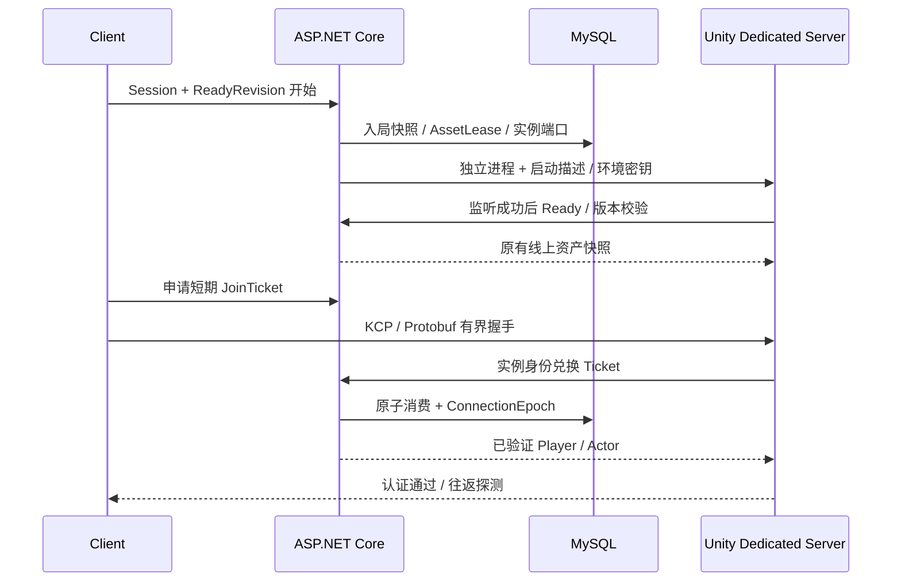

# Norn 联机系统开发解析（更新中）

> 整体状态：进行中。本文以 Visual Studio 的图形界面为例讲解手动搭建；菜单名可能随语言和版本略有变化。现有项目已经搭好，下面的“从零创建”是复现教程，不要求你在原目录重复创建或覆盖工程。

> 最新进度（2026-10-25）：N0–N3 本地阶段已完成，N4 权威战斗已取得本机技术验收，当前继续 Task 7 的原 P7/P8 共享 UI 接入。共享 HUD、只读数据源与本机输入占用已进入实现/回归，正式地图、可信完整线上背包与编辑命令仍待集成，`FormalOnlineExperienceAccepted=false`。Task 6 的 Native/Profiler 证据属于当时配套构建，不能替代 Task 7 修改后的构建和验收。扩大回归的既有失败、两条 native 启动错误以及加密/Linux/公网/IL2CPP/D3D12 等未通过项继续保留。下方各 Task 的“当前”均代表当时状态。

如果先想弄明白 Mirror、副本服、Class Library、Test 项目等基础概念，请先读独立的[双端开发基础指南](<F:/Develop Project/RPG/RPG/Assets/_Project/Docs/2026-10-21 双端开发基础指南（是什么、为什么、怎么操作）.md>)。本文件继续记录每个 Task 的实现、文件变化和验证证据。

> 2026-10-21 文档与协议排版补充：新增上述基础指南，按“是什么、为什么、怎么操作”讲解双端技术与 IDE/Editor 操作。`common.proto` 参考旧 MyMMO 的分区格式整理，字段/枚举值注释放在分号后，长篇原理转入指南；从 Schema 重新生成 `Common.cs`，没有手改生成代码。修改前后不含源码位置信息的 Schema Descriptor SHA-256 相同，业务测试 10/10 通过，生成可重复性校验通过。本次未重新运行 Unity Player 构建、KCP 多进程或 Profiler，不增加这些方面的验收结论；证据见 `docs/superpowers/evidence/multiplayer/proto-comment-format-2026-10-21/`。

## Task N0-1：业务服、共享协议和两端工程引用

本 Task 要解决的是“不同程序怎样理解同一条消息”。当前单机 Demo 仍由 Unity 运行；我们另外建立一个能够独立启动的业务服，再定义一组共享消息，让业务服与 Unity 使用相同的消息结构。这样，后面添加登录、组队和副本入口时，才能明确区分：程序是否启动、请求是否到达、数据是否能解析、版本是否兼容、业务是否允许执行。这些层次各有自己的错误，单纯看到项目编译成功，并不能证明通信已经完成。

我们保留已经确认的 `RPG / Server / Shared` 同级目录。`Server` 放 ASP.NET Core 业务服，`Shared` 放双方都能使用的纯 C# 消息契约，现有 `RPG` 是 Unity 工程，将来从它构建 Client 和 Dedicated Server 两种程序。协议项目不引用 UnityEngine，也不拥有账户、背包或战斗状态，因此业务服不需要安装或启动 Unity 就能使用这些消息。当前只完成基础 HTTP/Protobuf 链路与 Unity 内的协议验证；没有实现登录、MySQL、KCP、房间或真正的多人副本。

阅读时先区分“项目模板”“库”和“工具”：ASP.NET Core 是运行 Web 服务的框架，Class Library 是供其他程序调用的代码项目，Protobuf 是消息定义与序列化方案，protoc 是开发时生成代码的工具。它们处于不同层次。知道这几个对象各自负责什么，才能独立搭建，而不只是照着已有目录复制文件。

### 1. 三个项目是什么，共享库为什么不选 ASP.NET Core

当前已有三个 **.NET 项目**，并不意味着已经有三个服务器进程。Unity 工程也不是这三个项目之一。

| 项目 | 创建时选择的模板/类型 | 目标 | 最终用途 |
|---|---|---|---|
| `Norn.Business` | ASP.NET Core Empty，C# | `net10.0` | 有 `Program.Main`，启动 Web 服务，接收业务请求 |
| `Game.NetworkProtocol` | C# Class Library | `netstandard2.1` | 提供消息类型和版本约束；被业务服和 Unity 使用，本身不监听端口 |
| `Norn.Business.Tests` | xUnit Test Project，C# | `net10.0` | 由 Test Runner 运行，验证 HTTP 入口和错误处理 |

**共享库不是 ASP.NET Core 项目。** Class Library 编译后提供可被引用的程序集，没有业务服务入口；ASP.NET Core 项目在 C# 基础上加入 HTTP Hosting、Routing、Middleware、Dependency Injection 等能力，运行时会有独立进程。两者都能使用 C#，也都可以调用 Protobuf，但职责不同。把共享消息做成 Web 项目会引入无关框架依赖，并不能让消息“更能联网”。

```text
F:\Develop Project\RPG\
├─ RPG\                                    Unity 工程
│  ├─ Assets\ThirdParty\Networking\         Unity 使用的 Protobuf Runtime DLL
│  ├─ Assets\_Project\Editor\Networking\    Unity 验证菜单
│  └─ Packages\                             引用 Shared 的本地 Package
├─ Server\
│  ├─ Norn.Online.sln                        Solution：管理项目的入口
│  ├─ Norn.Business\                        可运行的业务服
│  └─ Norn.Business.Tests\                  集成测试
└─ Shared\Protocol\
   ├─ Game.NetworkProtocol.csproj            .NET 对共享源码的编译配置
   ├─ package.json                          Unity 对同一份源码的包描述
   ├─ Protos\common.proto                   人编写的消息定义
   ├─ Runtime\ProtocolCompatibility.cs      人编写的版本/预算约束
   ├─ Runtime\Generated\Common.cs           protoc 生成，人工不修改
   ├─ Runtime\Game.NetworkProtocol.asmdef   Unity 的程序集边界
   └─ Tools\protoc\34.2\bin\protoc.exe       开发时的消息编译器
```

`.sln` 像 IDE 中的项目目录册，不决定源文件必须放在哪个磁盘目录。`.csproj` 决定 .NET 编译哪些源码、针对什么 API、引用什么库；`.asmdef` 则决定 Unity 怎样划分和引用程序集。它们可以描述同一份 C# 源码，但由各自的构建系统读取。

共享项目由 .NET 编译时会产生 `Game.NetworkProtocol.dll`。Unity 当前采用本地 UPM **源码引用**，自己编译 `Runtime` 中的同一份源码，所以不要再把这个第一方 DLL 复制到 Unity。`Google.Protobuf.dll` 是另外一个第三方 Runtime，仍需要给 Unity 导入。

### 2. 版本分别是什么意思，为什么这样选

| 层次 | 本工程固定版本 | 选择原因与边界 |
|---|---|---|
| Unity Editor | `6000.3.16f1` | 沿用现有项目，避免为联机基础改动引擎 |
| URP | `17.3.0` | 沿用项目渲染依赖，与消息序列化无关 |
| .NET SDK | `10.0.402` | 用于编译/测试/发布 .NET 项目；当前工程固定此版本 |
| .NET / ASP.NET Core Runtime | `10.0.13` | 业务服使用 .NET 10 LTS 系列；SDK 版本与 Runtime 补丁号不同 |
| 共享库目标 | `.NET Standard 2.1` | 约束可调用 API，兼顾当前 Unity 与 .NET 10；它是 API 标准，没有独立的 LTS Runtime |
| 共享源码语言约束 | C# `9.0` | 限制手写代码使用双方可接受的语言特性，避免只在新 .NET 编译器中可用 |
| Protobuf C# Runtime | `Google.Protobuf 3.34.2` | .NET 和 Unity 对齐的已验证基线，不代表最新发行版 |
| Protobuf 编译器 | `protoc 34.2` | 与上述 C# Runtime 对应，生成器和库的版本编号形式不同 |
| Unity 的 Protobuf 补充依赖 | `System.Runtime.CompilerServices.Unsafe 6.1.2` | N0-2 实际 Unity 测试发现 ASCII 路径需要此独立程序集；NuGet 版本与程序集版本 `6.0.0.0` 不同，不能依赖 Editor 插件替 Player 提供 |
| 测试库 | xUnit `2.9.3`、Test SDK `18.11.0`、Adapter `4.0.1`、Mvc.Testing `10.0.13` | 当前固定组合，测试包不套用 .NET 的 LTS 标签 |
| 自己的项目/Package | `0.1.0` | 我们给自己工程的版本，不是第三方框架版本 |
| 应用协议版本 | `1` | 我们定义的消息兼容版本，不是 Protobuf 的版本 |

所以，“所有依赖都是官方最新 LTS”这个说法不成立：不同组件采用不同发布和支持方式。我们选择可复现、两端已验证的组合；升级时需要重新检查生成器、Runtime、Unity 插件兼容和测试，而不是只改一个 NuGet 数字。

当前验证使用放在 Unity 工程 `.tools/dotnet` 下的私有 SDK，系统原有 SDK 没有被替换。**私有 SDK 可用，不等于 Visual Studio 已自动识别它。** 如果你要通过 IDE 自己构建，打开 Visual Studio Installer，安装/更新到官方支持 .NET 10 的 Visual Studio，勾选“ASP.NET 和 Web 开发”工作负载，并在“单个组件”检查 .NET 10 SDK。现有 `Server/global.json` 还限制 SDK 选择；遇到版本不满足时先核对它和 IDE 实际可用 SDK，不要直接删除限制。

版本来源可查看 [.NET 10 下载页](https://dotnet.microsoft.com/en-us/download/dotnet/10.0)、[当前固定 Protobuf NuGet 版本](https://www.nuget.org/packages/Google.Protobuf/3.34.2)、[对应 protoc Release](https://github.com/protocolbuffers/protobuf/releases/tag/v34.2)。这些页面用于查看来源，不要求现在升级。

### 3. 在 Visual Studio 中从零创建三个项目

**先建立 Solution，再创建可运行项目。** 在 Visual Studio 选择“创建新项目”，搜索 `Blank Solution / 空白解决方案`，名称填 `Norn.Online`，保存位置安排为 `F:\Develop Project\RPG\Server`。不同模板会自动附加同名文件夹，创建前看最终路径；目标是让 `Norn.Online.sln` 直接位于 `Server`，避免多嵌套一层 `Server/Norn.Online`。如果只是打开现有工程，直接用“打开项目或解决方案”选择已有 `.sln`，不用重建。

在 Solution Explorer 右键 Solution → `Add / 添加` → `New Project / 新建项目`，搜索并选择 **ASP.NET Core Empty**。项目名称填 `Norn.Business`，位置指向 `Server`，Framework 选择 `.NET 10.0`。这个阶段不启用 Docker、身份验证或额外示例服务；我们先理解最少的启动和 HTTP 处理。模板可能带一个默认根路径响应，实际工程的端点定义以 `FoundationEndpoints.cs` 为准。

**再创建共享 Class Library。** 再次“添加新项目”，选择 C# Class Library，名称填 `Game.NetworkProtocol`，把项目位置安排为 `F:\Develop Project\RPG\Shared\Protocol`。检查预览，最终 `.csproj` 应直接在这个目录，避免自动多出同名子目录。不要选 `Class Library (.NET Framework)`。如果模板没有 `.NET Standard 2.1` 选项，先创建现代 C# Class Library，再右键项目 → `Edit Project File / 编辑项目文件`，将 `TargetFramework` 改为 `netstandard2.1`；这一步是编辑配置，不需要重新创建项目。

模板自带的 `Class1.cs` 没有业务意义，删掉它。在共享项目下右键 →“添加”→“新建文件夹”，建立 **`Protos`、`Runtime`、`Runtime/Generated`**。正式项目的主要编译设置如下：

```xml
<Project Sdk="Microsoft.NET.Sdk">
  <PropertyGroup>
    <!-- 这是可调用 API 的范围，不是给共享库启动一个 Runtime。 -->
    <TargetFramework>netstandard2.1</TargetFramework>
    <Version>0.1.0</Version>
    <LangVersion>9.0</LangVersion>
    <Nullable>disable</Nullable>
    <!-- 主动限定源码范围，避免把包里的工具或临时源码也编进来。 -->
    <EnableDefaultCompileItems>false</EnableDefaultCompileItems>
    <RestorePackagesWithLockFile>true</RestorePackagesWithLockFile>
    <TreatWarningsAsErrors>true</TreatWarningsAsErrors>
  </PropertyGroup>
  <ItemGroup>
    <Compile Include="Runtime/**/*.cs" />
    <PackageReference Include="Google.Protobuf" Version="3.34.2" />
  </ItemGroup>
</Project>
```

这段配置中 `PackageReference` 是安装 NuGet 包后形成的引用，获取方法见下一节。`EnableDefaultCompileItems=false` 后必须保留 `Compile Include`，否则你虽然看得到 `.cs` 文件，构建时却没有把它们编入程序集。

在首次构建共享项目之前，还应在 `.csproj` 同级通过“添加新项 → 文本文件”建立 `Directory.Build.props`，内容如下。它让 .NET 的中间源码和输出留在包目录之外；否则 Unity 可能把 `obj` 中自动生成的程序集信息当作包源码再次编译，产生重复定义。文件名是 MSBuild 的约定，放对目录就会在项目构建前被读取，不需要 C# 主动加载它。

```xml
<Project>
  <PropertyGroup>
    <!-- 路径从当前配置文件所在目录出发；输出集中在 Server，不进入 Unity 源码包。 -->
    <BaseIntermediateOutputPath>$(MSBuildThisFileDirectory)../../Server/.artifacts/Protocol/obj/</BaseIntermediateOutputPath>
    <BaseOutputPath>$(MSBuildThisFileDirectory)../../Server/.artifacts/Protocol/bin/</BaseOutputPath>
  </PropertyGroup>
</Project>
```

如果共享项目是从另一个 IDE 窗口独立创建的，回业务 Solution 右键 →“添加”→“现有项目”，选择 `Shared/Protocol/Game.NetworkProtocol.csproj`。**加入 Solution 只是让 IDE 管理它；还没有让业务服引用它。** 接着右键 `Norn.Business` 的“依赖项/Dependencies” →“添加项目引用/Add Project Reference” →“项目/Projects” → 勾选 `Game.NetworkProtocol` → 确定。源码仍留在 Shared，不会被搬进 Server。

最后在 Solution 中“添加新项目”，选择 `xUnit Test Project`，名称 `Norn.Business.Tests`，保存在 `Server` 下，Framework 选 `.NET 10.0`。在测试项目“添加项目引用”，勾选 `Norn.Business`。测试会沿业务项目引用链得到共享类型；无须复制一份消息源码到测试目录。

### 4. Protobuf 到哪里找，怎么装进 .NET

Protobuf 涉及三件不同的东西，不能只安装一个包就默认全部完成：

| 对象 | 从哪里来 | 安装/放在哪里 | 负责什么 |
|---|---|---|---|
| `.proto` Schema | 由开发者编写 | `Shared/Protocol/Protos` | 约定消息字段、类型、编号 |
| `protoc.exe` | 官方 GitHub Release 的编译器压缩包 | `Shared/Protocol/Tools/protoc/34.2` | 开发时把 Schema 生成 C# |
| `Google.Protobuf` Runtime | 官方 NuGet 包 | .NET 项目通过 NuGet 引用；Unity 导入兼容 DLL | 程序运行时执行编码、解码、反射和 ProtoJSON |

**给 .NET 安装 Runtime：** 在 Solution Explorer 右键 `Game.NetworkProtocol` 项目 → `Manage NuGet Packages / 管理 NuGet 程序包` → `Browse / 浏览`。Package Source 选 `nuget.org`，搜索完整名称 `Google.Protobuf`，确认包链接对应上表的官方 NuGet 页面；版本下拉框选 `3.34.2`，点击“安装”，按提示确认。完成后展开项目 `Dependencies → Packages`，应看到对应版本。这里必须选择项目，不是对某个 `.cs` 文件安装库。[NuGet 官方 GUI 安装说明](https://learn.microsoft.com/en-us/nuget/consume-packages/install-use-packages-visual-studio)

业务项目当前也直接调用 `ToByteArray`、`JsonFormatter` 等 Runtime API，因此它也显式引用 `Google.Protobuf`。当前 Server 使用 `Directory.Packages.props` 集中管理版本：这个文件保存版本，业务 `.csproj` 中仅保留包名。共享项目位于 Server 目录之外，自己显式固定版本。GUI 修改依赖后要检查这些文件，确保两边仍是 `3.34.2`；不要在启用 Central Package Management 的业务 `PackageReference` 上再添加一个 `Version`，那会和集中配置冲突。

从零复现这项集中设置时，在 Visual Studio 中右键 Solution →“添加 → 新建项 → 文本文件”，把文件保存为 `Server/Directory.Packages.props`，不是某个业务子目录下的同名文件。设置 `ManagePackageVersionsCentrally=true` 后，NuGet 从这里读取版本；例如下面是正式文件中 Protobuf 设置的摘录，完整文件还包含测试库版本，不要用摘录覆盖整个文件：

```xml
<Project>
  <PropertyGroup>
    <!-- Server 下的项目共用版本；外面的 Shared 不在这个目录的管理范围内。 -->
    <ManagePackageVersionsCentrally>true</ManagePackageVersionsCentrally>
  </PropertyGroup>
  <ItemGroup>
    <PackageVersion Include="Google.Protobuf" Version="3.34.2" />
  </ItemGroup>
</Project>
```

对应业务 `.csproj` 只写 `<PackageReference Include="Google.Protobuf" />`。共享 `.csproj` 则保留上一节带版本的写法。这个配置的意义是集中约束 Server 中多个项目的依赖，并不是通过 Solution 把所有磁盘目录都纳入管理。

测试项目通过同一个 NuGet 界面安装/核对 `Microsoft.AspNetCore.Mvc.Testing`、`Microsoft.NET.Test.Sdk`、`xunit` 和 `xunit.runner.visualstudio`，版本见第 2 节。前者用于搭建真实 ASP.NET Core 请求处理管线的测试宿主，后几项负责识别和运行 xUnit 测试。ASP.NET Core 项目本身由 Web SDK 引入框架支持，不要再寻找一个“ASP.NET Core 共享库包”替代项目模板。

**获取生成器：** 浏览器打开 [protobuf v34.2 官方 Release](https://github.com/protocolbuffers/protobuf/releases/tag/v34.2)，展开 `Assets`，选择 Windows x64 编译器压缩包 `protoc-34.2-win64.zip`，不是 Source code 压缩包。用资源管理器解压到 `Shared/Protocol/Tools/protoc/34.2`，检查里面有 `bin/protoc.exe` 和 `include/google/protobuf`。后者提供官方内置 Schema，当前简单消息还没用到，但以后导入 `Timestamp` 等类型时会需要。

只安装 `Google.Protobuf` NuGet 包，并不会为当前工程自动执行 `.proto → C#`。有些教程使用 `Grpc.Tools` 让构建时生成代码，那是另一种工具集成方式；Protobuf 不要求使用 gRPC。我们采用固定的独立 protoc，把生成结果放在唯一目录，让 .NET 与 Unity 编译同源文件。Trade-off 是改完 Schema 后要显式生成一次，优点是 Unity 无需执行 .NET 专属的生成步骤。

### 5. 怎样写 `.proto`，每个定义的作用是什么

在共享项目 `Protos` 文件夹右键 →“添加”→“新建项”→“文本文件”，命名 `common.proto`。没有 Protobuf 模板或语法高亮也能写，后缀必须是 `.proto`，不能变成 `.proto.txt`。现有文件是全部基础消息的正式定义；下面摘取请求消息说明语法，不能用这个摘录覆盖完整文件：

```proto
syntax = "proto3";                              // 普通标量有缺省值。
package norn.protocol;                           // Protobuf 逻辑命名空间。
option csharp_namespace = "Game.NetworkProtocol"; // 生成 C# 的 namespace。

// 基础连通性探测请求，不代表登录成功，也不携带线上资产权威。
message ProtocolPingRequest
{
    uint32 protocol_version = 1; // 应用协议版本，0 必须拒绝。
    uint64 sequence         = 2; // 请求关联序号，响应原样带回。
    string message          = 3; // UTF-8 文本，当前最多 256 字节。
}
```

`message` 定义数据结构，生成后得到 C# 类型 `ProtocolPingRequest`；`uint32` 对应 `uint`，`uint64` 对应 `ulong`，`string` 对应 C# `string`。字段 `protocol_version` 会生成属性 `ProtocolVersion`。

等号右侧的 `1/2/3` 是 **Field Number**，不是字段值或默认值。Protobuf 二进制根据编号识别字段，所以发布后不能把原来编号 2 的“请求序号”改成“玩家金币”。删除字段后应使用 `reserved` 保留其编号，并考虑保留旧名称，避免以后误复用。新增字段也要检查两端兼容；能够解析旧消息不代表旧客户端理解新业务。

当前 `common.proto` 还包含：`ProtocolPingReply`（探测回复）、`ProtocolErrorCode`（机器读取的错误分类）、`ProtocolError`（错误详情及期望协议版本）、`ServiceInfoReply`（服务身份及版本）。每个字段和枚举值都已补上中文注释。枚举的 `0` 值是 `Unspecified`，用于表示未指定，不能把它理解成业务成功。

Schema 只描述结构，不自动限制消息字节数、登录身份或伤害数值是否合理。`protocol_version=1` 也只是客户端传来的声明，不能代替认证。必须由接收方进一步校验。我们把这些约束写在 `ProtocolCompatibility` 与 HTTP 入口中，后续玩法校验仍归相应权威服务。

### 6. 不打开终端，怎样把 `.proto` 生成 C#

`protoc.exe` 是接受参数的编译器，没有自己的消息编辑窗口。双击它不会让你选择文件并完成生成。可以通过 Visual Studio 的 **External Tools** 给它做一个菜单入口，之后从菜单点击生成。[Visual Studio 官方 External Tools 说明](https://learn.microsoft.com/en-us/visualstudio/ide/managing-external-tools?view=visualstudio)

先在资源管理器确认 `Runtime/Generated` 文件夹存在。然后在 Visual Studio 打开 `Tools / 工具 → External Tools / 外部工具 → Add / 添加`，按下面填写当前工程的设置：

| 对话框字段 | 填写内容 | 为什么 |
|---|---|---|
| Title / 标题 | `Norn - Generate Shared Protocol` | 以后菜单显示的名称 |
| Command / 命令 | `F:\Develop Project\RPG\Shared\Protocol\Tools\protoc\34.2\bin\protoc.exe` | 选择已下载的编译器文件，可用浏览按钮 |
| Arguments / 参数 | 见下方文本 | 指明输入根目录、输出目录和要处理的 Schema |
| Initial directory / 初始目录 | `F:\Develop Project\RPG\Shared\Protocol` | 工具运行时的工作目录 |
| Use Output window / 使用输出窗口 | 勾选 | 在 IDE 里查看生成错误 |

把下面一整行填入 **Arguments 参数输入框**：

```text
--proto_path="F:\Develop Project\RPG\Shared\Protocol\Protos" --csharp_out="F:\Develop Project\RPG\Shared\Protocol\Runtime\Generated" "F:\Develop Project\RPG\Shared\Protocol\Protos\common.proto" "F:\Develop Project\RPG\Shared\Protocol\Protos\lab.proto"
```

路径中的引号用于保留 `Develop Project` 里的空格。`--proto_path` 是查找 Schema 的根目录，`--csharp_out` 是输出目录，最后一项是本次输入文件。以后拆成多个 `.proto` 时，要把需要生成的文件明确加入参数，不能以为这个入口会自动扫描全部 Schema；使用官方内置类型时，还需要增加对应 `include` 搜索路径。

保存设置后，选择 `Tools → Norn - Generate Shared Protocol`。成功时检查 `Runtime/Generated/Common.cs` 是否已更新；生成器成功可能没有文字输出，所以不能只看输出窗口是否为空。如果有错误，根据输出中的文件和行号改 `.proto`，再重新生成。`Common.cs` 开头带有自动生成标记，其中包含字段属性、`Parser`、编码方法与 Descriptor。

**只维护 `.proto`，不要人工修改 `Common.cs`。** 注释也优先写在 Schema，让 protoc 带进生成源码；否则下一次生成会覆盖人工修改。IDE 中安装语法高亮插件只能改善编辑体验，不能代替生成器。当前共享项目构建会编译已经生成的 `.cs`，不会因为 `.proto` 保存了就自动执行这一步。

### 7. 在 C# 里怎样使用 Protobuf，它怎样参与网络通信

从 `common.proto` 生成 C#，再成功安装 Runtime 后，就可以在引用共享项目的代码里使用消息。下面仅演示内存中的编码/解码，不会建立任何网络连接。`using` 放在 C# 文件顶部，其余语句放进一个现有方法或测试方法中；不要把它当作共享库的 `Program.Main`：

```csharp
using Game.NetworkProtocol;
using Google.Protobuf;

// 生成类保存一次请求的数据；版本与序号是业务约定，不由 Protobuf 自动填写。
ProtocolPingRequest request = new ProtocolPingRequest
{
    ProtocolVersion = ProtocolCompatibility.CurrentVersion,
    Sequence = 42,
    Message = "你好，Norn"
};

// Serialization：把 C# 消息编码成可交给 HTTP/KCP 的字节。
byte[] payload = request.ToByteArray();

// Deserialization：已知消息类型之后，用对应 Parser 恢复字段。
// 真实接收入口要先检查大小，并捕获畸形数据引起的解析异常。
ProtocolPingRequest decoded = ProtocolPingRequest.Parser.ParseFrom(payload);

// 结构能解析不等于业务能接受；协议版本等规则由接收方检查。
bool isCompatible = ProtocolCompatibility.IsSupported(decoded.ProtocolVersion);
```

Protobuf 负责 **对象 ↔ 字节**，HTTP 或未来 KCP 负责传输这些字节。二进制本身不会自动告诉你“该分发给登录还是聊天处理器”：当前使用 HTTP 路径选择消息类型，例如 `/api/system/ping` 的请求按 `ProtocolPingRequest` 解析；未来实时通道还需要明确的消息类型标识、分发、连接状态与安全边界，不能认为用了 Protobuf 就已经有消息分发系统。

本工程的真实请求链为：HTTP 请求 → ASP.NET Core 路由 → 检查 Content-Type 和字节预算 → `ProtocolPingRequest.Parser` → 校验应用协议版本与 UTF-8 文本预算 → 建立 `ProtocolPingReply` → `ProtobufHttpResult` 编码 → HTTP 响应。错误时返回正确的 HTTP 状态和 `ProtocolError`，例如版本冲突为 409、请求过大为 413、格式不支持为 415。HTTP 状态用于传输入口层，错误枚举用于程序识别具体原因，不能只返回一个看起来正常的 200。

`ServiceInfoReply` 通过 `JsonFormatter` 输出 ProtoJSON，方便浏览器查看。ProtoJSON 是 Protobuf 自己定义的 JSON 映射，尤其 `uint64` 通常表示成字符串，以免 JavaScript 数值精度丢失；不要任意替换成普通 JSON 序列化后假设含义完全一样。二进制 Ping 则设置 `application/x-protobuf`，浏览器地址栏发送 GET 并不能完成这个 POST 测试。[官方 C# 使用教程](https://protobuf.dev/getting-started/csharptutorial/)

`ToByteArray()` 在这个离散演示中会分配数组，它不是未来每帧实时通信的零分配实现。当前示例的 1024 字节总量和 256 字节文本限制也是 Ping 专用预算，不是今后所有背包/快照消息的统一大小。

### 8. 怎样把共享消息和 Protobuf Runtime 导入 Unity

**第一步，导入 Runtime DLL。** Unity 不会因为 .NET 项目装了 NuGet 就自动获得同一个包。浏览器打开第 2 节的 `Google.Protobuf 3.34.2` NuGet 页面，在包下载入口获取 `.nupkg`；它本质是 ZIP 格式，可用支持它的解压工具打开，或将下载副本改成 `.zip` 后解压。找到 `lib/netstandard2.0/Google.Protobuf.dll`，通过资源管理器复制或拖拽到 Unity 工程的 `Assets/ThirdParty/Networking/Protobuf`。同时保留包版本、来源说明和许可证，便于之后排查。只取适用的程序集，不要把整个 NuGet 包和多套 Framework DLL 全部拖进 Assets。

这里 DLL 选 `netstandard2.0` 与我们的共享库选 `netstandard2.1` 不矛盾：2.0 的依赖可供支持 2.1 API 的使用方引用，不意味着应该导入 NuGet 中的 `net5.0` 版本。选中 DLL 查看 Inspector，当前工程按 Runtime 用途启用 Editor/目标平台，并通过 Auto Reference 与 asmdef 配置解析依赖。Unity 自己生成和维护 `.meta`。

还需要导入 [System.Runtime.CompilerServices.Unsafe 6.1.2 官方包](https://www.nuget.org/packages/System.Runtime.CompilerServices.Unsafe/6.1.2)：同样下载 `.nupkg`、解压，取 `lib/netstandard2.0/System.Runtime.CompilerServices.Unsafe.dll` 放到上述 Protobuf 目录，并保留许可证与来源。这个依赖在 N0-2 的真实 Unity ASCII 编码测试中发现缺失；之前只测试中文路径不足以发现它。Unity 自带 Span/Memory 相关 API，不代表自带这个独立程序集，不要把 System.Memory 等另一整套 BCL 一起复制进来。当前固定的 Unsafe Runtime 仍需在原 Editor 重载与独立 Player 中分别验证，不能由“Editor 某个插件已经携带”推导出构建产物一定可用。

**第二步，将 Shared 注册成本地 UPM Package。** 在资源管理器打开 `Shared/Protocol`，建立 `package.json` 文本文件；当前内容可以直接参考正式文件，关键字段如下：

```json
{
  "name": "com.norn.network-protocol",
  "version": "0.1.0",
  "displayName": "Norn Network Protocol",
  "unity": "6000.3"
}
```

在 Unity 打开 `Window → Package Management → Package Manager`，从“添加”菜单选择 `Install package from disk / Add package from disk`，定位到 `Shared/Protocol/package.json`。选的是这个 JSON 文件，不是 `.csproj` 或整个 Server。界面名称可能随 Editor 版本略有差异，核心是从磁盘安装本地 Package。[Unity 官方操作](https://docs.unity3d.com/6000.3/Documentation/Manual/upm-ui-local.html)

当前 `Packages/manifest.json` 已使用相对地址 `file:../../Shared/Protocol` 记录该包。保留相对布局有助于换电脑恢复；如果通过界面导入后得到本机绝对地址，可在保留其他依赖的前提下对照现有项检查。只备份 Unity 仓库不会自动包含旁边的 Shared 和 Server，三者都要备份。

**第三步，建立/核对程序集边界。** 在 Unity Project 窗口展开本地 Package，选中 `Runtime` 文件夹，右键 `Create → Scripting → Assembly Definition`（部分版本在 Create 下直接显示 Assembly Definition），名称填 `Game.NetworkProtocol`。选中 `.asmdef` 后在 Inspector 勾选 `No Engine References`，避免协议库引用 UnityEngine；取消 `Auto Referenced`，让使用方明确声明依赖。勾选 `Override References`，在 `Assembly References` 中添加 `Google.Protobuf.dll`，再点击 `Apply`。这对应当前正式 `.asmdef` 的配置。

需要使用消息的程序集，在自己的 `Assembly Definition References` 列表点击 `+`，选入 `Game.NetworkProtocol` 并 Apply；直接使用第三方 API 的代码也要能解析 `Google.Protobuf`，若该程序集启用了 Override References，就在它的预编译程序集列表中显式添加该 DLL。不要为了方便把整个游戏模块接到业务服，或让共享库反向引用 Unity 玩法代码。

当前工程的 AI Assistant 包还内置了较旧的 Editor 用 Protobuf。现有验证菜单会检查**实际加载**的版本是否为 `3.34.2.0`，所以不仅要看 Assets 里有什么文件。发生重复类型、程序集冲突时，先查实际 DLL 与插件配置，不要随意修改 `Library/PackageCache`；也不要再导入一份 `Game.NetworkProtocol.dll`。

### 9. 怎样构建、启动、测试，以及当前到底验收了什么

在 Visual Studio 打开现有 `Server/Norn.Online.sln`，先用 `Build / 生成 → Build Solution / 生成解决方案`，查看 Error List 和 Output。它只把源码编译成产物，不会自动让服务器持续运行。

右键 `Norn.Business` → `Set as Startup Project / 设为启动项目`，选择项目运行配置，点击启动按钮或“开始执行（不调试）”。本机配置的监听地址为 `http://127.0.0.1:5080`；以进程实际输出为准，新模板可能有 `launchSettings.json` 覆盖端口，需要在项目调试配置中核对。进程运行后，浏览器访问 `/health/live` 应看到 `alive`，访问 `/api/system/info` 可查看服务信息。停止调试或关闭自己启动的服务进程后，这些地址就不再由它响应。共享 Class Library 不应设为启动项目。

打开 `Test / 测试 → Test Explorer / 测试资源管理器`，构建后点击“运行全部测试”。`WebApplicationFactory<Program>` 用测试宿主执行真正的路由、消息解析与响应，不需要你提前另外启动业务服，也不等于验证了独立 Linux 进程。当前测试包括中文/大序号往返、缺省/错误协议版本、截断数据、已知/未知长度的超大请求、UTF-8 预算和错误 Content-Type 等，共 10 个用例。

Unity 中等待编译完成后，点击 `Tools → Norn → Online → Verify Shared Protocol`。它验证 Unity 内的二进制与 ProtoJSON 往返、实际 Runtime 版本以及协议程序集没有 UnityEngine 引用，不会启动业务服或连接 KCP。你在 2026-10-20 23:12:46 已手动通过这项验证，归档报告记录 `6000.3.16f1`、`Google.Protobuf 3.34.2.0` 和协议版本 `1`。

当前已取得的证据包括：.NET Release 构建、10 个集成测试、独立 Kestrel 进程 HTTP/Protobuf 检查、依赖锁定恢复、发布产物收集，以及上述 Unity Editor 验证。**未验收** Dedicated Server 构建、Linux 运行、KCP 多人、MySQL 事务与 Profiler/GC。不要由“共享协议包验证通过”推导出“联机系统已经完成”。

以后部署前可右键业务项目 → `Publish / 发布` → 选择文件夹目标收集部署文件。Publish 只是整理产物，Linux 目标和 Runtime 供应方式仍要单独选择和验证；文件夹生成成功不等于已经部署到远端。开发阶段继续本机运行，不需要现在租服务器。

日常修改顺序是：修改 `.proto` 及其注释 → 点击 IDE 中配置的生成菜单 → 构建 Solution → Test Explorer 运行测试 → 等 Unity 编译 → 点击共享协议验证菜单。Protobuf 依赖升级还要同步检查 NuGet、Unity DLL、protoc 与版本锁定记录。

### 10. 现有代码怎么读，出错时先查哪里

下表中的路径均相对于外层 `F:\Develop Project\RPG`。其中前三个是 .NET 项目，后面的配置/脚本各有自己的归属。

| 文件 | 责任、技术及阅读重点 |
|---|---|
| `Server/Norn.Online.sln` | Solution 管理业务、共享和测试项目；不移动源码 |
| `Server/global.json` | 固定 SDK 选择；IDE 找不到指定 SDK 时先检查这里 |
| `Server/Directory.Packages.props` | Central Package Management，统一 Server 范围的 NuGet 版本 |
| `Server/Norn.Business/Norn.Business.csproj` | Web SDK、net10.0、共享 ProjectReference 与包引用 |
| `Server/Norn.Business/Program.cs` | 入口装配：CreateBuilder → Kestrel 限制 → Build → 映射端点 → Run；不在入口堆积业务规则 |
| `Server/Norn.Business/Bootstrap/FoundationEndpoints.cs` | 三个基础 HTTP 入口；异步限量读取、池化缓冲区、解析和版本检查 |
| `Server/Norn.Business/Bootstrap/ProtobufHttpResult.cs` | IResult 统一写 HTTP 状态、Content-Type 和 Protobuf 字节，允许离散请求分配 |
| `Server/Norn.Business/appsettings.json` | 本地监听和日志等配置；当前没有额外的 Development 覆盖文件，不在受版本管理的配置里保存密码 |
| `Server/Norn.Business.Tests/Norn.Business.Tests.csproj` | 测试目标、业务项目引用和测试依赖 |
| `Server/Norn.Business.Tests/FoundationEndpointsTests.cs` | xUnit + WebApplicationFactory 验证 HTTP 行为；自定义未知长度请求验证读取上限 |
| `Shared/Protocol/Game.NetworkProtocol.csproj` | Class Library；仅编译 Runtime 源码，固定兼容目标 |
| `Shared/Protocol/Directory.Build.props` | 提前把 .NET bin/obj 输出移到 Server 的产物目录，避免 Unity 把中间生成源码吸入包 |
| `Shared/Protocol/package.json` | 同一源码给 Unity 使用的 UPM 元数据，不会启动服务 |
| `Shared/Protocol/Runtime/Game.NetworkProtocol.asmdef` | Unity 程序集边界及第三方引用，禁用 UnityEngine 依赖 |
| `Shared/Protocol/Runtime/ProtocolCompatibility.cs` | 应用协议版本、Ping 字节预算；默认版本 0 不合法 |
| `Shared/Protocol/Protos/common.proto` | 唯一 Schema；消息、字段与兼容规则从这里维护 |
| `Shared/Protocol/Runtime/Generated/Common.cs` | protoc 生成类型；由两边各自的编译器编译，人工不改 |
| 各 .NET 项目的 `packages.lock.json` | 固定完整依赖解析结果，避免只有直接版本一样而间接依赖不同 |
| `RPG/Assets/ThirdParty/Networking/Protobuf` | Unity 实际使用的第三方 Runtime 与来源说明 |
| `RPG/Packages/manifest.json`、`packages-lock.json` | 本地 UPM 引用与 Unity 解析结果；锁文件由 Unity 维护 |
| `RPG/Assets/_Project/Editor/Networking/OnlineFoundationTools.cs` | 归属 Game.Project.Editor；菜单验证与报告输出，不进入客户端热路径 |
| `RPG/Assets/_Project/Editor/Game.Project.Editor.asmdef` | 使既有 Editor 程序集能引用共享消息 |
| `RPG/Tools/Networking/dependency-lock.json` | 本阶段工具、Runtime 及候选依赖的固定记录；候选不代表已经安装 |
| 三个仓库的 `.gitignore`、README | 区分源码、生成产物、缓存和秘密配置，说明独立备份边界 |

读取实现时，先看 `common.proto → ProtocolCompatibility.cs → Program.cs → FoundationEndpoints.cs → ProtobufHttpResult.cs → FoundationEndpointsTests.cs`。在 HTTP 入口中，`ArrayPool` 的数组必须在 `finally` 归还；即使检查失败提前 return，也不能泄漏租用缓冲。实际解析只使用已读取长度，不能把池中数组的多余空间一起当作消息。结构解析成功后仍须校验版本和业务预算，这是“数据格式”和“业务可信”之间的边界。

| 症状 | 先检查的证据 | 不宜直接采取的处理 |
|---|---|---|
| IDE 无法构建 net10.0 | SDK 安装、IDE 支持、global.json、Error List | 删除 SDK 锁定或随意改 TargetFramework |
| 找不到 Google.Protobuf 类型 | 对应项目 Dependencies 与 NuGet Restore 错误 | 从不明来源下载另一个 DLL |
| 新字段没有生成属性 | Schema 是否保存、protoc 是否成功、Common.cs 修改时间 | 直接手改生成 C# |
| Unity 缺共享消息/重复类型 | UPM 路径、asmdef 引用、是否重复导入第一方 DLL | 把 Server 整体复制进 Assets |
| Protobuf Runtime 版本不符 | Unity 验证报告、DLL Inspector 与插件依赖 | 修改 PackageCache 掩盖冲突 |
| Ping 返回 409/413/415 | 协议版本/实际字节量/Content-Type | 让服务端无条件返回 200 |

本次文档整理与注释补全沿用原来的项目、依赖和协议版本。Schema 的消息名、字段名、类型、编号及枚举值保持原样；生成源码的说明从 `.proto` 重新生成。修改后的回归结果见本次交接记录，之前的 Editor 报告保留其原验收时间。

**2026-10-21 文档与注释补全的实际回归：** 六个共享/服务端手写文件经去除注释后的内容比较，未发现代码或 Schema 定义变化；protoc 生成的不包含源注释信息的 Descriptor 在修改前后 SHA-256 都是 `6678c17ddf586f47575aed9d66e6b81ac06be099d9cb87aad983a55d425f0b98`。重新编译生成源码并运行已有集成测试，10/10 通过，报告为 `docs/superpowers/evidence/multiplayer/n0-1/comments-regression.trx`。Editor 工具本次也仅补注释，没有重新声称完成一次 Unity Editor 验收。

后续每个 Task 都会在这份文档里说明：为什么做、在 IDE/Editor 中怎样操作、改了哪些文件、有哪些可见结果、如何验证以及仍有什么边界。新写和实质修改的代码会加中文学习注释，`.proto` 也要解释消息与字段含义；自动生成文件通过修改 Schema 再生成来更新。

## Task N0-2：最小 KCP / Protobuf 副本服通信实验

本 Task 的目的，是把上一阶段的“双方都能理解消息”推进到“两个独立客户端真的能通过实时通道收发消息”。业务服已经能处理 HTTP，但这并不意味着 Unity 副本服已经存在，更不意味着多人移动、伤害或材料世界已经同步。我们先用一条简单的探测请求贯通独立客户端、UDP/KCP、Mirror 分发、Protobuf 解码、服务端校验与回复，把每一层都放到真实 Unity 编译器和不同进程中验证。只有这条链路稳定，后续接入角色与战斗时才有明确的排错起点。

这里新增 Game.Networking 和 Game.Multiplayer 两个程序集，分别负责网络适配与 Unity 场景装配。原来的 Game.Core、Game.Combat、Game.Run 等玩法模块不反向引用 Mirror，线上探测也不读取单机资产。实验采用独立服务器而非 Host：服务器进程不会因为某个玩家关闭客户端而结束，这正是之后四人合作副本所需的进程边界。当前只同步 Ping，不创建玩家角色，不执行线上伤害或结算；认证、加密、快照和 MySQL 仍有后续独立验收。

本次实现还发现一个基础依赖问题：仅用中文消息测试 Protobuf，会漏掉它在部分 ASCII 编码路径对 Unsafe 程序集的需求。我们先取得 Unity 中的真实失败，再补齐明确缺少的 Runtime，保留来源、摘要和许可证。这说明学习网络开发时，不仅要会写消息，还要理解程序究竟加载了哪些库、代码运行在哪个进程、某份通过报告能证明到哪一层。

### 1. 新增内容、版本和边界

| 内容 | 本次选择 | 原因与取舍 |
|---|---|---|
| Unity Networking Framework | Mirror `96.11.3` 官方固定 Release | 复用连接、消息分发和 KCP 接合，不自研整套 Framework；保留上游源码/.meta/许可证，排除 Examples/Tests |
| 实时 Transport | Mirror 自带 KcpTransport | UDP 上提供可靠交付能力；当前探测使用 Reliable 通道，不代表以后移动快照也都应可靠重传 |
| 消息体 | 原有 `Google.Protobuf 3.34.2` / `protoc 34.2` | 复用同源契约，既有请求字段不变；新增实时消息种类枚举 |
| 补充 Runtime | `System.Runtime.CompilerServices.Unsafe 6.1.2`，程序集 `6.0.0.0` | 采用官方维护包的固定 netstandard2.0 发行版，满足 Protobuf 要求的最低 4.5.2；实际 Unity 测试/Player 另验，不把整套 System.Memory/BCL 再复制进来 |
| Game.Networking | asmdef，Unity 工程内 C# 模块 | 负责 Envelope、Codec、Pool、连接适配；没有独立 .csproj 服务入口 |
| Game.Multiplayer | asmdef，Unity 工程内 C# 模块 | 将 SO 配置和网络管理器装进实验场景，决定 Client/Server 构建职责 |
| 界面/资源 | 开发用 IMGUI、纯色相机、配置 SO | 不需要你提供新美术或音频，便于直接观察连接和回复计数；不是正式游戏 UI 的性能/视觉方案 |

业务服仍为 .NET 10，Unity 仍为 `6000.3.16f1`，共享库仍为 `netstandard2.1`。**没有新建两个生产 Unity 工程。** Client 和 Dedicated Server 是同一套场景/源码的两种构建角色，`UNITY_SERVER` 决定服务器自动监听。测试时另建的最小验证工程只用于隔离编译和进程实验，不是新的游戏架构或需要维护的第四个业务项目。

### 2. 消息经过哪些层，为什么还需要 Envelope 和 Pool

```text
客户端创建 Ping 数据 → Codec 编码到预分配 Buffer
→ Envelope：消息种类 + 有界字节段
→ Mirror 消息头/批处理 → KcpTransport → UDP
→ 服务器 Mirror 分发 → Reader 检查长度 → Codec 解码/版本校验
→ 每连接预算与序号检查 → PingReply → 原链路返回
```

UDP 是底层 Datagram 传输；KCP 在它上面处理可靠性、确认和重传；Mirror 提供 Unity 网络程序的连接与消息生命周期；Protobuf 负责消息体的对象/字节转换。这里没有把 Mirror 内置握手与批处理头也改成 Protobuf。

`RealtimeMessageKind` 告诉接收方应按哪个消息类型解释 Payload。`ProtobufEnvelope` 自定义的头为 2 字节种类和 4 字节长度，再跟消息体；Mirror 自己的消息标识由 Mirror 添加，不重复手写。Reader 在读取消息体之前就拒绝未知种类、超过 1024 字节或比剩余数据更长的声明，避免根据不可信长度先分配大数组。`ArraySegment<byte>` 只是现有数组的窗口，不会自动复制；收到的窗口仅在当前回调中使用。

Pool 在初始化时建立固定数量的消息，收到数据时租用，处理后释放。`MergeFrom` 是“合并字段”，不是“先清空再赋值”；如果上次有文本、下次没有文本，不清理就会留下旧值。因此手写的 `ProtocolMessageReset.cs` 通过 partial 扩展清理普通字段和 UnknownFields。代价是它与固定 protoc 的生成字段名耦合，Schema 增字段或生成器升级时必须同步审查和回归，不能只运行生成器就结束。

Lease 是“这一轮租借”的凭据，包含池、槽位和代次。结构体复制后可能被重复 Dispose；代次检查使旧副本不能释放新租借。调用者仍必须遵守约定：不把消息对象引用存到下一帧，不把回调里的接收 Buffer 当作长期库存。此设计是主线程模型，不宣称可以直接从多个网络线程并发调用。

**池化不等于整体 Zero GC。** 文本解码、UnknownFields、第三方 Transport 和实验 IMGUI 仍可能分配。当前一秒一次的探测用于正确性验证；正式高频消息、EncryptionTransport 与完整帧的 GC/CPU 必须另行测量。

### 3. 在 Unity 中怎样审阅和操作

**先等待脚本导入与编译。** 切回 Unity，必要时选择 `Assets → Refresh`，查看 Console 是否有编译或程序集冲突。第三方来源可在 `Assets/ThirdParty/Networking/Mirror/NornIntegration.md` 和 Protobuf 目录 README 中查看。此阶段不要打开另一个 Editor 加载同一个项目。

**创建/打开独立实验场景。** 先自行处理当前场景的保存，再点击 `Tools → Norn → Online → Create Local Transport Lab`。工具生成配置与测试场景，若已存在则保留已有内容。通过 Project 窗口打开 `Assets/_Project/Scenes/Tests/MultiplayerAuthorityLab.unity`，选中 `OnlineLabRoot`，审阅 KcpTransport、NornNetworkManager、DedicatedServerBootstrap、OnlineClientBootstrap 和验收组件。正式 Hub/主菜单不会被加入联网组件。

在 `Assets/_Project/ScriptableObjects/World/Multiplayer/OnlineNetworkProfile.asset` 的 Inspector 中查看默认 UDP 端口 `7777`、容量 `4`、消息池容量 `8`、探测间隔 `1 秒`、Mirror 发送频率 `30`。发送频率不是“已经实现 30 Hz 权威战斗 Tick”；本阶段还没有正式玩法模拟。

**运行 EditMode 测试。** 打开 `Window → General → Test Runner`，选择 EditMode，找到 `Game.Networking.Tests`，运行其测试。Codec/Pool 测试覆盖中文与大序号、缺省/错误版本、畸形输入、容量、清理和 Lease；Envelope 测试使用真实 Mirror Writer/Reader，覆盖截断与长度伪造。单个 Editor 的测试通过，不能替代独立进程验收。

**分别构建两种程序。** 点击 `Tools → Norn → Online → Build Lab Windows Client`，输出 `Builds/OnlineLab/Client/NornClient.exe`；点击 `Build Lab Windows Dedicated Server`，输出 `Builds/OnlineLab/Server/NornServer.exe`。菜单仅使用实验场景，不修改全局 Build Scene List。Server 构建依赖 Unity Hub 为同一 Editor 版本安装的 Windows Dedicated Server Build Support；不要把普通 Client 加一个无画面参数就称为 Dedicated Server。

**自己完成可见验收。** 从资源管理器先启动 `NornServer.exe`，再把 `NornClient.exe` 启动两次。Server 默认没有游戏画面。两个客户端分别点击 `Connect Client`，应显示 Connected，Sent/Replies 每秒增长。关闭其中一个客户端，观察另一个的 Replies 是否继续增长；结束后关闭剩余客户端和你自己启动的 Server。不要只从 Editor 运行 Host 来替代这个步骤。

这里只允许本机回环连接，不需要现在配置公网、防火墙转发或租服务器。KCP 默认监听接口较宽，服务端又在连接准入时检查回环地址；这不是完整公网安全方案。界面写的 Connected 仅表示 Transport 连通，不是账号已经认证。

### 4. 每个脚本的职责与依赖

下列路径相对于内层 Unity 工程；Shared 下的文件位于旁边的共享项目。

| 文件 | 职责、技术与位置 |
|---|---|
| `Scripts/Networking/Game.Networking.asmdef` | 新网络基础层；Core/NetworkProtocol/Mirror/Transport 依赖，显式第三方 DLL 引用 |
| `Networking/Protocol/ProtobufEnvelope.cs` | NetworkMessage 外壳、自定义 Writer/Reader，先限长再读取借用窗口 |
| `Networking/Protocol/ProtoMessageCodec.cs` | 通过 Span 编解码，错误分类、版本/文本预算，失败路径释放 Lease |
| `Networking/Protocol/ProtoMessagePool.cs` | 固定容量预分配；租借代次、完整重置与重复释放保护 |
| `Networking/Runtime/ConnectionSession.cs` | 每连接序号、速率和计数；清理离线连接，不代表业务 Session |
| `Networking/Runtime/NornNetworkManager.cs` | Mirror 启停和收发回调；只允许本地探测，不生成角色或访问资产 |
| `Scripts/Multiplayer/Game.Multiplayer.asmdef` | 联机组合层；下层网络不反向引用该层 |
| `Multiplayer/Runtime/OnlineNetworkProfile.cs` | ScriptableObject 配置，初始化时传给 Networking 的纯参数 |
| `Multiplayer/Runtime/DedicatedServerBootstrap.cs` | 等组件 Awake 完成后装配；只有 UNITY_SERVER 构建自动监听 |
| `Multiplayer/Runtime/OnlineClientBootstrap.cs` | 本地实验按钮和计数；无 Host 入口，正式 Client UI 后续单独实现 |
| `Multiplayer/Runtime/OnlineLabProbe.cs` | 显式实验参数启用的自动进程探针，普通启动禁用；就绪/结束时写一次报告 |
| `Editor/Networking/OnlineSceneSetup.cs` | 既有 Game.Project.Editor 内的显式场景/SO 生成工具，保护用户场景 |
| `Editor/Networking/OnlineBuildTools.cs` | 两种 Windows 构建与 Build Report，不改正式场景清单 |
| `Editor/Networking/OnlineEditorRequests.cs` | Editor 明确请求白名单，复用菜单实现；编译、Play 或项目测试期间不接管，拒绝覆盖脏场景 |
| `Tests/Networking/ProtoCodecTests.cs` | 18 个消息正确性/池生命周期测试；同源 CLR 验证与 Unity 验证分开记录 |
| `Tests/Networking/ProtobufEnvelopeTests.cs` | 5 个真实 Mirror Reader/Writer 边界测试 |
| `Tests/Networking/Game.Networking.Tests.asmdef` | Editor 测试程序集，显式 NUnit/Protobuf/Weaver 依赖 |
| `Editor/Project/ProjectTestRunner.cs` | 扩充现有明确程序集白名单，允许新测试；不自动保存场景 |
| `Editor/Game.Project.Editor.asmdef` | 既有 Editor 装配层增加新模块和 Transport 引用 |
| `Shared/Protocol/Protos/common.proto` | 新增有中文注释的 RealtimeMessageKind，保留既有字段编号 |
| `Shared/Protocol/Runtime/Generated/Common.cs` | protoc 重新生成，不人工维护 |
| `Shared/Protocol/Runtime/ProtocolMessageReset.cs` | 生成消息的 partial 重置扩展，清除 UnknownFields |
| `Tools/Networking/dependency-lock.json`、初始化工具 | Mirror/Unsafe 版本、来源、摘要和依赖准备记录 |
| Protobuf/Mirror 来源 README、AGENTS/CLAUDE | 记录插件边界、新 Assembly 依赖与后续维护要求 |
| `ProjectSettings/ProjectSettings.asset` | Mirror/内置 Hosting 插件自动向 Standalone 加入 MIRROR 版本宏与 EDGEGAP_PLUGIN_SERVERS；原 APP_UI_EDITOR_ONLY 保留，没有创建或使用云服务 |
| `Assets/ScriptTemplates/` | Mirror 的上游 Editor 工具自动搬到 Unity 规定位置的脚本模板，保留原 GUID；属于插件编辑器集成，不是新业务服源码 |

表中 `Scripts`、`Editor`、`Tests` 均位于 `Assets/_Project`；`Networking`、`Multiplayer` 简写分别属于 `Assets/_Project/Scripts`。单机 Character/Combat/Run 的实现没有因这个实验新增 Mirror 依赖。

安装插件也可能触发它自己的 Editor 初始化，而不只是增加一个文件夹。这里已核对 ProjectSettings 的差异仅为上述编译宏追加；`ScriptTemplates` 是 Unity 顶层约定目录，不应误认为把业务服搬进客户端。我们自己的代码仍放在明确的模块中，上游模板由插件维护。

### 5. 实际验证、遇到的问题与剩余 Gate

纯协议测试先在 .NET 10 中编译同一份 Codec/Pool 与 NUnit fixture，观察到 16 个预期失败、2 个通过；接通实现后 18/18 通过。随后用同版本 Unity 的隔离最小工程验证实际编译器、Mirror Weaver 和 Mono Runtime；不是把 .NET 编译成功写成 Unity 成功。

Unity 初次执行发现 18 个 Codec 测试中 17 个通过，ASCII 回复用例因缺少 Unsafe 程序集失败。根因是 Protobuf 的不同文本编码路径依赖不同底层 API；Editor 内 AI 插件的可选依赖不等于 Player 自带 Runtime。补官方 Unsafe 后，18 个 Codec 加 5 个 Envelope 测试全部通过。当前 AI Assistant 还带有程序集版本不同的 Editor 专用 Unsafe，原工程重载后的选择和插件功能仍须单独关注，未修改 PackageCache 或声称已验收 AI 插件。

另外，Mirror 的 Weaver 只拿到直接引用列表，启用 Override References 的 asmdef 必须显式包含它检查 Transport 时用到的 BouncyCastle DLL；这个引用不表示已经开启加密。场景工具则处理了 Unity 禁止在未保存的 Untitled 场景旁新建 Additive 场景的限制：交互 Editor 要求先保存；隔离 batch 工程纯空初始场景才允许替换，不以保存用户场景绕过限制。

独立构建、多进程探测和原工程测试的最终结果见下表。Headless Grid 10 Hz、正式 Snapshot、认证/加密、Linux、MySQL、原单机玩家路径回归和 Profiler/GC 不由这组 Ping 测试替代。出现问题时按 Console/Weaver → Runtime DLL → UDP 端口与连接 → 消息种类/长度/版本 → 业务约束的顺序排查；不要删除版本检查或放开长度来“修通”。

原工程的 23 个 Networking EditMode 测试也已通过，Windows Client 构建成功且 Build Report 为 0 错误。测试器临时切换过空场景，通过原有安全入口恢复已保存 Hub；NornNetworkManager 销毁时还恢复 Mirror 修改的后台运行和目标帧率，避免从实验回到单机后遗留全局配置。Dedicated Server 构建和最终进程结果如下，分别记录“产生程序”与“错误项清零”的区别。

**本 Task 的首次自动验证记录（2026-10-21；构建错误收尾结果见第 6 节）：**

| 验证 | 实际结果 | 证据/边界 |
|---|---|---|
| 同源纯 Codec 的 CLR 验证 | RED 16 失败/2 通过 → GREEN 18/18 | 只证明消息与池的逻辑，不代替 Unity/KCP |
| 隔离最小工程 Unity EditMode | 23/23 | 真实 Unity 6000.3.16f1、Mono 与 Mirror Writer/Reader |
| 原工程 Unity EditMode | 23/23 | `unity-project-editmode.xml`，包含原工程的实际插件依赖环境 |
| 原 ASP.NET Core 回归 | 10/10 | `foundation-regression.trx`，原有 HTTP 行为保持 |
| 隔离工程 Client/Server 构建 | 两者 Succeeded、0 错误 | 分别为真实 Player/Server 构建角色 |
| 原工程 Client 构建 | Succeeded、0 错误 | `project-client-build.json` |
| 原工程 Dedicated Server 构建 | Succeeded，**记录 1 个错误项** | `project-server-build.json`；不能说零错误通过，见下文 |
| 隔离工程三进程 KCP | A 收到 6 次，B 收到 13 次 | A 退出后 B 与 Server 继续运行，B 退出后 Server 仍在 |
| 原工程三进程 KCP | A 收到 6 次，B 收到 14 次 | B 结束前最后回复间隔约 0.27 秒，两个客户端退出后 Server 仍存活 |
| Server 角色与 Graphics | DedicatedServer=true，Null Graphics Device | 由真正 Server 编译角色和运行时报告确认，非普通 Client 冒充 |
| 实例清理与交接 | 本次测试的三个进程均已清理 | 原 Editor 回到已保存 Hub，未替开发者执行可见 UI 验收 |

所有上述 JSON/XML/日志位于 `docs/superpowers/evidence/multiplayer/n0-2`。当前可启动的实验产物在 `Builds/OnlineLab/Client` 与 `Builds/OnlineLab/Server`，由**原工程**正式工具构建；不需要从临时验证目录找程序。自动探针使用无画面 Client 来验证消息，开发者仍应按第 3 节启动可见窗口观察按钮和计数。

原工程 Server 构建日志出现既有第三方 `Assets/ANGRY MESH/Stylized Pack - Common/Shaders/ASE_Template_URPLit.shader` 的 `_SHADOWS_SOFT` 重复声明。模板中的 `ase_srp_cond` 是 Amplify 的注释标签，不是 Unity Shader 编译器的条件指令，直接导入模板时两组 pragma 都可能被读取；日志片段已保存为 `project-existing-shader-error.txt`。历史阶段也曾记录过此问题。本次没有扩大联网任务去修改该模板，保留 Server 报告的错误计数；构建产生程序且网络实测通过，仍不等于完整工程满足零错误 Server 构建验收。

当前状态是“通信实验实现及自动验证完成，开发者 Gate 待验收”，N0 整体继续进行中。下一次进入正式认证、玩法快照或 Headless 世界推进前，需要先审阅本次实验结果与已知问题，不能将当前 Ping 往返当成合作副本已实现。

### 6. 构建错误收尾：为什么增量构建零错误仍要重新导入

2026-10-21 用户要求继续按计划推进，并明确尚未完成可见窗口的手动验收，先处理本阶段问题。因此这次继续收尾 N0-2，不提前开发认证、Snapshot、Headless Grid 或 MySQL。要解决的具体问题是：此前原工程 Dedicated Server 虽然产生了可运行程序，Build Report 却记录了一个第三方 Shader 错误。联机实验的后续验证需要建立在可解释的构建结果上；服务器运行时不绘制画面，也不能作为忽略工程导入错误的理由。本次没有新增 .NET 项目、运行时模块、资源或框架版本，只处理模板兼容问题并补充一个可手动执行的 Editor 诊断入口。

调查中出现一个容易误判的现象：不修改 Shader 的首次增量 Server 构建已经返回 `Succeeded / Errors=0`，但源码里重复声明仍在。因为 Unity 会缓存导入与构建结果，这次报告不能证明问题消失。我们先用强制重新导入建立独立证据：`ShaderUtil.GetShaderMessages` 实际读到重复关键字错误，`ShaderHasError=true`；最小补丁后，用同样入口再次导入得到 `Errors=0 / ShaderHasError=false`。这条前后对照比“清 Console 后没再看到红字”更能说明修复起作用。两条过时 API 的 Warning 被保留，不能称为零警告或整个第三方资源包已完成升级。

**根因与取舍。** Shader 中的 Forward 和 GBuffer 各包含一条旧 `_ _SHADOWS_SOFT` 声明和一条含 LOW/MEDIUM/HIGH 的完整声明，重复发生在同一个 Pass 内。`ase_srp_cond` 是 Amplify 模板标记，对 Unity 是注释；它没有执行 `#if` 的版本过滤。当前工程使用 URP 17.3.0，且本地 URP 自带 Lit Shader 每个对应 Pass 都只保留完整集合。补丁仅移除两个旧声明块并写明中文原因，不改 Vertex/Fragment 数学、Material 属性、Shader 名称或 `.meta` GUID。代价是这份局部补丁针对当前固定版本；未来更新第三方包会覆盖源码，需要复查，不承诺模板仍兼容全部历史 URP。

没有选择的处理方式包括：清 Console（只改变显示）、删除 Library（会扩大重导入且没有修复源码）、删除整个第三方包（可能破坏引用），以及为了这次实验顺便迁移全部渲染 API（会引入额外视觉回归范围）。

| 本轮文件 | 职责、位置与使用的技术 |
|---|---|
| `Assets/ANGRY MESH/Stylized Pack - Common/Shaders/ASE_Template_URPLit.shader` | 第三方 Shader 源码，两个 Pass 各去掉一组旧关键字；保留当前 URP 的完整 Shader Variant 选择 |
| `Assets/_Project/Editor/Networking/OnlineBuildTools.cs` | 仍属 `Game.Project.Editor`，增加 `VerifyLabShaderImport`；使用 `AssetDatabase.ImportAsset` 的 ForceUpdate / ForceSynchronousImport 重新导入指定资产，再用 `ShaderUtil` 获取错误与 Warning 并输出 JSON |
| `Assets/_Project/Editor/Networking/OnlineEditorRequests.cs` | 增加一个固定白名单命令，调用与菜单完全相同的诊断，不接受任意方法或文件路径 |
| 总体执行方案第 17 节、双端基础指南第 10 节 | 前者限定本轮范围与回滚，后者解释 Keyword、Variant、Pass、Build Report 与菜单操作 |

Editor 诊断会创建字符串数组和 JSON，这是人工触发的一次操作，不进入 Client/Server 的每帧热路径。没有修改 `Game.Networking` / `Game.Multiplayer` 的运行时代码或任何协议字段。

**你可以怎样操作。** 等 Unity 编译完成后，点击 `Tools → Norn → Online → Verify Lab Shader Import`。成功时 Console 有验证通过信息；详细结果在 `Tools/Networking/.artifacts/shader-import.json`，应为本次时间、`HasErrors=false`、`Errors=0`。这只验证指定 Shader 的当前导入信息，不会启动副本服，也不代替整个工程的构建或视觉验收。随后使用原有两个 Build 菜单，再启动可见 Server/Client 做手动验收。

本轮新证据单独保存在 `docs/superpowers/evidence/multiplayer/n0-2-build-cleanup/`，不覆盖前面的历史构建报告。实际结果如下，开发者 Gate 仍未通过：

| 检查 | 本轮结果与范围 |
|---|---|
| 指定 Shader 强制导入 | RED：1 个重复关键字错误 → GREEN：0 错误；2 个弃用 Warning 保留 |
| 原工程 Windows Dedicated Server | Succeeded，Build Report 0 错误；不是隔离工程或普通 Headless Client |
| 原工程 Windows Client | Succeeded，Build Report 0 错误 |
| 新产物三进程通信 | A 收到 6 次回复后退出，B 收到 14 次；B 结束时最近回复约 0.31 秒前；Server 在两 Client 退出后仍存活 |
| 真实 Server 角色 | DedicatedServer=true，NullGraphicsDevice=true；无画面 Client 的 DedicatedServer=false |
| 进程与场景保护 | 本轮进程全部清理；46 个场景文件与全局 Build Scene List 的 Hash 保持不变 |
| 未重新执行的检查 | Unity EditMode、业务测试、完整单机玩家路径、视觉、Profiler/GC、Headless Grid 与远端安全不由本次检查替代 |

**验收脚本本身也需要查证。** 首次新产物探测误报 Server Ready 超时，但原始 Server 报告与日志表明它已经监听。检查发现当前工具环境会把 JSON ISO 时间直接转为 UTC `DateTime`，脚本再次 `Parse` 时经由字符串丢掉 Kind，按本地时区换算后错误地减去 8 小时。修正临时验收脚本的类型分支后重跑成功，没有修改游戏的时钟或网络代码；首轮失败及其 `AllOwnedProcessesExited=true` 也归档，不能把它记成游戏通信失败。

**仍未关闭的日志问题。** 本轮 Server 启动日志有两条 `Built-in Resource Error: dereference potentially before BuiltinResourceManager::InitializeAllResources()`，此前 `n0-2/project-probe-server.log` 也有相同条目。它们没有阻止本次 Ready / Ping，但这不足以证明其无害。当前没有能确认具体调用点的 native 堆栈；原工程还包含 App UI 等启动初始化，日志上的相邻位置不能单独证明它就是根因。保留为后续 N0 Headless 兼容与服务端依赖检查项，不通过删除 Package、修改 PackageCache 或过滤日志“清零”。因此这里的“0 错误”特指上述 Shader 导入与两次 Build Report，不表示 Server 运行日志没有任何错误文本，N0 整体仍在进行中。

**当前交给你的操作。** 资源管理器启动 `Builds/OnlineLab/Server/NornServer.exe`，再启动两份 `Builds/OnlineLab/Client/NornClient.exe`，各点 `Connect Client` 观察 Replies，关闭其中一个 Client 再观察另一个；测试结束关闭剩余 Client 与 Server。暂时不需要运行 ASP.NET Core 或安装 MySQL，因为这个实验尚未连接业务认证。可见窗口验收通过后，后续仍先补齐 N0 的兼容与性能子项，再进入账户/数据库阶段。

### 7. 委托 GUI 验收与启动依赖对照：已证明什么，哪些仍未知

用户随后明确要求“你自行验收”，因此本轮由 Codex 实际启动可见窗口、操作连接和退出按钮，并把过程与后台自动探针分开记录。这个区别很实际：探针直接调用 `StartClient` 可以证明网络链路，却没有经过窗口加载、按钮输入和界面状态反馈。我们需要证明玩家真的能够从 `Configured` 点到 `Connected`，看见 Replies 增长，再从 `Quit Client` 退出；退出一个进程后，另一个窗口里的计数还应继续变化。与此同时，这个结果仍然只覆盖传输实验，不会产生角色、背包、认证或多人玩法的验收结论。

本轮的另一个目标是收紧 Server 启动职责。Dedicated Server 来自同一个 Unity 工程，所有 Runtime Assembly 的全局启动方法都可能参与启动；只把 Hierarchy 留成实验 Root 与 Camera，不足以排除其他模块的静态初始化。我们对照了原工程和最小验证工程的 `RuntimeInitializeOnLoads.json`，发现 App UI 与单机过场黑幕都仍在原 Server 启动清单中。修正这些边界有明确意义，但它们是否造成原来的 native 资源报错，必须由单变量对照回答，不能把“发现多余初始化”直接写成“找到了报错根因”。

**实际 GUI 证据。** 两个 Client 都没有传自动连接探针参数，点击了各自的 `Connect Client`。A 的截图显示 Connected / Replies=17；B 在 A 退出前显示 Replies=66。通过 A 的 `Quit Client` 按钮退出，并确认 A 进程消失后，B 的截图显示 Replies=226，后续又增长到 272；再通过 B 的按钮退出，独立 Server 仍在运行。最后清理了本轮 Server。有效截图与窗口动作记录在 `n0-2-gui-startup/gui-gate.json` 中索引，N0-2 的委托 GUI 验收通过，不再等待用户重复操作。

截图过程也需要检查证据质量：窗口未取得前台时，桌面拷贝可能拍到其他窗口；因此我们核对了前台句柄与本次登记的进程，只采纳明确显示游戏界面的截图。按钮动作走了正常窗口鼠标事件与 IMGUI，不通过调用游戏内方法伪装成点击；出现焦点或鼠标投递问题时，先验证工具，没有据此修改游戏逻辑。

| 对照 | Server 启动方法数 | App UI / 黑幕入口 | Built-in Resource 报错数 |
|---|---:|---|---:|
| 原构建 | 57 | 3 / 1 | 2 |
| 仅追加 App UI Editor Only 宏 | 54 | 0 / 1 | 2 |
| 再禁止 Server 安装过场黑幕 | 53 | 0 / 0 | 2 |

这个表支持两个结论：启动边界调整确实生效；原来的两条 `BuiltinResourceManager::InitializeAllResources` 报错没有被这两种初始化移除，直接原因仍未知。没有继续靠猜测删包、升级引擎、过滤日志或修改其他启动代码。后续 N0 的 Headless 兼容检查需要继续保留原始日志，进一步区分工程的引擎/渲染输入与玩法初始化，不能把报错归因于 Mirror 或宣称它们已无害。

| 本轮正式源码变化 | 原理、责任与取舍 |
|---|---|
| `Editor/Networking/OnlineBuildTools.cs` | `Game.Project.Editor` 的 Server Build 通过 `extraScriptingDefines` 追加 `APP_UI_EDITOR_ONLY`。Server 与 Standalone 是不同 Named Build Target，原来的 Standalone 宏不会自动继承；使用一次构建的编译条件，避免为实验改动全局 Player Settings 或 PackageCache |
| `Scripts/UI/World/PortalTransitionFade.cs` | `Game.UI` 的全局 `Install` 仅在 `UNITY_EDITOR || !UNITY_SERVER` 编译。保留客户端/Editor 过场行为，真实 Server 不创建该 Canvas / Image；没有更改黑幕插值、事件响应、材质或单机状态权威 |

本轮没有新建 .NET 项目、Assembly 或协议类型，沿用原有 Unity / Mirror / .NET / Protobuf 固定版本。代码新增的是编译/启动边界，不增加每帧分配；这不代替 Profiler 的实测结论。Target、Subtarget、编译宏与全局初始化的“是什么、为什么、怎么操作”见独立基础指南第 11 节。

本轮证据位于 `docs/superpowers/evidence/multiplayer/n0-2-gui-startup/`。修正后的 Server / Client 均重新构建成功、Build Report 0 错误；Client 启动清单保留黑幕入口，Server 清单排除 App UI 与黑幕入口。最终新产物三进程回归 A=6 / B=14，A 退出后 B 继续收包，两 Client 退出后 Server 仍存活；本次进程全部清理。46 个 Scene、全局 Build Scene List 与 ProjectSettings.asset 的 Hash 均保持不变。

GUI Gate 已由用户委托执行通过，后续无需重复要求用户完成这次 Connect / Quit 操作。N0 的 Headless Grid、持续分配、认证后 Snapshot 与上述 native 报错仍单独保留；本轮没有用 EditMode/业务测试旧结果冒充重新执行，也没有声称完成完整单机过场、视觉或 Profiler 回归。

## Task N0-3：真实 Dedicated Server 的 CPU Grid 与 10 Hz 验证

本 Task 回答的是“服务器没有显卡和画面，现有材料世界是否还能运行”。上一个实验已证明两名客户端可以经 KCP 收发 Protobuf，并且一个客户端退出不会结束独立 Server；但网络能通信，并不说明世界能在服务器上初始化，更不说明水、火等 Gameplay 可以脱离客户端的 GPU 表现。因此本次把网络连接暂时留在原实验中，单独构建一个材料世界 Server：明确选择 CPU Grid，用真实的 Unity Update 和既有固定步长累加器推进，向世界写入一笔水，再观察时间、位置和数量。这使失败能够归到材料初始化、Tick 或记账，而不被登录、房间和网络复制混在一起。

实验复用现有 `Game.ElementField`，没有引入第二套材料 Solver，也没有改动正式 P7/P8 场景和 Profile。场景只有 Collider 地面、Interest Point、初始 inactive 的材料 Root 和诊断组件，不含 Camera、Light、Renderer 或 GPU Runtime。启动时先检查真正的 Server 编译角色、Null Graphics 和 Grid 配置，再激活世界，保证初始化读取的是完整装配。运行时通过正式队列提交 128 GMU 水，世界仍拥有唯一写权限；探针只读取 Tick、液体总量和空间查询。这个闭环为后续线上材料权威提供兼容性证据，但尚未建立多人 Interest、Baseline/Delta、统一 AuthorityTickDriver，也不会把本地单世界实验说成已实现联机玩法。

### 1. 架构位置、执行链与设计取舍

执行链为：Unity 菜单创建隔离 fixture/Scene → Server Subtarget 构建 → Editor 工具启动独立 exe → `HeadlessGridProbe.Start` 检查环境并激活世界 → `ElementWorldRuntime.Update` 累积时间并推进材料 → `LateUpdate` 采样 Tick/GC → 一次有界查询检查下落与守恒 → 写 JSON 并退出 → Editor 工具检查退出码和本轮报告。

这里没有让 `Game.Networking` 接管世界，也没有让 `Game.Multiplayer` 新增材料依赖。诊断组件与材料世界同属 `Game.ElementField`，场景和进程工具属于已有 `Game.Project.Editor`。世界增加的只有两个 `internal` 只读配置值，避免向其他 Assembly 公开可被改写的 Profile。组件负责实验观测，ScriptableObject 负责参数，Editor 工具负责装配与启动；这些角色与正式玩法权威仍分开。

| 采用的方式 | 原因与放弃的替代方案 |
|---|---|
| 独立 HeadlessGridLab + 克隆 P7 CPU Profile | 复用真实路由/材料配置并缩小实验容量；不修改正式场景，也不把已有 KCP 实验变成包罗所有系统的启动器 |
| 显式 GridLiquid | Server 从一开始就选择 CPU；不依赖设备能力触发 GPU fallback，避免部署机器差异改变实验含义 |
| 既有 Update 累加器 | 检查真实 Player 的自动推进；不循环调用 `TickForTests` 冒充真实运行，也不同时运行两个 Tick 驱动 |
| Collider 地面与 Interest Point | 提供阻挡和活跃区，无需美术资源；不通过创建可见平面、材质或 Camera 间接引入 Rendering |
| 预热后测量 + 1 Hz 容差 | 计入实际调度耗时，避免要求短窗口内浮点 Hz 恰好等于 10；它不是长时容量或最坏情况延迟证明 |
| 独立进程正反向检查 | 实测 `UNITY_SERVER`、Null Graphics、退出码与报告；Editor 单元测试不能替代这种构建角色验证 |

`World.asset` 的最大常驻 Chunk 为 64，兴趣半径 XZ/Y 均为 1 Chunk；`Liquids.asset` 限制活动格、待写入和稳定区容量。这些是有界小实验的配置，不是四人副本容量结论。液体仍沿用原来的 coarse/fine 映射和 GMU 记账规则；材料数量不能用“查询了多少细格”估算。

### 2. 本次新增与修改文件：各自负责什么

以下路径均相对 Unity 工程根目录；通过 IDE 的文件搜索即可定位。全部沿用 Unity 6000.3.16f1、URP 17.3.0、Mirror 96.11.3 与既有 Protobuf/.NET 固定版本；没有新建 .NET 项目、asmdef 或升级软件包。

| 文件 | 所在层、技术与责任 |
|---|---|
| `Scripts/ElementField/Diagnostics/HeadlessGridProbeProfile.cs` | `Game.ElementField`；ScriptableObject、SerializeField、Inspector 范围提示与运行时有限值/容量校验。保存预热/测量、目标帧率、Hz、128 GMU 注水和扫描范围；Inspector 提示不能代替运行时验证 |
| `Scripts/ElementField/Diagnostics/HeadlessGridProbe.cs` | 同 Assembly 的 MonoBehaviour；Start 验证并激活世界，LateUpdate 读真实时间/Tick 与 ProfilerRecorder。热路径只读值类型，不拼日志或创建数组；结束时才扫描、构造报告与写文件 |
| `Scripts/ElementField/Runtime/ElementWorldRuntime.cs` | 只新增 ConfiguredTickRate / ConfiguredWaterSimulationMode 两个内部只读值；没有改动 Update、Solver、写入规则或所有权 |
| `Editor/Networking/HeadlessGridSceneSetup.cs` | `Game.Project.Editor`；AssetDatabase 克隆 fixture，SerializedObject 设置私有序列化字段，EditorSceneManager 临时 additive 装配并保存新场景，恢复原活动 Scene。已有实验不覆盖，全部 .meta 由 Unity 生成 |
| `Editor/Networking/HeadlessGridVerification.cs` | Editor 非阻塞子进程工具；ProcessStartInfo 直接启动无窗口 Server，不经 shell。先检查期望 20 Hz 的拒绝，再检查正常 10 Hz；轮询退出码、UTC 文件时间和 JSON，45 秒超时/Domain Reload 时只清理自己登记的进程 |
| `Editor/Networking/OnlineBuildTools.cs` | 复用已有 BuildPipeline，增加 Grid Server 菜单及可指定的实验 Scene/输出名。显式传入单 Scene，不改全局 Build Scene List；仍使用真正 Server Subtarget 与既有 Server 编译宏 |
| `Editor/Networking/OnlineEditorRequests.cs` | 增加 create-grid-lab / build-grid-server / verify-grid-server 固定白名单；自动验收走与人工菜单相同的方法，拒绝 Dirty Scene，不接受任意方法或文件执行 |
| `Scenes/Tests/HeadlessGridLab.unity` | 新隔离场景；地面仅 BoxCollider，材料 Root 初始 inactive，探针保存明确引用；不是联机大厅或正式副本 |
| `Tests/Fixtures/Networking/HeadlessGrid/{World,Liquids,Probe}.asset` | 前两项克隆既有 CPU 配置并限制容量，后一项为实验参数。保留真实材料目录/路由及既有 FixedSolid/Gas Profile 引用，不复制正式资源后另造规则 |
| `AGENTS.md` / `CLAUDE.md`、总体执行方案、两份学习文档 | 固化“每轮说明本轮完成、验证/限制、下一步”；在唯一计划中登记 N0-3，概念与菜单操作进入独立基础指南第 12 节 |

### 3. 调试中发现的问题与证据边界

首次编译时，探针错误假定世界已有公开 `Profile` 属性；Unity 编译直接指出不存在该 API。修正时没有为方便诊断暴露可变配置，而是补两个同 Assembly 内部只读值，继续保持封装。编译通过只能确认类型和引用正确，随后仍需实际 Server 验证初始化与行为。

首轮真实正反向检查通过后，复核发现原来的下落条件仅比较世界细格 Y。液体分辨率更粗，一个粗格可能覆盖相邻细格，所以在注入粗格的下半部查询到水也可能满足旧条件。最终改为用现有 `WorldCellToLiquidCell` 映射比较**液体粗格 Y**，必须在严格更低的粗格观察到水；报告额外保存 InjectionLiquidCellY / ObservedLowerLiquidCellY。首轮证据放在 `first-run`，最终结果以修正后重新 Build 和 Run 为准，不把早期结果覆盖成没有发生过的问题。

原有两条 native `Built-in Resource Error` 继续在新 Server 中出现；它们与已通过的材料检查分别登记。现在只能确认本次初始化、Tick、注水和退出完成，不能由此断言 native 错误无害或已找到根因。全帧 GC 采样与世界既有 Tick 计数只覆盖这个小场景，不覆盖 KCP/加密/多客户端 Snapshot，也不提供分配调用栈或长时延迟分位数。

### 4. 最终实测、操作交接与下一步

最终证据归档到 `docs/superpowers/evidence/multiplayer/n0-3-headless-grid/`；以下为本轮实际执行，不沿用旧测试数量或把增量构建当作运行验收。

| 检查 | 本次结果与边界 |
|---|---|
| 最终 Windows Dedicated Server 构建 | Succeeded / Build Report Errors=0；真实 Server Subtarget，Unity 6000.3.16f1 |
| 负向真实进程 | 配置 10 Hz，要求 20 Hz，得到 ConfiguredTickRateMismatch / Passed=false / 退出码 1，符合预期 |
| 正向真实进程 | DedicatedServer=true，GraphicsDevice=Null，WorldInitialized=true，Configured/EffectiveBackend 均 GridLiquid，退出码 0 |
| 固定步推进 | 测量 4.0025559 秒、40 Tick、9.993614 Hz；预热加测量总计 60 Tick |
| 水的变化与守恒 | 注入 128 GMU，总量 128，Pending=0；注入液体格 Y=5，下方观察到水的液体格 Y=0，收紧判定后仍通过 |
| GC 观察 | 独立 ProfilerRecorder 有效，120 个测量帧的全帧分配峰值 0 B。原 World/Grid 日志记录过 0/60，但 N0-4 的已知分配校准证明其 .NET 计数方法在当前 Runtime 无效，不能据此证明局部 Tick 零分配；没有网络/加密或长时容量结论 |
| 相关 EditMode 回归 | 24/24，覆盖 ElementFieldRuntimeTests、ElementWorldSimulatorTests、WaterSimulationCompatibilityPolicyTests、MaterialPhaseIntegrationTests；原始 XML 与 JSON 一并归档 |
| 文件与 Editor 保护 | 50 个既有文件 Hash 不变，含原有 46 Scene、全局 Build Scene List、ProjectSettings 与原 P7 两份 Profile；全部本次 Grid Server 已退出，原 Editor 保持非 Play、非 Dirty 的 MultiplayerAuthorityLab |
| 仍未关闭 | 每次 Server 启动仍有 2 条既有 native Built-in Resource 报错；没有将其过滤、忽略或宣称已无害 |

你可以按基础指南第 12 节依次点击三个菜单：Create Headless Grid Lab → Build Headless Grid Windows Server → Run Headless Grid Verification。前两个负责准备与构建，最后一个只运行已经构建的程序；改过脚本/配置必须重新 Build。工具完成后，打开 verification.json 确认本次时间和总结果，再读 positive.json 的具体证据，不能只看 Console 最后一条文字。

本轮完成的是 N0-3 Headless Grid 子项，整个联机基础阶段仍标为进行中。下一步优先继续 N0 的高频 Codec/KCP 容量、GC 与帧调度测量，单列 EncryptionTransport 分配基线及 native 启动错误；随后补齐认证后的有界 Snapshot 验证。账户、MySQL 持久化与正式多人 Gameplay 仍按后续阶段推进。本轮没有新建业务项目或升级版本，也没有提交、推送或替用户保存/丢弃场景。

## Task N0-4：四客户端高频 Codec/KCP 的容量、分配与帧调度基线

本 Task 要把“能够连通”推进到“知道当前链路在持续工作时付出什么成本”。上一轮无画面 CPU Grid 的 0 B 结果只来自一个不运行网络负载的小世界，不能用于证明 KCP、Protobuf 或将来的加密同样没有分配。因此本次建立独立的 TransportLoadLab，实际构建一个 Dedicated Server 和普通 Client 程序，在本机启动四个客户端，每个持续发送 30 条请求/秒。先使用只有版本和序号的数值消息，再加入固定中文文本，比较相同 Codec/Transport 上不同数据形状的成本。A 提前退出，其他三人仍需持续收取新回复，最后四人全部退出，服务器继续到自己的报告时间。

这次实验不创建玩家角色、账号或库存，不把 Ping 改名为 Gameplay Snapshot，也不将满四个连接说成完整四人副本容量。它验证的是当前真实网络底座，帮助我们在正式模拟改造之前识别持续分配、调度和预算问题。场景不含实验 IMGUI 或 Camera，避免每秒更新计数文字干扰网络观测；Global Runtime 初始化仍然存在，所以同时记录局部 Codec 和稳态全帧数据。任何功能通过与零分配失败都必须同时保留，不能因为消息回复正常就越过 N0 Gate。协议、.NET、Unity、Mirror 和 URP 版本全部沿用此前固定值，没有安装新依赖或引入 native Socket 实现。

### 1. 真实 Runtime 链路与测量边界

执行链为：Editor 菜单创建隔离 Scene/fixture → 分别构建 Server 与 Client → Run 工具启动 Server，Ready 后启动 A/B/C/D → `TransportLoadProbe.Start` 读取 SO 并装配原 NornNetworkManager → Manager 的 Update 按 realtime 发送 → Codec 写入复用 Buffer → Mirror Envelope / Batch → KCP / UDP → Server Handler → ConnectionSession 检查序号与 Token → Codec 解析并编码回包 → Client Handler 验证并计数 → Probe 结束时写报告并退出 → Editor 工具核对报告、退出码和先后关系。

`Game.Networking` 继续只负责网络基础能力；计数器没有读取玩法状态。`Game.Multiplayer` 负责本地实验组合与进程生命周期。`Game.Project.Editor` 创建资产、构建与管理自有子进程。没有新增 asmdef 或领域依赖，也没有把 EventBus 当成跨进程消息系统。Schema 和共享协议生成文件没有变化。

Codec 范围最终使用通过正向校准的 `GC.Alloc` 当前线程事件记录器，以及 `Stopwatch.GetTimestamp` 耗时差值；它不包含之后的 Mirror Send 或 Socket，也不包含其他线程。全帧使用独立 ProfilerRecorder；Server 的稳态 GC 窗口在首次 Client 断开前停止，将连接生命周期的离散分配和持续负载分开。功能和帧间隔继续观察到 Server 结束，以验证进程独立性。FrameInterval P95/P99 包含调度等待，不是 CPU Tick 时间，也不是请求 RTT；目前没有对网络完整调用栈和整场游戏 CPU 作结论。

### 2. 先失败再修正：逐包间隔为何误伤合理批到达

旧 `ConnectionSession` 用 `now >= NextAllowedAt` 判断每包之间至少隔 50 ms。即使客户端按固定频率发送，网络聚合也会使多个消息在同一个回调帧到达，这时第二个消息就会被拒绝。旧实现也没有显式拒绝 NaN 时间，浮点比较可能使序号状态被错误推进。

新增 4 个测试先在旧实现上全部失败，原始证据保存在 session-red.xml/json。修复采用 Token Bucket：`tokens=min(Burst, tokens+经过秒数×Rate)`，有一个 Token 才接受一条。桶容量有界，等待不能无限积累，预算属于每个连接；重复或逆序序号、无效/回退时钟直接拒绝。默认低频实验为 20/s、Burst=4，四客户端负载配置为请求频率两倍的接收预算（默认 60/s）、Burst=8。它允许短暂聚合，不取消限流，也不是正式库存/施法的业务配额。

发送侧也从 `next=now+interval` 改为累计目标时刻，避免每次晚一帧就永久漂移。每帧最多补发三条；更长卡顿超出的机会记入 SkippedProbes，然后跳到新的有界目标，不通过无限补发掩盖过载。已有单次手动 TrySendProbe 和默认中文文本仍保留。

### 3. 逐文件责任与操作入口

| 新增/修改路径（相对 Unity 根目录） | 责任、技术与取舍 |
|---|---|
| `Scripts/Networking/Runtime/ConnectionSession.cs` | 固定容量 Token Bucket、每连接序号与时间校验；纯 C# 数值计算，无每包对象、LINQ 或字符串诊断 |
| `Tests/Networking/ConnectionSessionTests.cs` | 覆盖同帧 Burst/容量耗尽与补充、重复不扣 Token、NaN/Infinity/回退时间、连接独立与 Clear/Attach；先看见旧行为失败再修复 |
| `Scripts/Networking/Diagnostics/CodecAllocationMeter.cs`、`Tests/Networking/CodecAllocationMeterTests.cs` | 对 GC.Alloc 当前线程事件作固定容量隔离采样；已知 1 KiB 分配与空范围测试先 RED 再修正，启动正向校准不放进稳态采样，invalid/-1 不能写成可信 0 B |
| `Scripts/Networking/Runtime/NornNetworkManager.cs` | 增加可配置探测文本/接收预算、有界补发、连接数量统计；显式 BeginCodecMeasurement 后才记录 Codec 调用分配/耗时，默认实验不自动开启测量 |
| `Scripts/Multiplayer/Diagnostics/TransportLoadProfile.cs` | ScriptableObject，端口 7788、30 Requests/s、60 FPS 目标、30 Send Rate，预热 3 秒与各角色测量长度；Inspector 提示以外仍做有限值/上限校验 |
| `Scripts/Multiplayer/Diagnostics/TransportLoadProbe.cs` | 仅显式角色参数启用；区分 UNITY_SERVER 与普通无画面 Client，固定数组采样，结束才排序/写 JSON，功能与 ZeroAllocationPassed 分开 |
| `Editor/Networking/TransportLoadTools.cs` | 创建 Scene/fixture、调用已有 BuildPipeline、非阻塞管理两轮五进程；检查新文件时间与退出码，超时/重载清理自有进程。没有自动关闭 Editor、接管 Dirty Scene 或保存用户内容 |
| `Editor/Networking/OnlineBuildTools.cs` | 复用现有 Build 方法供同 Editor Assembly 调用；Server Subtarget / 宏 / 显式单 Scene 策略继续保留 |
| `Editor/Networking/OnlineEditorRequests.cs` | 增加 create-load-lab / build-load-server / build-load-client / verify-transport-load 白名单，与人工菜单调用相同工具 |
| `Scenes/Tests/TransportLoadLab.unity` | 新隔离场景，仅 KcpTransport、NornNetworkManager 与负载探针；不修改旧 GUI Lab、Grid Lab 或正式 Hub/P7/P8 |
| `Tests/Fixtures/Networking/TransportLoad/Profile.asset` | 默认实验参数，独立于旧 OnlineNetworkProfile；Scene 和所有新 .meta 由原 Unity Editor 创建 |

你可以在 Unity 的 `Tools → Norn → Online` 依次使用 Create Transport Load Lab、Build Transport Load Windows Server、Build Transport Load Windows Client、Run Transport Load Verification。详细“是什么、为什么、怎么点击与看报告”见独立基础指南第 13 节。改过脚本或 Profile 后先重建，两轮运行只使用已有 exe；不要在运行期间改代码触发 Domain Reload，再把中断报告当作通过。

工具的总报告位于 `Tools/Networking/.artifacts/transport-load/verification.json`，numeric/text 下各有五个进程报告和日志。State=Finished 只代表完成两轮采集；FunctionalPassed 与 ZeroAllocationPassed 分开读。Server 的 MaximumConnectedClients=4 证明四个连接同时存在，ConnectedClients=0 / DisconnectedClients=4 以及报告时间关系证明没有随 A 或最后一个 Client 自动退出；它仍不代表模拟了四个 Wizard、世界同步或战斗。

### 4. 测量工具也会出错：为什么撤回首轮 Codec 的字节零值

首轮两种消息都能收发，数值 Client 的稳态帧峰值为 68 B，Server 达到 4228 B；文本轮帧分配也明显存在，但 Codec 的 `.NET` 字节差值始终为 0。不能因为希望得到零分配就接受这个反常结果。我们增加一个明确的 1 KiB 数组分配校准，旧方法仍读到 0，测试报告为 Expected>=1024 / Actual=0。它证明的是**当前 Unity Runtime 中该计数方法不可用**，没有证明字符串不分配，也没有证明所有 .NET 平台都这样。

最终按 Unity 官方 GC.Alloc / CollectOnlyOnCurrentThread 示例采集分配事件。记录器只在启动时创建一次，固定 native 容量 128；每次 Codec 前 Reset/Start，之后 Stop/read Count，关闭按整帧合并才能在一帧中隔离不同操作。启动时先在独立控制范围分配数组，必须捕获事件；容量耗尽或不可用返回 invalid / -1。正式测量在预热后开始，控制分配不污染稳态窗口。报告改为事件数而不是字节数；数值轮可观察零事件，文本轮必须观察到正事件，工具才采纳这次测量。校准与空范围测试、Session/Codec/Envelope 回归共 28/28 通过，最终结论还需来自重新构建的真实 Player。

首轮的 JSON/log 保留在证据目录 `first-run`，其中 CodecAllocatedBytes=0 已明确作废；全帧观察与功能行为仍是首轮实际记录。同一 `.NET` API 也用于原材料 World/Grid 的每 Tick 诊断，所以 N0-3 旧日志的 0/60 也撤回局部零分配证明力。N0-3 独立 ProfilerRecorder 的 120 帧峰值 0 B、Grid 初始化/10 Hz/下落/守恒仍保留。本轮没有通过让 ElementField 引用 Networking 来硬接这个诊断工具；旧材料诊断如何统一校准属于后续有边界的修正。

这个案例的学习重点是：API 有定义、能编译、能返回数字，仍不代表这个数字在当前 Runtime 有效。性能计数至少要有能检测到已知成本的 positive control，再看真实负载；无效读数应写成未知，而不是 0 B。计数器能指出某段范围存在分配，但没有完整调用栈时，不把某一个候选 API 宣布成所有分配的唯一根因。

## Task N0-5：沿实际分配边界修正 Windows KCP 路径

本 Task 从上一轮的真实失败出发：数值 Protobuf 已经复用对象，Codec 读到零事件，但 Client 每帧仍出现约 68 B、Server 峰值超过 3 KiB。这说明继续给消息对象加 Pool 无法解释和消除剩余成本。我们先把测量范围扩大到 KCP Early/Late 回调，再用真实 UDP 收发测试隔离 Socket 入口，保留失败证据，最后才替换 Raw IO。优化目标仍是本机 Windows 的有界实验，不提前声称跨平台或公网容量达标。

测试揭示两个彼此独立的来源：托管 Socket 的地址/异常路径，以及 `Enum.IsDefined(Type, object)` 每次 Header 验证的 Boxing。旧 Header 实现执行 16 次就捕获 16 次分配；替换为合法 byte 值比较后，仍遍历全部 256 值检查拒绝语义。第一版适配器还漏掉 RuntimePlatform.WindowsServer，造成 Client 启用了 native IO、真正 Server 却没有；真实进程的 UsesNativeSocket 报告找出了这个缺口。这个过程说明局部测试、平台判断与最终构建运行必须连起来看，不能只凭源码推断 Player 行为。

### 1. 文件、Assembly 与调用链

| 新增/修改文件 | 职责、关键技术与边界 |
|---|---|
| `Networking/Transport/WindowsDatagramIo.cs` | Game.Networking；DllImport/同步 nonblocking Winsock、固定 byte[]、sockaddr_in 字节序与 WSAEWOULDBLOCK。只借用原 Socket.Handle，不创建/销毁 Socket；nonzero offset 使用固定 scratch 复制，没有 unsafe 或自带 native DLL |
| `Networking/Transport/NornKcpTransport.cs` | Game.Networking；派生 KcpTransport，RawReceive/RawSend 接入上述 helper。Server 预创建 8 个 IPEndPoint 槽，只有未被活跃连接引用时才能复用，防止不同客户端共享同一个可变地址；非 Windows 沿原实现 |
| `Networking/Diagnostics/CodecAllocationMeter.cs` | 原有采样器允许固定容量参数；Codec 128、Transport 4096，仍要求校准和容量有效，嵌套记录器空范围测试排除观察器自身分配 |
| `Networking/Runtime/NornNetworkManager.cs` | 仅暴露传输诊断标量、配置实验丢包；没有添加 Gameplay Authority 或绕过其他模块 |
| `Tests/Networking/WindowsDatagramIoTests.cs` | 真 Socket 的双向往返、非零 offset、预热后 128 轮已校准分配检测与 WindowsServer 平台测试 |
| `Tests/Networking/KcpHeaderTests.cs`、测试 asmdef | 合法 Header 无 Boxing 和 256 byte 输入等价检查；显式引用现有 kcp2k，没有新建生产 Assembly |
| `Mirror/Transports/KCP/kcp2k/highlevel/KcpServer.cs` | 本地补丁只把 newClientEP 改为 protected，恢复派生 RawReceiveFrom 的可用扩展边界 |
| 同目录 `KcpHeader.cs`、`Mirror/NORN_LOCAL_PATCHES.md` | 去除 Enum.IsDefined 装箱，登记 upstream 版本和本地差异；Wire/ARQ/Cookie 算法保持原语义，升级必须重新应用并验证 |
| `Scenes/Tests/TransportAllocationLab.unity`、`Editor/Networking/TransportLoadTools.cs` | 新增优化装配及 Build 菜单；原始基线 Scene 不覆盖。复用相同 Profile 和 numeric/text 负载，保证有对照 |
| `Networking/Diagnostics/DatagramLossGate.cs` 与对应测试 | 显式开启后每 20 个发送 Datagram 丢 1 个，默认关闭；固定整数状态、无随机数/队列分配，实际 DroppedDatagrams 必须为正才采纳故障注入 |
| `Multiplayer/Diagnostics/TransportLoadProbe.cs` | 增加本次进程 CPU 时间的边界取样、原始丢包数和传输范围结果；CPU 总量覆盖所有线程，不是单 Tick 主线程耗时 |

调用链是 `NornNetworkManager → Mirror batch → NornKcpTransport → kcp2k → WindowsDatagramIo → ws2_32 → OS`；接收反向经过同一链。适配器只替换最底层，Reliable 的重传仍由 KCP 执行。放弃整个重写 KCP，是为了保留成熟算法并缩小维护范围；代价是 Windows 地址/封送边界需要自己测试，Linux 和 IL2CPP 后续必须另验，不能照抄性能结论。

### 2. RED、GREEN 与真实多进程结果

证据目录 `docs/superpowers/evidence/multiplayer/n0-5-socket/` 保留 socket-red、header-red、平台漏判时的 platform-miss 与最终 final，不覆盖失败历史。最终优化构建（Server 16:42、Client 16:44）均 Succeeded / Errors=0；四 Client 数值轮功能及 ZeroAllocationPassed 全部通过。Server 14.0079 秒服务 1089 条，Codec 2178 operations / 0 events，Transport 稳态 732 calls / 0 events，366 个稳态帧峰值 0 B。Server P95/P99 帧间隔 16.9266/17.5452 ms，这些是帧间隔而不是 CPU Tick。

文本对照功能也全部通过且明确检测到分配：Server Codec 1083 events、全帧峰值 144 B；Client Codec 180/300/300/299 events，全帧峰值 72–108 B。数值零值和文本正值来自相同有效采样器，不能把文本结果包装成高频字符串零分配。连接/断开是离散生命周期，稳态帧窗口在第一次断开前截止；功能窗口继续检查其他 Client 和 Server 存活。此轮没有角色、投射物、材料复制或世界分页，不能作为完整四人副本容量证明。

### 3. Headless Rendering 对照与恢复原则

新增 `Editor/Networking/ServerRenderingBuildScope.cs`，仅在一次 Server Build 中暂时隔离默认/各 Quality 的 RenderPipelineAsset，并进一步对照独立的 URP Global Settings 注册。Dispose/finally 恢复强引用、Quality 等级和原 Graphics/Quality 文件字节；原设置 Hash 单独核对。Client Build 保留原 Rendering 配置，全局 Scene List 不改。

第一轮只移除默认和 Quality RP 后，native Built-in Resource 报错仍是两条，因此这一假设被排除，不能说“Server 不用 URP，所以问题已修复”。同样，前面移除 App UI 启动方法和黑幕 Install 只修正了不必要的启动边界，不能把它们当已确认根因。接下来的单变量对照必须继续留存原日志，不能过滤错误或用普通 Headless Client 冒充 Dedicated Server。

### 4. 人工复现与限制

按基础指南第 14 节使用 Create/Build Optimized 两种产物，再 Run Transport Load Verification。丢包实验单独点击 Run Packet Loss Verification，使用刚构建的支持该参数的产物；功能率、最后回复年龄、实际 Datagram 丢弃与 GC 分别判断，不只看总 State。5% 是发送侧每 20 包的确定性模型，不模拟真实互联网的突发丢包、RTT、Jitter、乱序或 MTU 变化。世界大页和控制队列竞争仍属于 N5 验收，本阶段不假装已执行尚未实现的分页链路。

## Task N0-6：临时开发认证与有界数值 Snapshot

本 Task 要建立正式联机开发之前的最小身份边界。前面的 Ping 允许未登录连接探测通路，但“我能发到你的端口”不应等价于“我可以控制一个角色”。N0 还没有 MySQL、账号与正式 JoinTicket，因此本次只建立明确标记的本地开发认证：工具每轮生成 32-byte 测试凭据，Server 在短时有效期内核对协议、凭据和 Nonce，成功后分配临时 ActorId。这个身份属于 Server 的连接上下文，不从 Client 自报字段取得，也不持久化为玩家账号。

认证后新增一条 15 Hz 数值 Snapshot 通道，用临时身份、实验 Tick 和已接受的 Ping 序号验证数据归属及新旧关系。它不包含 Transform、HP、背包或施法，不提前接管原单机 Authority。我们既运行错误版本、错误凭据和认证前发消息的真实负向进程，也启动四个合法 Client 检查持续通信、一人退出其他人继续、对象复用及全帧分配；只有正反向都通过，才能说身份边界实验成立。

### 1. 从 Schema 到 Runtime 的文件链

| 新增/修改文件 | 职责、Assembly 与技术 |
|---|---|
| 同级 `Shared/Protocol/Protos/lab.proto` | 唯一 Schema 新文件；AuthRequest/AuthReply/Snapshot 的每个字段有中文行尾解释。保留 common.proto 旧编号/含义，采用独立 package，仍生成到 Game.NetworkProtocol namespace |
| 同级 `Shared/Protocol/Runtime/Generated/Lab.cs` | protoc 34.2 自动生成；Client/Server/业务 Class Library 编译同源，禁止手改 |
| 同级 `Shared/Protocol/Runtime/LabProtocolReset.cs` | partial class 扩展，清理 Snapshot 字段和 _unknownFields；不引入 Unity 依赖，没有新建 .NET 项目 |
| `Networking/Authentication/LocalLabAuthenticator.cs` | Game.Networking；Mirror NetworkAuthenticator、限长 Envelope 序列化、4 个等待槽、5 秒握手超时、60 秒凭据期限、8 个 Nonce 固定防重放表。连接边界解析/身份对象允许一次性分配，不把这些对象放进稳态循环 |
| `Networking/Authentication/LocalLabSnapshotChannel.cs` | Game.Networking；Server 固定 15 Hz，两个预创建消息和 64-byte 缓冲，Ready 后才发 Unreliable Snapshot；Client Reset/MergeFrom、检查自己的 ActorId/版本/确认序号，丢弃旧 Tick。没有反向依赖 Character/Run/Rendering |
| `Networking/Runtime/NornNetworkManager.cs` | 自动 Ping 增加 isAuthenticated 条件；Session 在 ServerAccept 后绑定，显式统计未认证探测拒绝；只向 Snapshot Channel 提供已接受序号的只读查询和生命周期钩子 |
| `Multiplayer/Diagnostics/TransportLoadProbe.cs` | Game.Multiplayer；仅参数明确开启 auth 时装配凭据与故障；报告区分 ExpectedAuthRejection、Authenticated、ActorId、Snapshots 与稳态 GC。无 auth 参数时关闭实验认证器，保持纯传输对照可复用 |
| `Editor/Networking/TransportLoadTools.cs` | Game.Project.Editor；创建临时凭据文件、先三种负向后四种正常进程、核对 Server 拒绝原因和 ActorId 唯一性、最终/失败/重载清理；不把凭据打印到日志 |
| `Scenes/Tests/AuthenticatedTransportLab.unity` | 独立实验装配；已有 load Profile 复用，不改原 GUI 场景或正式场景 |
| `Tests/Networking/LocalLabProtocolTests.cs` | Snapshot Reset 同时清理旧身份/UnknownFields；声明长度 65 bytes 在 Protobuf Parser 前拒绝，保证 64-byte 上限不是只写在注释里 |
| `OnlineEditorRequests.cs`、两份文档与计划 | 固定菜单白名单、实际步骤与证据记录；Visual Studio protoc 参数更新为 common.proto + lab.proto 两个输入，人工流程使用 IDE/Editor |

运行链是 `KCP 连接 → Mirror NetworkAuthenticator → Server 校验 → ServerAccept/ClientAccept → Ready → 15 Hz Snapshot → Client 验证并复用数据`。Ready 屏障有实际意义：Reliable 认证应答与 Unreliable Snapshot 不保证跨通道相同到达顺序，不能在发送应答那一刻就假设 Client 已经处理完身份。Client 上传 ServerSnapshotEnvelope 永远不被应用；认证前 Mirror 拒绝，认证后处理器仍断开。正式 Gameplay 后续应使用自己的 Intent/Authority 路径。

### 2. 为什么不用真实账号、JWT 或 Client 自报 ActorId

N0 只验证选型兼容与边界，把真实密码存储、账号恢复和正式 Ticket 先塞进来会混淆阶段，也会缺少数据库事务与生命周期设计。开发凭据方案成本低、可重复，但只能在受控 loopback 用：它不能证明账号所有权，短期 Nonce 表也不等价于持久化重放防护。N1/N2 会替换身份来源和准入凭据，复用 Mirror 的认证挂接位置，不能把临时 ActorId 当作永久 PlayerId。

Snapshot 使用平坦数值字段，是因为本阶段已实测非空 string 会分配；没有选择每 Tick 新建消息或直接上传 Client Transform。Reset 不只是清默认值，还要清 UnknownFields，防止新旧 Schema 混用时意外残留。64 bytes 是当前实验的硬上限，不是正式世界 Snapshot 的容量；正式实体/世界分页需要独立设计和验收。

### 3. 本次真实结果与解释

证据在 `docs/superpowers/evidence/multiplayer/n0-6-auth-snapshot/`。36/36 Networking EditMode 测试通过，覆盖此前 Codec/Session/Socket/Header 和新增 Snapshot/LossGate。Server 与 Client 重新 Build 均 Succeeded / Errors=0。三种错误 Client 均 ExpectedAuthRejection=true、Authenticated=false、Snapshot=0；Server 分别记录 RejectedVersions=1、RejectedCredentials=1、RejectedPreAuthProbes=1。

| 有效 Client | 临时 ActorId | 总 Snapshot（含预热） | 测量 Snapshot/s | 最大 Schema 消息体 | 稳态全帧峰值 |
|---|---:|---:|---:|---:|---:|
| A | 2 | 135 | 14.9936 | 10 bytes | 0 B |
| B | 4 | 195 | 14.9952 | 10 bytes | 0 B |
| C | 1 | 196 | 14.9950 | 10 bytes | 0 B |
| D | 3 | 195 | 14.9939 | 10 bytes | 0 B |

ActorId 的次序由到达顺序决定，不要求 A=1；要求不同且由 Server 分配。10 bytes 只指本次 Protobuf Snapshot body，不包含 Mirror/KCP/UDP/IP Header，不能当作真实带宽。五进程 AuthFunctionalPassed / AuthZeroAllocationPassed / RejectionsPassed 全部 true，A 比其他 Client 提前退出超过 2 秒，Server 晚于最后 Client 超过 1 秒，工具按 UTC 报告时间核对。Server 测量 14.0179 秒服务 1074 条 Ping，帧间隔 P99 17.4244 ms；Process CPU 时间差 93.75 ms，覆盖全部线程且有 OS 采样粒度，个别短测 Client 读到 0 也不等于完全不消耗 CPU。

### 4. 你怎样审阅和复现

基础指南第 15 节给出 Create → Build Server/Client → Run 的具体菜单。先查看 Scene 的 Root 组件和 manager.authenticator 引用，再在 VS 阅读 lab.proto、LabProtocolReset 和认证器；接着沿 Manager 的 StartServer/StartClient 钩子找到 Snapshot Channel。最后在 Test Runner 的 EditMode 运行 Game.Networking.Tests 各 fixture，并对照原始 JSON 的正反向字段。

若认证一直超时，先看 Client 是否实际处理了 OnClientAuthenticate、凭据文件是否由本轮工具生成，再看 Server 拒绝计数，不能为了连通把认证改为默认通过。若连上但没有 Snapshot，检查 isAuthenticated、Ready、身份上下文和合法序号，再看接收端的 InvalidSnapshots；不能直接跳过身份检查。当前不是正式角色复制或线上背包，下一步仍先完成加密基线与 N0 总复核。

## Task N0-7：丢包回归、加密基线与本地基础阶段收尾

本 Task 把之前分别通过的测试连接成最终验收链：同一批真实 Windows Server/Client 产物先做丢包，再做普通数值与文本对照，然后验证开发认证和有界 Snapshot，最后启用带公钥指纹校验的 EncryptionTransport。目的是知道当前基础在什么条件下成立、哪些风险仍然存在，而不是让所有报告字段都变成 true。正常数值和认证后 Snapshot 必须满足当前稳态零分配；文本作为 positive control 应检测到分配；加密按已批准方案保存真实基线，未整改前保持远端 Gate 未通过。

这轮还验证了优化中容易忽略的另一类成本：缓存虽然有数量上限，如果启动时没预留容量，遇到抖动仍会在 Update 范围内分配。第一次双向确定性 5% 丢包功能通过，但 Server 的 3 次事件、320 B 峰值没有被忽略。我们捕获真实 Player 的 GC.Alloc 调用栈，再写最小有界 Burst 测试重现，确认时间插值 SortedList 的扩容；把容量提前到连接建立时分配后，回到关闭重型采集的正常进程重测。它说明“有 Pool”和“预热过”都不能单独证明未来所有负载无分配，必须把实际容量、时序、平台与采样范围说清楚。

### 1. 这次补充的文件与 Runtime 边界

| 新增/修改文件 | 为什么需要，使用什么技术 |
|---|---|
| `Tests/Networking/MirrorTimeBufferTests.cs` | 构造真实 Mirror NetworkConnectionToClient，已有两项后再输入到默认 32 项上限；先 RED=6 个 GC.Alloc 事件，再 GREEN=0。测试直接运行上游实现，不复制其算法 |
| `Mirror/Core/NetworkConnectionToClient.cs` | 第三处明确登记的本地补丁：时间插值 SortedList 连接建立时预留 64 项，保留默认上限和插值算法；不是扩大为无限队列 |
| `Networking/Runtime/NornNetworkManager.cs` | 在启动边界预留公开 Client 时间缓存，拒绝超出本地实验的配置；新增开发加密装配，将 EncryptionTransport.Inner 指向同一个 KCP，强制 List 指纹匹配，不以 Off 通过 |
| `Core/Settings/UserSettingsService.cs` | 仅限制自动 RuntimeInitializeOnLoadMethod 的 Server 编译边界；Dedicated Server 不加载个人全屏/音量设置、不应用 Screen/AudioListener，Editor/Client 原行为保留。它没有消除 native 报错，不能被写成原始错误根因 |
| `Multiplayer/Diagnostics/TransportLoadProbe.cs` | 增加显式加密/错误指纹/丢包/调用栈参数、Server 公钥摘要 Ready 数据、边界 CPU 采样和分配报告；仅 full-trace 诊断轮开启 Profiler binary log 与 allocation callstacks，正常轮不开重型采集 |
| `Editor/Networking/TransportAllocationTraceTools.cs` | 离线 LoadProfile / RawFrameDataView / GetSampleCallstack / ResolveMethodInfo 导出 TSV；暂存并恢复已有 Profiler 缓存与 Recording 状态，不接管 Scene/Play。未采到事件会明确拒绝定位结论 |
| `Editor/Networking/TransportLoadTools.cs`、`OnlineEditorRequests.cs` | 增加正常丢包、独立 trace、加密和错误指纹菜单/固定白名单；指纹来自本工具刚启动的 Server 报告，不是远端生产信任来源；归档总结果与本次进程报告 |
| `Editor/Networking/ServerRenderingBuildScope.cs` | 显式诊断 Build 的默认/Quality RP 与完整 Error stack 对照；finally 恢复引用、Quality 等级和三份 ProjectSettings 原字节。URP Global Settings 移除已撤回，常规 Server Build 使用原项目 Rendering 输入 |
| `Editor/Networking/ServerClientResourcesBuildScope.cs` | 单变量诊断：AssetDatabase.MoveAsset 把纯 Client Resources 临时放入 Editor 文件夹，保留所有 GUID，finally 原路恢复；恢复标记写在 Temp。没有删除 Resources，也未设为默认构建行为 |
| `OnlineBuildTools.cs` | 明确实验 Scene/Subtarget；Rendering Comparison / Without Client Resources 仅是显式诊断菜单，普通 Grid/Load/Auth 构建不启用。Build Report 记录隔离输入，避免把不同输入混作同一个构建 |
| `Tools/Networking/dependency-lock.json`、`Mirror/NORN_LOCAL_PATCHES.md` | 保留 upstream 包 Hash，额外锁定三个本地补丁 Hash 和内置 BouncyCastle 2.4.0.0 的 Hash；升级要同时核对差异和回归，不能把有补丁的源码叫未修改发布包 |
| 总体计划、基础指南、进度账本、N0 原始证据目录 | 保存结果、原理、菜单操作、回滚方式和限制；未新建业务项目、未升级既定版本、未提交/推送 |

### 2. 丢包的定位链与错误尝试

初次正常丢包轮四个 Client 都是零事件，Server 有 3 次事件/320 B 峰值。重型 trace 的首批调用栈进入 `NetworkConnectionToClient.OnTimeSnapshot → SnapshotInterpolation`，另外也看到诊断过载时 KCP AckList 的增长。这个重型轮因记录成本触发限流、断开并产生 Unknown connectionId 后续日志，已经原样保存在 `n0-7-loss/trace-overhead-failure`；它只用于定位，不能用来宣称正常容量，也不能为让 trace 通过而撤销 Token Bucket。

最小时间缓存测试在旧实现产生 6 次扩容事件，确认了可控根因；修正后该测试和全部相关回归通过。最终正常丢包轮五进程 FunctionalPassed / ZeroAllocationPassed 都 true，Server 实际丢 223 个 Datagram，A/B/C/D 分别丢 30/43/44/46 个，客户端回复率 29.962–29.986/s，P99 帧间隔约 17.15–17.25 ms；Server P99 17.455 ms。各进程 Codec/Transport 稳态事件均 0，全帧峰值 0 B。它覆盖本机小消息、确定性 5% 丢包，**不覆盖** trace 过载、任意长 RTT、突发丢包、世界大页或正式战斗。

### 3. 加密的真实结果与 trade-off

加密基线轮错误指纹 ExpectedEncryptionRejection=true、回复为 0；正确指纹四 Client 正常通信并保持 A 先退出、其他 Client 与 Server 继续。Server 和所有 Client 的 EncryptionEnabled / FingerprintValidationEnabled 实际开启，绝非默认 Off。N0 使用每次 Server 启动生成的临时密钥，公钥指纹从受控本机报告取得；N2/N8 正式流程需要 HTTPS 业务端提供可信期望值和相应实例生命周期，不能把本地文件当作正式服务器认证方案。下表是 17:23 的 Rendering 输入对照基线；恢复默认构建输入后的最终结果见本文件最后的 N0 总复核和 n0-final 原始报告。

| 角色 | 稳态帧 GC 峰值 | Transport 范围累计分配事件 | 测量区间 Process CPU 时间 | P99 帧间隔 |
|---|---:|---:|---:|---:|
| Server | 38,308 B | 69,459 | 62.5 ms | 17.4851 ms |
| A | 9,072 B | 15,716 | 140.625 ms | 17.2571 ms |
| B | 11,268 B | 25,346 | 46.875 ms | 17.2505 ms |
| C | 11,332 B | 26,049 | 78.125 ms | 17.2210 ms |
| D | 11,268 B | 25,111 | 62.5 ms | 17.2730 ms |

事件不是 bytes；Transport 计数围绕 KCP 回调，所以覆盖其中的接收解密/回调，但不能独自覆盖所有在 Manager Update 发生的发送加密。全帧 GC 提供更广观察范围，Codec 此轮仍为 0 事件。Process CPU 时间覆盖进程所有线程、测量长度因角色不同且 OS 有粒度，不能把这张表当成精确的加密单次耗时或服务器每 Tick CPU P99。

结论是 EncryptedFunctionalPassed=true、EncryptedZeroAllocationPassed=false。保留成熟 EncryptionTransport 是为了先验证可信指纹与功能，代价是当前明确的持续分配；N8 必须整改或采用经过验证的成熟等价实现，重做同条件测试。N0 不通过取消加密来绕过远端要求，也不把当前组件当成已满足全部上线指标。[官方分配说明](https://mirror-networking.gitbook.io/docs/manual/transports/encryption-transport)

### 4. 证据保护、启动异常与下一步

最终总复核集中到 `docs/superpowers/evidence/multiplayer/n0-final/`：66 项 EditMode（Networking 37、世界 24、设置 5）、业务测试 TRX 10 项、真实 Kestrel Protobuf/错误版本/超大请求、协议和依赖报告、四组进程结果。14 个下载/Runtime/补丁 Hash 检查通过，Shared 根/Runtime 没有 bin/obj 污染，Unity Assets 无第二份 Game.NetworkProtocol.dll；50 个原有保护文件保持原 Hash，Graphics/Quality 与全部临时移动 Resources 恢复。protoc 的 Tools/.../bin 是合法工具目录，不能误报为 .NET 编译污染。

native Built-in Resource 启动报错仍有两条。先后移除 App UI/黑幕的启动入口，隔离默认/Quality RP 和 URP Global Settings、临时排除纯 Client Resources、开启完整 Error stack，以及隔离 UserSettings 自动入口，均没有将它清除；这些是已排除的假设，不是已确认根因。后续 Grid 总回归还发现，移除 Global Settings 会触发 URPPreprocessBuild 的 RenderGraphSettings 缺失拒绝；之前增量构建可用不等于这个输入长期受支持。已撤回该移除，并把输入隔离从普通 Build 收回到显式诊断菜单，最终常规构建使用项目原 Rendering 配置，不使用缓存或忽略检查绕过。失败 Build/Editor 原日志位于 n0-9-startup/rendergraph-rejection。

当前实测的启动、通信、身份拒绝、Grid/Tick/守恒和稳态预算都通过，**不能据此证明 native fallback 无害**。该异常保留到后续 Dedicated Server 兼容性清单，在正式 Gameplay/远端验收前继续定位；本地基础实验通过不等于整个 Unity Server 无错。

构建保护还发现一个真实工具缺陷：只恢复磁盘字节不够，原诊断 Scope 用普通托管引用保存 RP，Unity 卸载 native Asset 后可能留下失效引用；后续 Save 会把 Mobile 的 RP 写成 null。同时 Unity 自动升级 Quality YAML 版本也会改变字节。旧文件没有简单用 Git 覆盖，我们按已记录 SHA256 核对出完全相同的原始设置字节（6814d6cc…），恢复后再次验证；这保留了用户实验前的真实配置。

最终 Scope 改为从保存的 Quality YAML 记录每级 RP 的 GUID/路径，恢复时重新 LoadAssetAtPath，再恢复原等级和文件原字节；普通 Client/Server Build 也有这个保护，但不隔离 Rendering 输入。Restore Saved Rendering References 菜单用于显式同步已保存设置与 Editor 内存，并输出默认/各级 RP 路径供核对。这里的分配都在 Editor 离散操作，不属于 Runtime 热路径。C# 引用存活和 Unity native Asset 存活是两回事，不能用 GC 的直觉代替资源生命周期验证。[Unity 的 UnloadUnusedAssets 说明](https://docs.unity3d.com/6000.3/Documentation/ScriptReference/Resources.UnloadUnusedAssets.html)

本阶段没有创建账号表、存储密码、连接 MySQL、签发正式 JoinTicket 或迁移单机资产。线上资产与单机存档隔离的决定继续保留。下一阶段按总体计划 N1 建立账号/线上 Profile/MySQL 事务，继续用 GUI/IDE 说明配置与验证；本文件作为整个联机阶段的解析仍标为“更新中”。

## Task N0-8：补齐批次缓存的冷路径，并重新进行最终复核

这次收尾从一条很小的异常开始：正常数值轮的四个 Client 都为零分配，Server 却出现一次 Transport 分配、全帧峰值 64 B。不能因为占用小就忽略，也不能多跑几轮取一次零值作为修复。完整调用栈采集最初在稳态中途开启，其启动停顿制造了额外积压和断开，无法代表原始负载。于是把 Profiler 的启用提前到 Server Ready、Client 连接之前，再取得一次功能完成的诊断记录。该记录包含退出清理和后续通信的分配，必须结合生命周期阅读；其中实际定位到 `Batcher.AddMessage → Queue.Enqueue → Queue.SetCapacity` 的 64 B。这为最小重现提供了具体方向，但它不是对旧轮每一个事件的一一回放。随后用真实上游 Batcher 输入三个不同 Timestamp，旧实现稳定出现一次分配；修正构造容量后变成零，并验证三个批次仍能独立取出。最后还必须关闭重型 Profiler，以同一正常配置重建和重测，才能作验收结论。

### 1. 修改了什么，为什么没有重写发送逻辑

| 文件 | 职责与取舍 |
|---|---|
| `Assets/ThirdParty/Networking/Mirror/Core/Batching/Batcher.cs` | 第四处明确维护的本地补丁：Queue 构造预留 4 项，即原本第一次 Enqueue 才申请的容量。一般预热只有当前 batch，GetBatch 直接取走，不一定访问 Queue；跨 Timestamp 的待发送批次才使用 Queue。提前几十 bytes 的连接边界成本，换来该容量内不在收包回调扩容。没有改变 batch 内容、Timestamp、顺序、Flush 时机；超过容量仍保留上游增长行为，不承诺无限积压零分配 |
| `Assets/_Project/Tests/Networking/MirrorTimeBufferTests.cs` | `Game.Networking.Tests` 直接构造 Mirror Batcher。先预热 WriterPool/方法，再对另一个新 Batcher 的三个 Timestamp 计数；旧实现 RED=1，新实现 GREEN=0，同时断言能取出三个批次。它验证的是容量与批次语义，而非照抄实现的字段值 |
| `Assets/_Project/Scripts/Multiplayer/Diagnostics/TransportLoadProbe.cs` | `Game.Multiplayer` 的诊断参数在 Start、建立连接前启用二进制 Profiler 和 Allocation Callstacks。诊断专用 Burst=64、正常验收仍为 8，两者限速仍 60/s；前者防止采集停顿立即触发拒绝，不能冒充正常容量数据 |
| `Assets/_Project/Scripts/Networking/Runtime/NornNetworkManager.cs` | `Game.Networking` 的 Update 补发循环与跳过判断改用同一个 `now`。原先循环条件读一次时钟，循环结束再读一次；如果下一次截止时间在二者之间到达，即使没用完三次预算也可能被误记为跳过。仍最多补发三条，真实积压仍统计/丢弃，服务端 Token Bucket 和 SkippedProbes=0 验收条件均未放宽 |
| `Assets/_Project/Editor/Networking/TransportAllocationTraceTools.cs`、`OnlineEditorRequests.cs` | `Game.Project.Editor` 增加纯数值采集/读取的显式入口，避免总是附带文本轮；原有 Profiler 缓存和录制状态在 finally 中恢复 |
| `Tools/Networking/dependency-lock.json`、`Mirror/NORN_LOCAL_PATCHES.md` | 登记第四处源码差异及 SHA256，原 upstream 包 Hash 和版本均不改。更新 Mirror 时必须复核这四处差异 |

### 2. 如何自己检查，不混淆分配事件与生命周期

在 `Window → General → Test Runner → EditMode` 找到 `MirrorTimeBufferTests`，运行两个测试；本次连同 Networking、世界和设置相关回归共 67/67 通过（Networking 38、世界 24、设置 5）。RED 原始报告保存在 `n0-10-control-allocation/batcher-red`，完整诊断数据保存在 `startup-trace`。调用栈中的 `DestroyOwnedObjects` 是断开清理，一次性分配与稳定通信预算分开；`Queue.SetCapacity` 则表示容器有了新的 backing array，池化 Writer 并不会阻止容器自身扩容。

使用 `Capture Numeric Transport Allocations` 等待结束，再用 `Read Numeric Allocation Trace` 导出 TSV；正常验收应重新使用 `Run Transport Load Verification`，不要把 Capture 的帧峰值当成正常数据。Profiler 的 Recording 开关和 Callstacks 不只是显示设置，它们会产生真实采集成本；开启时机、采样窗口、正向校准以及旧结果是否被覆盖，都需要跟着证据一起交代。最终复核结果记录在后续总表，不以诊断轮的成功代替正常 Gate。

首次修复 Batcher 后，正常数值轮五进程均零分配，但文本轮 B 的累计 SkippedProbes=1 导致功能拒绝；它仍有 299 次回复、29.8696/s、最后回复距退出 0.00277 秒。原始结果在 `n0-10-control-allocation/text-scheduling-failure`，没有删掉失败或把回复率足够当成全通过。源码检查发现上述两次时钟读取间的误计窗口，修正为一致时间快照；历史报告没有跳过发生的精确时刻，因此不能断言这 1 次必然全部由该窗口引起。真实 OS 长停顿也可能超过三条补发预算，修正后仍应报失败；接着用真实进程功能与性能回归检验。

### 3. N0 最终本地验收结果：2026-10-21 21:16

**N0 本地选型/基础验收完成，整个联机系统仍在开发中。** 总入口是 `docs/superpowers/evidence/multiplayer/n0-final/acceptance.json`，LocalN0Passed=true。它由每一轮独立报告汇总，不把最后加密轮的总 JSON 当成此前所有轮次的结果。最终 Server 21:10:28、Client 21:12:01、Grid 21:15:33 重建，三份 Build Report 均 Succeeded / Errors=0，均保留原 Rendering/Resources 输入。

| 项目 | 实际结果 | 证据目录/文件 |
|---|---|---|
| 业务与协议 | 业务 10/10；真实 Kestrel Protobuf、版本不符和超大请求拒绝；Unity binary/ProtoJSON/纯契约通过；两个 Schema 生成校验两次一致 | business-tests.trx、foundation-report.json、unity-protocol-report.json、protocol-repeatability.txt |
| Unity 相关回归 | 67/67；Networking 38、世界 24、设置 5；补发时间快照改动后重新运行 | editmode-results.xml / editmode-report.json |
| 数值四 Client | 五进程 Functional/ZeroAllocation 都 true；各进程 Codec/Transport 稳态事件 0、全帧峰值 0 B；回复率约 29.78–30.06/s，Skipped=0 | load/numeric |
| 文本 positive control | 五进程功能通过；Codec 均检测到分配，Server 1,078 次、A/B/C/D 为 180/301/300/300 次；各进程 ZeroAllocation=false、Skipped=0，符合预期 | load/text |
| 双向确定性 5% 丢包 | 五进程功能和稳态零分配通过；实际丢弃 Server=183，A/B/C/D=41/51/47/63；回复率约 29.97–30.13/s | loss/loss-numeric |
| 认证与 Snapshot | 三种负向分别计数 1；四个不同 ActorId，约 14.98–14.99 Hz、最大实际消息体 10 bytes / 上限 64；五进程稳态 0 B；一人先退出其他人继续 | auth/auth-numeric |
| 加密与指纹 | 正确指纹通信/错误指纹拒绝通过；持续分配未通过，下表列出实际基线 | encryption/encrypted-numeric |
| Headless Grid | Null Graphics / GridLiquid；40 Tick / 4.002676 s，9.993314 Hz；128 GMU、Pending=0、Y=5→0；120 帧峰值 0 B；要求 20 Hz 的负向拒绝 | grid/headless-grid |
| 依赖与保护 | 15 个 Hash 通过；Shared 无 bin/obj 输出污染，Assets 无第二份第一方协议 DLL；50 个原有保护文件未变，Rendering/Resources 原字节与内部 RP 引用恢复 | dependency-and-source-audit.json、rendering-references.json |

正常数值窗口为四连接预热后至首次退出前的稳态观察；生命周期另由 A 提前退出、B/C/D 随后退出、Server 最后完成来检验。基线不包含 GUI、角色、物理战斗或真实材料世界网络复制。只对本机 Windows 小消息实验成立，不承诺无限缓存、任意 RTT/Jitter 或所有 Gameplay 零分配。

| 加密角色 | 全帧 GC 峰值 | Transport 累计事件 | 边界 Process CPU 时间 |
|---|---:|---:|---:|
| Server | 38,308 B | 64,632 | 62.5 ms |
| A | 11,268 B | 15,830 | 15.625 ms |
| B | 11,268 B | 26,362 | 46.875 ms |
| C | 11,268 B | 25,034 | 78.125 ms |
| D | 11,268 B | 25,776 | 31.25 ms |

加密轮 Codec 仍 0 事件，分配落在更外层；Transport 事件数不是 bytes，CPU 是不同长度区间内所有线程的 OS 累计值，不能横向当成单次加密耗时。当前 EncryptedZeroAllocationPassed=false、RemoteGatePassed=false。两条 native Built-in Resource Error 在最终 Server 日志仍存在；一系列对照尚未确认根因，保留为正式 Gameplay/远端前的兼容风险，不能说成“只是无害警告”。本地 N0 通过只表示计划列出的六项局部实验得到证据，加密整改允许按既定 N8 处理。

没有新建第四个 .NET 项目，也没有升级版本：Unity 6000.3.16f1、URP 17.3.0、Mirror 96.11.3（四处登记的本地补丁）、.NET SDK 10.0.402 / Runtime 10.0.13、共享库 netstandard2.1、Google.Protobuf 3.34.2 / protoc 34.2 均延续原锁定。各工具/库不统一使用“最新 LTS”这个名称；版本理由与官方来源仍看 Task N0-1 和 dependency-lock。

下一步按 N1：先核对本机 MySQL 开发环境，建立独立线上 Schema、版本化迁移、Accounts/Online Profile、PasswordHasher 与真实数据库事务测试。重点验证单机档从未导入、并发版本只能提交一次、重复 commandId 返回同一结果、重启后线上数据仍存在。届时继续在 Visual Studio/数据库 GUI/Unity Editor 说明操作与文件职责，本文件维持“更新中”。

## Task N1-1：真实 MySQL、账户 Session 与原子库存事务

这一步开始让“登录身份”和“长期资产”真正落到业务服与数据库中。N0 的 KCP 连接和临时 ActorId 并不是线上账号；现在必须由业务服验证密码、签发临时凭据，再根据该凭据从数据库确定角色身份，而不是接受客户端自报的 PlayerId。新角色的金币和物品由服务端规则产生，注册请求根本没有上传存档的字段。这样即使玩家修改了本地单机档，也无法把其金币或装备导入线上。与此同时，真实网络会重试、两个请求也可能同时操作同一资产，所以“先读后写”还不够；我们用角色行锁、版本号、唯一约束和幂等收据，把一次物品移动限制在一个短事务里。最终既要检查返回结果，也要在 SQL 失败后直接查数据库确认没有半写入。本 Task 已运行 15 项新增真实 MySQL 测试与原 10 项基础测试，25/25 通过；Unity 可见界面与真实进程重启验收仍由后续 Task 补齐，不能从这些测试推断已经全部完成 N1。

### 1. 环境、项目与文件责任

本机原 MySQL 8.0.33 服务保留。Norn 使用官方 MySQL **8.4.13 LTS ZIP**，单独放在忽略的 `.tools/mysql`，数据/本机凭据放在 `.tools/local-mysql`，只监听 `127.0.0.1:13384`。开发库 `norn_online_dev` 与集成测试库 `norn_online_test` 分开。没有创建系统服务、没有写入旧实例；运行账号只具有两个 Norn Schema 的 SELECT/INSERT/UPDATE/DELETE，迁移账号另有 DDL 权限，控制账号只有 SHUTDOWN。服务进程/启动时间/可执行路径被登记，停止时核对身份，不按 mysqld 进程名查杀。

| 新增/修改文件 | 职责、位置与关键技术 |
|---|---|
| `Server/Directory.Packages.props`、`Norn.Business.csproj`、各 packages.lock.json | 原三个 .NET 项目不变，业务项目新增 MySqlConnector 2.6.2 与 Dapper 2.1.79；前者提供连接/事务/async IO，后者做参数绑定与行映射，不代替事务设计。Migrations SQL 作为 EmbeddedResource 随程序发布 |
| `Shared/Protocol/Runtime/Business/OnlineContracts.cs` | 纯 netstandard2.1 HTTP DTO，public fields 同时适配 JsonUtility 与 System.Text.Json.IncludeFields；注册无资产输入、移动无角色归属输入。它不是 ASP.NET Core 项目，也不是另一份 .proto |
| `Shared/Protocol/Runtime/Business/ContentManifest.cs` | 三端同源的物品身份清单/摘要规则；Ordinal 排序、长度前缀 UTF-8 与 SHA256，不受 JSON 空格或机器文化设置影响；重复/非法 ContentId 拒绝 |
| `Infrastructure/OnlineOptions.cs`、`OnlineDatabase.cs` | 显式启用开关、连接池与独立工作连接。关闭模块不要求 DB 配置；每个事务借用自己的 MySqlConnection，绝不跨请求共享连接 |
| `Infrastructure/SchemaMigrator.cs`、`Migrations/001_online.sql` | 版本表/脚本 Hash/GET_LOCK；八张表约束身份、归属、位置、版本和收据。DDL 失败不写成功版本；MySQL DDL 会隐式提交，不能声称整段迁移自动原子回滚 |
| `Infrastructure/OnlineFailure.cs` | 稳定公开错误 Code 与 HTTP 状态，避免把 SQL、连接串或 Token 回显给用户 |
| `Content/ContentManifestValidator.cs` | 业务启动加载正式清单，检查 Hash/初始物品/版本，拒绝未知内容。业务端不引用 Unity SO，不信任 Client 上传物品配置 |
| `Features/Accounts/AccountService.cs` | ASP.NET Core PasswordHasher、账户规范化唯一键、注册事务、随机 Session Token、摘要与到期时间；无账号与错密码返回同类失败，登录有全局有界 Rate Limiter |
| `Features/Accounts/SessionAuthenticationHandler.cs` | AuthenticationHandler 通过摘要 JOIN 得到 CharacterId/Username 并建立 Claims；PlayerId 只从认证上下文取得。注销删 Session，过期按服务端 UTC 拒绝 |
| `Features/Accounts/AccountEndpoints.cs`、`Program.cs` | HTTP 路由/DI/严格 JSON/身份与配置装配，业务异常映射。配置在 Build/Provider 覆盖完成后绑定；未启用线上时继续支持无 DB 的 N0 基础端点 |
| `Features/Inventory/InventoryService.cs` | Profile 在同一个 Repeatable Read 事务读取，防止 Version/位置混成不同时刻；移动使用角色行锁、版本比较、权限/内容/位置检查、收据与 Commit |
| `Norn.Business.Tests/{OnlineFactory,OnlineAccountsTests,OnlineProfileTests,InventoryTransactionTests}.cs` | Test Host 真实调用路由并连接专用 MySQL test Schema；环境缺失明确失败，绝不降级为内存假库。MutableOnlineClock 只替换时间，数据库/密码/事务保持真实 |
| `Editor/Networking/ContentManifestExporter.cs` | Game.Project.Editor 从正式 ItemDefinition 目录导出 61 项，排除 Tests/Compatibility，输出 Resources/Online/ContentManifest.json；构建前再计算并拒绝过期清单，Client 与 Dedicated Server 使用同一资源 |
| `Tools/Networking/Start-LocalDatabase.ps1`、`Stop-LocalDatabase.ps1` | 内部维护的本地生命周期工具；只操作已初始化/登记的 Norn 实例，关闭使用认证 SHUTDOWN，GUI 操作见基础指南 |

### 2. 一次请求的完整链路与 trade-off

注册：严格解析 Username/Password → PasswordHasher 加盐派生 → 一个 Transaction 写 Accounts/Characters/Wallets/两件固定初始物品/位置 → Commit。初始金币为 0，初始 ContentId 为正式清单里的 `wandtest.wand.a` 与 `wandtest.fire`。它们只是新线上实例，不继承单机实例 ID、强化、程序或余额。

登录：验证应用版本/ManifestHash → 规范化账号查询 → PasswordHasher 验证（未知账号也做 dummy hash 校验）→ 系统 RNG 生成 32-byte 随机 Token → DB 存 SHA256 摘要与30分钟期限 → Client 只在内存持有原 Token。这里 SHA256 用于随机高熵 Token 的索引摘要，**密码本身使用 PasswordHasher，不能用裸 SHA256 存密码**。选 opaque DB Session 而非 JWT，便于立即撤销；代价是请求认证需要查数据库，分布式限流/清理与远端 HTTPS 信任按后续阶段补齐。

移动：Token → Claims 的 CharacterId → 开 Transaction → `SELECT Version ... FOR UPDATE` → 先查 `(CharacterId,CommandId)` 收据 → 再校验 expectedVersion → 验证归属/内容/目标空槽 → 修改位置、物品 Revision、角色 Version → 写相同请求摘要/结果收据 → Commit。相同键同内容即使携带旧版本仍返回第一次结果，相同键异内容返回 CommandConflict。行锁只覆盖短暂 SQL 工作，不跨整局副本；不同角色仍可并发。当前 N1 的 Slot 是背包/仓库的实例位置，不等于已经实现 Game.Run 的形状格子或法杖编辑。

### 3. RED/GREEN、Debug 与当前边界

首个测试期望未认证 Profile=401，旧程序实际404；整组15个新增验收在接入前均失败，原始 TRX 保留。接入后先发现配置过早缓存 Enabled=false，改为容器建好后绑定；随后15项N1通过，但原10项全部500，追踪到 ASP.NET 自动 Authentication Middleware 会构造 Handler/DB。关闭模块时数据库构造不再要求连接串、Handler 明确 NoResult，最终25/25通过。这说明新功能测试通过也必须保留旧功能回归，不能只过滤到绿色那组。

测试实际覆盖：密码/Token摘要不等于原文、账号大小写唯一、错误密码/不存在账号一致拒绝、到期/注销 Session、清单版本错误、本地 LocalSave 字段拒绝、重新建立业务 Host 后资产仍在、并发两次移动只提交一次、同键重试原结果、异内容/旧版本/他人物品/未知内容拒绝、目标满位不消耗版本。中途失败测试将真实测试物品 Revision 置为 UINT_MAX，使第二次 UPDATE 溢出，确认此前位置 UPDATE、角色版本及收据全部回滚，不是模拟返回失败。

MySQL 初始化还发现：root@localhost 与只用 IP/skip-name-resolve 的 TCP 账号匹配不同，且 mysqladmin ping 在认证拒绝时也可能返回“进程存在”的成功状态。运行账号 `norn_app@127.0.0.1` 实际 SELECT 已成功；就绪必须以认证查询为准，不能以端口打开或 ping 返回0代替。**初次补控制账号的“重启成功”判断后来被撤回：当时记录的是 Windows monitor PID，实际 worker 没停，新 launcher 失败后查询连到旧 worker，不能证明控制账号创建成功。** 最终修复、真实 SHUTDOWN 与持久性结果见 Task N1-2；旧8.0.33从未停止。安装包来源/MD5/本地SHA256与测试TRX在 `n1-1-business`；MD5只用于文件完整性，不称作加密签名。

N1仍进行中：可见 Unity 主菜单/Overlay、完整 Client/业务进程重启、单机文件 Hash 和界面空闲 Profiler 需要后续验收。N0的加密持续分配、两条native启动错误、Linux/公网风险继续保留，没有在本Task解决。

## Task N1-2：可见账户界面、真实重启与学习入口

> 本节记录2026-10-21的首版实现/失败证据。主菜单“联机模式”入口已按2026-10-22用户裁定撤销；当前产品流程以Task N1-3和基础指南为准。OnlineLobby只保留为独立资产诊断界面。

这一步把后端接口接到玩家真正能点击的 Unity 界面。之前测试中的 Test Host 能证明数据库事务，却不能证明按钮绑定、Input System、Prefab 引用、UnityWebRequest 和界面生命周期正确；因此我们既保留真实 MySQL 的业务测试，也构建独立 Client 做完整玩家路径。正式入口是主菜单新增的“联机模式”，打开一个组合 Prefab；左侧注册/登录，右侧显示线上角色和物品，移动按钮只发送意图，成功后重新读取服务端快照。返回时销毁组合对象和内存身份，原菜单重新显示，全程不进入单机 Hub，不启动单机库存 Session。采用 Overlay 是为了沿用现有菜单而不增加正式 Scene 或修改全局 Build Scene List；独立测试 Scene 则方便定位 HTTP 与 UI，避免把测试探针装进正式主菜单。学习时应先看可见路径，再沿 Core 事件、HTTP Adapter、业务端点和 SQL 事务找实现，不必从所有工具脚本开始阅读。

### 1. 新增/修改文件与架构位置

下表路径默认相对内层 Unity RPG；Server/Shared 为同级目录。继承 N1-1 的三个 .NET 项目，**没有新增微服务或新的 .NET 测试项目**。

| 文件 | 职责、原理与集成方式 |
|---|---|
| `Scripts/Core/Online/OnlineLobbyEvents.cs` | 请求、只读物品投影、状态通知和关闭事件；struct/IGameEvent 经 EventBus 连接 UI 与组合层。Core 不认识 HTTP、Mirror、数据库或共享 DTO |
| `Scripts/Networking/Business/BusinessHttpClient.cs` | UnityWebRequest 的唯一业务 HTTP Adapter；HTTPS 允许正常远端，明文 HTTP 仅允许 loopback；拒绝带凭据/Query 的 BaseUrl。设置 JSON、Token/版本 Header 与 8 秒超时，不处理玩法权威 |
| `Scripts/Multiplayer/Accounts/OnlineServiceProfile.cs` | SO 仅保存服务地址，默认本机5080；不保存账号、密码或连接串 |
| `Scripts/Multiplayer/Accounts/OnlineAccountClient.cs` | 组合层持内存 Token/快照；一次只处理一个请求，Coroutine 等待异步 HTTP；移动后重新读 Profile。OnDisable 显式 Abort/Dispose 请求、停止 Coroutine、清内存身份。关闭请求不代表数据库已回滚，重新进入必须刷新 |
| `Scripts/UI/Online/OnlineLobbyController.cs` | UGUI/InputField/Button/ScrollRect 展示；只依赖 Core 事件，不引用网络实现。预建24行，响应时更新文字；密码遮蔽、登录后清输入，关闭按钮始终可用。字体用现有系统 CJK 字体，销毁自己创建的 Font |
| `Scripts/UI/DemoMainMenuController.cs` | 新增 Prefab 引用、StartOnline 与关闭事件接收；隐藏/还原原面板，单机 StartGame 仍进入原 Hub。避免把 Controller 自身也 Disable，否则会收不到返回事件 |
| `Scripts/Multiplayer/Diagnostics/OnlineAccountProbe.cs` | 仅独立测试 Scene 装配、显式参数启用；走相同 Core 意图/HTTP 链，核对错误密码、旧版本、持久化身份和注销。GC 使用全帧 ProfilerRecorder，先1 KiB正向校准，预热后测120帧；普通玩家不自动运行 |
| `Editor/Networking/OnlineAccountTools.cs` | 显式创建组合 Prefab、SO、独立 Scene 和主菜单按钮；保留 SceneSetup、拒绝 Dirty/Play，已有 Prefab 不覆盖。两个 Build 菜单分别构建 Lab 和含原启用 Scene 的主菜单 Client |
| `Editor/Networking/OnlineBuildTools.cs` | Build 可传明确场景数组；原全局 EditorBuildSettings 不修改。继续保留原 Rendering/Resources 输入，Client 与 Dedicated Server 构建前验证同一 Manifest |
| `Editor/Networking/OnlineLocalServices.cs` | GUI 管理本机数据库/Publish业务进程；PID+UTC启动时间+Executable核对身份。MySQL 用 --no-monitor，认证 SHUTDOWN 后非阻塞等待实际进程退出；不查杀系统服务 |
| `Editor/Networking/OnlineEditorRequests.cs` | 既有内部工具白名单补充导出、UI创建、两种构建和本地启停；不向任意字符串开放执行入口 |
| `Tests/Networking/BusinessHttpPolicyTests.cs` | 新增8项：URI允许/拒绝与Manifest排序稳定、修改/重复检查；加原67项后75项相关EditMode |
| `Prefabs/UI/Online/OnlineLobby.prefab` | 根Canvas/Http组合组件/UI，形成可复用装配边界；没有新的EventSystem，复用所在场景输入系统 |
| `ScriptableObjects/World/Multiplayer/OnlineServiceProfile.asset` | 本机非敏感地址配置；生产地址部署时替换，不在脚本散落 URL |
| `Scenes/Tests/OnlineAccountLab.unity` | 独立Camera、InputSystem EventSystem、同一Prefab和显式Probe；不加入全局Build Scene List |
| `Scenes/P7_MainMenu.unity` | 批准范围内只新增联机按钮/Prefab引用；保存前有原始副本与Hash，清理一条已废弃的旧未使用序列化字段。原 Play/Settings/Quit 绑定保留 |
| `Server/Properties/PublishProfiles/LocalOnline.pubxml` | VS Publish 到 Server/.artifacts/publish/online；运行DLL与bin/test输出分离，解决 Windows DLL文件锁影响编译/测试的问题 |

业务端还补了限流拒绝用例，最终业务测试26/26。版本延续：Unity6000.3.16f1、URP17.3.0、SDK10.0.402/Runtime10.0.13、Shared netstandard2.1、Protobuf3.34.2/protoc34.2、Mirror96.11.3；新增数据库仍为MySQL8.4.13、MySqlConnector2.6.2、Dapper2.1.79。MySQL8.4是LTS产品线；Dapper/Driver/Protobuf不能统称“官方最新LTS”。锁版本用于兼容和可复现，升级要单独复验。包来源/Hash/License在 dependency-lock.json，各NuGet锁图在对应项目 packages.lock.json。

### 2. Debug：失败证据、根因与修复边界

**进程活着不等于数据服务已重启。** 原MySQL启动工具记录了默认Windows monitor，误将它退出当作worker退出；第二次启动实际因ibdata1占用失败，旧worker仍可回答SELECT，造成“补账号成功”的假阳性。用数据库的@@pid_file/@@datadir/@@port、实际监听PID、可执行路径和精确启动时间相互核对后确认。旧控制账号不存在，业务已停且无写请求，只对明确核对的Norn私有worker做一次强制恢复，补控制账号并验证其实际认证/唯一SHUTDOWN权限。之后启动加 --no-monitor，PID file与登记PID一致；再完整执行认证SHUTDOWN→旧worker确实退出→新worker启动→认证SELECT，才记正常重启通过。该一次恢复不包装成正常关闭，原系统MySQL服务持续Running。官方机制见[MySQL Windows安装说明](https://dev.mysql.com/doc/refman/8.4/en/windows-installation.html)。

**窗口条件会影响自动化。** 首批Probe有RequestTimeout，真实HTTP调用却能注册成功；清除已授权诊断子进程的继承代理仍失败，因此没有把代理当根因。新Lab明确runInBackground=true、targetFrameRate=60并增加阶段日志后，全链路通过；旧Lab在前台按钮操作同样可成功。这里只能确定自动化生命周期/观察条件需要明确，不能从多个变量同时修正的结果断言某一个变量是唯一根因。日志只记方法/路径/状态，不记请求体、Header或Token。

**Rendering故障另列。** 一次默认D3D12可见Client发生Unrecoverable GPU device error；原始crash保留rendered-crash。最终可见链路使用进程参数强制D3D11通过，没有改全局Graphics设置，未宣称D3D12已修复。GUI截图还纠正了自动化自身DPI坐标，以及原主菜单Constant Pixel Size与新面板Scale With Screen Size的差异；没有为截图方便改变正式UI缩放设置。

**运行产物与测试输出分离。** 早期直接运行bin中的业务DLL，Windows文件锁导致后续test复制失败。改成VS Publish独立目录，保持测试编译产物自由更新。路径身份检查先规范化混合斜杠，仍保留PID/启动时间/Executable三项约束，不放宽为按名称结束进程。端口预检只看LISTEN，避免TIME_WAIT让临时Exclusive绑定探针误报；最终Ready仍以认证数据库查询裁决。

### 3. 实际验收与范围

真实顺序为：独立Client首轮注册/错误密码拒绝/登录/物品移动到版本2/旧版本拒绝→退出Client→停止业务→修复MySQL工具并完成一次正常数据库SHUTDOWN/重启→重启Publish业务→新的可见D3D11 Client登录→核对原PlayerId/InstanceId/位置/版本2→注销204。`first.json`为首轮Null Graphics功能/GC结果，`resume.json`为可见D3D11恢复/注销/GC结果，不能混称同一模式。可见恢复轮1KiB校准有效、120空闲帧峰值0B；注册/JSON/界面刷新是离散操作，允许分配，不声称HTTP请求全程Zero GC或长时间性能通过。

另以实际鼠标/键盘操作验证独立Lab的注册、登录、移动，数据库角色Version从1到2、Gold仍为0；正式主菜单Build也执行实际联机入口/返回检查，截图与最终Hash复核归档在 `docs/superpowers/evidence/multiplayer/n1-2-client`。业务重启后的26项真实数据库测试通过；最终75项相关EditMode通过。它们不是整个项目所有测试，也没有把Test Host冒充独立进程。

后续最终汇总以同目录 acceptance.json、主计划N1交接节为准。线上槽位仍只是实例位置，SafeHub目前是服务端固定出生标识；没有虚构在线移动世界坐标的实现。下一阶段N2才接房间、四人准备、Dedicated Server进程调度、Lease/Epoch和JoinTicket。N0加密分配/native启动错误、D3D12兼容性、Linux/公网/IL2CPP/长时压力仍未通过；整个联机解析保持“更新中”。

## Task N1-3：登录主菜单与副本门玩法选择（2026-10-22）

本轮依据用户的新要求纠正玩家入口：主菜单直接注册/登录，单机也必须登录；进入据点后，在P7/P8及远征门按F选择单机或匹配。这里最关键的变化不只是移动按钮，而是区分两种生命周期。菜单UI应该随Scene销毁，登录Session却要跨Scene保留；如果继续把Token放在临时面板根上，进入据点后就失去身份，而对整个Canvas使用DontDestroyOnLoad又会把输入框和按钮一起带进战斗。因此我们创建独立Application服务根，只让账号组合组件跨Scene；UI通过Core事件读取投影，不接触Token。传送门也不能在弹框前就保存、消耗或切Scene，必须先持有一次Pending选择，选单机后重新核对角色与范围，再进入原保存/转场链。取消只释放自己的暂停理由，匹配不执行单机回调。当前N2房间服务尚未实现，匹配明确提示暂不可用。此修改不改变原资产隔离：单机仍使用本地库存/模拟，线上实例仍由业务服/MySQL拥有，登录本身不会把单机物品上传。真实业务登录与生产场景/F键调用链已经通过PlayMode验证，具体证据和剩余平台边界见下文。

### 1. 玩家流程与为什么这样分层

主菜单：账号输入→注册或登录→业务返回Session与线上Profile→“进入据点”再次查询Profile→业务确认成功才调用原SceneTransition。即使已有Token，本次网络失败也不能进入；因此用户选择“单机也必须登录”的代价就是业务服不可用时无法从正式菜单开始单机。客户端的到期检查只服务UX，不能代替服务端AuthenticationHandler。原MainPanel自身的Image是美术背景，最终只停用其中旧导航按钮，不整根隐藏；保留背景且没有旧Play入口。正式菜单使用登录提示，资产位置/内存Token等诊断语只留Lab。

据点：Character的Input System采集F→PortalInteractionRegistry选择符合空间条件的门→Run的DungeonEntryChoiceGate申请独立Pause Reason→Core通知UI显示选项→UI只发布选择。选单机时Gate先结束选择/释放自己的暂停，再重新CanInteract并调用门原有TryEnter；真正的保存失败依然由旧流程拒绝，不能用一个UI按钮绕过。选匹配则发独立DungeonMatchRequestedEvent，当前响应暂不可用，既不出发也不改携装。返回门、撤离门、P8重试没有接入这个入口Gate。

Application Session不依赖Game.Run。菜单、据点和副本只是它的消费者，UI的OnDisable只解绑事件/清输入框，不清全局身份；注销/服务销毁才清Token。Observe是一条只读重放请求，让后创建的UI拿到最新投影，因为普通EventBus不自动缓存历史事件。这个做法比UI直接引用Multiplayer单例多一层事件，却保留了Core最低依赖与UI无网络写权限。

### 2. 逐文件责任与重要API

| 新增/修改文件 | 责任、集成位置与trade-off |
|---|---|
| `Core/EventBus.cs` | 增加只读HasSubscribers；没有Presentation接收者时Gate直接拒绝且不暂停，避免空白界面锁死。Publish本身仍按struct同步分发 |
| `Core/Online/OnlineLobbyEvents.cs` | Observe/EnterHub、菜单命令、业务验证后的HubReady通知。不是传给服务器的身份凭据，也不赋予Core玩法权威 |
| `Core/Online/DungeonEntryEvents.cs` | 模式枚举、带PortalId/Actor的选择请求/提交/关闭及匹配意图/状态，跨模块不引用Run或UI实现 |
| `Multiplayer/Accounts/OnlineAccountBootstrap.cs` | 菜单组合器，在inactive独立根上先注入SO再启用，避免AddComponent立即Awake时读到空Profile；只创建唯一Application实例 |
| `Multiplayer/Accounts/OnlineAccountClient.cs` | 正式实例DontDestroyOnLoad；诊断Lab实例仍随Scene释放。Token只内存、Expire只读判断、Observe重放；EnterHub必须本次Refresh成功才发Ready，不能沿用旧缓存放行。匹配只给未开放/失效提示，N2再接Room |
| `UI/Online/AccountMenuController.cs` | 新生产主菜单的UGUI；注册/登录/注销/进入/设置/退出，密码遮蔽并在认证后清空；按钮状态来自只读投影，网络错误必须保留可见，不能被通用欢迎文字覆盖 |
| `UI/DemoMainMenuController.cs` | 旧StartGame回调也改为请求业务确认，避免留下离线旁路；成功通知后才调原SceneTransition。主菜单打开AccountMenu，设置页关闭后返回认证界面 |
| `Run/Runtime/DungeonEntryChoiceGate.cs` | 预建普通C#状态对象，统一Pending、同门/同Actor、暂停、重新资格检查和生命周期释放。Match不调用单机委托；Disable可关闭悬挂弹窗 |
| `Run/Core/RunPauseReason.cs` | 新增独立DungeonEntryChoice bit，不改变旧值；取消不能清掉Inventory/Guide/SceneTransition的理由 |
| `Run/Runtime/SinglePlayerRunCoordinator.cs` | 只增加申请/释放选择暂停的窄入口；Phase、保存、结算、World加载仍为原实现 |
| `Run/Hub/HubPracticePortal.cs`、`HubExpeditionPortal.cs` | 进入门Interact先申请选择，原TryEnter保留；练习返回门直接原返回，不多弹一次。远征目标仍取配置SO的ScenePath，不让UI决定服务器地图 |
| `UI/Online/DungeonEntryDialogController.cs` | 常驻但默认隐藏的UGUI Presentation，监听选项/身份/关闭/匹配状态；不管理Time.timeScale、不LoadScene。Server构建排除Client安装入口，避免给Dedicated Server创建Canvas |
| `Editor/Networking/OnlineAccountTools.cs` | 显式创建新AccountMenu/Resources下Dialog Prefab，移除上次新增OnlineButton并绑定新菜单引用；保留原美术/设置/退出与全局Build Scene List，不改Hub/P7/P8 Scene |
| `Editor/Networking/OnlineEditorRequests.cs` | 加显式refresh-source入口；外部编辑后先导入，防止旧Assembly或0个测试被误认作新代码通过 |
| `Multiplayer/Diagnostics/OnlineAccountProbe.cs` | 分配计量变为严格Gate，校准/120帧/0B任一不符即失败；报告记录GraphicsDevice。仍只在Lab和显式参数下运行 |
| `Tests/Run/{DungeonEntryChoiceGateTests,AccountEntryNavigationTests}.cs` | 7项Gate边界+1项旧主菜单回调必须申请业务验证；测试不启动副本或写玩家档 |
| `Tests/RunPlayMode/DungeonEntryFlowPlayModeTests.cs`、其asmdef | 集成测试明确引用Multiplayer，仅测试程序集跨领域，生产依赖表不变。真实HTTP登录/失效拒绝，生产MainMenu→Hub→P7/P8→Hub；单机IProfileFileSystem注入MemoryFiles，账号/密码算法/DB不替换 |
| `Prefabs/UI/Online/AccountMenu.prefab`、`Resources/Online/DungeonEntryDialog.prefab` | 新生产菜单与玩法对话框，Unity生成meta。原OnlineLobby/Lab只做资产诊断，主菜单不再引用它 |

没有创建第四个.NET项目，也没有新增包或升级版本。Unity/URP、.NET、Protobuf、Mirror和MySQL/Driver/Dapper沿用N1-1锁定版本；本轮是生命周期/导航整合，不靠换版本解决设计问题。Listener/委托/数组只在Awake或离散交互中建立，没有新增Update轮询或每帧字符串。空闲GC另看最终真实Client报告，不从源码“看起来没new”推断0B。

### 3. 测试、失败记录与操作交接

Gate先用可编译空实现得到2通过/5失败；实现后7项Gate+1项菜单边界8/8。再连原Networking/世界/设置回归共83/83 EditMode。真实MySQL业务26/26保留。两条完整PlayMode路径分别覆盖P7/P8：未登录不能开始、错密码401、正确登录/清密码、业务确认进入、Session实例ID不变、F显示选择、Match不出发/不改版本、Cancel恢复输入和Cursor、Single走原转场、返回仍保留Session。另一个负向用临时SO副本将Client指向未监听loopback端口，已有Token仍不能放行；不停止真实业务服，不更改原SO。两条路径和1个负向分别保存报告，不能将最后单个测试报告当作全部3项。

首次新测试尚未导入时Test Runner给出0项；未记为通过。改用显式Assets Refresh后才运行RED。刷新工具最初尝试窗口快捷键未获得前台便拒绝发送，没有对其他窗口输入；随后用既有维护入口的空迁移做一次无文件移动的Refresh，并补正式refresh-source入口。PlayMode结束到Editor退出Play有一段过渡，同时排队的EditMode被安全检查Blocked；待退出后重新提交83项通过，没有清除安全检查。后端新账号/事务原始失败、MySQL monitor恢复和D3D12 crash继续保留，不因入口修正抹掉历史。

人工点击步骤集中在[双端开发基础指南](<F:/Develop Project/RPG/RPG/Assets/_Project/Docs/2026-10-21 双端开发基础指南（是什么、为什么、怎么操作）.md>)第22–25节。实现证据在 `docs/superpowers/evidence/multiplayer/n1-entry`，最终N1汇总另见n1-final。当前匹配仍未创建Room/JoinTicket/副本进程，不属于N1已完成项；N2沿同一传送门意图继续。N0加密分配、native启动错误、D3D12与Linux/公网/IL2CPP限制继续单列。

**N1最终本地交接（2026-10-22）：** `n1-final/acceptance.json` 的LocalN1Passed=true。最终业务26/26、EditMode83/83、PlayMode3/3；主菜单Client、Lab Client、Windows Dedicated Server三份最终Build Report均Succeeded/Errors0，原Rendering/Resources输入保留，三份Player的Protobuf DLL Hash一致。三个resources.assets均找到同一61项清单Hash；它不等于N2正式副本握手已完成。可见原生菜单的实际注册/登录、背景保留与密码清空截图已审阅；一次误在Splash输入不记通过，工具增加初始化Ready检查后重新执行。

最新实际重启链为：首轮原生Client注册/登录/移动到版本2后退出→业务停止→私有MySQL worker2648认证SHUTDOWN并退出→worker3568启动、PID file匹配且认证Ready→新业务进程ready200→新可见D3D11 Client恢复同PlayerId/InstanceId/位置/版本2并注销204。首轮Null Graphics和恢复轮D3D11均通过1KiB正向校准、120空闲帧峰值0B；只代表诊断UI稳态窗口。原50保护文件只改主菜单，其余49、4项设置和5个单机档均不变。最终Editor非Play/场景干净，回到MultiplayerAuthorityLab；本任务进程已退出、5080/13384无监听，原系统MySQL仍运行。详细映射见n1-final/README.md和cleanup.json。

本轮没有使用SubAgent、没有提交/推送；按代码Review检查项自查了身份/事务/UI生命周期，并修正可见QA发现的MainPanel背景隐藏、正式菜单诊断文案和异步数据库关闭回调可能误删新实例记录的问题。VS界面点击发布没有代验；真实构建/发布由锁定私有SDK执行，人工IDE依赖和操作已单列基础指南。整个联机系统仍在开发，下一步N2实现实际房间、四人准备、Lease/Epoch、独立进程Ready与JoinTicket，正式匹配入口仍保留在传送门。

## Task N2-1：房间权威、准备版本与入局资产预留

这一Task先解决“几个人是否真的能安全地开始同一局”，再把副本进程接上。玩家按F选择匹配只是表达意图；业务服必须确认每名成员的身份、席位、准备版本和线上装备状态，才能允许副本接管资产。否则两人同时抢最后一个席位、重复点击开始、准备后移动装备，都会让客户端显示与服务器实际入局数据不一致。本轮建立MySQL持久化的Room与Run：Room表示成员关系与准备状态，Run表示某一次尝试；开局预留在一个短Transaction中保存入局Profile并建立每角色唯一的AssetLease，重复调用返回同一个Run。失败回调必须同时匹配RunId和RoomEpoch，先使旧Epoch失效，再解除对应租约；因此上一局迟到的错误处理不会释放下一局的装备。这里的资产仍是独立线上Profile，不读取或上传单机存档。当前没有真实实例调度与入场认证，正式匹配继续显示暂不可用，房间HTTP默认关闭；这是完整N2中的第一步，不能把Starting记录误读为玩家已进入联机副本。

### 1. 本轮文件与调用链

下表Server和Shared均在外层`F:/Develop Project/RPG/`，没有将ASP.NET业务源码放进Unity。仍是原有三个.NET项目，没有新增微服务。版本全部沿用N1锁定值：SDK10.0.402、.NET/ASP.NET10.0.13、Shared netstandard2.1、Google.Protobuf3.34.2/protoc34.2、MySQL8.4.13、MySqlConnector2.6.2、Dapper2.1.79、Unity6000.3.16f1/Mirror96.11.3。本轮没有升级依赖、增加NuGet包或变更锁图。

| 新增/修改文件 | 所属位置、职责与技术 |
|---|---|
| `Shared/Protocol/Runtime/Business/RoomContracts.cs`（新增） | Game.NetworkProtocol纯消息：CreateRoomRequest、RoomReadyRequest、RoomReply、RoomMemberReply。公共字段适配JsonUtility/IncludeFields；不含Token、Unity或数据库行为。这是HTTP JSON契约，没有新增实时proto |
| `Server/Norn.Business/Migrations/002_rooms.sql`（新增） | 7张增量表：RoomMutationGate、Parties、PartyMembers、Runs、RunMembers、AssetLeases、RunLifecycleEvents。CharacterId主键限制每人一个房间/一个租约；RoomId+Seat唯一且Seat为0–3。不改001已应用Hash |
| `Features/Rooms/RoomTransactions.cs`（新增） | Room写Transaction、Gate锁顺序、只读投影与成员检查。异常时Dispose回滚，不跨HTTP/子进程启动持锁 |
| `Features/Rooms/RoomService.cs`（新增） | 创建/加入/读取/当前房间/Ready/退出。成员变化清全员Ready并推进Revision；Open房间队长离开转交剩余最低Seat成员；Starting禁止用大厅退出接口绕过资产租约 |
| `Features/Rooms/RoomEndpoints.cs`（新增） | Session与Manifest检查；从Claims取本人PlayerId。POST rooms、GET rooms/current、GET rooms/{id}、POST members/ready、DELETE members/me；不公开Prepare/FailStart |
| `Features/Runs/RunEntryService.cs`（新增） | 内部Prepare校验2–4人/全员Ready/队长/Revision，按角色排序锁行，复核资产版本，保存快照与租约。FailStart条件失效Epoch、解除对应租约并写固定Code审计；RunReservation不代表服务器Ready |
| `Infrastructure/OnlineOptions.cs`（修改） | RoomsEnabled默认false；DungeonIds默认p7/p8/raid配置键，禁止Client指定任意Scene路径。后续由启动Profile受控映射Scene |
| `Program.cs`（修改） | 原组合根注册Service，仅显式启用Rooms时映射房间HTTP。DI注册不会自动创建副本进程 |
| `Features/Inventory/InventoryService.cs`（修改） | 同Transaction复用ReadSnapshotAsync；新移动在角色锁下检查租约，已提交同幂等键收据仍优先返回，重试不重复写入 |
| `Norn.Business.Tests/OnlineFactory.cs`（修改） | 测试显式启用Rooms，另测关闭功能；严格限制独立13384的test Schema，使用真实MySQL |
| `Norn.Business.Tests/RoomAdmissionTests.cs`、`RunEntryTests.cs`（新增） | 7项房间HTTP与9项入局事务测试。通过DI调用内部开局，不为方便测试新增危险HTTP接口 |
| `Server/README.md`（修改） | 同步42项测试和功能开关边界，帮助从Server仓库入口找到当前状态 |

后续调用链为Portal匹配组合层→带Session/Manifest的HTTP→RoomEndpoints→RoomService→RoomTransactions→MySQL。Launcher调用Prepare，提交后才启动进程；失败按同RunId/Epoch取消。本轮没有修改Unity生产程序集依赖、Scene、Prefab或全局Build Scene List；只重新导入Shared源。

### 2. Transaction、Lease与Epoch为什么分开

Transaction只覆盖短请求处理；AssetLease是持久化记录，表示角色资产写权限暂归某个Run/Epoch。不能整场副本保持一个SELECT FOR UPDATE连接。N2-1保守锁整份线上角色资产，代价是入局期间不能整理仓库；这样先不引入逐物品托管。快照包括原有物品位置/Revision、Gold、Version和ManifestHash，后续副本只能领取携带区域的玩法权威，不据此获得修改仓库的接口。

所有Room写先取数据库Gate行锁，再处理Party，最后按角色ID排序锁角色。Inventory只取角色锁，不反过来等Gate，因此没有“Room等角色，Inventory等Room”的循环。相比内存lock，数据库锁跨业务Host有效；相比细粒度匹配队列锁，它串行化全部房间写，吞吐低，但本机小规模首版容易验证。以后按队列拆Gate，不能只删锁。

ReadyRevision保护“看见的成员/准备状态”，RoomEpoch保护“哪个Run/实例有权提交”。失败后重新Open、清全员Ready并推进两者；下一次Prepare生成新RunId和更大Epoch。启动前从未挪动/消耗装备，所以失败恢复只解除租约，不能再发一套快照装备。N6局中变化后的恢复还需结合结算状态。N2-1没有Heartbeat或超时自动释放器，因此Prepare保持内部接口，房间功能默认关闭，避免半成品被误用于真实入局。

### 3. 实际验证与未完成边界

Room首次6项RED因路由缺失失败，随后6/6GREEN；入局8项在空Service下失败，实现后8/8GREEN。自查发现创建成功但HTTP回包丢失时，重试只返回AlreadyInRoom却无法找回RoomId；补测试先观察400，再增加GET rooms/current。再补四人实际准备/预留/取消边界覆盖，最终业务回归42/42（原26+新16）、0跳过，真实MySQL事务。坏ContentId测试按排序选后处理成员，证明前一成员已写入的快照/租约也整体回滚。成功测试在断言后按匹配Epoch取消自己的预留；历史测试记录保留在隔离test Schema，不清空数据库。

Host重启测试只证明Room/Run/资产预留持久化，不等于接管仍运行的DS。Ticket防重放、实例PID/端口/Ready、Heartbeat/租约到期、队长退出后另一Client继续，都留N2-2真实验证。没有新增Unity热路径，不用N0旧0B推导本轮JSON/SQL零分配，没有新Player构建。Publish包含002增量迁移，开发库按正常AutoMigrate升级；不应直接运行只认001的旧程序，停用房间应关闭RoomsEnabled并保留数据。

证据集中在`docs/superpowers/evidence/multiplayer/n2-1/`，Editor回归和最终状态在验收清单补记。人工作法见基础指南第26节。下一Task接RoomLauncher、45秒Ready超时、实例Heartbeat和JoinTicket，再接传送门房间UI；N2整体保持未完成。

**最终本地回归：** 42/42业务、83/83相关EditMode、3/3完整PlayMode通过。PlayMode使用新Publish业务服与开发库，走真实登录和P7/P8门选择/单机/返回，隔离本地存档；不是联机玩法验收。真实开发库迁移版本为1、2，总表15张，AssetLeases为0，默认房间路由404符合关闭配置，health/ready为200。原49个其他保护文件、4项设置、5个单机存档未变，Shared无Unity/数据库反向引用、无重复DLL、无bin/obj污染；001和中央包版本配置与N1副本一致。N1未保存自动生成lock图的历史副本，因此本轮仅保存当前lock Hash和原修改时间，不声称做了不存在的历史Hash比较。协议生成检查仍是原2个C#文件一致。最终进程清理与Editor交接状态见acceptance.json/cleanup.json。

## Task N2-2A：独立实例生命周期与真实账户入场

这一步把数据库中的Starting记录变成真正运行的Unity Dedicated Server进程，并让真实线上账户通过一次性JoinTicket进入它。这里必须区分三个结果：Process.Start只代表操作系统创建了进程；Ready代表副本已监听、版本一致并领取入局快照；认证成功则要求业务服原子兑换Ticket后，Mirror才接受该连接。如果把三个结果混为一谈，启动失败时会过早锁资产，普通Transport连接也会被误当成已登录玩家。本轮加入受控端口分配、PID/启动时间/路径登记、Ready/Heartbeat、条件回收和Ticket兑换；业务服重启不会顺带杀掉副本，新业务进程从MySQL检查并接管原实例。实例与玩家的身份凭据分开，Ticket和实例密钥都只存摘要，副本只在内存持有自己的密钥，不继承业务数据库配置。Unity新增隔离RoomLifecycleLab验证实际进程和连接，尚未把房间成员/准备界面接到正式传送门；因此这是N2-2的控制与认证子步，整个N2和正式匹配仍未完成，没有新增主菜单联机入口。

### 1. 文件职责、项目与运行链路

仍使用原来三个.NET项目及Unity现有Game.Networking/Game.Multiplayer/Game.Project.Editor程序集，未新增微服务或.NET项目。SDK10.0.402、.NET/ASP.NET10.0.13、Shared netstandard2.1、Protobuf3.34.2/protoc34.2、MySQL8.4.13、MySqlConnector2.6.2、Dapper2.1.79、Unity6000.3.16f1、Mirror96.11.3全部沿用锁定版本。本轮增加Schema，不升级依赖。

下表Server/Shared指外层同级目录；Scripts/Editor/Tests均在内层Unity的`Assets/_Project`。

| 新增/修改文件 | 位置与责任、使用技术及边界 |
|---|---|
| `Shared/Protocol/Runtime/Business/InstanceContracts.cs` | 新增纯C# HTTP DTO：非敏感启动描述、Ready/Heartbeat、快照、Ticket和认证身份。密钥不属于启动JSON，不引入ASP.NET或Unity依赖 |
| `Shared/Protocol/Protos/join.proto`、`Runtime/Generated/Join.cs` | 新增一次性实时入场请求/回复；字段同行中文注释，protoc自动生成C#。握手有离散分配，不放每Tick池；原pooled字段不变，不需要手改ProtocolMessageReset或任何Generated文件 |
| `Server/Norn.Business/Migrations/003_instances.sql` | 扩展Room/Run状态和ConnectionEpoch；新增ServerInstances、JoinTickets两表。ActivePort唯一，释放后NULL但保留历史UdpPort；不改001/002 Hash |
| `Infrastructure/RoomInstanceOptions.cs`、`OnlineOptions.cs` | 可信部署配置与显式开关：Build路径/工作目录/端口范围、最大4实例、45秒Ready、15秒Heartbeat、120秒Lease、60秒Frozen。当前控制面限制loopback |
| `Features/Rooms/RoomInstanceService.cs` | Gate保护短SQL事务，分配实例/端口、校验实例密钥/进程/版本、Ready返回有界入局快照、续租、60秒Ticket签发与一次性兑换、条件Epoch回收。ConnectionEpoch递增，ActorId来自Seat+1，不信Client自报 |
| `Features/Rooms/RoomLauncher.cs` | Prepare提交后，以ProcessStartInfo.ArgumentList启动唯一子进程；密钥只进环境，剔除业务连接串/Online配置。重复请求不重新Start；覆盖Prepare后、Allocate前崩溃留下的预留 |
| `Features/Rooms/InstanceProcesses.cs` | PID+UTC启动Ticks+归一化Exe路径核对；停止时先持有OS进程Handle，避免核对后重新Open PID的复用窗口。不结束自身业务进程，不扫同名程序 |
| `Features/Rooms/RoomInstanceSupervisor.cs` | BackgroundService每2秒检查持久化实例，重接管存活DS、回收超时/退出实例、处理未启动预留；Host停止时不Kill子进程。未启用Online时不提前构造Manifest/数据库 |
| `Features/Rooms/InstanceEndpoints.cs`、`RoomEndpoints.cs` | 新增玩家start/instance/ticket端点与实例ready/heartbeat/admit端点。玩家仍校验Session+Manifest；实例用独立Header密钥且仅loopback。Client没有释放别人租约的接口 |
| `Program.cs` | 原组合根注册Service/HostedService，只有显式Rooms+Instances开关同时开启才映射实例端点，N0关闭模块仍能运行 |
| `Norn.Business.Tests/{OnlineFactory,RoomInstanceTests,RoomLauncherTests}.cs` | Factory为DB测试显式开实例并停自动Supervisor，手动推进服务端Clock；新增7控制契约+3启动测试。实例契约中用实际测试Host PID模拟可信控制调用，不把它叫Unity进程；真实Unity另测 |
| `Scripts/Networking/Authentication/JoinTicketEnvelope.cs` | Mirror有界Envelope与4席ConnectionEpoch门禁。先检查长度≤512，再借用缓冲段；旧/重复Epoch拒绝，不为恶意长度new数组 |
| `Scripts/Networking/Protocol/RoomProtocolEnvelope.cs` | 正式房间的独立外层MessageId 41798，避免旧ProtobufEnvelope与内置ObjectDestroyMessage碰撞44385；复用原有Kind/Payload有界规则，不覆盖内置处理器 |
| `Scripts/Networking/Authentication/JoinTicketAuthenticator.cs` | 4个Pending握手槽、10秒超时；HTTP兑换成功后才ServerAccept。迟到旧认证回复拒绝，新Epoch断开旧连接；HTTP在途进入Frozen时明确拒绝未认证连接 |
| `Scripts/Networking/Authentication/InstanceControlHttp.cs` | 实例HTTP Adapter，独立密钥Header与8秒超时，只访问可信loopback ready/heartbeat/admit路径，不保存账户密码 |
| `Scripts/Networking/Runtime/RoomNetworkManager.cs` | 与N0 Manager分离的真实账户连接适配；不创建Gameplay角色。使用原有池化Ping Codec验证往返，4个认证席位外保留4个临时握手位置以支持满员重连；CanSimulate同时要求业务Ready、Server活动且未Frozen |
| `Scripts/Multiplayer/Runtime/RoomInstanceBootstrap.cs` | UNITY_SERVER读取启动描述/环境密钥，校验内置Manifest、监听后Ready并领取快照；Coroutine续租，单调时钟控制Frozen。稀疏状态报告不写Secret/Ticket，尚未运行N3玩法Tick |
| `Scripts/Multiplayer/Runtime/OnlineInventorySession.cs` | 保存DS入局身份快照，提供只读查询；不复用单机InventorySession、不暴露客户端资产写入方法 |
| `Scripts/Multiplayer/Diagnostics/RoomAdmissionProbe.cs` | 只有隔离Scene、显式私有文件才启用；真实Ticket连接、往返计数与拒绝报告。每秒JSON/文件分配属于诊断，不能拿此场景验Zero-GC |
| `Editor/Networking/RoomLifecycleTools.cs`、`OnlineEditorRequests.cs` | 显式创建RoomLifecycleLab、构建Client/Windows Dedicated Server及菜单白名单，不覆盖已有Scene、不改全局Build Scene List |
| `Editor/Networking/OnlineLocalServices.cs` | 普通业务启动显式关闭房间/实例，新增Diagnostic启动菜单显式开启并传入受控Build路径。停止业务不会结束仍存活DS |
| `Tests/Networking/JoinAdmissionTests.cs` | 新增4项EditMode：旧Epoch、越界/截断长度、合法缓冲段往返、正式消息与Mirror内置ID不冲突；前三项先RED再GREEN，ID冲突另先观察44385的实际失败 |
| `Scenes/Tests/RoomLifecycleLab.unity` | 新增隔离诊断场景，Manager/Authenticator/Bootstrap/Probe与简单Camera；不复制正式P7/P8/Hub，不需要用户新资产 |

整体链路如下。N3会把角色/移动/战斗挂在已认证身份与CanSimulate之后，本轮没有偷用单机角色或存档冒充联机。



### 2. 设计取舍与必须理解的边界

Opaque Ticket选择数据库兑换，放弃此阶段纯HMAC自验证：2–4人连接时多一次HTTP可接受，换来立即失效、单次消费、角色绑定和ConnectionEpoch的一处权威；不是每个输入包都访问数据库。Ticket60秒有效，替换未使用票会使旧票失效，重复兑换只允许一份事务成功。Nonce仅关联请求/回复，防重放靠数据库消费状态，不能用Nonce代替授权。

实例密钥与玩家Session不是同一凭据。业务服只存实例密钥Hash，启动者把明文一次传入子进程环境；启动JSON/日志/命令行没有它。ProcessStartInfo默认复制父环境，因此要主动删除业务连接串/迁移配置，不能认为“没有写到Arguments就不会继承”。子进程文件是已构建的Unity程序，远端未来只部署其完整构建目录，不安装Unity Editor；本轮尚未验证Linux，路径与Raw IO仍是Windows loopback。

Heartbeat和Frozen也不是玩家暂停。副本每15秒续租；连续60秒未成功就关闭新准入和CanSimulate，连接管理/Ping仍可以继续。120秒Lease到期后业务服推进Epoch并恢复当前阶段未变更的资产，旧实例即使网络恢复也不能续租。本轮没有局中资产修改，因此异常退出只解除原位资产托管；N6必须结合结算状态恢复，不能沿用这段代码发放或覆盖已结算物品。

### 3. 验证、Debug与下一步

测试先看到7项实例控制空实现失败、3项启动失败，再分别通过；当前完整业务52/52。Unity有界握手3项先失败后通过；再加实际处理器与Mirror内置消息的ID冲突RED→GREEN测试，加入原83项得到87/87。45秒Ready和120秒到期是可控服务端Clock的真实MySQL边界测试，不冒充实际等待。无效Build路径与真实UDP端口占用验证预留恢复；双方装备没有搬走或重新发一套。

首轮原生Dedicated Server和两个D3D11 Client已通过Ready/快照、不同Actor、持续Protobuf往返、消费票重放拒绝、重连同Actor但ConnectionEpoch增加/断旧连接、队长Client退出另一人继续、真实业务重启后同一DS续租并接纳新Ticket。另一次真实约66秒业务中断触发Frozen，120秒内恢复后解除。Native Client为工具启动的隐藏诊断窗口，没有据此宣称正式房间UI或可见主菜单匹配验收通过；原两条Built-in Resource启动错误仍出现，公网加密/GC、Linux/IL2CPP/D3D12限制保留。

自查发现环境默认继承问题，新增测试在旧实现中实际匹配到NORN_N1_CONFIG而失败；剔除业务环境后通过。另两项Review修正是Ready前的Tick门禁与Frozen期间在途握手释放后仍需断开；因此重新构建最终Server/Client并复验，不能只引用旧产物结果。Native报告以新进程时间戳为准，重启探针前清除其上一轮报告，避免旧Passed假阳性。没有改用户单机档、全局场景列表或原Rendering/Resources输入。

最终数据、Build时间、原生检查点与清理见`docs/superpowers/evidence/multiplayer/n2-2/acceptance.json`及README；首轮保留native-first，最终轮另存native。下一子步N2-2B将Portal匹配意图接自动组房、成员/Ready展示、开始/取消与认证后转场；当前游戏匹配继续暂不可用，N2整体不勾完成，也不进入N3权威角色开发。

**最终验收与交接：** 52/52业务、87/87相关EditMode、3/3既有玩家路径PlayMode通过。最后三项走真实业务登录、Hub、F门选匹配仍不可用/取消/单机、P7/P8进入与返回；MemoryFiles隔离单机存档，不能称为正式匹配验收。最终Server于2026-10-22 03:53:52 UTC、Client于03:55:05 UTC构建成功，均Errors=0且保留原Rendering/Resources输入。最终原生轮的同一DS在这两个构建之后Ready，并完成双账号/票重放/重连断旧/队长退出/业务重启/约66秒中断后Frozen与恢复；报告的CanSimulate门禁与无处理器覆盖告警都已核对。开发库迁移1/2/3、17表，退出后AssetLeases与ActivePort均为0；普通业务服Ready200、房间路由404。没有新增GC测量，不能引用N0的0B宣称这些HTTP/诊断路径无分配。

**设置保护Debug记录：** 最后三项PlayMode之后保护审计发现QualitySettings.asset Hash变化。逐项Diff显示Quality条目的serializedVersion由4变5，新增默认meshLodThreshold=1与Nintendo Switch 2平台项，并重排YAML换行；原画质数值和Render Pipeline GUID未变。变化符合Unity设置序列化升级，但没有定位到精确触发保存的调用，不能归因成某个画质函数的错误。没有用Git版本覆盖现场，而是核对已有测试前快照SHA256与N1保护基线完全一致后恢复原字节；Editor干净状态复核与最终审计再次通过。恢复记录见quality-settings-restore.json。49个其他保护文件、4项设置、5个单机档最终一致，001/002与包版本配置未改，Shared无重复DLL或bin/obj污染。

本任务自己的业务服、私有MySQL、原生Client和DS已退出，5080/13384无监听，原系统MySQL仍Running；原Editor保持非Play、干净的MultiplayerAuthorityLab。工具发出Stop成功只代表发起停止，因此清理还核对了进程身份、记录消失与端口，结果见cleanup.json。N2-2B在打开Portal匹配前还必须给长期实例的Ticket申请频率/消费历史数量设边界；当前单次消费安全不等于无限运行的存储已经有上限。两条原生Built-in Resource错误、公网加密分配、Linux/IL2CPP/D3D12仍未通过。下一步接现有F门意图和房间UI，不向主菜单添加联机入口。

**MessageId冲突Debug记录：** 最终复验日志出现RegisterHandler替换告警，不能因为Ping正常就忽略。对照Mirror的完整类型名FNV-1a折叠算法，旧ProtobufEnvelope与ObjectDestroyMessage同为44385；因此不是多调用一次StartClient或网络丢包，而是不同消息覆盖同一字典键。新增测试从真实OnPing处理器参数取得生产Envelope类型，与Mirror全部内置NetworkMessage类型比较，实际RED明确报出冲突。拒绝用ReplaceHandler消音，也不改第三方Hash算法；正式链改为独立RoomProtocolEnvelope（41798），握手消息ID为49413/21812，测试转GREEN。旧N0 Lab协议与无实体往返证据保留，不能把它用于正式实体同步；N3将使用本轮正式链。另一轮Native因25秒观察窗口过早失败，随后两个Client实际认证且持续收包；工具观察窗口改45秒并清旧报告，不改变任何安全超时。失败轮放native-before-envelope-fix，不能混入最终通过汇总。

## Task N2-2B：从F门进入房间、认证与返回据点（本地验收完成）

前面完成的是可以安全运行的服务器能力，这一Task把它接成玩家能够使用的入口：主菜单只登录和注册，进入据点后在P7/P8或远征门按F，选择匹配，看到同一副本的成员，自己准备，再由队长开始。玩家没有手工复制RoomId、Token或Ticket的步骤，业务服也不相信按钮是否变灰，而是在Transaction中重新验证席位、ReadyRevision和线上资产版本。这个阶段最容易出错的地方是生命周期：一个请求超时不等于服务器没有执行，取消弹窗不等于已经退出房间，切Scene也不能把据点尚未保存的单机整备丢掉。因此本轮先补原子组房和Ticket预算，再用Core事件把Run、UI和Multiplayer组合起来。独立账号资产一直留在业务服，原据点Scene在连接期间停用并保留，返回时恢复同一批本地对象，避免读取或上传单机存档。N2的目标止于房间、准入和实例生命周期，连接测试区没有假玩家、假战斗或直接复制的单机P7/P8；真实权威角色、移动和战斗属于N3及后续任务。

### 1. 文件变化与完整调用链

没有新增.NET项目或NuGet/Unity第三方依赖。仍是Norn.Business（ASP.NET Core/net10.0）、Game.NetworkProtocol（Class Library/netstandard2.1）、Norn.Business.Tests（xUnit/net10.0）三个项目，具体版本沿前述锁定表。Shared只改RoomContracts的状态说明；join.proto和三份Generated保持N2-2A结果，不手改生成代码。

| 新增/修改文件 | 责任、程序集与技术 |
|---|---|
| `Server/Norn.Business/Migrations/004_room_lobby.sql` | 新增IsMatchmaking、LastSeenUtc、LastTicketUtc；增量DDL不改001–003，不删除角色或库存 |
| `Features/Rooms/RoomMatchmakingService.cs` | 新增同Dungeon原子组房、当前房间重试、90秒Open大厅Presence清理与队长转交；同一数据库Gate下分配席位 |
| `Features/Rooms/{RoomEndpoints,RoomInstanceService,RoomInstanceSupervisor}.cs`、`Program.cs` | 新增match/presence HTTP与DI组合；Supervisor清大厅但不碰运行中租约；Ticket最短5秒，每成员最多一条，包含已消费票 |
| `Server/Norn.Business.Tests/{RoomMatchmakingTests,JoinTicketBudgetTests,DatabaseTestIsolation}.cs` | 4项匹配/失联/Starting保护与2项票预算测试；共享真实Schema的Fixture串行，业务并发用例仍显式Task.WhenAll |
| `RoomInstanceTests.cs`、`Server/README.md`、`Shared/.../RoomContracts.cs` | 原重连测试遵守5秒预算，版本/功能与状态注释同步；没有改变原防重放断言 |
| `Scripts/Core/Online/OnlineRoomEvents.cs` | 新增不含秘密的Action、Phase、成员只读View、取消释放与认证入场事件。Core不知道Mirror、Run、UI或数据库 |
| `Scripts/Run/Runtime/DungeonEntryChoiceGate.cs` | 匹配挂起时拒绝重复匹配/单机切换；业务取消确认或真实入场事件后才释放自己的Pause Reason |
| `Scripts/Multiplayer/Rooms/OnlineRoomProfile.cs` | 数据驱动门路径到p7/p8/raid的映射、连接Prefab/Scene引用；客户端不能把任意Scene字符串提交给业务服 |
| `Scripts/Multiplayer/Rooms/OnlineRoomClient.cs` | 新增Application级房间组合。Coroutine发HTTP/准备/开始/轮询/取票/连接，统一处理错误和重试；认证后不持续轮询大厅 |
| `Scripts/Multiplayer/Accounts/{OnlineAccountClient,OnlineAccountBootstrap}.cs` | Session根同时装配RoomClient；内部创建已授权请求，UI拿不到Token字符串；移除N1固定“匹配不可用”应答 |
| `Scripts/Networking/Authentication/JoinTicketAuthenticator.cs` | StopClient清认证标记与旧身份，防止把上一次认证结果当新连接成功；实际准入规则不变 |
| `Scripts/Networking/Runtime/{ConnectionSession,RoomNetworkManager}.cs`、`Tests/Networking/JoinAdmissionTests.cs` | 重连复用槽后按当前connectionId检查后续消息，再推进序号与Token Bucket；新增旧消息污染测试，旧N0重载保留 |
| `Scripts/UI/Online/DungeonEntryDialogController.cs` | 原F门弹窗增加成员/队长/Ready/开始/取消/重连；只发Core意图、显示只读结果，不调用LoadScene或保存 |
| `Editor/Networking/{RoomLifecycleTools,OnlineAccountTools,OnlineEditorRequests,OnlineLocalServices}.cs` | 显式创建/升级资源和连接Scene，完整Client构建显式加入新Scene，不改全局Build Scene List；本机普通业务启动开放N2，远端默认配置仍关闭 |
| `Resources/Online/{RoomClientProfile.asset,DungeonEntryDialog.prefab}`、`Prefabs/Online/RoomConnection.prefab`、`Scenes/Online/OnlineRoom.unity` | Profile数据、原弹窗升级、独立连接组件与连接测试Scene。Unity生成meta，原菜单及Hub/P7/P8场景不重写 |
| `Tests/Run/DungeonEntryChoiceGateTests.cs` | 新增匹配中禁止单机/重复请求、迟到他门事件、认证释放三项；实际RED8通过2失败，再GREEN10通过 |
| `Tests/RunPlayMode/DungeonEntryFlowPlayModeTests.cs`、其asmdef | 真实登录/F/匹配取消/原单机往返、真实DS认证重连与保留Hub、未知HTTP结果取消；测试程序集可引用Protocol/Mirror，生产程序集没有反向依赖 |
| `Scripts/Run/Diagnostics/PortalRoomAcceptanceProbe.cs`、`SinglePlayerInventorySession.cs`的内部诊断初始化 | 显式Development参数才建立探针，注入MemoryFiles保护真实档，只定位角色并记录Core状态；不伪造F或认证。单机Session只增复用原Catalog/Seeds的内部初始化方法 |

调用链为：Input System的F→原Portal/Run Gate→Core匹配意图→Multiplayer房间组合→HTTP/Session/Manifest→业务Gate/MySQL成员与资产预留→独立DS Ready→一次性Ticket→Mirror认证→Core入场确认释放本地门暂停→Additive连接Scene。UI始终在旁边显示结果，不成为这条权威链的裁判。在线展示区还没有N3角色，因此不能说“P7/P8联机战斗已经完成”。

### 2. 取舍、Unity生命周期与错误处理

**匹配选短Transaction，不让Client先看空位再Join。** 同Dungeon取最早Open队列房间，四人满员另建；当前已有房间先恢复，重复HTTP不会多占一席。没有引入MMO匹配中心、评分或地域算法。LastSeenUtc只属于大厅，90秒无Presence可移除其成员并清Ready/转队长；Starting和Running不受大厅失联扫描回收，仍由独立实例的Epoch/Lease裁决。用更短大厅心跳换取不永久滞留席位，不把临时网络掉线当资产结算。

**Ticket选一条覆盖存储，不保留无限消费历史。** LastTicketUtc写在RunMembers，Host重启不会重置最短5秒预算；同一成员领取新票前删除原票，无论原票是否消费，每实例最多四条。被删除的旧Hash查不到仍拒绝，防重放不要求永远保存所有旧票。业务审计关注Run/生命周期，票明文不进日志/文件/命令行。限频429显示等待重试，不在Update里反复申请。

**Coroutine不是后台线程。** Unity主线程逐帧推进IEnumerator，UnityWebRequest等待网络；WaitForSecondsRealtime用真实时间，因此选择框将Time.timeScale设0也不会停止房间请求。控制面JSON、HTTP、成员文本与少量Coroutine属于离散UI/轮询分配，不混进Gameplay Tick；认证后停止HTTP大厅轮询，Ping仍使用既有有界池。GC验收必须暂停显式诊断报告IO并正向校准全帧计数，不能凭“代码没有new”判断通过。

**保留据点换取安全往返。** OnlineRoomClient记录原Scene和各Root的activeSelf，停用后Additive加载连接Scene；断开时卸载连接Scene、恢复原Root激活位。这样Scene Preview与未保存整备不会因重新加载Hub而重置，也不把本地库存拿给服务器。代价是保留Hub内存，原组件OnDisable会按自身规则释放瞬态资源，不能宣称整个单机世界的任意在途效果无损续跑。N3接真实Dungeon加载时还需明确资源与World模拟的冻结/退出规则。个人打开在线UI不设置全局暂停，连接也要求Application.runInBackground，退出匹配后恢复原值。

**超时不伪装取消成功。** 已知部署404/405或权威拒绝可返回玩法选择；未知网络结果进入错误页，暂不允许单机，重试找回当前房间或确认退出。取消Open房间等待真实DELETE成功；Starting期间不允许某一成员取消并杀掉全队实例。已入场“断开并返回据点”只断本机KCP，原席位暂保留，方便从同一门重连；资产仍由该Run托管，不能由Client调用裸解锁。所有人离开后DS按180秒空闲退出，Supervisor恢复本阶段尚未改变的资产；不代表已实现N6局中战利品结算。

### 3. Debug证据与验收进度

最初5项新业务用例实际RED：match路由不存在返回405、未限制立即重取票、消费票数量由1增长到2；实现后5/5，再补Starting不被大厅过期清理，完整58/58。全量回归曾出现“应只过期1个却返回2个”，数据库两条实例的时间仅差微秒，证实不同xUnit Fixture共用Schema并行运行，某测试的Clock推进扫描到了另一测试的合法实例。拒绝修改生产Expire只回收一条或放宽断言；增加测试Assembly的串行配置，各并发交易测试内部的Task.WhenAll保留，完整58/58通过。失败TRX保留，未清库掩盖记录。

未知HTTP结果的PlayMode又实际暴露取消竞态：第一次确认请求等待时收到第二次取消，旧请求失败后的赋值覆盖新意图。先消费本次取消再等待，保留在途新意图；独立负向复验1/1。它验证断网时保持选择、恢复业务地址后确认退出、TimeScale恢复，不冒称模拟了所有公网回包丢失顺序。Gate最终10/10，相关EditMode90/90；原完整4项回归已通过，加入上述负向后完整5项与原生GUI最终证据在n2-final汇总补记。测试只清理自己记录的实例PID/UTC ticks/路径，不按进程名Kill；真实单机档由MemoryFiles隔离。

**最终代码自查的两项修正：** 第一项不是再认证一次，而是每条消息都确认当前连接绑定。旧连接已要求断开、但迟到包仍可能到达时，如果只按ActorId取复用槽，会把新连接的LastSequence推进到99，导致新连接的序号1被拒。新测试在可编译旧行为下实际Expected False/Actual True；ConnectionSession新增带connectionId的重载，先验证绑定再调用原速率/序号逻辑，RoomNetworkManager真实处理器明确传入连接ID。测试转GREEN，原N0的二参数重载和第三方Mirror代码没有修改。ConnectionEpoch负责认证先后，当前连接绑定负责消息处理时仍有资格，两者不能相互替代。

第二项是Session在大厅中到期的UX：原实现会显示“登录已失效”但仍保持选择暂停，负向PlayMode实际超时在Lobby。现在清理本机身份、关闭选择并恢复输入；未确认的Open席位由90秒Presence机制回收，不用失效Token发送假DELETE，也不由Client解除Run资产。测试只推进Client的到期字段，不冒充实际等了30分钟；服务端Session到期仍由原真实MySQL测试覆盖。真实单机门仍要求登录，没有离线绕过。最终相关EditMode为91/91，完整玩家路径为6/6，业务58/58，Schema生成3文件一致。ActorId/ConnectionEpoch只读属性也使用Unity对象的显式null判断，避免已销毁托管引用展示旧身份。

本轮第一份完整Menu Client的Build Report为2026-10-22 08:05:24 UTC、Succeeded/Errors0；Editor日志记录构建约38分32秒，主要耗时在资产写入与Shader处理。等待工具曾把JSON解析出的UTC DateTime与转换成本地时间的字面量比较，误判完成状态，已核对原始报告纠正；它不是业务Lease或实例身份算法的修改。之后继续使用普通Build，由Unity的[增量构建规则](https://docs.unity3d.com/kr/current/Manual/build-scripts-only.html)决定复用内容；没有强制忽略待构建资源，也没有用手工复制DLL代替构建。最终产物、原生GUI、GC及清理状态在后续验收汇总确认。

**原生GC失败→调用栈→修复：** 首轮两份可见Client完成真实注册/登录/F匹配/入场，Actor分别为1、2；一方返回原Hub，另一方Replies继续，原门重新匹配后Actor保持且ConnectionEpoch升到2。但两个经1KiB正向校准的120帧窗口均有736B峰值，不能因功能通过而勾选性能。重复采样排除窗口操作后仍相同，使用新增`Editor/Networking/PortalProfilerTools.cs`选择实际Player而非Editor，采集8秒GC.Alloc调用栈。3470条事件中，重复的GUILayout事件量化为每帧4×(144+40)=736B，栈指向GUILayoutUtility.Begin/GUILayoutGroup构造；不指向KCP发包或Protobuf解码。另有探针IO/状态观察的离散分配，它们在正式稳态窗口中暂停，不把诊断报告本身算成网络热路径。

根因是RoomNetworkManager与KcpTransport继承的OnGUI：面板开关为false仍会先进入自动布局准备。正式界面使用UGUI，所以只在正式Manager的Awake把自身和transport的useGUILayout关闭，并关闭两个调试统计开关；不改Mirror源码，不全局禁用GUI。`PortalProfilerTools`仅属于Game.Project.Editor，临时连接真实Player，保存并恢复原Profiler连接/采样设置与帧数据，输出事件与栈，不进入Player。调用栈采样有额外开销，因此只用于定位，最终性能用正常窗口另测。原始约20MB数据保留在Tools内部产物目录，公开证据保存TSV及采集完成信息；首轮功能与736B报告放native-before-layout-fix，禁止拿它们冒充修复后通过。

同一轮发现Transport的DualMode在Prefab中仍为true。虽然Configure后来设false，底层Raw IO实现可能已在Awake选定，不能只看最终字段判断路径。因此`RoomLifecycleTools.SetupPortal`把正式RoomConnection及隔离RoomLifecycleLab的序列化DualMode在初始化前设false；Core只读View和PortalRoomAcceptanceProbe增加实际NativeSocket布尔值，不增加授权数据。这个优化明确只面向已验证的Windows IPv4 loopback；远端并未因此完成。修复后再跑相关91项EditMode和全部6项PlayMode，均零失败；最终原生结果另列，不能把Editor测试当作Raw IO或全帧零GC的证明。

原生输入工具也有两处边界：DPI/全屏回退导致首张截图拍到错误内容，随后只对自己登记的窗口设置DPI上下文、取得前台后输入并重新截图；F在焦点变化后要求先释放，工具明确释放并等待再发送扫描码，未改游戏输入宽容规则。窗口和密码文件只属于本任务测试账号，公开日志不打印Token/密码。第一轮准备步骤未独立保存检查点，故只保留为功能诊断，最终轮另取双方Ready及显式Start证据。

**修复后最终原生产物与性能证据：** Menu Client于17:18:14 UTC、Room Dedicated Server于17:19:49 UTC重新正常构建成功，两份Errors均为0，未隔离原Rendering/Resources。两份新Client从实际主菜单注册登录，经据点F→同一P7匹配，先保存双方未准备，再分别准备，保存全员准备且队长CanStart=true，最后显式点击开始。两端进入OnlineRoom，实际Actor1/2、同一Room、消息往返持续；NativeSocket均true。暂停探针报告IO/观察后，两端Recorder均通过1KiB正向校准，有效完整120帧峰值均0B，证明这次GUILayout修复在实际Player窗口有效。它只覆盖Windows/D3D11连接稳态，不覆盖大厅HTTP、UI交互、场景进入、Server Heartbeat或后续Gameplay。A返回原Hub时B继续，A原门重新匹配后仍Actor1、ConnectionEpoch从1升到2，真实数据见native-portal的分项JSON。

### 4. N2整体收尾、版本与接下来的开发

N2现在完成的是“让正确的人进入正确的独立进程，并在失败后守住资产和生命周期”。它包括N2-1的房间/事务，N2-2A的实例/准入，以及本Task的产品入口和完整往返。最终`acceptance.json`中N2Complete、LocalN2FunctionalPassed、CleanupPassed均为true，RemoteGatePassed和AuthoritativeActorsMovementCombatImplemented仍为false。时间戳统一为UTC，最终17时段产物对应北京时间2026-10-23凌晨，不把本机日期与报告日期混为一谈。

| 验收面 | 本轮实际结果与边界 |
|---|---|
| 真实数据库业务 | 58通过、0失败、0跳过；新增匹配/票预算及旧实例/重放/超时/并发原回归。四人预留/第五人拒绝由真实MySQL测试覆盖，原生窗口最终为两人 |
| Unity测试 | 相关EditMode91通过，玩家路径PlayMode6通过；包括实际P7/P8匹配取消后的原单机往返、真实DS认证重连/原Hub保留、未知网络取消、登录到期。不是全工程所有测试 |
| 两份最终Build | Menu Client与Windows Dedicated Server均Succeeded/Errors0；原Rendering/Resources保留，全局Build Scene List未改 |
| 实际窗口 | 两个不同账号真实注册登录，F/UGUI匹配、分别准备、队长Start、认证Actor1/2与持续Replies；A返回时B继续，同门重入Epoch2；A进程退出后B仍继续 |
| 真实故障恢复 | 停自己的业务进程后DS Frozen=true/CanSimulate=false；重启普通本机业务后原PID54652、UTC启动ticks与InstanceId不变，Heartbeat从8到9恢复，Frozen=false/CanSimulate=true。没有Gameplay Tick，不能称为战斗冻结/恢复已测 |
| GC Alloc | 两端实际Raw IO、1KiB正向校准成功、Recorder有效，各完整120帧峰值0B；736B失败轮与真实调用栈留档，未用历史0B替换 |
| 协议与保护 | 3份Generated与Schema重生成一致；001–003及包版本锁未改，开发库迁移1–4共17表。50项历史保护文件除N1主菜单外未变，本Task设置/原主菜单与5份真实单机档Hash保持；无重复共享DLL或Shared bin/obj污染 |
| 清理 | 开发库AssetLeases=0、活动实例端口=0；自己的2 Client/DS/业务/私有MySQL共5个身份已退出，5080/13384及房间UDP端口无监听，原系统MySQL仍Running。Editor非Play且干净，实际为P7_MainMenu，不冒称回到某张Lab |

本轮没有新建.NET项目、升级第三方依赖或安装新技术栈。复核的固定版本如下；它们是工程已锁定并验证的版本，**不是本轮重新宣称所有组件均为官网最新LTS**，Mirror/Protobuf等也没有统一的LTS制度。

| 组件/项目 | 当前版本 | 为什么保留 |
|---|---|---|
| Unity工程及Client/DS | 6000.3.16f1，URP17.3.0 | Client和Server保持同一引擎/内容基础，避免边开发准入边引入升级差异 |
| Norn.Business / Tests | net10.0，SDK10.0.402，ASP.NET/.NET Runtime10.0.13 | 沿用已验证的.NET10 LTS路线；global.json禁止漂移，Test项目不部署为服务器 |
| Shared Game.NetworkProtocol | netstandard2.1、源码UPM0.1.0 | 同一份纯契约可被Unity和业务服编译；不用ASP.NET依赖，也不复制第二份DLL进Unity |
| 实时网络/序列化 | Mirror96.11.3，Google.Protobuf3.34.2，protoc34.2 | 保留4个已声明Mirror补丁与Hash；本轮布局开关在自身Manager配置，不新增第三方补丁 |
| 数据库/访问 | MySQL8.4.13，MySqlConnector2.6.2，Dapper2.1.79 | 保持现有真实事务/迁移和包锁，不为房间功能切数据库或引入另一套ORM |
| Test工具 | xUnit2.9.3、runner4.0.1、Test.Sdk18.11.0、Mvc.Testing10.0.13 | 复用现有Test Explorer与真实HTTP宿主；并发业务仍在测试内部显式执行 |

收尾自查按入口/权限/事务/认证/资源与进程生命周期/版本/证据逐项对照计划，没有使用SubAgent或独立审查者，也没有commit/push。原QualitySettings出现的版本字段、meshLodThreshold、Switch2和YAML换行变化先核对diff，再恢复本任务已Hash核验的原始字节；不对整个Git工作区执行回滚，既有其他修改保留。首次原生注册曾在启动画面阶段过早输入，得到400；待实际菜单出现后重新填入并注册成功。它保留在日志，不当成注册首次即成功，也没有修改产品验证放宽用户名规则。

N2收尾时停在集中确认处。2026-10-23用户已授权上传GitHub并连续完成N3，后续实际执行记录如下；N4权威战斗、N5材料共享、N6结算仍各自保持独立边界。

## Task Repository：三部分共同上传GitHub（2026-10-23）

本Task解决的是“换一台电脑能不能找回整个项目”。以前Unity、ASP.NET Core和Shared分别属于三个本地Git仓库，而GitHub只有Unity源码；只上传Unity会缺失业务服、Schema和共享类型，Unity的本地UPM引用也找不到目标。因此采用Monorepo：外层`F:/Develop Project/RPG`成为仓库根，内层`RPG/`仍是原Unity工程，`Server/`和`Shared/`仍保留原文件位置。移动的是Git管理范围，没有搬Unity Assets，也没有重建GUID。这样可以让一次Commit同时记录两端代码和协议，代价是仓库体积较大、所有组件共用提交历史；当前个人学习开发的跨端一致性收益更高。迁移前保留bundle、diff和原始元数据备份，原历史继续作为父提交，没有force-push。

### 1. 上传了什么，以及如何理解目录

| 文件/目录 | 责任与取舍 |
|---|---|
| 外层`README.md`、`AGENTS.md` | 从同一个仓库进入Unity、业务服、共享库，说明恢复边界。 |
| 外层`.gitignore`、`.gitattributes` | 统一忽略工具缓存与秘密，Git LFS宏位于真正仓库顶层；各组件仍保留自己的具体规则。 |
| `RPG/Assets`及`.meta`、`Packages`、`ProjectSettings` | Unity可恢复源码；不把Library、Builds和SDK当源码上传。 |
| `Server/` | ASP.NET Core、Test项目、SQL Migration、项目/包锁文件；不上传运行数据库、连接密码或实例Secret。 |
| `Shared/Protocol` | netstandard2.1 Class Library兼本地UPM源包，包含Schema、生成类型和纯契约；不是ASP.NET应用。 |
| `Tools/Networking/Templates/` | 公开的配置样板，说明文件应该有哪些字段；全部是真正占位符，不复制本机凭据。 |
| `AGENTS.md`、`CLAUDE.md`及个人RPG Skill | 按用户指令删除SubAgent禁令，独立任务可并行，Editor/Git/构建仍统一调度。 |

### 2. 实际证据与恢复操作

GitHub仍为[uuh8/Norn-The-Lost-Spells](https://github.com/uuh8/Norn-The-Lost-Spells)。Unity N2快照为`603b540a`；Monorepo提交为`6a7bc60b`，已上传`codex/monorepo-n2`并正常fast-forward到`master`，Tag为`n2-local-complete-20261023`；原`main`未覆盖。48个新LFS对象约42MB上传完成，远端Ref已核对。索引审计30733个文件，没有gitlink，没有普通Git大于等于100MiB的Blob，13225个资产和1574个目录的`.meta`检查通过，候选秘密扫描未发现已知本机凭据。证据在`docs/superpowers/evidence/multiplayer/monorepo-20261023/`。

在GitHub Desktop选择Clone Repository并选择该仓库；完成后在Unity Hub点击Add，把`克隆目录/RPG`加入，不要把外层仓库根当Unity工程。Visual Studio打开`Server/Norn.Online.sln`，Shared已经由项目相对引用接入。数据库需要按模板填写自己的私有配置，再执行Migration；真实账号数据不是Git的一部分。当前独立本地Clone已完成locked restore与.NET Build，0 warning/0 error；该Clone跳过了LFS实际下载，**没有完成干净Clone的完整Unity导入/构建验收**。这项边界不能用原已打开工程编译成功来替代。

## Task N3-1：共享运动契约、唯一角色推进与多人AI基础

本Task把“当前电脑上的角色自己动”拆成三种明确责任。Authority角色只接受当前已认证连接的输入，在Dedicated Server计算真实碰撞和位置；Prediction角色立即响应本机输入，收到权威确认后恢复状态、重放未确认输入；Replica不读取键盘、不运行AI，只播放服务器状态。三者复用现有CharacterController与运动State，因此不能在原Update继续Move的同时再从网络Tick推进一次。Snapshot也不能只有Position：起跳速度、Coyote Time、Dash锁向/进度、空中次数和各Buffer都会影响下一步，漏掉会使重放得到不同结果。这一层放在Core/Character，保持它们不认识Mirror；联网组合和协议适配分别位于Multiplayer/Networking。单机Wizard、Warrior、Archer的原能力继续保留。

### 1. 文件责任与架构位置

| 新建/修改文件 | 作用与涉及技术 |
|---|---|
| Core `OnlineMovementContracts.cs` | 定义ExecutionMode、输入帧、完整Snapshot、运动接口和AI只读Roster；值类型避免每Tick创建消息对象。 |
| Character `PlayerControllerBase.cs`、`WizardController.cs` | 唯一`Simulate/Capture/Restore`入口；只有本机持有Input System/Camera，在线禁旧施法和Root Motion，恢复不触发普通State Enter/Exit。 |
| `PlayerStateMachine.cs`、`GroundChecker.cs` | 显式恢复预创建State与接地状态；不通过重新Enter假造一次跳跃或Dash。 |
| `PlayerStateBase/Grounded/Airborne/Sliding/DashState.cs` | 使用显式SimulationDeltaTime；Replay不重复VFX，不向其他Rigidbody重复AddForce。 |
| `PlayerAirActionBudget.cs`、`JumpCutRuntime.cs` | 空中预算与短跳状态进入Snapshot，避免纠正后额外获赠一次跳跃。 |
| `EnemyControllerBase.cs`、`EnemyPerception.cs` | Authority显式Tick；Replica不决策；目标来自活着、在线、可选中且不同阵营的Roster，失效后才重新选择。 |
| `EnemyNavigationMotor.cs`、Enemy的Attack/Hurt/RangedAttack State | 保留原单机FSM；在线普通敌人使用真实NavMesh寻路，本阶段只追击/退避/停步，不执行N4伤害。 |
| Shared `movement.proto`、`Generated/Movement.cs`、`MovementMessageReset.cs` | Schema作为契约来源，字段注释同一行；protoc生成后清理池中全部字段/unknown fields，不手改生成代码。 |
| Networking `MovementEnvelope.cs`、`MovementCodec.cs` | 有界512B独立Envelope，验证Mirror ID和Wire；先拒绝未知/重复/错误类型/非法数，再复用消息解码。 |
| Tests `OnlinePlayerMovementTests`、`EnemyOnlineAuthorityTests`、`MovementProtocolTests` | 覆盖真实CC运动、多人目标滞回/断线/阵营、高度及全部协议字段和分配计数校准。 |

### 2. 为什么这样设计

服务器从`JoinConnectionIdentity`取得ActorId和ConnectionEpoch；输入不携带“我要控制哪个Actor”，不允许客户端选择他人角色。Sequence表示输入顺序，Ack仅在Server实际消费后推进，不能收到包就确认。独立平铺Snapshot避免每Tick为repeated子消息创建一批对象，代价是协议较长、字段维护需同步；当前最多4玩家，单Actor一包更容易做容量和GC审计。合法Wire路径通过Span复用缓冲；畸形包的异常路径不宣称零分配。

AI不再通过`PlayerControllerBase.Current`寻找唯一玩家，改读固定4席位的Roster。Detect/Lose形成hysteresis：已经选中的合法目标在Lose范围内保留，避免两个玩家等距时每Tick抖动；重新选择时按最近距离，等距按ActorId稳定排序。客户端敌人只插值，不能偷偷执行旧Attack向本机Health写伤害。合作玩家间明确允许穿行，以免预测客户端对动态角色的碰撞与Server不一致；静态地面、坡面、墙仍真实碰撞。这不是全场Physics Rollback，也不承诺NavMesh Determinism。

### 3. 实际RED/GREEN与当前边界

首批三组33例在stub上得到6通过/27失败，补入固定调度后5例全失败；修复后47例全部通过，证据见`n3/{initial-red,scheduling-red,prediction-red,movement-green}`。随后新增“冻结60秒后恢复Interpolation”回归，先4通过/1失败，再5通过/0失败：根因是ServerTick停了而客户端真实时间继续，修复为Frozen快照清旧段并重建时钟偏移。协议/角色/AI单元通过只代表基础层，不能证明真实入场、重连、两窗口操作或Profiler已通过。

## Task N3-2：运行组合、共同地图与联机UI（本地验收完成）

本Task把上述基础放入N2的真实房间。玩家仍从主菜单登录进入据点，按F打开P7/P8门选择匹配；匹配成功后进入独立在线运动验证世界，由同一份配置生成两端真实Wizard、普通敌人、坡面、台阶、障碍和NavMesh。当前没有把单机P7/P8的所有脚本直接搬到Server：它们包含本机Input、单机Session、材料表现和旧伤害，直接复制会把客户端权威一起复制过去。本阶段验证多人移动/AI完整链路，正式合作施法、材料世界、奖励分别由N4/N5/N6接入。以下运行组合已经完成针对性PlayMode及原生验收，失败与实际边界分别保留，没有把构建成功当作玩法成功。

### 1. 新增文件与运行链路

| 文件 | 责任 |
|---|---|
| `AuthorityInputBuffer.cs` | 每Actor固定32输入，当前Epoch/序号/有限数/Token Bucket校验；0.2秒断流后归Neutral，清陈旧按键。 |
| `FixedStepClock.cs`、`AuthorityTickDriver.cs` | Update内30Hz，单帧最多4补步，Frozen清债；只有Server拥有Script Physics并在停止时恢复原全局配置。 |
| `LocalMovementPrediction.cs` | 128帧历史；恢复后只重放未Ack帧，历史缺失则硬纠正，禁止拿半段历史假装完整重放。 |
| `RemoteMovementInterpolation.cs` | 约100ms延迟播放16份状态，缺包保持最后位置；Frozen重新对齐时钟。 |
| `MovementMessageMapping.cs`、`MovementNetworkChannel.cs` | Core值契约与Protobuf互转；处理器按连接生命周期注册，先校验当前认证绑定，再转发运动消息。 |
| `NetworkActorRegistry.cs` | Actor到本地实例的映射；inactive hierarchy先配置模式再Awake，远端从出生就不创建Input。 |
| `OnlineWorldBootstrap.cs`、`OnlineMovementProfile.cs` | 组合角色/AI/准入/时钟和Snapshot；数据存SO，SimulationHash不一致拒绝运动。 |
| `OnlineOrbitCamera.cs` | 本机CameraRoot轨道与遮挡；不参与服务器模拟。 |
| `MovementCorrectionBlend.cs`、`MovementPresentationSmoother.cs` | 小于等于2米的位置纠正在模型/相机上100ms内消退，物理根立即校正；大传送直接重置。 |
| Core `OnlineMovementEvents.cs`、UI `OnlineMovementHint.cs` | UI与玩法通过EventBus通信，菜单仅清本机输入，不能把Time.timeScale设0。 |
| `OnlineRoomClient.cs`、`RoomNetworkManager.cs`、`RoomInstanceBootstrap.cs` | 复用N2准入和Epoch；返回时先停Tick/恢复Physics，再卸载在线Scene、恢复原Hub。 |
| `DungeonEntryDialogController.cs` | 收到实际运动状态后收起连接区，Escape打开在线菜单；断线保留重连/返回流程。 |
| `OnlineMovementTools.cs`及Build入口 | 显式装配共同Prefab、NavMesh、SO和两个在线Scene；构建前校验Hash，不改正式Hub/P7/P8或全局Build列表。 |
| `MovementFaultQueue.cs`、`OnlineMovementAcceptanceProbe.cs` | 显式Development参数下的固定容量应用消息延迟/丢弃和只读运行报告，诊断IO不计入零分配窗口。 |
| `MovementSchedulingTests.cs`、`PredictionInterpolationTests.cs`、`MovementFaultQueueTests.cs`及玩家路径测试 | 固定调度/确认重放/冻结时钟/有界故障注入，以及真实F门入场→运动→菜单→重连→回Hub。 |

### 2. Editor操作、版本与验收范围

在Unity菜单`Tools → Norn → Online → Setup Online Movement World`装配本阶段资产；在Project查看`Resources/Online/MovementProfile`，其Player/Enemy/World引用必须完整。打开`Prefabs/Online/MovementWorld`可见地面、30°可走坡、55°陡坡、0.2米台阶及中央寻路障碍；NavMesh保存在`ScriptableObjects/World/Online/MovementNavigation.asset`。改动影响模拟的Prefab/配置后重新Setup，再选择`Build Room Dedicated Server (Windows)`与`Build Online Main Menu Windows Client`，不能只构建一端继续连接旧产物。

版本保持Unity6000.3.16f1/URP17.3、Mirror96.11.3、SDK10.0.402/.NET10.0.13、Shared netstandard2.1、Google.Protobuf3.34.2/protoc34.2、MySQL8.4.13、MySqlConnector2.6.2、Dapper2.1.79，没有趁N3顺便升级依赖。运行验收还需记录：实际权威Tick和两端移动、跳/Dash/碰撞/坡面、菜单不暂停、断线输入清理、AI更换目标、重入Actor/Epoch、回Hub恢复、故障注入及校准Profiler。0/100/200ms档位是**运动应用消息**的双向延迟模拟，Jitter每向±0/20/40ms、消息丢弃0/1/3%，不称为UDP/KCP底层丢包或真实公网RTT。

### 3. 本阶段Debug：从真实失败追到边界原因

**菜单可见却无法点击。** `OnGameplay`原来只显示Panel，而鼠标解锁只写在Escape分支；网络断线同样会显示Panel，却不会经过按键分支。新增实际Dialog Prefab测试，先复现2项失败，再由同一Presentation事件统一Panel和Cursor状态。没有在每帧强制解锁，也没有让UI设置全局暂停。有限模型平滑另以stub复现2失败/1通过，合并相关回归13通过；`MovementCorrectionBlendTests`验证误差有界和有限时间归零，不能用无限Lerp把模型一直留在错误位置。

**转动相机后W方向仍旧。** Player Awake先缓存连接区Camera，组合层随后才创建在线Camera；旧Camera虽然disabled，Unity对象仍不为null，原SampleInput因此继续读它的Yaw。回归明确制造disabled旧Camera，轨道Yaw=90°而实际采样=0°，先失败再修复；Prediction使用自己维护的轨道Yaw，单机继续读原Camera。角色/表现相关16项随后全部通过，见`n3/camera-yaw-green`。

**认证成功后马上断开。** 第一轮真实F门PlayMode失败，日志明确为MovementStateEnvelope到达时Client尚未认证。Reliable认证应答与Unreliable Snapshot不是同一条有序流，ServerAccept完成不代表Client已处理应答。修复在Server按Actor/Epoch记录“收到第一份合法运动输入”，此后才向该连接发Snapshot；保留Mirror requireAuthentication及当前连接绑定验证，不以关闭认证来消除错误。证据为`n3/admission-race-red`，修复后该断开消失，后续流程继续暴露下一个独立问题。

**Editor在线世界没有预测输入。** 随后PlayMode中Server Tick和Ping正常，却等不到MovementReady；Editor调用栈显示在Awake创建Authority敌人。进一步抽出实际运行职责判断，EditMode复现`IsDedicatedRuntime`预期false、实际true：构建Dedicated后，本机Editor也带`UNITY_SERVER`符号。最终条件是`UNITY_SERVER && !UNITY_EDITOR`，独立Dedicated产物才持有Authority，Editor明确作为Client；RoomInstanceBootstrap同样排除Editor自动启动。保留完整失败证据`n3/{editor-role-red,editor-role-unit-red}`，不能把“多等几秒”作为修复。

**扩大回归的边界。** 300个既有fixture实际运行得到2193通过/42失败，其中N3六组51项全部通过。失败清单保存在`n3/broad-regression`，包括缺失`Temp/ElementPerformance`输出目录、材料配置/数量、Shader字符串契约、GPU超时/可见性、旧内容与UI反射断言。这不是全量通过，也尚未用N2基线执行证明每一项都属于既有问题；要核对文件是否由N3触碰并做隔离复验，禁止降低产品断言来清空失败数。

**Server有规律地每次寻路分配44B。** 第一轮原生Client在正校准后，移动窗口240帧峰值0B、120个Tick零分配事件；但Server在敌人实际追人时120个Tick出现24次事件，不能拿Client的零值替代Server。连接实际WindowsServer的Profiler后，47条调用栈均落在`EnemyNavigationMotor.TryRequestPath`。继续检查本机编译的IL，发现三参数`Mathf.Max(a,b,c)`选择了`params float[]`重载，编译器隐式创建`new float[3]`，每次路径刷新都分配。根因不是“NavMesh必然分配”，也不是消息池漏清理。改为嵌套两个二参数Max，数学含义不变，移除隐式数组；中文注释说明重载取舍。新增`NavigationHotPathAllocationTests`使用真实地图/NavMesh与正校准Recorder，16次刷新从16次分配变为0，证据`navigation-allocation-unit-{red,green}`。普通EditMode最初Warp失败属于测试装配问题，不算有效RED；最终使用EnterPlayMode验证真实运行。最终原生Server复验另列，不能用这个单测提前宣告原生零GC。

**碰撞与AI确实走共同地图。** 新增`OnlineMovementPhysicsPlayModeTests`三个真实Prefab测试：台阶最高Y约1.08米，30°坡最终接地角29.99999°，55°坡被阻挡；敌人绕中央墙的横向偏移达到3.47米，没有直穿障碍。记录位于`physics-green`。这些测试证明CharacterController和NavMesh实际运行；其输入帧和Roster是测试夹具，不代替真实账号/Ticket/KCP双端验收。隔离复验五组广泛失败得到44通过/5失败，输出目录缺失的三例恢复通过，材料、Shader字符串及旧UI反射的五例仍保留，见`triage`。

**独立代码审查发现Ready条件漏了null。** 当前两份在线Scene都已正确装配，因此原生流程没有因此失败；但旧条件只拒绝“存在但没准备好”的世界，漏装/禁用组件时反而能报告业务Ready。抽出实际Runtime predicate后先用null输入复现1通过/1失败，再要求世界非空、启用、WorldReady并且IsAuthority，得到2通过/0失败。Editor构建门禁同时以Additive只读检查两份Scene有唯一且激活的Bootstrap，finally关闭本工具打开的Scene，不保存、不改全局Build列表。证据`readiness-{red,green}`；这是修复可触发的失败边界，不描述成已经发生过的双端故障。审查由独立SubAgent只读完成，主执行者核对、修复和验证。

最终源码的针对性EditMode在Ready修补前为59通过/0失败（`final-editmode`），Ready修补后额外2项回归通过；原有6项`DungeonEntryFlowPlayModeTests`全部通过（`final-player-flow`），包括真实业务F门入局、同Actor新Epoch重连、回原Hub以及P7/P8单机往返。三项共同地图物理检查另存`physics-green`。完整项目广泛回归仍保持上述未通过边界。

2026-10-23最终重建后又从10个针对性fixture实际跑出**60通过/0失败**，`final-editmode`已更新为新报告；没有把前后两次测试数量相加。新Server构建时间04:05:20Z、新Main Menu Client为04:07:46Z，均0 error，见`builds`。独立交付审计核对224个候选文件、216个文本和Shared新增6文件，实际私有凭据匹配、缺meta/孤立meta、越界依赖均为false，Schema全部字段有中文同行注释；截图没有自动OCR，因此该审计不声称检查了图片中的每个字。

**最终原生GC证据。** `native-final/gc-first-warmup.json`保留首次120Tick的1个事件，来源未归因；不能删掉它后称“任何时候都零分配”。随后相同往返输入与敌人持续追击的稳态复验得到120Tick/0事件、计数器有效、EnemyTarget=1，见`native-final/gc-steady.json`；独立连接该WindowsServer的8秒全调用栈捕获为0事件，见`server-profiler-steady`。Client正校准有效，移动窗口240帧peak0B、120Tick/0事件。以上通过结论仅限记录的预热后本机Windows/D3D11稳态，不包括初始化、HTTP/Heartbeat、场景切换、诊断文件写入、公网加密、Linux或IL2CPP，更不是容量基准。

### 4. 验收工具为什么也需要明确责任

| 文件 | 本Task的具体变化与边界 |
|---|---|
| `Editor/Networking/PortalProfilerTools.cs` | 允许显式选择WindowsServer目标；按PID、启动时间、可执行文件与Profiler标识核对身份，采样后恢复原Profiler状态。只读诊断不授予角色控制权。 |
| `Editor/Project/ProjectTestRunner.cs` | EditMode白名单加入Game.Multiplayer.Tests；仍要求显式TestNames，空请求不视为跑过全部测试。 |
| `Run/Diagnostics/PortalRoomAcceptanceProbe.cs` | 显式Development验收期间收到Core采样事件后暂停JSON写文件，继续用MemoryFiles保护真实单机存档。 |
| `Multiplayer/Movement/OnlineMovementAcceptanceProbe.cs` | 记录Actor/Epoch、真实位置、Tick、重放与校准计数；测量先正校准、预热，再采240帧和120Tick；不把HTTP/入场/文件写入混进稳态结论。 |
| `OnlineRuntimeRoleTests.cs`、`NavigationHotPathAllocationTests.cs` | 分别回归Editor职责/缺World拒绝Ready，以及真实NavMesh路径刷新不分配；测试不部署到Server。 |
| `OnlineMovementCursorTests.cs`、`MovementCorrectionBlendTests.cs` | 实际UGUI Prefab的Cursor生命周期和有限纠正数学；不是只检查代码里是否出现某个字段。 |
| `Game.Multiplayer.asmdef`及相关Tests asmdef | 显式允许组合层引用Character/Combat/InputSystem；Core/Character仍不反向依赖Mirror或UI。 |

原生操作使用两份可见D3D11 Client，注册/登录后从真实Hub的F门、UGUI匹配/Ready/开始进入；Development探针只把验收角色摆到Hub门前、记录结果和提供显式断线/消息故障指令，在线移动本身由真实键盘输入驱动。每份进程均登记PID、UTC启动时间与可执行文件路径；只能操作本次登记的窗口，无法取得前台则停止输入。截图、数值报告与Profiler是不同证据，某个操作发出过不等于验收通过。

**最终重建遇到Editor停滞。** 第一轮重建完成代码编译后，Editor在`Hidden/Universal/CoreBlit`的`BilinearCubeToOctahedralPadding`步骤超过十分钟无CPU/日志进展，不能引用旧Succeeded文件称本轮构建成功。精确核对父进程/路径/启动时间后重启Compiler子进程未恢复，正常关闭Editor请求也没有退出；最后备份日志与设置，仅重启已确认保存、非Play的该Editor，保留源码/Library，改用D3D11重新打开。恢复对话框选择保留备份，没有覆盖正式场景。证据`build-recovery`；尚无调用栈证明D3D12或某个Shader是根因，不能将环境恢复描述为已修复引擎Bug。后续必须重新构建并记录新时间。

### 5. N3最终本地验收、学习顺序与下一阶段

最终两份可见D3D11 Client从真实主菜单注册/登录、据点F门、匹配/Ready进入同一房间。A菜单打开期间位置保持，B移动8米，Time.timeScale保持1，Server继续Tick；200ms/每向±40ms/3%应用消息故障记录5次丢弃、7帧重放。坡道必须从低端走上去：早期自动按键路线碰到实体坡底、没有到达目标，保留原报告；修正验收路线与只读报告时间判断后，实际按键走到Y=2.604763，B看到的A为2.6047628，才计为通过。没有写在线角色Transform或伪造Snapshot。先理解相机局部前方与世界+Z不同，再看为何反馈导航工具需要测方向；工具失败不能直接诊断为游戏碰撞失败。

真实停止业务后双方收到Frozen，W按住也没有推进位置或ServerTick；finally及时恢复业务，原PID/启动时间的Dedicated Server续跑，见`native-final/freeze-acceptance.json`。A通过界面返回原Hub，Time.timeScale=1、Physics=FixedUpdate，B继续；从F门再次进入仍为Actor1，Epoch1→2。关闭队长进程后，B的Replies1595→1601、RemoteCount=0、原DS仍在，B还能移动并最终通过界面返回Hub。功能完成后才按精确身份回收验收DS，由业务Host处理进程退出/租约释放；这不是180秒自然Idle退出或N6结算的验收。

集中门禁`n3/acceptance.json`为N3LocalComplete=true：60相关EditMode、6玩家路径PlayMode、3地图Physics PlayMode、58真实MySQL业务、4份生成C#校验通过。稳态GC范围见上节；广泛2193/42、隔离44/5、首次1个未归因事件、两条native启动错误与普通敌人空受击状态名警告继续保留，不通过删日志或放宽断言消失。50个历史保护文件除早已批准的N1主菜单外无意外改变，正式场景相对N2无修改，5份真实单机档Hash保持；版本锁、第三方Mirror、共享库纯依赖、无重复DLL检查通过。5个精确验收身份已退出，5080/13384与房间UDP无监听，开发库租约/活动端口0，原系统MySQL仍Running；Editor非Play、干净停在保存的Hub。Shader停滞恢复产生的新Scene备份及meta成对保存在忽略目录，既有备份与正式场景没有删除。

学习时建议先在基础指南理解Authority/Prediction/Replica和Tick，再顺着`PlayerSimulationFrame → AuthorityInputBuffer → PlayerControllerBase.Simulate → CaptureMovementSnapshot → LocalMovementPrediction.Reconcile`阅读本机链路；随后看`RemoteMovementInterpolation`与`EnemyPerception`的只读Roster。最后在Editor打开MovementProfile和MovementWorld，把代码里的速度/坡面/碰撞与可见对象对应起来。本阶段没有新建ASP.NET项目或升级第三方版本，新增的是Unity程序集中的实现与Shared协议，所有取舍围绕复用现有3C和限制权威边界。

下一步N4先细化施法/战斗计划：客户端发送施法意图，Server核对线上法杖与法术白名单、冷却/法力和状态，权威生成弹道与命中/伤害，再以事件驱动Client表现；并检查敌人的受击Animator配置。N5再处理共享材料世界，N6处理结果与奖励。不能把当前运动/AI验证世界称为P7/P8完整合作战斗。公网加密、Linux、IL2CPP、D3D12及完整干净Unity Clone仍需各自独立验收。

## N4：权威战斗与单机手感一致性（进行中，2026-10-24）

本阶段要让玩家在联机中仍然使用熟悉的 Wizard 操作，同时将真正的法力消耗、法术次数、弹体碰撞、伤害和状态推进交给 Dedicated Server。只让两端同时播放火球并不能达成这个目标：如果客户端继续运行原来的命中逻辑，同一攻击可能重复扣血；如果服务器仍使用基于真实时间的 Coroutine，业务失联导致房间 Frozen 时，延迟法术又可能悄悄出手。因此实现先建立执行权限和统一时间，再接入线上资产、施法意图与表现复制。单机默认行为仍有自己的自动生命周期，在线使用显式 Tick。这里记录的是已落地代码和实际证据，N4 尚未通过完整双客户端验收，不能视作已经交付。

### 1. 已修复的鞋底悬空与验证范围

原 Wizard 模型相对角色根节点的 localY 为 0.1。正式 Hub 的 PlayMode 测试对鞋子的 SkinnedMeshRenderer 使用 BakeMesh，取得动画后的真实鞋底，再向实际地面检测距离；旧配置约高出地面 0.178 米。修复仅把模型 localY 调为 -0.08，保留 CharacterController 的 height、center、skinWidth 和移动规则。修复后静止姿态距离约 -0.0023 米，落在测试容差内。不能为视觉问题直接减小 skinWidth，因为它影响碰撞稳定性，而不是仅移动可见模型。

涉及文件：`Editor/Project/CharacterGroundingTools.cs` 提供显式 Editor 修正菜单；`Art/Prefabs/WizardPlayer.prefab` 保存模型偏移；`Tests/RunPlayMode/WizardGroundingPlayModeTests.cs` 在真实 Hub 测量，使用内存存档保护用户存档。证据位于 `n4/grounding-red` 与 `n4/grounding-green`。这证明静止鞋底修正，走跳、在线场景和返回路径仍需后续验收。

### 2. 服务器到底推进哪些逻辑

`Combat/Simulation/CombatSimulationWorld.cs` 是 Combat 模块的时间协调器。它在固定容量内登记投射物、范围伤害、状态等参与者，拒绝重复 Tick，并记录新对象的出生 Tick。`Core/Online/CombatExecutionContracts.cs` 定义 SinglePlayer、Authority、Replica 三种权限：Replica 可以安装 HP 等结果，但不能重新计算伤害。相关修改覆盖 HealthComponent、ManaComponent、StatusController、StatusVolume、AreaDamage、MeleeHitDetector，以及 ProjectileBase 和盾、火球、陨石等派生类型。

本轮修改 `Multiplayer/Movement/OnlineWorldBootstrap.cs` 和 `AuthorityTickDriver.cs`，接入 `BeginTick → 角色动作/施法 → BeforePhysics → Physics.Simulate → AfterPhysics`。BeginTick 必须早于施法出生，否则新弹体会误消耗出生前的时间。Physics 之后才处理需要最新碰撞状态的范围逻辑。Frozen 时不补算停顿期间的战斗时间。Prediction replay 仅重放移动，施法请求在真实输入步发送一次。

`NetworkActorRegistry.cs` 保留固定 Actor 槽位，1–4 为玩家，5 为近战敌人，6 为远程敌人，7 为 Boss；死亡或断线不能压缩数组，否则旧消息会指向另一个角色。它在 inactive 层级上先配置权限，再激活 Prefab，确保首次 Awake/Start 就处于正确模式。本轮还补齐 Boss 的 Collider 查询。

### 3. 线上法杖为何不能直接拿单机存档

业务服在入局时冻结角色拥有的法杖、安装卡、剩余次数、位置关系和 GameplayConfigHash。`Run/Spells/OnlineOwnedWorkspaceFactory.cs` 校验这些事实，`OnlineOwnedWorkspace.cs` 建立只在内存中的本次 Run 工作区；`IOwnedCastWorkspace.cs` 让 `OwnedWandCastAdapter.cs` 复用原有 Owned 事务入口。客户端提交 WandId 只是请求，不能据此声明自己拥有该法杖。相同 Run 的重连保留法力、次数和牌堆，不通过断线免费重置。

业务修改位于外层 Server 的 Inventory/Account/RunEntry，以及增量 Migration `005_owned_combat.sql`；共享 DTO 位于外层 Shared/Protocol。既有真实 MySQL 回归记录为 70/70，见 Server/TestResults/N4Business；它不等于开发库已完成部署，也不等于客户端联机已通过。数据库和协议版本本阶段没有升级。

### 4. 施法、协议与当前集成结果

`Character/Spells/OnlineCastDriver.cs` 负责按下瞬间 Aim、动作队列、Owned 校验和有界收据；`AuthorityActionTimeline.cs` 使用明确的出手秒数；`AuthorityCastScheduler.cs` 让 Skyfall 延迟随 Tick 推进。`SpellCaster.cs` 在生成物上注入 Authority/Replica，`CastSpawnTransaction.cs` 在资源事务提交后才发布出生事件，失败时撤销延迟任务。`OnlineCombatDefinition.cs` 与 `Editor/Networking/OnlineCombatTools.cs` 从生产资源导出动作时序、允许生成的 Prefab 表和玩法 Hash。

`Networking/Protocol/CombatCodec.cs` 与 `CombatEnvelope.cs` 处理有界 Wire 数据；`Multiplayer/Combat/CombatMessageMapping.cs` 只转换合同；`CombatNetworkChannel.cs` 验证认证身份、Epoch、Hash 和请求速率；`OnlineCombatWorld.cs` 将权威事实映射到客户端 Replica。Protobuf 消息对象是复用的，接收者不能在回调外保存该对象引用。`combat.proto` 是源定义，生成的 Combat.cs 不手改。

本轮首次集成修复了 `DamageReceivedEvent` 字段引用错误（实际字段为 Amount）。随后真实 Editor focused EditMode **51/51 通过**，包含 Combat 权限/失败回滚/终止、Enemy/Boss、OnlineCastDriver、消息映射和 Codec。报告保存在 `docs/superpowers/evidence/multiplayer/n4/combat-integration-green`。这组测试不包含最终双客户端、战斗 Profiler 或公网验证。下一步继续处理死亡表现生命周期、派生输出复制、HUD、乱序快照与真实骨骼 PlayMode，然后再进行新构建的完整玩家路径验收。

### Task 0：用实际鞋底测量修正模型位置

本任务解决玩家截图里的悬空感。角色根节点、CharacterController 胶囊底部和动画后的鞋底是三个不同的位置，不能看到模型高就直接把运动根节点下移。胶囊的 skinWidth 是碰撞容差，修改它会影响台阶和坡面的稳定性；模型的 localPosition 则是视觉资源相对物理角色的偏移。本次先在正式 Hub 用 BakeMesh 取得动画后的真实鞋子顶点，再向实际地面检测间距，保留失败数据后才改变模型偏移。修改没有复制另一个在线 Wizard，也没有增加每帧贴地 Raycast 来掩盖资源位置问题，因此单机和联机都使用相同的 Prefab 修正。验证目前覆盖真实静止姿态，在线走跳和返回的最终可见验收还需要另记。

#### 1. 文件与排查链

| 文件 | 职责、位置与取舍 |
|---|---|
| `Editor/Project/CharacterGroundingTools.cs` | Game.Project.Editor 显式菜单，使用 PrefabUtility 修改模型子层级，保留 GUID 和 CharacterController 参数。 |
| `Art/Prefabs/WizardPlayer.prefab` | 单一生产资源，模型 localY 从 .1 改为 -.08；鞋底测量约 +.178m→-.0023m。 |
| `Tests/RunPlayMode/WizardGroundingPlayModeTests.cs` | 实际 Hub/SkinnedMeshRenderer/地面，内存存档及 synthetic input；不是只检查 Prefab 数字。 |

#### 2. 实际证据

`grounding-red`、`grounding-green` 各保留 XML/JSON；后续 `combined-player-physics-green` 的9项 PlayMode 包含鞋底、骨骼、真实在线碰撞和 Boss teleport 相关回归。不能把静止测量推断为所有动画每一帧都已人工审查。

### Task 1：执行权限和 Combat Tick

原有单机逻辑可以由 Unity 的 Update、FixedUpdate、Start 和碰撞回调自然推进；复制同一套组件到两台 Client 后，这些入口却会同时授予伤害、状态和销毁权限。N4 因此没有直接解除 Wizard 的输入 guard，而是先让 Combat 明确区分 SinglePlayer、Authority 与 Replica。SinglePlayer 保留原生命周期；Authority 只接受组合根提供的逻辑步；Replica 只安装已裁决的值。独立的前后 Physics 阶段让新生弹体、范围首跳和持续跳伤具有明确先后顺序。固定容量和单调 Tick 避免重放、补跑以及回调中生成对象时重复结算；代价是超预算必须明确拒绝，不能偷偷丢对象后继续伤害。

#### 1. 文件职责与运行链

| 文件 | 责任与集成 |
|---|---|
| `Core/Online/CombatExecutionContracts.cs` | 低层权限枚举和 Health/Mana/Status 值快照，不依赖 Mirror、Run 或 UI。 |
| `Combat/Simulation/CombatSimulationWorld.cs` | 固定512参与者、出生 Tick、Before/AfterPhysics、一次首跳和有界登记；内部 CombatExecutionState 复用模式及幂等计数。 |
| `Combat/Damage/HealthComponent.cs`、`Combat/Resources/ManaComponent.cs` | 权威写入口与 Replica 安装分开，客户端碰撞不能再扣 HP/Mana。 |
| `Combat/Status/StatusController.cs`、`Status/Environment/StatusVolume.cs`、`Status/AreaDamage.cs` | DoT/Reaction/范围效果随 Tick；尸体不重新接受状态；新 Area 先配置再首跳。 |
| `Combat/Melee/MeleeHitDetector.cs` | 保留原 OverlapBoxNonAlloc 和每挥击去重，Authority 由显式采样推进。 |
| `Combat/Projectiles/ProjectileBase.cs` | 生命周期、定时 Trigger、碰撞权限及终止通知；结束时先停碰撞/速度，再发事件和帧尾销毁。 |
| `Combat/Projectiles/ProjectileShield.cs`、`ShieldProjectile.cs`、`ProjectileStatusOnImpact.cs`、`ThrownContainerProjectile.cs` | 封住盾 Trigger、附加状态及投掷入口的 Replica 写权限。材料网格权威仍属于 N5。 |
| `Combat/Simulation/CombatVisualLifetime.cs` | 已出生预警自己的 Tick 寿命，不依赖施法者 Scheduler；死亡取消未来施法后，残留仍能有限清理。 |
| `Multiplayer/Movement/AuthorityTickDriver.cs`、`OnlineWorldBootstrap.cs` | 唯一时钟/Physics Owner，明确 `BeginTick→动作→BeforePhysics→Simulate→AfterPhysics`。 |

#### 2. 失败处理和测试

容量失败必须先停止新对象，再撤销事务；停止不能假装 LifetimeExpired 触发 Payload。`CombatExecutionModeTests`、`CombatAuthorityFailureTests`、`CombatProjectileTerminationTests`、`CombatVisualLifetimeTests` 分别检查权限、容量/死亡、终止物理与冻结寿命。相关 RED/GREEN 各有证据目录。Frozen 不调用逻辑步；客户端粒子 Pause/Play 和 Animator.speed 暂停属于表现层，保存原播放资格，恢复不会重新启动已经结束的爆炸。

### Task 2：线上 Owned 入局资产和内存工作区

线上物品必须来自业务服的真实身份与位置关系，而不是玩家本地存档或单机 StarterKit。业务在入局时冻结法杖及安装卡闭包、修订、次数和 Gameplay Hash；Run 再检查内容和父链后建立本次 Run 的内存聚合。这里复用 SinglePlayerProfile 类型表示聚合，并不代表读取单机文件或把单机财富带入线上。相同 Run 重连继续使用原工作区，法力、次数和牌堆不补满；新 Run 才有初始化过程。业务持久数据与副本里的临时状态各有所有者，当前 N4 不把战斗后的资产结果直接当作 N6 已完成结算。

#### 1. 文件、模块与事务

| 文件 | 责任与技术 |
|---|---|
| `Core/Online/OnlineOwnedAssetContracts.cs` | JSON 中性 DTO；SchemaVersion 默认0使旧数据失败关闭，字段描述位置、父实例和有限/无限次数。 |
| `Run/Spells/IOwnedCastWorkspace.cs` | 给 Character 的窄接口，避免 Character 直接选择具体存档仓库。 |
| `Run/Spells/OnlineOwnedWorkspaceFactory.cs`、`OnlineOwnedWorkspace.cs` | Catalog→TryRestore→Eligibility→WandLoadout→V2事务；按 InventoryId 过滤 EventBus，统一推进资源。 |
| `Run/Runtime/SinglePlayerInventorySession.cs` | 实现同一接口，原单机装配继续成立。 |
| `Character/Spells/OwnedWandCastAdapter.cs` | 显式 BindWorkspace；把施法 Prepare/Complete/Cancel 请求路由到正确的工作区。 |
| `Multiplayer/Runtime/OnlineInventorySession.cs` | DS 只读取冻结成员快照，不重新读客户端或本地 Profile。 |
| `Multiplayer/Combat/OnlineOwnedAssetMapping.cs` | 显式 Shared→Core 值映射；修正 Unity JsonUtility inline class 的 null 空壳语义，不让 Run 引用网络程序集。 |
| 外层 `Shared/Protocol/Runtime/Business/OnlineOwnedAssetContracts.cs`、`OnlineContracts.cs`、`InstanceContracts.cs` | HTTP 公共字段合同，Unity JsonUtility 与 ASP.NET IncludeFields 使用同一数据形状。 |
| 外层 `Server/Norn.Business/Features/Inventory/OwnedCombatAssetRules.cs`、`InventoryService.cs` | 业务资格和真实装备闭包；支持未来扩展前先明确拒绝不存在的实例属性。 |
| 外层 `Features/Accounts/AccountService.cs`、`Features/Runs/RunEntryService.cs`、`Features/Rooms/RoomInstanceService.cs`、`Infrastructure/OnlineOptions.cs`、`Content/ContentManifestValidator.cs` | 注册有限卡、冻结入局、Ready/Heartbeat兼容、服务配置与内容身份检查。 |
| 外层 `Migrations/005_owned_combat.sql` | 增量列、位置父链、装备选择及旧种子迁移审计；不修改001–004 Hash。 |

#### 2. 容量、迁移和证据

Runtime 的 WandStats 上限为32槽，最多3把法杖，因此执行投影最多99项；业务旧校验的64槽/195项已在真实 RED 后收紧。完整 Profile 还包含仓库16和背包8，DS 的总快照上限相应为123，不能继续用 N2 的24项门禁。`OnlineInventoryAdmissionBoundsTests` 检查123接受/124拒绝；业务 `OwnedCombatAssetRulesTests` 检查32、63槽号被拒绝。没有为了匹配旧业务误设值而扩大 Unity 玩法容量。

首次双窗口运行完成登录、F匹配及双方Ready，却在真实DS入场时失败，报告保留于 `native-admission-red`：法术卡被判断成携带法杖属性。原因不是 Protobuf，而是控制面 JSON→Shared DTO→第二次 JsonUtility JSON→Core DTO 的转换。Unity 把 inline 普通类 null 展开成全默认空壳，直接构造 DTO 的单项测试未覆盖这条路径。最终使用显式映射，只有不可能是合法 WandStats 的全默认壳归一化为 null；真正非默认属性保留给 Factory 检查，不能按“这是法术卡”直接删掉非法字段。`OnlineOwnedAssetMappingTests` 保留实际 JsonUtility round-trip、非默认属性不被吞掉、实例数组独立拷贝及Schema默认值不被自动升级等回归。完整修复仍须重建两端再走同一条可见流程。

`OnlineOwnedWorkspaceTests` 覆盖真实事务、所有权、资源与 EventBus 隔离；外层 OwnedCombat*Tests 覆盖合同、MySQL及迁移。开发库005已由本地新业务 AutoMigrate，`/health/ready` 实际返回200。005 SHA256仍为 `ccfb5802d39e45ba3f8faac8ee96c9ad44d54389c2f141b174d5dd1e076d38d9`。MySQL DDL 不具备整脚本自动回滚语义；保留审计与迁移记录，不能失败后盲目重跑。新业务容量修复的最终整套测试仍以最新 TRX 为准。

### Task 3：动作、点击和服务器施法

客户端发送的是意图，不是伤害结果或任意 Prefab 路径。服务器用已认证连接找到 Actor，检查 Epoch、命令、Owned Wand、程序版本、瞄准有限值和范围，才进入动作 Timeline 与资源事务。点击时锁存 Aim，移动 replay 不再创建攻击；动作 Overlay 单独拥有 Animator，避免空中 locomotion 下一帧覆盖 JumpAttack。服务器 Wizard 出手秒数来自原 Clip/AttackDefinition 导出，近战骨骼则仍需真实 Animator 每 Tick 采样。延迟法术使用逻辑 deadline，死亡检查先于 Scheduler，并通过 DeathEvent 当 Tick 取消未来生成，避免死亡后补打最后一发。

#### 1. 文件与关键取舍

| 文件 | 责任与集成 |
|---|---|
| `Character/Spells/AuthorityActionTimeline.cs`、`AuthorityCastScheduler.cs` | 确定性动作时间和有界延迟，不依赖 Rendering frame 或 WaitForSeconds。 |
| `Character/Spells/OnlineCastIntentRules.cs`、`OnlineCastDriver.cs` | 验证、128项收据、点击/连发缓存、Owned 事务、冻结/失焦门、本机表现；同命令不重复扣费。 |
| `Character/Controllers/WizardController.cs` | 保留单机攻击路径，在线点击转意图；独立动画所有权，取消/释放后明确返回 locomotion。 |
| `Character/Controllers/PlayerControllerBase.cs` | 在线只读输入和实际 Camera 绑定；相机晚于 Awake 创建，不能继续用旧连接界面的缓存 Camera 做准星 Raycast。 |
| `Character/Spells/SpellCaster.cs`、`CastSpawnTransaction.cs` | 真正生成/初始化、Payload原上下文、Owned提交后出生/声音事实；失败撤销对象和延迟句柄。 |
| `Character/Spells/OnlineCombatDefinition.cs`、`Editor/Networking/OnlineCombatTools.cs` | 导出 Timeline、出手挂点、Prefab/AudioClip 表和 Hash，不手填另一套近似技能。 |
| `Core/Online/OnlineCastContracts.cs`、`OnlineCharacterActionEvent.cs` | 中性意图、收据、资源及实际起手动作合同。 |

#### 2. 玩家手感与检查

Frozen 不推进 Tick，但输入回调仍会到来，因此组合根每帧/状态边沿调用 SetBlocked 清旧点击、拒新点击；恢复需要松开再按。死亡客户端仍发送 neutral liveness frame，给重连新 Epoch 打开准入栅栏，同时不模拟移动/施法。不能简单让死者在发包前 return。`OnlineCastDriverTests`、`OnlineCastIntentRulesTests`、`AuthorityActionTimelineTests`、`AuthorityCastSchedulerTests`、`N4OnlinePresentationTests` 覆盖这些状态；`OwnedWandFireSchedulerTests` 等原有单机回归继续验证原入口。

### Task 4：复制、HUD、命中和声音

客户端只安装服务器事实，并根据受控资源索引播放表现。可靠消息负责动作、出生、终止、伤害和死亡；状态快照负责位置、HP、Mana和状态校正。两个通道没有总顺序，必须分别保存每个 Actor/Output 的序号。测试曾复现 Health 已拒绝旧 HP、但伤害反馈仍广播旧数值导致血条回涨，修复后事件使用当前已安装 HP。表现生命周期同样需要边界：Replica 不能独自销毁网络角色或禁掉网络组件；命中后的爆炸/火场要继承原 Actor/Command，不能读后来一次施法的上下文。

#### 1. 协议、注册和表现文件

| 文件 | 责任与集成 |
|---|---|
| 外层 `Shared/Protocol/Protos/combat.proto`、`Runtime/CombatMessageReset.cs` | Schema 与全部45字段/unknownFields清理；生成的 `Runtime/Generated/Combat.cs` 只由 protoc 写。 |
| `Networking/Protocol/CombatCodec.cs`、`CombatEnvelope.cs` | 有界解码、拒绝重复/未知/非规范Wire及非有限值；Mirror ID不复用旧N0外壳。 |
| `Multiplayer/Combat/CombatMessageMapping.cs`、`CombatNetworkChannel.cs` | 借用消息→中性值、认证当前连接、Epoch/Hash与有界速率；不裁决 Gameplay。 |
| `Multiplayer/Combat/OnlineCombatWorld.cs` | 注册输出、单对象序号、状态安装、Core事件、晚加入基线、暂停表现；Unity InstanceID仅用于本进程映射。 |
| `Multiplayer/Movement/MovementNetworkChannel.cs`、`NetworkActorRegistry.cs` | ready Epoch栅栏、固定Actor席位、inactive装配及武器子层级来源映射。 |
| `Combat/CombatOutputIdentity.cs`、`Combat/Projectiles/Fireball.cs`、`NovaFireball.cs` | 原命令Scope和子产出Ordinal；Nova全部子对象配置成功才发布，失败不留下半份出生事实。 |
| `Combat/Status/CharacterCombatFeedback.cs` | Authority不做视觉死亡销毁，Replica播受击/死亡而保留网络生命周期，SinglePlayer默认保留。 |
| `Core/Online/CombatOutputContracts.cs`、`CombatCastSoundEvent.cs`、`OnlineCombatPresentationEvents.cs` | 出生、提交后的声音和HUD事实，不给 UI 可变 Gameplay 所有权。 |
| `UI/OnlineCombatHudController.cs`、`Editor/Networking/OnlineCombatHudTools.cs` | 复用真实 P7 HP 子树、MP_line Sprite；仅在线Scene装配，固定数字子Text避免持续ToString。 |
| `UI/Online/OnlineMovementHint.cs` | 左键施法提示和本机拒绝收据反馈，常量文本，不逐帧格式化网络状态。 |
| `Multiplayer/Diagnostics/OnlineMovementAcceptanceProbe.cs`、`Runtime/RoomInstanceBootstrap.cs` | 显式诊断和真实入局配置核对；采样窗口停JSON写入，诊断不能替代实际玩家输入。 |
| `Editor/Networking/OnlineEditorRequests.cs`、`OnlineLocalServices.cs` | 白名单Editor装配/构建入口，业务启动时传真实Gameplay Hash，秘密留在忽略目录。 |

#### 2. 声音预测的边界

Authority 不创建 AudioSource；原 CastSfx 成为资源提交后的可靠事实。确定性的单 Emit 程序可先预测第一声，固定64槽的 Command/Key 窗口确保确认先到、预测先到都不双播；后续 Payload SoundOrdinal 独立播放。复杂 Shuffle/Deck/Trigger 不猜抽牌结果，使用服务器确认声，这是减少错误反馈的明确取舍。命中Prefab内自己的声音与根施法 CastSfx 是两条不同路径。`CombatCastSoundTests` 检查提交/回滚/Replica权限及同Clip去重，最终听感仍须可见 Client 运行确认。

#### 3. 实际回归范围

`OnlineCombatReplicationTests` 对真实 World/Registry/Prefab 安装事实，覆盖迟到HP/死亡/终止和独立Epoch；`CombatMessageMappingTests`、`CombatCodecTests` 检查复用与Wire；`JoinAdmissionTests` 用实际类型检查Combat/Movement/Join与Mirror builtin消息ID。HUD和Presenter回归分别为 `OnlineCombatHudTests`、`BossTeleportPresentationOwnershipTests`。各轮测试有重叠，51、62、19、11等报告不能相加冒充独立测试总数。最新原始结果位于各自 n4 子目录。

### Task 5：敌人、Boss 与单机资源一致性

服务器恢复普通敌人的完整感知、追击、近战/远程和受击路径；客户端不自行选目标、扣资源或出招。普通敌人使用原 AttackDefinition 的窗口，近战每 Tick 手动采样真实武器骨骼后再执行原 OverlapBox。Boss 保留原阶段、动作锁、法术和 teleport 规则，目标从只读 Actor Roster 排除死亡/断线角色。动作、阶段和 teleport 表现分别来自服务器事实；不能只同步 Boss 根节点位置而遗漏地面预警。共享 Prefab 加入表现组件时也必须考虑原 P8 场景已有配置，否则单机可能出现双份 Portal。

#### 1. 文件与生命周期

| 文件 | 责任与技术 |
|---|---|
| `Character/Controllers/EnemyControllerBase.cs`、`RangedEnemyController.cs` | Authority完整FSM、显式dt、Roster目标、受控骨骼；Replica只读动作接口。 |
| `Character/Enemy/States/EnemyAttackState.cs`、`EnemyRangedAttackState.cs` | 权威逻辑窗口与一次出手，单机仍按原 normalizedTime 路径。 |
| `Character/Enemy/Boss/Runtime/WizardBossController.cs`、`BossCastState.cs` | 原Boss规则、每根命令上下文、阶段/目标/动作/teleport的Authority与Replica接缝。 |
| `Core/Online/OnlineBossTeleportPresentationEvent.cs` | 纯位置/阶段事实；客户端消费不自行修改Boss位置。 |
| `UI/World/BossTeleportVfxController.cs`、`Art/Prefabs/Boss/Boss.prefab` | Dedicated Server不创建6套Portal；新增Presenter一次性检查同Health原场景Presenter并让位，保持P8原配置。 |

#### 2. 实际骨骼证据与剩余门禁

`N4EnemyCombatAuthorityTests` 验证敌人/Boss逻辑；`N4ServerAnimationPlayModeTests` 使用真实NavMesh和正式Sword/Magic Prefab，逐帧与单帧补3Tick的武器姿态一致，骨骼确实变化，真实挥击不重复命中。Replica phase/teleport 权限分别由 `N4OnlinePresentationTests`、`N4TeleportReplicaTests` 检查。最终两个可见Client的战斗、Frozen/重连、稳态Profiler和完整返回路径尚须独立记录。首轮Server构建Succeeded且0错误仅是SFX前构建，不能作为最终成对构建或Native验收证据。

### Task 6 补充：入场完成与 Boss 开战需要分开判定

这轮可见双 Client 验收说明，网络连接成功并不等于玩家已经获得了合理的战斗体验。修复线上资产映射后，两名玩家能够进入同一副本，收到一致的 HP、Mana 与法术次数；但在检查入场报告时，两人很快就在出生区域被击倒。此时不能把“双方状态一致”当作完成验收：服务器可能只是把一份不合理的结果准确同步给了所有人。问题发生在身份认证、客户端玩法世界建立和 encounter 激活之间。它们是三个不同职责：authentication 回答“你是谁、有没有入局资格”，SimulationReady 回答“这一条连接对应的客户端是否已经建立玩法世界并能发送合法输入”，Boss proximity 回答“玩家是否实际接近并触发这场战斗”。本次修复保留原伤害、法术程序和战斗时序，收紧的是启动条件；最终是否恢复合理的入场体验，仍须重新构建并沿真实登录、F 传送门、匹配、加载、移动与施法路径确认。

#### 1. 症状与实际证据

`docs/superpowers/evidence/multiplayer/n4/native-entry-pressure-red/` 保存了修复前两个可见 Client 的截图、状态和 Server 日志。两端均已进入实际在线世界，Actor 1、Actor 2 的连接有效，回复持续增长；但在约二十秒内，两名玩家的 HP 都变为 0，Mana 仍为 100、法术剩余次数仍为 30。双方报告均记录了累计 71 次输出出生、42 条伤害事实。这里的累计值是诊断计数，不等于某一帧同时存在 71 个弹体，也不能把 42 条事实直接当作 42 次某一种法术命中。截图能够直接看到出生区域的倒地角色及已经展开攻击的 Boss。资产初始化与事实复制已经走通，但玩家尚未进行有效施法，不能据此宣称完整战斗通过。

#### 2. 根因：三个不同门槛被合并成了“已经认证”

原 `OnlineWorldBootstrap.Awake` 在 NPC 创建后尝试激活 Boss，`OnlineCombatWorld.BindAuthority` 在玩家完成认证、绑定战斗资产后又尝试一次。与此同时，Registry 仅根据 Connected 与存活状态提供 Targetable。于是 Server 知道玩家身份后，就可能把仍在加载或建立本机角色、Camera、输入路径的玩家纳入 AI 目标。Boss 的 `TryActivateAuthorityEncounter` 会寻找合法目标，原本并不负责检查副本出生点到战斗区域的距离；上层直接调用它，实际上绕过了 encounter 应由玩家接近或场景入口批准的语义。

已有 `MovementNetworkChannel` 的 ready Epoch 栅栏主要解决跨通道发送顺序：认证回复与状态快照可能以不同顺序到达，收到合法输入后才允许向该接收者发送玩法事实。它证明网络初始化已进行到某一步，不能直接替代角色模拟资格。角色的 SimulationReady 进一步要求该输入真正通过当前 Epoch 的 `AuthorityInputBuffer.TryEnqueue`，避免被拒绝的旧序号、错误 Epoch 或非法输入赋予资格。

#### 3. 拒绝的修复方式与原因

不能通过降低 Boss 伤害、延长所有施法间隔或临时给新玩家无敌来掩盖自动开战，因为这些操作改变了正常战斗规则，且仍没有回答何时可以开战。固定等待几秒同样不能代表加载完成：不同机器、资源缓存与重连条件下，所需时间不同。只隐藏 Boss、关闭 HUD 或改 Client 表现也无效，Authority 仍会继续扣血。最后，不能为了让旧测试继续通过而让所有已认证角色默认 SimulationReady；测试应明确模拟客户端就绪，生产代码应保留这道边界。

#### 4. 修复与代码责任

| 文件 | 修改及其目的 |
|---|---|
| `Multiplayer/Movement/NetworkActorRegistry.cs` | Slot 增加 SimulationReady；Targetable 统一要求 Connected、SimulationReady 与存活，Roster 不再把认证完成等同于 AI 可选目标。 |
| `Multiplayer/Movement/OnlineWorldBootstrap.cs` | OnJoined/OnLeft 清除 ready；当前 Epoch 的合法输入被 Buffer 接受后才置位；移动模拟与状态快照沿用同一资格；移除 Awake 的自动开战调用，Authority Tick 中检查首次接近条件。 |
| `Multiplayer/Combat/OnlineCombatWorld.cs` | 移除资产绑定后的自动开战；施法意图也要求 Targetable，防止角色未就绪时先排入战斗命令。 |
| `Multiplayer/Combat/OnlineEncounterEntry.cs` | 使用只读 Actor Roster 检查已就绪、存活、已连接玩家与 Boss 的水平距离；比较 XZ 平面的平方距离，避免不必要的开方，并忽略胶囊与地面的小高度差。 |
| `Character/Spells/OnlineCombatDefinition.cs` | BossActivationRadius 是可检查的序列化配置，当前默认 10 米；它表达 encounter 的激活范围，不是法术射程或 AI 攻击范围。 |
| `Editor/Networking/OnlineCombatTools.cs` | 激活范围参与 Gameplay Hash；两端配置变化后需要重新 Setup 并成对构建，不能让不同激活规则被当作同一份玩法配置。 |
| `Tests/Multiplayer/OnlineEncounterEntryTests.cs` | 明确区分“认证但未就绪”“就绪但尚远”“就绪且接近”，并检查断线后旧 ready 不再产生 Targetable。 |

SimulationReady 不依赖输入是否真的推动角色；合法 neutral frame 也能证明客户端玩法路径已建立。因此死亡后的重连仍可完成网络就绪，但存活条件会继续阻止移动、施法和 AI 选敌。Boss 一旦激活，后续目标丢失、断线和恢复仍交给原 Authority 逻辑处理，不能通过离开激活圆反复重置 HP、Phase 或法术冷却。

合法玩家在激活半径外先命中 Boss，也会通过真实 DamageReceivedEvent 激活 encounter，避免远程攻击将其当作不反击的木桩。伤害事实先发送，随后才调用激活：两种事件复用同一发送缓冲，若反过来嵌套发布，尚未发送的伤害消息可能被覆盖。

#### 5. 验证结果与尚未覆盖的边界

`entry-gate-red/` 保留了入口门尚不存在时的 3 项失败；`entry-gate-green/` 的真实 Editor 报告为 **20 通过、0 失败**，包含 4 项入口测试、4 项复制测试和 12 项 NPC 测试。它验证了新入口规则与已覆盖的复制、NPC 接缝没有冲突。这些是有明确范围的测试结果，不代表两个可见 Client 已完成本轮修改后的战斗验收，也不代表 N4 的 Profiler、Frozen、重连、退出继续与返回 Hub 已经全部通过。

还要特别区分 **不被 AI 选为目标** 与 **不能受到伤害**。Targetable 只约束目标资格；场上已经存在的 Projectile、爆炸和持续 Area 仍沿真实 Collider 与统一 Damage Funnel 结算。当前门禁没有增加出生保护或重连无敌，也不承诺加载中的角色不会被既有输出波及。Boss proximity 同样只决定首次接近激活，不是攻击碰撞边界。战斗中重连、既有 Area 穿过入场点，以及在激活半径外先攻击 Boss 的行为，都需要在完整验收中检查并明确规则，不能由这 20 项通过结果推断已经解决。

### Task 6 补充：Tick 内故障必须立即停止 Physics

本次审查关注的是失败路径，而不是正常施法是否成功。AuthorityTickDriver 在帧开始时向 FixedStepClock 取得最多四个补步预算，原先只在这一次计算预算时检查 CanAdvance。如果第一个 Tick 的产出因为 Prefab 不在白名单、或者输出表容量不足而触发 OnlineCombatWorld.Faulted，旧的预算仍会驱动同帧后续循环；而且 world.Step 返回后，Physics.Simulate 仍会执行。这样“世界已停止”只是一项状态，尚未成为实际权限边界。最终修复在每个补步开始、Step 之后以及 Physics 之后重新检查 CanAdvance；World 内也在玩家施法和每个 NPC 动作后短路。由于故障可能发生在采样区域内，Profiler Begin/End 仍须配对，不能为了提前退出而遗留活动的测量窗口。

`AuthorityTickFailureTests` 使用真实 Fireball 定时 Trigger，在 BeforePhysics 内发布一个不在白名单的产出，让真实 OnBorn 路径使世界 Faulted；另一个远处 Rigidbody 作为物理位移见证。测试预置至少三个补步，RED 实际为 Expected 1 / Actual 3；GREEN 确认停在第一个 Tick，且见证物体没有移动。此前两轮测试装配分别缺具体投射物类型与 Collider，原始失败也保留在 `tick-fault-fixture-red*`，它们不算生产逻辑 RED。最终 `tick-and-entry-green` 是 **26 通过、0 失败**，与此前入场、复制、NPC、真实 Owned 施法测试有重叠，不应相加当作独立总数。

| 测试脚本 | 它实际保护的边界 |
|---|---|
| `Tests/Combat/CombatOutputInheritanceTests.cs` | Fireball / Nova 子产出保留原 Actor、Command 与 Ordinal；子产出建立失败时完整回滚。 |
| `Tests/Combat/OnlineFeedbackLifecycleTests.cs` | 线上死亡可以播放表现，但不能禁用网络拥有的角色组件或由表现组件销毁角色。 |
| `Tests/Multiplayer/AuthorityTickFailureTests.cs` | Tick 内真实产出故障后，不执行本步 Physics，也不继续同帧剩余补步；恢复测试占用的 Physics 设置。 |
| `Server/Norn.Business.Tests/OwnedCombatAssetsTests.cs` | 注册授予的线上法杖与有限次数法术卡，在真实 MySQL 入局快照中保留位置、父子关系和次数事实。 |
| `Server/Norn.Business.Tests/OwnedCombatContractTests.cs` | Core/Shared 边界的数据字段与 Schema 契约保持一致，不能用默认值冒充完整线上资格。 |
| `Server/Norn.Business.Tests/OwnedCombatMigrationTests.cs` | 增量 Migration 的适用条件与旧资产审计规则，不能给已被玩家修改过的资产重复补发。 |

既有业务测试中的 OnlineFactory、Inventory/Profile/Run/Room/Ticket fixture 也补上 GameplayHash，并由测试自己创建需要的额外可移动物品。这是让测试前提明确；产品注册依然只授予一杖一卡，没有为测试扩大真实初始资产。

### Task 6：客户端边界与最终玩家路径验收（本机技术验收完成，正式体验待集成）

本阶段最后的工作，是把“服务器算得对”落实为玩家能够正确观察、瞄准、施法、离开和重入的完整体验。两个 Client 收到相同血量，仍可能同时看见错误的 BossBar；角色没有本地伤害权限，也仍然需要供准心查询使用的身体形状；死亡后保留网络身份，也不等于永久保留会挡住后续弹体的尸体。这些边界只能沿真实操作逐层拆开。此前可见窗口已经完成登录、原据点 F 门、同房间匹配、两人各自施法、存活队友继续、原席位重入；同时保留了入场即被 Boss 攻击、资产 JSON 映射拒绝和射击未命中敌人的失败轮。本 Task 不用网络连接成功代替战斗验收，也不通过赠送无限资源、关闭敌人伤害或强制写敌人 HP 来制造通过结果。最终构建与 Native 验收结果将在本节后继续记录。

#### 1. 显示、输入与查询各自的边界

Boss 实体已经出生，不代表 encounter 已激活。`OnlineCombatWorld` 的 ActorState 对未参战或已死亡 Boss 投影 Phase=0；`OnlineCombatHudController` 只显示活着的 Phase 1–3。实际回归先复现未激活仍显示 BossBar，再验证 inactive→active→inactive 与死亡后旧阶段仍保留的情况。头顶普通血条仍由原 `EnemyHealthBar` 的死亡事件关闭，不另造一套血条职责。

施法缓冲不能只依赖 `World.Update` 轮询焦点。如果在两次 Update 之间短暂失焦又回焦，轮询只看见最终的 true，Driver 自己的待施法队列可能未清。因此 `OnlineCastDriver` 同步响应 `OnApplicationFocus(false)` 与 `OnApplicationPause(true)`，立即撤销本机动作与缓冲；恢复回调不自行解锁，仍等待 World 的 Frozen、菜单、连接条件与旧按键释放。真实 RED 2→GREEN 覆盖没有任何 World Tick 的负边沿。上午一次自动化手势后多消耗九次的根因没有被证明，不能把这项修复写成已定位那次现象；后续普通短按的一秒/六秒记录保持次数稳定，新轮正常 Tick、回焦状态下也记录 `AttackHeld=false`。

另一个确定问题是 Replica 身体被关闭。CharacterController 同时提供移动碰撞与 Physics Query 形状；`NetworkActorRegistry` 原先通过关闭远端玩家、近战、远程和 Boss 的 CC 防止本地移动，却同时让 Camera 的 Raycast 看不见这些可见角色。真实 Prefab 查询回归四种身体全部 RED，恢复 CC 后，准心能够选择近处身体，Replica 的 `Simulate/Move` 仍被模式门拒绝。现有 `IgnoreActorCollisions` 继续负责合作角色互穿。实际测试证明当前 Unity 的快照恢复保留 IgnoreCollision，因此没有基于猜测修改 RestoreMovementSnapshot。

恢复查询还必须检查接地。全局 SphereCast 不自动继承某对 Collider 的 IgnoreCollision 规则；在带真实胶囊顶部和原始 SphereCast 命中的正控下，测试复现了把互穿角色当作地面的情况。`GroundChecker` 现在跳过这类命中，继续从预分配的 16 项 Buffer 中选择有效支撑。最早的空查询正控失败属于测试几何错误，原始报告单独保留，没有当作生产逻辑 RED。

#### 2. 死亡两秒后清理表现与碰撞，保留 Run 身份

单机原 `CharacterCombatFeedback._destroyDelay` 为两秒，随后 Destroy 整个角色。在线同 Run 重连仍需要原 Actor、Health 和 Cast workspace，因而不能让纯表现组件销毁网络拥有的根对象。`OnlineActorBodyLifetime` 读取原 Prefab 的同一延迟，按 ServerTick 计算清理窗口；到期只关闭 Collider/Renderer，不删除身份。死亡后窗口内的遮挡仍保留，窗口结束后射线才能穿过尸体命中后面的活体，保持原单机时序。未来复活需要独立的 NewLife 操作；提高 ConnectionEpoch 只是重连，不能复活角色或补满资源。

首次死亡事件后扫描 Renderer，是为了包含 Boss Awake 与受击血液等后来创建的子表现。这一次扫描属于离散死亡分配；持续 Tick 只检查标量时间并复用缓存，不扫描层级。较晚的 ActorState 可以缩短窗口，明确的零 remaining 必须立即清理，即使运动通道的 ServerTick 暂时落后。比较 deadline 时统一到原 Tick 锚点，不能只比较来自不同时刻的“剩余秒数”，也不能让重复快照、新 Epoch 不断重启两秒倒计时。

`CombatFactMessage.Amount` 原本就按 Kind 复用。当前明确为 Setup 射速秒、Action 混合秒、Damage 伤害量、Death/死亡 ActorState 的尸体剩余秒数；没有新增字段或修改编号，Schema 行内注释与生成代码已用固定 protoc 同步。Collider/Renderer 清理仍由服务器事实驱动，Frozen 停 Tick 时不会因为墙上时钟经过两秒就提前清理。

最后两条回归使用正式 StatusDatabase，复现迟到 Burning 快照在死亡后才创建 OnFire，以及已退休后又创建 OnFire。`StatusController.RetireReplicaPresentation` 只关闭现有四槽特效并禁止再创建；强度、HP、资源等读模型继续安装。这样既不丢服务器事实，也不会在尸体消失后留下悬空火焰。SinglePlayer 从不调用这道 Replica 表现门。

#### 3. 本轮文件职责与已获得的证据

| 新增/修改文件 | 职责与技术位置 |
|---|---|
| `Character/Spells/OnlineCastDriver.cs`、`Tests/Character/OnlineCastFocusTests.cs` | 同步处理焦点/挂起负边沿，验证旧施法队列、动画 Overlay 和等待释放的权限。 |
| `Multiplayer/Movement/NetworkActorRegistry.cs` | 保留 Replica 查询胶囊，出生时组合身体生命周期，不把查询资格混同移动 Authority。 |
| `Character/Core/GroundChecker.cs`、`Tests/Multiplayer/ReplicaAimQueryTests.cs` | 真实准星/Physics Query、互穿、Snapshot 恢复、无本地移动权限，以及带正控的接地过滤。 |
| `Multiplayer/Combat/OnlineActorBodyLifetime.cs` | 同一 Tick deadline 下的尸体碰撞与视觉退休；不销毁角色身份，不因重连重新计时。 |
| `Combat/Status/CharacterCombatFeedback.cs` | 只公开原 Authoring 的 DeathRemovalDelay，保持单机字段和行为。 |
| `Combat/Status/StatusController.cs` | 退休 Replica 状态表现，保留只读 intensity，拦住迟到状态 VFX 再生。 |
| `Multiplayer/Combat/OnlineCombatWorld.cs` | 死亡的各条事实入口、Kind 对 Amount 的解释、可靠/快照乱序，以及 Boss 显示资格的投影。 |
| `UI/OnlineCombatHudController.cs`、`Tests/UI/OnlineCombatHudTests.cs` | 活 Boss 的显示资格与死亡后旧阶段处理，不参与伤害或资源结算。 |
| `Tests/Multiplayer/OnlineCorpseLifecycleTests.cs` | 真实 Collider/Ray、原延迟、Frozen、late join、重复事实、短窗口及正式 OnFire 的 13 条生命周期回归。 |
| `Tests/RunPlayMode/OnlineMovementPhysicsPlayModeTests.cs` | 明确测试中的角色已经 SimulationReady，不放宽产品认证边界；继续检查真实台阶、坡面和 NavMesh 绕墙。 |
| `Multiplayer/Diagnostics/OnlineMovementAcceptanceProbe.cs` | 仅显式 Development QA 启用的只读位置、AimPoint、AttackHeld 与校准后的逐帧分配记录；测量期间停报告 IO。 |
| `Docs/项目架构与目录导览.md` | 从三个并列工程和真实玩家入口出发，提供初学者的源码阅读顺序。 |

最新相关 EditMode 为 **50 通过、0 失败**（尸体 13、查询 8、复制 4、HUD 6、焦点 2、施法 5、敌人 12）；真实 Physics/骨骼/鞋底/Teleport 的 PlayMode 为 **9 通过、0 失败**；业务真实 MySQL 为 **72 通过、0 失败、0 skipped**。这些组与前文历史回归存在重叠，不相加为独立总数。原 Combat 广泛回归的两个 MaterialReaction 失败已与 N3 相同名称/消息比对，继续保留；两条 native Built-in Resource 启动错误也未被本阶段解决。

#### 4. 实际操作与当前验收范围

**用户补充的正式体验要求：** 当前灰盒 `MovementWorld` 和独立 `OnlineCombatHud` 只用于 Development 技术验收，不能用于上线。正式联机必须复用单机 P7/P8 的场景布置、Tab 背包、左上角道具栏、准心、角色状态 Icon、血条样式和操作反馈；通过读模型/命令适配接入网络，不另维护一套联机 UI。技术验收与正式体验验收分别记录，后者当前为 false。尚未接入的正式共享 UI 不能用测试 HUD 代替宣布完成。

在 Unity 的 `Window > General > Test Runner` 中，分别查看上表 EditMode fixture 与 `OnlineMovementPhysicsPlayModeTests`、`WizardGroundingPlayModeTests`、`N4ServerAnimationPlayModeTests`、`WizardBossTeleportTests` 的 PlayMode 结果。Setup/Verify/配套 Build 继续使用 `Tools > Norn > Online` 中的正式菜单。更改 Gameplay 配置或代码后，需要一起重建 Client/Server，不用旧 Server 配新 Client。

已保存的 `native-query-red` 中，双方施法为29/29次；A 返回原 Hub 后 B 保持满血并继续到28次；A 从原门重入仍为 Actor1、Epoch2，并保留29次。这些记录没有通过 Profiler 校准，不能把其中的零计数当零 GC 证据。此前 `native-pre-hud-final` 的独立窗口才记录了正向校准成功的 Client 空闲/移动采样与 DS Tick 采样。最终新构建仍要补玩家真正命中敌人的 Native 结果，并独立区分持续热路径与出生、命中、死亡等离散分配；本节在这一步完成前保持“进行中”。

**最终收尾（2026-10-24）：** 上段为当时待验收的历史状态。最终使用 Gameplay Hash `66d9c7a9ea335d373e8442b8c4b95a21ac424d3f4581dcc3ade35c95300a8f37`，正常 Server/Client 分别于 13:35:44 / 13:38:38 UTC 构建成功、Errors=0，保留原 Rendering/Resources。`native-melee-final` 实测玩家法术令敌方 HP 从100下降，两端一致收到伤害、Burning、资源与命中反馈；`native-boss-final/final-observed-boss-and-death.json` 中两端近战敌人 HP=0、Boss HP 均为986.7374268，玩家死亡后身体/特效按原窗口清理。这里没有直接改 HP、线上坐标或赠送无限次数，也没有声明用初始装备完成整场 Boss 击杀。

同版本还完成了存活队友继续、原 Hub 恢复、Actor1/Epoch2 重入次数保留，以及实际停止业务后双端 Frozen、位置与 Tick 保持、同一 DS 进程恢复。冻结真实链路与 focused deadline 测试共同覆盖规则；不把它扩大成每个 Skyfall/Trigger/DoT 组合都已在 GUI 中实测。

性能分别记账：两端空闲各240帧峰值0B、各120 Tick分配事件0；真实DS空闲120 Tick事件0。一次移动窗口发现单帧48B/两次Tick分配事件，原始记录保留，未确认具体根因。随后先暖机再重复同一路径，两轮各240帧峰值0B、各120 Tick事件0，证明所测持续移动窗口通过；不声称冷路径也无分配。战斗接收窗口240帧中6帧分配、峰值1260B，Prediction Tick事件0；出生/受击等离散成本及原始数据保留，**不声明整段战斗全帧零分配**。

`acceptance.json` 中 `TechnicalAcceptancePassed=true`，但 `FormalOnlineExperienceAccepted=false`、`ReleaseReady=false`。这与用户要求一致：灰盒仅用于技术测试，后续必须复用正式 P7/P8 内容及同一套背包、快捷栏、准心、状态 Icon、血条和相机/操作表现，而不是将测试 HUD 上线。下一项集成工作先列清这些既有 View 的在线读模型与命令适配，再继续材料世界/结算等后续阶段。

收尾已关闭本轮精确识别的 Native Client、DS、业务服与私有数据库，未操作系统 MySQL；五份真实单机存档 Hash 不变，QualitySettings 恢复原字节，Physics 设置的自动序列化迁移恢复，正式 P7/P8/Hub/Home Scene 无本阶段改动。`source-audit.json`、`cleanup.json` 与验收文件记录实际范围和未解决项。原广泛 MaterialReaction 失败、两条 native Built-in Resource 启动错误、正式共享 UI、公网/加密/Linux/IL2CPP 等仍独立保留，不因本次本机技术验收而被清除。

### Task 7：共享原 UI、只读来源与输入占用接入（进行中）

本 Task 的起点是用户看到灰盒截图后的明确要求：正式联机必须与原单机使用相同的 P7/P8 场景、美术、Tab 背包、左上角手持栏、准心、状态 Icon、血条与操作反馈。此前的 MovementWorld 和 OnlineCombatHud 用来拆解网络权威与复制问题，其通过只证明那套技术设施中的链路成立；不能把一条相似红色 Image 当作已经复用了正式 UI。真正复用还涉及组件的数据来源、Awake/OnEnable/Start 的先后关系、CanvasScaler 与父 Rect、单机存档所有权，以及打开面板后输入和世界时间怎样变化。本轮先把这些基础接缝补出来：保留既有 View 和作者资源，允许它们读取认证后的本机角色与独立资产来源，再通过 Editor 从明确的正式来源导出纯表现树。导出并不启动或复制单机的 Session、AI、存档、拾取和副本规则，也没有赋予客户端修改线上资产的权限。当前工作是共享表现与数据边界的接入过程；完整线上库存 Snapshot、编辑 gateway、实际 P7 四关十二敌人的权威组合、可信 DungeonId 与原 Cinemachine 仍未完成，因此 Task 7 与正式体验验收继续保持进行中。

#### 1. 先确认原资源，而不是按测试界面反推正式布局

实际取样源是 `Assets/_Project/Scenes/P7_DemoRun.unity` 的 PlayerHealthBar/PlayerStatusBar、`Assets/_Project/Scenes/P8_BossField.unity` 的 BossHealthBarController，以及 `Assets/_Project/Prefabs/SinglePlayer/PracticeInventoryWorkspace.prefab` 内的 PracticeHeldHUD。最后一项已经包含十格手持栏、法杖 MP/Cooldown 与准心；正式源已没有独立 PlayerManaBar，所以工具明确要求导出树中 PlayerManaBar 数量为零。旧组件仍可用于既有独立场景，但不能为了凑齐“HP/MP 各一条”的测试假设，把已经被作者替换的旧 UI 加回正式体验。

`SharedGameplayHudTools` 在 inactive Preview Scene 中临时建立表现树，只保留 UGUI、原健康/状态/手持/Boss/准心 View 和 LocalActorHudBinding 等白名单组件。祖先层级用于保留位置、缩放、CanvasScaler 和遮罩；SinglePlayerInventorySession、Character、Combat、Multiplayer 等玩法或命令所有者不进入导出树。所有指向源 Scene 玩家、Session、仓库、Shop 的外部引用显式清除，Asset 引用则保留原 Sprite、字体与资源身份。这样 Client 不会先跑一次单机初始化，再尝试删除它来补救。Dedicated Server 中 LocalActorHudBinding 的早期生命周期会关闭该表现根，避免启动字体和 Canvas 表现。

第一轮 Native 检查仍发现 HP 可见、原手持栏与准心不可见，证据在 `native-hierarchy-red/observed.json`。根因是 PracticeInventoryWorkspace 原根默认为 inactive，单机 Bootstrap 原本负责在初始化后激活它；导出时已正确剥离 Bootstrap，却遗漏接替这项表现启动责任。导出规则现为 V2，只激活已经剥离单机行为的 workspace 祖先，状态 Icon、Boss HUD 等子节点仍保留原作者的显示策略，不能对整棵树无条件 SetActive(true)。另一个独立问题是 HeldItemHud 在库存来源未 Ready 时过早 return，连自身 Canvas 的显隐恢复也被跳过。修复先处理 Canvas visibility，再决定是否能刷新物品内容；空数据只影响物品，不应阻止原十格框与准心显示。两项均先建立独立失败回归，再纳入后续 28 项 focused 通过结果。

安装目标只允许 `Scenes/Online/OnlineRoom.unity`，源 P7/P8 只读，历史 RoomLifecycleLab 保留原技术 HUD。新树通过校验后才替换目标中的旧独立 HUD；若旧 HUD 嵌在另一个未知 Root 内，工具拒绝连同其余内容一起删除。根名称携带来源 Hash，Verify 再从正式来源建立一次 Preview，比对组件、资源引用和样式签名；这比仅检查“有一个同名 PlayerHealthBar”更能发现手工维护出第二套界面的问题。它是开发时同源导出，不代表修改源场景后旧 Build 会自动更新，源改变后仍需重新 Setup、Verify 和构建。

#### 2. 原 View 如何收到服务器状态，又不获得玩法写权限

`OnlineWorldBootstrap` 认证并建立本机角色后，通过 Core 的 LocalActorPresentation 公布该进程内的本机 Actor 与准心可见事实。这里的 GameObject 用于查找现有 Health/Mana/Status 组件，不是网络身份，也不能据此代表已经获得资产写权限。LocalActorPresentation 保留最近绑定，解决 Canvas 晚于角色出生而错过一次性事件的问题；Clear 要求匹配 owner，旧世界卸载不能清空较晚建立的新世界绑定。

原 PlayerHealthBar、PlayerManaBar、PlayerStatusBar 增加 Bind 入口，显示与平滑继续由原控件负责。状态栏绑定时清掉旧角色 Icon，再读取 StatusController 当前强度和 Icon，因而不必等下一次 Burning/Wet 事件才显示。父 HUD 的 OnEnable 可能先于子组件 Awake 执行，所以 PlayerStatusBar 的 Awake 重新绑定现有来源，而不是无条件把先到的真实状态清空。准心同样读取最近的本机显示事实，避免角色早已发出可见事件、后加载的 CrosshairUI 却一直隐藏。

完整 HP Snapshot 与一次命中必须分开。Kind7 只安装 HealthComponent 读模型，不能为了让血条变化而伪发 DamageReceivedEvent，否则血液、受击音效或动画订阅者也会误以为又受了一次伤。新增 HealthStateChangedEvent 表达数值校正，原血条订阅它更新目标比例；Update 仍只平滑 Image，不在每帧格式化血量字符串。真实伤害继续走原 Damage 事实与表现。`hp-notification-red` 先复现 state-only 校正没有到达原血条，随后 `focused-green` 的 22 项通过覆盖这条修复及相关接缝；配套 Native 验证仍待实际记录，不能由 focused 测试推断通过。

Boss 使用相同原则。Character 原本允许依赖 Run，因此 WizardBossController 的 Replica 接口可以发布已有 Boss 初始化/阶段事件及新的 BossHudStateChangedEvent，UI 不需要反向依赖 Character 或 Mirror。首次有效 Phase1 也要初始化，因为 Runtime 默认 Phase 已是 1，仅等待“阶段变更”会漏掉开场。后续完整状态只校正数值和 active 资格，Phase0/死亡隐藏，重复状态不重播阶段特效。原 BossHealthBarController 的 Start 不能把更早收到的有效初始化重新隐藏；阶段文字也只在阶段改变时更新。

#### 3. 同一背包与手持栏怎样换来源，为什么现在还不能线上编辑

`IInventoryPresentationSource` 放在 Game.Run，因为它组合库存、法杖、SpellUse、Toolbelt、Wallet 等现有只读服务；它不暴露 Profile、Store、Save 或事务提交方法。原 SinglePlayerInventorySession 实现接口，SinglePlayerInventoryController 与 HeldItemHud 保留 serialized `_session`，已有单机场景无需重新接线；运行时可以显式 BindPresentationSource。子 View 也统一读取同一来源，避免格子显示线上物品、详情或 MP 却从旧单机 Session 取值。

外部 Bind 只交接显示，**不交接单机写权限**。当前外部来源下，拖拽资产、整理、Save、拾取、Shortcut 绑定、仓库及内嵌 Shop 入口明确拒绝；不能把旧 Session 仍订阅的 EventBus 命令当作线上操作。已有 DS Owned 工作区只接已装备 Wand 和安装卡闭包，不是完整背包 Snapshot，不能凭它编出仓库、钱包或背包物品。完整可信投影与版本化编辑 gateway 尚待实现，因此“原 Tab 已能绑定另一份只读来源”不等于“正式线上 Tab 可以编辑”。同样，本轮 HUD 导出器只导出表现组件，没有把 Tab 整个工作区带进 OnlineRoom。

显式 Bind(null) 表示来源为空，不能自动退回 `_session`。一次独立审查还发现来源的 Unity 对象被 Destroy 后，接口变量仍保留 managed 引用，面板会留下 input owner；修复在持续交互检查中识别 Unity 对象实际寿命，关闭并清空显式来源，仍不回落单机。HeldItemHud 在运行时 Start 隐藏作者序列化的占位 Icon，可信来源 Ready 后才显示真实实例。Editor 的 Configure 只接线并保留作者预览，不能在编辑期间清掉美术；运行时清缓存与作者预览是两个不同生命周期。

#### 4. Tab 的输入 owner 与 Canvas viewport 为什么是两类问题

单机原 RunPauseCoordinator 可以暂停本局；联机 Tab 不能把 Time.timeScale 改为 0，否则会同时停掉本客户端观察远端世界的时间。外部来源打开时发布 InventoryPresentationVisibilityEvent，携带 UI 实例的 OwnerId 和 Open；世界组合用 owner 集合记录占用。Tab、Esc 与其他面板关闭时只释放自己的理由，最后一个占用释放后才恢复输入。移动采样、施法、相机以及 Cursor 都要使用合并后的阻塞事实，而不能只屏蔽鼠标点击。OnlineMovementPresentationEvent 的 InputCaptured 与 MenuOpen 分开，背包占用不应误打开 Esc 菜单。关闭面板、Disable、换源或来源被销毁都必须释放原 owner。

Canvas 的布局校验则属于坐标问题。Screen Space Canvas 根 Rect 由 viewport 驱动：在 1920×1080 的 GameView 中可能显示 position=(960,540)，inactive Preview 则可能是(0,0)。这不自动说明复制把作者布局改坏。测试最初比较这组根坐标而失败，修正后仍逐一检查普通子 Rect 的 Anchor、Pivot、Size、Position，以及 CanvasScaler 的 Reference Resolution/Match 等作者参数；仅排除由屏幕尺寸驱动的根值。不能通过跳过所有 Rect 校验让测试变绿，也不能为满足测试而硬写 (960,540)，那会在其他分辨率制造偏移。

#### 5. 本轮脚本责任、程序集和集成位置

下表路径均相对于 `Assets/_Project/`。本轮没有升级依赖或增加新的运行服务：仍是 Unity 6000.3.16f1、URP 17.3.0、Mirror 96.11.3、Google.Protobuf 3.34.2/protoc 34.2、Shared netstandard2.1，以及原 .NET SDK 10.0.402/ASP.NET Core 10.0.13。保留已锁定版本是为了单独定位 UI/生命周期行为变化，不能把功能修复与未验证的升级混在同一轮。本轮未修改 Schema、数据库 Migration，也没有新增 Web/Class Library 项目。

| 新增/修改脚本 | 程序集、责任与接入技术 |
|---|---|
| `Scripts/Core/Online/LocalActorPresentationEvent.cs` | Game.Core；本机角色绑定、准心显示、最近事实与 UI input owner 事件；EventBus 只传表现合同。 |
| `Scripts/Core/Events/HealthStateChangedEvent.cs` | Game.Core；完整生命值读模型通知，不等价于 Damage，不重播命中反馈。 |
| `Scripts/Core/Online/OnlineMovementEvents.cs` | Game.Core；区分 MenuOpen 与合并后的 InputCaptured，避免 Tab 误触 Esc 面板。 |
| `Scripts/Combat/Damage/HealthComponent.cs` | Game.Combat；Replica 安装实际变化的 HP 后发只读校正，继续拒绝本地 ReceiveHit 权限。 |
| `Scripts/Combat/Status/StatusController.cs` | Game.Combat；新增只读 Icon 查询，供晚绑定原状态栏重建显示。 |
| `Scripts/Run/Events/BossHudStateChangedEvent.cs` | Game.Run；Boss 完整 Replica 状态的数值/显示资格通知，与阶段动作和伤害分离。 |
| `Scripts/Run/Inventory/IInventoryPresentationSource.cs` | Game.Run；共享库存、法杖、Toolbelt、Wallet、容量和预览读接口，没有持久化/写引用。 |
| `Scripts/Run/Runtime/SinglePlayerInventorySession.cs` | Game.Run；实现接口并保留原单机生命周期；没有把它实例化为线上资产容器。 |
| `Scripts/Character/Enemy/Boss/Runtime/WizardBossController.cs` | Game.Character；将服务器 Phase/HP 映射到原 Run HUD 事件，首个 Phase1 初始化且重复快照不重播规则。 |
| `Scripts/Character/Interaction/PortalInteractInput.cs` | Game.Character；Hub 恢复启用时重新读取 Application.isFocused，保留等待 F 释放，防止停用期间漏掉 Focus 回调造成传送门无响应；29项相关回归及后续实际重入证据见本节末。 |
| `Scripts/Multiplayer/Movement/OnlineWorldBootstrap.cs` | Game.Multiplayer；公布本机 Actor，组合 UI owner 集合、清输入、停止世界时释放绑定；不引用 UI 程序集。 |
| `Scripts/UI/LocalActorHudBinding.cs` | Game.UI；把现有角色组件交给原 View，支持晚加载；Dedicated Server 早期关闭表现根。 |
| `Scripts/UI/PlayerHealthBar.cs`、`PlayerManaBar.cs` | Game.UI；新增动态 Bind，保留原 Image/数字/平滑；正式导出不恢复已移除的独立蓝条。 |
| `Scripts/UI/PlayerStatusBar.cs` | Game.UI；换角色清旧 Icon，再从当前 Status 读模型恢复，处理父子生命周期先后关系。 |
| `Scripts/UI/BossHealthBarController.cs` | Game.UI；消费新只读 Boss 状态，保留原美术/阈值 Marker，Start 不覆盖先到事实，阶段文字按变化更新。 |
| `Scripts/Rendering/CrosshairUI.cs` | Game.Rendering；继续使用原准心对象，同时支持最新本机绑定事实与晚订阅。 |
| `Scripts/UI/Inventory/SinglePlayerInventoryController.cs` | Game.UI；共用原 Tab 控制器，换只读来源、清旧缓存、外部写入口拒绝、申请/释放本机 input owner。 |
| `Scripts/UI/Inventory/BackpackWorkspaceView.cs`、`InventoryWorkspaceView.cs` | Game.UI；背包容量、钱包、容器详情和按钮资格从同一来源读取，不混用单机详情。 |
| `Scripts/UI/Inventory/NearbyItemGridView.cs`、`SpellStorageView.cs` | Game.UI；布局缓存的 InventoryId/世界键与真实法术槽容量取自当前来源。 |
| `Scripts/UI/Inventory/ToolbeltSlotView.cs` | Game.UI；绑定 ID 与实例 Icon 从同一来源读取，操作仍交原控制器 gate。 |
| `Scripts/UI/Inventory/WandInventoryView.cs`、`WandProgramPanelView.cs` | Game.UI；法杖资源/程序预览读取接口，V2ManaPreview 不再要求具体单机会话。 |
| `Scripts/UI/Wands/HeldItemHud.cs` | Game.UI；复用十格 View，换源清实例、Icon/MP/Cooldown 缓存，Runtime 无来源时隐藏占位。 |
| `Scripts/UI/Online/DungeonEntryDialogController.cs` | Game.UI；保留门上选择/房间与 Esc 职责，按 InputCaptured 管 Cursor，不用背包事件打开退出菜单。 |
| `Editor/Networking/SharedGameplayHudTools.cs` | Game.Project.Editor；来源只读、inactive Preview、组件白名单、引用清理、样式/来源 Hash 校验，明确 Install/Verify 菜单。 |
| `Editor/Networking/OnlineCombatTools.cs`、`OnlineEditorRequests.cs` | Game.Project.Editor；正常 Setup 在 OnlineRoom 安装共享原控件，lab 保留诊断 HUD；现有 Editor 请求入口增加同一工具调用。 |
| `Tests/UI/LocalActorHudBindingTests.cs`、`OnlineMovementCursorTests.cs` | Game.UI.Tests；角色隔离、状态数值、生命周期、state-only HP 及背包/Esc Cursor 区分。 |
| `Tests/Run/SharedInventoryPresentationTests.cs` | Game.Run.Tests；换源、旧源隔离、清空不 fallback、原格复用、owner 释放及无来源占位隐藏。 |
| `Tests/Multiplayer/OnlineInventoryInputCaptureTests.cs`、`SharedGameplayHudAuthoringTests.cs` | Game.Multiplayer.Tests；owner 合并与真实来源导出、布局/资源保持、拒绝非法写入目标。 |
| `Tests/Character/BossReplicaHudTests.cs`、`Tests/RunPlayMode/BossHealthBarControllerTests.cs` | Game.Character.Tests / Game.Run.PlayMode.Tests；Replica 首阶段初始化、完整校正及原 Boss HUD 真实生命周期。 |
| `Tests/Character/PortalInteractInputFocusTests.cs` | Game.Character.Tests；先用当前焦点的反值模拟停用 Hub 的陈旧缓存，检查 OnEnable 重采焦点且仍等待 F 释放。 |
| `Tests/Rendering/SharedCrosshairBindingTests.cs` | Game.Rendering.Tests；晚加载准心读取当前本机显示事实，清绑定后不残留。 |

#### 6. 实际验证、保留失败与下一步验收

证据根目录为 `docs/superpowers/evidence/multiplayer/n4/shared-experience/`。下面各轮有重叠，不能相加成独立测试总数；通过只针对该轮已选 Fixture 与当时源码。

| 证据目录 | 实际结果与解释 |
|---|---|
| `hud-red`、`inventory-red` | 原 HUD 5 项失败、库存换源 4 项失败，明确缺少真实 Bind/来源隔离能力，而非项目编译失败。 |
| `input-red-hud-green` | 7 通过、2 失败：HUD 已可绑定，但世界输入占用与 Cursor 尚未响应；随后修复 owner 合并。 |
| `core-hud-green` | 17 通过、0 失败，覆盖当时本机 HUD、5 项库存接口、输入捕获、Boss Replica、Cursor 和原状态栏生命周期。 |
| `boss-hud-green` | 原 BossHealthBarController 的 7 项 PlayMode 通过；是真实生命周期证据，不代替两个可见 Client。 |
| `source-lifetime-red` | 0 通过、1 失败，复现外部 Unity 来源销毁后未关闭面板/释放 owner；修复后纳入库存回归。 |
| `export-first-check` | 2 通过、2 失败：一项把 viewport 驱动根坐标误作作者固定布局，另一项是真实的 Runtime 占位 Icon 泄漏；分别修正测试口径与产品生命周期。 |
| `export-inventory-green` | 导出 authoring 3 项 + 库存来源 7 项，共 10 通过、0 失败；源 Scene 字节、子 Rect/CanvasScaler/资源与引用边界得到明确检查。 |
| `shared-ui-regression-before-authoring` | 较广的原 UI/单机回归 62 通过、1 失败；不能写成整个项目全绿。 |
| `hp-notification-red` | 0 通过、1 失败：完整 Replica HP 已为 11，但原血条仍为满值，随后新增独立 HealthState 通知。 |
| `focused-green` | 当时 focused EditMode 共 22 通过、0 失败，包含只读 HP 通知及相关修复；不是 Native 或全项目验收。 |
| `hierarchy-activation-red`、`canvas-visibility-red` | 分别 0 通过、1 失败，覆盖被移除的 SP Bootstrap 所留激活职责，以及无库存来源时 Canvas/准心仍应恢复的边界。 |
| `focused-final-green` | 后续 focused EditMode 28 通过、0 失败，包含上述导出/Canvas 生命周期修复；该轮发生在最后发现 Portal 焦点问题之前。 |
| `portal-focus-red`、`portal-focus-green` | 先0通过、1失败，实际复现恢复启用后仍沿用停用前 Focus 缓存；修复后的相关回归29通过、0失败。 |

上述 62/1 的失败是 `Game.Run.Tests.BackpackAuthoringTests.ThrowAndSolidCollectionDoNotShareG`，NullReferenceException 位于 `BackpackAuthoringTests.cs:52`。已与 `docs/superpowers/evidence/multiplayer/n3/triage/isolated-results.xml` 比对，相同测试、异常与源码行在 N3 已存在。该事实说明它是已知回归，不说明它已经修好；原 XML 保留，不通过改测试预期或删除记录将其归零。

**Editor 与配套构建（2026-10-25）：** 最新 focused 22/0 后，主 Editor 实际执行 `setup-online-combat` 和 `verify-shared-hud` 对应的现有工具成功，OnlineRoom 已替换为同源原控件，历史 lab 保留测试 HUD。GameplayConfigHash 为 `2a7d38481e08a42c7f4b503ed76d9f69f97dc1405e20897f473218ae423e7ef5`。`shared-experience/builds/room-server-build.json` 与 `account-menu-client-build.json` 分别记录 00:03:06 / 00:06:11 UTC 的 Server/Client 构建成功、Errors=0；RenderingInputsIsolated=false、ClientResourcesExcluded=false，未用隔离诊断构建代替正常产物。构建 Settings 原 Hash 未变。

**再次构建与 Editor 阻塞：** 完成 V2 激活与 Canvas 修复后，原 D3D12 Editor 第二次构建停在 Compiling shader，ShaderCompiler 进程 CPU 采样不再变化，helper 超时；`editor-shader-wait/observed.json` 明确记录 BuildSuccessConfirmed=false、IssueMatchConfirmed=false。这次尝试没有成功完成的构建证明。相关 [Unity 官方 issue UUM-152966](https://issuetracker.unity.com/issues/24975/deadlock-on-exiting-play-mode-when-a-shader-is-destroyed-while-async-shader-compilation-has-queued-variant-requests-for-a-different-shader-with-graphics-jobs-enabled) 描述 D3D12、Graphics Jobs 与异步 Shader 编译条件下的 Editor 卡死/CPU 降低；症状相似只是调查线索，未证明本项目与其同一根因，也未凭此升级 Unity 或改变项目图形设置。

主验收保留原 Settings 字节，精确识别并重启本项目 Editor，仅给该进程传入 `-force-d3d11`；新 Editor 的实际 Graphics API 已核对为 D3D11。`builds/room-server-final-build.json` 与 `account-menu-client-final-build.json` 分别记录 00:33:21 / 00:36:59 UTC 两端成功、Errors=0，仍保留正常 Rendering/Resources，Gameplay Hash 仍为 `2a7d38481e08a42c7f4b503ed76d9f69f97dc1405e20897f473218ae423e7ef5`。这里的进程 API 选择是本次恢复验证的条件，不是 D3D12 兼容通过，也不是 Linux/公网通过。Recovery 选择保留副本新增 `0 (19)`，原 Recovery 文件 Hash 未变；这些恢复文件与用户已有 `0 (18)` 均不进入本阶段提交。

**该构建的真实 Native 路径：** `native-final/portal-entry.json` 记录两名可见 Client 经真实注册/登录、原 Hub F 门、匹配、Ready 和认证入场；原 HP、十格空框与原点状准心可见。`owned-casts.json` 中两人的次数均从30到29；A 离开后 `living-peer-continues.json` 中 B 仍存活100 HP并继续施法到28次；`same-run-reentry.json` 中 A 恢复 Actor1、ConnectionEpoch2，仍为29次；`both-returned-hub.json` 记录两人最后回到原 Hub。这些事实证明独立副本、资源保持与原 Hub 返回链路在该构建中实际成立。

战斗观察有两类独立证据：`combat-ui.json` 的 A 侧 ActorHp 记录本机80、近战敌人68.85350036621094；稍后的 `a-004312576.png` 可直接看见原血条0/100和 Burning 81% 的原 Icon。它们来自不同时间，不能写成同一帧血量，也不能把顺序截取的 A/B 数值当作同帧等值证明。原十格显示空框是有意的真实边界：目前仍没有可信完整线上 inventory source，不能把作者占位物品露出来冒充已同步资产。

Boss 实机观察没有成功完成：旧 DS 在 idle 退出后，B 的后续操作建立了另一个只有一人的房间，随后已取消。文件名 `boss-ui.json` 或某张 `boss-second` 图片不自动构成 Boss HUD 通过证明；本轮原 Boss HUD 的有效证据仍是前述7项 PlayMode，不宣称已在这轮 Native 正确显示或完成整场 Boss 战斗。

**性能范围：** `native-final/idle-a.json` 的 A 窗口及 `idle-b.json` 的 B 窗口各240帧，均为 Calibrated=true、RecorderValid=true、TickCounterValid=true、PeakFrameBytes=0、TickAllocationEvents=0。这是本次已正向校准的连接空闲窗口，不能拿同一文件里另一个尚未采样端的无效零值当证据，也不扩大到战斗、首次加载或所有 UI 编辑操作。战斗记录可能继续携带上一次空闲采样字段，它不是新的战斗 Profiler 窗口；原冷移动48 B与战斗峰值1260 B历史记录继续保留。

**后来发现的 F 门恢复问题：** B 第二次回 Hub 时门提示可见但 F 未响应，将窗口焦点从 A 切到 B 后 ChoiceOpen 立即成立。源码定位到 PortalInteractInput 在 Hub 停用期间可能错过 Focus 回调，而 OnEnable 未重采 Application.isFocused，继续保留旧的 false。新回归已实际0/1 RED；修复在 OnEnable 重采当前焦点，同时保留 waitRelease，避免按住 F 恢复场景时立即触发。`portal-focus-green` 已记录29通过、0失败。包含修复的 GameplayConfigHash 为 `b758e85fb00ec8530153a5ed48f34976c92330d7d0cf41f45137630c663e7536`，`builds/room-server-focus-final-build.json` 与 `account-menu-client-focus-final-build.json` 分别记录2026-10-25 01:03:38 / 01:07:32 UTC 的正常构建成功，Errors均为0，RenderingInputsIsolated与ClientResourcesExcluded均为false。此前 `native-final` 的2a7d证据保持原样，不覆盖成新版本通过。

新 Hash 的 `native-focus-final` 中，B 保持同一前台窗口恢复 Hub 后，F 已能打开选择页；但后续单击 Match 等待连接超时，这个失败仍保留。完整日志中的 CharacterCombatFeedback 调用栈来自“受击动画状态名为空”的 Warning，并非新的 CombatFactEnvelope Exception，不能只看到 Mirror 栈就把它写成消息处理异常。后续 `native-reentry-investigation/direct-reentry-cycles.json` 记录同一 Room `87dcc9afe7224e6b914bcc3cf534e12d` 的B连续三次原窗口返回→F→单击Match成功，ConnectionEpoch依次为5、6、7。该轮验收 helper在点击前重新读取实际ClientRect，记录实际鼠标落点后得到了成功结果；这首先校正验收输入的可信度，并不证明某个业务匹配缺陷已被游戏代码修复。新的共享相机构建仍需完整复验，不能把不同构建与不同采样窗口混成一次通过。

#### 7. Task 7C-1：复用原 Cinemachine，让画面输出与准心使用同一镜头（继续执行）

这一增量处理“角色操作规则相同，为什么看起来仍不像原单机”的具体原因。此前灰盒用 OnlineOrbitCamera 直接计算镜头位置，默认FOV为60、距离为4.5；正式P7使用Cinemachine，FOV为70、ThirdPersonFollow距离为5.23，还配置了原来的肩部位置、避障和AimFraming。FOV是镜头的视角，距离决定角色占屏幕的大小；避障则决定镜头遇到墙壁时如何缩回，三者都直接影响玩家判断移动速度、瞄准和空间。因此只把两个数字抄过去仍会保留不同算法，后续每次单机调相机还要再维护一套联机参数。本次从正式P7导出完整原相机表现树，运行时只替换跟随目标，把相机职责留在Rendering。网络组合只从Core取得实际输出Camera，再交给既有准心射线入口；CameraRoot和CharacterController仍由原角色与Prediction拥有。这样既复用原来手感，又避免为了减轻网络校正的视觉跳动而移动碰撞身体，导致表现反过来影响物理或输入。

| 新增/修改文件 | 架构位置、原理与取舍 |
|---|---|
| `Scripts/Core/Online/LocalActorPresentationEvent.cs` | 原本机绑定扩展CameraTarget，并保留三参数Bind兼容入口；明确传Transform，Rendering无需引用Character或猜测名为CameraRoot的层级。 |
| `Scripts/Core/Online/LocalActorCameraPresentation.cs` | Game.Core；缓存Owner/Actor/Camera并发布LocalActorCameraBoundEvent；旧Owner不能清除新绑定，TryGet采用Unity已销毁对象语义。 |
| `Scripts/Rendering/LocalActorCameraBinding.cs` | Game.Rendering；消费本机Actor与目标，将原CinemachineCamera的TrackingTarget换成表现目标；晚加载读取缓存，无目标时关闭Camera/Brain/Rig/Listener，DS不启用相机表现。 |
| `Scripts/Multiplayer/Movement/OnlineCameraTarget.cs` | Game.Multiplayer；只读proxy，位置等于原CameraRoot世界位置加MovementPresentationSmoother的视觉校正，旋转保持原CameraRoot；不移动CC根。 |
| `Scripts/Multiplayer/Movement/OnlineWorldBootstrap.cs` | 先创建proxy并发布本机绑定，再读取Rendering注册的Camera；兼容相机晚到，届时关闭旧lab fallback。没有共享相机的历史lab继续原fallback。 |
| `Editor/Networking/SharedGameplayCameraTools.cs` | Game.Project.Editor；从正式P7复制原Camera、URP AdditionalCameraData、CinemachineBrain与完整rig，清外部Scene引用，保留组件参数和资产；只允许写OnlineRoom，以来源Hash/序列化signature校验。 |
| `Editor/Networking/OnlineCombatTools.cs`、`OnlineEditorRequests.cs` | 现有Setup装配共享HUD与相机，增加同一Setup/Verify工具入口，不另建相机项目或改变原P7。 |
| `Tests/Rendering/LocalActorCameraBindingTests.cs` | 缓存重放、旧Owner隔离、对象销毁与解绑/重绑；不把普通managed非空视作Camera仍有效。 |
| `Tests/Multiplayer/SharedGameplayCameraAuthoringTests.cs`、`OnlineCameraTargetTests.cs` | 检查真实P7来源、完整pipeline、外部引用清理、非法目标拒绝、视觉偏移与物理根隔离，以及旧ConnectionCamera输出权。 |
| `Scripts/Run/Diagnostics/PortalRoomAcceptanceProbe.cs` | 仅显式Development验收增加CursorLock/CursorVisible/Focused/TimeScale只读记录，用于区分门状态、鼠标占用和窗口焦点；诊断IO不计作稳态零分配证据。 |

proxy的LateUpdate顺序是必要的：原角色先更新鼠标轨道，MovementPresentationSmoother的执行顺序为50，proxy为75，CinemachineBrain的包内`.meta`执行顺序为100。proxy必须使用本帧已衰减的视觉偏移，Brain随后才计算输出镜头；不能先让Brain算完，再移动目标而留下额外一帧延迟。这里复用的是同一有限校正偏移，不是让相机持续追赶一个滞后的物理角色，也不改变服务器运动状态。

本增量已保留 `camera-red` 的0通过/4失败、`camera-target-red` 的0通过/1失败，以及随后 `camera-green` 的6通过/0失败。独立审查又指出原OnlineRoom的ConnectionCamera仍启用，可能在depth=-1的原相机之后用SolidColor覆盖世界；新 `camera-output-owner-red` 实际1通过/1失败，证明此前6项没有覆盖输出交接。第一次修复组合结果34通过/1失败，原因是FindObjectsByType不返回测试使用的Preview Scene相机；改为明确遍历world.scene的根与其Camera后，离散关闭同Scene其他Camera/Listener并保留其他Scene相机。最新 `camera-focused-green` 实际35通过/0失败，包含先前29项与新增6项；这些轮次重叠，不能相加。新构建/Native尚待主验收补记。该问题也说明“有一个正确的Cinemachine”不足以证明玩家实际看见它，Camera输出权和AudioListener必须一起验收。

显式Development诊断也增加SharedCameraBound、MainCameraName、FOV、实际Camera位置与CameraTargetPosition等只读字段，帮助区分“已创建rig”和“实际用于输出/瞄准”；只在诊断IO区读取和写报告，不在GC采样窗口运行。字段存在本身不代表Native通过，仍需核对对应Hash的实际新Player报告与画面。

#### 8. Task 7D-1：返回据点后，窗口有焦点但原按钮仍不响应

前面的三次重入成功只能证明当时操作走通，不能据此认定单击失败已经消失。后续同一玩家路径再次复现：B已回原Hub，F能打开模式选择，鼠标可移动，匹配按钮看起来也可用，第一次单击却没有发起匹配。这里要把“窗口收到输入”“UI知道自己有焦点”“射线命中可交互按钮”“按钮消费点击”“业务收到请求”拆开检查，否则很容易把问题归给HTTP、按钮太小或点击太快。显式只读报告最终找到关键分歧：Application.isFocused为true，但EventSystem.isFocused仍为false。当Hub被停用时，原EventSystem可能错过窗口恢复Focus的回调，重新启用后又沿用自己的旧缓存；InputSystemUIInputModule在不允许后台输入时因此跳过正常点击。修复应恢复这个组件自己的生命周期状态，而不是强制全局后台输入、伪造按钮触发，或让网络重复发送请求。这样的定位也解释了为什么额外切一次窗口有时会“治好”问题：新的Focus回调恰好刷新了旧缓存，但玩家不应该依赖这一操作。

**实际证据链。** `native-ui-focus-cache/b-choice-before-click.json`与`b-choice-after-first-click.json`均记录Focused=true、EventSystemFocused=false、RunInBackground=false，且Cursor为None并可见，UI Module、Point与Click Action都启用。点击后的UiPoint为(795,275)，Raycast首个目标为原`Matchmaking`按钮，active与interactable均为true；内部PointerStates记录ignore=false、PressedAndReleased。因此“没点到按钮”“IgnoreNextClick吞首击”“缺失Click Action”等解释与这次证据不符。UGUI原EventSystem的OnEnable没有重采`m_HasFocus`，Input Module的处理门禁却读取该缓存；这里的Application焦点与EventSystem焦点是两个值，不能只看前者。

| 新增/修改文件 | 职责、技术与为何这样实现 |
|---|---|
| `Scripts/UI/FocusAwareEventSystem.cs` | Game.UI；派生原UGUI EventSystem，执行顺序-1000。OnEnable先调用base维护原注册，再调用受保护的base.OnApplicationFocus(Application.isFocused)重采真实窗口焦点；没有逐帧轮询，不修改第三方包，不改变全局InputSystem后台策略。 |
| `Editor/UI/EventSystemFocusTools.cs` | Game.Project.Editor；明确列出主菜单、Hub、Home、P7、P8、OnlineRoom六场景及PracticeInventoryWorkspace源Prefab。用SerializedObject更换原组件槽位的m_Script，重新获取托管wrapper并校验FileID、原设置、InputModule数量与Actions接线，避免删除重建造成引用失效。 |
| `Editor/World/SinglePlayerSetup.cs`、`Editor/Spells/SpellWorkbenchExampleSetup.cs`、`Editor/Networking/RoomLifecycleTools.cs`、`OnlineAccountTools.cs` | 四处既有创建入口直接使用FocusAwareEventSystem，保证以后重建资源也沿用同一生命周期修复；不新建联机UI。 |
| `Editor/Networking/OnlineEditorRequests.cs` | 复用既有Editor显式入口执行同一迁移工具；仍要求非Play、场景干净，不偷偷保存用户编辑。 |
| `Scripts/UI/Online/OnlineInputAcceptanceProbe.cs` | 仅显式Development参数启用。人工请求时只读Application/EventSystem Focus、UI Point、Raycast与内部pointer状态；反射只用于固定Input System版本的诊断，不进入生产修复、按钮权限或输入状态写入。GC采样窗口停止查文件和报告。 |
| `Tests/UI/FocusAwareEventSystemTests.cs` | 旧Focus缓存恢复、Prefab保存重载后的组件FileID/原设置/InputModule接线，以及未知派生预检。没有把“当前wrapper看起来正确”当作保存后身份仍正确。 |
| `Tests/RunPlayMode/HubPracticePortalTests.cs` | 更新已经过期的F直入假设，使用InputTestFixture设备在原弹窗中跨帧移动、按下、释放，实际经EventSystem/Raycast/Button选择单机。Fixture从已进入Hub的角色边界开始，不覆盖生产登录。 |

**迁移为何先预检。** 只替换m_Script的目的，是保留序列化组件FileID及其他组件指向它的引用。若先删除旧EventSystem再Add派生组件，即使Inspector里的名字一样，引用身份也可能不同。独立审查还发现另一条异常路径：一个已加载Scene中若既有原基类又有未知自定义派生，先迁移普通组件、最后才拒绝派生，会留下部分修改的dirty Scene。`eventsystem-preflight-red`实际2通过/1失败后，工具改为先只读预检全部固定资源，再开始任何写入；每Scene及公共UpgradeRoot也先检查完整范围。未知派生由其作者负责，不能被本工具覆写；预检临时打开的Scene/Prefab只检查后关闭并恢复原SceneSetup，不在预检中保存。

迁移后的资源核对不是忽略整个Scene差异。Unity重新序列化P8时曾顺带清掉无关旧字段，这部分已恢复；`eventsystem-migration-audit.json`对五份普通来源Scene与原Workspace Prefab逐一记录OnlyExpectedScriptChanged=true，即只留下预期的脚本GUID一行变化。OnlineRoom同时还有共享HUD/相机生成内容，不能用这份审计把它也称为只有一行改动。原导航设置、拖拽阈值、firstSelected及InputModule/Actions接线则由迁移校验与保存重载测试共同验证。

| 证据 | 实际结果与范围 |
|---|---|
| `eventsystem-focus-red`、`eventsystem-migration-harness-red` | 保存旧缓存与迁移测试早期失败，不删掉旧结果；后者实际1通过/1失败，后续用保存重载的Prefab身份验证修正测试路径。 |
| `eventsystem-preflight-red` | 2通过/1失败，未知自定义派生未在普通兄弟组件写入前拒绝。 |
| `eventsystem-focused-green` | 38通过/0失败，包含新Focus/身份/预检和相关共享表现回归。 |
| `eventsystem-authored-green` | 对实际迁移与重导后的资源再次38通过/0失败，不与前一轮相加。 |
| `singleplayer-choice-flow-red` | 7通过/2失败；原单机测试仍按F直接入场，已不符合现有“先选择单机/匹配”的产品流程。 |
| `singleplayer-choice-flow-green` | 更新Fixture后10项PlayMode通过，实际点击原单机按钮后再检查转场；不是账号数据库或Native登录验收。 |

PlayMode Fixture提供的`Authenticated=true`只是“角色已在Hub”这一测试前置的UI事实，不创建Token、账户或线上资产；真实主菜单Profile门禁、账号认证与匹配仍由业务和Native路径检验。没有通过恢复F直入来迎合旧测试；更新后的这条单机选择路径实际经过原弹窗的鼠标处理，不直接Invoke按钮。

**本次配套构建与恢复条件。** D3D12 Editor再度停在Compiling shader，`editor-focus-shader-wait/observed.json`明确BuildSuccessConfirmed=false，不能把这次等待当作成功构建。主验收在原场景已保存且干净的条件下核验本项目精确PID/启动时间/路径后重启，仅该Editor进程使用D3D11；恢复提示保留新增`0 (20)`副本，没有覆盖正式场景或旧Recovery。原四份Settings Hash保持，未升级Unity或借修改全局图形配置掩盖阻塞。原D3D12问题仍未证明修复。

该增量GameplayConfigHash为`4f3dbb699addc46fc86112b202b7cf99dd4f049ada527e263cbfac2e4d15bcb9`。`builds/room-server-focus-fixed-build.json`与`account-menu-client-focus-fixed-build.json`分别记录2026-10-25 13:24:05 / 13:28:05 UTC（北京时间21:24:05 / 21:28:05）构建成功、Errors均为0，RenderingInputsIsolated=false、ClientResourcesExcluded=false。后续`native-focus-fixed`已实际走通两Client原登录/F门/匹配入场、共同施法30→29、A退出后B存活继续施法到28、A以Epoch2同Run重入并保留29次，以及B保持前台返回Hub后F→一次Match重入，最后两人回原Hub。该轮实际输出与准心使用的都是Main Camera，FOV均为70。`direct-b-reentry.json`记录B较早一次重入Epoch2；后来`b-choice-focus-fixed-before-click.json`在13:35:50 UTC记录Application与EventSystem Focus均为true、RunInBackground仍为false，相邻的`b-first-click-confirmed.json`在13:35:54 UTC记录SingleMatchClick=true、Connected、Epoch3。这是后一次单击重入，两份记录均保留。这里证明的是本轮Focus与同源相机链路，尚不包含后面新写的Task8常驻Host。

`native-focus-fixed/idle-a.json`的A窗口、`idle-b.json`的B窗口分别记录240帧，正校准与RecorderValid/TickCounterValid均为true，PeakFrameBytes=0；各MeasuredTicks=120、TickAllocationEvents=0。这些是该Hash的连接空闲采样，不能拿别的端尚未采样的零值当证据，也不能把后续战斗文件里沿用的旧采样字段当成新战斗性能窗口。原攻击/死亡的离散分配、冷移动正值与遗留错误仍保留。若自动战斗操作反复导致角色死亡，应提供当前真实状态和可执行的人工步骤，不把无限重跑或文件名含boss当作Boss体验已通过。

### Task 8：所有战斗区域自动装配同一套表现与功能（实施中）

这一项落实用户对长期开发方式的要求：新建可战斗区域时，不再逐图搭一套血条、准心、状态栏和十格，而由共同入口自动装配同一份原UI资源，并接上该区域已经拥有的背包Controller与读源。问题不只是少复制几个GameObject。角色、库存Session、PauseCoordinator和副本权威各有Scene寿命；若把整个玩法父根标为DontDestroyOnLoad，旧角色、敌人、暂停理由与数据源引用也会保留，下一张图可能看到旧血量、旧Icon或重复HUD。本次已实现独立纯HUD Host、临时Context/Scope、带代次的lease、Resource导出和三类共同入口；Host跨图复用同一个HUD实例，退出时释放临时引用，Gameplay对象仍由原Scene/Run拥有。又通过真实PlayMode发现同区域更换库存来源也会触发Boss.OnDisable，导致一次性初始化丢失，随后把它改为局部重绑，并补上按World只读请求Boss完整状态的重放。常驻解决实例寿命，Context和lease解决当前显示所有权，Replay解决订阅晚于事件的问题，三者必须一起成立。当前已有生命周期与下述P7/P8/满包/普通Raid功能路径证据，配套新构建与Task8双Client仍待完成，不能将上一增量的Native结果直接复用为本Task结论。

#### 1. 选定结构、自动入口与替代方案

唯一Client `CombatPresentationHost`按需加载`Resources/Presentation/CombatHud.prefab`，只让独立管理根与纯表现子树常驻。Unity的DontDestroyOnLoad会连同Transform子树一起保留，因此不把含Session、角色、敌人、NavMesh或副本权威的Scene父根带走。每次区域进入提供Context/Owner lease，明确当前Actor、真实WorldScene、只读库存来源、原背包Controller与准心能力。lease由OwnerId与单调递增Generation构成；同一对象再次进入也取得新代次，旧Scope迟到的Release/Update不能清掉当前显示。Context的Scene必须已加载，且Actor确实属于该Scene，不能用仍位于Hub的Controller所在Scene代替实际副本。

三类入口使用已有组合边界，不根据Scene名字写P7/P8特判：练习工作区由共同PracticeInventoryWorkspaceBinding提供Context；普通冒险在原SinglePlayerInventoryController响应Run状态的离散边界绑定，使用Actor.scene，并在仍有World的保存失败/结算等待期间保留现场UI；在线由共同OnlineRoom Scope消费认证后的LocalActorPresentation事实。新增地图复用对应Run/工作区或在线composition并配置Dungeon内容即可，不再独立开发HUD。Hub/主菜单没有战斗Context时隐藏战斗层。相比每Scene复制独立UI，这种方式减少重复配置与差异；代价是必须管理换源、缓存、输入与清理，不能把“单例对象没销毁”当作“旧引用仍然有效”。

ICombatActorPresentation把默认准心能力放在Core，UI无需引用Wizard/Archer具体类型；运行中的准心变化仍走原事件。相机继续沿独立Rendering装配复用原Cinemachine，不让UI反向依赖Rendering或Character；HUD自动接入不代表任意空Scene已经自动具备地图、AI或相机。单机库存继续由原Controller/Session执行可写命令，Host只读取并管理面板关闭，不用外部只读Bind替换原单机Controller。联机完整库存仍等待可信Snapshot与command gateway，当前空源保持空，不能用保留的Hub存档冒充线上资产。

#### 2. 已落地文件与重要API怎样衔接

| 新增/修改文件 | 架构位置、责任与API/取舍 |
|---|---|
| `Scripts/Core/Presentation/ICombatHudElement.cs` | Game.Core；UI与Rendering共同声明可被替代的纯HUD叶树。不能返回玩家、Session或整个__UI，避免为去掉重复血条而停掉暂停菜单/Guide。 |
| `Scripts/Core/Presentation/ICombatActorPresentation.cs` | Game.Core；暴露DefaultCrosshairVisible只读能力，不暴露角色输入或类型；具体角色仍持有自己的规则。 |
| `Scripts/UI/Combat/CombatPresentationContext.cs` | Game.UI；Context只保存临时引用，WorldScene是Actor实际战斗Scene；Lease的OwnerId/Generation用于验证释放资格，不是服务器身份或资产版本。 |
| `Scripts/UI/Combat/CombatPresentationHost.cs` | Game.UI；TryAcquire验证资源/Context后发lease，TryUpdate对完全相同Context幂等早退、同World变更局部重绑，Release先清临时显示与输入再等待场景释放；只让纯UI子树DDOL。 |
| `Scripts/UI/Combat/CombatPresentationScope.cs` | Game.UI；场景临时使用者，单机显式Bind，在线订阅/重放本Scene的本机Actor事实；Disable或World卸载释放自己的lease，自己不常驻。 |
| `Scripts/UI/Combat/CombatHudLegacySuppression.cs` | Game.UI；离散检查World与背包Controller所在Scene，收集ICombatHudElement并先验证全部候选，再隐藏纯叶树；恢复原activeSelf，不移动/销毁原资源，不每帧扫描。 |
| `Scripts/UI/PlayerHealthBar.cs`、`PlayerManaBar.cs`、`PlayerStatusBar.cs`、`BossHealthBarController.cs`、`Wands/HeldItemHud.cs`；`Scripts/Rendering/CrosshairUI.cs` | 原View实现中性叶树合同。原独立ManaBar也参与抑制，虽然当前正式P7/P8不再使用它；避免其他旧战斗区留下第二条蓝条。 |
| `Scripts/UI/Inventory/PracticeInventoryWorkspaceBinding.cs` | 共同练习入口，在工作区角色/Session就绪后绑定Scope；重复事实由Host幂等处理，仍保留原背包、EventSystem、暂停和容器交互。 |
| `Scripts/UI/Inventory/SinglePlayerInventoryController.cs` | 普通Raid的Run事件触发Context刷新/释放；Actor可已移到副本而Controller仍在Hub，因此按Actor.scene绑定；不把原单机写命令切到外部只读来源。 |
| `Scripts/Character/Controllers/PlayerControllerBase.cs`及对应具体控制器 | 实现Core只读表现能力，UI不再按职业类型猜准心；不削弱Warrior/Archer原控制和未来变身支持。 |
| `Scripts/Run/Events/BossHudInitializedEvent.cs`、新增`BossHudReplayRequestedEvent.cs` | Game.Run；初始化带本机WorldSceneHandle，请求只针对当前World的只读重放。句柄不跨网络、不持久化，也不替代可信DungeonId。 |
| `Scripts/Character/Enemy/Boss/Runtime/WizardBossController.cs` | 按Scene和存活/激活状态响应重放，Authority不消费Client HUD请求；Replica在Client本机发布自己的Scene句柄。重放不调用TryActivate、阶段规则、扣资源或VFX。 |
| `Scripts/UI/BossHealthBarController.cs` | BindWorld限定接受当前区域初始化，同World幂等；Disable隐藏旧子树并清身份，避免DDOL再次启用不重跑Start而漏清旧Boss。 |
| `Editor/Networking/SharedGameplayHudTools.cs` | 导出/验证唯一`Resources/Presentation/CombatHud.prefab`，根保持inactive，组件白名单与引用清理；来源摘要存在Unity importer.userData，不依赖Prefab根名称，也不反向引用源Scene。 |
| `Editor/UI/CombatPresentationTools.cs`、`Editor/Networking/OnlineCombatTools.cs`、`OnlineEditorRequests.cs` | 显式为共同在线Scene安装唯一在线Scope，统一Setup/导出/验证入口；运行时不靠场景名分支，不在每张地图新增UI。 |
| `Tests/Run/CombatPresentationLifecycleTests.cs`、`Tests/RunPlayMode/CombatPresentationRuntimeTests.cs`、`CombatPresentationBossTests.cs` | 资源真实加载、跨区域复用、旧lease隔离、Tab幂等、纯度拒绝，以及真实生命周期/DDOL和同World更换Source保留Boss。 |
| `Tests/UI/BossHudPersistentLifecycleTests.cs`、`Tests/Character/BossReplicaHudTests.cs` | Boss跨区隐藏、Scene过滤、同World幂等，以及晚绑定重放与Authority/Replica职责边界。 |

TryAcquire不是“先关原界面再假定新界面可用”。缺Resource或候选HUD混入Health、Session、交互窗口等Owner时，返回失败并保留原Scene UI；尚未成功取得的Controller不归Host关闭。Editor导出用更严格的组件白名单，运行时也做纯度检查；界面对象位于Game.UI命名空间并不代表它一定没有资产命令权限。旧HUD抑制只关闭纯表现叶树，原Tab、Guide、Pause与EventSystem继续由Scene负责。

同World更新只替换实际变化的Actor/读源/Controller，完全相同Context不关闭Tab或取消拖拽；更换Controller才关闭旧Controller的输入所有权。不能简单把整个HUD先Disable再Enable：Boss.OnDisable会清一次性身份，随后普通State事件因为没有Initialized而被忽略。此次真实PlayMode先复现这个问题，再改为局部重绑；这比只在EditMode手工调用几个方法更能验证Unity真实启停行为。

#### 3. Boss晚绑定为何要重放，为什么不做全局Boss缓存

EventBus同步发布但不保存历史。若Boss已经激活，Host稍后才创建HUD，原一次性Initialized不会自动再来；因此Host先BindWorld、启用订阅、绑定原View，再向当前World发布BossHudReplayRequestedEvent。仍活跃的同Scene单机Boss或Client Replica只重发完整只读初始化快照，死亡/未激活/其他Scene/DS Authority不响应。这不重新开战，不重播阶段或Teleport，不持有跨Scene静态Boss引用。

WorldSceneHandle只是本Unity进程的局部Scene标识。DS本机的句柄与Client不能互认；在线UI读的是本机Replica安装权威事实后发布的本地事件。BindWorld非0时拒绝其他区域或缺失区域的初始化；旧独立场景UI默认未限定0保持兼容。Host切区域先隐藏并清Boss，Start只运行一次也不会带出旧条；同World换库存source则不清这个仍有效的Boss上下文。

#### 4. Editor操作、实际证据与尚待验收

在Editor退出Play并保存自己的修改后，先在原P7/P8/PracticeInventoryWorkspace维护共同美术，再点击`Tools → Norn → Combat → Export Shared Combat HUD`，随后`Verify Shared Combat HUD`。Project打开`Assets/_Project/Resources/Presentation/CombatHud.prefab`，确认根inactive、只含原纯表现控件、角色/Session引用为空，不把整套Tab控制器拖进常驻资源。在线仍使用现有`Setup Online Combat`在共同OnlineRoom安装Scope/共享相机；新地图通过共同入口提供Context，不为每图搭HUD。运行时Hierarchy应只有一个CombatPresentationHost在DontDestroyOnLoad Scene，Actor/Session仍处于原实际Scene；离开战斗层隐藏、临时引用与旧输入理由应清掉。

| 证据 | 已实际观察的范围 |
|---|---|
| `persistent-hud-red`、`persistent-hud-export-red`、`persistent-hud-prefab-name-red` | 保留缺共同Host/资源及Prefab根重命名等早期失败；来源摘要改用importer元数据，不能把资源文件存在当作导出已正确。 |
| `persistent-hud-suppression-red`、`persistent-hud-update-red` | 原HUD抑制、重复Context与失败更新清理的RED，后续按实际错误补Owner/纯度/失败边界。 |
| `persistent-boss-reuse-red`、`persistent-boss-world-red` | 旧Boss条重用先0/2；补隐藏后，新World限制两项RED、旧隐藏两项GREEN，分别保留。 |
| `persistent-boss-source-play-red` | 真实PlayMode实际0/1，证明同World换Source会因真实Disable清Boss；原EditMode不足以代替该生命周期证据。 |
| `persistent-hud-runtime-green` | 真实PlayMode3通过/0失败，包含两项Runtime/DDOL与一项Boss Source更新；不是完整原P7/P8、普通Raid或Task8 Native验收。 |
| `persistent-boss-replay-red`、`persistent-replay-handle-type-red` | 相关组合先13通过/3失败（缺Replay能力），随后15通过/1失败（SceneHandle反射装箱的测试类型问题）；原始报告保留，修正测试参数的实际int类型，不删掉失败。 |
| `persistent-hud-focused-green` | 2026-10-25 17:50:18 UTC实际16通过/0失败，覆盖当时Host/Boss相关组合；与前述3项PlayMode分别计，不称全项目通过。 |

**2026-10-26继续验证：** `persistent-hud-player-path-first`实际2通过/2失败，其中`ContactP7AndReturnPreservesHubAssets`与`ContactP8AndReturnPreservesHubAssets`已通过；满包用例与普通Raid当轮失败，不能把整轮写全绿。满包的失败发生在异步ScreenCapture文件IO，后续将功能链断言与独立截图分离；不再让截图等待遮住已验证的流程，也不把没有产出的图片称为视觉通过。普通Raid则暴露原`_hubWorld?.SetActive(...)`遇到Unity未分配对象wrapper时未按Unity判空的错误，已改用`!= null`再调用。`persistent-hud-player-path-green`随后实际2通过/0失败，分别覆盖满包整理/保留地面源，以及正式Raid往返恢复地图、站点和实验环境。前后是不同用例/轮次，保留原报告，不靠覆盖文件消掉失败。

最新`persistent-identity-inventory-green`相关EditMode实际77通过/0失败，含共同HUD、身份及下述库存只读来源测试；其中ReadSource的14项已包含在77内，不能再相加。当前这些源码/PlayMode证据也不替代配套Player新构建和双Client的实际画面与手感。主控完成本轮构建后，再核对新Hash和实际Native；本节不预填尚未发生的Build通过。

### Task 7C-2补充：可信Dungeon身份贯通与应用协议v2（本机合同/业务通过，地图内容待接入）

此前房间知道玩家选择的是P7或P8，但实例启动描述、一次性票兑换、DS握手确认与Client连接身份没有把同一DungeonId贯穿到底。只让Client根据本地门名选地图，无法证明服务器运行的是同一副本；两端甚至可能认证成功却看到不同几何。因此本增量先补身份链：业务服从已授权Party读取稳定地图键，分配或重新接管DS时写入启动描述，Ready、签票、原子兑换与握手确认都保持同一值，再由Client与已取得的Ticket/Room核对。字符串格式合法只表示它像一个标识，业务部署白名单才决定是否接受；比较时空值与空值也拒绝，防止旧合同缺字段被当作一致。由于旧Protobuf接收者可以忽略新增字段，仅追加tag9不足以保证新语义生效，所以应用协议升到v2并配套更新HTTP头、握手与Manifest，明确拒绝旧产物。这个工作使“被授权进入哪个副本”可追踪，但当前World仍未按Dungeon装配正式P7/P8地图；Bootstrap核对授权描述与Ready回复一致，不是已经验证正确地图、十二敌人或Encounter流程已运行。

#### 1. 身份流、文件职责与取舍

链路为：业务`Parties.DungeonId`→受事务保护的Instance分配/重新接管Descriptor→DS启动描述与Ready请求/回复→业务签发Ticket→原子Consume回复→`join.proto`确认→Client连接Identity。DungeonId是稳定配置键，不是自由Scene路径；不能由待验证回复反填期望值，也不能在不匹配时悄悄切换本进程世界。

| 新增/修改文件 | 责任与实现边界 |
|---|---|
| `Shared/Protocol/Runtime/Business/DungeonIdentityRules.cs` | Shared纯合同；验证1–32字符稳定小写ASCII标识，Ordinal比较并拒绝空值。它不执行部署白名单或加载Unity地图。 |
| `Shared/Protocol/Runtime/Business/InstanceContracts.cs` | Launch、Instance、Ready、Ticket、Consume等控制面合同携带DungeonId；缺省空值拒绝，既有JSON反序列化成功不等于身份合法。 |
| `Shared/Protocol/Protos/join.proto`、`Runtime/Generated/Join.cs` | Reply追加`dungeon_id = 9`，保留旧tag；字段注释同一行。只编辑Schema并再生C#，不手改生成文件。 |
| `Shared/Protocol/Runtime/ProtocolCompatibility.cs`、`Runtime/Business/ContentManifest.cs` | 应用CurrentVersion=2并更新Manifest默认版本；协议语义变化与Google.Protobuf/protoc工具版本分开管理。 |
| `Server/Norn.Business/Features/Rooms/RoomInstanceService.cs` | 分配/重试/重新接管、Ready、签票与Consume从当前受保护Party派生Dungeon；检查部署白名单和当前Room/Run，错误Ready不能使实例或Run就绪。复用已有Party数据，不另建容易分歧的地图身份副本。 |
| `Scripts/Networking/Authentication/JoinAdmissionRules.cs`、`JoinTicketAuthenticator.cs` | DS先核对业务兑换的Room/Run/Dungeon再推进Epoch；Client核对Nonce、应用版本与Ticket期望，再建立Identity。保留票据秘密的最小副本，不打印Ticket/Secret。 |
| `Scripts/Networking/Business/BusinessHttpClient.cs` | `X-Norn-Protocol`从同一CurrentVersion派生并缓存文本，避免KCP升级而HTTP仍写死旧版本；不改变账户/本地资产权限。 |
| `Scripts/Multiplayer/Rooms/OnlineRoomClient.cs`、`Runtime/RoomInstanceBootstrap.cs` | Client核对Room/Ticket/确认身份，DS核对启动描述/Manifest/Ready回复；不把HTTP成功或字符串相同写成正式内容已经装配完成。 |
| `Server/Norn.Business.Tests/DungeonIdentityContractTests.cs`、`DungeonInstanceTests.cs` | 纯合同往返/空值/旧版本拒绝，以及真实MySQL的P7/P8分配、Ready、签票、重连和白名单拒绝。 |
| 既有业务测试`FoundationEndpointsTests.cs`、`JoinTicketBudgetTests.cs`、`OwnedCombatAssetsTests.cs`、`RoomInstanceTests.cs`、`OnlineFactory.cs` | 更新共享应用版本与完整Dungeon前置，保持原票据预算/资产事务等真实回归；不是绕过旧约束给测试造通过。 |
| `Tests/Networking/JoinDungeonIdentityTests.cs`与相关HTTP/入场测试 | 验证错图/缺图/旧应用版本不会建立身份或提前推进Epoch；保存实际HTTP头版本遗漏的RED。 |

本次不升级Unity、Mirror、Google.Protobuf 3.34.2或protoc 34.2，也没有新建数据库Migration。应用版本2的意思是Norn入场要求发生了变化，不能宣传为“Protobuf升级到2”。五份Schema的生成校验已通过；生成一致、业务事务通过、实际Unity地图装配是三类证据。

#### 2. 实际验证和配套发布边界

`dungeon-identity/mysql/n4-dungeon-v2.trx`记录真实MySQL业务91项全部通过，failed=0、notExecuted=0；纯.NET合同另有`contract-green/dungeon-contract-green.trx`的29项通过。两者运行范围不同，不相加为一个业务测试总数。Unity相关验证包含在前述77/0；`dungeon-identity/http-version-red`保留0/1失败，证明当时HTTP头仍是旧版本，后续改为统一CurrentVersion。

旧Client/DS缺Dungeon或仍使用应用v1时应明确拒绝。配套发布必须更新Shared生成、业务程序、Manifest、DS和Client，不能只换一个exe然后把拒绝当作网络不稳定。此时仍沿原测试世界，不宣称按Dungeon装载正式场景；后续需要真实本地内容registry、授权Dungeon到authoring的映射与关卡权威，再验收P7/P8。

### Task 7B补充：线上库存的稳定只读来源（纯Run实现通过，网络接入待完成）

共用View需要一份可以稳定持有的读源，但不能为了“让UI显示”就让Client运行一份Authority工作区。原OnlineOwnedWorkspaceFactory会建立本Run的资格、施法事务与资源执行能力，它属于DS的规则路径；如果在Client也创建同类对象，容易订阅到同一命令、重复消费或自行恢复Mana。本次新增纯Game.Run读源，以已认证组合层提供的独立身份为期望，校验收到的一批值快照，然后发布给原IInventoryPresentationSource及库存/法杖/Toolbelt/SpellUse只读接口。Source与这些接口始终是同一个对象，更新时只交换内部State，原Tab和HeldItemHud不用每次重新绑定。它可以展示服务器已确定的当前Mana、Cooldown、ProgramRevision与资格，却不Tick、不扣费、不发Authority命令，也不从剩余次数重新猜本局资格。当前只支持真实装备法杖和已安装卡的完整投影，Bag、钱包、地面和容器没有合同就保持不支持；不能把“完整快照”理解成已经具备玩家全部背包资产。网络owner-only快照、在线Tab和命令gateway尚未接入，本增量为它们准备可验证的只读接缝。

#### 1. 新文件、API与为什么保持对象稳定

| 文件 | 责任与关键API |
|---|---|
| `Scripts/Run/Inventory/OnlineInventoryPresentationSnapshot.cs` | 定义独立可信预期Identity和一次完整表现Snapshot；包含Run/Player/Actor/Inventory/Hash、ConnectionEpoch、递增Sequence、各资源/选择版本、法杖当前资源和已批准资格。Identity必须来自认证组合，不能从同一待验证快照反填。 |
| `Scripts/Run/Inventory/OnlineInventoryPresentationSource.cs` | 纯Run读模型。TryCreate验证后才交出Source；TryInstall先构造不可见候选，全部验证通过后一次引用交换，失败保留旧State；Dispose清内部值并拒绝迟到更新。没有MonoBehaviour、Update、Session或Authority订阅。 |
| `Tests/Run/OnlineInventoryPresentationSourceTests.cs` | 14项覆盖真实资源/程序版本/资格、稳定接口、外部数组隔离、错Run/Player/Inventory/Hash、旧Epoch/序号、孤立父链、缺读数、失败更新保旧、不订阅/不恢复Mana、未支持Bag拒绝和Dispose。已包含77项相关GREEN。 |

每次全量更新检查Schema版本、Epoch、Sequence与资源/选择/SpellUse版本不倒退，核对预期身份与GameplayConfigHash，再恢复真实父链/装备格位；不依赖DTO数组顺序推断父物品已存在。可变输入数组会复制，防止解包对象复用后改写已展示的数据。当前最大99项是有界投影预算，不是向Client授予99格背包。缺失钱包/Bag/容器能力用null/false与初始化消息表达，不能伪造零余额、免费空包或初始装备。

TryInstall是离散完整快照安装，会创建候选、数组和索引，不应在Update或每条频繁Mana事实中调用。未来实时资源变化需要有界更新/独立读模型策略，再由组合层按实际Version变化通知原View；不能每次回包都重建整份库存或发布全背包刷新。Source对象稳定解决绑定生命周期，内部分批值更新解决当前读数，两者不能混为“原对象没换，所以数据永远不变”。

#### 2. 人工阅读与本轮尚待验收的战斗步骤

在IDE先读Snapshot中的Identity和值合同，再读Source的TryCreate→TryInstall→TryBuild→只读接口实现，最后在Unity Test Runner选择OnlineInventoryPresentationSourceTests。对照Authority的OnlineOwnedWorkspaceFactory看它为何具有执行能力：读源验证值，Authority工作区执行规则；两者复用领域类型，不共享写权限。当前没有Inspector按钮能让一份本地档自动成为线上读源，也不能把该纯C#类当成已接入的MonoBehaviour拖进Host。

完成本轮配套新Build并核对实际Hash后，手动战斗验收按以下范围执行；本段是待执行操作，结果由主控后补：

1. 启动本机业务/私有数据库后，在资源管理器打开两份新主菜单Client，用不同账号真实登录。分别到原F门选择匹配，两人准备、队长开始；检查两端只有一套原HUD、Main Camera/FOV和原操作手感。
2. 先走短距离、跳跃、冲刺和转镜头，再由A瞄准一名普通敌人单击施法一次，B观察同一个结果。记录双方自身/敌方HP与当前只读资源证据；当前线上完整库存/Tab接入未完成，空十格不能算物品已同步，也不手工补物品或改血量制造通过。
3. 单机另走原P7/P8的Tab开关、拖拽/满包整理、状态Icon与Boss条，比较原资源/布局并返回。联机只检查已具备的能力，尚未接入的Tab编辑明确留待完成。
4. A通过Esc菜单断开并返回原Hub，B保持存活继续操作；A再从同一门一次匹配重入，检查同Run身份与已消耗资源保持。死亡后同Run重连不等于复活或补满次数；若已死亡，保留失败状态和未覆盖项，再通过正常新副本流程另验，不无限重复攻击。
5. 双方返回原Hub后检查Host纯UI可保留但已隐藏、无旧Actor/读源/Icon/Boss/输入占用。将实际操作与Profiler窗口分别记录；加载、字体、出生/命中/死亡等离散分配单列，不用旧空闲采样替代新战斗数据。

`FormalOnlineExperienceAccepted=false`与`ReleaseReady=false`继续成立。可信Dungeon身份合同/业务与纯库存读源已有上述证据；正式地图按Dungeon装配、完整owner-only库存网络链、在线Tab命令gateway、P7十二敌与整体验收仍未完成。旧native Built-in Resource、历史非零分配及公网/加密/Linux/IL2CPP/D3D12边界继续保留。

#### 5. 2026-10-26 本轮构建与交付状态

本轮配套 Windows Dedicated Server 于 2026-10-25 18:13:26 UTC（北京时间10月26日02:13:26）构建成功，主菜单 Client 于18:16:25 UTC构建成功，两者 Errors=0。没有隔离 Rendering 输入或排除 Client Resources；Editor 仍使用本进程 D3D11，并未因此证明 D3D12 问题已解决。实际报告分别为`shared-experience/builds/room-server-persistent-v2-build.json`和`account-menu-client-persistent-v2-build.json`。ASP.NET Core 的 Release 产物也已发布至原本本机菜单使用的`Server/.artifacts/publish/online`，避免新Client连接旧协议业务程序；没有上传或部署远端。

两端使用应用协议2、GameplayConfigHash=`ee8f3ff819f99a0d51b11fe7855b632e6ae5bd86515d8c3598136c5e0c7c258f`、ContentManifestHash=`80f84176ed3b987340236f6cdc273328e8a9ec07a34176ea3426b594a779ba28`。Unity、ASP.NET Core、Google.Protobuf/protoc与MySQL依赖版本均保持原锁定值；新建的是代码类型与共同资源，没有新建另一套ASP.NET项目或联机皮肤。

`persistent-v2-acceptance.json`只记录本增量：77项EditMode、3项真实生命周期PlayMode、分两次完成的四条不同单机玩家路径、91项真实MySQL与配套构建。29项纯.NET验证属于业务集的一部分，不和91相加；先前16项与最新77也有重叠。新构建后的可见双Client战斗/完整Profiler尚未执行，继续按上节人工步骤记录，不借用旧Hash Native结果。四份Settings与五份真实单机档在构建/测试后仍匹配历史Hash，见`persistent-v2-preservation.json`；Recovery未加入提交。

接下来优先连接owner-only库存快照到稳定Source和原Tab/十格，补授权编辑与选杖命令，然后按可信Dungeon配置装配原P7/P8内容并处理十二敌容量/快照分包。这些属于尚未完成的实现，不会被归入“仅缺人工验收”。每轮会继续分别报告代码完成、验证结论、人工待测与下一步，不重复要求用户确认已有授权。

### Task N4-7B：原Tab／十格接入真实库存快照与授权命令（7B-3、7B-4，实施中）

这一Task把此前分离的“服务器确实拥有资产”和“客户端看见原库存界面”连成一条可追踪的读写链。只把原Tab搬到联机Scene并不能解决问题：若仍绑定Hub里的SinglePlayerInventorySession，玩家看到、拖动和保存的都是本地档；若为了显示Mana又在Client建立执行工作区，则会引入第二份资源恢复、资格和施法事务。因此本次复用原来的Canvas、View、InputAction引用、卡片与布局，让DS从当前Run工作区捕获完整值，沿当前认证连接定向发送，Client经过连接身份、字节预算和领域完整性校验后安装到稳定只读Source，再交给原Controller和十格读取。更新Source内部数据不更换Source对象，正在打开的Tab便不必每包关闭。反方向只开放已有装备法杖的选择，以及已有法术卡在程序槽与随身法术专区间移动；UI提出带版本的意图，DS复核后执行，收据只说明处理结果，资产仍以随后完整快照为准。选择这条结构增加了DTO、Codec、收件箱、Replica和命令账本等边界代码，却避免了两套UI、Client本地写权与网络层反向依赖Run。它解决当前有限资产闭包的共享呈现和命令路径，不等于普通Bag、仓库、掉落、材料、正式P7/P8地图和完整N4已经完成。下面记录代码责任与操作方法；最终测试、配套Build、Native和性能结论由主验收补记，不预填通过。

#### 1. 完整读链与有限写链：同一View，不同权限

读链为：DS `OnlineOwnedWorkspace.TryCapturePresentation` → Character Driver包装入口 → Multiplayer当前Owner连接 → `InventorySnapshotCodec`／Protobuf／可靠KCP → Client身份收件箱 → 本机Prediction Actor上的`OnlineInventoryReplica` → `OnlineInventoryPresentationSource` → 原Tab与HeldItemHud。完整快照包含当前实例、位置、次数、每根法杖真实Mana/CD/ProgramRevision和已批准的本局资格，不重新使用入场时的初始余额。Server不会把某人的完整清单Broadcast给全房间；观战到一个ActorState，也不自动取得该角色的库存读权。

写链为：原1/2/3 InputAction或原Tab拖放 → Core `OnlineInventoryCommandRequestedEvent` → Client命令Codec与pending映射 → DS当前认证连接校验／限流 → Character检查连接、生命和施法占用 → Run Authority账本与原领域事务 → Owner-only Receipt及必要的最新完整快照 → Client更新Source → 原View刷新。普通单机仍沿原`InventoryCommandEvent`和Session执行；线上不会通过放开`AllowLocalCommand`借用那条本地写路径。

| 值／对象 | 它回答的问题与不能替代的责任 |
|---|---|
| Identity | 由已认证连接提供Run、Player、Actor、Inventory、Hash与Epoch的独立预期；不能从待验证消息抄一份再和自己比。 |
| 完整Snapshot | 这一批资产及其资源事实是什么。当前最多3根法杖、96张卡、99项实例；位置2/3/7分别是WandSlot、EquippedWand、SpellStorage，不是普通Bag/grid。 |
| InventoryVersion、ProgramRevision | 玩家抓起卡片时看到的资产/来源程序版本；目标程序版本从落点读源取得。过期操作应拒绝并刷新，不能提交前偷偷改成新版本。 |
| CommandId、CallerId | CommandId由Client共同单调序列生成，原Controller重建不会从1重复；CallerId只把本机收据交还原输入对象，不发送给DS当作玩家身份。 |
| DS幂等账本 | 相同Epoch/CommandId且内容相同返回原结果，内容变更拒绝；保留128项结果，淘汰后仍拒绝旧序号。失败与Busy也需要保持原结果，不让一次重试变成第二次资产修改。 |
| Receipt | 这条意图被接受或拒绝；Success由Failure=None推导。它没有卡片列表，不能拿成功收据直接在Client改位置。 |
| Source／Context／Scope | Source持有稳定只读接口；命令Context仅暴露Actor/Epoch；Scope管理本Scene的UI使用寿命，三者都不取得Store写口。 |

SpellStorage沿用既有领域位置7，容量来自共同Catalog及GameplayHash；它是玩家根位置，没有另一只“储存袋”物品。初始业务入场资产闭包仍不额外发放普通包，移动卡片也不创建、销毁或补满实例。钱包、材料容器、研究与工具绑定没有可信合同就保持不支持，不能用伪造Bag或本地档补齐画面。

#### 2. 新增／修改脚本和资源，按依赖方向阅读

本表路径相对Unity的`Assets/_Project/`；Shared路径从Monorepo根计算。相邻领域可以共用类型，但网络层仍不引用Run，UI仍不引用Mirror或Character。

| 文件 | 责任、关键API与设计原因 |
|---|---|
| `Scripts/Core/Online/OnlineInventoryPresentationSnapshot.cs` | 将中性Identity、Snapshot、Wand资源与SpellUse值放在Core。原先只读增量的DTO已从Run移动到Core，网络可映射值而不依赖Run。DTO是输入数据，不是服务或权威物品对象。 |
| `Scripts/Core/Online/OnlineInventoryCommands.cs` | 定义Kind、Intent、Receipt、Failure和请求／结果事件。`OnlineInventoryCommandIds.Next()`在Unity主线程生成全Client共享序号；不承诺后台线程安全，也不把序号当认证凭据。 |
| `Scripts/Run/Inventory/IOnlineInventoryCommandContext.cs` | 只给ActorId和ConnectionEpoch。ulong网络Actor通过接口显式提供，与原库存读口的string Player/Actor标识区分，不暴露TryMove。 |
| `Scripts/Run/Inventory/OnlineInventoryPresentationSource.cs` | 稳定纯C#读源；TryCreate/TryInstall验证完整身份、父链、程序容量、资格和版本后原子换State；TryApplyResources只更新已知法杖的有限数值，不Tick、不回蓝、不建执行事务。扩展接收真实SpellStorage与目录容量。 |
| `Scripts/Run/Events/OnlineInventoryPresentationEvent.cs` | 缓存当前本机Actor/Source并发布通知。晚启用UI先重放缓存，Clear按Owner隔离，旧Replica销毁不能清掉新角色的来源。 |
| `Scripts/Run/Spells/OnlineOwnedWorkspace.cs`、`OnlineOwnedWorkspaceFactory.cs` | DS执行工作区保存真实修订与玩法Hash。TryCapturePresentation从当前Store/资格/资源导出值；ExecuteInventoryCommand与RejectInventoryCommand共用128项账本，复用Store.TryMove和WandLoadoutService.TrySelect，失败不改资产。 |
| `Scripts/Character/Spells/OnlineInventoryReplica.cs` | 本机Prediction角色上的读桥；合法完整快照先装Source，再发布绑定与按版本变化的原Changed事件。缓存最多三根装备杖的资源事实，解决资源先于完整快照到达；OnDestroy释放自己的Source/缓存。Dedicated Server不安装Client展示。 |
| `Scripts/Character/Spells/OnlineCastDriver.cs` | 连接网络组合与Run，不把目录/工作区交给Multiplayer。导出当前快照、安装Client快照、请求选杖，Authority执行前检查死亡、断线、活跃时间线和排队施法；Busy拒绝仍入领域账本。 |
| `Scripts/Character/Spells/OnlineCombatDefinition.cs` | 携带共同Catalog、Hash与从原资产导出的三份选杖InputActionReference。原Wizard Prefab没有库存Adapter，运行时AddComponent不会自动填Inspector字段，因此必须显式装配引用。 |
| `Shared/Protocol/Protos/inventory.proto`、`Runtime/Generated/Inventory.cs` | 新增完整库存、有限命令和收据消息。只手写proto并由protoc生成C#，每个字段保留同一行中文注释；不发送Sprite、Prefab加载路径或可执行程序代码。 |
| `Scripts/Networking/Protocol/InventorySnapshotCodec.cs` | 64KiB完整快照Wire Adapter。TryDecode先在Span上预检长度、嵌套/重复数量，再MergeFrom，防止小字节包用大量空repeated消息制造过量对象；解码后返回独立DTO。目录语义仍由Run校验。 |
| `Scripts/Networking/Protocol/InventoryCommandCodec.cs` | 独立512B命令／收据Codec；校验应用版本、玩法指纹、字段形状与有限范围，拒绝重复标量／未知字段，避免Protobuf最后值覆盖掩盖篡改。校验通过仍不等于领域授权。 |
| `Scripts/Multiplayer/Inventory/InventorySnapshotEnvelope.cs` | 独立Mirror完整快照消息与有界序列化。ReadBytesSegment借用当前回调接收缓冲，先核对声明长度与实际剩余长度，不在回调外保存借用字节。 |
| `Scripts/Multiplayer/Inventory/InventoryCommandEnvelope.cs` | 分开的命令／收据Mirror类型，均限512B。消息身份不复用历史发生过碰撞的ProtobufEnvelope；真实Mirror ID必须与builtin及既有消息一起检查。 |
| `Scripts/Multiplayer/Inventory/InventorySnapshotInbox.cs` | 身份来自Authenticator，只保留最新完整值。先核对Owner/Run/Hash/Epoch再推进Sequence，错误Owner的高序号不能阻挡正确包；InventoryId按可信Run/Player规则派生。 |
| `Scripts/Multiplayer/Inventory/InventoryCommandPendingInbox.cs` | 固定128项本机CommandId/Epoch→Caller映射，满时拒绝新请求，不覆盖未应答条目；连接切换清空。它负责本机投递，不是DS幂等账本。 |
| `Scripts/Multiplayer/Inventory/InventoryNetworkChannel.cs` | 注册认证后的独立Mirror消息，向当前Owner发送完整快照／收据，校验当前connection对象再消耗速率预算。Client请求与收据通过Core EventBus接UI；断开取消handler及pending。 |
| `Scripts/Multiplayer/Combat/OnlineCombatWorld.cs`、`Movement/OnlineWorldBootstrap.cs` | 在已有世界组合边界泵入最新库存、转交Driver、定向发送快照与命令结果；同时将原Tab可见性转成只占本机的输入理由，不暂停DS或队友。无法发布可信权威库存时明确fault，不用客户端默认资产续跑。 |
| `Scripts/UI/Inventory/SinglePlayerInventoryController.cs` | 保留原Controller。BindPresentationSource(null)显式关闭单机回落；BeginDrag复核Spell位置并捕获来源版本；Submit最前分流线上Place；结果按Actor/Epoch/Caller/最新CommandId过滤，只提示。InspectWandSlot仍只是查看，重复点击查看也不再误报写拒绝。 |
| `Scripts/UI/Inventory/InventoryWorkspaceView.cs`、`BackpackWorkspaceView.cs`、`NearbyItemGridView.cs` | 原面板从PresentationSource读身份／能力，避免沿保留的Session读旧档；附近布局按库存与World键换源。不因此开启线上Bag、地面或钱包操作。 |
| `Scripts/UI/Inventory/WandInventoryView.cs`、`WandProgramPanelView.cs`、`SpellStorageView.cs`、`ToolbeltSlotView.cs` | 原View改读同一Source，继续复用美术与布局。法术专区容量来自读源；法杖资源／资格／快捷槽实例必须来自同一批资产。预览只读，不能为获得预估值创建执行工作区。 |
| `Scripts/UI/Wands/HeldItemHud.cs`、`HeldItemHudValues.cs` | 原十格按同一读源显示真实选择和资源，保持原样式；变化版本驱动离散格式化，资源事实不触发每包重建完整库存。空工具位表示尚无绑定，不能把它等同于线上背包已完成。 |
| `Scripts/UI/Combat/CombatPresentationScope.cs` | 在当前本机Actor Scene按需创建原Tab Resource，先显式空源再启用；Source到达后更新Host Context，稳定同引用更新不反复Bind/关闭Tab。Clear关闭面板、释放本机输入并销毁Scene UI。 |
| `Editor/UI/SharedInventoryPresentationTools.cs` | 从原PracticeInventoryWorkspace Prefab导出原库存Canvas，保留Controller/View/Input接线与原视觉；排除Session/Nearby/Pause/Guide/EventSystem及重复Held树，清跨来源引用。ExportResource与VerifyResource分别生成／核对来源Hash、组件白名单、布局和引用。 |
| `Editor/Networking/OnlineCombatTools.cs`、`OnlineEditorRequests.cs` | 将上述导出及原选杖Action引用接入既有Setup和显式Editor请求入口；没有新建一套ASP.NET项目、联机UI工程或单独的美术皮肤。 |
| `Resources/Presentation/CombatInventory.prefab` | 默认inactive的原Tab副本，Source唯一来源是原Workspace。不是Authority容器；Session、Nearby、Pause等引用为空，openOnStart=false，生成由Unity负责保留meta和GUID。 |

测试入口按域分开：`OnlineInventoryCommandAuthorityTests`验证版本/去重/冲突/Busy与失败原子性；`OnlineInventoryPresentationSourceTests`验证读源身份与原子更新；`OnlineInventoryReplicaTests`验证连接和资源乱序；两个Inventory Codec测试验证Wire预算与结构；`InventorySnapshotInboxTests`／`InventoryCommandRoutingTests`验证Owner与pending；`SharedInventoryPresentationTests`验证真实原Tab来源、空权威引用和Scope寿命；`OnlineInventoryUiGatewayTests`验证原Controller卡拖放、保留抓起版本、实际Storage、禁止操作、收据隔离和无单机写入。测试用Reflection装配不代表生产需要Reflection跨模块，禁止给测试增添一个生产反向依赖。

#### 3. 生命周期、资源热路径与同修订双杖乱序问题

CombatPresentationHost与纯HUD可以常驻；Tab Controller及Canvas留在当前战斗Scene的Scope子树。Unity的Instantiate复制的是原资源对象，SceneManager的归属与父子关系则决定其卸载寿命；没有把Actor、Session或PauseCoordinator拖入DontDestroyOnLoad。Scope先执行`BindPresentationSource(null)`再启用Resource，表示即使库存迟到也只能等待，不能回落到旧Hub档；缓存重放解决先Actor后UI、先Source后Scope等启用顺序。缺Resource会明确日志并保留可用HUD，不能静默补另一套皮肤。退出关闭原Tab、取消Ghost/草稿、释放自己的输入理由和临时引用，Time.timeScale不由这段线上UI改变。

BeginDrag只放行当前读源中的自有Spell，来源限程序槽或SpellStorage，复制池化View的值后记录InventoryVersion与来源ProgramRevision。落点限实际已装备法杖程序或目录中的SpellStorage槽。拽出窗、地面、仓库、普通包格、换装备、保存、整理、材料和研究均不沿gateway放行。InspectWandSlot改变的是Tab里查看哪根杖；实际手持切换由角色原1/2/3 Action提出SelectWand。一次成功收据不会先移动Icon再等服务器纠正，Client资产始终等待合法完整快照；这样牺牲少量立即反馈速度，换来不串档、不双写与容易解释的冲突行为。

完整Snapshot允许离散分配数组/索引，不能每Tick发送。高频ActorState只同步当前资源，Replica固定缓存三个装备槽，并按Epoch/Tick/程序版本安装到稳定Source。这里出现了必须单独覆盖的乱序问题：A、B两根法杖都可能是ProgramRevision=1；“版本相同”不表示它们是同一物品。如果B的资源事实先到，而可靠Setup仍显示A，按当前Setup或Revision猜归属就会把B的Mana写到A。`combat.proto`末尾追加`wand_slot_plus_one = 46`明确稳定装备槽，0表示无Owned来源，1..3对应原槽0..2；Replica先缓存该槽，完整快照到达后按槽解析真实实例，再校验程序修订。稳定槽承担身份映射，Revision承担新旧比较，不能互相代替。旧tag保留，池化CombatMessageReset也必须清此字段，避免下一条消息沿用上一根杖的槽。

本增量没有升级Unity 6000.3.16f1、Mirror 96.11.3、Google.Protobuf 3.34.2、protoc 34.2或业务／数据库版本；Norn应用协议仍为2。新增inventory.proto及追加Combat tag是Schema演进，库存自身SchemaVersion仍按当前合同1处理，不能写成“应用协议又升到3”。生成入口现在应覆盖common、lab、join、movement、combat、inventory六份Schema，并配套更新生成代码、Manifest和Client/DS；生成文件一致与两端体验通过仍是分开的结论。

#### 4. 在IDE／Editor中怎样实际检查，以及当前边界

基础概念与不含实施日志的操作路线见[双端开发基础指南](2026-10-21%20双端开发基础指南（是什么、为什么、怎么操作）.md)末尾“原Tab共用与线上库存命令”一节。本Task的手动检查顺序如下；这些是操作方法，不是对尚未执行步骤的通过声明。

1. 退出Play、保存自己正在编辑的内容。在Project打开原`Prefabs/SinglePlayer/PracticeInventoryWorkspace.prefab`，确认Tab的布局／InputAction引用是期望的共同来源；修改美术仍在来源中完成。
2. 点击`Tools → Norn → Combat → Export Shared Combat Inventory`，再点`Verify Shared Combat Inventory`。检查生成的`Resources/Presentation/CombatInventory.prefab`根inactive、openOnStart=false、Session/Nearby/Pause引用为空；不要手工把Hub Session拖回去。
3. 使用既有`Tools → Norn → Online → Setup Online Combat`装配共同Scope、资源和原选杖引用，并核对Content/Gameplay Manifest。Visual Studio的External Tools协议生成入口应包含inventory.proto；再用Unity `Tools → Norn → Online → Verify Shared Protocol`检查生成一致性。
4. 在`Window → General → Test Runner`的EditMode中按上表Fixture逐类阅读／运行。重点观察错Owner高序号、旧Epoch、缺字段／超限、同ID不同内容、抓起后版本变化、同Revision双杖乱序、Scope晚绑定与退出清理；不能只看一次正常拖放。
5. 使用配套新Client与DS，经真实登录→Hub原F门→匹配进入。Tab应仍是原面板，十格读当前Run真实资产；拖法术到空程序槽或随身专区，等待服务器结果／快照后再确认位置变化。此时没有真实Bag，原包区为空不等于发放失败；也不能手动补本地包让画面“完整”。
6. 对比1/2/3手持切换与Tab内查看：按已装备槽的原快捷键才请求实际选杖，点击Tab法杖只换查看。施法时间线／Reservation繁忙时移卡应拒绝并保留原位。把卡拽到窗外／地面／仓库／普通包或点击保存应明确拒绝，队友与DS仍继续。
7. A退出、B继续；A重入同Run核对实例、位置、资格与资源保留。双方回Hub后检查没有旧角色Source、Ghost、输入占用或重复Tab，单机原档保持独立。自动战斗反复死亡时先保留真实状态，记录缺测项并由人工按正常新副本路径检查，不无限重试同一攻击。

最终测试数量、真实Build Hash、双Client画面、命令端到端与正校准Profiler结果由主控在本Task后补；历史失败不覆盖，也不将有重叠的测试轮次相加。本段不把尚未运行的7B验收写成GREEN。`FormalOnlineExperienceAccepted=false`与`ReleaseReady=false`继续保留；正式Dungeon地图、完整普通背包／掉落／材料／交易及N4其他未完成范围，不能被“原Tab已经能显示”代替。N0 native Built-in Resource错误、历史分配、公网加密/Linux/IL2CPP/D3D12仍沿各自证据处理。

#### 5. 本轮实际结果、两次真实UI缺陷与剩余验收（2026-10-26）

最后一轮是135项EditMode通过、0失败，5项PlayMode通过、0失败；91项真实业务/MySQL测试通过、0失败、0跳过。分别见`docs/superpowers/evidence/multiplayer/n4/shared-inventory/final-ghost-editmode-green`、`final-playmode-green`和`mysql/n4-shared-inventory.trx`。这些批次有重叠，不相加声称更多独立用例。原法杖InputAction引用已实际通过Editor装配，完整协议六份生成文件一致性检查通过。旧NuGet锁图曾丢失直接依赖，导致发布找不到Dapper/MySqlConnector；按现有固定声明重新还原后严格locked-mode复核通过，两个锁文件恢复到已提交版本，没有升级包。四份项目设置与五份真实单机存档Hash最终仍一致。

Native验证没有一次全绿就结束。`native-authorized`中两个Client都得到各自2项资产，但十格为空、Tab不捕获输入。追踪发现角色在真实Scene加载的Awake阶段发布时`Scene.isLoaded=false`，Host拒绝未就绪Scene是正确的；Scope却在后续Source到达时只清空Context，不再重试。本次新增`Tests/RunPlayMode/EarlyCombatPresentationPublisher.cs`记录真实Awake前置，`EarlyCombatPresentationLifecycleTests.cs`使用实际异步载入而非CreateScene后手工Bind；先观察0/1 RED，再在`CombatPresentationScope`监听同Scene的`sceneLoaded`重放可信Actor，晚到Source也可恢复。`Editor/UI/CombatPresentationLifecycleFixtureTools.cs`仅显式创建Tests/Fixtures中的最小Scene，不修改正式图或Build Scene List。5项PlayMode还检查实际面板尺寸及屏幕位置，防止把IsOpen标记当作画面已正确显示。

修复后`native-fixed/a-072315264.png`实际显示原“背包与法术”面板、法杖A和30次火球，A捕获输入而B继续，Time.timeScale为1。随后真实拖拽揭示第二个问题：工具最初只SetCursorPos，没有Mouse Move事件，InputSystem在按住时未收到移动；改为真实MOVE事件后PointerStates已记录dragging=true，但Raycast首项却是`DragGhost_拖拽物品预览`。原Prefab上Ghost有`CanvasGroup.blocksRaycasts=false`，导出器白名单漏了CanvasGroup，剥掉后Ghost遮住真实Drop目标。新增`SharedInventoryPresentationTests.ExportKeepsOriginalDragGhostCanvasGroupSoItCannotSwallowDropRaycasts`先观察0/1 RED，再在导出器保留原CanvasGroup并重新导出；4项导出回归及最终135/5均通过。这里没有把测试不方便当作逻辑错误的豁免，也没有修改原皮肤或绕过UGUI直接移动资产。

Server成功构建于06:58:56 UTC，最新Client（包含Ghost修复）成功构建于11:35:09 UTC，报告均0 Build Error、正常Rendering/Resources输入。共同Gameplay Hash为`3ed0f8ec1c65c5671cbc1e9255155670a740d13608c24d812704d4af47efd94a`，Content Hash仍为`80f84176ed3b987340236f6cdc273328e8a9ec07a34176ea3426b594a779ba28`，应用协议2。完整报告位于`shared-inventory/builds`；同Hash的Client变更只在UI生命周期/导出资源，DS裁决未再次更改。最新Native轮次无法取得自有窗口前台，随后登记Client已退出；保留`native-final`，不把这次未完成的拖拽闭环写为通过。当前没有新的完整UI正校准Profiler通过声明，单机/联机最终手感与正式地图也不由这组证据替代。

**本轮剩余人工项（可直接按原界面操作，无需终端）：**

1. 在Unity菜单`Tools → Norn → Online`启动Local Database和Local Business Server；使用最新`Builds/OnlineAccounts/Menu/NornMenuClient.exe`打开两个Client，注册/登录，从据点按F选择匹配，两人准备后开始。
2. A按Tab，确认与原单机相同的面板及真实法杖/卡；B保持正常移动。A将火球卡拖到右侧法术专区空槽，再拖回该法杖的空程序槽。预期位置由服务器快照更新，卡实例仍是一张、次数不因移动减少或补满；不应被Ghost挡住Drop。没有普通包时左区“未装备背包”是真实状态。
3. A关闭Tab后施放一次，再返回同一Hub；确认B仍能移动/施法。A从同一个门重新匹配进入原Run，检查卡位置、次数、Mana与当前Epoch的Source正确恢复，随后双方返回Hub，确认无残留Tab/Ghost和输入占用。不要把单机档的装备拖入线上补数据。
4. 初始线上角色只有一根杖；双杖1/2/3切换的领域/Codec/Input引用已有自动回归，但本轮未做具备第二根真实线上杖的Native验收。最终UI完整Profiler与原P7/P8正式地图体验继续保留为后续项，困难攻击验收不无限重试。

下一工作按可信Dungeon初始化→受控地图/Spawn配置→Actor容量与正式Encounter推进。源码调查确认P7四组共12敌，包含Sword/Bow/Fireball/Poison/Sticky/Elite等原配置，P8当前1 Boss，因此16席可容纳4玩家与P7十二敌；不能只放大数组继续用Actor5/6/7选择Prefab。另纠正早期计划的聚合假设：当前运动消息是每Actor独立最大512B发送，扩容量增加包率/带宽，不会直接扩大单包；聚合分包只有将来采用聚合时才是必要设计。N4及正式体验仍未整体完成。

收尾时额外发现Unity重序列化了QualitySettings（条目版本4→5、默认meshLodThreshold及平台默认项），实际RP GUID/Quality选择未变。保留重写前后证据，核实既有verified-before备份与开工SHA256完全一致后恢复原字节；最终9项保护文件均保持不变。只停止本轮RoomId/PID/UTC启动时间/路径一致且无Client的两个DS和本轮业务服，原先已运行的私有MySQL及其他实例保留。每轮开工先说明已完成/当前任务、收尾说明结果/下一步的要求已写入AGENTS及用户明确授权的长期便签。

### Task N4-7C：从技术场地接入原 P7/P8 内容与多人遭遇（2026-10-27，验收中）

这一Task解决“匹配能进入世界，但世界仍然不是原副本”的问题。前面的权威战斗、预测和原版库存是必要基础，却不能证明玩家进入了正确地图，也不能让原单机DemoRunController直接接管在线队伍。单机Owner会创建本地角色、保存Checkpoint、授予奖励，死亡或退出时也可能按单人规则结束整局；把整个Scene直接放到DS与Client运行会产生多份权威。因此，本次把作者的内容与内容的执行者分开：Editor只读原P7/P8，导出静态几何、碰撞、导航和照明配置，再把场景中真实敌人实例及其覆盖配置导出为受控NPC；运行时只在拿到可信DungeonId与RunId后选择Catalog内容，由一个Character层Runtime裁定区域开始、NPC激活、剩余数量与开门。Client继续使用相同地图和原表现控件，只接收结果。它增加了离线导出、配置和生命周期代码，但以后新地图可以配置内容而不再复制一套网络Owner、HUD或背包。导出静态世界不等于ElementWorld、液体、气体、掉落或线上结算已经联网；这些范围保持明确的后续责任。本节先记录结构与已经复现的缺陷，最终联合回归、导出、配套构建与玩家验收结果随后追加，不能据代码落盘提前宣布N4完成。

#### 1. 内容、身份和执行者为什么分开

可信链为：业务服Launch → DS验证Launch → 按Catalog装配地图/Registry/Runtime → 安装唯一Tick Driver → StartServer → Ready。Client则是Join认证成功 → 身份中的DungeonId/RunId → 同Catalog装配Replica世界。`Awake`只缓存基础配置，不默认生成灰盒、角色或Physics Owner；未知Dungeon、缺配置、错误Run和非单位World根都明确拒绝，不暗中回落其他场景。`WorldReady`是“这个可信副本已经可以执行”的承诺，不是某个进程刚启动的同义词。

P7当前确有四个区域，敌人数依次2/3/3/4，总计12；包含原Sword、Bow、Fireball、Poison、Sticky与Elite等配置，不再用Actor5/6/7猜敌人类型。玩家连接仍只有4席，NPC使用5..16，所有Codec、Registry和去重数组共用16 Actor上限。当前运动状态依然是每Actor独立发送的有界消息；扩容增加包数和带宽，不会把16份状态突然合并进一个UDP包。P8当前只有一个Boss，因此它可以是Actor5；出生时可见不等于取得开战权限。安全区沿用“活着且已连接的玩家先在区内，再真正离开”触发，断线与死亡不会冒充跨界。

关卡Runtime最多扫描12个NPC和4名玩家，按当前区域自己的NPC计数，不把全局重复Death事件作为另一份计数器。P7未来区域保持Dormant，当前区清场才开门并进入下一准备区；一名玩家死亡不自动判整队失败。最后的`StageCleared`只表示清场和门状态，不发布线上资产或单机`Completed`奖励。真实结算与退出授权仍需要后续业务链。

#### 2. 新增和修改文件的阅读路线

表中脚本路径以`Assets/_Project/`为起点；Shared路径以外层Monorepo根为起点。Unity新文件的`.meta`均由Editor生成，生成C#由正式工具生成。

| 文件 | 分层、职责与关键API |
|---|---|
| `Scripts/Core/Online/OnlineActorLimits.cs` | 共同身份预算：4玩家、12 NPC、16 Actor、最多4区域。Codec与Registry引用同一常量，避免一个模块接受Actor16、另一个模块访问越界。 |
| `Scripts/Character/World/OnlineDungeonDefinition.cs`、`OnlineDungeonCatalog.cs` | SO保存来源Hash、静态世界、四席出生点、真实NPC Prefab/Pose/Clip长度/所属区域及显示元数据；Catalog只允许已经导出的内容键。数据配置不拥有角色执行状态。 |
| `Scripts/Character/World/IOnlineDungeonNpcReadOnly.cs` | Runtime只问NPC是否存活/激活，取不到Health写口或Registry内部Slot。通过与玩家Roster组合保留模块边界。 |
| `Scripts/Character/World/OnlineDungeonWorldBindings.cs` | 缓存原入口Collider、ArenaGate与安全区粒子。`Collider.ClosestPoint`按真实形状检查进入，不以宽大的AABB冒充空间；粒子数组仅初始化缓存，安全区结束用StopEmitting保留原消散表现。 |
| `Scripts/Character/World/OnlineDungeonRuntime.cs` | 纯C# Authority/Replica。`Step`由唯一Tick Owner推进，重复Tick不执行；`ApplyReplica`先完整校验再改门和进度。同区Active剩余数不可回升，错误快照不得消耗Revision；`Dispose`只释放自己的读源和门表现，不销毁角色权威。 |
| `Scripts/Character/World/OnlineDungeonEnvironment.cs` | Prefab不自动携带Scene级RenderSettings，所以Client一次性应用原天空盒、雾、环境光与已有Lightmap引用，退出按Owner恢复；DS跳过渲染配置。缺失原LightingData不能被一次DynamicGI更新当作已恢复。 |
| `Editor/Networking/OnlineDungeonTools.cs` | 在inactive Preview中只读原Scene、拆除单机Owner、重映射跨Root引用、保存NPC/world与Catalog。`RequireComponent`按依赖关系剥离；地面/角色净空检查与NPC NavMesh是不同问题。正式Scene与全局Build Scene List不作为写入目标。 |
| `Scripts/Multiplayer/Movement/NetworkActorRegistry.cs` | 按Definition实例化异构NPC。先在受控容器完成一次真正Awake，再按InitiallyVisible关闭，避免后来的遭遇激活把已安装HP重新初始化；Player连接席位不随NPC容量增加。 |
| `Scripts/Multiplayer/Movement/OnlineWorldBootstrap.cs`、`Runtime/RoomInstanceBootstrap.cs` | 前者组合可信地图、Registry、Runtime、Channel与Tick；后者验证Launch后才允许初始化/Ready。身份拒绝并清理后，当前Update/OnState必须立即早退，不能继续新建Actor。 |
| `Scripts/Multiplayer/Combat/OnlineCombatWorld.cs`、`CombatNetworkChannel.cs` | 资源、事实去重和动作缓存扩为共同16席；Boss按实际Slot组件识别，不再依赖固定Actor7。超出当前地图配置的Actor，即使数字未超16也拒绝。 |
| `Scripts/Networking/Protocol/MovementCodec.cs`、`CombatCodec.cs` | 共同边界允许1..16，仍保留版本、Hash、Epoch、消息长度等检查；合法数字不替代上层当前地图白名单。 |
| `Shared/Protocol/Protos/dungeon.proto`、`Runtime/Generated/Dungeon.cs` | 新增独立副本进度Schema，绑定应用版本、GameplayHash、Run、Dungeon、Revision、Tick、区域、Phase与剩余数。只手写同一行字段注释的proto，再由protoc生成C#；应用协议仍2，Protobuf依赖版本未升级。 |
| `Scripts/Core/Online/OnlineDungeonProgress.cs`、`Scripts/Networking/Protocol/DungeonProgressCodec.cs` | Core值与Protobuf Wire映射分开；Codec限256B，并拒绝未知/重复字段、错误Wire类型、非最短Varint、越界Phase以及错误身份/Hash。Wire合法仍需Runtime审核当前地图语义。 |
| `Scripts/Multiplayer/World/DungeonProgressEnvelope.cs`、`DungeonProgressNetworkChannel.cs` | 独立Mirror消息身份。长度头先检查，再用ReadBytesSegment借用当前回调缓冲；回调外只存解码的Core值。固定8槽候选Inbox按到达顺序交领域审核，不用未审核高Revision覆盖合法候选。断开/换身份清空。 |
| `Scripts/Core/Presentation/IDungeonPresentationReadOnly.cs`、`DungeonPresentation.cs` | 中性关卡HUD读口与晚绑定缓存。Runtime成功安装Replica进度后发布，HUD按实际World Scene重放；Owner+Source引用双重释放，旧Runtime不能清掉新来源。 |
| `Scripts/UI/DemoRunHudController.cs`、`UI/Combat/CombatPresentationHost.cs` | 原Controller保留单机路径；共同Host给导出实例显式绑定只读Source/null。null隐藏阶段提示叶树、清旧文本；不隐藏HP/准心、不读取旧单机Run，不把纯HUD升级为权威。Host订阅晚到来源并在释放lease时解绑。 |
| `Editor/Networking/SharedGameplayHudTools.cs` | 实查当前Stage authoring来自P8原DemoRunHudController，原实例禁用；导出仅启用这个纯读Adapter，剪枝保留目标/区域/剩余数/通知原叶树、祖先Rect/Canvas、字体与颜色，清Run/结果Owner。没有凭空声称P7原场景本来存在同一组件。 |
| `Editor/Networking/OnlineCombatTools.cs`、`OnlineEditorRequests.cs` | Setup统一导出共同UI和正式世界；受控技能产出表追加实际NPC依赖。原Scene、生成配置、导出器与相关规则进入GameplayHash，因此两端必须一起重新构建。显式请求入口只调用已有Editor菜单，不接受任意方法。 |
| `Scripts/Multiplayer/Diagnostics/OnlineMovementAcceptanceProbe.cs` | 仅显式Development验收时读取16席状态，按实际Boss组件采样，不把技术场景固定Actor7沿用到P8。诊断数组/磁盘IO不放进正式稳态Profiler窗口。 |

测试文件包括Character的`OnlineDungeonRuntimeTests`，Networking的`DungeonProgressCodecTests`与更新的Movement/Combat边界，Multiplayer的`FormalDungeonRegistryTests`、`TrustedDungeonInitializationTests`、`OnlineDungeonExportTests`、`SharedGameplayHudTests`、`DungeonProgressEnvelopeTests`与`DungeonProgressInboxTests`，UI的`DungeonHudSourceTests`，以及Run的共同HUD生命周期EditMode/PlayMode和`DormantNpcRegistryPlayModeTests`。反射只用于测试定位新合同/夹具，生产运行时不靠反射分派遭遇。

#### 3. 本轮调试过程：症状、证据、根因和被放弃的修法

**地图剥离仍残留ElementFieldSolidBaker。** 四项实际导出测试抛“未授权Owner”。根因是ElementWorldRuntime通过RequireComponent依赖Baker，先删Baker被Unity拒绝；按GetComponents返回顺序或简单反序都不能保证依赖次序。最终按依赖者先删除的关系处理，保留组件若仍要求一个禁用Owner就明确拒绝。没有把材料Owner加入白名单掩盖错误。Camera同样在依赖它的脚本剥离后移除，多Collider引用按组件序号映射。

**进度高修订可以把同一区的死亡数加回来。** 新测试真实观察到Active3→Active2后，更高Revision的Active3仍被接受。当前静态遭遇没有复活路径，因此在任何Revision/Tick赋值之前拒绝剩余数回升，再用同一Revision提交合法Active1证明拒绝包未消耗版本。Channel同时保留有界候选队列，不能在Runtime尚未判断合法性时就丢掉较早候选。

**错误身份清理后仍产生NullReferenceException。** 两项实际RED分别复现OnState在StopWorld后继续创建远端Actor并访问已清空Combat，以及Update在世界停止后仍改冻结状态。最终在EnsureLocalIdentity之后重新检查停止/Ready并立即早退。只在尾部加null判断会漏掉清理后又创建的对象，因此没有采用。

**真实导出拒绝玩家出生点。** Setup实际报“原玩家出生点附近没有对应NavMesh”，这份证据不能区分Preview未注册导航与作者原点不在Bake面上，但足以指出玩家CC不应被强制约束在NPC NavMesh。第一次修法使用LocalPhysicsMode创建Scene，又真实触发Editor禁止调用PlayMode Scene API的两个失败；换成普通Editor NewScene仍被Test Runner的untitled Scene限制拦住。无地面测试随后加强了错误语义断言，避免同为InvalidOperationException就假绿。最终使用EditorSceneManager.NewPreviewScene创建工具自己的临时预览，只遍历本图Collider.Raycast找地面，用指定两形状Pose的Physics.ComputePenetration检查CC胶囊净空，不做全局Raycast/Overlap、不Simulate、不保存，不要求关闭或保存用户/测试器已有Scene。没有假定Preview拥有独立PhysicsScene；隔离来自查询对象集合只含本图。玩家检验地面支撑与实际胶囊空间，NPC继续保留原NavMesh，搜索固定最多33个候选，不回退世界原点。API约束可对照Unity官方[Collider.Raycast](https://docs.unity3d.com/6000.0/Documentation/ScriptReference/Collider.Raycast.html)与[Physics.ComputePenetration](https://docs.unity3d.com/6000.0/Documentation/ScriptReference/Physics.ComputePenetration.html)，最终导出及回归状态见下方验收追加。

#### 4. 验收范围和接下来的玩家路径

本轮证据目录为`docs/superpowers/evidence/multiplayer/n4/formal-dungeons`，RED与后续GREEN分别保留。测试夹具的地图/生命周期检查不是正式联网可玩证明；新的配套Client/DS构建、两人通过F门进入正确P7/P8、原UI/相机/操作感、跨区开门、安全区开战、一人退出另一人继续、重入与回Hub必须分别记录。最终完整画面与16席状态的正校准Profiler仍是单独范围，不沿用旧灰盒性能数字。操作不便的真实战斗保留明确人工步骤，不无限重试，也不将未执行范围写成通过。`FormalOnlineExperienceAccepted`、`N4Complete`、`ReleaseReady`在完整体验验收前仍为false。

**当前实际回归。** `final-editmode-green`记录210通过/0失败；`world-playmode-green`记录9通过/0失败，新增两例实际装配正式P7/P8、原NavMesh与原入口Collider：P7只激活首区两敌，P8进入安全区后离开才开战。其余覆盖Dormant Health预热、DDOL晚绑定/跨世界释放及Boss HUD。它们没有建立真实业务账号或两个网络Client，不能代替Native玩家链。私有MySQL重新认证就绪后，`mysql/n4-formal-dungeons.trx`为91通过/0失败/0跳过；最初本机重启导致13384未启动的失败轮已取消并单独记录，NuGet生成依赖图亦按原固定版本重建，不升级Dapper/MySqlConnector或SDK。

**构建Hash差异的完整定位。** 初次DS Build返回Succeeded却计1 Error，原文实际是预检Hash不一致，不能因已有exe而验收。`OnPreprocessBuild`改用`BuildFailedException`后，第二次同类错误真实中止，报告Failed。非构建Verify及Client Build均通过，排除了持续的源配置错误。逐文件清单显示稳定Player为1818项、Hash`4fecc56511950a9d3257b44fe537ce4b81b091941154bff25fc86d5c34572610`；Server临时为1819项、Hash`b8f763c32081d89ed690085fe6d8aafaf138a26bc42d600d660ce8b3cde31c73`。共同条目的大小/写入时刻及VersionSalt一致，唯一多出URP TerrainLit声明的`Packages/com.unity.render-pipelines.universal/Shaders/Terrain/TerrainLitBase.shader`。RP asset虽在Build期间被Unity改写，但不在1818项内，不能错认成直接根因。最终仅规范化这个固定URP17.3的纯Rendering隐式依赖，继续Hash碰撞/NavMesh/配置/脚本/Schema真实字节，不跳过预检、不把stored自动改成临时Server值。`hash-stable-player.json`、`hash-server-mismatch.json`及`builds/*rejection*`保留证据；升级引擎/URP/平台时需要重审。Editor工具新增阶段日志与Temp输入清单，以后可看到正在导出、采样、收集还是计算Hash，而不是反复重试同一长操作。

补充发现并修复：导出NPC时过窄的白名单曾移除原BossTeleportVfxController，导致只有空的同名子物体。`boss-vfx-red`实际复现缺原组件，修复只保留这个纯事实Presenter，不放开整类UI/单机Owner；其自身Dedicated Awake会禁用，不生成六套Portal。新测试检查真实P8_05导出物、原Portal Prefab与本地Health绑定。`FormalDungeonWorldPlayModeTests`及两个Hash输入trace也加入本Task阅读链；Hash trace只属Editor诊断，不进入Runtime网络包。

#### 5. 配套产物、真实网络功能与当前交付边界

最终常规Server Build于02:19:38 UTC成功、0 Error；正式主菜单Client于01:58:07 UTC成功、0 Error，诊断Room Client于02:36:55 UTC成功、0 Error。三者采用相同`4fecc56511950a9d3257b44fe537ce4b81b091941154bff25fc86d5c34572610`；Hash修复只改Editor预检，未改变已构建Client的运行代码/配置。均未启用Rendering/Resources诊断剥离。应用协议2、Content Hash`80f84176ed3b987340236f6cdc273328e8a9ec07a34176ea3426b594a779ba28`及原Unity/URP/Mirror/Protobuf/.NET/MySQL版本不变。具体报告在`builds/`，首次Succeeded含预检错误与后来的硬拒绝报告也保留，不用最后一份绿色覆盖历史。

`transport-p7`和`transport-p8`随后分别启动真实业务账号、准备/Start、独立DS及两个原生诊断Client，使用一次性JoinTicket认证，检查当前World Ready、正确DungeonId/NPC数、非零副本Revision和Owner库存已安装。P7报告12个NPC、未来区Dormant、当前剩余2；P8报告1个可见Boss、当前剩余1、安全区准备状态。两图均验证A退出后B的Replies继续增长；A用新票回同Run，Epoch从1升到2。它们复用已建的诊断入口，没有模拟F键和原Tab，因此只证明认证、KCP/Protobuf、正式地图Replica、进度/库存与连接寿命，**不证明正式可见UI、战斗输入或手感**。

首轮正式菜单窗口真实显示了登录界面，但窗口随后正常退出，未找到应用崩溃事件；重试截图还发现旧自动化WM_CHAR没有写入输入框，空凭据被正常拒绝。未把这个自动化失败改成客户端绕过登录，原窗口证据保留为`native-p7-first`及`native-p7`，停止继续重复窗口操作。诊断API首轮另外遇到500、DS ReadyRejected，`initial-ready-failure`保留其状态；切换干净且有持久日志的本机业务进程后P7/P8通过，最后正常Unity菜单启动业务服的独立复验也Ready成功（`transport-p7-menu-restart`）。当前未确定首轮异常根因，不能宣布某个未经修复的原因已经解决。

收尾仅停止登记PID/UTC StartTicks/完整路径一致的本轮诊断Client和三个自有DS。本轮恢复执行时13384未运行，后来启动的私有MySQL以认证SHUTDOWN关闭；系统MySQL不动。原P7/P8源Scene、全局Build Scene List、四份ProjectSettings及五份真实单机档，共12项恢复执行前后的SHA256保持不变（`preservation-after-builds.json`）。本轮未创建Git提交或推送，原有未提交工作和`Assets/_Recovery`未清理。

**你需要在Unity/Client中做的人工验收（不用终端）：**

1. 退出Play并保存自己的编辑，Unity菜单点击`Tools → Norn → Online → Start Local Database`，再点击`Start Local Business Server`。浏览器打开`http://127.0.0.1:5080/health/ready`，应显示ready；没有ready先检查服务，不反复点击开始副本。
2. 双击`Builds/OnlineAccounts/Menu/NornMenuClient.exe`打开两份正式Client，用实际键盘分别注册/登录。主菜单只有账号入口；单机同样先登录，再点击进入据点。诊断Client不能代替这一步。
3. 两人到同一个P7入口按F，选择匹配；两人准备、队长开始。应进入原P7布局，看到相同的HP、状态Icon、十格、准心、原相机与区域提示；不能看到旧灰盒或独立技术HUD。
4. 走、跳、冲刺并绕过障碍，检查角色脚底、转向、相机避障和准心方向。进入首区应关对应门、只出现该区两敌；伤害、Mana、次数、状态和清场开门由DS事实更新。若反复死亡，只保留这一条战斗项与具体症状，不循环重试阻塞其他检查。
5. A按Tab，核对与单机相同的界面和当前线上实例；把已有卡拖到法术专区，再拖回原法杖空程序槽，确认无复制/丢失/补满。B此时继续移动；A开Tab不能暂停DS或抢B输入。关闭后检查Ghost/鼠标和角色输入恢复。
6. A从当前联机菜单返回同一Hub，确认B继续；从保留的房间/重连入口回同Run，核对Epoch、HP/Mana、卡位置与次数。双方退出后再次进入，不应叠HUD、残留旧角色/旧关卡文本。出口奖励/持久结算不由本次清场状态自动授予。
7. 独立重复P8入口：Boss初始可见但待机，先在安全区内再离开才开战；检查原Boss血条、阶段和紫色传送门表现，而不是仅检查Boss组件存在。结束/返回后回归原单机P7/P8，确认UI和存档正常。
8. 在`Window → Analysis → Profiler`连接实际WindowsPlayer，按基础指南校准GC计数，再分别记录连接稳态、移动、Tab打开后的稳态和持续战斗。区分加载/Instantiate等离散分配；本轮没有新的完整画面零GC通过声明。

本增量已完成地图、Encounter、原Stage/VFX和网络功能接入；**N4整体、FormalOnlineExperienceAccepted与ReleaseReady继续为false**，直到上述正式玩家路径和完整Profiler范围关闭。下一步集中收尾Task7D，不重复建设另一套联机UI，也不把尚未做的可见验收隐藏在技术Lab通过数中。

### Task N4-7D：真实 F 入口、原 Tab 与共享通知生命周期（2026-10-27，验收中）

这一轮把已有网络功能放回玩家实际操作路径，先从正式菜单输入随机测试账号，完成注册、登录、新鲜 Profile 门禁与进入据点，再使用原 F 交互打开单机／匹配选择，经过两人准备和队长开始进入原 P7。这样才能同时观察输入、账号权限、房间状态、一次性 Ticket、场景保留与原 UI 的接线；直接调用业务 API 或启动诊断场景无法覆盖这条链。当前截图已显示原地图、两名角色、十格、准心、HP 和原 Tab，A 打开 Tab 时 B 仍能移动，TimeScale 保持 1；关闭 A 后 B 的 Replies 由 1120 增至 1124。这些是本轮真实记录，不能扩展成 P8 可见战斗、拖动成功或完整性能已经通过。测试角色只通过显式 Development 探针定位到 F 门，按键、按钮与账号认证仍走真实路径；单机文件在内存沙盒中隔离，没有把测试账户或本地资产升级为线上权威。

#### 1. 画面问题怎样回到统一表现入口修复

真实画面发现顶部仍有一整行 WASD／Space／Shift／施法／Esc 横幅，与原 P7/P8 的共同 HUD 叠在一起。根因是历史 `OnlineMovementTools.UpgradeScene` 用一个 `client` 参数同时代表“需要客户端表现”和“允许诊断提示”，把正式 OnlineRoom 也装成了技术 Lab。只在场景里手删横幅会被下次 Setup 重新生成；只阻止新建又会留下已有 Scene 中的旧树。因此最终同时修改生成、升级清理和 Verify：正式入口只允许原共同 HUD；旧工具独占的 `OnlineMovementControls` Canvas 在确认根名和脚本白名单后移除，遇到混入其他脚本的未知树就拒绝自动删除。历史 Lab 的诊断界面保持自己的用途。

有用的拒绝／连接反馈仍然需要保留。`DemoRunHudController` 已经有原 NotificationRoot、字体、Icon、位置和自动收起逻辑，因而将 `OnlineCastFeedbackEvent` 与 `OnlineMovementPresentationEvent` 翻译为这个面板中的文字。普通施法拒绝低频显示后收起；Frozen 持续显示，恢复后给出恢复提示。UI 只解释事实，不修改 Mana、不重发施法、不裁决连接。单机实例和显式 null Source 忽略在线反馈，解绑及 Disable 清除旧文字、Icon 和 Coroutine。

截图还存在 Stage 文字叠加。实际 Scene 层级与抑制器代码共同确认：Scene 版 Stage 与 DDOL 版 Stage 都存在，旧 `CombatHudLegacySuppression` 只收集单根 `ICombatHudElement`，遗漏了拥有两个兄弟叶树的 Stage；Scene 版未绑定线上 Source，会留下默认文字，DDOL 版在同位置显示中文。英文具体残段未作运行时 Text 清单采集，因此不把某个单词强行归因。最终由抑制器在 UI 模块内读取 Stage 的两个只读根，先检查所有叶树不混入角色、Run／库存／交互 Owner，再保存全部 `activeSelf` 与 Adapter `enabled`，最后禁用旧表现 Adapter、隐藏两个叶树。不能只关一个叶树，也不能关闭它们的共同 Canvas 祖先；后者会影响兄弟 HP 与其他窗口。为容纳一个 UI 的双根而扩大 Core 通用接口也没有必要，因此保持 UI 内部的具体适配。

这里顺序很关键：`enabled=false` 只关闭该 MonoBehaviour，Unity 会调用其 `OnDisable` 退订并停止通知；它不会禁用所引用的 `DemoRunController`。必须先保存两个根的原激活位，因为 `OnDisable` 本身就会隐藏通知，边禁用边记录会丢掉原状态。恢复先放回叶树，再恢复 Adapter 的原 enabled，避免新 OnEnable 的同步重放又被旧快照覆盖。出现错误时尝试恢复其余快照并释放旧强引用，不能留下半套隐藏。所有数组枚举和列表扩展仅出现在离散交接阶段。

另外，C# 多播委托在 Invoke 时已经持有本次调用的快照：第一个订阅者触发 HUD 交接并退订旧 Stage，并不能取消同一轮分发中已捕获的后续回调。因此 Stage 的七个事件入口都检查对象仍存活且组件 enabled，防止旧回调重新打开 GameplayHUD 或 NotificationRoot。只在 ShowNotification 最后检查会漏掉先发生的目标区 Refresh；真实 EventBus 回归覆盖了这个次序。

#### 2. 为什么 EventBus 的订阅还需要一次重放

EventBus 是瞬时通知，不保存过去的状态。HUD 晚出现，或者在 Frozen 时 Disable 再 Enable，单纯重新 Subscribe 会错过之前那次 Frozen 事件。让 HUD 在 Update 中寻找网络对象会打破依赖边界并增加热路径工作；让 UI 引用 Multiplayer 又违反 asmdef 方向。本轮使用 Core 中的 `OnlineMovementViewRequestedEvent`：在绑定有效读源、或者 OnEnable 完成订阅后，低频请求一次当前视图。Bootstrap 对请求回复已有的只读事实，不改变输入捕获、暂停、Tick 或连接状态。

请求与回答都携带本进程的 `WorldSceneHandle`。它是 Scene 生命周期归属，不是跨网络的 DungeonId 或账号身份。共同 HUD 先以 `ReferenceEquals` 核对 Core 已安装的读源，取得非零 World handle；Bootstrap 只回应自身仍存活的 World；HUD 只接同一 World。旧副本最后到达的 Active=false 不能把新副本的 Frozen 提示清掉。`OnEnable` 必须先 Subscribe 再请求，因为回应可能在同一调用栈同步发出；`Start` 也不能再无条件隐藏刚收到的暂停提示。以上链路全部使用 struct EventBus 消息，没有新增逐帧轮询或热路径字符串拼接。

| 创建／修改文件 | 职责、API 与架构位置 |
|---|---|
| `Scripts/Core/Online/OnlineMovementEvents.cs` | 新增只读重放请求，现有 Presentation 事件附 World 归属；Core 不引用 UI／Multiplayer。 |
| `Scripts/Multiplayer/Movement/OnlineWorldBootstrap.cs` | Enable／Disable 配对订阅查询，按实际 Scene handle 和停止状态回应；复用 PublishView，不另建网络请求。 |
| `Scripts/UI/DemoRunHudController.cs` | 原 Stage／Notification Adapter 继续服务单机；显式线上 Source 才接收在线反馈，配对订阅、重放、解绑和清理。`StopCoroutine` 负责终止旧延迟，`WaitForSecondsRealtime` 使低频提示不依赖 TimeScale。 |
| `Editor/Networking/OnlineMovementTools.cs`、`SharedGameplayHudTools.cs` | 正式路径拒绝并清理诊断横幅；资源导出继续保留原样式，禁止下次 Setup 重新引入差异。 |
| `Scripts/UI/Combat/CombatHudLegacySuppression.cs` | 保存 Stage 的双叶树与组件状态，统一预检、抑制、异常回滚和恢复；仍由当前 Host lease 所有，旧 Scope 不能恢复新 World 的旧界面。 |
| `Tests/UI/DungeonHudSourceTests.cs` | 覆盖单机／等待态隔离、通知、Frozen、解绑、真实 EventBus 退订、晚绑定／重新启用重放，以及旧 World／未知 World 拒绝。 |
| `Tests/Multiplayer/SharedGameplayHudAuthoringTests.cs` | 检查实际正式 Scene 没有独立移动横幅，不只验证导出 API 存在。 |
| `Tests/Run/CombatPresentationLifecycleTests.cs` | 真实调用 Suppress／Restore，覆盖两个 Stage 叶树、原 disabled／active 状态、未知玩法混入时原子拒绝、多播快照与旧 lease。 |
| `Scenes/Online/OnlineRoom.unity`、`Resources/Presentation/CombatHud.prefab` 及配置生成产物 | 由原有菜单统一重装／导出；前者是进入在线世界的场景，后者是可复用纯 HUD 资源，不能只更新其中一个。具体产物与构建状态见本任务证据。 |

#### 3. 真实证据、工具故障与验收边界

本轮 `player-7d/hint-red` 实际记录 12 项通过、1 项失败，失败正是旧正式 Scene 的 `OnlineMovementControls`。重新装配和导出后，相同组 13 项通过；加入 World 重放与生命周期回归后为 15 项通过、0 项失败，见 `hint-final-green`。它们证明具体逻辑和场景约束，不代替真实 Client 截图、完整战斗和 Profiler。

Stage 遗漏的 `stage-red` 实际为 0 项通过、2 项失败，分别观察到 Gameplay 叶树仍 active，以及混入 Health Owner 的错误叶树没有被拒绝。修复后通知、原场景与 Host 交接三个 Fixture 合计 **28 项 EditMode 通过、0 项失败**，包括后来增加的原 disabled 状态和真实多播快照回归；后两项没有宣称独立观察过 RED。`playmode-green` 另外记录 **9 项真实 PlayMode 通过、0 项失败**，覆盖 Scene／DDOL、早期 Actor 与原 Tab 装配、Boss 清理、Dormant NPC 及正式地图 Runtime。这些用例使用内存区域或测试 fixture；没有实际两份网络 Client，也没有人工拖动或完整画面 Profiler，不能扩大通过范围。

可见 P7 路径、原 Tab 和队友继续的原始截图／报告保留在 `formal-dungeons/native-p7-player7d` 与 `player-7d`。第一次空账号不是登录绕过需求：验收工具错误地复用了已经被 `ClientToScreen` 原地改写的 Point，坐标逐次累加，甚至点击到窗口外；每次从客户区 `(0,0)` 重新转换并拒绝无效客户区后，真实注册／登录成功。后续拖动又受到两台不同 DPI 显示器与全屏恢复尺寸变化影响。没有用 UI handler／库存 API 伪造拖动，也没有关闭权限校验让测试变绿；这一范围保留未完成，停止盲点重复。

**仍需人工核对的操作（直接在 Client 中）：**用同一正式副本入口进入两人 P7，A 按 Tab，将已有火球卡拖入法术专区，等待真实快照后再拖回法杖空槽，检查位置和次数不丢失／复制；B 同时移动。A 关闭 Tab 后按 Esc，点“断开并返回据点”，检查原 Hub 与 UI 恢复；再以保留房间重新连接，核对同 Run 资源。P8 独立重复正式入口，离开安全区触发 Boss，观察原血条、状态 Icon、传送门 VFX 和相机。若战斗反复死亡，记录具体未覆盖项，不循环重试阻塞其它工作。正式全帧 GC 需连接实际 Player 独立采样，不能从这一组 EditMode 或旧技术场景零值推断。

本任务没有升级 Unity、URP、Mirror、SDK、MySQL 或 Protobuf，也没有新增业务／共享库项目。最终构建、Hash、保护和清理结果统一记录在 `docs/superpowers/evidence/multiplayer/n4/player-7d/acceptance.json`；未记录的范围不宣布通过。N4 整体及正式体验状态继续按实际验收范围维护。

### Task N4-7E：同 Run 重连的连接交接、动画冻结释放与 Esc 优先级（2026-10-27，验收中）

本任务继续收尾 N4 的正式玩家路径。独立副本服的意义是角色和本局进度由 DS 持有，一名玩家断线不应让其余队员停止；同一玩家回来时，应取得新的连接代次并继续使用本局资源。客户端因此不能把“重新建了网络连接”简单等同于“重新建一局游戏”：地图、Registry、遭遇 Runtime 和角色可以沿用，连接 Manager、消息通道和它们持有的委托却要交接。本轮沿真实 Connect 的销毁／重建路径检查，修复了 Manager 被发现后漏接通道、进度通道留在旧对象上、复用 Cast 时委托仍属于旧战斗对象，以及旧冻结对象没有交还 Animator 速度的四个问题。同时修复原 Tab 的 Esc 按键穿透，继续复用现有界面和 Input Actions。当前相关 EditMode 已实际达到 47 项通过、0 项失败，基础真实 Scene／DDOL 等 9 项 PlayMode 通过；完整场景业务重连和配套构建以本任务后续证据为准，不从静态审查推断通过。

#### 1. “找到新 Manager”为什么不等于“新连接已经接好”

正式 `OnlineRoomClient.Connect` 会停止旧连接、Destroy 旧 Manager，等待一帧让旧 singleton 释放，再领取新 Ticket 并创建下一代 Manager。这与在同一个 Manager 上重新调用 StartClient 的诊断路径不同。原 `OnlineWorldBootstrap.ResolveManager` 先把 `_manager` 换成新 singleton，Update 随后判断“它是否仍等于 singleton”就得到了 true，于是漏过真正接线。旧字段指向的 Movement／Combat／Progress 组件可能已经被销毁，World 本身却仍 Ready。

修复引入 `_boundManager`，分别表达发现和完成装配：`_manager` 是当前找到的连接对象，`_boundManager` 只有在所有接线成功后才提交。Update 同时检查二者；发现新对象但未完成接线，就进入 `BindNetwork`。该方法解除旧 Manager 的成员事件和旧运动回调、结束旧 Combat 适配器，清空并禁用旧 Progress Inbox／handler，再取得新对象上的三个通道。新进度通道从已经验证的 `_runId`、`DungeonId`、`WireHash` 配置，不能从客户端随口传来的字符串重新选择地图。全部完成后才保存 `_boundManager`。

这里保留原 Registry、DungeonRuntime、World 内容和角色工作区；新连接的 Epoch 仍要通过原认证门，不能借“重绑”跳过跨 Run／Dungeon 检查。`EnsureLocalIdentity` 若拒绝身份并调用 StopWorld，Update／OnState 必须立刻结束，避免清理之后继续创建 Replica 或更新冻结状态。旧生命周期回归仍保留这一断言。

#### 2. 角色、委托和 Animator 分别由谁释放

`OnlineCastDriver` 附着在角色上，角色比一次 Manager／CombatWorld 活得更久。旧代码只在 `slot.Cast == null` 时订阅 `IntentProduced`，隐含了“Driver 一直由同一个适配器所有”的假设。重连后复用 Driver，新 Combat 就没有订阅，而旧委托还可能向旧 Channel 发消息。现在 CombatWorld 用固定四席数组记录自己实际订阅的 Driver：重复 Bind 同一对象不增加委托；更换对象先移除自己的旧 handler；远端角色不接本机 Intent；Dispose 只移除本实例的 Intent／Receipt handler，保留其他观察者。不能在 Dispose 时从已经变化的 Registry 猜测曾经订阅了谁。回调还检查 `_disposed`，因为退订不能取消多播委托本次已经捕获的调用快照。

冻结动画属于临时表现权限。原 CombatWorld 在 Frozen 边沿保存角色 Animator 的速度并设为 0；如果它在 Frozen 时被替换，新对象默认未冻结，就没有原来的 true→false 边沿可以还原旧速度。真实回归观察到原速 0.65 被遗留为 0。现在 Dispose 只在仍持有冻结权限时，将自己缓存的 Animator 恢复到捕获值，并清引用；不能强制设成 1，也不能在已经解冻后用历史值覆盖角色后来设置的 0.8。输出物仍由旧 Combat 释放，角色和资产继续归 World／DS。

#### 3. 为什么 Tab 的一次 Esc 会打开另一层菜单

Input System 的 Cancel Action 在输入更新阶段即可取消拖动或关闭原 Tab；关闭时会同步发布输入捕获释放。稍后的 `DungeonEntryDialogController.Update` 仍能读到同一次 `escapeKey.wasPressedThisFrame`。只检查 Update 时“现在没有捕获”，就会把这次已用于关闭背包的按键再次用于打开联机菜单。

修复在共同 Dialog 内记录库存捕获释放的 `Time.frameCount`：库存仍捕获时，Esc 由库存处理；本帧刚释放时，该次 Esc 也不再穿透。下一帧的新按键仍能正常开关联机菜单。联机菜单自身也会捕获输入，因此使用 `InputCaptured && !MenuOpen` 区分库存捕获，不能把菜单自己也永久挡住。这里没有设置 0.2 秒等经验延迟，没有更改 TimeScale，也没有给联机另建背包。

| 修改文件 | 职责、关键技术和边界 |
|---|---|
| `Scripts/Multiplayer/Movement/OnlineWorldBootstrap.cs` | 区分发现／完成绑定；所有通道随 Manager 交接，原 World 和资产不重建。Unity 已销毁组件仍需用 `==/!=` 判断存活。 |
| `Scripts/Multiplayer/Combat/OnlineCombatWorld.cs` | 固定数组保存实际 Driver 订阅所有权；幂等接线和 Dispose 解除本实例委托；交还仍由旧对象持有的冻结速度。数组创建在离散对象构造，不在 Tick 分配。 |
| `Scripts/UI/Online/DungeonEntryDialogController.cs` | 记录库存捕获释放帧，处理同次 Esc 的 UI 优先级；热路径仅比较 bool、int 和已有键盘状态。 |
| `Scripts/UI/Online/OnlineInputAcceptanceProbe.cs` | 显式 Development 的按需原 UGUI 几何报告；读取真实 Rect／Canvas Camera／Mask 及只读物品位置，不执行 UI 或库存命令。输入框不记录内容，Stage 文字和节点数量有界；Profiler 采样暂停全部诊断枚举／IO。 |
| `Tests/Multiplayer/TrustedDungeonInitializationTests.cs` | 真实替换 Manager 组件、保留同一 Registry／Runtime，检查旧队列、Driver 委托及 Animator 原速；无真实 Socket。 |
| `Tests/UI/OnlineMovementCursorTests.cs`、`Game.UI.Tests.asmdef` | 隔离输入运行时，使用键盘事件验证库存仍捕获／同帧释放／正常菜单开关；仅测试程序集补已有 InputSystem／TestFramework 引用，无包升级。 |
| `Tests/RunPlayMode/DungeonEntryFlowPlayModeTests.cs` | 正式业务准入测试使用独立账号和服务端起始装备；原地重连检查同World／Registry／Cast、恢复动画、真实移动与实际施法扣次数，返回后核对原Hub／单机内存版本。输入先取得GameView焦点并确认F选择框，避免调用隐藏按钮伪造入口；失败也清理自己的席位。 |
| 原共享 HUD／OnlineRoom 和 Gameplay 配置产物 | 继续通过现有 Editor 菜单生成、校验；Runtime 修复进入 GameplayHash，双方配套构建后才能与重启后的业务进程连接。 |

#### 4. 实际故障证据和验证局限

本轮 Manager／Progress 两项回归先观察到真实 RED：新 Manager 没有接上 Movement，显式 Bind 后 Progress 仍属于旧 Manager。Animator 回归另外观察到期望 0.65、实际 0。最初四项 Esc 测试失败在测试自身的输入前置条件，不能算产品 RED；使用隔离输入运行时后，两个库存 Esc 用例才真实复现界面穿透，普通菜单开关保持通过。修复后的最新五组回归为 **47 项 EditMode 通过、0 项失败**；**9 项 PlayMode 通过、0 项失败** 的原始报告分别保留在 `player-7e/editmode-green`、`playmode-green`。计数包含此前相关用例，不与旧轮次相加冒充独立数量。

测试组件顺序也是本轮的实际调试点：Mirror 的 Authenticator 要求 NetworkManager；先添加 Authenticator 会自动补出基类 Manager，导致后续具体 RoomManager 无法正确加入。正确夹具顺序是先建具体 RoomManager，再装 Authenticator，两者均早于 BindNetwork。这既避免 World 缓存空 Auth，也还原正式 Prefab 的真实组合。未通过放宽身份拒绝断言消除失败，测试创建的 Actor 使用 EditMode 自己的 DestroyImmediate 清理，生产销毁路径仍不变。

原 UI 几何工具已能读取控件在当前 Unity 像素视口中的实际位置；坐标原点在左下角，与 OS 客户区左上角不同。OS 映射还须统一线程的 DPI 上下文并恢复原上下文，可参照 [Microsoft 的 SetThreadDpiAwarenessContext 说明](https://learn.microsoft.com/en-us/windows/win32/api/winuser/nf-winuser-setthreaddpiawarenesscontext)。本轮实际报告中的 Unity 指针没有匹配目标，工具因此拒绝发送点击；随后测试窗口已退出，未继续盲点。它只证明安全拒绝和候选几何读取，不证明本轮注册、法术卡拖动或 P8 实机场景通过，具体坐标偏差原因仍未确认。

本任务开工时 N4 整体约 85% 是按功能与未完成验收范围的工程估计，不是代码行数或自动测量。正式双人 UI／操作、卡拖动、P8 可见战斗及正式全帧 GC 仍按独立范围验收；线上结算、材料同步及公网阶段不被并入本任务。最终结果与清理统一查看 `docs/superpowers/evidence/multiplayer/n4/player-7e/acceptance.json`，在这些范围未关闭前不把 N4 或正式上线标记为完成。

**本任务最终补充（2026-10-27晚间）。** Client与DS均构建Succeeded／0Error，实际`resources.assets`中均查到新GameplayHash：`6145e22ef1d63b44c07ed43e3a50150c5c10bdebe64be74ee129d2690c20921b`，未使用Rendering／Resources隔离构建。新增的真实业务场景回归最终通过1项：登录／Profile门禁、F匹配、真实两名业务成员准备／启动独立DS、一个实际KCP Client准入、断线后换Manager原地重连、更高Epoch且保留同一World／Registry／Cast、重连后真实输入移动与服务端确认的法术次数扣减、最后恢复同一Hub及未改动的单机内存版本。第二名成员通过业务API加入；部分UGUI按钮由测试直接Invoke，移动／F／施法走Input System。它不是两份可见Native的完整UI／战斗验收，也不是Profiler。

该用例首次使用N1长期账号时，启动HTTP为409且未创建DS；只读Profile证实其法杖位于Warehouse、法术为旧Backpack位置，不满足N4装备闭包。没有给旧账号强塞装备或关闭服务端校验，改为每次通过业务注册获得合法起始装备的独立账号。第二次失败在F进入房间前；按F前显式聚焦GameView、等待释放帧并断言选择框实际打开后，通过完整路径。随后针对Cast委托再加实际鼠标施法断言的同一用例也通过；这两次绿色是同一个测试的增强与重跑，**只计1项**，因此本轮是47项EditMode和9+1项不同PlayMode，不计作11项PlayMode。测试失败和前置条件证据保留在`real-business-flow-first/second`，最终增强结果在`real-business-flow-cast-green`。

基于上述关闭的真实连接／恢复范围，工程估计由开工时约85%更新为**约90%**。剩余正式可见操作、卡拖动、P8战斗／手感和正式全帧GC仍保持未通过标志。没有创建Git提交或推送，旧工作与Recovery内容保留；本轮自有服务／实例清理及12项源Scene、Build列表、设置和真实单机文件保护以最终JSON为准。

### Task N4-7K：N4最终审查、跨通道乱序与输入生命周期修复（2026-10-29，本地代码交付完成，完整体验待确认）

本Task来自用户要求的N4全面代码检查。上一轮已经改善移动显示与NPC动画，也统一了共同源HUD布局；但玩家能顺利进场、某一条链路测试绿色，并不能证明不同到达顺序和输入顺序都正确。因此本轮按权威战斗、完整状态/可靠事件、预测冻结恢复、共享UI捕获、库存事务回执及DDOL解绑分区审查，先保存扩大回归基线，再将有生产调用链证据的问题变成失败回归。审查发现的问题都沿现有分层修复：没有新建联机HUD，没有让Replica获得AI/伤害/库存写权限，也没有通过升级框架或改Schema绕过问题。尤其要区分“当前安装的角色已经死亡”与“这个迟到事实发生时是否已经死亡”，以及“服务器已接受库存操作”与“界面已安装对应版本”；这些是多通道网络和异步UI最容易混淆的时间语义。所有Editor、测试、构建和服务操作串行执行，独立代码任务明确文件所有权。困难的原生战斗体验仍遵守有界验证，不因代码检查改写为正式N4全部完成。

#### 1. 审查范围与修复原则

可靠KCP保证同一可靠流的顺序，不保证它与不可靠快照之间存在总顺序。因此较新的死亡完整状态可能先到，较早的Damage/Action可靠事实随后才到。旧HP不能回填；旧非致死受击也不能充当死亡时间；死亡后不应让旧施法重新CrossFade覆盖死亡动画。活人未播放的可靠动作仍有价值，不能简单按最新HP快照序号一刀切丢弃。

Frozen会停止玩法Tick，但仍能接收完整权威状态。本机已有Prediction位置只是候选，应安装服务器Pose并撤销历史；模型允许有限100ms纠正，相同Frozen状态重发不能不断重启偏移。UI捕获则由多个Owner叠加，菜单、库存、失焦、死亡、冻结与断线不能互相释放；关闭面板后真正的新按键应立即有效，阻断期按住的旧按键仍须先松手。

战斗15Hz状态发送复用移动已有的SnapshotSendClock。它保留deadline余数、过载只生成一份最新状态；这恢复声明的频率，不能声称网络延迟已消失。库存提示按当前连接收据的目标InventoryVersion与只读Source对齐，不因收据成功就乐观移动物品，也不因一个刷新通知就假定版本已安装。

#### 2. 文件职责与回归入口

| 文件（Assets/_Project下） | 本轮职责与关键约束 |
|---|---|
| `Scripts/Multiplayer/Combat/OnlineCombatWorld.cs` | 跨通道死亡/动作安装边界、15Hz真实Pump调度；不改变伤害计算或资源Owner |
| `Scripts/Character/Enemy/Boss/Runtime/WizardBossController.cs` | Replica阶段读数单调安装与HUD生命/激活资格解耦，不启动AI、战斗或无敌 |
| `Scripts/Multiplayer/Movement/OnlineWorldBootstrap.cs` | Frozen完整状态安装、有限视觉校正、当前所有UI/焦点/生命门同步 |
| `Scripts/Character/Controllers/PlayerControllerBase.cs` | pending边沿、当前输入门、旧按键松手栅栏分别负责；保留原Jump/Dash/FSM |
| `Scripts/UI/Online/DungeonEntryDialogController.cs` | 识别库存Owner与本帧释放，Esc一次只交给正确层级 |
| `Scripts/UI/Inventory/SinglePlayerInventoryController.cs` | 成功收据与已安装版本完成等待提示；关闭/换Source/新命令清旧关联 |
| `Tests/Multiplayer/OnlineCombatReplicationTests.cs`、`CombatSnapshotSchedulingTests.cs` | 真实事实入口乱序、活人动作负控、真实Pump的50/60/144FPS与hitch |
| `Tests/Multiplayer/LocalFrozenStateTests.cs` | 真实OnState完整状态、重复Frozen/新Pose/错误Epoch和解冻replay |
| `Tests/RunPlayMode/OnlineMovementInputGateTests.cs` | 实际Input System Space/Shift边沿、旧键释放及叠加门；使用已有测试程序集引用 |
| `Tests/UI/OnlineMovementCursorTests.cs`、`OnlineInventoryUiGatewayTests.cs` | 原Tab/Cancel输入顺序、两种收据/快照顺序、拒绝与旧交互隔离 |

新增脚本的meta由Unity导入生成。版本、程序集依赖、协议与数据库不变；业务端Owned装备闭包/冻结/版本与事务路径只读复核，本轮未以改数据解决UI问题。

#### 3. 已观察证据与当前边界

修复前扩大回归为246通过、1失败。失败的`ReplicaBossPhaseIsMonotonicAndDoesNotActivateCombatOrInvulnerability`暴露阶段读数被Health/HUD active条件阻断；不能以其他测试通过掩盖。第一批新EditMode为32通过17失败，其中4项是调度夹具漏初始化空ConnectionSession，不算有效频率RED；另有测试属性/namespace编译阻塞，均单独保存并修正测试，没有关闭校验或改产品来掩盖夹具错误。真实频率RED随后确认：20秒目标约300批，旧Combat.Pump在50/60/144FPS分别250/297/288批，hitch恢复还会重新等待完整周期。改用既有独立SnapshotSendClock后，相同真实Pump回归通过。

独立输入RED为5通过6失败：关闭UI后、下一采样前的新Space/Shift都被吞；不同剩余门的5项负控通过。产品把清pending、当前阻断和松手栅栏拆清，`canceled`配对退订且不删除正常短pulse。追加短按用例后13项输入PlayMode全部通过。Frozen的5项通过完整OnState/真实CC/预测历史验证，包含重复相同Pose不延长模型误差、错误Epoch/旧序号拒绝与解冻后仅重放新历史。

新Owner方案复核时发现Dialog晚启用/重启会错过已有库存Visibility；补充RED为23通过6失败。最终在OnEnable一次读取现有active原库存的只读显示事实并请求现有World视图，保留原总View非菜单capture的fallback；不要求库存关闭重开，不在Update扫描Scene。库存成功提示同时支持receipt先到/快照先到，事件数字不能替代Source真实版本；关闭/换源/新命令清旧关联，旧收据不串到重开的界面。

最终扩大**464项EditMode通过，0失败、0跳过**；独立Play Session合计**30项不同PlayMode通过**：输入13、正式遭遇/原Animator/CC/NavMesh/共享HUD生命周期16、原Tab线上Source1。不是全项目Run All，也没有把历史MySQL业务测试算作本轮执行。期间一次把Refresh与测试同时排队，测试先运行了旧程序集；该尝试明确排除，不作GREEN证据。最终先等Refresh结束，再核对相关DLL时间新于修改源码后运行。未参与实现的审查者复核六份产品差异及调用链，未发现需要阻止构建的新问题；静态未见热路径分配，不是Native全帧Profiler证明。

本轮源码没有改场景authoring、模型、动画、协议、数据库或固定版本。运行时兼容Hash已刷新为`4b90cc71567b404d27186d5d20283c79d6fe52ea6731860dd28469b8bef72390`，SimulationHash保持`5474887383301007881`；当前正在生成配套Client/DS。最终构建、保护和清理以`docs/superpowers/evidence/multiplayer/n4/final-audit/acceptance.json`为准，不用上一轮Hash产物替代。完整P7清场、Boss后期/击杀、最新双Native主观手感和持续战斗Profiler仍是明确人工范围，`N4Complete`与`FormalOnlineExperienceAccepted`继续false。

#### 4. 你在Editor与Client中怎样复测

**本Task收尾：** 新Client与DS均Succeeded、各0Error，实际资源Hash均为`4b90cc71567b404d27186d5d20283c79d6fe52ea6731860dd28469b8bef72390`。额外真实P7链路最终通过登录/F门匹配/独立DS准入/移动/原Tab鼠标拖放/同Run重连/施法与返回Hub；第二席通过HTTP，不能当双Native。首次BeginDrag未成立，增加仅失败时只读诊断后独立重跑通过，没有修改产品拖动规则；首次间歇原因未证实，失败保留而不声称已修复。累计31项不同PlayMode。P8本轮未重跑真实业务路径，其原内容/动画范围包含在前述16项内。Physics/Quality由Unity自动升序列化版本，运行参数未改；核对原文件哈希后精确恢复，12项场景/设置/Build列表/真实单机存档最终全保持。测试自有DS已退出，业务和私有数据库保留ready，无Git提交推送。用户随后明确要求进入N5，按新授权继续；N4完整清场/Boss后期/主观手感的false标志保留，不把授权当成这些测试通过。

1. 在Test Runner的EditMode查`OnlineCombatReplicationTests`与`CombatSnapshotSchedulingTests`，看乱序、活人负控、真实15Hz生成与hitch；查`LocalFrozenStateTests`看冻结前后完整状态和replay。它们控制事实到达，不是人工在游戏里注入伤害/位置。
2. 在PlayMode单独运行`OnlineMovementInputGateTests`，观察同一逻辑Tick之间的真实press/release。换成实际Client时，经原登录→Hub→F门匹配入场，打开/关闭Tab后立刻新按Space或Shift应有响应；在Tab里一直按住，关闭后仍须先松手再新按。普通走跳、冲刺优先级、相机和单机Wizard/Warrior/Archer规则不应改变。
3. 先Esc打开连接菜单，再Tab开背包。第一次Esc只结束库存交互，后续一次新Esc关闭连接菜单；两端世界与TimeScale继续正常。把法术卡从法杖拖到法术专区再装回，确认位置只在服务器快照后更新，成功提示不永久等待；关闭重开不接受旧操作提示。
4. 冻结/恢复的真实表现按基础指南现有业务中断流程检查。注意物理根应先接受服务器最终状态，模型仅做有界纠正；不能用伪造一份Snapshot的单元测试宣布真实双Native视觉/持续战斗性能通过。测试不便时记录可复现输入/地图/日志，不反复死亡追击杀。基础原理另见指南新增的Reliable/Snapshot/Receipt与Frozen章节。

### Task N4-7J：用户实测后的低延迟预算、共同HUD适配与NPC动画（2026-10-29，本地技术验证完成，Native体验待复测）

第一轮配套产物交给用户实际操作后，用户明确确认攻击基本同步，玩家移动比之前好很多，而且已经能看到其他玩家的行走动画；但仍感到零点几秒延迟，两种分辨率的UI位置差异明显，P8敌人仍在滑行。这份反馈比“旧技术测试通过”更接近最终玩家体验，因此本Task继续收敛问题，没有把N4Complete改成true。这里将剩余显示缓冲、收发相位、连续输入队列分别处理，不把一个67ms配置误称为总延迟；UI直接修原P7/P8共同authoring，避免联机再造一套布局；敌人修复针对实际Boss类型与普通Enemy的原Animator语义，不通过让Replica执行AI或强制CrossFade来凑动画。新增回归先真实失败，再落实代码和源布局。自动测试窗口与用户实际操作曾交叉，后续停止自动输入，并保存用户原始截图和体验描述；没有采满240帧的Native报告不能被写成全帧性能或真实延迟通过。本Task沿用既有版本、协议与数据库，重点让已有架构得到可解释的玩家结果。

#### 1. 剩余延迟的处理边界

第一轮Native报告中的headroom约65ms、effective delay约77ms，只代表未播放的模拟历史，不是端到端输入延迟。服务器稀疏报告当时pending为0、没有DroppedSteps，所以不能宣称用户那一次仍在持续积压。源码中可以避免的预算则很明确：安全连续队列保留两帧再消费可能留下一个旧方向，改为消费最新安全帧；Jump/Dash、JumpHeld与Suppressed变化仍逐个消费。新增短Jump pulse、独立JumpHeld转换、Suppressed开关的回归保护原语义。

`RoomNetworkManager.Configure`的sendRate从30改60。Mirror既用它控制Server批次flush，也用于Headless目标主循环；`FixedStepClock`仍1/30秒，运动快照仍30Hz，AI/Physics没有翻倍。减少的是接收/flush相位等待的机会，代价是更多主循环；实际节省不能凭设置60Hz就宣布减半。稳定缓冲目标再降到50ms，抖动上限仍200ms；确定性质量用例同时保留67ms对照和50ms三档。KCP Unreliable路径直接RawSend，不将Reliable Interval虚算成额外固定等待。真实端到端阶段还需要同一命令/ACK关联，不能相减不同进程的Unity realtime。

#### 2. Source UI与两种分辨率的根因

用户两张截图中Boss/HP随1080→1600整体偏移约260px，正好等于中心变化`(1600-1080)/2`。原UICanvas为ConstantPixelSize、血条为center Anchor，十格却采用1920×1080/Match .5的ScaleWithScreenSize；导出器完整保留了这些原设置，并非裁剪丢失Canvas。两图共同UICanvas现在统一缩放；PlayerHUD bottom-center，P8 Boss父容器与DemoRun父容器Stretch，Boss/Stage top-center，通知top-right。

初次保持1080原位后又查出BossName与第十格原本就相交，统一缩放会在16:10下放大交叠。于是共同源Boss/Stage组额外留出120设计像素的顶部空间，通知仍右上。检查的是十个Slot子节点union，不能只测其较窄父Rect。P8 Stage显隐仍遵守既有ShowEncounterHud=false策略；布局测试分别保存Boss/Stage视图，不把强制同时开启的测试画面冒充正式UI。

源Scene手工补丁只改9个白名单对象、28个UI字段行，几何、敌人、入口与其他序列化字节保持。P7最终SHA为`f06f1dabf378ffc749be0e4d55315a90a5fc17462b39e13a4435f716526a3493`，P8为`6fbc20b0a2a34eb6b0d7bf890929a570a40fe2ef06613d6537467e87a9f9cdea`。与Git HEAD比较还有此前已存在的FocusAware EventSystem GUID差异，不当作本轮新增修改或撤回。源修正后重新Export/Setup，两种模式继续复用原视图与相同布局。

#### 3. NPC参数链与文件职责

P8的Actor5实际是WizardBossController。旧World LateUpdate只取Enemy.Animator，所以Boss Replica普通Update返回后永远不更新speed/moveX/moveZ。新`PlanarVelocity`保留权威快照段的世界水平向量，Boss转换到本地方向并按原MoveSpeed归一化，speed仍米/秒。普通Enemy同样走原米/秒语义。两者只SetFloat，不运行FSM、导航、攻击，也不每帧CrossFade；原UpperBodyCast和动作出口继续掌管动画。Teleport使用已有CombatFact.ServerTick和插值播放时间抑制跨传送段的跑步参数，取消和缺失末事件有界恢复；这不等于已经修复所有位置传送或验收完整Boss后期。

| 新增/修改文件 | 本Task职责 |
|---|---|
| `Multiplayer/Movement/AuthorityInputBuffer.cs`、`Networking/Runtime/RoomNetworkManager.cs`、`OnlineMovementProfile.cs`与资产 | 最新安全输入、60Hz网络泵/30Hz模拟、50ms稳定缓冲 |
| `Multiplayer/Movement/RemoteMovementInterpolation.cs` | PlanarVelocity与标量同生命周期，不使用Replica CC.velocity猜运动 |
| `Character/Controllers/EnemyControllerBase.cs` | 纯Replica移动参数入口，沿用原SyncAnimator单位 |
| `Character/Enemy/Boss/Runtime/WizardBossController.cs` | Boss方向Blend Tree、上身施法并行、传送表现时间窗 |
| `Multiplayer/Movement/OnlineWorldBootstrap.cs`、`Combat/OnlineCombatWorld.cs` | 按实际角色类型接线，向Boss传已有事实Tick；不改Schema |
| `Multiplayer/Diagnostics/OnlineMovementAcceptanceProbe.cs` | 多人总数与单Actor采样分开，避免把多条快照流相加冒充Hz |
| `Scenes/P7_DemoRun.unity`、`Scenes/P8_BossField.unity` | 共同authoring的屏幕边缘布局；不是线上专用皮肤 |
| `Tests/Multiplayer/MovementLatencyBudgetTests.cs`、原Scheduling/Quality/Authoring测试 | 预算分离、输入顺序、三档对照、源Scaler/Anchor和导出一致性 |
| `Tests/RunPlayMode/RemoteNpcLocomotionPlayModeTests.cs` | 实际World→插值→原Boss/Enemy Animator，5项生命周期/动作边界 |
| `Tests/RunPlayMode/CombatHudResolutionPlayModeTests.cs` | 真GameView尺寸、Canvas.renderingDisplaySize、GetWorldCorners、十格union、6张PNG和尺寸核对；恢复原GameView选项 |

#### 4. 验证结果、失败记录与边界

追加RED中，布局/预算合计11通过12失败；Boss的World链路单项实际speed=0而失败。修复后核心78项EditMode通过。NPC/角色/物理组合曾9过1失败，唯一普通Enemy夹具忘记激活P7默认Dormant对象；生产OnState本来会激活。仅修夹具后NPC5项全部通过，未通过强播动画修改产品。最初新测试还使用了Unity自带NUnit不支持的NonParallelizable，编译阻塞已明确修正，没有使用旧Assembly伪报绿色。

最终通过**89项不同EditMode**：核心78项、源布局/导出一致性11项；**11项不同PlayMode**：既有玩家/物理5项、NPC5项、viewport1项，分独立Session执行，不声称全项目Run All。布局/导出合并首轮88过1失败，原因是将活跃源Scene与未激活预览的派生RectTransform.localPosition直接比较；回归改核对真正authoring的Anchor、Pivot、sizeDelta与anchoredPosition3D，实际屏幕几何另由WorldCorners验证，未删除布局约束。

viewport用例确实改变GameView实际尺寸，核对Screen与Canvas.renderingDisplaySize，在1920×1080、2560×1440、2560×1600分别保存Boss/Stage两种视图，共6张PNG，并重读文件尺寸。初次Overlay夹具缺少清屏Camera，截图出现旧帧残影；该批归档到`ui-no-camera-attempt`，不能当作产品重复HUD或有效外观证据。夹具新增仅清屏的测试Camera，检查没有可见外来Canvas；透明PortalTransitionFade和无活动Graphic的已关闭应用Canvas按真实状态保留。最终截图已肉眼复核，范围是原UGUI独立布局，Adapter禁用、空槽/占位文字来自夹具，不是正式战斗/真实库存截图。

最终50ms稳定缓冲的20秒确定性模拟：无注入与100ms RTT/20ms jitter/1% loss两档连续移动帧均100%，200ms/40ms/3%档99.02%；三档最终位置滞后约0.25m、0.721m、0.979m（测试移动速度5m/s）。后两档缓冲因抖动有界增加。这些是模型结果，**不是新Native的实际RTT或输入到画面延迟**；50ms也仅是最低播放缓冲目标。发送/插值1000次调用的正校准GC.Alloc事件为0，仅证明指定热路径，不能替代Native整帧/整场战斗性能。

完整Setup成功，新Client和Windows Dedicated Server均Succeeded、各0Error；两份实际resources.assets都含GameplayHash `523f059b2129efd0976431b64c6a51fdba0faa1a98304370fdc4dda4376f3f70`。不是只比较配置文件的期望Hash。12项受保护文件中10项原样不变，另两项为本轮允许的P7/P8源UI改动；独立脚本在内存反向替换28行UI字段后恢复修复前全文件SHA，确认没有夹带几何、敌人或入口修改。真实单机存档、ProjectSettings和Build列表保持。版本、Schema与数据库实现未改，因此未重复跑无关MySQL业务套件。

最新配套双Client已启动到主菜单，但自动化未取得目标窗口焦点，**在发送输入前中止**。这不是网络或移动测试通过；最新实际收包Hz、端到端延迟和全帧GC仍未采到有效窗口。按有界验证要求不继续反复抢焦点，两份本轮测试Client已按PID/启动时间/实际路径核对后关闭；原Editor与系统MySQL未停止。本轮原已运行的业务服重启后加载新Hash，私有数据库与业务ready，保留给人工复测。没有创建Git提交或推送。

`ImplementationComplete=true`、`LocalTechnicalChecksPassed=true`，`RemediationVerificationComplete=false`、`N4Complete=false`、`FormalOnlineExperienceAccepted=false`、`ReleaseReady=false`。完整证据见`docs/superpowers/evidence/multiplayer/n4/movement-smoothing/followup/acceptance.json`；旧失败、旧Hash及用户反馈分别保留，不以重跑覆盖。基础概念见《双端开发基础指南》的移动时钟与多分辨率章节。

#### 5. 下一步：你怎样复测这三项修正

1. 本轮结束时业务服与私有数据库仍ready；若已关机或自行停止，在Unity的Tools → Norn → Online菜单先启动Local Database，再启动Local Business Server。用资源管理器将`Builds/OnlineAccounts/Menu/NornMenuClient.exe`打开两次，使用两个不同线上账号。无须手动双击DS：匹配房间的队长开始后，业务服负责启动对应副本进程。不要混用此前备份的旧Client或旧DS。
2. 两端从登录进入Hub，到同一个P7门按F、选匹配、双方准备、队长开始。先在入口安全区域让A持续移动/急停/转向，B看A；再交换。检查原Run动画连续、停下回Idle，跳跃/Dash/移动中施法仍遵守原手感。此步判断真实感觉；配置50ms不能代替实测结果。
3. 去P7观察普通Enemy追击/停止，再去P8离开安全区激活Boss。看腿部移动与转向是否出现、走路中上身施法是否共存、停下后是否退出Run。先完成这些短检查即可，不必为了测行走反复打完整Boss；后续Phase、完整瞬移位置、击杀仍是原N4独立人工范围。
4. 在Client显示设置切换1920×1080、2560×1440、2560×1600，观察同一套十格/HP/MP/Boss栏/通知；Boss名和阶段不应覆盖十格，玩家条应跟随底边。按Tab检查原背包仍完整可点击。若当前版本无分辨率选择项，可在Editor的Game窗口选这三个精确尺寸检查布局；Editor结果与Native体验分别记录。
5. 若仍异常，记录地图、实际分辨率、谁看谁、是否失焦/开Tab、走停或Dash哪个瞬间异常，以及对应Client/DS日志。需要分析时再连接Unity Profiler到WindowsPlayer，区分Render FPS、快照实际Hz、插值欠载与输入队列，不把注入参数当Ping。完整P7清场、Boss后期/击杀与主观手感仍确认后才关闭N4，不进入N5代替这些检查。

### Task N4-7I：移动同步时钟、输入积压与远端滑行动画修复（2026-10-28，第一轮实现/用户实测）

用户实际操作两个Client后发现，自己移动时队友视角呈现一卡一卡的平移，动作延迟很大，行走动画几乎看不见。这次反馈说明之前“成功入场、位置改变、Tick推进”的技术证据没有覆盖持续移动的显示质量，不能以旧验收记录否定真实体验。本Task沿现有输入、DS权威、Snapshot、Replica与原Animator逐层调查，把能够从源码推出的缺陷先变成失败回归，再修复，而不是直接提高频率掩盖问题。三个主要断点分别是发送deadline不断后移、首包offset把模拟Tick误当成永不失步的真实时间、动画把每个渲染帧是否发生位移当成行走意图。此外，DS有界丢步后持续FIFO输入会积压，这会产生与显示缓冲不同的控制延迟。本次保留独立DS、原角色Controller、原Animator与共享UI，不改数据库、共享Schema或网络框架；所有新分支带中文学习注释。当前先完成确定性与实际Animator验证，再更新兼容Hash、配套构建并核对双Native，未执行范围不会填成通过。

#### 1. 从玩家症状追到四个根因

`PumpSnapshots`原来使用`next=now+interval`。30fps的DS如果某帧比deadline晚2ms，旧算法会再完整等待一个周期，重复丢失余数；Inspector写15Hz不意味着实际到达15Hz。新的`SnapshotSendClock`沿原deadline推进，跳过过期整周期，每帧只发送一份当前状态，不补发没有保存过的历史快照。float周期和double真实时间之间的小误差只用至多1μs的容差处理，不吞掉真正的帧抖动。

旧插值器只在首包/Frozen设置`receivedAt-ServerTick/30`。DS的`FixedStepClock`每帧最多补4步，超出的步数会丢弃；这是避免过载追债的既有规则，却意味着Tick/30可能永久比真实时间少走。旧Client继续按真实时间播放，100ms缓冲耗尽后就永远夹在最新包，退化成到一包跳一次；首包迟到也可能永久保留额外延迟。这些是源码可证明的缺陷，不等于已记录用户那一次运行的唯一原因。

新播放器保存独立、单调的playback timeline，收包和渲染先结算同一wall时刻，再反馈缓冲headroom。小误差以0.95/1/1.05倍播放速度收敛；欠载停在最新已知Pose，持续更新wall锚点，等未来历史足够后恢复，不能倒放已显示的角色，也不能将暂停时间再补跑一次。长积压只向前有界resync。到达间隔EMA估计jitter额外缓冲，快速增加、缓慢减少，上限200ms；这是显示缓冲，不是实测RTT。Position/Rotation继续Lerp/Slerp，Grounded/Locomotion在其Snapshot时间边界才生效。

旧Replica动画由每渲染帧位移是否超过1mm决定speed=1/0。欠载时大部分帧为0、来包帧为1，原Idle/Run Transition反复被打断。现在由相邻权威快照的水平距离/模拟时间求米每秒，再映射到原Animator。短欠载的动画速度只保持一个发送周期，计时从真正underflow开始；明确静止段、冻结与长断流归零。不会用动画速度继续外推未知位置。

旧输入FIFO在持续收包时只判断最后收包是否超时，不能识别队头已经旧了。两端同为30Hz，DS卡顿形成的积压不会自然消失。现在只压缩超过两帧预算的连续方向/视角，遇到Jump/Dash边沿、JumpHeld变化（Jump Cut）或Suppressed门变化必须先按原顺序消费；绝不将不同Tick的Jump/Dash OR到一起。每Tick仍只Simulate一次，Ack只在权威Consume提交执行/明确替代结果时推进，Client据此清除旧预测并从权威Pose重放剩余输入。网络丢失单份Unreliable边沿的风险仍在，不声称本次已经实现输入冗余。

#### 2. 业内方法与本项目的取舍

保留本机Prediction/Reconciliation，远端使用缓冲Snapshot Interpolation；这适合现有非确定性Unity物理、CharacterController与多人AI。参考[Gaffer的Snapshot Interpolation](https://gafferongames.com/post/snapshot_interpolation/)与[Mirror的独立插值算法说明](https://mirror-networking.gitbook.io/docs/manual/components/network-transform/snapshot-interpolation)，也核对项目锁定Mirror的`SnapshotInterpolation`和`AccurateInterval`源码。没有直接挂另一套NetworkTransform/NetworkAnimator，否则会与当前Actor/Epoch/显式消息形成双Owner。

不采用无限Extrapolation：急停、墙体、Dash结束时会预测到没有授权的位置，再产生回拉。不立即上Hermite：当前Schema没有完整线速度，输入方向不能冒充碰撞后的实际速度。Lockstep/整场Rollback也不适合作为当前Unity玩法的小修复。先修时间轴，再将快照15Hz提高到30Hz，与权威Tick同频，稳定缓冲从100ms降到2个发送周期约67ms；移动快照部分带宽约翻倍，CPU/带宽和Native实际频率需要单独测量，不把配置值当结果。没有提高整场AI/物理模拟到60Hz。

#### 3. 修改文件及架构位置

| 文件（均在Assets/_Project下） | 职责与重要技术 |
|---|---|
| `Scripts/Multiplayer/Movement/SnapshotSendClock.cs`（新增） | 单调deadline、保留余量、跳过过载周期、无补发burst；纯C#可测 |
| `RemoteMovementInterpolation.cs` | 预分配16格ring、反馈播放时钟、rebuffer/resync、EMA、段速度与诊断计数 |
| `AuthorityInputBuffer.cs` | 安全压缩连续输入积压，保留离散边沿/释放/输入门，Ack提交边界不提前 |
| `OnlineWorldBootstrap.cs` | 将新调度器和段速度接入现有DS/Replica组合根，不改变战斗权限 |
| `OnlineMovementProfile.cs`与`Resources/Online/MovementProfile.asset` | 30Hz、67ms最低/200ms最高缓冲的Inspector配置和Tooltip |
| `NetworkActorRegistry.cs` | 在首包前按Profile初始化每个Actor的插值器 |
| `MovementNetworkChannel.cs` | 只累计Protobuf状态payload字节；不是含Mirror/KCP/UDP/IP头的线速 |
| `Runtime/RoomInstanceBootstrap.cs` | 稀疏报告DS丢步、输入队列、被替代连续帧、快照批次数与payload量 |
| `Diagnostics/OnlineMovementAcceptanceProbe.cs` | 固定数组记录240帧时间、远端位置、动画speed、收包计数、headroom；测量期间停文件IO |
| `Editor/Networking/OnlineCombatTools.cs`与`OnlineEditorRequests.cs` | 原内容已Setup时只刷新运行时兼容Hash，保留构建前真实Verify，不重复修改作者场景 |
| `Tests/Multiplayer/{PredictionInterpolationTests,MovementSchedulingTests,SnapshotSendClockTests,MovementPlaybackQualityTests}.cs` | 普通hitch、首包迟到、冻结、离散状态、输入顺序、真实频率、确定性故障与正校准分配回归 |
| `Tests/RunPlayMode/RemoteLocomotionPresentationPlayModeTests.cs`（新增） | 原生产Prefab/Controller/Avatar，实际PlayerLoop中验证Run时间推进、Idle恢复和施法后恢复Run |

没有改变.NET/Unity/Mirror/Protobuf/MySQL固定版本，没有修改Shared协议字段。新增脚本meta由Unity导入生成。

#### 4. 已有验证与尚未完成的实机范围

先观察到插值2项RED、调度5项RED、输入积压2项RED，再修改相应实现。扩展68项EditMode全部通过，5项PlayMode通过，后者含真实CC/碰撞/NavMesh与2项原Animator生命周期。确定性20秒模拟：稳定链路连续移动帧100%，100ms RTT/20ms jitter/1% loss为100%，200ms/40ms/3%为99.90%；动画速度有效帧均100%。稳定链路最终模拟位置滞后约0.333m（5m/s对应67ms），故障档约0.804m/1.017m；这是模拟的权威到显示差异，不是用户输入到屏幕的端到端延迟。发送/插值热路径1000次调用通过真实1KiB正校准，GC.Alloc事件为0，不能代替Native全帧/整场战斗性能。

**第一轮历史记录：上述67ms配置与结果属于7I首次实现。用户实测后已由Task N4-7J追加修正为50ms稳定缓冲并重建配套产物，最新结果和待测范围以7J及`movement-smoothing/followup/acceptance.json`为准。** 原N4的完整P7/P8清场、Boss后期及主观手感验收仍保留，不因移动算法回归通过改为正式体验通过。

#### 5. 你怎样复测与排查

使用新配套Client/DS，重启业务服以加载同一GameplayHash，再经原登录→Hub→F门→匹配→准备→开始。A持续走/停/转向，B观察A；交换双方；随后跳跃、Dash、走路中施法。检查对方原Run动画是否连续、停下是否回Idle、是否在一次卡顿后永久逐包跳动。先在P7入口安全位置测走位，避免反复死亡阻塞独立诊断。发现问题记录谁观察谁、地图、是否失焦/UI打开、是否刚发生卡顿、两端日志与当前Hash。

诊断中`ObservedRemoteSnapshotHz`是单Actor实际接受的快照数/窗口时间，`ObservedRenderHz`是采样窗口实际帧率，`RemoteBufferedSeconds`是未播放的模拟headroom；Rtt/Jitter/Loss仍是注入档位。不能把这些混为Ping。DS的`DroppedSteps`和`InputPendingCounts`可以分辨服务器过载与输入积压。长期欠载不该通过无限加大delay掩盖，应检查实际帧耗时、网络与DS负载。

### Task N4-7H：开发交付收尾与人工体验验收（2026-10-28）

本任务不再增加另一套联机系统，而是把上一任务的实现放回最新正式产物中核对，区分开发完成、技术证据和体验确认。旧版本截图和某个孤立测试通过都不能直接替代新版本，因此实际重新走了两张地图的注册、登录、Hub按F、匹配、双方准备和独立DS准入，使用的都是7G重建后Hash为214aafaf…的产物。随后验证原Tab实际鼠标拖放、一人返回后队友继续、两图显隐配置及原战斗表现，并在两图分别采集空闲、背包静止和真实键盘走位的全帧GC。对于反复死亡、不方便自动操作的完整击杀和主观手感，按用户已明确的有界验证要求列成可操作的人工项，不再无限重开同一场战斗，也不把未执行范围填成绿色。本地开发已达到可交付人工验收的状态，完整N4体验标志仍等待这些范围确认。

#### 1. 实际完成的交付链路

最新P7两位玩家都以真实KCP连接入局，12个NPC配置及原区域栏正确；原Tab鼠标卡片往返成功。A通过原Esc菜单返回同一Hub后，B仍为Ready／非Frozen、RemoteCount为0、HP为100，继续用实际键盘移动、跳跃和冲刺，位置由入口推进到z≈2.98，DS没有随A退出。最新P8开战前没有普通区域栏，离开安全区激活Boss后只出现原Boss专属栏；截图可见原Burning Icon和受击VFX，没有之前的Stage重叠。

两张地图各有idle／tab／moving三个有效窗口，共六个：每个正校准240帧，峰值0B；独立120Tick事件为0。输入用真实OS键盘，移动窗口的外部输入记录显示22次方向切换、未失焦。前后均核对同一Room／Dungeon／Actor／Epoch、Ready／非Frozen和Tick／Input推进。它们证明这些稳定窗口，不能写成“所有战斗／所有线程／所有平台均零GC”。完整持续战斗的出生、命中与状态转换仍须单独归因。

版本、项目、包和协议没有升级；沿用Unity6000.3.16f1、URP17.3、Mirror96.11.3、Google.Protobuf3.34.2／protoc34.2及原.NET10／MySQL8.4配置。7H没有新增产品逻辑脚本；实现与关键中文注释见7G文件职责表，7H新增的是证据和验收编排。最新两端构建均0Error，实际资源Hash已核对。

#### 2. 测试通过的范围与保留的工具问题

57项相关EditMode保持通过。PlayMode最终分为两个独立Play Session：场景／真实业务链路11项通过，原Tab合成输入夹具1项通过，共12项不同Case。混合运行曾触发Input System的cached unprocessed value错误；改用Press／Release、暂停旧Action的两种尝试都没有消除问题，已撤回无效改动，未忽略错误或关闭SDK校验。原混合运行问题仍作为测试基础设施限制保留；分Session结果和真实Native输入证据分别记录，不能声称混合运行已修复。一次同时启动Native影响测试焦点的尝试也单独保存，之后Editor输入测试与Native完全串行。

当前状态为**开发实现完成／可交付人工体验验收**，不是“全部正式体验已确认”或ReleaseReady。完整结果见`docs/superpowers/evidence/multiplayer/n4/player-7h/acceptance.json`。最终12项受保护Scene、设置和真实单机文件哈希一致；自有窗口、按RoomId／PID／StartTicks／路径识别的DS、业务及私有MySQL均已清理，系统MySQL和Editor保留。没有提交／推送。

#### 3. 你需要做的最终体验确认

1. 在Editor的Tools → Norn → Online菜单启动Local Database和Local Business Server。用资源管理器打开`Builds/OnlineAccounts/Menu/NornMenuClient.exe`两次，两窗口用**不同线上账号**登录。由主菜单进入Hub，到P7门按F，选匹配，双方准备、队长开始。当前线上资产与单机存档隔离，原UI的空背包不表示加载了本地装备。
2. 在P7实际完成四个区域：检查门的关闭／清场开放、敌人受击和死亡、原十格／Tab／准心／状态／HP显示。对照单机体验走、跳、冲刺、转相机及空中施法；一人开背包时另一人继续。完整四区清场与主观手感没有由本轮自动化代为确认。
3. 用同样方式进入P8：出生安全区不应自动开始；离开安全区后看原Boss栏，区域文本不应覆盖它。两人协作观察35%／70%阈值对应的后续Phase、瞬移／预警与最终击杀。不要用Debug改HP跳过机制；本轮仅看到初始战斗，后续阶段和击杀保留人工验收。
4. 如果要检查长战斗性能，在Unity Profiler连接实际WindowsPlayer，查看Memory／GC Alloc及出生、命中、状态变化的时间点。Instantiate等离散生命周期与稳定Tick分开判断；不能拿六个稳定零窗口代替整场战斗。发现异常时记录地图、具体输入、谁开了面板、双方看到的差异和Console／Client日志，不先重做另一套UI。

以上体验确认通过后，才将FormalOnlineExperienceAccepted和N4Complete改为true，再进入N5材料模拟同步；N6持久结算、N7更完整恢复和N8远端安全／平台验收仍不混入N4。

### Task N4-7G：正式双 Native、实测 GC 与原 P8 显隐策略修复（2026-10-28）

本任务继续收尾正式玩家体验。两个Client实际通过注册、登录、Hub的F门、匹配和DS认证进入P8，原Tab的鼠标卡片往返使库存版本2→3→4，回装后次数仍29；一人打开背包，另一人的键盘输入可以继续移动。它补足了上一任务第二席仅使用业务API的范围，但仍不能把一次入场当成整张地图和所有Boss阶段都通过。玩家离开安全区后，双方安装相同副本阶段与HP事实，原Burning Icon、受击VFX和Boss栏可见；两名角色随后死亡，本次战斗保持有界，不反复重新开局追求击杀。过程中发现正式P8区域栏与Boss条重叠，以及百分比显示的持续分配，因此先把这两个确定问题做成可复现回归，再修复并重建。技术栈、协议、数据库与美术资源不变，所有新逻辑仍走已有共享界面与生命周期。

#### 1. 显示坐标没有错，丢失的是原场景策略

共享Stage和Boss资源都来自原P8，Rect参数也一致。单机P8原本禁用Stage Adapter，Boss还会在同Canvas下隐藏区域叶树；导出重新启用通用Adapter，并将两组内容分别裁剪到独立Canvas，旧的同级查找策略便失效。线上进度又不断打开区域叶树，最终覆盖Boss条。不能靠挪位置、改字体或加一套联机UI解决。

现在`OnlineDungeonDefinition._showEncounterHud`保存原选择，`OnlineDungeonTools`从源Adapter.enabled导出；没有旧Adapter的P7默认显示，P8明确隐藏，多来源歧义拒绝导出。`OnlineDungeonRuntime`通过Core可选`IDungeonHudPresentationPolicy`公开只读策略。原`DemoRunHudController`在Start及进度刷新时遵守该位，仅隐藏区域／目标／剩敌叶树，通知、HP/MP、十格、状态和输入组件继续工作。旧来源没有实现该接口时保持原行为，不在UI散落副本名判断。

#### 2. GC证据必须与真实窗口匹配

修复前真实P8的空闲、实际Tab静止和OS键盘持续走位三个有效窗口均完成正校准240帧，峰值0B；各自独立120Tick事件数为0。Tick meter不包含PumpSnapshots、Mirror自身Update或UI，不能代替全帧。外部脚本以命令删除ACK排除旧报告，核对前后Room/Dungeon/Actor/Epoch、Ready、非Frozen与Tick/Input推进，完整保存原始数组。这是前后身份核对，不宣称逐帧身份检查。

首轮脚本因PowerShell自动转换JSON日期丢失时区产生8小时误差，正确拒绝了测量；修复为保留原ISO字符串后仍沿严格新鲜度门槛。另一个名叫Tab的窗口实际已关闭背包，审查后只按idle理解，不能用Case名字冒充UI状态。真正Tab窗口另行打开、核对输入捕获与光标后采集。

战斗后死亡收尾窗口6帧非零、峰值48B，数组中没有新出生／伤害，故不能叫持续战斗窗口。真实StatusIconView scope另复现同值64次128个GC.Alloc事件、连续101个整数202个事件，均先通过1KiB正校准。修复在类型冷初始化预生成0..100共101个百分比字符串；热Set沿原RoundToInt取整，只读缓存，不降同步频率、不隐藏Icon。超范围诊断值仍按原格式显示，避免UI偷偷Clamp事实。这个scope是事件数，不是字节，也不能据此断言Native48B唯一来源；修复后Native需重新测量。

#### 3. 文件、回归与当前边界

修改Core的`IDungeonPresentationReadOnly.cs`、Character的`OnlineDungeonDefinition.cs`／`OnlineDungeonRuntime.cs`、Editor的`OnlineDungeonTools.cs`、UI的`DemoRunHudController.cs`／`StatusIconView.cs`。测试包括`DungeonHudSourceTests.cs`、`OnlineDungeonRuntimeTests.cs`、`OnlineDungeonExportTests.cs`及新增`StatusIconAllocationTests.cs`。关键注释解释只读权限、原场景配置、冷初始化、有界缓存和API行为。原Scene、字体、Sprite及单机存档不作为修复目标。

已观察区域策略2项行为RED、状态scope2项分配RED；中间一项夹具漏写配置参数，保留其失败后修正夹具。聚焦31项最终通过、0失败。完整证据和后续构建／保护／清理以`docs/superpowers/evidence/multiplayer/n4/player-7g/acceptance.json`为准。新Runtime/Core/配置必须重导Hash并配套构建，不用旧Native截图证明新修复通过。N4Complete与FormalOnlineExperienceAccepted仍须等待剩余正式验收。

**7G本轮收尾。** 扩展57项EditMode通过／0失败；31项聚焦回归属于其子集，不重复加总。新Client与DS均Succeeded／0Error，实际resources.assets均含`214aafaf18a853054ea4e3eee7ef204197ac03f327264bd4f117350995d40bfb`。PlayMode组合运行11通过／1失败：原Tab夹具的InputSystem cached unprocessed value错误；该项单独复测通过，但未据此宣布组合隔离问题已解决。真实P7/P8业务／DS链路均在组合中的通过项。Setup曾在末尾恢复空Editor SceneSetup失败，原错误保留；随后独立Verify通过，再完成两端构建，不把失败Setup改写成成功。

工程估计约95%，N4仍未全完。修复前Native性能不能直接转移到新Hash；下一步复验最新双Native的P7遭遇／门、P8显隐／战斗及持续战斗GC，并排查组合InputSystem错误。Boss后续阶段、击杀及主观手感保持明确人工范围，不以反复死亡阻塞开发。最终12项保护文件哈希一致；仅恢复精确匹配的已知QualitySettings自动序列化差异。自有Native／DS／业务和私有MySQL已清理，5080／13384无监听，未停止Editor或系统MySQL，无提交／推送。

### Task N4-7F：原 Tab 真实拖放、P8 完整连接路径与业务启动竞态（2026-10-27）

本任务解决“原界面已经出现，但玩家是否真的能用它改变本局权威资产”的问题。上一任务确认同 Run 重连后移动和施法可以恢复，尚不能证明拖放也穿过了新的连接代次。背包里出现 Ghost、卡片在本地消失，甚至某个 Handler 返回成功，都不能证明 DS 接受了操作；必须从真实输入开始，等待服务器发回更高版本的库存，并核对同一张卡的唯一位置、所属法杖和槽号。因此，本轮在已有真实业务／DS 场景回归中加入原 Tab 往返拖动，P7、P8 共用实现，重连前后各执行一次。它保留原资产、布局和 Input Module，也保留当前仅支持自有法术卡／法杖的权限边界，没有借此开放尚未实现的普通背包、地面、仓库或奖励。测试同时发现真实业务启动竞态，本轮一并修复“进程已启动”到“可安全登记实际身份”的空引用窗口。没有升级依赖、修改 Schema、复制线上 UI 或改写真实单机存档。

#### 1. 从实际输入到 DS 库存事实

按 Tab 使用 `InputSystem.QueueStateEvent`，没有直接调用 Open；鼠标依次按下、超过 `pixelDragThreshold`、移动、释放，由原 `InventoryItemView`／`InventoryDropTarget` 接收 UGUI 事件。位置来自实际 RectTransform 与 Canvas Camera，`EventSystem.RaycastAll` 先确认首个命中确属目标，不能向遮挡区域输入后仍记成功。最终等待 DS 新快照令 Version 增长，卡片从原 WandSlot 到 SpellStorage，再回到原法杖原槽；物品总数、次数保持。打开 Tab 时 TimeScale=1、ServerTick 继续增长；关闭的 Esc 不穿透联机菜单。

重连后的 Movement 和完整库存走不同通道，前者 Ready 不代表新库存源已到。测试先等待 Source 的 ActorId／ConnectionEpoch 与当前 Client 一致，再操作；确认当前线上 Controller 唯一且属于 World Scene，快照更新沿用原 Source，不重建界面。返回仍恢复同一 Hub Session 及其未变版本。P8 的 Actor5 是 Boss，不能沿用“必定是普通 Enemy”的测试假设；按实际 Boss ExecutionMode 或 Enemy Replica 合同检查。

#### 2. 真实 HTTP 500：MainModule 不一定立即可读

首轮 P7 开始请求返回500，堆栈为 `InstanceProcesses.Describe` 的 `MainModule!.FileName!`。C# 的 `!` 仅压制 Nullable 警告，不会让 OS 提前完成模块枚举。旧 catch 又 Describe 一次，可能令清理再次失败；Matches／StopMatching 也有同根假设，不能只在最外层吞掉 NRE。

最终统一 `TryDescribe`：持有真实 Process Handle，Refresh 托管缓存，检查存活，再读取 PID／StartTime／实际模块路径；信息不全就返回 false，绝不用配置 BuildPath 填空。新启动 `DescribeAsync` 以25ms间隔、最多80次有界重试并响应取消。这约两秒只等 OS 元数据，**不代表 DS Ready**；Ready 仍需启动校验、业务认证和心跳。失败只通过本次 Process.Start 直接返回且已持有句柄的对象回收，之后以 CancellationToken.None 释放预留；不再次 Describe、不按 PID 重开或按进程名批量结束。已登记实例仍做完整 PID／StartTicks／实际路径核对。

取舍是增加少量启动期延迟和离散 delegate 分配，换取可恢复的 OS 时序与确定性测试；没有向逐帧玩法加轮询。内部重试核心仅向同仓测试开放，可构造“null、null、成功”、耗尽、取消，不需庞大 Process 抽象。当前按 Windows 本机范围验证，不扩大到 Linux。

#### 3. 文件职责、验证与范围

| 文件 | 职责与关键技术 |
|---|---|
| `Tests/RunPlayMode/DungeonEntryFlowPlayModeTests.cs` | P7/P8 共用真实业务路径；Input System→原 UGUI→授权命令→DS 快照；身份代次、单份 Controller、Tab／Esc 与原 Hub 保护。 |
| `Server/Norn.Business/Features/Rooms/InstanceProcesses.cs` | null-safe 实际身份、有界 async 重试、取消、同一 Handle 上三元核对，防止 PID 复用。 |
| `Server/Norn.Business/Features/Rooms/RoomLauncher.cs` | 启动登记、自有子进程的失败清理及不受 HTTP 取消影响的预留释放。 |
| `Server/Norn.Business.Tests/InstanceProcessesTests.cs` | 9 个确定性 Case：暂缺／耗尽／取消／空路径／未启动对象／真实身份错位；不启动或终止任意外部进程。 |
| `Server/Norn.Business/Norn.Business.csproj` | 仅加 InternalsVisibleTo；SDK、TargetFramework、包、协议版本不变。 |

首轮两项失败保留在 `player-7f/drag-first`：P7 是实际业务500，P8 是上述测试假设错误。过程中另有测试 namespace 写错造成编译失败，未运行旧程序集冒充结果。修复业务服重新 Publish 并重启后，**P7／P8 两项完整场景回归均通过**：每张地图重连前后各做一轮卡片往返、恢复后实际施法扣次数、最后回原 Hub。新增9项进程测试加原 StartInfo 的10项聚焦回归通过；业务服全量 **100项通过、0失败**，包含专用 MySQL Test Schema 的实际集成测试。结果与保护／清理统一见 `n4/player-7f/acceptance.json`。

第二名成员在该 PlayMode 使用业务 API 加入，没有第二份 Mirror Client；部分大厅按钮由测试 Invoke。原 Tab／卡片拖放确实走输入，但仍不是双 Native 可见战斗或主观手感验收。正式全帧 GC 需真实 Native 的正校准、完整帧数、身份保持和 Tick 推进；静态审查不算 Profiler 通过。N4Complete／FormalOnlineExperienceAccepted 继续保持 false。

最终补充：共享 HUD、原 Tab、Dormant NPC 与正式 World 的另外10项 PlayMode通过，本轮合计 **12项不同 PlayMode／100项业务测试，0失败**；早先P8绿色和10项聚焦业务测试都是重跑或子集，不重复加总。工程估计约 **92%**。本轮复用7E已配套的Unity产物，未改Unity Runtime，GameplayHash仍为`6145e22e…`；业务重新Publish后的DLL与Release bin哈希一致。Native P8尝试被真实指针偏差阻止点击，随后窗口句柄不可用，停止继续输入；绝对移动候选还未获得Unity命中证据，不能宣称输入原因已解决。该辅助实验只在忽略目录，不修改游戏输入。相关 Win32 坐标／移动参数见 [Microsoft mouse_event 文档](https://learn.microsoft.com/en-us/windows/win32/api/winuser/nf-winuser-mouse_event)。最终12项受保护文件逐项哈希相同；自有Native、业务及私有MySQL已退出，5080／13384无监听，Editor及系统MySQL未停止。无新提交／推送，下一步仍是双Native战斗／手感与正式全帧性能。

## 2026-11-02：随机法杖持久状态载体与可信读回（更新中）

上文是N4历史。本段对应项目总计划§44–45，是已批准“保留原实例与原随机属性”的可靠保存技术前置，不代表N5完整游玩或N6结算通过。玩家以后重新读到同一法杖时，固定Mana上限、回复、延迟、散布、容量、Draws、Shuffle和有序AlwaysCast应保持原值，不能根据模板重建或重新随机；当前只实现业务载体及读回，正式获得/结算写入和仓库属性UI仍未接。

1. **为什么分模式和侧表。** `Server/Norn.Business/Migrations/011_item_wand_states.sql`在原Items加默认0模式列，0保持旧模板，1表示真实实例属性；ItemWandStates用原InstanceId和Owner复合外键存完整Schema1文本与Hash。缺行不是“用模板代替”的许可，非法组合须拒绝。迁移不回填旧物、不更换身份、不重掷，固定4096字节预算。SQL只在隔离测试库应用，主库仍010，已应用011的Hash不再改写。
2. **谁有权写。** `Features/Inventory/PersistentWandStateStore.cs`是内部事务helper，不是HTTP接口。调用方先持角色锁并在同一获授权事务创建模式1物品，helper锁真实Item行、核实Owner/类型/模式，再复制并验证完整属性。它不选归属/位置、不创建Item、不提交事务；同ID同值保留原状态，异值拒绝，失败随上层回滚。正式生产获得或保存流程尚未调用它，测试创建物品不能冒充正式获得路径。
3. **Hash不能代替内容校验。** 读取先检查Schema、UTF8字节预算和Hash，再拒绝未知/缺失/重复字段、错误JSON类型、NaN/Infinity、非法容量/Draws与非可信Spell trait。完整round-trip JSON保留非整数float；AlwaysCast顺序是状态一部分。DB约束只守结构，领域校验继续守数值和内容身份。
4. **接入原链，而不是再建库存。** `InventoryService.cs`在原事务中有界读取全Owner侧表，包含仓库；先查模式一致性，再向CombatAssets深拷贝真实roll。`OwnedCombatAssetRules.RequirePersisted`与`RoomInstanceService.ReadyAsync`复用完整父链、位置、实例容量与版本校验。通用Require仍是模板严格门，不让任意Client DTO变成真实属性写入口。Freeze沿现有EntrySnapshot，不额外开读视图；原Shared/Factory/Codec合同已足够，本段未改Unity或协议。
5. **开发检查与调试。** `PersistentWandStateTests`首次20项1/19，最小实现后20/0。既有六组首次111项109/2，根因是旧测试仍预期发瓶前版本；现改成已批准发瓶的精确+1、实际Profile/冻结版本一致和唯一新空瓶，同时保留数量/ID/冻结JSON独立断言。最终七组联合131/0、Release编译通过；证据在`Server/TestResults/persistent-wand-state-20261102/`，不要累加重叠运行。两次只读审查未发现确定缺陷。主协调只读校验原13测试表旧行原列不变、37561个旧Item仍模式0，主库未011。
6. **你需要在Unity Editor中做的事。** 本片段无需改Scene、Prefab、Inspector或Animator。不要为了试新业务代码直接对主库启用AutoMigrate；当前已发布v11业务/Client/DS保持原状，新业务源码需要011但尚未部署。完整随机杖写回、Hub属性显示及ESC保存待接；两项Hub模式/原Run资格决策仍待用户，不能以此数据层检查代替真实玩家验收。

N5真实链当前仅A正式注册/登录、同ID卡拖到Nearby的数据与D3D11部分Hub行走有证据；未双端入副本。D3D12菜单崩溃与之后位置观测不变的真实根因未确定，未修改焦点/碰撞或显卡参数，未继续重复开GUI。具体原始证据和待测字段见总计划§45及`n5/container-operations-2026-11-01/six-issues-player-chain-20261102/recovered2/actual-validation-checkpoint.json`。

## 2026-11-02：可信DS完整已实现事实检查点（更新中）

本段把§46的真实数据源接到了正式后台调用，目的在于可靠保存“现在持有什么、哪些物品已明确终止、材料实际在哪个Owner”，并能按完整值读回核对。它不让客户端提交存档，不决定ESC/死亡/撤离，不把检查点当长期资产结算，也不能重建完整战斗/材料Solver。此段没有新增Unity资源依赖、Scene或Inspector设置，现有领域文件夹继续复用。

1. **中性事实与事务。** `Core/Online/OnlineRunCheckpointFacts.cs`提供Owner、Flight、独立输出、损耗及退役中性值和有界Journal；不依赖Shared。`ItemOwnershipStore`、`MaterialStackOps`、`BackpackOrganizeOps`、`ContainerSourceReservation`及`ContainerUseService`只在已知真实Consumed/Merged/Destroyed提交点登记，先Reserve再扣量/删物，取消不留记录；普通丢地/跨Owner是迁移，不是退役。Journal属于同World，重连/装配不重建，ACK后不删除历史墓碑腾位。
2. **为什么库存投影不够。** `OnlineOwnedWorkspace.TryCaptureCheckpoint`另读当前工作区，保留真实roll、次数、Mana/CD、资格、选择、Location6及损耗，拒绝准备中状态；原UI表现仍排除在途行。`ContainerUseService`复制真实Flight账本；`SpellMaterialOutputService`保存已从瓶中扣除、尚未落世界的独立OutputId/剩余预算，它不能遗漏或算回瓶。原4096项导出门没有玩法依据，合法4097份RED后改用原64MiB wire预算推导的保守数量界；字节/DB packet限制仍不变，不能宣称无限积累可保存。
3. **同一个物理/材料边界。** `OnlineCastDriver`和`OnlineGroundItemAuthority`只桥接Core值，保持Multiplayer不反向依赖Run。`OnlineCombatWorld.Checkpoint.cs`从真实Registry取当前epoch和Workspace，关联同Actor/Inventory/Flight的实际Transform/Rigidbody；飞行中无代理拒绝整份，碰撞后无代理明确保存真实ImpactPosition与null速度/旋转。`WorldReplicationCoordinator.Checkpoint.cs`复制所有已发布Key、Geometry及tombstone，保留原uint bits、FNV、Generation/Revision、材料WorldTick/CommitSequence，绝不按Client Interest裁剪。`OnlineWorldBootstrap.Checkpoint.cs`仅在原AfterPhysics材料Capture成功后同步聚合，任何源失败不产半份候选。Gameplay Tick和材料Tick不能互换。
4. **冻结正文与网络生命周期。** `RunAssetCheckpointCapture`将携带和Flight各放一次，全局Ground/退役只采一次；未首次入场显式NeverAdmitted，曾入场缺Workspace绝不回Entry补满。`InstanceCheckpointJson`只编码合同公开字段，显式null，拒绝非有限数和超预算，不用JsonUtility写入的默认class壳代替null。`RunCheckpointPending`固定ID/Sequence/正文，未知HTTP不清候选，Receipt不单独推进水位；完整Head规范排序、处理Unity明确的null壳后逐值相同，才确认捕获时退役序列。原uint材料bit保持原样，标量-0与0按SQL JSON数值语义统一。
5. **正式调用与权限。** `RoomInstanceBootstrap.Checkpoint.cs`沿原Heartbeat节奏安排请求，下一安全Tick捕获，随后Coroutine进行POST/查询/读回；只新建一个pending，每候选最多三轮，失败保留现场/正文，不退款、不结束Run、不恢复模拟。`InstanceControlHttp`只向可信loopback实例控制地址发送实例key。业务`RunCheckpointWorldRules`验证完整bit/layout与数值，`RunCheckpointCompleteRules`校验所有分区/资源/未首次入场/前次输出与损耗，原Service继续身份、租约、角色锁、JSON/packet及事务Journal，Head只读返回历史事实，不授予新Authority。
6. **旧记录和能力协商。** 旧schema1有明确“不完整”标签并保留旧canonical Hash；新schema2必须显式有全部分区，不能把缺失默认为空。Ready新增CheckpointSchemaVersion：旧缺字段为0、新业务为2；仅能力2启用新检查点，原Ready保持兼容。严格拒旧Ready门两次被自动审批拒绝（当前旧发布会导致全房间不可启动），确认未执行；不能绕过或写成已完成。后续匹配部署/011迁移需另获授权。实时协议11不变不是新功能已发布的证据。
7. **准确检查与Debug。** 业务74项30/44→78/0，case7首末槽13项11/2→原12槽最小修复，最终必要业务联合222/0；能力回包另8/0。Unity世界/聚合/控制23/0，受影响264项263/1后固定原4097用例单项1/0，能力/pending最后20/0；不相加、不冒充264/0整组重跑。所有RED/编译/夹具失败保留，主库010/发布未动。排查时先看原state中的CheckpointSequence/PendingCheckpoint/CheckpointError，再查同实例Receipt/Head；不要重捕获后复用旧ID或用缺ID猜消耗。
8. **你需要在Unity Editor中做的事。** 本片段无Scene/Prefab/Inspector/Animator配置，无需复制新资源。现有旧v11发布不含新检查点，新源码需要测试库已应用的011但主库仍010，当前不要启动新源码AutoMigrate主库或拿旧DS证明功能。完整Runtime/Native和玩家链尚未验收，Hub/ESC两项仍待答。没有已接线的DS钱包Owner可捕获，不造Currency=0；最终资产写回、Gold、完整Solver恢复和四人性能均不能从此结果推导通过。

### 2026-11-02 22:22UTC：Dedicated验证闭环及真实法杖只读属性

上一节的Dedicated未测已取得独立构建证据：首轮因旧GameplayHash失败，保留报告；核对27个本轮Runtime输入后官方刷新，再构建到`Builds/OnlineValidation/RoomServer/20261102T220403Z/`，Succeeded/0error。Cecil只读核实产物的Server专属Start迭代器已调用能力判断和检查点Publisher，Update含Pump；未启动该进程。原16fixture完整重跑268/0（含新增4项），不拿早期263/1加单项冒充。固定正文/Receipt/完整Head及能力降级两轮静态复核未发现确定缺陷，静态审查与编译不代替真实故障时序。证据集中`checkpoint-verification-20261102/`。

属性接续解决两个读回丢失点：业务`InventoryService`同一RR事务原本已校验仓库和携带的持久roll，却未写入`Profile.Items`；账号`Publish`又只保留名字/位置。现在`OnlineItemReply`显式携带模板标记与现有WandStats，按原实例ID复制；`OnlineOwnedAssetMapping.ToLobbyItem`复用null壳归一化，`OnlineWandStatsView`深拷贝并只读封装所有固定值/有序trait。旧服务缺字段保持不可用，不从ContentId猜roll或把旧物转模式。此为加法HTTP字段，无proto/实时版本更改、无新SQL或资产写。

正式右键仍从Controller当前`_read.TryGetView`取快照。`InventoryReadModel`通过已冻结Catalog的实例优先规则取得`FixedWandStats`，不重读live SO；Popup显示Mana上限/恢复、基础施法/重载/散布、容量、抽取、乱序和原顺序固定法术。长正文只在离散打开时格式化，运行时包ScrollRect/RectMask2D，按实际宽度测高、夹父区域、超高可滚动；作者Prefab与Scene不改。旧Show(string)与非杖占位保留，原公共四参Snapshot构造器保留，新五参仅内部使用，避免反射Adapter破坏。此处只读属性，不选择/移动/消耗或改变数据源。

真实检查分别记录：业务新增RED3项0/3→完整持久属性fixture23/0；账号RED6项0/6（随后加正式Publish覆盖）；详情RED8项0/8。首次五fixture105项102/3为原四参反射构造器兼容问题，修生产重载后同105项105/0，全部原断言保留。生成校验8个C#与原proto一致。隔离原13表旧行/原列和37561旧Item模式0未变，主库仍010，011只测试；这些结果不相加为一个总覆盖数。

**仍未完成：** 正式Hub仓库仍绑定单机源，线上副本源禁止访问仓库；线上Profile读回保真不等于已决定Hub切源/交易。共用详情会显示当前合法source的实例值，不能拿旧实验面板冒称正式线上仓库完成。UI布局自动检查不等于真实字体/缩放/鼠标体验已验收。独立DS包对应属性切片前冻结代码，当前旧v11业务/客户端/部署DS没有新检查点和属性补丁；不能混用验证或自动部署。128Key、两条DS历史资源错误、D3D12/移动真实链和性能延期继续保留。金币唯一拾取者归属已有用户依据；缺的是DS金币Owner/原拾取方式的线上权威接入及永久Wallet写回，不能填0或新增分摊/退出结算。

22:36补充：新增名称RED1/1后，固定法术通过当前快照自己的只读目录解析原DisplayName，不显示正常内容的内部配置键，不新建每帧名称数组；固定属性/ID/顺序不变。原105组加入此例后最终106/0，仍保留先前105/0、102/3和RED；两轮静态复核未见确定缺陷。22:35:49再次官方刷新后的源码GameplayHash为0b2512852aee752301a77774ccd1db958409053f9d1fe93e8fbdceb3e21272c9；验证包仍为属性前1faae8…，不要混用。最终4原发布/7保护Hash保持，证据与接续见总计划§49末及`checkpoint-verification-and-wand-details-20261102.json`。

### 2026-11-02 22:50UTC：金币接线前的真实模型与依赖

原单机P7/P8沿用保存Profile.Currency，正常入局不清零，拾取直接累加，返Hub仍保存同值；不是独立“本局金币”。业务Profile.Gold来自Wallets，整份Profile在RunEntry事务冻结并经Ready传DS，真实入局来源存在；WorkspaceFactory当前只接CombatAssets，所以内部默认Currency0不是线上钱包。当前线上ReadOnly钱包为空，Owner/8份proto/Codec/Reset/检查点schema2都没有货币字段。

权威敌死已完整抽Coin+Items，NpcPlan却只交付Items，故缺的是Coin事实的生产消费者/唯一实体/入账Owner/复制/捕获，不可用测试造物或死helper代替。P7原概率75%和四阶段数量、原自动Trigger拾取、不占背包、先成功才封闭幂等、原视觉放大与抬高均已有参照；P8没有原来源。用户已确认共享唯一、拾取者独得，不再询问分摊。

本轮只读核查、文档更新，未实现新合同。总计划§50提出待确认的最小模型：推荐保留单机合计显示，可信入局Gold与本局获得在DS分别记事实，永久Wallet不动；另一选择是只显示本局获得，属于显示语义改变。确认前不新增Owner/消息/检查点字段，也不把单机回存规则复制成未批准的线上退出/死亡结算。没有访问阻塞/不确定写入，无测试、构建、服务、数据库、GUI或Editor关闭。后续独立可做既有检查点控制面恢复核查；主库010和旧v11发布保持。

### 2026-11-02 23:26UTC：捕获后检查点正式HTTP投递已验证

显式测试夹具现在可走Unity实际InstanceCheckpointJson/InstanceControlHttp/RunCheckpointPending/Bootstrap投递Coroutine，经过独立Kestrel认证和隔离MySQL。它不运行World Tick、DS监听或玩家场景，候选由原业务Fixture构造。初始测试基类仅guard runtime连接的缺口已补：migration也必须在Host前通过同一test Schema门，13项有效RED后13/0。新增HTTP桥默认关闭，临时key以CurrentUser DPAPI写入忽略Temp、不改ACL、结束即删；首次误加ACL写操作被OS拒绝的失败保留且未重试。

最终两场景13实际请求：Recovery两次提交后丢响应、一次坏Mana Head和一次503查询都不清正文/ACK，第三正常完整Head确认原17水位；Bounded原401、503/404和上一实例真实旧Head均不确认，原三轮上限停止并保留正文。实际回放Head与前一正常Head SHA完全相同，不是伪造零值旧头。三次POST正文固定，改后续源DTO/退役counter不会影响原候选。每Run一Receipt/Head/退役身份、Journal所有行完整指纹不改，资产/成员/租约不改；这不是退出或永久资产结算。Unity1/0、业务1/0代表同一跨边界检查，两场景不重复计数；相关业务35/0另列。生产代码未发现缺陷，只有测试基础设施变动。

主库010/011只测试、原13表/37561旧物/发布和保护Hash均保全。Editor测试临时Scene脏标记在框架恢复后已通过inspect确认原P7_MainMenu干净，未保存/丢弃用户内容；服务保持，无发布/新包/Native。详见总计划§51/52及`checkpoint-http-recovery-development-20261102.json`。

离线PDB已把原D3D12 8帧从泛化UnityMain展开到Present→DeviceStatus→fatal日志路径，精确GUID/Age匹配、纯本地自进程API，无网络/附加/设置更改；最初887a0001原因仍缺参数/DXGI/DRED，不能因有符号就宣称修复。Hub移动的探针对象、输入map/私有焦点/UI占用/CC碰撞同帧证据仍缺，旧UI报告过时、OS扫描码不等于Unity输入。最短下一步是现有Probe无消费观测，Gold/Hub/ESC决策不自行补。详见`graphics-and-hub-offline-audit-20261102.json`。

## 2026-11-03 Task：Hub移动有界只读观测（运行未测）

本Task接续总计划§52缺失证据，不更改输入或试探性修移动。复用原Run/Diagnostics/PortalRoomAcceptanceProbe，新增ObserveMovementOnly模式；Core原movement合同增加可选纯读接口，Character同目录partial直接复制现有私有门/Action/CC值。原Player.Update、Move、碰撞推力、地面查询均未改变，不新建重复目录或反向程序集引用。

只读模式不替换Profile文件系统、不取旧动作命令、不移动Actor、不发房间Observe。真实Hub加载后LateUpdate取同帧实际Current、Session缓存Actor、表现/相机Actor与Scene、初始化/焦点/map/Action值/抑制门、暂停及已观察UI事件、CC最近结果；接触通过显式短命组件仅复制callback数值。240样本/5秒/32接触/16 UI Owner硬上限，预分配、结束一次输出并禁用Probe，跨Actor不刷新接触预算，禁用/卸载幂等收尾。未知事件和精确Move请求/发生帧均明确不可用，不能拿旧flags当当前Move或Draw当屏幕呈现。

真实开发检查：最初不支持的NUnit属性导致编译Blocked，修后11项0/11→11/0。扩展/审查窗口14/1和13/3保留，修正JSON原事件丢值、停止后空回调、同Actor重启观察器丢引用，并删除含混的首个Behaviour.enabled字段。最终4fixture37/0（新5/11、原运动11/暂停10），无新GUI/Native/Play、大回归或打包。源GameplayHash于00:04:22官方刷新为f8a20da7c67ef3ec5f525a392dadfcc7327175d68fd7a8b76ad34152e9d1d010；旧v11和22:08独立验证包均非当前匹配产物，未发布/迁移011主库。

7保护与4原发布Hash相同，Editor15628留在干净P7_MainMenu，资源内部dirty标记不批量保存；业务14912/MySQL29780原端口保持。证据在原`checkpoint-verification-20261102/hub-readonly-observation-development-20261103.json`及各窗口XML。真实CC回调投递和Hub移动未复现、D3D12初始Present原因未知。三待答决定分别阻塞金币实际局内合同、Hub线上切源、ESC原局资格与最终提交；现有检查点/随机杖载体和只读详情已经实现，不能重复记为代码未做。四人性能延期、完整玩家链未过、128Key边界与DS旧资源错误分别保留。详见总计划§53分类，不宣称N5/N6全部完成。

## 2026-11-03 Task：统一资产确认与可信金币余额首段

最新规则覆盖旧建议：单机/联机共用同一账号的据点资源、背包/仓库/金币；ESC/断线重连保留当前物资，死亡金币不清零。主动ESC成功可靠保存后结束本人本局资格、随后重新匹配，意外断线仍可重连，其他成员继续。详见总计划§54/55，不再开发两套资产切换。旧单机档不按账号隔离，Editor模板9999999不是已核实的真实存档余额；保留旧文件、不自动导入即可先推进统一账号链，导入另预览。单机断业务服务后继续写资产及可信写回不暗中取消或整档覆盖。

已实现真实Gold从业务RR冻结到Shared/Core Owned3、DS原Profile.Currency、完整Owner Codec/Reset、原背包钱包和同局重连，完整检查点3也保留Gold/修订。业务/Client都拒坏值、同版改币和修订回退；钱包来源销毁显示不可用，不暴露默认0。Schema2历史Canonical和Head不补新字段，原Hash/鉴权/合法兼容行为保留，IsComplete只认当前3；旧能力仅停新Publisher，不阻断Ready。无新Wallet提交、死亡处理或租约解除。

最终受影响Unity413/0、业务242/0分开报告，历史首轮夹具/Manifest11/旧v11断言失败与真正RED均保留；强化旧断言仍核验备用杖真实资源、通用工具选择且F/H/G容器资格严格拒绝。新账号12347实际入局冻结和旧Head真实GET都有隔离证据。生成8文件一致，Protocol12/ContentHash c9767d36…/GameplayHash 3e43aa78…；未构建部署或开游戏/关Editor，7保护和4旧发布Hash一致。证据`checkpoint-verification-20261102/unified-gold-owner-development-20261103.json`及两个范围最终报告。

这只是余额首段：Coin唯一实体/原Trigger入账仍待接，主动ESC最终提交/收据/资格与统一Hub完整写链继续开发。不能把Journal当永久结算，不能用未匹配v11游戏包测试源码12，也不把413项开发检查当真实玩家链。当前主库001–010为前证据、011只测试，不自动迁移；四人性能仍延期，Hub/D3D12现象未新实测。

### 2026-11-03 01:33UTC可靠ESC的首个独立前置

签发Ticket原只看Party/Ready，而兑换才检查Run成员/租约，因而旧席位残留时还能签发一张注定不合法的票。现在Mint/Consume共享同Run/Epoch lease和Reserved/Admitted读口，Mint失效资格返回409（保留账号Session），Consume原401及限频/单票/Epoch不变。隔离5项2/3 RED，相关实例/地图整组首次18/1为旧能力2硬编码，按当前3常量修正并加强拒绝后队友/实例不受影响，最终19/0。无新增迁移或主库/发布/GUI操作，金币源码Hash不变。

这不等于完整ESC：最终资产/金币提交、Run托管和已结算身份栅栏、个人收据/按账号查询、退出终态/仅本人lease解除和提交后Hub刷新仍待接。原单人退出不能调用FailAsync清全员，也不能关闭处理在途G/供料的统一写门或Dispose凑零。源代码路径与012必要项见总计划§55，证据`esc-ticket-eligibility-development-20261103.json`。

### 2026-11-03 05:02UTC个人ESC／Coin开发检查闭环

上述01:33记录是历史前置。现已接通本人排空→固定正文提交/查询→业务最终收据、托管和Exited→本人资格失效→同账号Profile确认后恢复原Hub；队友继续，意外断线保持重连。012仅获准源码/隔离验证并完成，主库未应用。Coin原75%/阶段抽样、死亡位置和自动Trigger接唯一Owner入账/墓碑/地面复制，完整检查点4携带真实Coin与Exited历史损耗，旧1/2/3Canonical保真。

最终Unity408/0、业务190/0，正式HTTP桥两端各1/0，官方导出/Hash/战斗校验通过；分组不相加，原失败保留。Protocol13、旧v11发布仍未替换，不能用旧包验源码。完整文件与证据见总计划§59、N5开发解析§59及`checkpoint-verification-20261102/coin-esc-development-closure-20261103.json`。

这不覆盖首次登录Hub账号源、Hub全部写事务、服务器单人路径、最终不可复活死亡事务、最后成员正常Completed终态；它们是真正生产缺口，不写成仅待用户手测。当前未部署、Native/KCP/玩家链未重新验收，四人高负载性能按用户延期；不关Editor、不自动迁移主库/导入旧档/提交推送。

### 2026-11-03 v14接续：账号Hub、服务器单人、最终死亡

首次Hub加载前绑定账号，背包/仓库结构移动、原F/区域/双Canvas已接正式事务。Single按钮复用原冻结/保底/开局瓶/实例/Ready/Ticket/DS，可信单人恰好1人，合作2–4Ready保留。DS最终不可复活后精确退休本人随身内容，保装备包壳/仓库/Gold，真实材料损耗独立来源3，收据确认后回Hub；不新增复活玩法/死亡掉地/SQL/离线资产合并。

按用户开发优先分工，仅必要编译、Unity直接7/0、隔离业务直接2/0；Hub前片19/0与入口9/0分别保留，不相加。最终业务0警0错，Unity最终编译和官方Hash通过；未Native/独立DS构建或实际玩家验收。Protocol14/Owned3/完整4/个人终态2兼容1，完整4当前96损耗行，旧2/3保64，128ChunkKey不扩。最终Hash及原失败见总计划§60.1/61.1与single-player-final-death-development-20261103.json。

主库最后已知010、011/012仅隔离，旧v11发布未动；需批准正式主库/匹配业务与DS交付，用户可先用Editor单人，合作另需v14客户端。Hub选杖/整理/地面/交易研究等权威写及末人正常Completed仍是生产缺口，不把N5/N6全标完成。用户负责游戏验收，不再重复大组或自动开窗。

### 2026-11-03 Hub选杖/末成员生产接续（总计划§62）

原数字1–3选杖已接账号Op2固定请求/幂等收据/完整Profile及真实HUD，未知Mana/CD隐藏，Hub施法保护保持。真实RED0/1后业务直接2/0（包含选杖HTTP+隔离MySQL及终态一条纯规则）；Unity直接HUD1/0与编译通过，未游戏验收。末成员必须原Entry每人真实最终收据，专属终态入口完整schema4/Journal/Receipt/Head确认后方请求Complete；普通检查点不接受空成员。业务严格无托管/世界遗留资产才Completed且Fail不覆盖，旧SQL不支持则503，原Idle/401/409退出保留。未跑Complete真实HTTP/DDL整合或独立Dedicated构建，不等同全部生产生效。

完整整理/Hub地面仍未完成：需待批013追加退休账本、私人Hub场景姿态、WorldItem位置及Completed状态CHECK，文件/DDL尚未创建。Unity原五点探地+业务姿态校验的几何信任取舍和末人遗留物品去向亦待明确；不伪造仓库掉地、不自行销毁/归还。交易研究/Hub材料权威适配仍独立列缺口，不扩大规则。详见项目总计划§62，审批拒绝的Heartbeat409等待补丁已确认未写入且不重试。

官方Hash 2026-11-03T07:57:58.9051890Z 已刷新：Protocol14，Content=`e79b64af2167407e1bf412c982ca526faf17ef3e356e3d02a1024fcf3037e369`，Gameplay=`30564897d6d5a6762339358578f060d87e9adae201b06b8761294105e64dbeb3`。7保护/4旧发布未变，主库最后已知010/011012仅隔离，旧v11未覆盖；真实游玩由用户验收，四人性能延期。证据 `hub-select-completion-development-20261103.json`，不重复大组/Native/实操/验收打包，不关Editor、不提交推送。


### 2026-11-03 Hub整理/地面、末成员世界销毁与命中特效收束（总计划§63）

013源码/隔离验证和末人尾物销毁已由用户明确批准，覆盖前段待定。账号Op3原GMU合并排格、耗尽身份永久退休；Op4/5私人Hub真实地面及姿态/子卡/组分保真，原拖放/F/批拾经固定正文与收据+完整Profile。中心模型/附近列表复用原5点支撑、3m/站点优先级与失效解绑，不回落旧本地写、不改旧存档。最后所有原成员真实最终收据后，原终态Head确认/冻结，再同事务销毁精确世界闭包/不分尾物金币、正常Completed/释放实例；断线可重连和队友继续不变。元数据能力门503已按原006/013格式精确归一化修复，不改迁移或放宽校验。

现有Kind6真实原因/点接Replica首次Impact纯视觉，复用原VFX、不跑伤害/材料/payload。毒球串火的原报告尚未定位，普通杖卡拖动也未GUI复现；不以静态正确或VFX修复宣称原问题已解决。

最终业务4/0（2026-11-03T08:36:40.5732866Z），Unity3/0（2026-11-03T08:41:41.0916310Z）与编译，官方Hash 2026-11-03T08:45:15.1745490Z 通过；原失败保留、不相加。Protocol14，Content=`e79b64af2167407e1bf412c982ca526faf17ef3e356e3d02a1024fcf3037e369`、Gameplay=`a2439a6a88f10fd9917dd5d28c8a11ad72c9621a43dc0349082ed4a9a5c88476`。013仅隔离应用，主库最后已知010/011–013未正式应用，旧v11/7保护及4发布Hash保持。无GUI/Native/大组/验收包，不关Editor/提交推送。真实游玩交用户、四人性能延期；独立DS构建未测。证据 `hub-ground-completion-development-20261103.json`，最小交付需另批备份+011–013+匹配业务/DS/ready；账号交易研究/Hub材料写仍具体留缺口，Heartbeat409被拒补丁不重试。


### 2026-11-03 v14本地环境已正式更新（总计划§64）

用户具体批准后已备份主库与旧业务/DS并验证指纹；实际主库从010经原AutoMigrate顺序应用011–013，旧26表原列指纹全部一致，5新表即时为0，无回填/导入/补偿。当前业务发布online，PID29956:5080，live/ready均200；MySQL35908:13384继续运行。DS于2026-11-03T09:10:51.8502673Z真Server构建Succeeded/0错误，按房间入局启动，本轮没开实例/客户端/游戏。

业务/DS/Editor实际PE常量均14，DS资源实含Content=`e79b64af2167407e1bf412c982ca526faf17ef3e356e3d02a1024fcf3037e369`和Gameplay=`a2439a6a88f10fd9917dd5d28c8a11ad72c9621a43dc0349082ed4a9a5c88476`；992源码、7保护及旧客户端exe不变，Unity34452保持原MainMenu打开。用户现在可用Editor从P7_MainMenu正常登录→Hub门F选单人测试；旧Nativev11未更新不能混用，合作需后续匹配客户端，2–4Ready不变。备份及准确证据见delivery-v14-environment-ready-20261103.json。此为部署就绪，非N5/N6/游戏验收通过；普通卡拖动/毒球原报告及商店研究等剩余保持，四人性能延期，不重试Heartbeat409被拒补丁，不提交推送。
