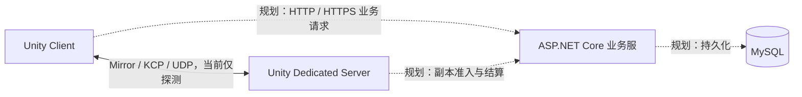

# Norn 双端开发基础指南：是什么、为什么、怎么操作

> 读者前提：会使用 Unity、写过一些 C#，但没有独立搭建过客户端与服务端。这是一份持续补充的基础指南，解释技术概念与手动操作；每个 Task 做了什么、改了哪些脚本、验证到什么程度，继续记录在[联机系统开发解析](<F:/Develop Project/RPG/RPG/Assets/_Project/Docs/2026-10-20 联机系统开发解析（更新中）.md>)中。
>
> 本文操作基于现有工程。已有文件、包和项目不需要重复创建；“从零怎样做”用于理解与复现，建议在另外的练习目录尝试。

> **当前阅读位置：** 第28节讲房间与入场，之后的“角色移动”讲 N3，“战斗、Owned 工作区与 Combat HUD”讲 N4 技术基础；末尾“共享原 UI：View、Presentation Source、Input Owner 与 Canvas Viewport”讲原 P7/P8 控件的接入。前文“匹配暂不可用”“尚无角色/战斗”等属于对应阶段的历史语境。独立 OnlineCombatHud 是灰盒技术设施，正式体验复用原 View，不另维护一套联机界面。当前仍缺完整可信线上库存/编辑与正式地图组合，**不表示 N4 或正式体验整体验收已通过**；实际证据见[联机系统开发解析](<F:/Develop Project/RPG/RPG/Assets/_Project/Docs/2026-10-20 联机系统开发解析（更新中）.md>)。

## 1. 先把“服务器”拆成不同概念

你租到的 Linux Server 是一台运行 Linux 的机器；业务服、副本服、MySQL 则是运行在机器上的不同程序。开发语言决定怎样编写程序，框架提供不同能力，操作系统负责启动进程。最终都能部署到 Linux，不代表它们的功能、运行环境或构建产物相同。

| 名词 | 是什么 | 本工程中的例子 |
|---|---|---|
| Machine / 主机 | 提供 CPU、内存、磁盘、网络的计算机 | 当前开发电脑，未来租用的云服务器 |
| Process / 进程 | 一个正在运行的程序实例，有自己的内存与生命周期 | 业务服进程、副本服进程、两个客户端进程 |
| Runtime / 运行环境 | 执行程序所需的运行时能力 | .NET Runtime、Unity Player Runtime |
| Framework / 框架 | 帮助我们组织程序、实现常见能力的代码 | ASP.NET Core、Mirror，各自负责不同领域 |
| Library / 库 | 被其他程序引用的代码，不一定能独立启动 | 共享协议库、Google.Protobuf |
| Protocol / 协议 | 通信双方约定的数据与交互规则 | UDP、KCP，以及我们定义的应用消息契约 |
| Database / 数据库 | 管理持久数据的系统 | 规划中的 MySQL |

“双端开发”强调客户端和服务端职责分离，不代表最终只能有两个程序。本项目规划中，客户端、业务服、副本服、数据库都是不同角色；本地开发时可以全部运行在一台电脑上，以不同进程和端口区分。



`Shared/Protocol` 没有画成一个网络节点，因为它是编译时使用的共享源码，不是在后台启动、等待连接的服务。目前业务服已有独立 HTTP 探测接口，但 Unity 客户端的业务登录链尚未接入；实时实验已有 Mirror/KCP/Protobuf 探测，不包含角色、战斗或资产同步。

## 2. Unity Dedicated Server 和 Mirror 到底是什么关系

### 是什么：一个是构建运行方式，一个是网络框架

**Unity Dedicated Server** 是 Unity 支持的专用服务器构建目标。它使用 Unity 的运行环境执行场景、组件和 C# 逻辑，并针对服务端用途减少部分显示相关开销。**它不是“安装在每个玩家电脑里的后台业务服”，也不要求远端机器安装 Unity Editor**。开发电脑负责构建，部署机器运行构建产物。[Unity Dedicated Server 官方说明](https://docs.unity3d.com/6000.3/Documentation/Manual/dedicated-server.html)

**Mirror** 是 Unity 使用的开源网络框架。它作为代码进入客户端和副本服构建，提供连接管理、消息收发，以及 `NetworkIdentity`、`NetworkBehaviour` 等网络对象工具。它不是另一个单独部署的服务器程序，也不是云服务器租赁服务。[Mirror 官方概览](https://mirror-networking.gitbook.io/docs/manual/general)

| 层次 | 我们选择什么 | 负责什么 |
|---|---|---|
| 运行环境 | Unity Dedicated Server | 执行服务器场景、组件与 Unity API |
| 网络框架 | Mirror | 管理连接、注册处理器、组织网络消息与网络对象 |
| Transport | Mirror 的 `KcpTransport`，内部使用 kcp2k | 在 UDP 上提供 KCP 通信能力 |
| 消息定义与编码 | Shared 中的 Protobuf | 定义消息字段，把对象与字节互相转换 |
| 游戏规则 | 我们编写的 C# | 决定准入、移动、命中、伤害、副本状态等权威行为 |

它们需要配合使用。Mirror 能让两个程序通信，却不会自动把现有单机角色改造成服务端权威角色；命中校验、敌人 AI、客户端表现和玩家退出后的处理仍然要由我们设计、实现。

### 为什么采用这套组合

副本玩法可能需要复用 Unity 场景、碰撞和已有 C# 游戏逻辑；Dedicated Server 可以让玩法继续使用这些引擎能力。Mirror 则让我们从成熟连接与 Transport 能力开始，不必先实现整个网络框架。代价是引入 Unity 服务端的构建、资源和生命周期管理，也要理解 Mirror 的约束。

纯 .NET 副本服也能实现玩法，但无法直接把 Unity 场景和 `MonoBehaviour` 当成 ASP.NET Core 的运行内容；需要抽取纯规则，并另行选择或实现物理、场景表达等能力。当前选择 Unity 副本服，是为了降低现有玩法迁移成本。

**Host 与 Dedicated Server 需要区分。** Host 让一个程序同时承担客户端与服务器角色，关闭该程序通常就失去服务器。Dedicated Server 作为独立进程运行，某个玩家退出不会顺带关闭这个进程；不过“剩余玩家继续玩”还需要正确的离线、角色清理与房间规则。目前仅验证了探测客户端退出后，另一客户端仍能通信。

### 怎么操作：从工程里找到它们

1. Unity 的 Project 窗口打开 `Assets/ThirdParty/Networking/Mirror`。这是已经导入的 Mirror 源码，不要再重复导入另一份。
2. 打开 `Assets/_Project/Scenes/Tests/MultiplayerAuthorityLab.unity`，选择 Hierarchy 中的 `OnlineLabRoot`，在 Inspector 查看 `NornNetworkManager`、`KcpTransport` 与实验用 Bootstrap 组件。
3. 查看 `Assets/_Project/ScriptableObjects/World/Multiplayer/OnlineNetworkProfile.asset`。当前实验使用本机地址与 UDP 端口 `7777`；Profile 保存实验配置，Manager 执行连接行为。
4. 如需在独立练习工程中导入，先从 [Mirror 官方 Releases](https://github.com/MirrorNetworking/Mirror/releases) 找到项目固定的 `96.11.3`，下载对应 Unity Package；Unity 选择 `Assets → Import Package → Custom Package`。本工程排除了 Examples/Tests，并保留上游 `.meta`，不能把整个样例包直接覆盖进正式工程。

`Game.Networking` 封装通信能力，`Game.Multiplayer` 组合实验场景。它们都不能因此越过正式玩法模块，直接获得账户或背包的权威状态。

## 3. 三个 .NET 项目、一个 Unity 工程，各自是什么

### 是什么：目录、Solution、Project、Assembly 是不同层次

```text
F:\Develop Project\RPG\
├─ RPG\                               Unity 工程，构建 Client / Dedicated Server
├─ Server\Norn.Online.sln              Visual Studio Solution，组织三个 .NET 项目
│  ├─ Norn.Business\                  ASP.NET Core 业务服
│  └─ Norn.Business.Tests\            自动化测试项目
└─ Shared\Protocol\                   共享协议 Class Library，同时是本地 UPM Package
```

| 对象 | 作用 | 是否独立运行、监听网络 |
|---|---|---|
| `Norn.Business` | 运行 HTTP 服务，处理业务请求 | 是，启动后有业务服进程 |
| `Game.NetworkProtocol` | 定义共同消息、协议版本和消息清理约束 | 否，被其他程序编译或引用 |
| `Norn.Business.Tests` | 自动执行测试，检查业务服入口 | 由 Test Runner 临时运行，不作为线上服务部署 |
| Unity `RPG` | 游戏场景与玩法源码 | 构建后可以分别运行客户端、副本服 |

**Class Library 不使用 ASP.NET Core 项目模板。** 两者都写 C#，但共享库只需要“别人能引用我”的能力；Web 项目还需要启动入口、HTTP Hosting、Routing 等能力。共享协议如果依赖 Web 框架，会把 Unity 不需要的东西带进来。

业务服也不是简单地把客户端数据写进数据库。规划中它拥有账户、线上资产、仓库和结算规则，必须校验调用者身份、物品归属与操作合法性；副本服拥有一次副本里的实时玩法状态。客户端说“我获得了装备”并不足以让业务服直接发装备，这需要可信的副本结算流程。

### 为什么既有 `.csproj`，又有 `.asmdef` 和 `package.json`

它们描述的是不同构建系统怎样使用同一份源码：

| 文件 | 谁读取 | 要解决的问题 |
|---|---|---|
| `.sln` | Visual Studio / .NET 工具 | 把相关项目组织在一个 Solution 中 |
| `.csproj` | .NET 构建系统 | 目标 API、源码范围、项目引用、NuGet 依赖 |
| `.asmdef` | Unity | Unity 内的 Assembly 边界和依赖关系 |
| `package.json` | Unity Package Manager | 本地 Package 的身份、版本、目录入口 |

当前业务服通过 `ProjectReference` 使用共享项目；Unity 通过本地 UPM Package 编译共享源码。因此，**不要再把第一方 `Game.NetworkProtocol.dll` 复制进 Unity**，否则容易出现同名类型重复。第三方 `Google.Protobuf.dll` 则是另一回事，仍要作为 Runtime 依赖提供。

### 怎么操作：在 IDE 中正确打开与检查

1. Visual Studio 选择 `File → Open → Project/Solution`，打开 `F:\Develop Project\RPG\Server\Norn.Online.sln`。查看 Solution Explorer，确认三个项目都在。
2. 右键 `Norn.Business → Set as Startup Project`，使用 IDE 的启动按钮运行业务服；不要把共享库设成服务器启动项目。
3. 展开业务项目的 `Dependencies → Projects`，确认引用了 `Game.NetworkProtocol`。如果从零练习，右键 `Dependencies → Add Project Reference`，勾选共享项目；仅把两个项目放进同一个 Solution 并不等于引用。
4. 查看共享项目的 `TargetFramework` 为 `netstandard2.1`，业务和测试为 `net10.0`。可右键项目选择 `Edit Project File` 阅读配置。
5. 新建练习共享库时，选择现代 C# `Class Library`，不要选择旧的 `.NET Framework` 模板。Unity 自动生成的 IDE `.csproj` 不适合作为长期手工配置入口；Unity 侧的依赖应维护在 Package、Plugin 和 `.asmdef` 中。

如果 IDE 提示不支持 `net10.0`，先用 Visual Studio Installer 检查适配 .NET 10 的 IDE 与开发组件。本项目有供自动化使用的私有 SDK，不表示任意版本 Visual Studio 都会自动使用它。

## 4. Test 项目是什么，为什么要测试“这个项目”

### 是什么：一组可重复执行的行为检查

`Norn.Business.Tests` 是我们写测试代码的项目，主要被测对象是 `Norn.Business`。它使用 xUnit 定义测试，用 Test SDK 和 Visual Studio Adapter 让 IDE 发现并执行测试。测试代码也可能写错，因此测试通过只能证明“这些检查目前通过”，不能证明所有需求都已完成。

当前工程中的 `FoundationEndpointsTests` 使用 `WebApplicationFactory<Program>` 创建测试宿主，通过 `HttpClient` 执行真实路由、解析和响应逻辑。它不要求先手动启动业务服，也不需要占用正式业务端口。虽然 IDE 模板可能叫 Unit Test Project，这些跨 HTTP 处理链的用例实际上属于 **Integration Test**；测试范围由检查内容决定，不由模板名称决定。

| 常见标记/依赖 | 是什么、为什么需要 |
|---|---|
| `[Fact]` | 一条没有输入参数组的 xUnit 测试 |
| `[Theory]` 与 `[InlineData]` | 同一规则用多组输入验证，例如版本 `0` 和 `2` 都应被拒绝 |
| `Assert` | 把预期写成机器可检查的条件，失败时报告差异 |
| `Microsoft.NET.Test.Sdk` | 将测试项目接入 .NET 测试运行机制 |
| `xunit.runner.visualstudio` | 让 Visual Studio 测试工具发现并运行 xUnit 用例 |
| `Microsoft.AspNetCore.Mvc.Testing` | 为 ASP.NET Core 应用提供集成测试宿主 |

例如下面是帮助理解的最小 **Unit Test**，不是本次新增的生产代码：

```csharp
using Game.NetworkProtocol;
using Xunit;

namespace Norn.Business.Tests;

public sealed class ProtocolBasicsExample
{
    [Fact]
    public void MissingVersionMustBeRejected()
    {
        // proto3 未填写普通 uint32 字段时读取到 0，不能把它视为合法版本。
        bool accepted = ProtocolCompatibility.IsSupported(0);
        Assert.False(accepted);
    }
}
```

它只检查纯函数。实际 `Ping_IncompatibleVersion_IsRejected` 还检查请求经过 HTTP 入口后，是否真的得到 `409` 与 `VersionMismatch`，因此覆盖了更多集成环节。[xUnit 官方入门（Microsoft Learn）](https://learn.microsoft.com/en-us/dotnet/core/testing/unit-testing-csharp-with-xunit)

### 为什么不能只看“编译成功”和“我能点进去”

编译器会检查类型与语法，但不知道我们规定“缺失版本必须拒绝”“中文不能截断”“请求超过预算必须报错”。手动测试正常请求，也很容易遗漏畸形数据。自动化测试把这些要求固定下来，后续修改解析、协议或依赖时，可以快速发现 Regression。

当前测试关注 HTTP 探测入口，包括 Unicode/大序号保真、版本拒绝、畸形消息、大小限制与 Content-Type。它们没有证明 MySQL、玩家登录或多人战斗可用。MySQL 尚未接入，因此这些测试目前不需要数据库。

### 怎么操作：运行、读懂结果、定位问题

1. 在 Visual Studio 打开业务 Solution，选择 `Build → Build Solution`，先处理编译失败。
2. 选择 `Test → Test Explorer`，找到 `Norn.Business.Tests`，点击运行该项目的测试。无需先启动业务服，也不要把测试项目当业务服务器启动。
3. 全部绿色表示这些用例通过。出现失败时选中用例，先读错误信息的 Expected / Actual，再双击跳转源码；区分“需求不满足”与“测试环境没有启动成功”。
4. 先阅读 `Ping_RoundTrip_PreservesUnicodeAndLargeSequence`：看它构造了什么请求、执行了什么操作、断言了哪些字段。再读版本错误用例，比较成功与拒绝路径。

Unity 的测试是另一套入口：`Window → General → Test Runner → EditMode`，当前网络测试 Assembly 为 `Game.Networking.Tests`，使用 NUnit 的 `[Test]`。Visual Studio 的业务测试通过，不代表 Unity 测试也运行过；Unity 测试通过，也不代表真实多个进程已互联。

| 验证方式 | 能帮助回答什么 | 仍不能据此推出什么 |
|---|---|---|
| Unit Test | 一个纯规则、Codec 是否满足输入输出约定 | 真实端口、场景和进程是否正常 |
| Integration Test | 路由、解析、响应等模块组合是否正确 | 远端网络、多人玩法是否正确 |
| 多进程通信实验 | 独立 Server 与 Client 是否真的通信 | 移动、命中、资产系统已完成 |
| Editor / Player 手动流程 | 玩家实际操作是否得到正确反馈 | 所有边界条件都覆盖 |
| Profiler | 指定场景与采样条件下的 CPU、GC Alloc 等 | 所有机器、负载都满足性能指标 |

## 5. Protobuf：要下载哪些东西，怎样从定义走到消息

### 是什么：Schema、生成器、Runtime 各司其职

| 对象 | 作用 | 我们维护什么 |
|---|---|---|
| `Protos/common.proto` | Schema，声明消息结构与字段编号 | 人工编辑，包含中文业务注释 |
| `protoc.exe` | 开发时把 Schema 编译为指定语言源码 | 固定版本的工具，不随游戏运行 |
| `Runtime/Generated/Common.cs` | 生成的 C# 消息类型和编码代码 | 重新生成，不人工修改 |
| `Google.Protobuf` | 生成代码在运行时依赖的库 | 两端提供匹配版本 |

我们采用统一 Schema，是为了避免客户端和服务端分别手写一套字段后逐渐不一致。Protobuf 解决结构化数据编码问题；连接建立、登录、加密和消息分发不是它自动提供的能力。[官方 C# 基础教程](https://protobuf.dev/getting-started/csharptutorial/)

### 怎么操作一：获取与引用 Runtime

**.NET 侧：** 在 Visual Studio 右键共享项目 → `Manage NuGet Packages` → `Browse`，包源选择 `nuget.org`，搜索 `Google.Protobuf`，核对官方包身份并选择固定版本 `3.34.2`，安装后在 `Dependencies → Packages` 查看。已有工程已经配置好了，检查 Installed 即可；不要顺手更新全部依赖。[NuGet 图形界面操作](https://learn.microsoft.com/en-us/nuget/consume-packages/install-use-packages-visual-studio)、[固定版本包页面](https://www.nuget.org/packages/Google.Protobuf/3.34.2)

业务项目与测试项目在 `Server/Directory.Packages.props` 集中管理相关包版本；共享项目位于该目录之外，使用自己的显式版本引用。IDE 的 `using Google.Protobuf` 只是让类型名可见，不会下载或安装包。

**Unity 侧：** 本工程没有自动继承业务项目的 NuGet 依赖。下载上述固定版本 `.nupkg`，用解压工具打开，取 `lib/netstandard2.0/Google.Protobuf.dll` 放入 `Assets/ThirdParty/Networking/Protobuf`；保留来源与许可证。该版本对应的补充依赖 `System.Runtime.CompilerServices.Unsafe 6.1.2` 也已导入。只放适用的一套 DLL，不要把包里的多套目标框架与整套系统库复制进来。

`netstandard2.0` 的 Runtime DLL 可以被我们的 `netstandard2.1` 共享库使用，这不是版本冲突。Unity 插件检查还要考虑 Player：某个 Editor AI 插件带了依赖，不代表它会进入最终游戏或副本服。

### 怎么操作二：编辑 Schema，点击生成 C#

生成器从 [Protobuf 官方 v34.2 Release](https://github.com/protocolbuffers/protobuf/releases/tag/v34.2) 获取，对 Windows 选择对应架构的预编译 protoc ZIP，而不是 `Source code`。本工程已放在 `Shared/Protocol/Tools/protoc/34.2/bin/protoc.exe`，不必重新下载。

在 Visual Studio 的 `Tools → External Tools → Add` 注册生成入口，Command 浏览到这个 `protoc.exe`，Arguments 指定 Schema 根目录、C# 输出目录和输入文件，勾选输出窗口。当前路径的完整输入框内容见[开发解析 Task N0-1 第 6 节](<F:/Develop Project/RPG/RPG/Assets/_Project/Docs/2026-10-20 联机系统开发解析（更新中）.md>)，可以直接复制到 IDE 配置框。

日常修改按这个顺序操作：

1. 打开 `Shared/Protocol/Protos/common.proto` 或实验用的 `lab.proto`，编辑定义并保存。
2. 在 Visual Studio 点击已配置的 `Tools → Norn - Generate Shared Protocol`。
3. 查看输出错误与 `Runtime/Generated/Common.cs`、`Lab.cs` 的更新。当前工程不会因为保存 `.proto` 就自动生成 C#。
4. 构建业务 Solution 并运行测试；回到 Unity 等待重新编译，再执行 `Tools → Norn → Online → Verify Shared Protocol`。

共享源码通过本地 UPM 导入 Unity，可在 `Window → Package Management → Package Manager → + → Install package from disk` 选择 `Shared/Protocol/package.json`。现有工程已引用，先检查 Package，避免复制第二份源码或第一方 DLL。

### 怎么操作三：读懂字段与编码，不混淆数字的含义

本项目 Schema 使用下面的排版：分区标题归类，message/enum 的用途说明在上方，字段与枚举值注释紧跟分号，并在同组内对齐。

```proto
////////////////////////////////////////////////////////////////
//  连通性探测 / Protocol Ping
////////////////////////////////////////////////////////////////

// 基础探测请求，不代表登录成功。
message ProtocolPingRequest
{
    uint32 protocol_version = 1; // 应用协议版本，缺省 0 必须拒绝。
    uint64 sequence         = 2; // 请求关联序号，回复时原样带回。
    string message          = 3; // 探测文本，UTF-8 最多 256 字节。
}
```

`= 1` 是字段编号，不是“这个字段的默认值为 1”。`protocol_version` 的实际值由发送代码填写；普通 proto3 `uint32` 没有填写时读取为 `0`。不同 message 可以重复使用字段编号，但同一个 message 内不能重复，已经发布的编号不能换成其他业务含义；删除字段时使用 `reserved` 保留编号和旧名称。

| 数字 | 代表什么 |
|---|---|
| `.proto` 的 `= 1` | 该 message 内的字段编号 |
| `ProtocolCompatibility.CurrentVersion = 2` | 当前Norn应用兼容版本，v2要求可信Dungeon身份 |
| `RealtimeMessageKind` 枚举值 | 实时消息的种类，用于分发 |
| `sequence = 42` | 某次请求的关联序号，单独使用不提供身份认证 |
| `Google.Protobuf 3.34.2` | 第三方 Runtime 包版本 |
| `protoc 34.2` | 开发工具版本 |

生成后的 C# 用消息对象存字段，调用 `ToByteArray()` 得到字节，接收方在确定消息类型后调用对应 `Parser.ParseFrom()`。编码本身不会发送网络请求；解析成功也不表示拥有执行该操作的权限。基础用法示例见开发解析 Task N0-1 第 7 节，实时入口则使用已有 Codec 与消息池，不把一次性数组演示搬进每帧热路径。

## 6. UDP、KCP、Mirror、Protobuf 为什么能同时使用

它们位于不同层次，不是在四个方案里只能选择一个。

```text
玩法消息对象
    ↓ Protobuf 编码
Protobuf 字节 + 应用消息类型等 Envelope 信息
    ↓ Mirror 消息处理 / KcpTransport
KCP：在 UDP 上实现确认、重传等可靠传输机制
    ↓ UDP 数据报
操作系统网络栈与网络
```

UDP 提供数据报传输，不保证送达和顺序；**KCP 是运行在 UDP 等数据报通道之上的可靠传输协议实现，不是操作系统另提供的一种 Socket 类型**。**Mirror 的 `KcpTransport` 使用 kcp2k 接入它**。因此之前说的“UDP + KCP”并不矛盾。[Mirror KCP Transport 官方说明](https://mirror-networking.gitbook.io/docs/manual/transports/kcp-transport)

选用它是为了使用已有游戏网络栈，并保留以后按消息特点选择可靠或不可靠通道的空间。**它不保证所有网络条件下都比 TCP 快**；重传、带宽、MTU 和队列依然需要测量。当前 Ping 使用可靠通道，不代表未来每帧位置都必须可靠重传。

业务服的 HTTP/HTTPS 与副本服的实时传输可以不同。浏览器、账号与背包接口不需要为了“统一技术”全部走 KCP；KCP 本身也不提供我们需要的账户认证或完整加密方案。

## 7. Build、Run、Publish：本地怎样打开，远端运行什么

### 是什么、为什么区分

Build 把源码编译、打包成目标程序；Run 是启动程序；Publish 是准备适合部署的业务服输出。Unity 构建还会处理场景、资源和目标平台；.NET 发布则按目标 Runtime 和部署方式组织输出。两者不是同一个构建流程。

**业务服构建产物不能代替 Unity 副本服。** Unity Windows Server 构建也不能直接复制到 Linux 运行；以后部署 Linux 时需要对应的 Unity Server 模块与构建。业务服选择 framework-dependent 发布时，远端要有匹配的 .NET Runtime；选择 self-contained 则随应用提供所需 Runtime。Unity 副本服部署其 Player 构建产物，不在远端安装 Editor 来“打开工程”。

### 怎么操作当前本地实验

1. 在 Unity 打开实验场景，检查 Console 与 Profile。场景已存在时直接打开，不必再次点击创建菜单。
2. 从 `Tools → Norn → Online` 分别选择 `Build Lab Windows Client` 和 `Build Lab Windows Dedicated Server`。菜单使用实验场景，不需要改正式游戏的全局 Build Scene List。
3. 在资源管理器打开 `Builds/OnlineLab/Server`，先启动 `NornServer.exe`；再到 `Builds/OnlineLab/Client` 启动两次 `NornClient.exe`。
4. 两个客户端各点 `Connect Client`，观察 `Sent / Replies` 计数。退出其中一个客户端，确认另一个仍收到回复。
5. 测试结束关闭自己启动的客户端与副本服。没有明显游戏窗口并不等于副本服未启动，可在任务管理器查看进程，再结合客户端回复和日志判断。

Editor 的 Play 是运行当前编辑器场景，不会因此自动新建独立副本服进程。`127.0.0.1` 永远表示“当前这台电脑”，不是任意远端机器。本实验主动限制 loopback，未来远端访问还需要单独设计公开地址、端口、防火墙与认证，不能只改一个 IP 就声称部署完成。

## 8. MySQL 放在哪，哪些数据该存进去

我们已经确定使用 MySQL，但当前仍未接入数据库。可以先让 MySQL 与业务服在同一台开发电脑上运行，它们依然是不同进程；后期是否拆机，取决于资源竞争、备份恢复和运维需求，不取决于目录是否叫 Server。

持久数据需要由受信任的服务端流程写入。规划中的业务服负责账户、角色资产、仓库与结算等规则；副本服保存实时运行状态，并通过明确的结算与持久化流程提交结果。不是每次移动都写一次 SQL，也不应让客户端或公开暴露的游戏端直接操作数据库。

首版线上资产与单机存档隔离：本地存档里的货币和装备不能直接被视为线上合法资产。具体表结构、事务、幂等结算与断线恢复尚未实现，后续接入时会继续补充对应原理和 GUI 操作。

## 9. 版本怎样读，哪里排查问题

这里记录的是本工程固定基线，不是“永远使用官网最新版本”。

| 组件 | 当前固定值 | 应该怎样理解 |
|---|---|---|
| Unity | `6000.3.16f1` | 沿用现有游戏工程 |
| .NET SDK | `10.0.402` | 编译、测试、发布工具；不是 Runtime 补丁号 |
| .NET / ASP.NET Core Runtime | `10.0.13` | 业务服运行环境 |
| Shared TargetFramework | `netstandard2.1` | 可调用 API 契约，不是独立服务端 Runtime |
| Mirror | `96.11.3` | 固定的网络框架版本 |
| Google.Protobuf / protoc | `3.34.2` / `34.2` | Runtime 与生成器采用不同编号形式 |
| 自己项目版本 / 应用协议版本 | `0.1.0` / `2` | 两个由我们维护、含义不同的版本；应用v2不代表依赖包升级 |

| 现象 | 先检查什么 | 为什么 |
|---|---|---|
| `.proto` 改了，C# 没新字段 | 是否保存并点击生成入口，生成路径是否正确 | 编辑 Schema 不等于生成完成 |
| 共享库无法启动 | 是否把 Class Library 当成 Startup Project | 它没有服务器入口 |
| Test Explorer 没发现测试 | 编译错误、测试依赖与适配的 IDE/SDK | 先区分未发现和执行失败 |
| 业务测试通过，Unity 仍报错 | Unity 的 DLL、UPM 与 asmdef 依赖 | 两套构建系统有各自的依赖配置 |
| 客户端连接失败 | Server 进程、loopback 限制、UDP 端口与日志 | 协议能解析不等于网络连接已建立 |
| 能收到 Ping，但没有其他玩家 | 当前是否只运行探测实验 | 传输连通不自动生成角色复制 |

建议源码阅读顺序：[共享 Schema](<F:/Develop Project/RPG/Shared/Protocol/Protos/common.proto>) → [协议版本约束](<F:/Develop Project/RPG/Shared/Protocol/Runtime/ProtocolCompatibility.cs>) → [业务入口测试](<F:/Develop Project/RPG/Server/Norn.Business.Tests/FoundationEndpointsTests.cs>) → [实时连接 Manager](<F:/Develop Project/RPG/RPG/Assets/_Project/Scripts/Networking/Runtime/NornNetworkManager.cs>)。先知道每个文件负责哪一层，再沿一次请求读执行过程；不需要一开始就读完 Mirror 的全部实现。

## 10. 为什么 Server 构建也会出现 Shader 错误

### 是什么：构建检查与运行时绘制是两件事

Dedicated Server 不需要给玩家绘制画面，但构建仍然在同一个 Unity 工程中处理资产和依赖。构建阶段遇到 Shader 的导入、关键字检查等错误，并不与运行时使用 `Null Graphics Device` 矛盾。不能因为“服务器不画画面”，就认定构建中出现的 Shader 错误可以忽略。

| 概念 | 初学时怎样理解 |
|---|---|
| Shader | 描述 GPU 如何处理顶点、计算像素等工作的程序；这里是已有第三方资源的 Shader 模板 |
| Vertex / Fragment | 前者处理顶点与坐标变换，后者计算覆盖到的片元结果；本次问题并不需要修改这些计算 |
| Pass | 一段用于特定渲染用途的配置与程序，例如 Forward 和 GBuffer；不同 Pass 可以分别声明自己的关键字 |
| Shader Keyword | 编译或运行时选择功能的开关，例如是否使用软阴影 |
| Shader Variant | 同一 Shader 针对某组关键字编译得到的版本，过多组合会增加构建成本 |
| `#pragma multi_compile_fragment` | 声明 Fragment 阶段需要编译的一组关键字变体；同一行的选项表达不同选择，不是要求所有选项同时开启 |

例如 `_ _SHADOWS_SOFT _SHADOWS_SOFT_LOW _SHADOWS_SOFT_MEDIUM _SHADOWS_SOFT_HIGH` 表示一组软阴影相关选择，单独的 `_` 表示这一组没有启用这些关键字。若同一个 Pass 又用另一条 pragma 声明 `_SHADOWS_SOFT`，Unity 会报告重复关键字。不同 Pass 各有一条声明则正常。[Unity Shader Keywords 官方说明](https://docs.unity3d.com/6000.3/Documentation/Manual/SL-MultipleProgramVariants-declare.html)

### 为什么修复源码，而不是清 Console 或删除整个资源

这次旧模板把多个 URP 版本的声明放在 `/*ase_srp_cond...*/` 标记之间。这些标记供 Amplify 模板工具处理，对 Unity 的 Shader 编译器而言只是注释，不具有 `#if` 的条件编译效果。当前工程明确固定 URP 17.3，可以保留该版本所需的一组完整关键字，去掉同 Pass 的旧重复声明。修改的是当前工程的局部兼容补丁，不能推导为模板已适配所有历史 URP。

清 Console 只清显示记录，不改变源码；删除整个资源包会扩大改动范围，也可能破坏其他 Material 引用。重新构建验证应看新的结果，不把之前残留在 Console 的错误条数当成本次结果。

### 怎么操作：读懂本工程构建报告

1. 在 Unity Console 中双击错误，定位 Shader 文件和关键字，先区分重复声明、找不到 include 与真正的语法错误。
2. 修改后等待 Unity 导入；必要时在 Project 中右键**这一份** Shader → `Reimport`，不需要先删除整个 Library。
   本工程还提供 `Tools → Norn → Online → Verify Lab Shader Import`，强制导入这份已知模板并输出 `Tools/Networking/.artifacts/shader-import.json`；`HasErrors=false / Errors=0` 表示这一次没有 Shader 错误，`Messages` 仍会保留 Warning。
3. 从 `Tools → Norn → Online` 分别构建 Windows Dedicated Server 与 Client，查看本次 Console 和输出产物。
4. 用文本编辑器打开 `Tools/Networking/.artifacts/server-build.json` 与 `client-build.json`，核对 `RecordedAtUtc` 是否是本次时间，再同时看 `Result` 和 `Errors`。

`Result = Succeeded` 表示 Unity 报告生成了构建产物；`Errors = 0` 才表示该次 Build Report 没有记录错误项。它们仍不证明所有玩法、视觉或性能都已验收。当前实验程序需要继续经过通信测试和开发者的可见窗口操作，性能则需要单独的 Profiler 证据。

## 11. 同一个 Unity 工程，为什么 Client 和 Server 的启动行为会不同

### 是什么：平台、构建角色和编译条件需要分别理解

| 概念 | 本工程的例子 | 影响什么 |
|---|---|---|
| Target | Windows x64，后续还有 Linux | 可执行文件、平台 API 与底层运行环境 |
| Subtarget | Player / Dedicated Server | 同一平台上的客户端或专用服务器角色 |
| 内置编译符号 | `UNITY_EDITOR`、`UNITY_SERVER` | Unity 根据编译环境提供，用来保留适合该环境的代码 |
| 自定义 Scripting Define Symbols | `APP_UI_EDITOR_ONLY` | 包或项目自行约定的编译条件，不会自动获得业务含义 |
| Named Build Target | `Standalone`、`Server` | Player Settings 等配置区分目标的身份，不能假设两者的自定义宏相同 |

`UNITY_SERVER` 是编译期条件，和运行时 `Application.isBatchMode` 不同：客户端加 `-batchmode -nographics` 也可以无画面启动，但不会因此变成专用服务器。项目仍需通过真正的 Server 构建验证。`#if` 决定代码是否参与编译，运行时 `if` 决定已经编译的代码走哪条分支。

### 为什么场景里没有 UI，它还可能在 Server 启动

通常 `MonoBehaviour.Awake` 需要对应对象被加载、实例化；但 `RuntimeInitializeOnLoadMethod` 标记的静态方法是另一种入口：Unity 会把它登记在 Player 的启动清单，在指定阶段直接调用。场景中没有这个组件，并不阻止静态启动方法自己创建 GameObject。

本工程的 `PortalTransitionFade.Install` 就是例子：它为单机/客户端安装跨场景黑幕，再由 `Awake` 创建 Canvas / Image。Headless Server 不需要这层表现，因此需要明确的 Server 边界，而不是只从实验 Scene 的 Hierarchy 删除 UI。我们排查时也读取实际构建的 `NornServer_Data/RuntimeInitializeOnLoads.json`，检查哪些方法真正进入了启动清单。

第三方 App UI 也有启动方法。它的 asmdef 使用 `UNITY_EDITOR || !APP_UI_EDITOR_ONLY`：在 Editor 中保留；在 Player 编译中，如果启用该自定义宏，就排除这套 Runtime Assembly。现有 Standalone 配置已有这个宏，而 Server 是另一份配置，因此二者的打包结果可能不同。判断问题要看源文件、编译条件、输出清单与实际日志，不能仅凭报错刚好出现在某条初始化日志旁边就归因。

### 怎么操作：查看设置、读懂本项目的构建入口

1. Unity 打开 `Edit → Project Settings → App UI`，查看 `Editor Only` 的含义：它限制第三方 App UI 的 Player Runtime，并不是关闭整个 Unity UI，更不等于关闭我们使用的 UGUI。
2. 在对应 Build Profile 的 Player Settings 中查看 Scripting Define Symbols，核对当前选的是普通 Player 还是 Dedicated Server 配置。不要直接把 Client 的所有宏复制给 Server；某些宏可能启用仅客户端适用的代码。
3. 打开 `Assets/_Project/Editor/Networking/OnlineBuildTools.cs`，看 `BuildPlayerOptions` 的 `subtarget` 与 `extraScriptingDefines`。当前实验 Server 构建额外传入 `APP_UI_EDITOR_ONLY`，仅影响这一次 Player 编译，不把它当作账号认证、加密或网络连接能力。[Unity extraScriptingDefines 官方说明](https://docs.unity3d.com/6000.3/Documentation/ScriptReference/BuildPlayerOptions-extraScriptingDefines.html)
4. 使用已有 `Tools → Norn → Online → Build Lab Windows Dedicated Server` 菜单重新构建。验证时同时核对 Build Report、启动清单和新进程日志；旧输出目录里留有某个 DLL 文件，不足以证明它当前一定被加载和执行。

一个编译宏只能解决相应依赖的编译条件。整个 Server 的表现依赖清理、玩法 Headless 兼容、CPU/GC、Linux 与远端安全仍需要各自验证，不能因为加上 `UNITY_SERVER` 或某个宏就宣称完成。

## 12. Headless Grid：服务器没有画面，材料世界如何继续运行

### 是什么：Headless、CPU Grid、Frame 和 Tick

Headless 表示程序不需要图形显示设备与窗口。Dedicated Server 是构建角色，Headless 是运行环境，两者不能互相代替。本工程同时检查真正的 `UNITY_SERVER` 构建与 `GraphicsDeviceType.Null`，然后验证材料模拟能实际初始化和推进。Unity 的专用服务器仍有 GameObject、Transform、Collider 和脚本生命周期；没有 Renderer 并不等于没有游戏世界。[Unity Dedicated Server 官方说明](https://docs.unity3d.com/6000.3/Documentation/Manual/dedicated-server.html)

CPU Grid 是把材料数量存储在网格中，由 CPU 按规则计算变化。它与客户端 GPU 粒子表现是两条不同路径。本实验显式选择 `GridLiquid`，不先要求 GPU 后再依赖 fallback；这样部署机器有没有显卡都不改变实验选择。Collider 地面用于空间阻挡，Interest Point 用于确定活跃区，两者都不负责绘制画面。

| 概念 | 本实验数值与含义 |
|---|---|
| Frame | 进程执行一轮 Update 的机会，目标 30 FPS；实际会受调度、负载影响 |
| Material Tick | 材料世界推进一个固定时间步，配置 10 Hz，即每步对应 0.1 秒 |
| Accumulator | 每帧累积 `deltaTime`，达到固定间隔才推进 Tick；一次 Frame 可能没有 Tick，也可能补跑多个 |
| Warmup / Measure | 先预热 2 秒，再测量约 4 秒，降低初始化对稳态观察的影响 |
| GMU | 本项目既有材料数量记账单位；本实验写入 128 GMU 水，不将它说成 128 个粒子或 128 格 |

例如每帧约 1/30 秒，累积三帧才接近一个 0.1 秒材料步。固定的是模拟时间步，操作系统不会保证每 100 ms 准点回调，所以要用实际经过时间和 Tick 增量计算 `MeasuredHz`，并允许有界测量误差。这一实验仍沿用现有 `ElementWorldRuntime.Update`，后续正式联网的统一 AuthorityTickDriver 尚未接入，不能同时再手动推进同一个世界。

### 为什么既看 Tick，又看水量与位置

只有 `WorldTick` 递增，可能只说明计时器在走。实验还必须通过正式写入队列注入水，观察注入点下方实际出现水，并确认 `LiquidGmu=128`、`PendingGmu=0`。前者证明模拟结果发生变化，后者证明这笔水没有遗失或凭空增加。液体粗格可能对应多个世界细格，不能把每个细格查询出的数量相加当作世界总量；总量从液体系统的只读记账入口取得。

反向检查则故意要求 20 Hz，而场景配置仍为 10 Hz。它应输出 `ConfiguredTickRateMismatch`、`Passed=false` 并以退出码 1 结束。验证工具把这个**符合预期的拒绝**记为反向检查通过，随后才启动正常 10 Hz 检查。退出码 0/1 供外部工具区分通过/失败，不是网络消息编号。

### 怎么操作：全部从 Unity 菜单完成

1. 等 Unity 编译结束，处理自己的未保存场景并退出 Play Mode。工具会拒绝接管 Dirty Scene，不替你保存或丢弃。
2. 点击 `Tools → Norn → Online → Create Headless Grid Lab`。Project 中会出现 `Scenes/Tests/HeadlessGridLab.unity` 和 `Tests/Fixtures/Networking/HeadlessGrid`；已存在时不会覆盖，正式场景与全局 Build Scene List 不改变。
3. 在 Project 中选择 fixture 下的 `World.asset`，Inspector 可见 `Tick Rate=10`、`Water Simulation Mode=GridLiquid`。`Liquids.asset` 控制网格容量；`Probe.asset` 控制预热、测量、注水及扫描范围。它们是实验配置，原 P7 配置不受修改。不要随意改变这些数值后仍引用本文默认验收结果。
4. 点击 `Build Headless Grid Windows Server`，产物位于 `Builds/OnlineLab/HeadlessGrid`。核对 `Tools/Networking/.artifacts/grid-server-build.json` 的本次时间、`DedicatedServer=true`、`Result=Succeeded` 和 `Errors=0`。
5. 点击 `Run Headless Grid Verification`。工具会在后台顺序运行两个独立 Server，不需要点击 Play，也没有游戏画面。Editor 保持可操作；验证时等待结束再改代码，Domain Reload 会中断本工具的子进程，并把本轮记为 Interrupted。
6. 用 IDE 打开 `Tools/Networking/.artifacts/headless-grid/verification.json`，本次 `State=Finished / Passed=true / NegativePassed=true` 表示两轮检查符合预期。再查看 `wrong-rate.json` 与 `positive.json` 的具体原因、Hz、水量和后端；原始启动日志是同目录的 `.log` 文件。若失败，先读 `Error` 和日志，不能只看上次的成功文件。

修改脚本或 fixture 后需要重新 Build，Run 菜单只运行已有产物，不会把 Editor 内的最新配置自动传给旧 exe。双击这个测试 Scene 只是审阅装配；普通 Editor Play 没有显式实验参数，探针不会启动世界或自动退出 Editor。服务器初始处于 inactive 的世界 Root 是有意设计：让探针先确认角色和配置，再激活世界，避免 `Awake` 抢先读取未装配好的对象。

`FrameGcRecorderValid` 表示 Profiler Recorder 是否可用，`MaximumFrameGcBytes` 是测量窗口内观察到的全帧分配峰值。它不提供分配调用栈，也不是单个材料 Tick 的专属计数；即使某次为 0，也不能证明尚未运行的 KCP、加密、多人世界复制都为 0。JSON、报告对象和结束扫描发生在终止边界，不能把这些离散工作与持续热路径混为一谈。[ProfilerRecorder 官方说明](https://docs.unity3d.com/6000.3/Documentation/ScriptReference/Unity.Profiling.ProfilerRecorder.html)

## 13. 高频负载、Token Bucket 与 GC：为什么通信成功还不够

### 是什么：Codec、Transport 和全帧是三个观察范围

Codec 把消息对象写成字节、把字节读回消息；Transport 负责在进程之间传送这些字节；全帧还包括 Unity、连接管理、其他脚本和工具。这三个范围不能互相代替。例如消息对象虽然放回 Pool，Protobuf 解码非空 `string` 仍可能产生新字符串；即使这条消息全部是数值，Socket API 也可能分配地址对象。是否用了对象池，不能直接回答是否达到了 0 B GC Alloc。

本实验复用当前 Ping Schema：数值轮只发送 ProtocolVersion / Sequence，Message 为空；文本轮增加固定中文文本。没有创建新网络协议，也没有将 Ping 称为角色 Snapshot。两轮具有不同数据形状，便于定位字符串解析的成本；数值轮的结论不适用于所有 Protobuf 消息，嵌套对象、RepeatedField、UnknownFields 等仍要分别测量。

| 报告字段 | 表示什么，不能误读成什么 |
|---|---|
| FunctionalPassed | 这个进程完成了连接、请求/回复率与存活检查；不表示账号已认证或性能通过 |
| CodecOperations / CodecAllocationEvents | 预热后编码/解码调用次数，以及 GC.Alloc 当前线程事件数；事件数不是 bytes，也不是网络总分配 |
| CodecAllocationCounterValid / CodecCalibrationEvents | 记录器是否通过已知分配的正向校准；不可用或单次超出固定 128 条容量时，不能把读数当作零分配证据 |
| DotNetControlBytes | 同一 1 KiB 控制分配在 .NET API 上的读数；当前 Unity Runtime 读到 0，因此该方法未用于最终 Codec 结论 |
| MaximumCodecMicroseconds | 单次观测到的 Codec 调用耗时峰值；不是整个 Server Tick 的耗时 |
| MaximumSteadyFrameGcBytes / SteadyFrames | 稳态窗口中观察到的全帧分配峰值与采样帧数；Server 在首次断开前停止该窗口，连接/退出的离散工作另看功能结果 |
| FrameIntervalP95Ms / P99Ms | 把帧间隔从小到大排序后约 95% / 99% 所在的位置；包含调度等待，不是 CPU 计算耗时或网络 RTT |
| ZeroAllocationPassed | 当前实验功能完成、记录器有效、Codec 与稳态帧均未观察到分配；仍只覆盖这次数据、平台、进程和持续时间 |
| SkippedProbes | 卡顿超出最多三条补发预算后的发送机会损失；不会靠无限补发掩盖过载 |

`GC.GetAllocatedBytesForCurrentThread()` 在 .NET 的 API 定义中返回当前线程累计托管分配量，不是存活对象大小，也不包含 native 内存。但是能编译不等于当前 Unity Runtime 实现了有效计数：本工程用明确的 1 KiB 数组分配校准时仍读到 0，所以不能用这里的零值证明性能。[Microsoft API 说明](https://learn.microsoft.com/en-us/dotnet/api/system.gc.getallocatedbytesforcurrentthread)

最终改用 Unity 官方的 `GC.Alloc` 当前线程事件采集方式，在 Codec 调用前 Reset/Start，返回后 Stop/read Count；不启用按整帧合并，以隔离同一帧中的不同调用。启动时先故意分配控制数组，必须捕获到事件才能认为记录器有效，随后经过预热才开始正式测量。采集缓冲固定容量，热路径不创建 recorder 或扩容；报告说“事件”时绝不改口为“字节”。[Unity 当前线程采集示例](https://docs.unity3d.com/6000.3/Documentation/ScriptReference/Unity.Profiling.ProfilerRecorderOptions.CollectOnlyOnCurrentThread.html)

### 为什么限流要允许一小段 Burst

假设客户端平均每秒发 30 条，正常约每 33.3 ms 一条。但线程调度、Mirror Batch 和 KCP 交付可能使几条消息在同一帧抵达。若服务端要求每两次回调必须间隔 50 ms，正常流量也会被断开。

Token Bucket 的做法是：以固定速度补充 Token，每条消息消耗一个，桶有最大容量。负载实验每连接补充 60 Token/s、容量 8，允许有界的瞬时聚合；Token 耗尽仍拒绝，等待也不能积攒超过 8 个。每个连接有自己的桶，不能拿别人的预算。默认低频实验仍用 20/s、容量 4；这些是诊断配置，不是正式施法、聊天、库存消息都可以共用的最终策略。

限流与去重也不同：Sequence 必须递增，重复/逆序请求被拒绝且不消耗新 Token；时钟使用单调的 realtime，回退、NaN 或 Infinity 不能让预算失效。Reliable 传输会重传数据包，但不会因此免除应用层的预算与业务幂等性设计。

### 怎么操作：从四个菜单运行两组五进程实验

1. 等待编译结束，处理未保存场景并退出 Play Mode。
2. 点击 `Tools → Norn → Online → Create Transport Load Lab`，生成独立的 `Scenes/Tests/TransportLoadLab.unity` 和 `Tests/Fixtures/Networking/TransportLoad/Profile.asset`。已有场景不覆盖，原来的通信实验和材料实验继续保留。
3. 在 Inspector 选中 Profile 查看端口 7788、30 Requests/s、60 FPS 目标和 30 Send Rate。Requests/s 是应用发消息的频率，Send Rate 是 Mirror 批处理发送频率，FPS 是进程循环目标；它们不必相同。预热 3 秒后，A 测 6 秒，B/C/D 各测 10 秒，Server 测 14 秒。
4. 分别点击 `Build Transport Load Windows Server` 和 `Build Transport Load Windows Client`。核对 `Tools/Networking/.artifacts/load-server-build.json`、`load-client-build.json` 的本次时间、Result 和 Errors。改脚本或 Profile 后必须重新 Build。
5. 点击 `Run Transport Load Verification`。工具先启动 Server，Ready 后启动四个 Client；它们都是后台无画面进程，只有 Server 是真正 Dedicated Server。不要用任务管理器是否看见窗口判断 Client 是否运行。工具依次运行 numeric / text 两轮，超时或 Editor 重载时只清理自己启动的进程。
6. 打开 `Tools/Networking/.artifacts/transport-load/verification.json`：State=Finished 说明两轮实验采集完成；分别看 Numeric/TextFunctionalPassed 与 Numeric/TextZeroAllocationPassed，不能看到 Finished 就当作性能通过。再读 numeric、text 子目录中各进程 JSON 与日志，比较分配、帧间隔及 A 退出后其他进程的报告时间。

此场景没有实验 IMGUI、Camera 或玩家角色，避免计数文字更新污染网络测量。实验仍运行 Unity 的全局启动方法，因此全帧计数还需要结合局部测量和源码判断。四客户端 ×30/s 是本机小消息基线，没有模拟远端 RTT、抖动、丢包、巨大世界分页、敌人或投射物负载；不能据此宣布服务器已具备完整四人副本容量。

当前两轮使用原始 KCP，不含 EncryptionTransport。本阶段仍限制本机 loopback；加密与公钥验证属于独立能力。Mirror 的 EncryptionTransport 文档目前仍注明加密实现分配较重，这属于官方已知风险，不能当作本轮已经实测的数据，也不能通过启用加密组件就认为分配问题自然消失。[Mirror 官方说明](https://mirror-networking.gitbook.io/docs/manual/transports/encryption-transport)

## 14. Windows Raw IO：为什么装了 KCP 还要观察 Socket

### 是什么：三层代码各自负责不同工作

**KCP 是可靠传输算法，决定确认、重传和窗口；kcp2k 是 C# 集成，调用 Socket 把 Datagram 送到操作系统；Mirror 则把连接、消息和 Unity 生命周期接起来。**某一层实现有分配，不能推出整条技术路线无效，也不能靠给另一层加对象池解决。

本地优化实验使用 `NornKcpTransport : KcpTransport`，保留 KCP 的包格式、Cookie、重传和连接管理，只在 Windows IPv4 loopback 替换最底层 Raw IO。`WindowsDatagramIo` 通过 `DllImport` 调用 Windows 自带的 `ws2_32.dll`，不是下载了一个新的商业插件，也不是重写 UDP。Socket 仍由 kcp2k 创建、配置为 nonblocking 和关闭；适配器只在同步调用期间借用 Handle。nonblocking 没有数据时正常返回 WSAEWOULDBLOCK，不能每帧创建一个异常对象表示这种正常状态。

`byte[]` 是预分配的固定 MTU 缓冲。发送段可能从数组中间开始，因此先复制到固定 scratch，再进行同步数组封送；这增加一次有界内存复制，换来不暴露 unsafe 指针的实现。Windows 的 `sockaddr_in` 用 16 bytes：family 使用主机字节序、端口用网络大端、IPv4 地址按网络字节顺序。只有明确的 `127.0.0.1` 地址会被当前适配器接纳，所以它不能直接拿去承接公网客户端。WindowsServer 与 WindowsPlayer 还是两个不同的 RuntimePlatform；漏掉前者，会导致 Client 优化了但 Dedicated Server 仍走普通 Socket。

另一个独立分配点是 KCP Header 验证：`Enum.IsDefined(Type, object)` 的第二个参数为 object，传入 byte 就需要 Boxing。这里只有五个合法 Header，显式比较能保持原 wire format 和非法值拒绝语义。测试遍历全部 256 个 byte，确保不是为了 Zero GC 放松输入验证。第三方两处本地差异在 `Assets/ThirdParty/Networking/Mirror/NORN_LOCAL_PATCHES.md` 登记；升级 Mirror 时必须重新核对和验证，不能覆盖后继续引用旧性能结果。

### 怎么操作：保留原始实验作为对照

1. 点击 `Tools → Norn → Online → Create Optimized Transport Lab`，生成 `Scenes/Tests/TransportAllocationLab.unity`。原 `TransportLoadLab` 继续保留，方便比较原始 Socket 路径。
2. 分别点击 `Build Optimized Transport Windows Server`、`Build Optimized Transport Windows Client`。它们覆盖的是专用负载输出目录中的 exe，不覆盖正式单机程序。
3. 点击 `Run Transport Load Verification`，它运行刚刚构建的产物。查看每个 JSON 的 `UsesNativeSocket`、`TransportAllocationCounterValid`、`SteadyTransportAllocationEvents`、`MaximumSteadyFrameGcBytes`，同时看功能结果。文本轮仍然应捕获字符串分配，用来防止把失效计数器误当优化成功。

Transport 测量围住 Early/Late 回调，比 Codec 观察范围大，使用固定 4096 事件容量；Codec 默认固定 128。容量不足会使结果无效，不会静默截断成零。预热、连接建立和断开分开看；这不是 Linux、IL2CPP、远端压力或完整 Gameplay 的性能结论。

## 15. 开发认证和 Snapshot：连接后为什么还不能立即玩

### 是什么：连接、身份、Ready 是三道不同的门

UDP/KCP/Mirror 握手完成，只说明有通信通道。`NetworkAuthenticator` 是 Mirror 留给项目的身份认证接口：Server 收到请求，验证后调用 ServerAccept；Client 验证应答后调用 ClientAccept。随后 Mirror Ready 表示客户端已经完成相应准备。当前临时认证只用于 N0，使用每次实验生成、60 秒到期的 32-byte 测试凭据；工具把它放在短生命周期本地文件中，不写进日志或源代码，结束/失败/重载时清理。它不是账号密码、数据库登录，也不是 N2 正式 JoinTicket，不能作为上线方案。

`LocalLabAuthenticator` 在 Server 分配临时 ActorId 并绑定到该连接的 authenticationData。Client 不能在请求里随意指定自己的权威身份。Nonce 是本次请求的关联及短期防重放值；固定容量的已用值表满了会拒绝，不无限增长。认证消息属于连接边界，可以产生一次性分配；持续 Snapshot 需要另一条复用数值对象的路径。

`LocalLabSnapshotChannel` 在 Server 以 15 Hz 发送最多 64-byte 的平坦 Protobuf 消息，字段只有 ProtocolVersion、ActorId、ServerTick 和 LastAcceptedProbeSequence。ServerTick 是实验时钟，不是已经实现了正式 RPG 权威模拟；序号确认表示服务器接受了哪些 Ping，也不是数据库提交收据。收到 Snapshot 后 Client 检查版本、自己的 ActorId、Tick 和确认序号；旧 Unreliable Tick 直接忽略，错误身份或非法确认则断开。只有认证且 Ready 的连接可以接收，避免 Unreliable 快照比 Reliable 认证应答更早被应用。

### Protobuf 在哪里改，为什么要 Reset

共享 Schema 新增在同级 `Shared/Protocol/Protos/lab.proto`，与 `common.proto` 放在一起，生成到唯一的 `Runtime/Generated/Lab.cs`。这是同一个 Class Library/UPM Package 内的新文件，**没有新建 ASP.NET Core 项目**。修改 Schema 的人应先阅读字段行尾中文注释，添加新编号，保留已删除编号；然后用第 5 节配置的 Visual Studio `Tools → Norn - Generate Shared Protocol` External Tool 重新生成（参数现在列出两个 proto 文件，见开发解析 Task N0-1 第 6 节），回到 Unity 用 `Tools → Norn → Online → Verify Shared Protocol` 检查，不能手改生成的 C#。

复用 Protobuf 对象之前需要清理上一次的字段和 UnknownFields。否则新消息省略默认值时，旧身份/序号可能残留。`Runtime/LabProtocolReset.cs` 是 partial class 扩展，与生成类一起编译，允许我们维护 Reset 而不修改生成产物。增加 Schema 字段时必须同步 Reset，并在 Unity Test Runner 运行 LocalLabProtocolTests。所有消息、枚举、字段的解释放在 Schema 中；字段注释紧跟字段同行，生成代码由工具维护。

### 怎么操作：先验证拒绝，再验证四人正常通信

1. 点击 `Create Authenticated Transport Lab`，查看 `Scenes/Tests/AuthenticatedTransportLab.unity`。Root 上包括 NornKcpTransport、NornNetworkManager、TransportLoadProbe、LocalLabAuthenticator 和 LocalLabSnapshotChannel；Inspector 的 authenticator 指向同一个 Root 的认证器。
2. 点击 `Build Authenticated Transport Windows Server` 和 `Build Authenticated Transport Windows Client`。
3. 点击 `Run Authenticated Snapshot Verification`。工具先启动错误版本、错误凭据、认证前发 Gameplay Ping 三种 Client，要求全部被拒绝且收到 0 个 Snapshot；再启动四个有效 Client，要求身份不同、回复及 Snapshot 连续增长，A 退出后其他人继续。
4. 查看 `transport-load/verification.json` 的 AuthFunctionalPassed、RejectionsPassed 和 AuthZeroAllocationPassed，再查看 `auth-numeric` 下负向与四 Client 原始报告。认证负向的 ExpectedAuthRejection=true 表示按预期拒绝，不能误读为认证成功。

## 16. EncryptionTransport：加密和服务器身份校验为什么必须一起看

EncryptionTransport 是包装器：Mirror 消息先进入加密层，再通过内部 KCP/UDP 发送。加密不等于知道对方是谁；若接受任何公钥，中间人仍可能冒充 Server。N0 的受控本机实验从自己刚启动的 Server 报告读取**公钥指纹**，Client 使用 List 模式强制匹配，并额外测试故意错误指纹必须被拒绝。指纹不是私钥，正式远端将由 HTTPS 业务服交付可信期望值；本地报告文件的方式不替代正式信任链。

先构建优化负载场景，再点击 `Run Encrypted Transport Verification`。工具运行错误指纹 Client，再运行四个正确指纹 Client。查看 `encrypted-numeric` 日志/报告和总结果中的 EncryptedFunctionalPassed、RejectionsPassed、EncryptedZeroAllocationPassed。后者必须按实测报告，不能因为“官方库支持加密”就假定 0 B。

当前固定版本的官方文档已注明加密实现存在较重分配。因此 N0 的目标是记录启用加密后的真实功能、CPU/帧调度与 GC 基线；整改是 N8 的远端 Gate。N0 完成仍不能宣布公网版完成，也不会自动替你购买或部署服务器。[Mirror EncryptionTransport 文档](https://mirror-networking.gitbook.io/docs/manual/transports/encryption-transport)

## 17. 丢包、插值缓存与 Profiler 调用栈

`Run Packet Loss Verification` 在双向发送处每 20 个 Datagram 丢弃 1 个，让 KCP 自己恢复 Reliable 消息。它不会把应用请求悄悄改成不需要回复，也没有把丢弃计数当成成功条件的替代品；必须同时看实际 DroppedDatagrams、回复频率、最后回复年龄、一人退出后的存活，以及各层 GC。它只是本机确定性丢包模型，RTT/Jitter/乱序和大世界页仍另验收。

这里还有两个都叫 Snapshot、却属于不同层的对象：Mirror 的 `TimeSnapshot` 帮助平滑时间线，项目的 `LocalLabSnapshot` 承载临时身份/实验 Tick。丢包首轮的 Server 3 次分配来自前者相关的缓存增长，不是后者的数值 Protobuf 解析。预热只代表见过某种负载，不能保证未来抖动不会需要更多槽位。修正是在连接/启动边界为有界 SortedList 预留 64 项，而不是把缓存上限取消；代价是每连接提前占用少量内存，换来既定容量内的热路径稳定。

若还要定位新的分配，可以用 `Capture Packet Loss Allocations`，再用 `Read Packet Loss Allocation Trace` 导出调用栈。前者要求重新构建支持该诊断参数的 Server；工具生成 `Builds/OnlineLab/TransportLoad/Server/ProbeReports/loss-numeric/allocations.raw`，后者写出 `transport-load/loss-allocation-stacks.tsv`。Editor 读取时暂存已有 Profiler 缓存及录制状态，读取后恢复；不进入 Play、不保存/切换用户 Scene。也可以打开 `Window → Analysis → Profiler`，Load 该 raw 文件，在 CPU Usage 中展开 GC.Alloc 看调用者。

完整 Allocation Callstacks 有明显观察开销，会改变帧调度，甚至触发原来正常流量的限流。本次确实出现了诊断轮过载和断开，因此原样保留失败数据，只用于定位，最终预算取关闭该重型采集后的正常轮。不要把诊断轮失败隐藏，也不要为了让它通过而关掉输入校验。新的有界缓存测试先得到 6 次扩容事件，再修正为 0，最终真实丢包五进程也都恢复到稳态 0 B。

## 18. N0 结束时怎样理解“完成”

N0 的验收范围是工程/协议同源、真实 Dedicated Server、独立多 Client、错误版本/凭据拒绝、有界 Snapshot、小场景 Headless Grid 和基础传输预算。它不包含账号密码、MySQL 表、正式 JoinTicket、角色/战斗/背包/材料世界网络复制；这些按 N1–N8 继续。

最终结果和原始证据入口以总体计划及开发解析最后的总复核表为准。加密分配已实际测出，远端 Gate 未通过；启动日志仍有两条尚未定位的 native Built-in Resource Error。我们测试过默认/Quality RP、URP Global Settings、Client Resources 和启动边界，未将失败假设当成根因，也没有过滤日志。这些限制必须跟着后续阶段走，不能把 N0 的功能通过说成整个 Server 无错或已适合公网部署。

## 19. 为什么预热过还有 64 B，怎样读最终报告

Object Pool 只管池中的对象。Mirror 的 Batcher 虽然借用了池化 Writer，内部保存待发送批次的 Queue 仍可能第一次入队才分配数组。常见的一个 Timestamp 立即 Flush 不会碰这个 Queue；三个 Timestamp 等待同轮发送就会触发。我们为它在构造时预留原本首次增长的 4 项，承担每个 Batcher 少量提前内存；没有改协议或取消缓存上限。`MirrorTimeBufferTests` 的新测试旧实现分配 1 次，修改后 0 次，并检查三个批次都能取出。超过预留容量仍可能增长，不能把这次小消息验收推广到所有流量。

想定位纯数值轮，点击 `Tools → Norn → Online → Capture Numeric Transport Allocations`，完成后点击 `Read Numeric Allocation Trace`；文件为 Server 的 `ProbeReports/numeric/allocations.raw` 和工具目录的 `numeric-allocation-stacks.tsv`。Profiler 在 Ready 前开启，避免启动采集的停顿落入稳态；诊断 Burst=64、正常轮=8，速率上限同为 60/s。这个差异只用于诊断，正式预算要关闭重型采集再用正常 Verification 菜单。退出清理的 `DestroyOwnedObjects` 分配也不能当作稳定通信分配。

每次 Verification 会覆盖工具目录里的 `verification.json`，所以最后一次加密轮的 NumericFunctionalPassed=false 不意味着前面的纯数值轮回归失败，它只说明这一轮没有执行该项目。最终各轮分别归档在 `docs/superpowers/evidence/multiplayer/n0-final/{load,loss,auth,encryption,grid}`；看各自记录的时间、State、功能结果、分配结果与原始进程数据。文件存在和 State=Finished 都不等于性能验收通过。

## 20. MySQL、MySqlConnector、Dapper 分别做什么

MySQL 是独立进程，负责存数据与事务；MySqlConnector 是业务项目通过 NuGet 引用的 ADO.NET Driver，提供 MySqlConnection/MySqlTransaction/async IO；Dapper 把参数化 SQL 与 C# 对象/结果行连接起来。装 Dapper 不会自动安装数据库，也不会自动解决并发和回滚。本工程已有三个 .NET 项目，数据库不是第四个 C# 项目。

在 Visual Studio 打开同级 Server/Norn.Online.sln，右键解决方案 → Manage NuGet Packages，源选择 nuget.org。业务项目添加 MySqlConnector 2.6.2、Dapper 2.1.79；本工程用 Central Package Management，版本在 Directory.Packages.props、引用在 Norn.Business.csproj，还原结果在 packages.lock.json。不添加 Oracle 的另一个 MySql.Data Driver 来混用相似类型。两端共享库不依赖这两个数据库包，Unity 也不直接连接数据库。

当前电脑已有8.0.33服务，Norn另外配置8.4.13 LTS、127.0.0.1:13384，不升级或覆盖旧库。数据库 GUI（MySQL Workbench、DataGrip等）中新建连接：Host=127.0.0.1、Port=13384，用户名 norn_app 查看/操作 Norn 开发数据；建表迁移使用 norn_migrate，不给 Runtime root 权限。密码请从本机忽略目录 `.tools/local-mysql/connections.private.json` 自行查看并放入 GUI 密码管理器，不贴到聊天、代码或截图里。展开 norn_online_dev 看真实开发数据，norn_online_test 仅供集成测试；不要把已有个人库填成测试库。

从零安装时访问 [MySQL 官方8.4下载页](https://dev.mysql.com/downloads/mysql/8.4.html?os=3)，Windows选8.4 LTS Installer/ZIP，不能把 Innovation 大版本当作本计划版本。Installer/Configurator 中选择独立目录、端口13384、只允许本机连接；在 GUI 为 Norn 单独创建 Schema 与运行/迁移账号。现有实例已经配好，不要求你重复初始化。普通 GUI 启停在 Unity `Tools → Norn → Online → Start/Stop Local Database`，业务服对应 Start/Stop Local Business Server；启动后浏览器访问 `http://127.0.0.1:5080/health/ready`，返回ready才说明业务账号确实连上DB，/health/live只表示HTTP进程存活。

## 21. Transaction、Version 与 commandId 为什么一起存在

Transaction 让一次移动的位置、实例版本、角色版本和收据一起提交，异常时一起回滚。Version 防止两名调用者读到相同旧状态后都覆盖成功：本工程先锁角色行 FOR UPDATE，再比较 expectedVersion，两个并发请求只允许一个从版本1提交到2。commandId 处理网络重试：第一次已经提交但回包丢失，携带同一个键/同一请求重发，应返回第一次的结果；不能再移动一次，也不能先按旧版本拒绝而让 Client 永远不知道第一次是否成功。

在数据库 GUI 中可沿 Accounts→Characters→Items/ItemLocations→InventoryCommands 查看。一件实例只有一个位置，同角色同区域同Slot有唯一约束，Characters.Version随成功移动增长。PasswordHash保存框架派生结果，AuthSessions.TokenHash是随机Token摘要；不要把二者误解成可直接拿来登录的明文密码。密码/Token不要复制进教学截图。

在 Visual Studio Test Explorer 运行 OnlineAccountsTests、OnlineProfileTests、InventoryTransactionTests。它们需要已启动的独立 MySQL test Schema，测试配置只从本机私有路径注入；缺环境会失败，不退回假数据库。并发、幂等、越权和中途SQL失败必须查真实数据库结果，不能只断言一个 Mock 方法被调用。加入限流用例后，含原基础测试共26项；详细错误链见开发解析。

## 22. 不用终端，怎样启动并操作现在的线上界面

第一次先在 Visual Studio 打开外层Server里的Norn.Online.sln。右键Norn.Business → Publish → 选择现成的LocalOnline Folder Profile，检查Target Location为 `Server/.artifacts/publish/online`，Configuration=Release，Target Framework=net10.0，再点击Publish。这一步把业务程序连同依赖整理到可运行目录；不把解决方案或源文件直接当服务器进程。以后改了业务代码要重新Publish，先停止旧业务进程再发布，以免Windows锁定目标DLL。没有另建一个ASP.NET Core“共享库”：Shared/Protocol始终是纯Class Library，UI/业务接口共用其中的DTO。

注意IDE环境：项目工具使用RPG/.tools/dotnet里的私有SDK，ZIP解压不会自动让Visual Studio识别它。本次自动验证通过的是锁定SDK的构建/发布，不代表已经代你点击过VS Publish。若VS提示找不到SDK，检查它是否支持net10.0及ASP.NET工作负载；需要时从Microsoft .NET官网选择同版本10.0.402的Windows x64 SDK Installer并列安装，重启VS。Server/global.json禁止版本漂移，不能为了消除提示随便改成系统8.0，也不能把Shared改为net10.0。当前业务已Publish，可直接通过Unity菜单启动；未改后端代码时不必重复发布。

回到Unity，依次点击 `Tools → Norn → Online → Start Local Database` 和 `Start Local Business Server`。浏览器打开 `http://127.0.0.1:5080/health/ready`，看到ready后再登录。Unity菜单启动读取本机忽略目录的私有配置，不要把连接串填到OnlineServiceProfile或Client Inspector。退出时先Stop Local Business Server，再Stop Local Database；后者Console最终确认实际MySQL进程退出才算完成，不是刚发出请求就完成。若从源码新建UI，使用Create Online Account UI生成账号菜单/副本选择Prefab；已有资产不需反复创建。

打开 `Assets/_Project/Scenes/P7_MainMenu.unity` 并进入Play，主菜单直接显示登录/注册。用户名用3–24位字母/数字/下划线、密码10–128字符；注册后登录，再点“进入据点”。该按钮还会向业务服确认一次Session；未登录、断网或认证失效均不能从正式菜单进入，**单机也必须先登录**。进入据点后，到P7/P8或远征传送门范围内按F，在提示框选“单机进入”“匹配”或“取消”。单机沿原保存/过门流程，匹配只发送业务意图；N2尚未接入房间服务时会明确提示暂不可用，不会偷偷进入单机。返回门/撤离门继续承担原职责，不再选择进入模式。

要学习N1线上资产事务，单独打开 `Scenes/Tests/OnlineAccountLab.unity` 或构建Lab Client。那里保留注册/登录/资产列表/移动的诊断界面；新账号金币0、两件服务端初始实例，移动后Version增长。它不是正式主菜单，也不是进入联机副本的入口。当前N1背包/仓库只演示实例位置，不是已有单机格子编辑器的网络版；不要把测试界面的结构当作最终产品导航。

需要独立exe时点击 `Build Online Account Windows Client`（隔离检查场景）或 `Build Online Main Menu Windows Client`（含原启用场景、首场主菜单）。全局Build Scene List不改；输出分别在Builds/OnlineAccounts/Lab与Menu。默认D3D12曾有GPU device error，本轮可见验收用D3D11进程参数通过；这不是已修复D3D12。若人工复现，可在Windows为exe建立快捷方式，属性→目标末尾添加 `-force-d3d11`，不用修改全局Graphics设置。Editor本身没有被关闭或替换。

清单过期先点 `Export Content Manifest`，查看Resources/Online/ContentManifest.json；它从正式SO导出，不从玩家存档导出。修改正式ContentId/Kind/显示名后需要重新导出并让业务服重新加载/Publish配套清单。构建前会检查是否过期。清单Hash是N1的身份/版本兼容判断，不是完整地图、技能数值或客户端防作弊签名。

## 23. Test项目怎样在Visual Studio里运行，报告怎样看

Norn.Business.Tests是测试代码的项目，使用Test Host发HTTP并查真实MySQL；它不会部署为第四个服务。先启动Norn数据库，再在VS的 `Test → Configure Run Settings → Select Solution Wide runsettings File` 选择本机 `.tools/local-online/Norn.Online.runsettings`。这个已准备的XML只指定私有配置与Manifest路径，不包含密码；换电脑时用编辑器修正路径。打开 `Test → Test Explorer`，运行Norn.Business.Tests，当前N2预期58通过（N1为26，N2-1为42，N2-2A为52）。test Schema是norn_online_test，工具会拒绝把开发库作为这个测试库；不要手改成自己的数据库。

Unity打开 `Window → General → Test Runner → EditMode`，运行Game.Networking.Tests及本阶段列出的世界/设置/Run入口回归；当前相关范围共91项（N1/N2-1为83，N2-2A加4，N2-2B再加4）。不要把91说成整个工程全部测试。业务测试的并发/回滚验证、可见Client按钮路径、真实进程重启、Profiler空闲计量分别证明不同事情，需要结合看。

报告字段false有时意味着该轮没有执行：first.json不检查重启恢复，resume.json不重新注册/错误密码；看Resume、时间戳与该轮的必需字段。GC校准必须先看到已知1KiB数组分配，否则“0”可能只是无效计数。最终恢复轮是可见D3D11、120空闲帧0B；按钮响应的字符串/JSON分配与空闲热路径分开。原始失败保留，不通过删除旧报告制造全绿。

## 24. 为什么数据库会有两个进程，为什么停止也需要验收

Windows MySQL默认用monitor看护实际Server，以支持SQL RESTART。启动进程的PID不一定是持有ibdata1和端口的worker，所以停止launcher并不证明数据库停止。本项目的本地开发不需要SQL RESTART，因此启动加 --no-monitor，让登记PID直接对应实际Server；用PID file、端口、路径和精确启动时间交叉检查。停止通过只具SHUTDOWN权限的控制账号，让InnoDB正常Flush，不按mysqld名字结束所有实例。

这不只是工具细节：有错误的验收条件，再多“通过”也无法证明重启后数据仍在。正确检查应是旧worker退出、新worker身份变化、认证SELECT成功，再用新Client核对原资产。具体失败/修复记录见联机开发解析Task N1-2，基础指南只保留判断方法。关库未获确认时，先看本机mysql.log与控制账号权限，不能直接删除数据目录重建。

## 25. 登录、单机、匹配为什么是三个不同概念

登录回答“你是谁”，单机/匹配回答“这次副本怎样运行”。按当前产品要求，两种玩法都先登录，但登录并不会把单机战斗变成服务器计算，也不会把本地装备上传。单机仍沿现有本地模拟和单机存档；匹配完成后才应从线上Profile建立独立角色/资产，由Dedicated Server权威模拟。当前N1只实现身份和入口，Room/JoinTicket/副本调度要到N2，因此匹配明确暂不可用。

Session是登录后在内存持有的凭据，不等于TCP/KCP连接。主菜单的AccountMenu是Scene UI，会在进入据点时销毁；OnlineAccountBootstrap创建的独立OnlineAccountSession使用DontDestroyOnLoad跨Scene，保留Token。不能对整个菜单Canvas使用DontDestroyOnLoad，否则其子对象输入框也会跟进战斗。该API只作用于Root GameObject或其组件，具体见[Unity 6.3 API](https://docs.unity3d.com/6000.3/Documentation/ScriptReference/Object.DontDestroyOnLoad.html)。Bootstrap先在inactive根上注入Profile再激活，是利用首次激活时才调用Awake的行为，见[Awake执行条件](https://docs.unity3d.com/6000.3/Documentation/ScriptReference/MonoBehaviour.Awake.html)。菜单重新显示时用Observe请求读最新只读投影，UI仍通过EventBus工作，不直接修改身份。

在Unity Project里找到 `Prefabs/UI/Online/AccountMenu.prefab`，Inspector看用户名/密码与按钮引用；它引用非敏感OnlineServiceProfile，由Bootstrap组合业务Client。再看 `Resources/Online/DungeonEntryDialog.prefab`：Canvas默认隐藏，收到合格传送门请求才显示。Run的DungeonEntryChoiceGate持有本次选择和独立Pause Reason，UI只发布单机/匹配/取消；因此取消只解除自己的暂停，选单机仍由原门校验/保存/转场。你在代码里应按F输入→Registry→门/Gate→Core事件→Dialog→选择事件→原TryEnter的顺序阅读。

编辑登录界面时双击AccountMenu进入Prefab Mode。MainMenu Scene原MainPanel保留美术Image和旧兼容绑定，运行时仅隐藏其旧按钮，再创建新账号Prefab；因此Edit Mode里仍能看到原Play对象，不代表打包后存在离线入口。不要继续修改旧Play按钮来调整登录布局。

单机也必须先登录的实际代价是：业务服或网络不可用时，正式主菜单不能进入据点。缓存Token存在不表示本次认证成功，所以“进入据点”还会查询一次Profile；失败后应停留在菜单并显示错误。Editor直接打开Hub属于作者测试路径，不能拿它当作打包产品的登录验收。完整调用链与测试/平台限制集中在联机开发解析Task N1-3。

要运行完整的DungeonEntryFlowPlayModeTests，先启动本机数据库/业务服，并使用专用测试账号。当前 `.tools/local-online/account-probe.private.json` 已由验收工具准备；在新电脑可先注册一个测试账号，用IDE在此Git忽略文件中填写大小写一致的Username、Password两个JSON字段，不要使用或提交正式账号。该测试读取真实业务身份，只把单机IProfileFileSystem换成MemoryFiles，所以能走P7/P8保存/返回而不写玩家单机档。原业务xUnit测试使用独立test Schema，两者的测试范围不同。

## 26. Room、Run、ReadyRevision和AssetLease分别是什么，怎样学习这部分

**Room是组队关系，Run是一次副本尝试。** 两个人进入同一个Room，界面可以显示队长、成员、是否Ready。点击开始后建立一个Run；如果副本进程启动失败，可以保留原Room重新准备，下一次有不同RunId。不要用Unity Scene名、Transport connectionId或本机GetInstanceID代替这些业务身份。RoomId由业务服生成，PlayerId来自登录Session，界面不能提交一个他人PlayerId来替其准备。

**Ready不是一个永远有效的勾选框。** ReadyRevision是房间状态的版本号。例如A准备后房间Revision变成3，B加入后变成4并清除所有人的Ready；A此前看到的Revision3不能拿来开始当前4版本的房间。每次Ready还绑定InventoryVersion：如果准备后把线上装备移到仓库，开局必须拒绝旧版本，刷新后重新准备，不能让副本读取到一套与玩家确认时不同的装备。两种Version分别回答“成员/Ready是否仍相同”和“资产是否仍相同”。

**AssetLease不是保持一个数据库连接，也不是把装备搬到另一个表。** 它是一条以CharacterId为主键的持久化记录，写明RunId和RoomEpoch。业务服处理新的资产写入时先锁角色行，再检查这条记录；入局事务也锁同一角色行，因此移动与开局竞争时，只会有一种结果先提交。入局期间整份线上角色资产暂时锁定，换来了简单明确的权限边界。读取Profile仍可进行；已经成功过的移动重试返回原收据，不再执行第二次。Transaction在预留提交时已经结束，不整场占用行锁。

**RoomEpoch防止旧回调修改新一局。** 比如RunA/Epoch1启动失败，业务服恢复后又开始RunB/Epoch3；此时RunA的失败通知迟到，也只能尝试释放RunA/Epoch1对应租约，不能解锁RunB。数字中间有空档没有问题，要求是单调推进、旧资格失效。后续Heartbeat、实例认证和结算也要检查同一个fencing token。本轮仅实现启动前预留/条件取消，尚未实现自动到期回收或真实副本的Heartbeat，不要手工调用Prepare制造长期Starting记录。

你可以按下面的人工作法阅读和验证，不需要先学终端：

1. 在Visual Studio打开外层Server目录中的`Norn.Online.sln`。Solution Explorer里先看Shared Class Library的`Runtime/Business/RoomContracts.cs`，辨认请求与应答；它只有数据，没有ASP.NET Controller、Main或服务器监听。
2. 打开Norn.Business的`Features/Rooms/RoomEndpoints.cs`，从POST rooms追到RoomService，再到RoomTransactions。看Player来自Claims、RequireAuthorization与Manifest检查的位置；继续看`Migrations/002_rooms.sql`中的PRIMARY KEY、UNIQUE和CHECK，它们是数据库兜底，不是UI按钮禁用逻辑。
3. 打开`Features/Runs/RunEntryService.cs`，按Prepare→排序锁角色→复核版本→读取快照→写RunMembers/AssetLeases→提交阅读。再看FailStart为什么同时检查RunId和Epoch，以及InventoryService为什么先查成功收据再查租约。
4. Unity菜单`Tools → Norn → Online → Start Local Database`启动隔离数据库。在VS按第23节选择runsettings；Test Explorer搜索RoomAdmissionTests与RunEntryTests，分别运行，合计16项。再运行整个Norn.Business.Tests，当前预期52项（含下一节的10项实例/启动测试）。双击测试结果可跳到断言处，失败时先看Expected/Actual与Code，不直接改断言让它通过。这里操作不需要打开Unity Play Mode。
5. 想观察Schema时，在你熟悉的MySQL图形客户端新增连接，Host填127.0.0.1、Port填13384，使用本机私有开发账号，选择norn_online_test观察测试Room/Run/审计。不要选择原系统MySQL，也不要删除SchemaMigrations或直接清空AssetLeases。开发库norn_online_dev与测试库独立；表结构由程序AutoMigrate管理，不手工复制SQL创建第二份定义。
6. 当前部署默认`Online:RoomsEnabled=false`，所以正式HTTP找不到房间路由是预期行为。测试Host会自行启用，不必改真实服务。若以后需要配置，VS中右键Norn.Business → Manage User Secrets，在Online配置节中添加RoomsEnabled布尔字段；当前阶段保持false，等真实实例与Ticket接好再启用。它是功能开关，不会自动创建Unity Server。不要把密码写进appsettings.json或提交Git。
7. 修改服务端后仍使用既有LocalOnline Publish Profile发布到本地目录，先停本工具业务服再Publish，随后从Unity菜单启动并打开`http://127.0.0.1:5080/health/ready`检查。新程序带002迁移，不需要在图形客户端手点执行SQL。MySQL DDL可能隐式提交，因此迁移失败不能当作整段已回滚；看错误与SchemaMigrations，再按新版本修复，不重写已应用001。

本轮没有新增Unity Scene/Prefab或Inspector操作，也没有真实房间UI可以在游戏里验收。主菜单登录、F门选单机/匹配的产品位置保持不变；匹配当前仍提示暂不可用。等下一段接入RoomLauncher、Server Ready和JoinTicket后，再沿同一入口查看房间成员与准备状态。具体实施过程、文件变化和每次证据请看开发解析Task N2-1，基础指南只解释概念与操作。

## 27. 实例启动、Ready、Ticket和Mirror认证为什么不是同一件事

RoomLauncher是业务服中负责拉起进程的类，不是新服务器项目。它启动已构建的Unity Dedicated Server可执行文件，同时传入不含秘密的启动描述；实例密钥另经环境变量传递。就像打开游戏exe不需要同时打开Unity Editor，远端以后部署Server构建目录也不需要安装Editor。但可执行文件必须带着_Data等配套目录，且Windows构建不能直接当Linux构建使用。

进程被创建后还需加载程序集、场景和Transport，因此Process.Start返回不代表可入场。副本校验自己的ContentManifest、开始监听，再带独立实例身份向业务服发送Ready；业务服核对PID、UTC启动Ticks、版本和当前Epoch，返回原来锁定的线上快照。只有此后玩家才能领取60秒JoinTicket。Ticket到达副本后，副本再向业务服兑换，业务服在一个Transaction中标记已消费并递增ConnectionEpoch；Mirror这时才接受连接。用户名密码属于登录业务，不随每次KCP包发送，也不交给副本进程。

Mirror提供连接、消息注册与认证回调，游戏仍需编写身份规则。NetworkAuthenticator中的ServerAccept只应在业务验证后调用；Transport连接成功不能直接让它通过。同账号的新票认证成功时，旧连接被断开，ActorId保持本Run内一致而ConnectionEpoch递增。Nonce只是把应答关联到请求，不负责证明账号。四个实际席位之外保留临时握手连接，是为满员时让新连接替换旧连接，不是允许八人玩。

业务服重启时，MySQL中的实例登记和租约还在，独立副本也继续运行；新业务服检查原PID/启动时间/路径后接管。只看PID不够，因为操作系统可能把已退出进程的ID分配给另一个程序；停止程序时还要持有同一进程Handle，避免先核对、后重新打开PID的时间窗口。本项目不会按Unity.exe或NornRoomServer.exe名字批量结束进程。

Heartbeat是副本每15秒向业务服续租，不是每帧同步角色。连续60秒续租失败时，副本进入Frozen，关闭新的入场与后续Gameplay Tick门禁；连接管理和诊断Ping仍可继续。若120秒租约过期，业务服先让旧Epoch失效，再处理资产恢复。Frozen不使用玩家的Time.timeScale暂停，因为某一玩家打开菜单不能暂停其他人。现在尚无N3 Gameplay Tick，观察CanSimulate=false只能证明门禁，不代表已经验证权威角色停止移动。

还有一个容易忽视的协议层：Protobuf描述消息体；Mirror外层NetworkMessage另有16位MessageId。Mirror根据完整类型名计算该值，两个不同类型可能碰撞。旧ProtobufEnvelope与Mirror.ObjectDestroyMessage都得到44385，Ping能通也不代表未来实体销毁正确。正式RoomProtocolEnvelope使用41798并由EditMode测试检查与全部Mirror内置消息无冲突；它复用原有Kind/限长Payload序列化，不通过覆盖内置Handler压掉警告。改外层类型时两端都必须重建，不能只更新其中一端。

### 在IDE和Editor中怎样操作

1. 在VS Solution Explorer依次打开RoomLauncher、RoomInstanceService、RoomInstanceSupervisor，看“创建进程”“Ready/兑换/续租”“重启后看护”三种责任。继续看003_instances.sql：ServerInstances是持久化登记，JoinTickets存摘要与消费时间，不存明文票。
2. 打开Shared的Protos/join.proto，从JoinTicketRequest追到Networking的JoinTicketAuthenticator、RoomProtocolEnvelope与RoomNetworkManager。注释在字段同行，生成的Join.cs不要手改；原有生成流程会生成三份C#文件，包版本没有升级。
3. 在VS Test Explorer运行RoomInstanceTests与RoomLauncherTests，共10项；全部业务测试当前52项。TimeProvider允许测试快速推进服务端时间，45/120秒测试不需要让你坐着等待，也不能被描述为真实等待验收。实际原生中断证据另在开发解析与验收目录。
4. Unity退出Play并处理好自己的未保存内容后，点击Tools → Norn → Online → Create Room Lifecycle Lab。工具只创建不存在的Assets/_Project/Scenes/Tests/RoomLifecycleLab.unity，不覆盖原Hub/P7/P8。打开Scene可检查OnlineRoom上的Transport、RoomNetworkManager、JoinTicketAuthenticator、RoomInstanceBootstrap、RoomAdmissionProbe；这几个组件职责不同，不是重复的服务器。
5. 分别点击Build Room Dedicated Server (Windows)和Build Room Client (Windows)。产物在Builds/OnlineRooms/Server与Client；确认对应Build Report为Succeeded且Errors=0。只创建Scene不等于已经构建exe，不手动把测试Scene加入全局Build Scene List。
6. 服务端改动仍用VS的LocalOnline Publish Profile发布；先停旧业务服，避免运行中的DLL被Windows锁住。启动本机数据库后，如需诊断实例，明确点击Start Local Room Business Server (Diagnostic)。不要把它和普通Start Local Business Server混用：普通菜单显式关闭Rooms/Instances，诊断菜单才开启。若普通业务服已在运行，先用Stop Local Business Server停止自己的那一个，再选择诊断菜单。
7. 单独打开RoomLifecycleLab或双击Client exe不会自动登录/组队。当前Native Probe需要验收工具准备的私有一次性Ticket配置，它不是给玩家手工复制Token的产品流程。正式使用将由下一子步的Portal房间UI完成；不要把Server密钥写到Inspector、共享库或Client配置中。当前不需要你手工搭建额外Prefab，也不要求在游戏菜单添加联机按钮。

这部分不需要新模型、音效、贴图或字体。本阶段仍只验证Windows loopback；HTTP/KCP凭据不是已经加密的公网方案，N0加密分配及Linux/IL2CPP验证仍有独立Gate。游戏中主菜单登录、F门选择玩法保持不变，匹配暂不可用，下一子步接成员/Ready/取消与认证后转场。

## 28. 现在怎样从副本门进入房间，为什么还没有联机战斗

本节保留的是 N2 阶段的入场说明。当前 N4 已加入权威战斗，现阶段行为与操作以后文 N4 章节为准；本节中的“尚未战斗”不是当前功能状态。

N2把房间和连接流程连起来，N3才让服务器运行真实角色。当前选择P7/P8匹配会按对应DungeonId组队，进入联机连接测试区；它不会先加载单机P7/P8并假装别的玩家已经同步。你可以验证成员、准备、独立Server、认证、断开和重连，不能在这个区域施法刷怪。这个划分让我们先解决“谁有权入场、异常时资产归谁”，再开发“角色如何移动和战斗”。

### 在Unity、Visual Studio和游戏里操作

1. Unity退出Play，处理好自己的未保存内容。点击`Tools → Norn → Online → Setup Portal Room Entry`。它建立RoomClientProfile、RoomConnection Prefab、OnlineRoom Scene并升级原来的F门弹窗；不会改主菜单和Hub/P7/P8的正式场景，也不会把新Scene塞进全局Build Scene List。重复调用会更新这份专用弹窗，请先备份你自己对它做的视觉定制。
2. 在Project中打开`Assets/_Project/Resources/Online/RoomClientProfile.asset`。Inspector里的Portals把门使用的Scene路径映射到业务键p7/p8/raid；Connection Prefab指向RoomConnection，Connection Scene是OnlineRoom，Hub Scene是原据点。这里没有Token/服务器密钥，也不需要给客户端填数据库连接串。
3. 点击`Build Room Dedicated Server (Windows)`。构建后到`Builds/OnlineRooms/Server`查看exe和配套_Data目录；Unity Editor不是以后部署时要上传的内容。当前Server运行的是准入/连接阶段，后续会装配真正的权威Dungeon。构建成功与Server Ready是不同检查。
4. 在VS打开外层Server的`Norn.Online.sln`，先运行整个Norn.Business.Tests，当前58项；其中RoomMatchmakingTests四项、JoinTicketBudgetTests两项。不同Fixture共用一个test Schema，因此测试项目禁止类间并行；某项内部用Task.WhenAll验证并发业务仍然存在。不要删数据库来处理“某项看到了另一项记录”的问题。
5. 停本工具的旧业务服，再用VS的LocalOnline Publish Profile发布。Unity菜单依次点`Start Local Database`和`Start Local Business Server`，在浏览器确认health/ready就绪。本机普通菜单现在也显式启用N2房间/实例；Diagnostic菜单仍可做隔离验证。部署配置的默认RoomsEnabled/Instances.Enabled仍为false，未来远端要单独配，不能把这台电脑的本地路径照搬过去。
6. 点击`Build Online Main Menu Windows Client`，从`Builds/OnlineAccounts/Menu`运行两份Client。构建工具会显式包含新连接Scene及现有启用Scene；不要求你修改全局Scene列表。首次只需要原有UI/字体资产，不需要下载新模型、音效或Protobuf库。
7. 两份Client分别注册/登录不同账号，进入据点，在同一个副本门范围按F→匹配。第一位创建房间，第二位自动加入；双方都会看到成员与队长。若P7和P8不同队列，不会匹到一起。新成员加入会清准备，双方各点准备；至少两人、最多四人且全员准备后，队长才能点开始。非队长的按钮变灰只是提示，真实权限仍由业务服验证。
8. Server监听并Ready后，Client自动申请60秒一次性Ticket，并通过Mirror认证；正常操作不复制Ticket。成功后进入连接测试区，据点原Scene停用并保留。断线可以点重连，重新取票最短间隔5秒；Actor身份在本局保持一致，旧连接资格失效。点“断开并返回据点”只退出本机连接，其他人继续；原席位保留至该实例结束，可从同一门再连接。
9. 尚在大厅时点取消匹配，必须收到业务退出确认才关闭。网络结果未知会保留错误页，重试恢复房间或确认取消，不会默默切单机。大厅超过90秒没有Presence会清理；Starting/Running不走这个清理器，防止把掉线误当结算。全部Client离开后，DS在180秒空闲期后退出，业务按本局Epoch恢复N2尚未改动的资产。
10. 验证结束先关Client，后停自己的业务服，再停私有MySQL；停止业务服本身不会结束DS。实际Server/Client进程与数据库记录属于不同层，不要在任务管理器按Unity名字批量结束，更不能停止原系统MySQL。自动验收工具会核对自己创建的PID/UTC启动Ticks/路径并清理。

### 这些文件为什么分在不同项目里

RoomClientProfile是ScriptableObject数据，OnlineRoomClient是Multiplayer组合，JoinTicketAuthenticator是Networking适配，DungeonEntryChoiceGate属于Run，弹窗属于UI。它们通过Core的意图/只读View事件沟通，UI不用引用Mirror或Server项目；共享库只描述数据，仍不是ASP.NET Web项目。Session根跨Scene，Token不随菜单Canvas销毁，也不进入Core事件。改房间外观主要看弹窗Prefab/Controller，改匹配规则看RoomMatchmakingService，改准入看RoomInstanceService/Authenticator；不要把所有责任都塞进NetworkManager。

连接期间用Additive保留Hub，是为了返回时保持同一个单机Session和整备状态，代价是内存占用更高。禁用Root触发OnDisable，原组件可能清理瞬态效果；保留Scene不等于任何世界效果都能原封不动续跑。联机只使用独立线上角色，单机物品没有上传。测试工具额外注入MemoryFiles保护你的真实存档，它是验收隔离措施，正常玩家仍走原有存档系统。

控制HTTP和UI文本本来就可能分配；只有认证后的连接稳态窗口才单独测GC，不拿.NET不可靠的字节计数或历史N0报告代替。具体失败记录、文件逐项变化、最终构建时间与Profiler范围，请看开发解析Task N2-2B及n2-final证据。本机通过不能推导公网加密、Linux、IL2CPP、D3D12或联机战斗已经完成。

还有两个需要一起理解的细节。ConnectionEpoch决定哪一次认证更新，消息处理还要核对当前Transport连接绑定：上一连接的迟到消息不能推进新连接的序号。Session在大厅到期则应恢复输入并要求重新登录，剩余席位由服务器超时回收；客户端没有权限直接解锁某局资产。Unity PlayMode的当前6项玩家路径测试覆盖了这些UI生命周期边界及原P7/P8往返，具体键鼠/可见窗口另看原生验收。不要把测试项目里的Reflection推进到期字段当作产品操作，也不要手工改真实数据库的Session过期时间。

### 怎样用Profiler判断连接稳态有没有GC Alloc

打开Unity的`Window → Analysis → Profiler`，在目标下拉框选择实际运行的Windows Player，而不是Editor。两份Client名称可能相同，要结合进程和连接标识确认；不能把另一份Client的数据当成当前窗口。选择CPU Usage的Timeline或Hierarchy，打开GC.Alloc的Call Stacks，等待连接稳定后采样，点选`GC.Alloc`查看调用栈。窗口切换、HTTP、进入场景和文本更新都是额外工作，必须说明采样包含哪些操作。详细调用栈采集有诊断开销，不用它测最终容量；定位后再关闭调用栈记录，使用正常窗口复验。

`OnGUI`属于IMGUI，和本项目正式界面的UGUI Canvas不是同一套系统。即使方法里判断“统计面板关闭”后什么都不画，Unity仍可能在进入方法之前创建自动布局对象。因此本项目只对正式RoomNetworkManager和KCP Transport关闭`useGUILayout`，并关闭它们的调试面板；这不会关闭Canvas。不要对所有组件全局关布局，也不要删除第三方包里的OnGUI来掩盖调用栈。以后要重新开启IMGUI统计，需重新检查布局依赖与分配。

Transport Inspector的`Dual Mode`也是运行配置。当前本地Raw IO仅支持Windows IPv4 loopback，因此连接Prefab在Awake之前就设为关闭；若等组件初始化后才改值，底层实现可能早已选定。诊断报告记录实际`NativeSocket`状态，而不是仅看Inspector推测已走快速路径。该设置没有证明Linux、公网或IPv6可用，未来部署必须重新验证。

## 角色移动为什么需要Authority、Prediction和Replica

### 是什么，为什么不能所有电脑各自Move

同一个玩家在不同程序中有不同职责。Dedicated Server中的实例是Authority：根据已认证连接的输入和真实碰撞计算结果。这个玩家自己电脑里的实例是Prediction：按键后立即移动，减少网络往返造成的迟钝；收到服务器结果后校正。其他玩家电脑里的这个实例是Replica：只播放收到的位置和动作，不读取这台电脑的键盘。它们是同一在线Actor在不同进程中的表现，不是三个账户，也不意味着服务器窗口里有一个人在操作。

如果每台电脑都各自计算并决定最终位置，某人改速度或穿墙，其他电脑缺乏可靠裁决；若客户端每次按键都等服务器回包再移动，200ms往返就会明显迟钝。因此使用服务器权威加本地预测，代价是需要纠正和重放。Unity Physics/CharacterController不是跨平台严格Deterministic，即使复用同一段运动代码也不能保证两端永远零误差。当前N3只重放本机运动，不回滚整场物理；合作角色相互穿行，世界墙壁和坡面仍真实碰撞。

Input Frame保存“这一步想做什么”，例如移动轴、相机Yaw、Jump/Dash边沿。Sequence是输入的顺序号；ConnectionEpoch区分同一Actor的新旧连接；服务器从连接绑定查Actor，而不是相信消息里自报的控制目标。Snapshot保存“服务器实际算到了什么”，除了位置，还要有垂直速度、接地、Dash进度和空中跳跃次数。Ack表示服务器已经消费到哪个输入，客户端从Snapshot恢复后只重放Ack之后的历史。历史使用128帧固定容量；丢失历史时硬纠正，不能无限保存，也不能拿剩下一半输入当作完整历史。

### Tick、Physics和Interpolation各自做什么

Rendering Frame是每次画面更新，Tick是固定逻辑步。本阶段在Update中累积1/30秒，30Hz推进；CharacterController.Move仍由Update调用路径执行，不能再让原角色Update同时推进。服务器由唯一Owner切到`Physics.simulationMode = Script`，每Tick统一调用一次Physics.Simulate，退出时恢复原模式。这是全局设置，所以返回Hub的顺序很重要：先停在线Tick/恢复Physics，再卸载在线Scene和恢复原据点。

Interpolation是远端表现：暂存几份权威Snapshot，播放约100ms之前的状态，在相邻位置间插值，减少15Hz发包对应的阶梯感。它主动增加一点显示延迟，换取平滑；缺包时停在最新已知位置，不永久猜测角色向前跑。Frozen时服务器Tick停止，但客户端真实时间继续，因此恢复时必须重新对齐时钟。Prediction解决自己的响应，Interpolation解决别人的平滑，不能用后者代替权威校验。

### 在Editor中怎样找、怎样检查

1. 在Project定位`Assets/_Project/Resources/Online/MovementProfile.asset`，Inspector查看Player Prefab、Enemy Prefab、World Prefab、Snapshot Interval和Interpolation Delay。前三者为空时不要运行；Snapshot Interval约0.067秒表示15Hz发状态，服务器逻辑仍30Hz。
2. 通过`Tools → Norn → Online → Setup Online Movement World`装配共同地图；打开`Assets/_Project/Prefabs/Online/MovementWorld.prefab`观察墙、坡、台阶。它们不是只给客户端画的装饰，两端使用同一碰撞Prefab；NavMesh用于Authority敌人绕障。
3. 改动角色/地图/模拟配置后重新Setup，再分别选择`Tools → Norn → Online → Build Room Dedicated Server (Windows)`与`Build Online Main Menu Windows Client`构建。SimulationHash把影响模拟的依赖联系起来，两端不一致时拒绝运动；Hash不是密码，也不能代替认证。
4. 本机依次选择`Start Local Database`、`Start Local Room Business Server (Diagnostic)`，浏览器检查`http://127.0.0.1:5080/health/ready`；后者才开启本机房间实例启动，普通Business入口不能代替它。启动两份构建的Client，从主菜单登录→据点F门→匹配→两人Ready→队长开始。进入在线世界后观察移动、跳、Dash和远端动作；Escape仅打开自己的在线菜单，其他人和敌人仍应继续。断线后通过界面重连，不手工修改ActorId或数据库Epoch。
5. 返回据点后检查原单机角色、鼠标锁定、Time.timeScale和场景；不能用“Scene名字正确”代替原Session和资产没有变化的检查。实施验收证据和当前未通过项看开发解析Task N3，本文不把教学步骤写成通过记录。

### 延迟测试和Profiler怎样读才不误解

本阶段Development探针提供0/100/200ms应用消息往返延迟档位，每向加入一半RTT；Jitter是每向±0/20/40ms，消息丢弃率0/1/3%。这能暴露运动包迟到、乱序、丢失时预测历史和远端缓冲的问题，但没有模拟UDP层的KCP重传/拥塞或公网NAT，所以不能说“200ms公网已通过”。固定Seed便于复查，固定128队列防止测试工具本身无限积压。

Profiler应选择实际Windows Player。先制造一次已知1024B分配，确认计数器确实增加，再读取正常窗口；某个API始终返回0并不等于零GC。Input→Simulate→Encode的热路径分配和整个画面的GC Allocated In Frame是不同范围：场景加载、HTTP、JSON诊断文件、字体和动画预热都要另列。诊断报告会分配，所以测量期间停止诊断IO；有Allocation必须保存真实结果并定位调用栈，不能用N0旧测试或编译成功替代本轮测量。

### 为什么没有写new，也可能产生GC Alloc

`params`允许方法接收数量不定的参数。调用`Mathf.Max(a,b,c)`很方便，但当前Unity的这个重载接收`float[]`，编译器会替你创建数组；“源代码没写new”不代表没有分配。两个参数的Max有专门重载，因此`Mathf.Max(a, Mathf.Max(b,c))`能保留同样的最大值结果，又避免路径刷新时反复创建数组。在Profiler中点开GC.Alloc查看完整调用栈，再到对应方法检查重载签名；不要因为栈上出现NavMesh就先更换整个寻路系统。具体RED/GREEN和真实Server采样看开发解析。

`UNITY_SERVER`也是编译条件，不是“当前一定运行在远端”的运行时证明。本工程实际遇到构建Dedicated Server后Editor仍带这个符号；因此自动接管Authority的条件同时排除`UNITY_EDITOR`。Client、Editor和Dedicated构建是不同执行环境，要分别验证。服务器报告Ready也必须意味着运动世界和Authority实际装配成功，不能只证明UDP端口已经监听。

## 战斗、Owned 工作区与 Combat HUD：N4 基础概念与操作

这一部分先回答一个核心问题：把单机里的火球放到联机场景后，为什么还需要写这么多代码？因为单机只有一个程序同时负责输入、物理、扣血和显示；联机时多个程序都能看见火球，却只能有一个程序决定它是否命中、扣多少血和消耗哪张卡。N4 复用既有 Spell、Wand、Projectile、DamagePipeline 和美术资源，重点是拆清执行权限、时间和事实同步。这里介绍技术与人的操作，不把当前实现步骤当成验收结论；具体变更记录仍在开发解析中维护。

### 1. Authority、Prediction、Replica 在战斗中分别是什么

前文的移动 Prediction 仍然成立，但**本机预测移动，不代表本机有权裁决战斗**。角色能立即响应 WASD、Jump、Dash，也能立即播放施法动作；HP、Mana、次数、状态反应和实际命中依旧由 Dedicated Server 决定。

| 运行位置与职责 | 允许做什么 | 最终权威在哪里 |
|---|---|---|
| 单机 `SinglePlayer` | 原有输入、状态机、施法、碰撞、扣血与显示在一个程序中执行 | 当前单机进程 |
| 副本服 `Authority` | 校验已认证玩家意图、Owned 法杖、资源与动作时序，运行 Projectile/AreaDamage/Status，生成结果 | Dedicated Server |
| 本机角色的移动 `Prediction` | 立即响应输入，预测运动和施法动作；收到服务器结果后校正或取消表现 | 预测结果不授予战斗写权限 |
| 客户端战斗 `Replica` | 接收服务器出生、位置、伤害、状态和资源事实，播放相应画面与 HUD | 服务器发来的事实 |

代码中因此有两个不同的枚举：`PlayerExecutionMode` 描述移动职责，`CombatExecutionMode` 描述战斗权限。后者只有 SinglePlayer、Authority、Replica；本机在线 Wizard 的移动可以是 Prediction，而它的 Health、Mana、Projectile 和 Status 仍是 Replica。这不是遗漏一个枚举值，而是避免“客户端为了画得及时，顺便也把血扣了”的权限泄漏。

例如双方都看见同一颗火球撞上敌人：服务器运行碰撞和 `ReceiveHit`，计算 HP 从 100 变成 80；客户端安装 80，并播放命中反馈。客户端不能先把 100 扣成 80，收到服务器的 80 后再扣一次。客户端自己的 `AreaDamage.Start`、`Status.ApplyStatus` 等入口同样需要权限门，不能只禁用鼠标攻击就认为安全。

在 IDE 中可以从以下三个文件开始读：`Scripts/Core/Online/CombatExecutionContracts.cs` 说明职责，`Scripts/Combat/Simulation/CombatSimulationWorld.cs` 负责装配权限及推进 Combat，`Scripts/Multiplayer/Movement/OnlineWorldBootstrap.cs` 把这些领域组件组合到在线世界。Networking 负责传消息，不代替这些 Gameplay 判断；UI 负责显示，不持有扣血入口。

### 2. Owned 工作区是什么，为什么不能直接使用本地单机法杖

**Owned** 表示这次施法使用的是某个线上角色确实拥有、已装备且已安装的实例。`ContentId` 回答“这是什么类型的法杖/卡”，`InstanceId` 回答“具体是哪一件”，二者不能互换。同一种火球卡可以有多份实例，每份剩余次数和归属不同。客户端只告诉服务器“我要用这个已装备 Wand 发起一次施法”，不能发一个任意 Prefab 路径并要求服务器创建，也不能自己填写伤害或“无限次数”。

业务服在入局时提供冻结的资产 Snapshot：Run/Player/Actor 身份、InventoryVersion、选择的 Wand InstanceId、安装卡的父实例与槽位、剩余次数和无限资格等。冻结表示这一局按照明确版本使用这些资产，不是每次出手都向 MySQL 请求一次。Dedicated Server 将这份数据导入**仅在内存中存在的执行工作区**，每个玩家在同一 Run 中保留一份。

这个工作区复用单机已经实现的 Ownership、WandLoadout 和 V2 Cast Transaction 规则，而不读取本地存档文件，也不调用单机 StarterKit 赠送装备。工厂内部出现 `SinglePlayerProfile` 类型，是复用现有的内存聚合结构；它不代表线上角色开始读写单机 Save。真正需要检查的是数据从哪里来、有没有访问本地 Repository，而不是只凭一个类名判断数据归属。

| 数据 | 从哪里来 | 何时改变 |
|---|---|---|
| 实例归属、安装位置、进入副本前的卡片次数 | 业务服冻结的线上资产 Snapshot | 按业务规则冻结与导入 |
| 本 Run 的 Mana、Cooldown、Draw 状态 | Dedicated Server 的 Owned 工作区 | 受服务器 Tick 与施法事务控制 |
| Client 显示的 HP/Mana/次数 | 服务器复制的读模型 | 收到事实后更新 HUD |
| 单机 Profile 与单机背包 | 原有本地保存流程 | 与本次线上工作区隔离 |

新 Run 初始化 Mana、Cooldown 和 Draw；**同 Run 断线重连复用旧工作区**，不能以“重新连了一次”为理由重新补满 Mana 或恢复次数。一次施法使用 `CommandId` 关联请求与收据：同一命令重发，应该拿回原结果，不能再次扣卡。V2 Transaction 把资源准备、实际生成和提交联系起来，生成失败必须取消相应资源准备；这比“先扣次数，再随便 Instantiate”多一些流程，但能避免付了资源没有产物，或产物已创建却没有扣资源。

相关入口在 `Scripts/Run/Spells/OnlineOwnedWorkspaceFactory.cs`、`OnlineOwnedWorkspace.cs` 与 `Scripts/Character/Spells/OnlineCastDriver.cs`。前两者属于 Run，因为它们理解 Ownership 与资源事务；后者属于 Character，负责把角色动作接到工作区。Multiplayer 组合它们，无需越过 Run 的边界修改 Profile。N4 的局内资源裁决也不等于 N6 的持久结算已经完成，不能把内存次数的变化直接当作已经写回 MySQL 的结算。

### 3. Timeline 是什么，为什么服务器不直接读取攻击动画进度

单机攻击原本从 `AnimatorStateInfo.normalizedTime` 读取出手窗口。`normalizedTime` 是相对于 Clip 时长的进度，例如 0.2 表示该次动画的 20%；它不是 0.2 秒。服务器没有必要为了 Wizard 的出手阈值，依赖渲染帧自动推进 Animator，再每帧猜测是否越过窗口。

N4 的 **Authority Action Timeline** 是“由服务器 Tick 驱动的动作时钟”，不是 Unity 的 Timeline 编辑器资源。Editor 工具从既有 AttackDefinition、AnimationClip、Animator State 的固定播放速度中导出出手秒数、动画标识与生成挂点。服务器使用这些秒数裁决出手；客户端使用同样的动画定义播放。这样参数源头还是原来的单机资源，而不是另手填一套近似网络技能。

假设一段有效播放时长 1 秒的 Clip 在 20% 时出手，基础阈值对应 0.2 秒；具体还要按项目现有 CrossFade 门禁等规则导出。逻辑以 30 Hz 推进时，每步约 0.033 秒，不会保证恰好存在一个“正好 0.2 秒”的采样点。因此 Timeline 检查**本步是否第一次越过阈值**，而不是判断浮点数是否刚好相等。某 Rendering Frame 补跑三个 Tick，也只能释放一次；同一个 Tick 被重复调用同样不能再次释放。

Skyfall 等延迟产物使用 `AuthorityCastScheduler` 保存逻辑 deadline。它只在 Authority Step 时前进。副本进入 Frozen 后，不调用 Gameplay Step，Skyfall、Trigger、Cooldown 和 DoT 的逻辑时间就不会偷偷跨过到期点。单机原有 Coroutine 路径继续保留；在线 Authority 不能一边停止 Tick，一边让另一条 Coroutine 使用现实时间继续生成伤害。

近战敌人是另一个情况：原来的命中盒跟着实际武器骨骼移动，所以仍需要服务器采样必要的 Animator 姿态。**不显示画面不等于不需要骨骼数据**。相应路径关闭自动动画推进，按逻辑 Tick 手动更新，再使用原有 OverlapBox；不能把剑击偷换成一个静止的前方盒子。Animator 的显示效果、逻辑出手时钟和骨骼位置是三个相关但不同的概念。

### 4. Intent、Receipt、Fact 和 Snapshot 有什么区别

**Intent** 是玩家提出的操作，例如本次 CommandId、已装备 Wand、ProgramRevision 和按下瞬间的 AimPoint。它不是“服务器必须照做”的指令。服务器从已认证连接查 Actor，校验 ConnectionEpoch、资源、原点偏移、瞄准范围和版本，再决定接受、排队或拒绝。尤其不能相信客户端自报的伤害值或所控制的 Actor。

**Receipt** 回答某个命令发生了什么，例如 Queued、Released 或 Rejected。客户端用 CommandId 将服务器反馈关联到本机已经播放的动作；确认不是再播放一遍，拒绝则撤销对应预测表现。移动 Prediction 的历史重放也不能再次发送施法意图、扣资源或创建第二份投射物。

**Fact** 是已经发生的离散事实，例如出生、终止、受伤和死亡。**Snapshot** 是当前状态的定期校正，例如位置、速度、HP、Mana、状态强度和 Cooldown。出生/死亡等事件不能随意丢失；高频位置状态允许下一份更新替换旧份。Reliable 与 Unreliable 不是“重要”和“不重要”的简单分类，而是不同的恢复方式。两个通道的到达顺序没有天然的全局保证，因此接收端需要检查身份、Epoch 和各自有效的序号，不能让旧 HP 覆盖新 HP。

网络产物使用服务器分配的 Output 身份以及 Actor/Command 等关联字段，不把 `Unity GetInstanceID()` 当作跨进程 ID。每个 Unity 进程有自己的对象与 InstanceID；数值碰巧相同也不表示是同一网络对象。客户端根据双方共同构建的 Prefab 白名单索引创建显示对象，关闭自己的碰撞伤害与 Gameplay Payload，再安装服务器位置和生命周期。

N4 消息定义位于外层 `Shared/Protocol/Protos/combat.proto`。目前同目录包含 `common.proto`、`lab.proto`、`join.proto`、`movement.proto`、`combat.proto` 五份 Schema，仍然属于同一个共享 Class Library/UPM 包，没有新增 Web 项目。若修改 Schema，沿前文 Visual Studio External Tool 的生成入口重新生成，检查入口覆盖当前全部 Schema；生成目录始终是 `Shared/Protocol/Runtime/Generated`。在 Schema 写字段行尾注释，同时维护 `CombatMessageReset.cs` 对字段和 UnknownFields 的清理；不要手改生成的 Combat.cs。

### 5. 技术验收 HUD 为什么使用独立数据绑定（历史设施）

**阅读范围：** 本节解释 N4 灰盒时期 OnlineCombatHud 的实现原因。它用来验证网络事实，不是正式联机 UI 的设计结论。原 P7/P8 控件现在通过动态 Bind 与 Presentation Source 接入；当前 Editor 装配步骤见下一节和本文末尾的共享原 UI 章节。

原单机血条直接引用当前场景的 Health/Mana，在线世界里的 Actor 则会在认证后创建，重连也有 ConnectionEpoch。若把旧单机引用拖到在线 HUD，可能显示停用的 Hub 角色，或把另一个玩家的血量误当成自己。N4 因此由 Multiplayer 将服务器事实转换为 Core 的 `OnlineCombatHudStateEvent`，UI 只消费 `IsLocal`、`IsBoss`、HP、Mana、次数、Cooldown、BossPhase 等只读数据。

`OnlineCombatHudController` 属于 Game.UI，不引用 Mirror，也不能修改 Owned 工作区。它保留单机 HP/Mana 平滑填充的做法；数字对应当前收到的事实，Image 向目标比例滑动。Cooldown 的显示可以在两份服务器状态之间做视觉倒数，但显示到 0 并不授予施法权限，真正是否可施法仍由服务器判断；Frozen 时显示倒数也停止。普通远端玩家的快照不能覆盖本机资源栏，Boss 另有独立的 HP 与阶段区域。

美术没有另起一套：安装工具从 `Scenes/Tests/Hub/P7_DungeonReview.unity` 的现有 HP 子树复制 BG、Fill、Frame、数字样式，Mana 使用已有 `Art/UI/MP_line.png`，只克隆这一小段图形；不复制整份单机 Canvas、Session 或玩家引用。安装只写 OnlineRoom/RoomLifecycleLab，取样场景不保存。因此同一套 Sprite 与字体可以共享，数据绑定仍按在线生命周期独立处理。

UGUI Text 接收不可变 string。即使只写 `text = value.ToString()`，每次变化仍会产生新字符串。这里预先建立固定数量的数字 Text，反复使用 `"0"` 至 `"9"`、`"/"`、`"."`、`"∞"` 常量，数值没变不重新写文本；宽度变化只重新布置已有 RectTransform。取舍是初始化时创建较多小 Graphic，换取持续快照和倒数不反复产生数字字符串。这只是实现方式，是否达成目标仍必须在实际 Player 的 Profiler 中量测，不能凭“没有 ToString”就宣称全帧 0 B。

### 6. 人应该怎样装配和检查 N4 配置

以下步骤是开发操作说明。已有资产不需要从零重新创建；尚在开发/验收期间，某一步报错应保留原始错误并定位，不把“照着点击了一遍”当成成功。

1. **先保存自己的编辑内容并退出 Play。** Project 定位 `Assets/_Project/Resources/Online/CombatDefinition.asset`。它是 OnlineCombatDefinition 类型的 ScriptableObject，不是服务器进程，也不是另一份 Protobuf 文件。Inspector 可查看 Catalog、Gameplay Config Hash、地面/空中 Release Seconds、Animation Hash、Spawn Offset、Output Prefabs 以及 NPC/Boss 配置。自动导出字段不要凭感觉随意改。
2. **检查单机参数源头。** 打开 `Assets/_Project/Art/Prefabs/WizardPlayer.prefab`，查看 WizardController 的 Combo 和 FireballSpawnPoint；沿 Combo 找 AttackDefinition，再查看 Animator 的对应 State/Clip。修改技能或动作时先明确自己改的是 Clip、播放速度、出手进度还是法杖规则，而不是直接把导出后的 Release Seconds 改到“看起来能用”。
3. **点击 `Tools → Norn → Online → Setup Online Combat`。** 入口从既有资源导出动作时序、挂点、Prefab 表和 GameplayManifest，更新关联 Movement 配置。当前 OnlineRoom 安装从正式来源导出的共享原 HUD，历史 RoomLifecycleLab 继续保留技术 HUD。它会临时打开所需 Scene 后恢复原 Scene Setup，所以要求事先处理未保存内容。看 Console 是否出现明确错误；成功路径记录导出 Hash。菜单执行结束不能代替运行验收。
4. **检查输出。** Project 查看 `Resources/Online/CombatDefinition.asset`、`GameplayManifest.json` 与 `MovementProfile.asset`；打开 `Scenes/Online/OnlineRoom.unity`，Hierarchy 定位 `SharedGameplayHud_` 开头的根，检查原 PlayerHealthBar、PlayerStatusBar、BossHealthBarController、PracticeHeldHUD 与 LocalActorHudBinding。正式源的 MP 已在手持栏内，不新增独立 PlayerManaBar。单机 Health/Session 引用为空是隔离要求；运行时由认证后的本机角色与可信只读来源绑定，不能为了看到数字而拖入 Hub 的单机角色。当前尚无完整在线库存来源，手持 Icon 隐藏不能解释为同步通过。
5. **理解两种 Hash。** `ContentManifest` 主要关联物品身份；`GameplayManifest` 关联玩法配置与导出规则。物品 ContentId 没变，但火球速度、Mana 消耗或攻击动画变了，仍可能需要更新 Gameplay Hash。Hash 是版本一致性检查，不是账号认证、防篡改签名或加密。相关规则源码或资源改变后重新 Setup，并重建两端；不能拿一份旧 Server 配一份新 Client。
6. **在 Visual Studio 发布配套业务服。** 打开外层 `Server/Norn.Online.sln`，停止自己原来运行的业务进程，再用现有 LocalOnline Folder Profile 发布。N4 业务服增加 Owned 入局字段和增量数据库迁移；不要把旧业务程序继续指向已经升级的数据库，也不要手工修改已应用 migration 的内容来“强行重跑”。数据库 GUI 可只读查看 Items、ItemLocations、Migration 记录等实际结构，不向客户端填连接串。
7. **从 Unity 构建实际两端。** 使用现有 `Build Room Dedicated Server (Windows)` 与 `Build Online Main Menu Windows Client`。构建前自动检查导出是否过期；若报配置 Hash 不一致，回到参数源头/Setup 查差异，不删除校验。构建产物中的 exe 与配套目录属于运行程序，Assets 源码和 Editor 不需要一起安装到远端。两个 Client 也要来自此次配套构建。
8. **按正式玩家入口检查。** 依前文启动私有数据库和本机业务服，浏览器确认 health/ready，再打开两份可见 Client。分别登录→进入据点→同一副本门范围按 F→匹配→两人 Ready→队长开始。联机入口仍在门上，主菜单仍是登录/注册；不新增一个绕开认证的战斗测试入口。
9. **检查操作与事实同时成立。** 本机点击应及时播放对应动作，移动、空中施法和点击瞬间瞄准需要与单机比较；两端看到同一结果，HP/Mana/次数由服务器更新。Mana 不足、次数不足、断线或配置不符不能通过客户端继续播放动作来“视为出手成功”。关闭一名 Client，另一名仍应继续；重连检查本 Run 资源没有被补满；返回据点检查原单机 Session 和资产。

`Setup Online Combat` 是已经存在的菜单入口；源码中的 `Verify()` 同时供 Setup 和构建检查调用，不能因为看见这个方法，就假定 Editor 一定还存在一个同名 Verify 菜单。学习操作时先看 `[MenuItem]` 标记与实际菜单，再区分工具公开方法和 GUI 入口。

### 7. 人怎样运行测试，怎样判断结果证明了什么

Unity 打开 `Window → General → Test Runner`，切到 **EditMode**，搜索具体 Fixture 再运行。适合学习的顺序是：

| Fixture | 主要回答的问题 | 不能单独证明什么 |
|---|---|---|
| `CombatExecutionModeTests` | Replica 是否真的不能扣血/扣 Mana/执行状态，Authority Tick 是否幂等 | 真实两 Client 是否看到同一画面 |
| `OnlineOwnedWorkspaceTests` | 冻结资产能否正确导入，次数/归属/工作区是否遵守规则 | MySQL 中的持久事务是否正确 |
| `AuthorityActionTimelineTests`、`AuthorityCastSchedulerTests` | 重复 Tick、跨阈值、延迟与取消是否符合逻辑时钟 | 实际骨骼位置或 Native 窗口手感 |
| `OnlineCastDriverTests` | 实际角色、Owned Transaction 与生成是否关联，命令去重是否避免重复消耗 | 完整网络、HUD 与声画反馈 |
| `N4EnemyCombatAuthorityTests` | 敌人/Boss 的权威时序、目标及施法权限 | 一帧多 Tick 下实际动画骨骼是否正确 |
| `CombatCodecTests`、`CombatMessageMappingTests` | 字节边界、字段与应用意图转换是否符合契约 | 业务账号认证、公网加密和 UDP 实际丢包表现 |
| `OnlineCombatHudTests` | 本机/Boss 数据是否隔离，数字对象是否复用，隐藏场景是否释放订阅 | 实际分辨率下是否美观，Player 全帧是否 0 B |

在 **PlayMode** 中查看 `N4ServerAnimationPlayModeTests` 和 `WizardGroundingPlayModeTests`。前者需要真实 Unity 生命周期、场景与骨骼姿态，后者使用真实鞋底 Mesh/地面测量；它们比在 EditMode 直接给某个字段赋值更接近实际情况，但仍不代替双可见 Client 的玩家操作。测试期间让主 Editor 专心运行，不同时构建、手工切场景或进入第二次 Play。

Test Runner 中绿色表示这一次选中的测试通过，红色应展开读取 assertion 与 stack trace。先看运行的 Fixture 和时间，再判断覆盖范围；不要因为某个测试列表全绿，就说整个项目或 N4 全绿。导出的 XML/JSON 需要连同时间、Pass/Fail、场景与错误一起看；结果文件存在不等于完成，旧报告也不能代表刚修改的代码。

业务测试仍在 VS 的 Test Explorer 中运行 `Norn.Business.Tests`，使用前文的本机 runsettings 和独立 test Schema。新增 Owned / migration 测试验证真实 SQL 与入局冻结；它们不在 Unity Test Runner 中，也不会跟着 Dedicated Server 发布成一个运行服务。当前最终数量、RED/GREEN 与失败原因统一记录在开发解析，本文不把某次测试总数写成永远不变的期望值。

最后，进入实际 Windows Player 的 Profiler 分别观察连接空闲、移动、持续战斗和离散生成。场景加载、对象出生、首次字体/动画准备、UI 显示变化与稳态逻辑是不同的采样范围；先做正向分配校准，再谈零分配。Windows loopback 的验证也不能自动推广到 Linux、IL2CPP、公网、D3D12 或尚未通过的加密性能 Gate。N5 材料网格、N6 结算、N7 宕机恢复仍有各自的实现与验收边界。

## Replica 的查询身体、焦点和尸体生命周期

**Collider 与 Authority 各负责什么。** Collider/CharacterController 既提供碰撞形状，也供 Raycast、SphereCast 等 Physics Query 使用。关闭远端角色的 CC，准心就可能只碰到它后面的墙；Server 接收到的 AimPoint 也会随之错误。当前 Replica 保留查询胶囊，通过 ExecutionMode 拒绝本地 Move、AI 和伤害，通过 IgnoreCollision 保持合作角色互穿。这几道机制各管一件事，不能只用“把组件关掉”代替。GroundChecker 还要跳过已被忽略的角色，因为全局 SphereCast 不自动继承那一对身体的碰撞排除关系。

在 Editor 运行完整登录、F 门与匹配路径后，才能检查实际 OnlinePlayer/OnlineEnemy 实例；仅在 EditMode 打开配置 Scene，不能证明运行时权限正确。选中远端角色查看 CC 是否启用，再用真实准心、双方血量和 Test Runner 中 `ReplicaAimQueryTests` 核对结果。不要为了让它可被选中而恢复远端输入或挂第二套伤害组件。

**失焦为什么要响应事件。** `Update` 只能看到当前焦点值。如果短暂离开后在下一帧前回来，它可能漏掉中间的取消边沿。因此 Driver 在 `OnApplicationFocus(false)` / `OnApplicationPause(true)` 同步清理尚未发送的施法缓冲；回焦仍等 World 判断网络、菜单和 Frozen 条件，并等待旧按键释放。人工检查时，按下施法后切走窗口、松开鼠标再回来，旧缓冲不能突然继续发射；重新按下应正常工作。已经被 Server 接受、甚至已经生成的在途弹体有自己的权威生命周期，不能把它们正常飞行误判为本地缓冲仍在连发。

**死亡为什么保留对象。** 单机原角色在两秒后 Destroy。在线若直接销毁根对象，就会同时丢掉同 Run 的 Actor、Health 与 Cast workspace，重连时容易错误地重建成满资源角色。当前保留身份，依原 Prefab 的两秒 ServerTick 窗口关闭碰撞与 Renderer；Frozen 不推进这个窗口。随后重复死亡、重连的新 ConnectionEpoch、迟到状态快照都不能重开身体、重启倒计时或重新创建 OnFire。状态强度读模型仍安装，所以“有服务器状态数据”与“尸体还应该显示特效”需要分开判断。

人工验收时观察敌人死亡动画、原两秒窗口、身体与头顶血条清理，以及准心能否选中后面的活目标；重入同一 Run 检查身份与次数保留。当前阶段的重连不是复活，未来复活需要明确的新生命操作。相应回归集中在 `OnlineCorpseLifecycleTests`，实现与失败原因见开发解析的 Task 6。

**Profiler 数字如何阅读。** 显式 QA 报告保留 240 帧原始 `FrameGcBytes`，同时记录输出出生总数、命中总数和活动输出数；`TickAllocationEvents` 是校准后的当前线程 GC.Alloc 事件数量，不是字节。原始全帧峰值包含离散 Instantiate、受击血液和首次死亡的 Renderer 缓存；不要删掉这些正值再声称整个战斗零分配。Profiler 与玩法计数的采样处于不同 PlayerLoop 时刻，不能仅按同一数组下标认定因果。先核对正向校准、有效帧数、实际玩家动作和窗口范围，再解释持续热路径与离散事件的成本。

## 共享原 UI：View、Presentation Source、Input Owner 与 Canvas Viewport

### 1. 共享 UI 到底共享什么

View 指玩家实际看见和操作的界面组件，例如红色血条 Image、十格快捷栏、法术 Icon、Tab 背包网格、文字和拖拽反馈。Presentation 是把当前玩法数据投影成这些画面的过程；它可以读 HP，却不应拥有扣 HP 的决定权。相同外观也不只是使用同一张 Sprite：父 RectTransform、CanvasScaler、字体、遮罩、Sibling 顺序及显示时机都会影响玩家体验。

正式联机沿用原 P7/P8 的 View 与作者资源，换的是数据来源与授权命令接入。单机原血条读本机 HealthComponent；联机原血条读服务器已经安装到本机 Replica 的 HealthComponent。两者都是原 PlayerHealthBar，不需要另写 OnlinePlayerHealthBar。网络归属与 Actor 生命周期由上层组合处理，UI 不引用 Mirror，也不通过“改一下血条数字”反过来裁决伤害。

目前 Editor 工具从三处明确来源导出共享 HUD：`Scenes/P7_DemoRun.unity` 的 HP/状态栏、`Scenes/P8_BossField.unity` 的 Boss HUD、`Prefabs/SinglePlayer/PracticeInventoryWorkspace.prefab` 内的 PracticeHeldHUD。第三项已经包含现代法杖 MP/Cooldown 与准心，正式源没有独立 PlayerManaBar。导出器保留原表现层级和资源，清掉单机 Session/角色引用以及玩法、存档、AI 组件；不会在 Client 里先启动一局单机，再把它临时删除。

### 2. Presentation Source 是什么，为什么不是再建一个共享库项目

`IInventoryPresentationSource` 是现有 Game.Run 中的 C# interface，不是 ASP.NET Core 项目，也不是新增服务器，更不是另一个 Protobuf 包。interface 约定“界面可以读什么”：库存快照、法杖资源、Toolbelt 绑定、钱包、容量和只读程序预览。它不暴露 Profile、Store 或 Save，因此调用者不能通过这个入口取得一份可随意修改的线上资产集合。

原 SinglePlayerInventorySession 实现这份接口，原 Tab 与 HeldItemHud 继续默认使用 Inspector 已绑定的单机会话。联机组合以后可以调用 BindPresentationSource，把同一套 View 换成可信线上读模型。之所以保留 serialized `_session`，是为了现有 Scene/Prefab 的序列化接线兼容；之所以把外部来源单独记录，是为了显式 Bind(null) 后保持空白，而不是悄悄回落到本地存档。

**读源不等于写权限。** 当前外部来源只允许查看，原拖拽资产、整理、保存、拾取、道具绑定等写入口明确拒绝。未来线上编辑还需要 command gateway：将带版本、请求身份的意图交给权威服务，收到接受/拒绝和新 Snapshot 后刷新同一个 View。界面里已存在一个拖拽控件，并不代表现在可以本地提交线上资产。现有 DS Owned 执行闭包也不等于完整背包；它只包含实际装备及安装卡，不能据此捏造仓库或道具。

来源被 Destroy 后，C# interface 变量可能仍保存 managed 引用，必须按 Unity 对象寿命检查并释放面板。换来源还要清掉旧选择、拖拽、Icon/MP/Cooldown 缓存。手持栏在 EditMode 保留作者预览，Runtime 则先隐藏占位 Icon，等可信来源就绪；不能把源 Prefab 里显示的法杖图标直接当作玩家真的拥有那件资产。

### 3. Input Owner 为什么比一个“是否暂停”的 bool 多一层

单机按 Tab 可以通过 RunPauseCoordinator 暂停本局，联机则只应停止本机移动、相机与施法输入，世界、其他玩家与网络仍继续。因此外部 Tab 不修改 Time.timeScale，而是发布 `InventoryPresentationVisibilityEvent`，用面板实例的 OwnerId 申请或释放本机输入占用。

可以把 owner 理解为登记表：背包登记了自己的占用，Esc 菜单有自己的理由，关闭背包只能移除背包这一项。如果直接用一个 bool，背包关闭时写 false，就可能把仍然打开的 Esc 菜单也解锁。世界组合保存 owner 集合并合并阻塞状态；移动采样、施法、相机和 Cursor 一起读取这个结果。`InputCaptured` 表示本机输入被占用，`MenuOpen` 表示 Esc 菜单本身打开，两者分开才能让鼠标在 Tab 中可用，却不把退出菜单也弹出来。

检查这种机制时要覆盖“打开 A→打开 B→关闭 A→B 仍有效”，还要覆盖关闭、Disable、换源和来源销毁。它验证的是输入所有权，不赋予本地暂停服务器的能力，也不能用来证明正式线上背包已经获得完整数据。

### 4. Canvas Viewport 是什么，为什么 Preview 根坐标不必等于 GameView

viewport 是画面实际呈现的矩形区域，例如当前 GameView 或 Player 窗口。Screen Space Canvas 根 Rect 由 Unity 根据该区域驱动；1920×1080 画面中，根位置可能显示为 (960,540)，它对应屏幕中心，而不一定是作者手工加了这么大的偏移。inactive Preview Scene 没有同一个活动 viewport，根值可能是 (0,0)。

判断导出是否保留作者布局，应检查子 RectTransform 的 Anchor、Pivot、Size Delta、Anchored Position，以及 CanvasScaler 的 Reference Resolution 和 Match 设置。它们决定元素怎样随分辨率摆放和缩放。不能只因根坐标不同就给 Preview 硬写 (960,540)，否则另一分辨率会错；也不能把所有 Rect 检查删掉。当前校验只排除这类引擎驱动的根值，普通子节点和资源仍逐项比对。

工具生成的 `SharedGameplayHud_` 后缀是正式 UI 来源摘要，帮助识别导出是否过期；它与 GameplayConfigHash 的用途不同。前者追踪作者资源来源，后者追踪两端玩法配置。两者都不是账号 Token、加密密钥或“验证过就永远不会变”的证明。

### 5. 在 Editor 中怎样找到、导出并检查共享原 HUD

1. **先看原作者资源。** 退出 Play 并保存自己的修改，在 Project 双击 `Assets/_Project/Scenes/P7_DemoRun.unity`，通过 Hierarchy 的原 Canvas/Inspector 查 PlayerHealthBar 和 PlayerStatusBar；再看 `P8_BossField.unity` 的 BossHealthBarController。Project 打开 `Assets/_Project/Prefabs/SinglePlayer/PracticeInventoryWorkspace.prefab` 的 Prefab Mode，找到 PracticeHeldHUD，查看原十格与准心。布局、美术应在这些正式来源维护，不能到生成的 OnlineRoom 里单独改一套“联机皮肤”。
2. **导出表现。** 确保当前和来源场景没有未保存内容，点击 `Tools → Norn → Online → Setup Shared Gameplay HUD`。若刚改过战斗配置，也可用现有 `Setup Online Combat` 统一导出；它会在 OnlineRoom 安装共享 HUD，历史 lab 保留技术 HUD。前者不替你完成全部玩法配置导出。工具会检查明确目标、临时建立 inactive Preview，再保存 OnlineRoom，不保存原 P7/P8。
3. **核对目标层级。** Project 打开 `Assets/_Project/Scenes/Online/OnlineRoom.unity`，Hierarchy 找 `SharedGameplayHud_` 开头的根。查看 LocalActorHudBinding 的 Health/Status 指向同树内原控件，ManaBar 为空；原控件的单机 Health/Session 引用也应为空。这里的空引用是隔离边界，不要为了消除视觉上的空白而拖入停用 Hub 角色。根内不应带 SinglePlayerInventorySession、AI 或另一个玩家控制器。
4. **运行显式校验。** 点击 `Tools → Norn → Online → Verify Shared Gameplay HUD`，查看 Console 的实际结果。来源变了、样式被目标手改、遗留外部 Scene 引用或仍存在独立测试 HUD 都应处理原始错误，再重新导出；不能通过删掉校验让 Build 继续。源 Scene 有未保存修改时，先决定并保存自己的编辑内容，不让工具擅自丢弃。
5. **分清静态检查与玩家验收。** Test Runner 中按 Fixture 查 `SharedGameplayHudAuthoringTests`、`LocalActorHudBindingTests`、`SharedInventoryPresentationTests`、`OnlineInventoryInputCaptureTests`；PlayMode 查看原 `BossHealthBarControllerTests`。静态导出通过后，还要配套 Build Client/Server，再沿登录、原 F 门、匹配、入场、受击、状态和退出返回路径观察原 UI。在 GameView/Player 比较实际分辨率和 Cursor，不能仅看 inactive Preview 的数字。

这些界面操作已在当前项目提供；BindPresentationSource 是运行时组合 API，不是 Inspector 中一个可以直接拖入 interface 的新菜单。当前共享 HUD 导出没有把整个 Tab 工作区导入 OnlineRoom，也没有接入可信完整线上库存来源；因此现在不能把 Tab 可编辑、十格资源已同步或完整 P7/P8 体验当作已通过结果。需要先完成对应数据与命令适配，再按同一玩家路径验证。

### 6. 读状态与读一次命中为什么也要分开

服务器完整 HP Snapshot 可以让晚加入的玩家直接看见当前血量，但这不表示刚发生了一次新伤害。如果为了更新 UI 而广播 DamageReceivedEvent，所有血液、音效和硬直订阅者可能重复播放。当前 HealthStateChangedEvent 只表达当前/maxHP 数值改变，原血条据此校正目标比例；真实伤害仍沿独立 Damage 事实处理。Boss 的 BossHudStateChangedEvent 也只刷新 HP、Phase 和 active 资格，不重新执行服务器阶段规则。

原血条在 Update 中只平滑 Image，标签在绑定或实际数值事件发生时更新，并比较整数显示是否变化。这减少稳定帧的字符串分配，但不等于所有变化帧或整场战斗零分配；UGUI、字体、对象出生与命中表现仍要在实际 Player 中分别量测。当前新增的源码测试和配套 Build 不会自动消除前阶段保留的冷移动分配、战斗离散分配或 native 启动错误。各轮真实证据、失败与下一步继续记在开发解析，不在本指南把一次 Pass 数写成长期功能承诺。

## 共享原相机：Camera、Cinemachine、CameraRoot 与表现目标

### 1. 这几个对象分别是什么

Unity的Camera负责真正把场景渲染到画面；CinemachineCamera是一套取景规则，CinemachineBrain读取这些规则，把最终位置、旋转和Lens参数应用到Unity Camera。URP AdditionalCameraData保存这台Camera使用的URP设置。AudioListener是听者的位置，通常跟随本机镜头；同时启用两份Listener会造成冲突，不能只处理画面而忘记声音。

角色Prefab里的CameraRoot只是Transform枢轴，负责提供原角色鼠标轨道的位置和方向，它本身不是一台Camera。正式P7的完整Camera/Brain/Cinemachine rig在Scene中，因此不能仅复制WizardPlayer就认为已经带入同一相机。联机也不需要给每个远端角色都创建一个可渲染镜头：每个Client只把原相机绑定自己控制的Actor，其他人是被观察的Replica；Dedicated Server负责规则和物理，不运行玩家相机表现。

FOV表示视角，ThirdPersonFollow的距离、肩部偏移和避障参数决定角色占屏大小及镜头遇墙时怎样缩回。正式P7使用FOV70和距离5.23；灰盒曾用另一段固定距离计算，改成相近数字也无法自动恢复同一避障算法。共享原Camera与完整rig，让单机作者资源继续作为唯一来源，后续调手感后重新导出即可，不必维护一套联机近似参数。

### 2. 为什么跟随一个proxy，而不直接移动CameraRoot或玩家根

服务器校正到达时，Prediction会纠正角色真实位置；MovementPresentationSmoother用短暂、有限的视觉偏移减轻模型突然跳动。如果镜头直接跟已经纠正的碰撞根，模型虽然平滑了，画面仍可能跳一下。因此OnlineCameraTarget提供只读的表现目标：位置等于原CameraRoot的世界位置加当前视觉校正，旋转仍取原CameraRoot。

proxy是供表现读取的Transform，不拥有移动权限。不能为了镜头平滑去移动CharacterController或修改原CameraRoot，因为这些对象还参与运动、输入和下一次校正，容易形成表现影响物理、物理再影响表现的反馈。当前执行顺序让原角色先更新轨道，Smoother在50更新偏移，proxy在75读取，Brain在100计算镜头。顺序保证本帧计算使用本帧目标；帧内先后关系与网络Tick是两件事。

Core的LocalActorPresentation传入Actor与明确CameraTarget；Rendering的LocalActorCameraBinding设置原rig目标，注册实际输出Camera；Multiplayer经Core取得这台Camera交给原BindOnlineCamera。这样屏幕中心准心使用的射线与玩家看见的镜头一致，网络模块也不必引用Cinemachine。缓存解决“角色先创建还是相机先创建”的先后问题，Owner保证旧Scene清理不能抹掉新绑定。

### 3. 在Editor里怎样查看与操作

1. **查看正式来源。** 退出Play并保存自己的编辑内容，Project打开 `Assets/_Project/Scenes/P7_DemoRun.unity`。在Hierarchy选择Main Camera，Inspector查看Camera、URP AdditionalCameraData、CinemachineBrain和AudioListener；选择原CinemachineCamera，查看Lens、ThirdPersonFollow、RotateWithFollowTarget、CameraOffset与AimFramingController。改变手感应在这里维护原作者配置。
2. **导出同源相机。** 确保当前与来源Scene没有未保存内容，点击 `Tools → Norn → Online → Setup Shared Gameplay Camera`，或现有统一 `Setup Online Combat`。工具只把纯相机树安装到OnlineRoom，清掉原单机Player等外部Scene引用，不复制单机Session，也不保存原P7。
3. **检查生成树。** 打开 `Assets/_Project/Scenes/Online/OnlineRoom.unity`，找到 `SharedGameplayCamera_` 根，检查LocalActorCameraBinding的Camera和Rig指向同一生成树。静态authoring的TrackingTarget为空是预期，运行时才绑定本机proxy；不要手动把停用Hub的角色拖进去。该树应只有一套Camera/Brain/Listener/rig，没有新的玩家控制器或存档Owner。
4. **执行来源校验。** 点击 `Tools → Norn → Online → Verify Shared Gameplay Camera`。来源Hash、序列化参数和引用范围用于发现导出过期或生成树被手改；遇到失败应检查原始错误并重新导出，不能通过删除校验绕过。它验证authoring，不证明运行时已经由正确Camera输出画面。
5. **检查实际玩家路径。** 配套构建Client/Server，经登录、原Hub F门、匹配与入场后，查看本机CameraTarget是否指向原CameraRoot的表现proxy，实际Camera是否由共享rig驱动，旧ConnectionCamera和旧Listener是否关闭。走跳、转镜头、靠墙避障、准心施法后，返回原Hub再重入；返回时不能仍由在线镜头抢画面。Test Runner可查LocalActorCameraBindingTests、SharedGameplayCameraAuthoringTests与OnlineCameraTargetTests，但不能用绿色测试代替这条可见流程。

如果画面仍是连接背景，先检查是否有第二台Camera在更高depth输出SolidColor，而不是立即调FOV或改角色坐标。Camera存在、目标有效、Brain在更新、最终输出归属正确是连续几步。相机共享也不代表正式地图、完整线上背包或十二敌人的Encounter流程已经接入，当前完成范围及新构建实机证据仍以开发解析为准。

## UI Focus：窗口收到输入，为什么原按钮仍可能没有响应

### 1. Application、EventSystem、Input Module和Button各管哪一步

Application.isFocused表示Unity窗口当前是否有焦点；EventSystem是UGUI的输入分发中心，它还保存自己的isFocused缓存。InputSystemUIInputModule把Input Actions中的鼠标位置、按下/释放转换成UI指针事件，GraphicRaycaster判断画面上命中了哪个控件，Button最后依据是否可交互、按下/释放对象等条件决定是否调用onClick。它们不是同一个bool，因此“鼠标能移动”并不能证明按钮一定能消费点击。

本项目联机期间会停用并保留原Hub，返回时再启用。停用的EventSystem可能错过窗口Focus回调，而UGUI原OnEnable不主动重采Focus缓存。这时窗口实际Focused=true、原EventSystem仍Focused=false，UI Point与Raycast都正确，按钮也可交互，Input Module却可能因Focus门禁跳过点击。额外切一次窗口有时刷新缓存，只是一条Debug线索，不能要求玩家每次返回都这样操作。

当前FocusAwareEventSystem继承原UGUI EventSystem，OnEnable先执行base维护原注册，再通过受保护的base.OnApplicationFocus(Application.isFocused)同步真实状态。它只补恢复启用的生命周期，不伪造按钮、不重复HTTP、不强制全局IgnoreFocus或让后台全部输入继续，也不逐帧查询。PortalInteractInput自己的F门焦点缓存是另一处状态；F能开选择页与鼠标能点击仍须分别检查。

### 2. 为什么迁移组件脚本，而不是删除旧组件再Add

Unity场景和Prefab会通过GUID与FileID保存对象引用。组件名字相同不代表身份相同，删除原EventSystem后Add新组件可能改变FileID，让其他引用指向失效对象。当前显式迁移工具用SerializedObject的m_Script替换原组件槽位的脚本，保留原导航设置、拖拽阈值、firstSelected与InputModule/Actions接线；替换后重新获取托管wrapper，再检查身份，最后还用保存重载测试确认结果。

工具只处理明确列出的六份生产Scene与PracticeInventoryWorkspace原Prefab，不扫描修改所有历史实验或第三方资源。写入前先只读预检全部目标：原EventSystem可迁移，已是FocusAware可保留，未知自定义派生先拒绝并交还作者处理。这避免先改一部分、后发现自定义实现而留下部分迁移。预检不保存资源；原Scene有未保存内容时也拒绝继续。

### 3. 在Editor中怎样操作与排查

1. **先保留自己的编辑。** 退出Play，检查并保存自己要保留的场景修改。点击 `Tools → Norn → UI → Upgrade Production EventSystem Focus`，由工具预检固定资源并迁移；遇到自定义派生或校验失败，先读Console，不删除派生组件或跳过校验。
2. **检查原组件与接线。** 打开原Hub、P7/P8或OnlineRoom，Hierarchy选原EventSystem。Inspector中的Script应为FocusAwareEventSystem，原InputSystemUIInputModule及其Actions引用仍在，原选中对象与Drag Threshold保持。没有新增一套按钮或另一个在线EventSystem。四处创建工具也已改用这个类型，以后重建不会恢复旧缓存行为。
3. **验证实际生命周期。** 经真实登录、Hub F门、匹配进入副本，保持当前窗口返回Hub，再按F并单击匹配；观察不依赖额外切窗口。单机也应从F弹窗实际选择单机，再检查Tab、鼠标和返回。该路径验证输入恢复，不等于完整正式地图或线上背包已完成。
4. **按链路看证据。** 若仍不响应，先看Application与EventSystem两个Focus，再看Cursor Lock、Point/Click Action、UiPoint、Raycast首目标和Button可交互状态，最后才查onClick后有没有业务请求。显式Development诊断可记录这些值；内部pointer反射仅用于调查，不能作为正式输入权限或长期依赖内部字段的修复。

Test Runner中FocusAwareEventSystemTests覆盖Focus恢复与身份保护。单机HubPracticePortalTests使用InputTestFixture提供鼠标设备，跨帧移动、按下、释放，仍经过原EventSystem/Raycast/Button；它从已进入Hub边界开始提供已登录的UI前置，不创建Token或账户。因此不能拿这类测试代替真实注册/登录与Profile门禁。实际RED/GREEN数量、迁移差异审计和Native状态统一见开发解析。

## 战斗区域自动装配：Host、Context、Scope与DontDestroyOnLoad

### 1. 什么常驻，什么随区域释放

Task8的共同装配代码已落地，完整玩家验收仍在进行。每个可战斗区域通过共同入口提供Context，Host按需复用同一份原HUD，接上现有背包Controller和读源；新地图配置内容并复用组合入口，不再逐图重造HP、准心、状态栏或十格。原P7/P8资源继续作为同一套表现来源，单机与联机更换的是当前数据和授权命令。

DontDestroyOnLoad让对象跨Scene保留，也会保留整个Transform子树。当前只把独立CombatPresentationHost与其纯HUD子树常驻；角色、敌人、库存Session、PauseCoordinator、NavMesh与副本权威仍按自己的Scene/Run释放。账户应用服务有自己的持续寿命，与HUD Host是独立Root。把Gameplay父根整体常驻会保留旧输入理由、旧数据源和重复世界，因此Host只保存可清理的临时引用，不把Actor或Session移到自己的子树。

### 2. Context、Scope和lease分别解决什么

CombatPresentationContext说明这次实际Actor、WorldScene、库存只读源、原背包Controller和默认准心能力。背包Controller可能还位于Hub，而玩家已进入additive副本，所以WorldScene必须取Actor真实所属Scene。Context保存引用，不取得对象寿命或资产写权限。

CombatPresentationScope是当前区域的临时使用者：区域就绪时Bind，停用或World卸载时Clear，自己不常驻。Host发放的lease由OwnerId和Generation组成，相当于“这次绑定的释放凭证”；新区域替换旧区域后，旧Scope迟到Release不能清掉新界面。完全相同的Context更新是幂等事实，不能顺手关闭仍在操作的Tab；同区域只更换读源时，局部替换引用即可，也不应把整套HUD停用重启。

原单机Controller仍通过原Session执行拖拽、保存和资产命令。Host只让HeldItemHud读取同一来源、在真正释放时关闭原Controller以释放输入；它不会把单机Controller切到外部只读override。线上完整库存尚未就绪时保持空源和明确拒绝，不能把Hub本地档当作线上资产。

### 3. 原HUD怎样让位，Boss怎样应对晚加载

Core的ICombatHudElement标记可以替换的纯表现叶树，UI与Rendering都能使用这个中性合同。Host离散扫描明确的World和背包所在Scene，先检查所有候选，再隐藏原HP/Mana/状态/Boss/Held/准心节点；原Tab、Guide、暂停菜单和EventSystem继续保留。若候选节点混入角色、Session或交互Owner，接管失败并保留原界面，不能为了消除重复画面而关掉整个__UI。

Boss初始化是一次性事件，EventBus不保存历史。若Host晚于Boss激活才创建HUD，需要在订阅完成后请求当前World重发只读完整快照。BossHudReplayRequestedEvent按本机Scene句柄过滤，活跃同Scene的单机Boss或Client Replica应答；Authority、死亡或未激活Boss不因UI请求重新开战。BindWorld限定HUD接受当前区域初始化，Disable时还必须隐藏旧子树，因为同一常驻对象下次启用不会再跑Start。

WorldSceneHandle是当前Unity进程的局部标识，不能跨Client/Server当作相同Scene，也不替代协议里的可信DungeonId。重放不重跑阶段、Teleport或VFX。相机仍沿独立Rendering路径复用原Cinemachine，Host不因此拥有镜头规则或角色控制。

### 4. 在Editor中怎样配置、查看与验证

1. **维护共同来源。** 在原P7/P8 Scene与PracticeInventoryWorkspace Prefab中维护美术和布局，先退出Play并保存自己的编辑内容。不要到每张地图重新搭另一份基础HUD。
2. **导出唯一Resource。** 点击 `Tools → Norn → Combat → Export Shared Combat HUD`，随后 `Verify Shared Combat HUD`。Project打开 `Assets/_Project/Resources/Presentation/CombatHud.prefab`，确认根inactive、只含原纯表现组件，Actor/Session引用为空。来源摘要位于Unity importer元数据；Prefab根会被Unity按文件名命名，不要靠手改根名绕过来源校验。
3. **使用共同区域入口。** 练习区复用PracticeInventoryWorkspaceBinding，普通Raid沿原Run/InventoryController边界，在线复用现有 `Setup Online Combat`安装的共同OnlineRoom Scope。入口传Context，不根据P7/P8名称判断UI样式。原背包Controller与单机写权限仍在原Scene；不用把它们拖到常驻Prefab。
4. **检查实际Hierarchy。** 运行后Hierarchy应只有一份CombatPresentationHost位于DontDestroyOnLoad Scene；HUD实例在其子树，Actor、Session和敌人仍在实际Gameplay Scene。换地图后应复用同一HUD实例，离开战斗时隐藏并清旧引用；旧Scope卸载不能关闭较新区域的HUD。
5. **检查输入与Boss。** 打开Tab后重复Run状态不应自动关面板；真正退出应释放自己的输入理由。Boss激活后再绑定HUD应恢复当前状态，换无Boss区域不应留旧条，同World换读源不应丢Boss身份。Test Runner查看CombatPresentationLifecycleTests、BossHudPersistentLifecycleTests和真实PlayMode的CombatPresentationRuntimeTests/CombatPresentationBossTests。
6. **最后走玩家路径。** 验证Hub→P7/P8→Tab/施法/返回、普通Raid，以及配套新构建后的双Client→返回→单击匹配重入。源码测试与前一版Native通过，均不能自动成为这次Host的完整玩家验收；当前结果和未通过项看开发解析。若自动攻击反复死亡，保留真实状态并使用明确人工步骤继续观察，不以无限重跑代替结论。

关键Client/Server类、方法和API的注释须解释职责、取舍、调用时机、生命周期与不变量；每轮报告应同时说明本轮改动、实际验证及具体下一步。注释帮助理解为什么，Editor步骤帮助找到并核对实际对象，二者都不能省略。当前完整线上库存、正式P7十二敌内容与可信Dungeon身份仍有独立实施/验收边界，Host常驻本身不代表这些工作完成。

## Schema、应用协议与Dungeon身份：为什么加了字段仍要配套构建

### 1. 这些版本与编号分别是什么

Schema是消息的数据结构，例如join.proto里有哪些字段、每个字段的类型和tag。Protobuf编码器按tag识别字段，旧接收者通常能跳过自己不认识的新字段，所以“能反序列化”只说明结构可以读取，不代表双方执行同一业务规则。Norn现在要求入场确认携带可信DungeonId；旧Client忽略新字段后仍可能按旧规则继续，因此应用协议升到v2，明确拒绝没有该语义的旧产物。

| 数字所在位置 | 当前含义 |
|---|---|
| `syntax = "proto3"` | Schema使用的Protobuf语法，不是Norn应用版本。 |
| `dungeon_id = 9` | JoinTicketReplyMessage内字段tag9，不能与其他字段重用。 |
| `ProtocolCompatibility.CurrentVersion = 2` | Norn应用协议v2，要求Dungeon身份贯通HTTP、握手与Manifest。 |
| `Google.Protobuf 3.34.2` / `protoc 34.2` | 固定Runtime包与代码生成工具版本，本次没有升级。 |
| `OnlineInventoryPresentationSnapshot.SchemaVersion = 1` | 这类库存值快照自己的Schema版本，不等于应用v1，也不是Protobuf库版本。 |

DungeonId是稳定配置键，例如业务白名单中的p7/p8，不是可以自由加载的Scene路径。业务服从已经授权的Party取得它，Launch、Ready、Ticket、Consume和握手确认保持同一值；Client按已得到的业务期望比对，不能拿待验证回复反填期望。DungeonIdentityRules负责格式与非空相等，部署白名单和事务仍由业务服负责。当前链路已补齐身份校验，但Unity World还未按它装配正式P7/P8地图；字符串相同不能证明正式几何、敌人和Encounter已经加载。

### 2. 修改proto后，人应该怎样更新整个链路

1. **编辑唯一Schema。** 在IDE打开并列Shared目录的`Protocol/Protos/join.proto`，查看Reply末尾的tag9及同一行注释。保留原tag；删字段要保留编号，不去手改Generated/Join.cs。
2. **检查IDE生成入口覆盖范围。** Visual Studio打开 `Tools → External Tools`，查看已配置的 `Norn - Generate Shared Protocol`。输入目录仍是Shared/Protocol/Protos，输出仍是Runtime/Generated；输入应覆盖当前common、lab、join、movement、combat五份Schema，不能沿用只处理早期common/lab的配置而遗漏join。保存Schema后点击该入口，查看Output中的真实结果，再打开Generated/Join.cs核对新属性。
3. **核对应用语义。** 在Solution Explorer打开Runtime/ProtocolCompatibility.cs，当前为2；查看BusinessHttpClient的X-Norn-Protocol来自同一常量，握手与Manifest也应一致。新增必需字段不能只依靠Protobuf自动忽略行为；应用版本和生成一致性分别检查。
4. **重新构建业务与Unity资源。** 在Visual Studio使用 `Build → Build Solution`并通过Test Explorer跑对应测试；回Unity等待Shared重新编译，执行 `Tools → Norn → Online → Verify Shared Protocol`。通过 `Export Content Manifest`或统一玩法Setup更新Resources/Online/ContentManifest.json，并核对协议版本及玩法来源。现有业务发布/启动流程使用同一新版合同。
5. **更新配套Player。** 沿现有 `Tools → Norn → Online → Build Room Dedicated Server (Windows)`与`Build Online Main Menu Windows Client`生成配套产物，保留真实Build报告与Hash，再运行玩家路径。只换Client、只换DS或仍运行旧业务程序时，旧版本/缺Dungeon被拒绝是预期，不能直接归因为UDP丢包。

Build前先保存自己的Scene编辑；生成成功、测试通过与最终可见体验是不同步骤。当前五份生成检查和业务合同已有证据，新一轮Player构建/验收时间统一写开发解析，不在这里预先承诺通过。

## Stable Read Source与Authority Workspace：相同View怎样安全换数据

### 1. 为什么Client不能拿执行工作区当UI来源

Authority Workspace负责规则执行：批准资格、处理施法事务、消耗与恢复资源。当前OnlineOwnedWorkspaceFactory创建的是DS本Run执行路径，并不是为Client显示数字而准备的容器。若Client也创建一份，它可能订阅同一命令、自动Tick或自行改变Mana，从而出现看起来正常、实际双端规则不一致的问题。

OnlineInventoryPresentationSource是纯Game.Run C#读模型，没有MonoBehaviour、Update、Authority命令订阅或资源Tick。它实现原View需要的库存/法杖/Toolbelt/SpellUse只读接口；当前Mana、Cooldown、ProgramRevision和资格均来自同批服务器值，不在Client按模板或次数猜测。它当前支持的完整投影是装备法杖与安装卡，尚无真实Bag、钱包、地面和材料容器能力；不应据此说在线背包已经全部可用。

### 2. Stable与TryInstall分别是什么意思

Stable表示Source与各只读接口对象身份稳定。原Tab可以一直持有同一个Source，每次读到其当前State；更新数据时不必替换整个接口、重新绑定面板或取消正在进行的UI交互。

TryCreate需要目录、独立可信Identity和值快照，校验成功后才返回Source。Identity由上层已经认证的连接提供，不能从同一待验证快照抄一份再和自己比较。TryInstall核对Run/Player/Actor/Inventory/Hash、Epoch、递增Sequence与各版本、父链、装备位置、资源和资格完整性，先构造不可见候选，全部通过后一次交换State；拒绝时原UI仍读取上一份一致数据。可变DTO数组会复制，避免解包对象随后被复用时改写已展示内容。

这个完整快照安装过程会创建数组、索引与程序值，是离散操作，不应在Update或每条Mana高频事实中反复调用。后续网络适配还要设计owner-only快照与有界更新，再按真正变化的Version通知原View；稳定Source不等于免费重建，也不等于数据永久不变。Dispose清值并拒绝迟到安装，Scope退出仍负责解除UI临时引用。

### 3. 在IDE与Editor中的阅读路线

先打开`Scripts/Run/Inventory/OnlineInventoryPresentationSnapshot.cs`，区分独立Identity、一次Snapshot、法杖资源与资格值；再打开OnlineInventoryPresentationSource.cs，沿TryCreate→TryInstall→TryBuild→只读接口读；最后在 `Window → General → Test Runner`选择OnlineInventoryPresentationSourceTests，展开错身份、旧Epoch/Sequence、父链、缺读数、失败更新保旧与Dispose等用例。

随后对照`Scripts/Run/Spells/OnlineOwnedWorkspaceFactory.cs`与IOwnedCastWorkspace看执行能力从哪里来，再看IInventoryPresentationSource如何只向View暴露读接口。两边可以复用Item/Program领域类型，但执行权和读权必须分开。Source是纯C#类，不是可以拖进Inspector的MonoBehaviour；目前也还没有把owner-only网络Snapshot与线上Tab命令gateway接起来。单机仍读写原Session，不能把本地档接给线上Host冒充权威资产。

### 4. 怎样理解本轮玩家路径与截图证据

P7/P8往返功能、满包整理/保留地面源、普通Raid返回恢复环境已有对应PlayMode记录，实际数量与失败历史见开发解析。满包早期的异步ScreenCapture IO失败已与功能链分离：缺截图既不能让图片变成视觉通过，也不应掩盖已经独立验证的功能断言。Unity字段看似非null的managed wrapper也可能对应未分配/销毁的native对象，处理这类GameObject时使用Unity的`==`/`!=`判空，而不是只依靠C#的`?.`。

完成本轮配套新Build后，再用两份真实Client经原账号/F门/匹配进入，先观察走跳/转镜头，再各单击施法，最后一人退出、另一人继续、同门一次重入与双方回Hub。死亡后重连不会自动复活或补次数；自动攻击反复死亡时保留实际结果，明确哪一步尚未覆盖，再按正常新副本流程或详细人工步骤观察。原单机Tab与线上尚未具备的编辑能力分开记录，不能用空十格或代码测试代替实际网络资产UI。正式地图、完整在线库存/命令及整个N4仍有未完成项，当前FormalOnlineExperienceAccepted=false。

## 原Tab共用与线上库存命令：Snapshot、Replica、Gateway分别做什么

### 1. 共用界面，为什么还需要独立的读源与命令

共用的对象是玩家看到和操作的原Canvas、卡片、法杖行、法术专区、十格、输入引用与布局。单机资产由原Session与本地Run处理，线上资产由DS当前Run处理；共用View不能把两边资产混成一份。原类仍叫SinglePlayerInventoryController只是已有代码名，不表示它在联机时必须读取单机档。现在通过PresentationSource读口接数据，线上有限写入通过Core事件提交意图，原单机路径继续保留。

| 名称 | 是什么 | 为什么需要它 |
|---|---|---|
| DTO／Snapshot | 只含可传输基础值的一批数据；库存Snapshot含实例、位置、次数、资源和资格。 | 网络层不认识Run服务，也不传Sprite或GameObject；同批完整值可以统一校验后发布，避免先显示半份库存。 |
| Authority Workspace | DS当前Run执行物品归属、选杖、资格和施法资源规则的工作区。 | 这里才能批准修改；Client为显示数字建立同一执行工作区，会引入本地Tick/扣费或重复命令订阅。 |
| Read Source | Client给原View使用的只读接口实现。 | TryInstall验证一批值后换内部State，Source对象身份保持稳定；不会每次回包重新绑定并关闭正在使用的Tab。 |
| Replica | 当前本机Prediction角色上的读桥组件。 | 把已经认证的网络值交给Run读源，管理角色销毁／重连与资源乱序；它不创建Store写权限，也不是第二份服务器模拟。 |
| Codec | 在Core值和Protobuf字节间转换并做结构预算检查的适配器。 | 可解析的Protobuf仍可能超限、带错Hash或缺版本。先限制长度、重复数和形状，再解析，不拿反序列化成功当授权。 |
| Envelope | Mirror识别的外层消息类型，携带有界字节段。 | Mirror先分派消息类型，内部才由Protobuf识别字段；它们不是同一种协议层。库存快照、命令和收据使用独立类型。 |
| Gateway | 原UI向服务器提出有限意图的入口，不是一个新后端项目。 | 避免把AllowLocalCommand整体解锁而顺带开放本地保存、仓库、发放或地面丢弃。UI只提出动作，DS再复核。 |
| Receipt | 一条命令的处理结果。 | 成功只表示服务器处理了该意图，不携带完整资产；Client等合法Snapshot再改读模型，而不是先移动Icon猜结果。 |

当前完整库存是“受支持闭包的完整值”：最多3根已装备法杖及96张已有法术卡，不代表支持全部背包玩法。卡片可以位于原WandSlot或玩家随身SpellStorage。SpellStorage是领域中已有位置7，容量来自共同Catalog；它不需要一只新的Bag物品。普通包、材料容器、钱包、地面、交易、研究和工具绑定仍需要各自可信合同与授权。没有钱包读口时原Text显示“—”，单机有效读口的真实零余额仍显示0；缺能力与数值为零必须分开。

### 2. 抓起、提交、回执和刷新怎样对应

在原Tab抓起一张法术卡时，Controller从当前Read Source重新解析实例ID，保存InventoryVersion和来源ProgramRevision。这两个数字说明“我是在什么版本上开始操作”。松到目标法杖槽时再读取目标程序修订，随后发PlaceCard意图；松到随身专区时明确ToSpellStorage，目标不伪装成普通包。抓起之后有别的合法资产变化，旧意图可以被服务器拒绝；不能把保存的版本偷偷替换成最新值，让一个过期拖拽看起来像新操作。

CommandId由Client共同序列生成，不是每个Tab自己的局部_requestId；否则重建Tab后从1开始，DS可能把新拖拽当成旧命令。CallerId使用本机Unity对象ID，把收据交回正确Controller或角色输入对象；DS玩家身份从当前认证连接取得，不能信任Client自报的CallerId。ConnectionEpoch区分同一角色前后两次连接，旧连接消息不能作用于重入后的角色。收到结果时还要同时匹配Actor、Epoch、Caller和当前命令，避免旧面板的迟到提示覆盖新操作。

DS保留有界命令账本：相同ID、相同内容返回原收据；相同ID更换目标或版本拒绝；过旧序号拒绝。Busy／限流等失败也应保持一致，不能第一次因正在施法而失败、第二次重试却突然执行。真正改资产仍复用既有领域TryMove／TrySelect，先检查归属、类型、版本、目标容量、资格和Reservation。这里的幂等账本与Client pending收件箱不同：前者防止重复执行，后者只把网络收据关联到本机输入对象。

选杖也要区分两种选择。Tab里点击法杖、调用InspectWandSlot，是查看这根杖的程序；它不改变实际手持。按角色原1/2/3 InputAction才提交SelectWand意图，服务器批准后由完整快照更新真实选择。不硬编码新的键位，InputActionReference仍来自原受控输入资源。窗口外松手、拖向地面／仓库／普通包、换装备、保存等动作不在当前gateway范围，应该取消／提示，不能落回本地Session。

### 3. 为什么完整快照和Mana事实要分开，为什么还需要稳定槽

完整快照安装会创建物品索引、程序数组和资格字典，适合入场、重连、程序或资产离散变化，不适合每Tick重发。完整消息预算64KiB，经可靠KCP分片与重传；命令／收据独立限512B。高频ActorState则只带当前资源事实，Replica最多缓存三个装备槽，按Epoch/Tick/Revision安装到已知实例，不每包重建库存，不在Client自行回蓝。离散更新允许分配，不应因此把整个系统称为零GC；稳态和完整画面Profiler仍要单独实测。

两根法杖都可能是ProgramRevision=1，所以Revision不能识别“是哪根杖”。若B的资源比可靠Setup更早到达，按当前仍显示A的Setup猜归属会串Mana。Combat Schema追加tag46的wand_slot_plus_one：0表示没有Owned来源，1..3对应稳定装备槽0..2。Client先按槽缓存，完整Snapshot到达后解析该槽实例，再检查程序新旧；不同Channel的先后顺序不再成为身份依据。tag保留旧编号，池化消息Reset也要清新字段。

本增量Norn应用协议仍是2，库存值SchemaVersion当前为1，Google.Protobuf/protoc仍为3.34.2/34.2；这三个版本回答不同问题。inventory.proto属于新增Schema，Combat tag46属于末尾追加字段，没有因此升级Protobuf工具或Norn应用协议。加上关卡进度后，Visual Studio配置的生成入口应覆盖common、lab、join、movement、combat、inventory、dungeon七份Schema，只生成到Shared/Protocol/Runtime/Generated，不手改生成C#。

### 4. 人在Unity和IDE里应该怎样操作

1. **找到原来源。** 在Project打开`Assets/_Project/Prefabs/SinglePlayer/PracticeInventoryWorkspace.prefab`，在Prefab Mode查看原Tab Canvas、SinglePlayerInventoryController、法杖／SpellStorage View与原InputActionReference。样式和布局仍在这个来源维护，不创建“OnlineInventory”新皮肤。
2. **导出并核对。** 退出Play、保存编辑后，点击`Tools → Norn → Combat → Export Shared Combat Inventory`，再点`Verify Shared Combat Inventory`。打开`Assets/_Project/Resources/Presentation/CombatInventory.prefab`，应为inactive，openOnStart=false，Controller的Session／Nearby／Pause等权威引用为空；没有第二份EventSystem、Guide或Held HUD。不要为解决空引用把本地Session拖进去。
3. **装配共同入口。** 使用已有`Tools → Norn → Online → Setup Online Combat`。它沿共同OnlineRoom装Scope、资源和原选杖输入引用。纯HUD在CombatPresentationHost下按需常驻；Tab在实际战斗Scene的Scope子树中，角色／Session不移入DontDestroyOnLoad。新战斗区域复用Context/Scope组合入口，不逐Scene再开发一次Tab或血条。
4. **检查运行绑定。** 在已认证联机角色出现后查看Hierarchy：只有本机Prediction角色有当前库存读桥；Scene内原Tab Controller.Session为空，但运行时PresentationSource是OnlineInventoryPresentationSource。晚到快照之前应等待，不能看见旧Hub资产。重复快照不应让已打开Tab每包关闭，离开时原Tab／Ghost与输入占用应清掉。
5. **核对Schema和生成。** 在IDE打开并列Shared/Protocol/Protos/inventory.proto，阅读分组与同一行字段注释；再看Combat末尾tag46。在Visual Studio `Tools → External Tools`核对原协议生成入口包含七份Schema（新增dungeon.proto），运行后检查Generated/Inventory.cs、Combat.cs和Dungeon.cs；回Unity用`Tools → Norn → Online → Verify Shared Protocol`检查一致性。
6. **沿代码读一次完整动作。** 先读Core OnlineInventoryCommands和Snapshot，接着读Networking的两个Codec、Multiplayer收件箱/Channel，再读Character Replica/Driver与Run Source/Workspace，最后读原Controller的BeginDrag→SubmitOnlinePlace→OnOnlineInventoryResult。UI只发意图、Source只读值、Workspace执行规则，边界应能直接从方法和中文注释看出来。
7. **用Test Runner观察真实边界。** 打开`Window → General → Test Runner → EditMode`，分别查看OnlineInventoryUiGatewayTests、SharedInventoryPresentationTests、OnlineInventoryPresentationSourceTests、OnlineInventoryCommandAuthorityTests、OnlineInventoryReplicaTests、InventorySnapshotCodecTests、InventoryCommandCodecTests及InventoryCommandRoutingTests。阅读测试名区分正常功能与错Owner、过期版本、重入、重复命令、预算超限、同Revision双杖乱序；Fixture通过不能自动证明可见画面、网络端到端或Profiler通过。
8. **最后做玩家验证。** 配套新Client/DS构建后，从真实登录和原F门匹配进入，Tab查看真实Run资产，拖卡至程序空槽／专区，观察服务器处理后的最终位置；按1/2/3与仅查看法杖分别检查，施法忙时调整应明确拒绝。再验证一人退出另一人继续、同Run重入保留资产、回Hub后无旧来源或输入占用，并单独回归原单机档。

这节解释长期概念与操作方法，不存放本轮测试数字或Build日志。当前实测范围、保留的RED、脚本清单、配套产物Hash及未完成项统一看[联机系统开发解析的Task N4-7B](2026-10-20%20联机系统开发解析（更新中）.md)。FormalOnlineExperienceAccepted和ReleaseReady仍以完整共享地图／玩法／UI／网络玩家验收为准，不能因已有Tab Resource或一次局部测试通过就提前切成true。

## 正式副本地图：离线导出、Definition、遭遇进度与原 Stage HUD

### 1. 地图导出是什么，为什么客户端不能直接再跑一份单机副本

原 P7/P8 Scene 同时包含地图内容、玩家、敌人、单机 Session、入口、遭遇控制器、UI 和退出流程。地图模型可以共用，决定“谁死亡、是否清场、何时开门、发什么奖励”的 Owner 却不能在每台电脑上各运行一份。否则一名玩家先看到敌人死亡就可能自行开门，另一台还在战斗；原单机死亡或 Checkpoint 流程也可能错误结束整支队伍。

这里的**离线导出（Editor Export）**是开发阶段的数据整理：工具只读打开正式作者 Scene，在独立、inactive 的 Preview 中复制需要的内容，剥离单机 Owner，再保存受控 Prefab 和 ScriptableObject。它不是上传服务器、运行时下载地图，也不是先进入单机副本再删除单机 Session。运行时 Client 与 Dedicated Server 都按同一份可信副本配置装配；Client 不加载原单机 Scene 来开启另一局 Run。

| 导出部分 | 保存什么 | 为什么单独保存 |
|---|---|---|
| 静态 World Prefab | 原地图 Transform、Renderer、材质引用、Collider、NavMeshSurface／NavMeshData、原入口几何和 ArenaGate 接线。 | 地面、障碍物、门和导航须与原地图一致，不能用一块测试平面代替 P7/P8。 |
| NPC Prefab 与出生记录 | 每个原 NPC 实例的配置覆盖值，以及原世界 Position、Rotation、攻击时长、所属遭遇和初始可见状态。 | 同类型敌人在不同区域可能有不同 Health、程序或作者覆盖值，不能仅靠“近战／远程”类别猜出全部实例。 |
| Dungeon Definition／Catalog | 不可变内容描述和明确注册的地图键。 | 把“允许装配哪些内容”与“本 Run 已打到哪里”分开，网络消息不能携带任意 Scene 路径要求 Client 加载。 |
| 环境表现记录 | 原 Scene 的天空盒、雾、环境光、反射及可取得的烘焙贴图／Renderer 映射。 | Prefab 本身不会自动携带 Scene 级 RenderSettings；只复制树木与地面，天空和整体明暗仍可能不同。 |

`OnlineDungeonEnvironment` 在 Client 启用地图时应用环境值，退出时恢复先前环境；它不会在 Dedicated Server 上启动渲染表现。源图缺失的 LightingDataAsset 会保留诊断信息，导出不能凭空恢复已经丢失的烘焙结果。

静态材料的 Renderer／材质引用与“材料世界的联网模拟”也要分开：水、火、材料反应的权威模拟与同步，地面掉落、拾取、交易和线上结算，都不会因 World Prefab 导出而自动实现。地图里看见相同模型或材质，只能说明相关表现资源被保留。

### 2. Definition、Catalog、Bindings 和 Runtime 分别是什么

`OnlineDungeonDefinition` 是 `Game.Character` 中的 ScriptableObject。它描述一张副本：`DungeonId`、`SourceScenePath`、`SourceHash`、`WorldPrefab`、四个玩家出生位置、NPC 数组和遭遇数组。它不是 ASP.NET Core 项目，不是数据库表，也不保存当前玩家的 HP 或可变战斗进度。Inspector 的字段是作者输入或导出结果，Runtime 通过只读方法查询。

`OnlineDungeonCatalog` 是明确的登记表，位于 `Resources/Online/DungeonCatalog`。例如 `p7`、`p8` 是内容键；格式正确仍须唯一注册且 Definition 有效。未知键、重复键或失效引用必须拒绝，不能悄悄回退到 MovementWorld。SourceHash 用于识别源内容是否变化；它不是登录 Token，也不能单独代替身份认证。Dedicated Server 先验证业务 Launch，Client 先经过 Join 认证，再由上层组合按可信 DungeonId 查 Catalog。

| 代码／组件 | 职责与阅读重点 |
|---|---|
| `Character/World/OnlineDungeonDefinition.cs` | 共同内容数据；`GetNpc`、`GetEncounter`、`PlayerSpawn` 提供明确索引，`TryValidate` 校验数量、引用、姿态和归属。 |
| `Character/World/OnlineDungeonCatalog.cs` | 白名单查找；`TryGet` 不能返回有歧义的地图，也不接受网络任意 Prefab 路径。 |
| `Character/World/OnlineDungeonWorldBindings.cs` | Scene 对象引用；每区 `EntryVolumes` 保存原 Collider，`Gates` 保存原 ArenaGate，`SafeZoneVisualRoot` 保存安全区表现。它不裁定伤害或奖励。 |
| `Character/World/OnlineDungeonRuntime.cs` | 一份纯 C# 遭遇状态机；Authority 通过 `Step` 判断入口、激活本区 NPC、清场开门，Replica 通过 `ApplyReplica` 安装可信进度。 |
| `Multiplayer/Movement/OnlineWorldBootstrap.cs` | 组合入口；衔接已认证的副本身份、静态世界、Registry、遭遇 Runtime、网络通道和生命周期，防止出现两个 Tick Owner。 |

P7 的作者内容是四个顺序遭遇，敌人数依次为 **2／3／3／4**；不是生成四份同样的测试敌人。最初只有当前区处于 Armed，后区不会因玩家提前跑入而开战。当前区未清场的 NPC 被逐一激活并参与既有角色／战斗系统，遭遇 Runtime 只负责区域流程。

源 Scene 原本只有一名作者玩家，四席出生点不是作者已经手工摆好的四个 Spawn。导出器以原玩家 CharacterController 所在的世界位置为基准，保留首席XZ、按地面修正Y，最多搜索原点加四圈八方向的33个候选，为另外三席检查足迹支撑、坡度、胶囊净空和相互间距。玩家不由NavMeshAgent驱动，因此不强制站在NPC NavMesh上；敌人仍保留自己的原导航资产。工具只查询本图Collider，不能碰巧借用当前Hub或Review的地板；失败就明确提示，不能把四人都放到原点。工具的检查与真实四人入场仍是不同范围，下面的操作说明不代表完整玩家验收已经完成。

### 3. Authority 与 Replica 怎样使用同一份地图，为什么进度是稀疏快照

Authority 是 Dedicated Server 对本 Run 的裁决角色，不是另一个 Unity 编辑器。移动、伤害和 Health 仍由已有 Character／Combat 规则推进；遭遇 Runtime 从只读 Roster 查询已认证、仍存活且可被目标选取的玩家，以及当前区拥有的 NPC 状态。它不订阅任意全局 Death 就减数，场外 NPC 或重复事件不能替当前区清场。

P7 的流程是 `Armed → 任一合格玩家接触原入口 → Active → 本区全员死亡 → 下一处 Armed`。开战关闭本区原门，清场重新开门。查询使用原 Collider 的真实几何，包含旋转 Box 或偏心 Capsule，不能用覆盖全图的距离或世界 AABB 代替。单名玩家死亡不结束整支队伍。

P8 保留原安全区语义：同一名合格玩家**先在安全区内，再实际离开**，才启动 Boss。Boss 可以在开战前可见，但可见不等于其 Authority AI 已获准开始。玩家死亡、断线或失去资格会清掉进入资格，不算一次有效“离开安全区”。开始后，安全区粒子通过 `StopEmitting` 停止发射，已有粒子自然消散再隐藏，不突然清除全部粒子。Dedicated Server 不需要等待这段视觉表现。

Replica 是 Client 对服务器事实的本地安装与显示，不是第二份 Authority。它不能因本地看到敌人倒下而自行清场，也不能通过改 Phase 申请 Boss 开战。上层先核对 RunId、DungeonId 和共同玩法 Hash，再把完整 `OnlineDungeonProgress` 交给 Runtime 安装；外层认证与内层状态校验都需要存在。

| 进度字段 | 如何理解 |
|---|---|
| Revision | 本 Run 的进度修订，只在区域、阶段或剩余数实际变化时增长；重复或旧修订不能重放通知。 |
| ServerTick | 记录快照对应的权威逻辑步，不是 Client 的 Rendering frame；同 Tick 可以有新修订，旧 Tick 不能覆盖新状态。 |
| EncounterIndexPlusOne | 当前区索引加一，1 表示第一处，0 明确无效；不把缺省值当第一处。 |
| Phase | Armed、Active、StageCleared。StageCleared 仅表示此地图清场，不是发奖、落库或结算成功。 |
| RemainingEnemies | 当前区未死亡 NPC 数；不得超过本区配置，同区 Active 期间也不能回升。 |

这是一份 Run 级完整快照，首次就绪、重连或进度变化时可靠发送；它不随每个 Actor、每个 Tick 重发完整数组。完整状态让晚加入或重连者直接恢复当前门与文字，不必从第一条“开门事件”开始补历史。NPC 的位置、生命和可见状态仍沿各自的既有同步链路处理，阶段快照不代替它们。

### 4. 原 Stage HUD 怎么复用，为什么不保留单机 Run 来提供文字

Stage HUD 指原有目标、区域、剩余敌人数和进入／清理通知；HP、状态 Icon、Boss 血条、十格、准心与 Tab 继续使用已有共同表现入口。当前可用的 Stage authoring 实查位于 `Assets/_Project/Scenes/P8_BossField.unity`：其中原 `DemoRunHudController` 在源图被禁用。导出器沿该组件真实序列化引用选取三个文字叶节点和 NotificationRoot，保留所需祖先 RectTransform、Canvas 和样式，剪掉兄弟玩法／结果界面。导出后的纯表现 Adapter 才被启用，源图中的单机 Owner 不因此重新启动。

文字内容从各自 Definition 读取，不能因为外观来源是 P8 就给 P7 显示 Boss 目标。`IDungeonPresentationReadOnly` 位于 Core，只暴露目标元数据与已安装进度；UI 不认识 Mirror，也拿不到 NPC 激活、Store、奖励或保存入口。原 `DemoRunHudController.BindPresentationSource` 接这个读源，保留原单机路径；显式传 null 表示等待或解绑，清空旧文字，不偷偷回退单机 Controller。

`DungeonPresentation` 保存当前 World 的来源与 Owner，帮助晚出现的共同 HUD 找到已安装快照。`CombatPresentationHost` 使用实际战斗 World 的 Scene handle 查找，而不是用自身 DontDestroyOnLoad Scene；释放时同时核对 Owner 和来源对象，旧 Runtime 不能把新副本读源清掉。共同纯 HUD 可以常驻，地图、角色、遭遇 Authority 和旧对象引用随 Scope／World 解绑清理。Stage 的显隐根只包含阶段叶树，不能把 HP、准心或状态栏也关掉。

因此，不需要为了读取 DisplayName 再保留一个会运行 Start／死亡／Checkpoint 流程的 DemoRunController。线上清场通知也不是法术授予事件；线上掉落和持久化结算仍需独立业务授权。

### 5. 人在 Unity Editor 中怎样导出、看 Inspector 和验证

以下是操作方法，不是要求现在绕过失败的生成校验。退出 Play，先保存自己的编辑；如工具指出 NavMesh／出生点、缺失引用或源资源错误，保留 Console 原文并解决该错误，不能通过删校验或随便 Bake 一张替代导航来让菜单继续。

1. **查看作者 Scene。** Project 中依次双击 `Assets/_Project/Scenes/P7_DemoRun.unity` 与 `Assets/_Project/Scenes/P8_BossField.unity`。在 Hierarchy 搜索 `t:DemoRunController`、`t:DemoEncounterController`、`t:EncounterEntryTrigger`，在 Inspector 追到 P7 四区敌人与门引用；P8 搜索 `t:BossEntryTrigger`，查看 Collider 的 Center／Radius／Height、原安全区根及 Boss 引用。使用 Scene 视图 Gizmos 观察真实触发范围，不只看物体名字或 Transform 原点。
2. **分清作者内容与生成内容。** 地形布置、原敌人配置和入口形状在作者来源维护；生成目录不是另一张供手工长期维护的“联机版地图”。修改源 Scene 后保存，再重新导出；直接改生成 Prefab 可能被下次导出覆盖，也可能使来源校验拒绝。
3. **调用地图导出。** 点击 `Tools → Norn → Online → Export Formal Dungeon Worlds`，查看 Console 实际结果。工具以 inactive Preview 处理原内容，不替你保存修改后的源 Scene。必须看到当次成功结果；若出生空间或导航资源校验失败，可能只留下部分派生资源，不能据此开始 Build 验收。成功后再运行`Verify Formal Dungeon Worlds`检查来源与引用。
4. **查看 Definition 和 Catalog。** 导出完整成功后，在 Project 选择 `Assets/_Project/ScriptableObjects/World/Online/P7.asset`、`P8.asset`，检查 Dungeon Id、Source Scene Path、Source Hash、World Prefab、Player Spawns、Npcs 和 Encounters。展开 Npcs 检查 Actor Id、Prefab、原 Pose、Encounter Index、Initially Visible；展开 Encounters 检查文字与 Exit To Start。再选 `Assets/_Project/Resources/Online/DungeonCatalog.asset`，确认每个 Dungeon Id 唯一并引用正确 Definition。缺文件时应先回看导出错误，不手工造空数据填满 Inspector。
5. **查看静态地图 Prefab。** 打开 `Assets/_Project/Prefabs/World/Online/P7World.prefab`、`P8World.prefab` 的 Prefab Mode。根应保持 inactive；查看 OnlineDungeonWorldBindings 的 Areas，点击 Entry Volumes／Gates 引用，在 Scene 视图确认仍指向同树内原对象。检查原 Renderer、Collider 和带 NavMeshData 的 NavMeshSurface，以及 OnlineDungeonEnvironment 的源环境记录。静态树中不能有玩家 Controller、单机 Session、DemoRunController、BossEncounterController 或另一套玩法 Canvas。NPC 在同目录 `Npcs` 子文件夹单独导出，不应把场上原活体敌人也留在静态世界里。
6. **单独验证地图。** 点击 `Tools → Norn → Online → Verify Formal Dungeon Worlds`。如果报告 SourceHash 过期，先确认源图修改符合预期，再重新导出；若导航缺失、入口跨树、NPC 数量或 Owner 剥离错误，应解决对应来源／工具问题。Verify 是结构与来源校验，不是可见战斗、联网端到端或性能验收。
7. **查看原 Stage authoring 与共同 HUD。** 在 P8 Hierarchy 搜索 `t:DemoRunHudController`，查看被禁用组件的 Gameplay Root、三个 Text 与 Notification Root 引用，不手动在源图启用它。点击 `Tools → Norn → Combat → Export Shared Combat HUD`，再点 `Verify Shared Combat HUD`；在 `Assets/_Project/Resources/Presentation/CombatHud.prefab` 中检查导出后的 Stage Adapter 已启用、Run Controller 为空，阶段显隐根没有包含基础战斗控件。运行时来源由 Host 绑定，不是在 Inspector 给 interface 随便拖一个本地 Session。
8. **更新完整共同配置。** 地图与共同表现分别可检查后，使用 `Tools → Norn → Online → Setup Online Combat`。它统一处理共同 HUD、Tab、正式副本、战斗配置、摘要及 OnlineRoom 装配；其中任何步骤拒绝都不能视为整体完成。不要只导出 World 而沿用旧玩法 Hash／旧 Client／旧 Dedicated Server。完成后在 `Assets/_Project/Scenes/Online/OnlineRoom.unity` 查看共同 Scope 与表现装配，不添加另一局单机 Run。
9. **在 Test Runner 看规则。** 打开 `Window → General → Test Runner → EditMode`，分别搜索 `OnlineDungeonExportTests`、`FormalDungeonRegistryTests`、`TrustedDungeonInitializationTests`、`OnlineDungeonRuntimeTests`、`DungeonProgressCodecTests`、`DungeonProgressInboxTests`、`DungeonProgressEnvelopeTests`、`DungeonHudSourceTests` 与 `SharedGameplayHudAuthoringTests`。点选具体用例阅读测试名和源码：地图纯净性、可信键、Dormant NPC、P7 顺序、P8 进出、非法进度和 UI 解绑各验证不同边界。不要把内存夹具通过写成真实 Client 已经打通副本。
10. **最后沿玩家入口检查。** 在上述生成／校验问题解决且两端配套构建后，从主菜单真实登录进入 Hub，按原 F 副本门选择匹配；不从主菜单增加“联机模式”按钮。观察 P7 原地图／门／目标和 P8 安全区触发，再检查两人一致进度、一人退出后另一人继续、同 Run 重入与回 Hub 环境恢复。操作、Tab、十格、血条、状态、准心和相机须与原共同表现核对。战斗操作不便时记录具体未覆盖步骤供人工完成，不把反复死亡或尚未观察的外观写成通过。

### 6. dungeon.proto 在哪里，Visual Studio 生成入口怎样更新

本节没有升级 Unity、SDK 或 Protobuf：Unity 仍为 `6000.3.16f1`，项目锁定 .NET SDK `10.0.402`，Google.Protobuf／protoc 仍为 `3.34.2／34.2`，Shared 仍是 `netstandard2.1` Class Library／本地 UPM 包。新增一个消息结构不需要把 Shared 改成 ASP.NET Core，也不需要再建一份共享项目。

当前唯一 Schema 目录是外层 `Shared/Protocol/Protos`，生成入口必须覆盖全部 **七份**：`common.proto`、`lab.proto`、`join.proto`、`movement.proto`、`combat.proto`、`inventory.proto`、`dungeon.proto`。最后一份只描述 Run 级进度，字段业务含义和兼容约束写在字段同行注释；它不发送 GameObject、Collider 或地图 Prefab。

在 Visual Studio 打开 `Tools → External Tools`，选已有 `Norn - Generate Shared Protocol`，核对 Command 仍指向工程固定的 protoc，输入目录是 `Shared/Protocol/Protos`，C# 输出目录是唯一的 `Shared/Protocol/Runtime/Generated`，输入文件覆盖上述七份。保存 Schema 后点击该 External Tool，查看 Output 中真实错误；生成成功后打开 `Runtime/Generated/Dungeon.cs`，确认存在对应生成类型。External Tool 是 IDE 调用代码生成器的快捷入口，不是运行服务器，也不会自动替你构建 Client／DS。

不要手工编辑 Dungeon.cs，不导入另一份同名 DLL，也不要把生成目录复制到 Unity Assets 再保留原 UPM 引用。回到 Unity 等待编译，点击 `Tools → Norn → Online → Verify Shared Protocol` 检查共享包。协议可读、地图可导出、遭遇规则正确、双 Client 体验一致和正式性能是不同验证范围；当前状态与实际证据统一查看[联机系统开发解析](2026-10-20%20联机系统开发解析（更新中）.md)，不能由本节概念说明推断 N4 或正式 Native 验收已经完成。

### 7. 相同 HUD 怎样呈现在线连接反馈，为什么还要重放状态

**是什么。** HUD 是画面展示层；连接是否暂停、一次施法是否被拒绝，来自已经校验的事实。在线需要一些单机没有的提示内容，但可以使用同一个原 Notification 面板、字体、位置与 Icon。正式 OnlineRoom 不再安装 Lab 的整行操作横幅；连接中断／恢复与施法失败通过原 `DemoRunHudController` 的通知区域显示。它没有扣 Mana、修改库存或控制 DS Tick 的权限。

**为什么只 Subscribe 还不够。** 假设连接先进入 Frozen，随后 HUD 才出现：EventBus 的那次消息已经过去，新的订阅者看不到它。类似地，`DontDestroyOnLoad` 只是让对象跨场景存活，不会替你记住已错过的事件，也不会保证 Source 仍属于当前副本。正确接线是“绑定当前有效 Source → Subscribe → 请求一次当前视图 → 此后只监听变化”；Disable 退订并清旧显示，Enable 时重新请求。这里的 `OnlineMovementViewRequestedEvent` 是本进程只读查询，不是一次新的网络认证或业务请求。

为避免旧副本迟到消息覆盖新副本，请求和回答使用 `WorldSceneHandle` 核对归属。它来自 Unity Scene 的本地 handle，不能写进跨网络协议当作稳定 DungeonId，更不能保存到数据库冒充永久地图身份。UI 从 Core 的当前读源缓存取得归属，World 只回应自身 Scene；因此 UI 不需要依赖 Mirror 或 Multiplayer。重放只发生于启用／绑定等离散生命周期，不在 Update 中轮询。

**人在 Editor 中怎么查看。** 打开 `Assets/_Project/Scenes/Online/OnlineRoom.unity`，在 Hierarchy 搜索 `OnlineMovementControls`，正式场景应没有该独立横幅。打开 `Assets/_Project/Resources/Presentation/CombatHud.prefab`，查看原 Stage Notification、HP、状态、十格与准心引用；修改样式应回到其原 authoring 来源，不在生成资源维护第二份皮肤。退出 Play 并保存编辑后，点击 `Tools → Norn → Online → Setup Shared Gameplay HUD` 更新 Scene，点击 `Tools → Norn → Combat → Export Shared Combat HUD` 更新公共资源，然后分别运行这两个菜单旁的 Verify。完整 `Setup Online Combat` 会统一导出并更新 GameplayHash；改了 Core／Gameplay 后，仍需配套构建 Client 与 DS。

**怎么检查结果。** 在 Test Runner 搜索 `DungeonHudSourceTests` 与 `SharedGameplayHudAuthoringTests`，阅读测试如何模拟 Source 晚到、旧 World 拒绝与 OnEnable／OnDisable 配对。实际 Client 仍要从登录、据点 F 匹配进入，观察同一张原 HUD；单机 HUD 不应响应在线残留反馈。重新启用 HUD 后仍 Frozen，应立即继续显示暂停提示；恢复后换成恢复通知，而不是永久留下一行操作说明。测试场景通过、正式可见操作通过、完整 GC Alloc 通过分别记录，不能相互代替。

**为什么有时候会叠两份文字。** Scene 内的原控件和常驻 Host 的资源实例同时存在时，Host 必须明确接管原表现。HP 等控件有一个 `ICombatHudElement.PresentationRoot`；Stage 的 GameplayHUD 与 NotificationRoot 是两个兄弟根，不能把共同父 Canvas 随意作为“一个根”。`CombatHudLegacySuppression` 因而分别记录这两个纯表现叶树，并暂停旧 Stage Adapter 的 `enabled`。它不停止单机 Run Owner，也不移动或销毁 Scene 的角色。先保存原 `activeSelf/enabled` 再禁用，退出后恢复原值，原本 disabled 的组件不能被强行打开。

还要区分退订与取消本次调用：EventBus 使用 C# 多播委托，当前 Publish 已捕获的回调仍可能继续运行。旧 Adapter 的事件入口检查 enabled，才不会在刚接管之后又打开旧文本。`CombatPresentationLifecycleTests` 里可以看到通过真实事件分发验证这个问题的用例；不需要为每个新副本重写这一套交接逻辑。

## 同 Run 重连：哪些对象保留，哪些对象必须重新接线

### 1. 先区分返回据点与原地重连

主动点击“断开并返回据点”会卸载客户端在线 World，恢复原 Hub；下次进场会重新装配客户端世界。网络中断后的“重连”则保留当前地图和角色，用新 Ticket 取得更高 ConnectionEpoch，替换网络 Manager。这两种路径在 DS 上可以仍属于同 Run，但客户端对象生命周期不同，不能只验第一种就声称原地重连也正确。

DS 保留当前角色、HP、Mana、法术次数和遭遇进度；客户端是这些事实的 Replica。重新建立连接不能给客户端补满资源，也不能从单机存档重新拿装备。连接身份的 Run／Dungeon／Actor／Epoch 核对仍然要做；新的 Manager 只是连接对象，不自动拥有选择地图或创建资产的权限。

### 2. Manager、Channel、World、Driver的关系

| 对象 | 主要职责 | 原地重连时的处理 |
|---|---|---|
| `RoomNetworkManager` | Mirror 连接、准入和当前连接成员 | 旧实例释放，新实例按 Ticket 建立连接。 |
| Movement／Combat／DungeonProgress Channel | 有界消息、身份校验、当前连接的收发与暂存 | 随 Manager 换代，清旧队列／回调并重新配置。 |
| `OnlineWorldBootstrap`、Registry、DungeonRuntime | 当前地图、角色登记与副本 Replica／Authority 组合 | 同 Run 可以保留；必须重新接上新通道，不能仅改一个 Manager 引用。 |
| `OnlineCastDriver` | 角色的施法输入／工作区桥梁 | 可以比一次连接活得更久；事件订阅要交给当前 Combat 适配器。 |
| `OnlineCombatWorld` | 战斗事实与当前通道、表现对象的适配 | 旧实例退订、交还冻结速度，新实例接线；不能重建线上资产补满资源。 |

“找到对象”与“完成接线”是两个状态。`_manager` 表示发现了哪个实例，`_boundManager` 表示哪个实例已经完成通道与事件装配。若只在找到新 singleton 时改写_manager，后面再比较它是否等于 singleton，会误以为工作已经完成；用不同字段提交装配结果，才能发现并补做交接。

### 3. 为什么复用角色仍要重新订阅事件

C# 的 `event +=` 把订阅者委托保存到发布者中。Driver 仍存在，并不代表其中的委托属于新 CombatWorld。旧适配器 Dispose 时要移除自己实际订阅过的 handler；新适配器即使复用同一个 Driver，也要幂等安装自己的 handler。只在 `AddComponent` 时订阅，或者在退出时根据已经变化的 Registry 猜发布者，都会把两个生命周期混在一起。

当前使用固定四席数组记录实际订阅对象：这不是每帧重新建立列表；只在离散 Bind／Dispose 时交换。`ReferenceEquals` 用于判断是否同一个托管对象引用，Unity 对象的存活仍用 `==/!=` 判断，不能用它替代 Unity 销毁语义。事件退订后，本次已捕获的多播回调仍可能继续，所以旧接收者也检查 `_disposed`。

冻结动画同样有所有权。旧 Combat 暂时把 Animator.speed 从原值改为 0，就要在仍持有冻结权限时交还原值；不能总写成 1，角色可能原本使用 0.65。若已经解冻、角色后来改为 0.8，再 Dispose 也不能用旧缓存覆盖 0.8。清理对象引用和恢复自己暂时接管的状态是两件需要配对完成的事。

### 4. 人在 Editor／Visual Studio 中怎样检查

先保存场景并退出 Play，使用已有菜单更新 `Setup Online Combat`、配套构建 Client 与 Windows Dedicated Server，再启动本机私有数据库和业务服；步骤仍见前面的本机运行章节，不改变全局 Build Scene List。

在 `Window → General → Test Runner` 的 EditMode 搜索 `TrustedDungeonInitializationTests`，查看真实替换 Manager、保留 Registry／Runtime、Cast 委托以及冻结速度四类用例。它们不创建真实 Socket，适合在 Visual Studio 的 `BindNetwork`、`BindClient`、`Dispose` 设置断点，观察 `_manager` 与 `_boundManager`、当前 Driver 和 handler 的 Target。测试不能只看名字，要同时看实际触发和断言。

需要验证业务准入与独立 DS 时，在 PlayMode 搜索 `DungeonEntryFlowPlayModeTests.PortalMatch_AuthenticatedAdmissionReconnectAndReturn_PreservesLocalHub`。它使用真实本机业务账号／Ticket／DS、真实 F 输入与场景切换；测试内部直接调用部分 UGUI Button 事件，第二名成员通过业务 API 加入。因此这是场景与业务路径回归，不能写成两份可见 Native Client 的人工操作已通过。运行前确认本机服务 ready；失败先看 Console 与本任务报告，不反复点击 Start。

### 5. Tab 的 Esc 为什么要有优先级

一次 Esc 可能先由 Inventory 的 Cancel Action 关闭 Tab，再在同一帧被联机菜单 Update 看见。关闭 Tab 后，当前捕获位已经 false，但该按键已经有用途。Dialog 保存库存捕获释放的帧；库存仍捕获或本帧刚释放时，不把同一次按键再用来开菜单。后续帧的新 Esc 可以正常开关菜单。这是输入所有权／消费次序，不是用任意延迟“防抖”，也不暂停其他队员或 DS。

## 原版背包在联机中怎样完成一次真实拖放

### 1. 界面复用，数据写入权仍在 DS

原 `SinglePlayerInventoryController` 名称中有 SinglePlayer，但它已经通过只读 Source 和命令入口适配联机；名称不意味着客户端可以自己改线上资产。玩家拖卡时 UGUI 只产生意图，位置真正改变要等当前连接的 DS 校验并发回更高版本快照。因此看见 Ghost 跟随鼠标不是成功证明，最终卡位、次数与其他关联视图一致才是。当前 N4 支持已有法杖／自有法术卡的槽位调整；普通背包、仓库、地面和结算资产有独立后续范围，不能拿本地存档补齐线上数据。

输入顺序是 Mouse Press → 超过 EventSystem 的 pixelDragThreshold → BeginDrag／Drag → Release／Drop → Core 意图 → 网络认证／Epoch 校验 → DS 库存事务 → 完整快照 → 原 UI 刷新。RectTransform 是 Canvas 的布局坐标；鼠标位置是屏幕像素，所以自动测试要通过 RectTransformUtility 和对应 Canvas Camera 转换，并确认实际 Raycast 命中，不能拿参考分辨率上的固定数字猜位置。

### 2. 你在 Editor／Client 中如何检查

1. 使用现有本机业务服务和配套 Client／DS，启动流程沿前面的菜单操作；每位玩家使用独立注册的线上账号。主菜单登录后进入 Hub，到 P7 或 P8 门按 F，选择匹配，两人准备，由队长开始。
2. 按 Tab，确认显示原单机的整备布局。把已安装的法术卡拖到随身法术专区，再装回原法杖空槽。等待网络响应后应只保留一份卡，次数不变，关闭 Tab 后可以施法。
3. 一位玩家打开 Tab，另一位继续移动／战斗；世界不能暂停。按 Esc 关闭 Tab，本次 Esc 不应再打开连接菜单。再按一次 Esc 才应打开菜单。
4. 使用连接菜单的重连路径，在同一 Run 再做卡片往返、施法及返回 Hub；不能重新发初始装备。返回后旧战斗状态、旧卡片 Ghost 和第二套 HUD 都不应残留。单机存档与线上资产仍隔离。
5. 若只运行代码回归，打开 Window → General → Test Runner → PlayMode，搜索 `DungeonEntryFlowPlayModeTests`，分别选择名称含 `AuthenticatedAdmissionReconnectAndReturn` 与 `P8OriginalTabDragReconnectAndReturn` 的两项。它们需要真实本机业务服务和当前 DS，单机文件注入内存。其鼠标拖放走实际 Input System／UGUI，但第二席通过业务 API 加入，不能当作双可见 Client 或主观手感验收。

Visual Studio 中可从 `InventoryItemView.OnBeginDrag` → `InventoryDropTarget.OnDrop` → `SinglePlayerInventoryController.SubmitOnlinePlace` → `OnlineInventoryPresentationSource.TryInstall` 依次设断点。前两处观察输入，Submit 观察意图与 Epoch，TryInstall 观察 DS 快照。断点会暂停一个进程，可能触发网络超时；排查完应移除断点再验收，不能把被调试器暂停后的断线当普通性能故障。

## 共用 HUD 为什么还要保留场景显示配置

共用的是同一套Prefab、Controller、输入与数据接口，各区域仍可配置需要显示的部分。原P8有Boss专属血条，因此不同时显示普通区域目标栏；P7需要普通区域栏。这里不改坐标、字体或皮肤，而在离线导出时读取源场景的选择，写入OnlineDungeonDefinition.ShowEncounterHud。Client经Core只读策略消费它；策略不会激活Boss、推进遭遇或改变伤害。

你可以在Project窗口打开`ScriptableObjects/World/Online/P7`与`P8`，查看Show Encounter Hud：P7为true、P8为false。配置由Tools → Norn → Online → Export Online Dungeons根据源图导出，临时改生成资产会被下次导出覆盖；调整长期配置应先明确原场景的authoring意图。正式Runtime/Core改动后还需要原有Setup Online Combat和配套Client/DS构建，不能混用旧Hash产物。

回归时打开Test Runner的EditMode，运行DungeonHudSourceTests：隐藏策略应从Armed阶段生效，刷新或换源不重开区域栏，Frozen通知仍可见；回普通区域又恢复目标栏。StatusIconAllocationTests先用实际1KiB分配校准记录器，再测真实Image/Text/View；通过只说明同步Set范围，不能替代Native整帧Profiler。原状态强度被Combat限定在0..100，预生成101个百分比字符串使持续刷新不再格式化／装箱，冷初始化分配与稳定热路径分开核对。

## Process.Start、进程身份与 DS Ready 为什么是三个状态

本节的进程身份与Ready继续适用。移动显示质量还需要单独检查，见文末“移动同步为什么需要两种时钟与插值缓冲”。

`Process.Start` 返回表示 OS 已创建子进程。`MainModule` 是 .NET 向 OS 查询进程主模块的结果，启动初期可能暂时为空；`!` 是 Nullable 编译提示，无法保证运行时非空。业务服需要实际 PID、StartTicks 与可执行路径来安全管理 DS，所以暂时读不到时有界重试，不能直接用配置路径假装读到了实际身份。

身份登记完成后，DS 仍要完成 Launch／Manifest／GameplayHash 校验并经过业务认证才会 Ready；“进程在任务管理器里”与“可以发 JoinTicket”不是同一条件。取消启动或登记失败时，当前启动者可用其直接持有的子进程 Handle 清理；重启业务服后重新接管历史实例则必须重新核对三元身份。PID 可能复用，因此不能仅凭一个旧数字停止进程。

学习时在 Visual Studio 打开外层 `Server/Norn.Online.sln`，查看 `InstanceProcesses.TryDescribe`／`DescribeAsync`、`RoomLauncher.StartReservedAsync` 的中文注释。Test Explorer 搜索 `InstanceProcessesTests`，可运行9个无外部数据库操作的确定性 Case，观察暂缺、上限和取消的分支。内部可见通过 csproj 的 InternalsVisibleTo 只向测试程序集开放，不是把 ASP.NET Core 变成共享库，也不改变项目使用的 .NET 版本。具体本轮 HTTP500、修复与验收历史放在联机开发解析 Task N4-7F，此处只保留概念与操作。

## 移动同步为什么需要两种时钟与插值缓冲

自己的角色使用Prediction，按输入立即模拟，服务器确认后再Reconciliation；别人由Snapshot Interpolation重建显示。这两种角色不能都简单等服务器位置，也不能都把本机模拟当最终结果。DS的Simulation Tick与真实时间也不同：过载时有界补步会丢掉超预算的Tick，业务Frozen时Tick会停止，而客户端真实时间继续走。因此远端必须维护能反馈调整的播放时间轴，不能只在首包计算一个永久offset。

Interpolation Buffer先保存一点历史，显示时在两份已知状态之间计算位置/朝向。它用少量显示滞后换连续运动；不是Ping，也不是越小越好。缺后继快照时可以停在最后已知位置，等未来历史恢复，再继续前进；无限用旧速度外推会在墙、急停、Dash结束时产生错误位置和回拉。动画则读取带时间的运动段速度，不能用“这一Render帧是否刚好收到新位置”反复开关Run。

Simulation Rate、Snapshot Rate、Network Pump和Render FPS分别表示玩法推进、状态发送、网络主循环和画面刷新频率。提高网络主循环不应顺手把AI/Physics翻倍；提高Snapshot Rate增加的是快照带宽，不能保证网络延迟消失。端到端延迟还包含输入采样、队列、网络传输、服务器执行和显示；不同进程的Unity realtime起点不同，不能直接相减冒充测量。

在Project窗口打开`Resources/Online/MovementProfile`，查看Snapshot Interval、Interpolation Delay和Maximum Interpolation Delay。Tooltip解释单位和取舍；这些是项目级配置，不应在一次测试时只改一个Client。查看源码可沿`AuthorityInputBuffer`→`AuthorityTickDriver`→`OnlineWorldBootstrap.PumpSnapshots`→`RemoteMovementInterpolation`→`PlayerControllerBase.PresentReplicaMovement`阅读。前半段决定权威输入/状态，后半段负责显示；Replica不能因播放动画获得AI或伤害权限。

修改运行时代码后，如果地图、技能、Prefab和动画都没有改变，可使用Tools → Norn → Online → Refresh Online Runtime Compatibility Hash，再配套重建Client/DS并重启业务服。首次装配，或者修改地图、技能、Prefab、动画时，仍使用完整Setup Online Combat。原构建Verify仍会检查真实文件和兼容Hash；新菜单只是减少无关作者内容重建，不是跳过验证。

复测时启动数据库和业务服，使用两个不同账号，经原Hub F门进入同一副本。先在入口观察走/停/转向，再跳跃、冲刺、走路中施法，交换谁操作、谁观察。打开Profiler连接实际WindowsPlayer，区分渲染帧率低、快照欠速、插值欠载和输入队列积压。诊断`ObservedRemoteSnapshotHz`是单Actor实际接收频率，`RemoteBufferedSeconds`是未播放的模拟时间；故障注入Rtt/Jitter/Loss不能当成测出来的Ping。具体本轮失败和通过证据放在联机开发解析，基础指南不将一次窗口测试当作所有网络条件通过。

## 同一套战斗UI怎样适配不同分辨率

`CanvasScaler`决定UI的尺寸怎样随显示区域变化，`RectTransform`的Anchor决定它跟随父容器的哪个位置。二者解决不同问题：只设置Scale With Screen Size，不能让中心Anchor自动变成顶边；只改Anchor，也不能让一个Constant Pixel Size血条与另一个按屏幕缩放的道具栏获得相同比例。参考[Unity官方多分辨率UI教程](https://learn.unity.com/pathway/creative-core/unit/creative-core-ui/tutorial/manage-screen-size-and-anchors?version=6.3)。

举例：一个血条以屏幕中心为Anchor，向上偏移400像素。屏幕高度1080时，它离顶边约140像素；高度1600时却离顶边约400像素。血条没有丢失坐标，而是忠实跟随了错误的参考点。应让顶部Boss栏跟随top-center、底部玩家栏跟随bottom-center；需要充满视口的中间父容器使用Stretch，避免子节点实际上仍锚到固定1920×1080小框。

本项目以原1920×1080构图作为参考，公共战斗Canvas使用Scale With Screen Size，Reference Resolution为1920×1080，Screen Match Mode为Match Width Or Height，Match为0.5，与原十格栏保持同一缩放规则。Match=.5是宽高比例的对数平均；2560×1600时scale约为sqrt((2560/1920)×(1600/1080))=1.40546，不是随意选择1.5。固定偏移也以参考Canvas单位解释，不能再把它当显示器物理像素。

学习时打开原P7/P8 Scene，在Hierarchy找到`__UI/UICanvas`，选择Canvas Scaler；再分别找到PlayerHUD和P8的BossHUDRoot，查看Anchor。切换Anchor时若想保持原构图，须同时换算anchoredPosition：1080参考图中center→bottom的Y加540，center→top的Y减540；父容器若未Stretch，还要先明确它的坐标空间。调整共同authoring后重新导出共用资源，不能只改联机Prefab，否则单机和联机会再次分叉。

验收时打开Game窗口的分辨率下拉，依次检查1920×1080、2560×1440、2560×1600。确认游戏实际viewport确实改变，而非仅缩放Editor预览显示倍率；检查HP/MP不出屏、Boss栏靠顶部、状态/通知不与十格相盖、Tab仍可点击。自动测试同样须核对实际`Canvas.renderingDisplaySize`与`GetWorldCorners`，不能凭Inspector参数相同宣布多分辨率通过。开发日志和本次修复证据仍放联机开发解析。

## Reliable事实、完整Snapshot与UI收据为什么不能共用一种时间判断

### 1. 可靠送达不等于所有通道先后有序

项目中的动作/伤害事实使用Reliable，持续完整状态使用Unreliable。前者需要最终送达，后者可以让下一份新状态替代旧值；两条通道没有共同的到达顺序。一次较新的死亡Snapshot可能先到，较早的受击或动作随后才到。因此消息安装要分别回答：这个事实发生时是什么状态、当前已经安装了什么读数、现在还允许呈现什么。不能仅因为当前HP为0，就把一份旧非致死Damage的Tick当成死亡时间；也不能让旧Action重新覆盖死亡动画。

另一方面，活人的HP Snapshot更新不代表某个可靠动作已经播放。把所有早于Snapshot的动作一律丢掉，会让玩家漏看施法。当前实现以当前生命资格限制死亡角色动作，HP以序号防回涨，尸体期限只接受实际死亡事实，各自负责不同的不变量。N4尚无复活；未来NewLife必须有明确身份/生命代次，不能把ConnectionEpoch当作自动复活。

学习时在Visual Studio打开`OnlineCombatWorld.OnFact`，分别看Kind3/7/8/9分支，再看`OnlineActorBodyLifetime.MarkDeath`。在Unity的Window → General → Test Runner → EditMode搜索`OnlineCombatReplicationTests`，可观察新死亡状态与旧Damage/Action的两种顺序；测试直接投递已经通过Wire边界的值，没有建立真实网络，不能冒充公网丢包验收。

### 2. Frozen阻止继续模拟，仍须安装权威结果

Prediction位置是尚待服务器确认的候选。Frozen时若只停止Tick、不安装最后的权威Pose，本机可能站在自己预测的位置，队友却看见服务器位置。正确处理是恢复完整运动状态、撤销旧输入历史，然后停止推进；模型的有限视觉纠正与物理根的立即正确分开。重复同一Frozen状态不能每33ms重启一次100ms平滑，否则有限校正会永远结束不了。

输入门也不是一次“清缓存”就完成。关闭一个面板需要立即重新计算所有Owner、焦点、连接和生命资格；若等下一次30Hz采样才开放，新按下的Jump/Dash可能先被拒绝。阻断期间已经按住的旧键仍要先松手，`InputAction.canceled`负责确认释放；它不能顺手删除正常短按的pending，因为一次press/release可以都发生于两次逻辑采样之间。可在Test Runner的PlayMode搜索`OnlineMovementInputGateTests`，对照这些真实Input System事件用例阅读`SetOnlineInputBlocked`与performed/canceled配对。

### 3. Receipt成功与读模型已安装是两个条件

库存Receipt表示DS接受或拒绝了命令，不是一份物品清单，也不表示后续持久化已经完成。UI仍须安装对应InventoryVersion的完整只读Snapshot，才能结束“等待最新库存”提示。Snapshot可能先于Receipt；处理收据时要立即看当前Source，也要在后续刷新时再次核对真实版本，不能仅凭InventoryChanged通知中的数字假定资产已到达。关闭界面、换Source或提交新命令会结束旧提示关联；旧Actor/Caller/Epoch/CommandId不能改写新交互。

人工操作时，在同一线上副本按Tab，把法术卡从法杖槽拖到法术专区，再装回；检查卡片位置、数量、次数和提示一起收敛。随后先Esc打开连接菜单、再Tab打开背包：第一次Esc只结束背包交互，后续新Esc才能关闭连接菜单，其他玩家与DS继续运行。若要看精确两种到达顺序，在EditMode运行`OnlineInventoryUiGatewayTests`；它验证真实只读Source与原UI，不能替代双Native主观体验。
