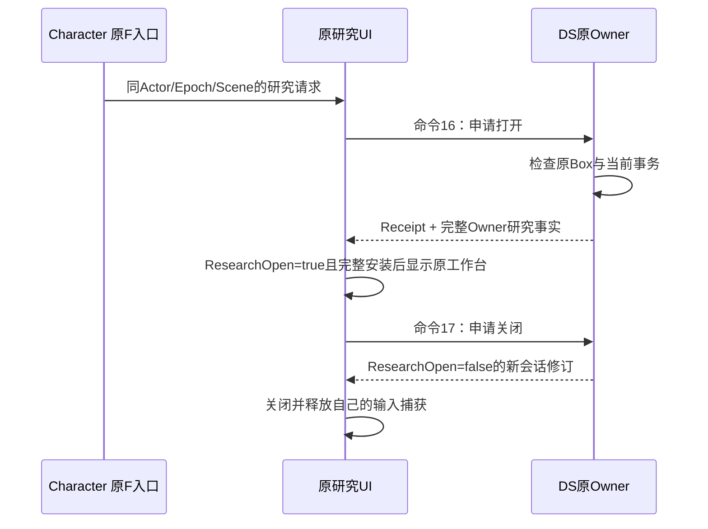

# 和平实验场研究与会话连续性详解（更新中）

更新日期：2026-11-04。本页记录本轮 Home 研究、法杖运行状态往返与采集进度的实现理由和隔离测试证据。对应任务见[单人玩法回归修复计划](<../../../docs/superpowers/plans/2026-11-03 单人玩法回归修复计划.md>)与[回归修复总解析](<2026-11-03 单人玩法回归修复解析（更新中）.md>)。

**当前状态：已有本文列出的 EditMode 证据，另有真实 loopback 业务服/MySQL/Native DS/Native Client 的 Home 两次入场、两次退出与同 Session 同卡 28 次的再入证据。本机业务、DS、正式Menu和迁移1–16已配套部署。研究区内装拆、Mana/CD 连续性的 Native 断言和主观体验仍未验收。** 有限玩家路径和本机部署不合并称为完整单机体验验收。

## 1. 先看玩家需要保住的体验

Home 是原有的和平实验场。进入后仍能在原研究区域查看当前法杖、装拆真实法术卡、查看最近实发记录；原研究窗打开时，实验世界停止推进，窗口中的合法结构编辑继续工作。关闭窗口后继续原来的物理、法术与材料时间，不补算研究期间经过的墙钟时间。

往返也不能成为补充资源的手段。例如实际释放一次后，法力从 100 变为 90、卡片次数从 10 变为 9；同一次登录回据点再进入 Home，未改动的同一根杖应继续使用原 Mana、Cast/Reload、Draw 状态。法杖丢在 Home 地面时，这些状态仍属于那根真实实例，不能因为不在背包里就被遗漏。

这次接线沿用已确认的单人 Dedicated Server 与统一账号资产。旧本地 `SinglePlayerProfile/Repository` 不能重新取得账号资产写权限，因此需要分别解决“谁拥有物品”“谁推进本次实验”“谁展示研究台”三个问题。

## 2. 每一层只承担自己的责任

| 层 | 本轮入口 | 为什么放在这里 |
|---|---|---|
| Core | [OnlineWandResearchContracts](../Scripts/Core/Online/OnlineWandResearchContracts.cs)、[OnlineHomeResearchPresentation](../Scripts/Core/Online/OnlineHomeResearchPresentation.cs) | 保存中立的状态值、只读空间能力与事件，不引用法术解释器、数据库或 UI。 |
| Run | [OnlineOwnedWorkspace.ResearchSession](../Scripts/Run/Spells/OnlineOwnedWorkspace.ResearchSession.cs)、[OnlineOwnedWorkspace.Research](../Scripts/Run/Spells/OnlineOwnedWorkspace.Research.cs) | 原 Owner 持有资源、命令去重和研究会话；这里只有真实服务器工作区能打开会话或恢复运行状态。 |
| Run 研究模型 | [OnlineWandResearchReadModel](../Scripts/Run/Wands/OnlineWandResearchReadModel.cs)、[OnlineWandResearchStateCodec](../Scripts/Run/Wands/OnlineWandResearchStateCodec.cs) | 逐项验证受控目录、固定属性、ProgramIndex、牌堆、输入与历史，再一次安装完整候选。 |
| Character | [OnlineCastDriver.Research](../Scripts/Character/Spells/OnlineCastDriver.Research.cs) | 将真实 Home 几何、角色生命/连接和原 F 交互接到 Run；UI 不必反向引用 Character。 |
| Networking | [InventorySnapshotCodec](../Scripts/Networking/Protocol/InventorySnapshotCodec.cs) | 限制 Wire 字节、UTF8、数组、重复字段和 canonical 子树；网络格式检查不代替 Run 的目录和归属验证。 |
| Multiplayer | [OnlineCombatWorld.Home](../Scripts/Multiplayer/Combat/OnlineCombatWorld.Home.cs)、[RoomInstanceBootstrap.Home](../Scripts/Multiplayer/Runtime/RoomInstanceBootstrap.Home.cs) | 只从受信 Entry 恢复，在稳定退出边界捕获并交给业务事务；不会接受 Client 自报 Mana 或完整物品草稿。 |
| UI | [WandResearchController](../Scripts/UI/Wands/WandResearchController.cs) | 复用原工作台 Presenter，提出命令并等待完整 Owner 事实，不乐观装卡或扣费。 |

研究 DTO 中的 `Wands` 是当前携带法杖的运行事实，`Library` 是当前可安装的真实散卡，`Replays` 是原 Archive 的最近三条实发记录。`GroundWands/GroundSpellUses` 只为和平往返保存地面树的原运行状态，不将地面物品复制到携带背包。

## 3. F 打开研究台，为什么还要等待服务器事实

原 Home 的 `HubInteractionController` 已不能作为线上 Gameplay Owner。Character 改为沿原 `PortalInteractionRegistry` 注册研究目标：本机 F 先按原门交互优先级选中目标，再发布 `OnlineHomeResearchRequestedEvent`。UI 核对当前 Actor、ConnectionEpoch 与 World Scene 后，提交库存命令 `BeginWandResearch=16`。

命令只表达开窗意图：`ItemId` 为空，搬物品、射线、剂量、父杖和格位等字段都必须是中性值。DS 再检查当前本人、原研究 Box、生命与连接，以及没有正在准备的施法事务。它不能相信本机 `CanResearch` 或窗口可见性来授予编辑权限。

Receipt 只说明该命令的处理结果。真正显示、关闭和刷新研究内容，仍以已经完整安装的 Owner 状态为准。关闭被拒时保留窗口与反馈，允许重新申请；不能先隐藏窗口，让服务器留在一个无人能操作的暂停会话里。

## 4. 会话修订和库存版本不是一回事

| 值 | 表达的事实 | 不能替代什么 |
|---|---|---|
| `InventoryVersion` | 当前真实物品布局/余额的修订 | 不能为了开关窗口而伪增资产版本。 |
| `ResourceVersion` | Mana、冷却等原资源读数水位 | 不是某件物品的持久 Revision。 |
| `ResearchSessionVersion` | 本次研究打开/关闭的修订 | 不能回退或在相同修订内改变 Open 事实。 |
| `ConnectionEpoch` | 当前认证连接代次 | 不是新的资源发放资格。 |

Home 初始是 `closed, version=1`，一次打开后为 `open, version=2`，关闭后为 `closed, version=3`。普通 P7/P8 没有 Home 研究会话，保持版本 0。Home 关闭后的普通 Owner 快照也继续携带当前非零修订，不能又回到默认 0。

开窗必须使用当前库存版本。关闭接受不超过当前值的非零旧版本：玩家刚装拆了一张卡，库存版本可能已经改变，但这不应使窗口永远关不掉。相同 CommandId 仍由原 ledger 返回原收据；改变正文重用同 ID、旧 Epoch 或窗口外旧 ID 都沿原规则拒绝。

本轮一个回归夹具最初手工伪造 `open, version=1`，而 Source 已经装过真实的 `closed, version=1`。它被“相同版本改变 Open”拒绝是正确行为。最终修正夹具，让它真实提交命令 16/17，验证版本 2/3；没有放宽生产 Source 的版本门。

## 5. 世界暂停，但结构编辑继续：两个权限维度

原和平研究需要停 Gameplay，不能把它实现成租约失效或故障 `Frozen`。后两者还会撤销正常资产写入，研究台就无法装拆。

[OnlineWorldBootstrap.Home](../Scripts/Multiplayer/Movement/OnlineWorldBootstrap.Home.cs) 独立回答 `ResearchPaused`。[AuthorityTickDriver](../Scripts/Multiplayer/Movement/AuthorityTickDriver.cs) 在该状态下不推进角色、Physics、施法和材料逻辑步，并让原 FixedStepClock 清掉追赶债务；网络、HTTP、快照泵仍继续工作。Run 同时拒绝新的施法、采集、倾倒等世界操作，允许原结构编辑命令，并再次检查研究区域许可。

输入捕获则是 Client 的另一件事。原 UI 沿 `InventoryPresentationVisibilityEvent` 取得自己的鼠标/输入 Owner，不在本机写全局 `Time.timeScale` 来冒充 DS 暂停。`CanResearch` 只判断真实空间、活人和连接，不能把研究窗自己的输入捕获又解释成失去研究权限，否则窗口会刚打开就关闭。

断线、Actor 停用、退出 Fence 和场景解绑需要结束瞬时研究会话。它们不清空已经提交的资源；原排空流程仍须等待已接受的输出完成。

## 6. 研究画面如何保留真正的程序语义

保存只描述“法杖 A 有一张火球”是不够的。乱序法杖还持有 Deck/Discard、随机状态、Cycle 和 ExecutionRevision；程序槽号也不同于编译后 `ProgramIndex`。压缩空槽或重抽一副牌，会改变下一次实际施法。

本轮捕获保持完整安装槽序列、受控 ContentId、固定属性、当前 Mana、Cast/Reload、原 Draw 与执行输入。历史另外保存原 Program 和 AfterProgram、Trace、Scope、Output、贡献与真实释放状态。有限卡耗尽后可能已从当前 Store 删除，历史仍需保留当时的 ContentId 和索引，不能重新查询一张已经不存在的卡。

恢复研究只构造只读模型。`SpellExecutionReadModelFactory` 根据已经冻结并验证的值恢复原 Graph/Trace；它不会调用 `SpellProgramMachine.TryBuild` 来重演一次游戏，也不会申请 Reservation、扣第二次资源或生成投射物。纯 Baker 只用于核对受控资源与最终数值。这保证“看历史”不会改变游戏结果。

研究正文只在打开、结构编辑或可靠退出等离散边界捕获。高频 Mana/CD 仍走原资源事实通道；不会每帧发送三条完整历史 Graph。

## 7. 和平往返为什么按真实实例求交集

保存的正文来自旧 Home，下一次进入可能已经经过据点合法交易或编辑。严格要求两次全部法杖/散卡集合一模一样，会让正常购买或售出后永久进不了 Home；整包清连续性则会给未改变的旧杖补满 Mana。

[TryRestorePracticeContinuity](../Scripts/Run/Spells/OnlineOwnedWorkspace.Research.cs) 先验证同账号、同 Gameplay Hash、保存条目自身的 Program/Draw/固定属性与历史，再沿原 `WandLoadoutService.RestoreContinuity` 逐实例求交集。

| 下一次可信 Entry 中的情况 | 原规则 |
|---|---|
| 同一 Wand ID、固定属性和安装序列未变 | 接续原 Mana/CD/Draw。 |
| 新购买的法杖 | 使用该新实例的原初始化语义。 |
| 旧法杖已合法售出或已不在该携带闭包 | 不把旧运行状态覆盖到另一实例。 |
| 原法杖程序或固定属性合法改变 | 按原 RestoreContinuity 的逐项匹配规则处理，不套用旧程序的牌堆。 |
| 重新登录，业务未返回旧 Scope 正文 | 明确开始新的运行 Session；真实物品身份和剩余次数仍来自账号 Entry。 |

恢复只允许在全新的和平 Owner、任何 Tick/命令/活 Ticket 之前执行一次。连接恢复继续使用存活 Workspace；不能每次重连都重新安装旧正文。这些限制防止“恢复功能”成为回滚消耗的接口。

## 8. 地面法杖也有运行状态

原地面转交已经通过 `GroundTransferState` 保留迁出的法杖连续性。本轮[OnlineWandResearchContinuityBridge](../Scripts/Run/Wands/OnlineWandResearchContinuityBridge.cs) 将它投影为 Core 值；重入时在未发布的候选地面 Store 上验证完整树，再一次安装原 Mana/Draw 和资格。

`Item/Children` 保存实例、父卡、roll、次数和 GMU；`GroundWands/GroundSpellUses` 保存对应的运行态和资格。两者不能互相替代。只恢复物品树然后按模板创建法杖，会让地面杖悄悄变成满蓝；把地面杖直接塞进 Owner.Wands 又会破坏唯一归属分区。

实际回归使用真实施法与原移动事务：先消耗一次，Drop 原杖树，捕获并 canonical JSON 往返，在新地面 Store 恢复，再由新 Owner 通过原 `PickupItem` 装备。两个用例分别证明：同登录保留原 Mana/CD/Draw；新登录使用新运行态，但卡片次数仍是已经扣过的 9，没有补回 10。

最终个人收据之前保留 DS 地面现场；收据确认后的 `CompletePracticeHandoff` 只解除运行中归属与模型引用，不登记新的 `Destroyed`。业务资产事务、个人收据与稍后的世界终态归档详见总解析第 8 节。

## 9. 采集进度只能来自真实新提交

原商店补货要求可靠成功出局，并且有实际采集量或敌人进度。`CollectedGmu` 因此不能从 Client、UI、当前瓶子余量或包内差分推导；倾倒和消耗都会改变余额，却不是新的采集。

`OnlineOwnedWorkspace.TransferContainer` 仅在原 Collect 事务返回成功时，累计它实际提交的 `Transferred`，并以 `ulong` 饱和加法避免回卷。统一命令 ledger 在进入此分支前已处理重放，因此同一命令重发只拿原收据，累计量不变。失败与 Pour 不推进进度。

三个已有材料事务回归先观察到 `Expected 800 / Actual 0`；最小修复后，实际采集提交为 800，冻结或更换 Context 后重放仍为 800，改变同 ID 的 budget/aim-origin/aim-direction 仍按原冲突规则拒绝。这里没有新增第二份钱包或资产数量。

## 10. 实际验证记录与边界

| 证据 | 本页相关实际结果 | 不能据此声称 |
|---|---|---|
| [unity-recovery-first-20261104.xml](../../../docs/superpowers/evidence/multiplayer/single-player-regression-20261103/unity-recovery-first-20261104.xml) | 2026-11-04 10:05:54–10:07:50 UTC，整批 335 passed / 21 failed；其中两个 `PeacefulGroundWandKeepsRealResourcesAcrossReturnAndStartsFreshOnlyForANewLogin` 均 Passed。采集累计三例与旧会话夹具当时仍失败，原证据保留。 | 不能把整批称为全 GREEN；地面两例没有建立 HTTP/KCP/真实账号连接。 |
| [collect-session-serializer-green-return-pose-red.xml](../../../docs/superpowers/evidence/multiplayer/single-player-regression-20261103/collect-session-serializer-green-return-pose-red.xml) | 2026-11-04 10:09:42–10:09:43 UTC，整批 5 passed / 1 failed；采集重放三例、真实会话开关/inline 默认壳一例均 Passed，另有一例退出 Serializer Passed。唯一失败是本轮另外尚未实现的 ReturnPose 字段回归。 | 不能抹掉另一项 RED，也不能把 Serializer 通过解释为业务保存成功。 |
| [Home Native evidence.json](../../../docs/superpowers/evidence/multiplayer/single-player-regression-20261103/native-20261104T112944Z/evidence.json) | 2026-11-04 11:30:49 UTC 记录 `Passed=true`、`EntryCount=2`。真实业务入场、Native DS/Client、原 UI 回调完成两次施法与可见角标 30→29→28；两次正常 ESC 退出均通过。第二次使用新 Run、新 Ticket 真实再入，同一 Session 的 `SameScope=true`、`SameCard=true`、`Charges=28`，没有重发起始卡或补回次数。 | `CardMovementCoverage=false`，未覆盖研究区装拆；`ManaCooldownContinuityAsserted=false`，不能据此声称 Native Mana/CD 接续或主观战斗 Gate 通过；也未覆盖 pointer Raycast。 |
| [air-cast-driver-green-20261104.xml](../../../docs/superpowers/evidence/multiplayer/single-player-regression-20261103/air-cast-driver-green-20261104.xml) | 2026-11-04 11:29:51–11:29:54 UTC，**123 passed / 0 failed**：动画表现 9 项、Focus 2 项、CastDriver 112 项。包括空中自然释放后的下一次真实移动模拟，不再由 JumpAir 抢占原攻击 EXIT。 | 这是 EditMode 回归，不代替 Native 空中施法手感或 Home 研究正向路径。 |

本次 Native 的原出生点位于原研究区域外。因此测试真实提交 `Kind=16` 后得到预期 `NotOwned`，`HomeOriginalResearchAreaGate` 与 `HomeResearchNotOwnedControl` 均通过；这是保留原区域权限的负向控制，不是研究台已打开或已经装拆成功。测试没有移动角色绕过范围检查，也没有放宽 DS 权限。仍需在原研究区完成开窗、装拆、关闭与暂停恢复的正向 Native 路径，并实际断言 Mana/CD 连续性；断线、重复开关和换源也保持独立验证边界。

后续本机部署已经完成，证据见[本轮交付记录](../../../docs/superpowers/evidence/multiplayer/single-player-regression-20261103/delivery-20261104.json)：dev数据库及旧程序完整备份，迁移1–16源码Hash一致，旧表行数和资产汇总保持；业务、DS与正式Menu配套Protocol15。正式5080 readiness及新账号基础包/商店HTTP smoke通过。上述Native仍是受控验证路径，不等于原Hub硬件F、研究区内正向装拆或主观战斗手感已经人工通过。

## 11. 从一个现象沿源码排查

1. F 没反应：先看 Character 是否取得同 Actor/Scene 的 `OnlineHomeWorldBindings`，再看原 Registry 是否选中研究目标；不要首先改鼠标或取消区域检查。
2. F 有收据却不开窗：核对完整 Owner 是否到达、`ResearchOpen/ResearchSessionVersion` 是否通过 Source 原子安装。Receipt 不携带完整研究内容。
3. 开窗即关窗：检查 UI 是否把自己的输入捕获算进 `CanResearch`，或把仍在等待的关闭当成已确认。
4. 关窗失败：区分旧非零 InventoryVersion 与旧 ConnectionEpoch。前者按 End 特例可接受，后者仍应被拒绝。
5. 往返后满蓝：先区分新登录与同登录，再看保存条目是否匹配同一 Wand ID/固定属性/安装序列；地面杖还要检查原 Transfer 连续性是否进入 GroundWands。
6. 看回放改变资源：沿 `TryCaptureResearchState → Codec/ReadModel → Presenter` 检查，展示路径不应进入 Machine Prepare/Commit 或 SpellCaster 输出。
7. 商店进度异常：先核实际 Collect 新提交与 ledger 重放，再核成功出局事实；不能通过修改显示数值或任意 ESC 让补货变绿。

推荐阅读顺序为 `OnlineWandResearchContracts → OnlineOwnedWorkspace.ResearchSession → OnlineCastDriver.Research → InventorySnapshotCodec → OnlineWandResearchReadModel → OnlineOwnedWorkspace.Research → OnlineWandResearchContinuityBridge`。先理解每个值在描述什么，再追对应的写入 Owner 和生命周期。

## 12. 网络重绑不能重建已经运行的 Gameplay Owner

只读接线审查还发现另一种生命周期问题：`OnlineWorldBootstrap.BindNetwork` 原来明确保留同 Run 的 Registry/Workspace，却 `Dispose` 并重建 `OnlineCombatWorld`。Home 的恢复标记和共享地面恰好属于后者。更换 Manager 时，旧地面被释放，标记回到默认值；随后同一个已运行 Workspace 被要求再次恢复旧连续性，又会被正确的“一次恢复、未 Tick”门拒绝。因此不能通过放宽连续性校验来修复这个问题。

[OnlineCombatWorld.Networking](../Scripts/Multiplayer/Combat/OnlineCombatWorld.Networking.cs) 改为独立的 `RebindNetworking`：同一个 World 保留同一个 Combat、地面、Home 标记、输出实例、资源事实和完整序号，只替换网络 Adapter 与回调。发送端“已经给本连接发过什么”的水位清零，使新连接重新得到基线；SnapshotSequence 和事实 sequence 不回到 1，避免同 Epoch 的保留 Source 把后续事实一直判为旧包。同一组组件重复绑定直接幂等返回，不清可靠在途页。

Dedicated 的 Instance 还持有原 Entry、租约与最终收据。相同 Run 字符串不能授权把它换成另一个组件对象；新接线在拆旧网络前检查这一身份，不匹配便挂起并保留原现场。Client 没有该 Gameplay Instance，允许 `null → null` 的网络重绑。Manager 暂时不存在时也只撤 Adapter，不 `Dispose` 玩法对象。

Mirror handler 属于全局消息注册，不能只考虑 C# 事件退订。新通道可能已经注册消息；若先装新、再由旧组件 `OnDisable` 注销同一消息 ID，会把新入口一起删掉。因此重绑先停新接收器、再停旧接收器，然后启用并配置新入口。这是网络生命周期操作，不是第二套 Gameplay 服务。

[narrow-return-green-rebind-red.xml](../../../docs/superpowers/evidence/multiplayer/single-player-regression-20261103/narrow-return-green-rebind-red.xml) 保留了集中观察到的 2 passed / 4 failed：两项窄返回门控制例通过，四项新重绑回归分别暴露缺 API 或旧 Dispose 重建行为。随后新增网络 partial 与 BindNetwork 最小修改，另补“Manager 短暂缺席后重附原通道”和可靠在途页幂等保护。

主 Agent 随后集中运行[rebind-ui-exit-green-20261104.xml](../../../docs/superpowers/evidence/multiplayer/single-player-regression-20261103/rebind-ui-exit-green-20261104.xml)，整批 **151 passed / 0 failed**。其中 `CombatNetworkingRebindTests` 五项全部通过：保留真实地面/输出/资源事实、World不另建Combat、短暂缺Manager后重附、不同Dedicated Instance拒绝保现场、同Instance重绑；第一项还验证重复绑定不清已排队的可靠页。该批同时包含 UI、个人退出与返回门相关保护回归，不能把 151 当成网络重绑用例数。

这些是隔离 EditMode 证据，没有启动 Transport 或替用户操作真实账号。完整 DS 玩家路径、Native Client/DS 与部署仍沿本页第 10 节边界单独验收。
