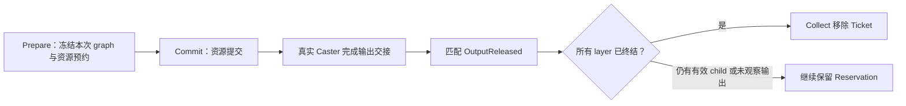

# 2026-11-15 施法后库存持续 Busy 与拾取链路解析（更新中）

本轮已经用有效 RED 证明并修复了一个问题：**空 Trigger child scope 不会进入 Runtime，却一直占有 Reservation，导致后续库存命令持续 Busy。** 用户现场的 Rapid + 4 Damage + Fire 程序没有这个 child scope，因此目前不能把该修复认定为现场长期 Busy 的唯一根因。

截至本次记录，新增与关联 **EditMode 235 passed / 0 failed**、三组 **PlayMode 27 passed / 0 failed**；新版本五组 **Native 全部 Passed，合计 258 checks**，包括两个真实 Client 共用一个 DS 的 Mouse / Tab 两序。Client、DS、Menu 三份构建均为 **0 Errors**。同型 Rapid 在这些运行中没有复现持续卡锁，仍不能倒推用户原现场的唯一根因。默认产物已备份后替换；业务服 PID 30028 按新 Hash 重启，health 返回 ready，原 MySQL PID 37068 保留运行，最终证据为 [acceptance.json](../../../docs/superpowers/evidence/inventory-reservation-regression-20261115/acceptance.json)。

旧版本六轮 direct Probe 的 85 checks 仍保留为 **Incomplete**：每轮 Move、F、拖放成功，末尾 Ground 准备达到总时限；它没有被改写为完整通过，也不属于产品 Busy RED。

对应[实施计划](<../../../docs/superpowers/plans/2026-11-15 施法后库存持续Busy与正式掉落拾取修复计划.md>)；本轮机器证据位于 [inventory-reservation-regression-20261115](../../../docs/superpowers/evidence/inventory-reservation-regression-20261115/)。本文件只公开去身份化现场信息，不复制私有 checkpoint 中的账户、房间、Ticket 或凭据。

## 1. 从玩家症状开始：为什么一次 Busy 会同时挡住 F 和拖包

用户反馈发生在 P7：施法后，固定冰堆 Ice256 和普通掉落都无法用 F 拾取，也无法从附近物品拖入背包；即使停手较久，仍显示“物品资源正在使用”。参见[Busy 截图](../../../docs/superpowers/evidence/inventory-reservation-regression-20261115/reported-busy.png)与[Ice 截图](../../../docs/superpowers/evidence/inventory-reservation-regression-20261115/reported-ice.png)。

这两种输入最终都会向 DS 提交库存意图。F 从原 `NearbyPickupInput → NearbyPickupController → WorldItemPickup` 发起；拖包从原 `SinglePlayerInventoryController` 提交。它们共享同一玩家的权威 Workspace、实例归属、版本和资源门，所以“两个入口都失败”并不意味着两个 UI 各有一个独立布局或输入错误。

固定 Ice 已有正式 DS seed 和 Ground 身份，位置为 `(-16, 0, 25)`，数量 256。它是可拾取的材料物品，走 `PickupContainer(8)`；普通非容器物品走 `PickupItem(15)`。不能把这次 Ice 问题解释成“没有生成地面物品”，也不能把它与从连续材料世界中收取 Liquid 的操作混为一谈。

UI 的 Busy 文案只显示最终拒绝类别。它不能告诉我们究竟是 Driver 的动作队列、库存准备状态，还是某张 Reservation 没有结束。F 的失败事件也会更新原背包状态文字，因此诊断必须对应**本次新 CommandId 的 Caller、Kind、ItemId 和 receipt**，不能只看打开背包后留下的一行旧文字。

## 2. 实际现场配置：Actor 1 与 Actor 2 必须分开

[去身份化现场记录](../../../docs/superpowers/evidence/inventory-reservation-regression-20261115/observed-loadout.json)来自只读 checkpoint。数组第一项是 Actor 2，不能按数组位置误认玩家；本次需要核对的是 **ActorId == 1**。

| 内容 | Actor 1 的实际值 | 对排查的意义 |
|---|---|---|
| 法杖 | `norn.v2.wand.0`，Rapid 模板 | 120 MaxMana、16 个程序槽、BaseDraws 1 |
| 槽 0–3 | 四张 `norn.v2.damage`，各剩 7 次 | 四张 Modify 属于同一个 root scope |
| 槽 4 | 空 | 源槽位空白不等于 Runtime OutputId 缺失 |
| 槽 5 | `wandtest.fire`，剩 13 次 | 当前 Fire 没有 Trigger payload |
| 程序修订 | ProgramRevision 2 | 与全局 InventoryVersion 分别核对 |
| 资源快照 | Mana 120、CooldownRemaining 0 | 是 checkpoint 时刻的值，不证明拒绝瞬间 Driver 没有排队 |
| 包内其他卡 | 有 `norn.v2.termination`，未装入当前程序 | 不能因为包里存在 Trigger 就断言本次施法执行了 Trigger |

Actor 2 才是普通起始杖 `wandtest.wand.a`。现场 Rapid 的一发有效输出使用四张 Damage 各 10 Mana，再加 Fire 的 20 Mana，共 60 Mana。Damage 属于本局资格卡：入局时正式资格规则会扣一次，例如商店购入 8 次进入 P7 后为 7 次；之后本局每次施法不应再次扣这四张资格。Fire 则按实际成功输出扣次数。

`SourceSlot=5` 描述法术卡在玩家程序中的位置；`OutputId` 描述本次冻结执行图中的输出编号。只有一个 Fire 输出时，其 OutputId 是 0。两种编号不能互相替代，也不能据“中间空了一个槽”推断观察回执会找不到输出。

## 3. Busy 是资源所有权边界，需要先辨认哪一层仍在持有

正常的施法准备、在途 Trigger 或库存事务期间拒绝编辑，是避免重复扣费、移动正在使用的卡以及破坏归属的必要规则。本轮没有删掉 Busy 门，也没有加入“等几秒强制解锁”。

| 层次 | 要观察的状态 | 含义 |
|---|---|---|
| Character Driver | `TimelineActive`、`Queued` | 仍有真实动作时间线或待处理施法输入；可能先于 Workspace 拒绝库存命令 |
| Run / Profile | `RaidActionsFrozen` | 本局写入已受冻结或退出边界约束 |
| Run / Item Store | `ItemsResourceBusy` | Store 仍有准备中的事务或材料锁 |
| Run / Cast service | `CastPending` | 当前仍有等待 Finish 的准备层 |
| Run / Ticket 集合 | `ActiveReservations` | 还有未终结的执行票据，不一定仍持有 Store 的准备锁 |

此外，共享 Ground 的执行门、Research 会话以及外部强制拒绝也可能产生 Busy。四个 Owner 值全为 false，不足以直接排除 Driver 或 Ground；反过来，单凭 Mana 已回满，也不能证明所有票据已经回收。

命令还有幂等语义：**同一个 CommandId 的第一次 Busy 是固定结果，稍后重放仍应得到同一结果。** 验证“已经恢复”要提出新的合法命令，并确认新的 receipt 与 Owner；不能通过重复旧 ID 要求它从失败变成成功。

## 4. 核心原理：资源 Commit 与 OutputReleased 是两个完成条件

一次 owned 施法不仅要知道“是否付了钱”，还要知道“已承诺的 Runtime 输出是否完成了交接”。[WandExecutionTransactionService](../Scripts/Run/Spells/WandExecutionTransactionService.cs)把这些信息保存在 Ticket 的各个 layer 中。

1. **Prepare**：取得库存与法杖执行预约，冻结本次 graph、费用、卡实例和输出归属。此时相关库存必须保持不可编辑。
2. **Commit**：完成本层资源提交，更新 Mana、次数、牌堆及材料事务。root 的资源准备锁可以结束，但 Ticket 不一定已经结束。
3. **OutputReleased**：真实 Caster 报告某个已提交输出完成 Runtime 交接。观察包含原 Inventory、Ticket、Caller、Wand、ProgramRevision、LayerId 和 OutputId，不能用当前随手读取的配置替代。
4. **Collect**：所有 layer 已到终态，且所有已提交输出都收到匹配观察，才移除 Ticket。

这里的 `OutputReleased` **不是等待 Projectile 碰撞、寿命结束或 Destroy**。普通 Forward Fire 在生成事务完成、输出交给 Runtime 时就报告观察；一颗弹仍在飞，不等于它必须持续锁住整个背包。真实 Caster 控制测试正是用来检查这条原链路，而不是手工删票据让断言通过。

一个容易误判的地方是：`CastPending == false`、Store 已不忙、Mana 也正常时，`ActiveReservations` 仍可能为 1。这不自动说明门禁过严；先要查看那张票据究竟还在等什么。

## 5. 有效 RED：永远不会进入 Runtime 的空 child scope

[SpellProgramMachine.FreezeGraph](../Scripts/Skills/Programming/SpellProgramMachine.cs)会保留 scope，供 Trace / Replay 解释执行过程；但如果 Trigger 的 child 没有任何输出，父输出的 `PayloadScopeId` 会变成 `-1`。因此这个 child 没有 Runtime payload 入口，后续不会收到 `PrepareLayer` 或 `Abandon`。

旧事务代码仍按 graph 的 scope 数量创建 layer，非 root 默认处于 `Unattempted`。测试已 Commit root 并提交其匹配输出观察后，`Collect` 看见空 child 仍是 `Unattempted`，就一直保留整张 Ticket。等待更久、推进更多 Authority Tick 都不会产生那个已经不存在的 Runtime 入口，所以 Reservation 长期为 1，后续独立 Move 与 Ice 拾取均被 Busy 拒绝。这里的 Run 测试显式提交观察，验证事务层；真实 Caster 装配另由四个控制用例验证，不能混为同一覆盖范围。

[第一次有效 Run 测试](../../../docs/superpowers/evidence/inventory-reservation-regression-20261115/reservation-first-run.json)是 **5 passed / 3 failed**。三个实际失败分支分别是：

- Trigger 后面没有任何卡。
- Trigger 后面只有 Modifier，没有可生成的 child 输出。
- root 可以支付，但 child 没有足够 Mana，最终 child 输出为空。

这些测试保留真实 graph、root 输出观察、ActiveReservations 和后续新库存命令；不是仅比较一条 UI 文案。失败也证明空 child 的问题能影响固定材料物品拾取，不只影响程序编辑。

### 最小修复为什么只处理非 root、没有 Runtime 输出的层

创建 Ticket 时，root 仍按原流程进入 `Prepared`。只对 **非 root 且 `OutputIds.Count == 0`** 的层，直接设为 `Cancelled` 终态。这里的含义是“此层没有可执行的 Runtime 工作”，不是退还已提交资源，也不是取消仍在飞行中的有效 payload。

这样保留了 graph 的 ScopeId 与解释信息，同时让账本终态与冻结图的可达性一致。root 仍必须 Commit，并等待自己的真实输出观察；有输出的 child 仍必须经历原 Prepare / Commit / OutputReleased，或者由原 Abandon 生命周期结束。

[Run 修后结果](../../../docs/superpowers/evidence/inventory-reservation-regression-20261115/reservation-green.json)为 **8/0**。保留的负控制包括：root 已提交但尚未观察输出时仍 Busy；有效 child 在 Unattempted、Prepared、已 Commit 但未观察时仍 Busy；合法 Abandon 后才可释放。修复没有借“空层”理由提前解锁真实工作。

## 6. 为什么这还不能解释用户的 Rapid 现场

现场四张 Damage 与普通 Fire 都在同一个 root scope，没有 Trigger child。正式 Catalog 的同型程序控制、空槽 4 / Fire 槽 5 / ProgramRevision 2，以及固定 Ice 的手动和自动目标规则均已有通过证据。[真实 Caster 四个控制](../../../docs/superpowers/evidence/inventory-reservation-regression-20261115/driver-reservation-controls.json)也为 **4/0**，覆盖单双 Owner、出生区域与区域 2 位置。它们说明正常路径能恢复，不证明用户现场失败从未发生。

旧 Hash `b09c5197227f2f7854c8da12165efa83b4b40ed2b8fb9c8141eeca44f25b7d23` 的 [Native 复现汇总](../../../docs/superpowers/evidence/inventory-reservation-regression-20261115/native-current-reproduction.json)记录了 85 checks：六轮 Rapid direct Probe 施法之后，普通 Move、真实虚拟 Keyboard F、原 UI 拖放都观察到成功；最终在再次准备 Ground 时触及 280 秒总预算。完整结果为 `CaseDeadlineExceeded / Incomplete`，不是全 Passed，也不是产品 Busy RED。[原始 evidence](../../../docs/superpowers/evidence/inventory-reservation-regression-20261115/native-rapid-current-20261115T124713Z/evidence.json)保留不覆盖。

direct Probe `cast` 确实经过正式 Combat Channel 和 DS 资源事务，但没有走原 Wizard 鼠标输入、持键连发和 Tab 打断。它的通过观察不能替代用户的输入时序。为给完整退出留出预算，后续 direct 工具分支缩为三轮，每轮 8 秒门和原断言保持；没有把全局超时扩大到 280 秒以上。

新版本的 [direct 三轮完整运行](../../../docs/superpowers/evidence/inventory-reservation-regression-20261115/native-p7-rapid-inventory-20261115T135930Z/evidence.json)已为 **61 checks / Passed**，包括完整退出。Native 使用正式商店购买的 Fire 初值 12 次，保留实际余额；没有把用户 checkpoint 的 13 次注入新账号来制造“完全相同存档”。同型程序与真实现场状态、输入历史仍有边界。

## 7. 新的 Mouse / Tab 诊断：把输入事实、DS 事实与库存事实连起来

用户暂时不能确定是先松左键再打开 Tab，还是按住左键打开 Tab 后才松开，因此新增独立 `rapid-mouse-inventory` 场景覆盖两种顺序：

| 顺序 | 必须取得的事实 |
|---|---|
| Mouse down → 持续施法 → Mouse up → Tab open | 左键实际已松开；原 Tab Action 打开 UI；World 输入已被捕获 |
| Mouse down → 持续施法 → Tab open → Mouse up | 打开 UI 时左键实际仍按住；在背包内松开；期间不再产生新的 Driver 施法意图 |

每种顺序要求至少两次真实 Driver 意图及对应 DS Released。Probe 只向独占的虚拟 Mouse 排队 `MouseState`，唯一白名单为左键；Keyboard 精确增加 Tab。它不调用 Wizard / Driver 的施法方法，不重入 `InputSystem.Update`，也不放宽焦点、Frozen、连接或世界资格。

`AllowSyntheticPointer` 是私有诊断配置中的独立 opt-in，默认关闭。Mouse 模式从配置阶段就禁止 direct Probe cast，避免两个生产者混用同一 Epoch 的命令序号。设备只由本 Probe 创建和清理，不能 Reset 或移除用户已有设备。

真实 `Driver.IntentProduced` 单独记录 Caller、CommandId、Epoch 和程序身份。Client 当前的 `ApplyReceipt` 不发布 `ReceiptProduced` 事件，因此实际 DS 回执从 `CombatNetworkChannel.FactReceived` 匹配；不能等一个本来不会产生的事件制造假超时。固定环保留多次施法及 terminal fact，重复回执不增加 Released 次数。

DS 副本中 Tab 打开原背包会占用本机输入，**不会改变 Time.timeScale 或暂停 DS**。每序松键、真实 Tab 关闭后保留 8 秒等待，分别检查新 Move / F / 拖放收据。再等待不早于本轮观察 Tick 的新 Authority 样本，检查 Owner 四门与 Driver Timeline / Queued。`QueueRemaining` 可能保留历史正数，只作诊断值，不单独据此判 Busy。

最后补充了资源守恒：先冻结每序输入前的 Fire 次数，等待可靠 Owner 与该序全部 terminal fact，再要求 **Fire 减少量恰好等于本序实际 Driver Released 增量**；Rejected 不应扣 Fire。最终退出保存“实际剩余次数”仍保留，但不能拿这个实际值自证之前没有漏扣或多扣。

本场景仍不模拟移动，不覆盖预置 Ice 的实际坐标，也不覆盖 OS / 硬件鼠标、任意指针 Raycast 或完整战斗。出生点普通自丢物的 F 成功，不能直接宣称作者区域中的 Ice 已经通过 Native 验收。

### 双 Client 运行具体证明了什么

[单 Client Mouse 两序](../../../docs/superpowers/evidence/inventory-reservation-regression-20261115/native-p7-rapid-mouse-inventory-20261115T135630Z/evidence.json)已通过 49 checks；随后 [rapid-mouse-coop](../../../docs/superpowers/evidence/inventory-reservation-regression-20261115/native-p7-rapid-mouse-coop-20261115T141817Z/evidence.json)通过 54 checks。合作分支用两个独立账号完成正式 HTTP Create → Join → 各自 Ready → Start，各自签发一次性 Ticket，启动两个真实 Native Client，认证到同一个 DS。Actor 1 使用 Rapid，Actor 2 使用普通起始杖并保持空闲；不是单进程里构造第二份 Owner 数据。

Actor 1 的两种 Mouse / Tab 顺序、施法后新 Move、F、原 UI 拖放、新鲜 Authority 门以及 Fire 守恒全部保留。双 Client 证据中，每序分别观察到 2 个 DS Released，Fire 依次从 **12 → 10 → 8**；同序其余被拒绝的请求没有多扣 Fire。Actor 2 的 synthetic 开关均为 false、设备数与 Driver 施法意图均为 0，原 Fire 保持 30 次，实例内容未变；每序复核两个真实 Owner 的身份与 Epoch。

Actor 1 先退出，Actor 2 随后以本人的 Client 命令、Bearer 和 HTTP receipt 退出。双方均核对了 Committed、本人持久 Profile、数据库成员 Exited、本人租约为 0 及 PayloadHash / RequestHash；第二人退出证据独立保存。这证明本次双成员正常退出路径通过，未宣称整个 Run 终态 checkpoint、全部恢复情况或 N6 已完成。

工具审查还修正了一处测试前提：DS 的 `ActorInventories` 固定保留四席，`JsonUtility` 将空席输出为 `ActorId=0` 对象，不能直接要求 JSON 数组长度为 2。工具现在只排除明确的 0 空席，再严格要求两个有效 Owner 恰为 Actor 1 / 2；额外第三个有效 Owner 仍失败。这个修正未改变 Gameplay 的席位或资源规则。

## 8. 只读诊断的架构与未来现场日志

| 文件 | 本轮职责 |
|---|---|
| [OnlineInventoryBusyDiagnostic](../Scripts/Core/Online/OnlineInventoryBusyDiagnostic.cs) | Core 的 readonly 值合同，四门及 Captured；不暴露 Store，不进入 Wire 资产协议 |
| [OnlineOwnedWorkspace](../Scripts/Run/Spells/OnlineOwnedWorkspace.cs) | 原 Owner 只读捕获真实门值；Dispose 后返回 unavailable |
| [OnlineCastDriver](../Scripts/Character/Spells/OnlineCastDriver.cs) | 连接 Owner 与 Driver 诊断，保存可序列化值副本，保留原命令与账本逻辑 |
| [RoomInstanceBootstrap](../Scripts/Multiplayer/Runtime/RoomInstanceBootstrap.cs) | 在现有 Development DS 报告中附加同次 Authority 样本与 Tick |
| [SinglePlayerInventoryRegressionProbe](../Scripts/Multiplayer/Diagnostics/SinglePlayerInventoryRegressionProbe.cs) | 显式 Mouse / Tab 排队、原 Driver 事实观察、原 UI 回调与设备清理 |
| [NativeInventoryRegression](../../../Tools/Networking/NativeInventoryRegression/Program.cs) | 独立测试账号、正式 HTTP 采购入局、两种输入顺序、收据/Owner/资源守恒与正常退出 |

Core readonly struct 通过 Character 中的 `[Serializable]` DTO 复制为 public 字段后再落 JSON，避免 `JsonUtility` 把 readonly 字段省略成空对象。Client 没有权威门值时明确 `Captured=false / DriverBusyCaptured=false`，不能把默认 false 解释为服务器空闲。

Development / Editor 中，新命令第一次被 Busy 拒绝会留下离散日志，包含 Actor、Epoch、Command、Kind、Tick、Driver / Owner 门与 Research / ForcedFailure。账本重放不重复记录，也不按当前门重算原结果。日志不打印凭据、Ticket、PlayerId 或任意请求字符串；它为未来现场保留证据，不承担解锁或补偿职责。

单 Client Mouse 的 49 checks 虽然通过，其 Native 日志曾出现一次 Probe 报告 `Sharing violation`：工具默认共享读会短暂阻止 Client 覆盖写报告。这是诊断工具读写争用，不是 Gameplay Busy，原日志继续保留。工具读取已改为 `FileShare.ReadWrite | FileShare.Delete`，读前、读后检查 32 MiB 上限；partial JSON / IOException 仍重试，原命令、版本与新鲜 Tick 门不变。后续双 Client 日志的 error / exception 匹配数为 0；DS 每次启动仍有两条已知 Builtin Resource 错误，因此不能称本轮“运行零错误”。

## 9. 哪些失败属于产品 RED，哪些属于测试前提

| 记录 | 实际结果 | 正确解释 |
|---|---|---|
| [首轮编译阻断](../../../docs/superpowers/evidence/inventory-reservation-regression-20261115/reservation-first-compilation-blocked.json)、[Driver 编译阻断](../../../docs/superpowers/evidence/inventory-reservation-regression-20261115/driver-reservation-first-blocked.json) | Blocked，0 个行为用例执行 | 当前 Unity NUnit 不支持所用的部分 API / 属性，例如 Assert.Multiple、NonParallelizable；先修夹具，不能运行旧 Assembly 冒充验证 |
| [Driver 首轮 Setup](../../../docs/superpowers/evidence/inventory-reservation-regression-20261115/driver-reservation-first-valid.xml) | 0/4；均在建立 additive Scene 时失败 | “untitled scene unsaved” 是夹具 Scene 前提错误，尚未执行施法；不是 Reservation RED |
| [Run 有效 RED](../../../docs/superpowers/evidence/inventory-reservation-regression-20261115/reservation-first-run.xml) | 5/3 | 三个空 Trigger child 确实造成 Reservation 保留，属于产品 RED |
| [Pointer / Tab RED](../../../docs/superpowers/evidence/inventory-reservation-regression-20261115/pointer-tab-red.json) | 19/13 | 原 19 个控制通过；12 Pointer 新 API / opt-in 与 1 Tab 白名单是新增诊断功能的有效 RED，不是用户 Busy 的复现 |
| [Pointer 首次 GREEN 尝试](../../../docs/superpowers/evidence/inventory-reservation-regression-20261115/pointer-tab-green.json) | 31/1 | 非 ExecuteAlways 组件未经历 Player 激活，直接 DestroyImmediate 未派发预期 Player 清理；属于 EditMode 生命周期前提错误 |
| [新增合集 GREEN](../../../docs/superpowers/evidence/inventory-reservation-regression-20261115/reservation-input-diagnostics-green.json) | 51/0 | Run 8 + Caster 4 + Pointer/Tab 32 + Busy 诊断 7；包含修正后的清理幂等用例 |

Destroy 用例只改为显式重复 `OnDisable` 后销毁夹具，继续断言自有 Mouse 被移除、其他设备不受影响；没有给产品加 ExecuteAlways，也没有放宽 opt-in。这个 EditMode 用例证明清理入口幂等，不能单独宣称 Unity Native 的 Destroy-only 回调已完整验收。

## 10. 当前回归、旧实例状态与交付待办

| 验证或交付项 | 当前实际状态 | 边界 / 后续填写 |
|---|---|---|
| 新增定向 EditMode | 51/0 | 已保存合集，空 Trigger 修复与诊断功能分开解释 |
| [旧关联 fixture](../../../docs/superpowers/evidence/inventory-reservation-regression-20261115/related-cast-ground-green.json) | 184/0 | 与新增合集合计 235 EditMode 通过 |
| [当前 PlayMode 批次](../../../docs/superpowers/evidence/inventory-reservation-regression-20261115/play-owned-inventory-green.json) | 27/0 | ContainerUse 11、OnlineSharedInventory 2、OwnedWandV2 14；不代替 Native 两序 |
| 旧 b09 Native direct 六轮 | 85 checks，Incomplete | 每轮 Move/F/拖放成功；末尾 Ground 准备达到总时限，无完整退出通过结论 |
| 新 Client、DS、Menu 构建 | **3 Succeeded / 0 Errors** | [Inventory Client](../../../docs/superpowers/evidence/inventory-reservation-regression-20261115/inventory-client-build.json)、[DS](../../../docs/superpowers/evidence/inventory-reservation-regression-20261115/room-server-build.json)、[Menu](../../../docs/superpowers/evidence/inventory-reservation-regression-20261115/menu-client-build.json)；构建通过与默认版本替换分开记录 |
| Native 原 Wizard Mouse / Tab 两序 | **49 checks / Passed** | 原 Caller / fact / Owner、四门与 Driver 门、Fire 守恒、正常退出 |
| Native direct 三轮完整运行 | **61 checks / Passed** | 保留每轮 8 秒门与完整退出；旧六轮 partial 原样保留 |
| [Native P7 existing](../../../docs/superpowers/evidence/inventory-reservation-regression-20261115/native-p7-existing-20261115T140243Z/evidence.json) | **78 checks / Passed** | 原库存、输入、容器与退出断言保留 |
| [Native Home existing](../../../docs/superpowers/evidence/inventory-reservation-regression-20261115/native-home-existing-20261115T140503Z/evidence.json) | **16 checks / Passed，2 次入场** | 同 Session 的原 Home 路径与次数连续性，不外推研究区未执行动作 |
| Native rapid-mouse-coop | **54 checks / Passed，2 个真实 Client / 1 个 DS** | Actor 1 两序与拾取门，Actor 2 零输入 / Fire 不变，双方独立可靠退出 |
| [五组 Native 总表](../../../docs/superpowers/evidence/inventory-reservation-regression-20261115/native-final-pipeline.json) | **Finished，258 checks** | 五组全部 Passed；checks 不等于五组覆盖了所有玩法 |
| 默认版本与业务服交付 | **已更新；业务 PID 30028，health ready** | [local-delivery.json](../../../docs/superpowers/evidence/inventory-reservation-regression-20261115/local-delivery.json) 记录 DS 361 / Menu 379 个文件逐一校验与旧目录备份；MySQL 原 PID 37068 未停，不重置数据库 |
| 用户真实 Rapid 长期 Busy | **唯一根因尚未证明** | 新 Native 正例也不能倒推用户当时具体状态；需要原输入顺序或后续离散 Busy 日志 |

本轮主 Agent 只读核对时，用户旧 DS 在服务维护之前已退出，业务状态记录 `ProcessExited`，两个成员为 `RolledBack`；Agent 没有为此结束该进程或写数据库。这个状态不能表述为用户本局进度已完整、可靠结算入库，`N6Complete` 仍为 false。相关事实和限制保留在最终 acceptance，而不是靠状态名称推导资产持久化保证。

本次构建与五组 Native 使用的 Gameplay Hash 为 `ce8af468ef7bffa30f6db92398d6060f9b29e0471e065cdb695a85511632e2ac`。默认版本是否已经替换、业务进程是否已加载该 Hash，仍以最后的交付与 health 证据为准。

用户图四的红错来自 Unity.AI.Assistant 的 RelayService，和 Gameplay DS 的进程、业务租约状态分别核查；不能据 Editor 插件错误认定 DS 已崩溃。Compute warning 本轮未修改，也没有用吞日志或统一忽略警告来制造“零错误”结论。

最终 [protected-final.json](../../../docs/superpowers/evidence/inventory-reservation-regression-20261115/protected-final.json) 确认 79 个正式 Scene / ProjectSettings 文件与原 baseline 一致；只恢复本轮工具生成的独立测试 Scene，InputAction 资产未变。Editor 停止 Play、MainMenu 干净，无编译错误；没有自动提交或推送。

复测时从当前 `P7_MainMenu` 点击 Play，或启动 `Builds/OnlineAccounts/Menu/NornMenuClient.exe`，登录原账号并重新开局。若原 Rapid 现场再次出现 Busy，使用保留的离散日志辨认具体持有者。双 Client 已验证一人施法、另一人空闲及双方退出，双方同时战斗、Region 2 原 Ice / 敌人掉落处的 Native 拾取、OS / 硬件输入与主观手感仍需单独验收，不能写成全部完成。
