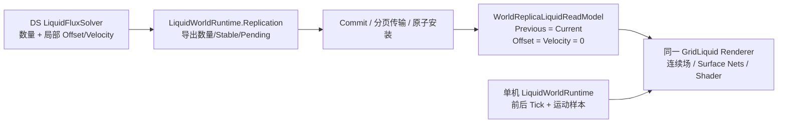

# 流体连续运动与空中洒出表现审查（更新中）

## 1. 这次要解决的玩家感受

用户指出：液体流动断续，空中落下像方格跳动，希望参考 Terraglass 的连续水流，为以后自然的“洒出”打基础。同时明确背包整理应为**左上紧凑排列、同类相邻**，此前右上要求作废。

本轮已修改背包规则；流体部分完成源码、正式资源和公开参考审查，**没有将下述流体方案当成已实现或已达到参考效果**。两张参考截图能说明风格目标，不能测出 Norn 当前帧率、网络间隔、GPU 耗时或判断实际是否使用 CPU fallback。

核心结论：现有 Solver 已有重力、格内位置与速度，Renderer 也已有连续场与插值。但联机 Replica 没有把这些运动样本交给 Renderer；同时，空中液体仍以较粗的数量格为主，当前倾倒又是落点提交。因此要依次解决**运动连续、空中形状、真实在途数量**，水面颜色和泡沫是后续细节。

## 2. Terraglass 可以借鉴什么

核对来源：

- [Terraglass 官方 Steam 页面](https://store.steampowered.com/app/5440970/Terraglass/)描述注水、积水、溢出、向低处流动；本轮访问时仍为 Coming soon。宣传效果可作为目标，但不等于经过 Norn 相同的多人材料数量与长期资产边界验证。
- [开发者 Technical-Mud54 的原帖及技术回复](https://www.reddit.com/r/Simulated/comments/1x8br74/working_on_a_fully_simulated_ecosystem_game_what/)说明：使用 Unity 6，GPU Compute 更新柱状网格中保存的材料量；飞溅和火花为叠加视觉块。不能将它说成已证实的全场景 PBF/FLIP 粒子模拟。

值得借鉴的是：大轮廓持续移动，水流有方向，越过边缘有连续下落形态，落地有可见反馈，小波纹与高光共同提示运动。我们不必复制其整个世界表示；Norn 需要保留真实数量、反应、收集、服务器权威与重连恢复。公开回复没有披露完整算法，也不能据此推断其多层腔体、所有碰撞情况或联机实现。

## 3. 当前正式链路与证据



### 3.1 实际格子和频率

正式 P7/P8 单机 Scene 和在线 P7World/P8World 使用同一个 `GridLiquidFieldRenderProfile_Default`，不是分别重新开发的液体显示系统。在线装配剥除可写 Owner 或 Rendering，分别保留 Client/DS 应有职责。

实际基础世界格为 0.25m，液体 `resolutionScale=2`，因此液体 native cell 为 **0.5m**。`unitVolumeMultiplier=4` 后，每液体格容量为 **510 GMU**，不是 Profile 参考值255。材料 Tick 配置10Hz；联机由唯一 Authority 时钟喂入。10Hz 是目标模拟/捕获频率，不能理解为每个可见 Chunk 必定每100ms完成安装和绘制。

源码与资源：

- `Scripts/ElementField/Liquids/LiquidVolumeSettings.cs:24`：格尺寸和容量换算。
- `ScriptableObjects/World/Online/Materials/P7_OnlineCPU_LiquidWorldProfile.asset:15`、正式 `P7World.prefab:3054`：真实 Profile 绑定与参数。
- `Scripts/Multiplayer/Movement/OnlineWorldBootstrap.cs:689`：权威时钟和材料捕获。

### 3.2 单机并非“每 Tick 固定下降一格”

`LiquidFluxSolver.cs:258–315` 已有重力积分，位移使用前后速度平均乘以 dt，保存格内 Offset、水平速度和通过碰撞检查的 SafeDistance。离开坡面继承横向动量；坡面还使用局部水头差、重力切向分量、drag 和整数 GMU 的小数余量。它是局部通量近似，不是完整 incompressibility pressure projection。

问题在于：跨格时，该格对应材料的整份 quantity 会搬到目的格；运动状态按 `(Cell, Material)` 保存。它没有独立小水团的身份、内部位置分布或完整动量混合语义。0.5m 粗格占据需要连续表现层隐藏，否则空中轮廓容易暴露网格。

### 3.3 联机运动数据确实丢失

`LiquidWorldRuntime.Replication.cs:16–46` 导出数量与 Stable/Pending；当前 resident cell 合同没有实时 Offset/Velocity。Pending 中存在 InitialVelocity，并不等于正在下落液体的当前速度已被复制。

`WorldReplicaLiquidReadModel.cs:150–160` 明确将前后样本设为相同值，Offset 和 Velocity 均为零，changed transport cells 返回0。`GridLiquidFieldSurfaceRenderer.cs:401` 又通过前后样本差异/速度判断是否需要运动重建。因此：

1. DS 内液体可能已经在同一格中下落，数量暂时未变化；Client 没有对应运动可显示。
2. 跨格数量更新到达后，Client 直接重建新占据。
3. 原 Renderer 即使有 Alpha，也无法用两份相同的零速度样本还原移动。

这是明确的联机连续性缺口，不是“所有卡顿都由网络造成”的证据。单机相同症状仍需检查下面的 Solver/Renderer 预算和形状。

前轮已修 `WorldReplicationCommitOwner.TryCopyDelta` 的旧版本追赶队列，以及 F 首次请求额外等待。它们缩短等待链，但**没有新增液体运动样本**，不能把前轮通过的测试解释成流体连续性已经完成。

## 4. Renderer 已有什么，仍缺什么

| 能力 | 当前情况与影响 |
|---|---|
| 连续几何 | 已有宽核连续场、Surface Nets、空间平滑和 Normal 重建；不是直接画所有裸 Cube |
| 时间插值 | GPU 已混合 Previous/Current，并按速度有限前推/回推；联机输入让它失去效果 |
| 极小水滴 | 已有球实例，位置同样依赖前后样本和速度；不能把“新增球粒子”当成唯一修复 |
| 水面纹理运动 | Noise 按固定速度随时间滚动，未随实际液体流向输运，因此水体运动和高光运动可能不一致 |
| Foam | 已有 Depth 接触泡沫和 Noise；不是由冲击/湍流生成并随水漂流的泡沫 |
| Refraction | 当前 Shader 未见 Scene Color 折射采样；透明混合、Depth 与 Fresnel 不等于折射 |
| 空中形状 | 已有自由液体液舌/液帘、上下对称截面和速度Warp；缺少旧粒子路径的邻域协方差/Anisotropy，持续连接、方向拉伸与断裂仍有提升空间 |

位置：`Rendering/ElementField/GridLiquidFieldSurfaceRenderer.cs:301`、`Art/Elemental/Compute/GridLiquidFieldCommon.hlsl:73,137,226`、`Rendering/ElementField/GridLiquidSmallDrop.cs:21`、`Art/Elemental/Shaders/ElementLiquidSurfaceLighting.hlsl:169–218`。

当前艺术 Profile 的 crown=.8、visual volume scale=1.8 偏厚圆液团；Runtime 还设置较弱的 Normal/Foam。可以调整水/毒液/黏液的视觉性格，但不能拿统一增强波纹掩盖运动断层，也不应把黏稠液和水调成同样的运动表现。

### 4.1 CPU fallback 可能产生另一类停顿

正式显示预算为128 MiB、256个输入Chunk、128个view、96个fine view。缺少 Compute、初始化失败或输入容量超额可进入 CPU fallback；近远范围还可能混用 GPU/CPU。

`GridLiquidFieldCpuSurface.cs:107–115,217–227` 的 CPU 构造取 Alpha=1，每帧约2ms软预算、8192 work，全部 Owner 完成后才整体交换 Mesh。完整 CPU fallback 构建期间暂停主 Capture；Hybrid 下近处 GPU 仍可接收新提交，远处 CPU 使用自己的构建快照。这能避免出现半份表面，却可能让对应 CPU 区域持续展示旧水面，然后突然切换。

当前用户运行是否命中此分支**未采证**，不能直接给它定罪。`DisplayLagMilliseconds=0` 也不能证明零延迟，因为这个指标依赖 Animated 或 CPU pending，Replica 的相同样本可能让它报告0。

### 4.2 Solver 预算可能让流动节奏不匀

`LiquidFluxSolver.cs:75` 每 Tick 最多处理1024个队列格；若持续超额，没轮到的格不推进，轮到时仍按当前固定 dt 积分。`LiquidTransportState.cs:46` 的地面动量超过两个 Solver tick 未更新即失效；`LiquidTerrainSupportCache.cs:50` 每 Tick 新支撑采样预算128，耗尽时有 fallback。

这是需要测 queue age、支撑查询失败数及局部更新间隔的理由，不代表当前小水坑必然超预算。也不能只把10Hz改成30Hz：现有 perTick 流量、quiet计数等会一起改变，需要先明确时间单位和 substep 规则。

## 5. “洒出”为什么还要补一段真实玩法

当前 `OnlineContainerTrajectory.cs:26–47` 以抛物线采样和 SphereCast 求落点；`OnlineCastDriver.cs:668–709` 将目标交给事务；`MaterialInventoryDepositPort.cs:77–105` 在目标附近 Stage/Commit。玩家看见的轨迹预览不等于沿路径飞行的材料。抛出整只容器已有另一条轨迹路径，不能混同。

未来需要的语义应是：

```text
容器内数量 → World内的在途液体 → 碰撞/落地 → Dynamic或Stable液体
```

现有 Dynamic Store 和 Falling 状态已经能保存空中液体，并非世界里完全没有在途数量。首先应评估**从喷口向现有 Dynamic/Falling 链路注入真实数量和初速度**，复用原重力、碰撞、材料归属及提交路径；补齐其运动同步和重连时需要的状态。当前 Pending 放置未直接利用 InitialVelocity 创建喷口飞行路径，因此不能只改落点坐标便宣称完成。

只有格表示不能满足目标碰撞、动量、形变或持久运动语义时，再设计有界 parcel 表示，例如ID、composition/GMU、位置、速度和sample tick；这不是预先确定要新增第二套Owner。两种方案都必须满足：扣容器一次，落地只是World内部表示交接，不再生成一次液体；无容量时保留数量，不用TTL删除。Baseline、重连和结算计入尚未落地的份额。

若某些细小水花只是视觉粒子，它们可在 Client 上表现，但不独立拥有 GMU、伤害或可收取资源。两类粒子必须在职责上明确区分。

## 6. 建议的分阶段路线

### 第一阶段：建立对照，补齐联机连续运动

先以固定数量与位置做四类可重复输入：地面水流、台阶/边缘落水、高处落团、F采集；单机和双Client同视角比较。记录每目标Chunk的 Authority tick→Commit→安装→Capture→首次绘制，连同 fallback、CPU build frames、queue age 和帧时间。不能只看全局平均FPS或当前 DisplayLag。

复用现有 Renderer，在 Replica 保留有效前后样本与正确播放时间。单纯对每格数量 Lerp 会变成两处淡入淡出，不能保证水团从A移动到B；要恢复已有速度形变，需要设计有预算、关联 WorldEpoch/Chunk Generation/提交版本的权威运动样本。正常跨Chunk移动应衔接前后关系，不能每次清空History；Epoch/Generation不兼容、重建或无法匹配时才丢弃旧历史，最终删除清理残影，Frozen停止推进且不积累外推债务。运动表示只供显示，不写回权威数量。

验收：相同输入下单机/在线的连续性差异缩小；采集减少及时可见；掉包/重连不残留旧水团；记录新增带宽与CPU/GPU成本。阈值在首次基线测量后明确，不能提前承诺任意机器60FPS或固定毫秒数。

### 第二阶段：近处更新优先，改善空中大形态

若测量确认表现预算导致停顿，Client优先绘制近处活动/下落/新注入液体，限制最老未显示年龄；CPU fallback 的分批构建需能及时接纳新提交，同时保持Owner切换完整。Client Camera不能决定DS数量推进。若是Solver预算问题，则另由DS结合权威Actor Interest、公平性与最大等待年龄调度。直接扩大显存上限或缩小Gameplay格子应作为有成本对照的备选。

在已有连续场、液舌/液帘和小水滴基础上改善速度方向拉长、跨格持续连接、落地摊开与断裂；不能让平滑核穿墙，也不能靠放大视觉体积制造“看得到却收不到”的水。必要时复用旧 PBF 的表现算法，先限制在近处活动区域和明确预算内。

验收：高处落水连续移动且落地接触位置可信；薄流不退化为串珠；水/黏液的运动差异明确；同一数量下没有丢失、重复或假碰撞。

### 第三阶段：自然洒出与水面细节

按第5节先验证复用现有Dynamic/Falling的喷口飞行路径，必要时才选择parcel表示，并保证数量交接原子性；把喷口、流量、初速度与容器操作统一。独立视觉水花、冲击泡沫和波纹由权威事实驱动；表面Normal沿流向输运，最后评估Depth吸收、Fresnel、Refraction。

新资产依赖暂不强制：优先现有材质/程序Noise。若进入美术制作，再明确 normal/foam 贴图通道、Import Settings、分辨率、资源路径和fallback，不能偷偷引入收费插件。

### 为什么不直接整体换成 PBF

旧 `GpuPbfFluidRuntime` 已有substeps、spatial hash、density constraints、viscosity/vorticity、collision及Anisotropy显示；并不是没有开发过。当前迁移到Grid的数量、Stable压缩、headless权威和网络合同已经围绕格世界建立。直接重开旧组件会重新引入GPU读回、粒子池容量、两个可写Owner及重连恢复问题。

[Position Based Fluids 原论文](https://mmacklin.com/pbf_sig_preprint.pdf)可用于理解粒子密度约束和取舍；它不是“换上即可达到Terraglass”的承诺。当前推荐先修运动链路，再评估有界混合方案；完整Solver替换应在现有模型确实不能满足目标时单独设计。

## 7. 背包更正与本轮验证

共用 `BackpackOrganizeOps.cs` 与业务服 `AccountInventoryMoves.cs` 已同步改为 Y从上到下、X从左到右，每个位置优先原旋转。保留分类/ContentId稳定顺序、真实占格、GMU合并、独立实例和失败原子性；没有在不同场景新增背包系统。

当前测试：178项相关EditMode、28项HTTP/MySQL业务测试通过。有效RED分别为两项方向断言失败，随后同一行为改为GREEN。曾有一次fixture命名写反被白名单拒绝，一次Editor未Refresh执行了旧Assembly；记录保留，后者9项通过不计本轮验证。通过显式Refresh/重编译及新的UpperLeft测试名确认实际程序集更新。

本轮流体仅审查，无新增流体Runtime改动，无Native流体Profiler或视频测量；不能将背包测试通过扩展为流体效果通过。证据目录为 `docs/superpowers/evidence/left-top-fluid-20261116/`。

23:05完成本地交付：Client和Dedicated Server构建均为0 Error，默认 `Builds/OnlineAccounts/Menu/NornMenuClient.exe`、`Builds/OnlineRooms/Server/NornRoomServer.exe` 与业务发布目录均已更新；旧目录保留。GameplayHash为 `f8a2419d62901da30769077585cc48339bc6071184ab68350357c733ff517f03`，协议仍为17。业务服健康检查为ready，MySQL未停止或重置；Editor停在已保存的P7_MainMenu，非Play、无编译失败。79个受保护资源Hash保持不变。

本轮没有再运行Native双Client游玩或PlayMode；方向、权限、幂等、原子性由上述实际运行的EditMode与HTTP/MySQL测试覆盖，画面及实际整理手感仍由用户验收。流体下一步应先实施第6节第一阶段的对照采证与运动链路方案，不能仅凭这次审查就声称已达到参考游戏的表现。

## 8. 2026-11-17 接续：第一阶段运动链路实现

用户同意第一阶段后，已在原 Solver、数量复制和 Grid Renderer 上接入只读运动窗口。上一节“仅审查”描述的是23:05的前一轮交付，不代表这一接续仍未修改Runtime。详细实施计划位于 `docs/superpowers/plans/2026-11-16 联机液体连续运动第一阶段实施计划.md`。

### 8.1 玩家动作到画面的链路

```text
DS 10Hz原LiquidFluxSolver
  → LiquidTransportHistory冻结Solver写入前的状态、合并完整搬运组
  → 原World数量Capture/Commit成功
  → WorldLiquidMotionSource核对同Tick的真实数量
  → WorldLiquidMotionReplication按可信Actor位置选择完整组
  → WorldPageMessage Kind8有界分页（独立于数量ACK）
  → Client完整Assembler + 当前订阅/Generation/Revision/Quantity witness
  → 同一个WorldReplicaLiquidReadModel原子发布Previous/Current
  → 原GridLiquidFieldFrame/Renderer按同步播放相位重建GPU表面
```

`WorldLiquidMotionContracts.cs` 定义固定容量、`WorldLiquidMotionCodec.cs` 只量化姿态为Half，`WorldLiquidMotionAssembler.cs` 完整校验后等待Sink确认；只有确认成功才推进AcceptedSequence。Quantity、地址、Generation和Revision仍为精确整数。协议升为18，未修改数量payload或checkpoint布局。

`LiquidTransportHistory.cs` 保留原单机History，并增加固定容量的union group、资格及数量校验scratch。两处Transfer与密度Exchange连接完整组；Stable吸收/展开、F采集、外部写入不冒充Solver transport。发布前要求每格Current等于canonical Dynamic+Stable，且每组每种材料的Previous总量等于Current。任何不匹配排除整组，不发半份水。Source无Update、无写权限、不创建第二个数量Owner。

`WorldReplicaLiquidReadModel.Motion.cs` 将网络样本叠加为只读表现，实际可收取数量仍来自原Store。每行Current witness必须与当前数量匹配；同Chunk无关格的Revision增加不会无故饿死窗口。未知Chunk不当作空格，真实tombstone才可证明Current=0。数量变化立即撤旧窗口，Renderer取消过期CPU壳，避免采集后旧水复活。固体变化也撤旧姿态，避免旧速度穿入新墙。

### 8.2 时间与生命周期的设计取舍

Replica本来就始终禁止本地模拟，所以不能用SimulationSuspended暂停插值；现在单独传递Frozen/失联/退出。Frozen固定相位，恢复清旧窗口，不追赶冻结期间的墙钟。Frame保存自己的Interval和WindowId，重复Capture不重启播放时钟。

本仓Mirror的 `NetworkTime.time` 在Client端实际返回带SnapshotInterpolation buffer的 `localTimelineScaled`。本功能复用这一播放时基，不额外再排一整Tick，但不能称它为无延迟服务器now。首窗口或断档先贴Current；如果数量终点已经显示，迟到窗口不能倒播。新连续窗口再使用同步Alpha。

跨Chunk移动还有一个容易遗漏的生命周期：源Chunk空后，tombstone ACK会触发Leave，导致刚发布的Previous尾水被立即撤销。新增固定容量短暂hold只延后空Chunk的订阅退休，最多0.2秒；真实数量删除仍立即安装/ACK，空间Interest退出也不等待。到期、重连和元数据搬槽均清理对应hold。

### 8.3 预算、代价与失败行为

数量原18,000B/s预算保持，先发数量页。运动每peer独立96KiB/s、12KiB burst、每Pump最多4页，每页不超过900B，预算计入72B framing预留；实际KCP重传/Socket成本另算。最多128行、32个anchor，完整最大1607 words/11页。没选中或未完整收到的窗口降级为当前数量快照，不阻塞数量恢复，不触发Gameplay Faulted。

选组使用固定数组min heap，避免8192个不合格组在每次Pump触发平方级全扫描；每peer每窗口只尝试一次。Source使用双缓冲，防止同Epoch重捕获改写Rows却继续使用旧组索引。新scratch与窗口带来固定内存成本，不是免费优化；未测得的Native全帧GC/显存不能宣称为零。

### 8.4 已运行验证与调试过程（接续中）

初始57项行为验证为15通过/42失败，记录在 `motion-red.xml`。实现后的首轮为73通过/4失败：新集成夹具把Water写成MaterialId2（实际Water=1）、未处理发送预算耗尽，以及误认为换连接不会清Replica缓存；按实际合同修正后通过。独立编译阶段的测试asmdef缺引用和fixture类名冲突也已修正，保留原失败记录。

首次GPU对照在生成样本前失败：`TryAddInitial(..., false)` 的false是wake=false，水没有进入活动队列；不是Renderer丢了510 GMU。改为wake=true，分别捕获真实第3/4 Solver Tick，验证前Current与后Previous接续、两相位各510 GMU及跨Chunk/tombstone，再走Codec和GPU Readback。

00:30实际扩展EditMode为232通过/0失败，包含7项真实GPU测试且未Skip；业务清单/checkpoint相关104项通过/0失败。新GPU对照的三相位下落重心Y约23.7404、23.6619、23.5690，Replica与单机最大重心差约0.000024m。它证明这一固定高处落团的子帧几何连续和wire往返一致，不代替复杂地形、水面美术或任意机器性能验收。详细JSON在 `docs/superpowers/evidence/liquid-motion-20261116/gpu-comparison.json`。

随后完成hold专项回归、匹配的Client/DS构建及真实双Client窗口采样，结果见8.5–8.6。Native显式诊断默认关闭，仅 `NORN_LIQUID_MOTION_PROBE` 绝对目录与 `start.request` 同时存在时启用；使用正式ElementWriteRequest注水，不暂停世界。报告区分数量/运动输入、网络计数与实际GPU证据，不能把WindowId增长等同于已绘制。

### 8.5 Native第一次采样揭示的真实ACK瓶颈

hold专项最初4项失败来自另一个夹具前提：原点Chunk固定承载Geometry，即使无数量也保持resident，只产生普通Delta；改用非原点A/B后4项全部通过。加上实际运行的其他专项，截止首次Native前有247个不同Unity用例通过。失败证据未删除。

首次构建的DS、验证Client、菜单Client均0 Error，隔离测试Schema上的双Native合作库存/施法流程54项检查通过。但**没有据此接受液体体验**：10秒真实注入10×512 GMU时，DS捕获100个窗口，98个有运动行，两Client却只发布30/24份；一端数量WorldTick曾停在255约1.6秒。整体客户端平均帧间隔仍约16.7ms，说明“60 FPS”不能证明液体连续。

进一步定位 `WorldReplicationCoordinator.ReceiveControl`：每秒32个ACK限制施加在已经逐字段匹配真实连接、订阅、Generation/Revision、SnapshotId与Checksum的合法ACK上。10Hz × 多个活动Chunk很容易超过32；被拒的ACK已经是Client安装成功后的唯一响应，Server因此卡在AwaitingInstallAck，直到原2秒重发超时。新增真实Coordinator/Codec/Store回归在第32次合法确认确实RED，不是只根据日志猜测。

修复移除这层重复ACK计数器：只有完整发完的唯一pending可以得到一次确认，接受后立即清pending，重复ACK仍拒绝；吞吐受DS每轮页数与字节预算约束。客户端可以主动自造的Resync继续保持4/s保护，未放开其预算。修复后76项相关回归通过，其中新增用例连续接受40份合法确认并逐次拒绝重复确认。

第一次Native报告保留在 `native-motion-20261116T165606Z/`，不能把其54项库存检查通过解释为液体最终通过。该次运动额外发送总计约24.2kB/s（两个peer合计，含每页72B预留，不含实测Socket重传），客户端p95帧间隔约17.49/17.45ms，但一端最大间隔110.26ms；未做全帧GC或公网性能声明。运动与数量目前仍共享可靠Transport，独立预算不等于物理链路完全隔离，弱网队列竞争仍需单独验收。

### 8.6 ACK修复后的复测与明确边界

第二次报告位于 `native-motion-20261116T171851Z/`。使用实际业务入场、独立DS与两个Native Client、隔离测试Schema，合作库存/低蓝连射/松手后拾取与拖动/正常退出流程的54项检查再次通过。采样运行在已有RoomLifecycleLab与SinglePlayerInventoryRegression测试装配中；没有把它描述为正式副本全流程视频验收。

同样10秒、10次注入、总计5120 GMU，DS捕获100个窗口，其中98个含运动行；两个Client发布窗口数从30/24提高到89/56。数量侧682次ACK全部接受、0次拒绝，运动侧无解码拒绝或组装超时。额外运动发送约24.0kB/s（两个peer合计，含framing预留）。每个Client分别有72/38次采样处于0与1之间的Alpha，表明子帧播放时钟实际在推进；这项指标仍是ReadModel输入证据，不能替代Native最终像素观察。

两Client的p95帧间隔约17.62/17.51ms；最大值43.11/124.49ms。第二端仍有一次较长帧，当前采样没有定位其CPU/GPU原因，因此不宣称卡顿已经全部消失。严格Current quantity witness与迟到不倒播策略仍会让部分窗口回退数量快照；不能用解除数量校验、让Replica推进真实水量来换取表面平滑。

本轮累计254个不同Unity用例的最后一次实际结果均为Passed，未解决失败为0；包含7项真实GPU测试。另有104项业务测试通过。计数按用例全名去重，没有把多轮重复执行相加；早期RED、错误fixture和中间失败全部保留。ACK改动后运行76项受影响回归并重建DS、验证Client与菜单Client，三者均0 Error。

第一阶段实现及上述自动验证已完成；主观液体感、复杂台阶/薄流、大规模同时反应、四人及公网弱网尚未验收。没有完成第二/三阶段的空中大形态、连续洒出、泡沫、Refraction，也没有声称达到Terraglass的视觉效果。下一步先用更新后的正式菜单Client观察地面流动、高处落水与F采集，再以最明显的残留跳变定位安装→Capture→实际绘制，进入后续形态优化。

### 8.7 本地交付与试玩入口

北京时间2026-11-17 01:33完成本地交付。默认菜单Client、Dedicated Server与业务发布目录已更新，旧目录可逆备份保留，753个交付文件逐一Hash一致。协议18，GameplayHash为 `dd066d79c28bff989fefb3e029a5505be6a39d3cb408d4f9119e2fb012502514`；业务服ready，原MySQL进程及启动时间未变。Editor停在已保存P7_MainMenu，非Play、无编译失败。

交付保护检查曾失败一次：现有验证Client构建器重新生成了专用 `SinglePlayerInventoryRegression.unity` 的RoomConnection对象ID；没有改动正式场景。已保存生成版本，并从Hash与本轮开工记录一致的备份恢复测试Scene；重新Refresh及安全检查后，79个受保护资源Hash全部一致。原失败及恢复证据分别保存在 `delivery-protection-failure.json` 与 `protected-scene-restoration.json`，没有覆盖成一次从未失败的流程。33个Runtime/合同源码Hash保持验证时版本。最终范围与未测项见同目录 `acceptance.json`。

试玩仍打开 `F:/Develop Project/RPG/RPG/Builds/OnlineAccounts/Menu/NornMenuClient.exe`，使用两个不同账号建房进入联机副本。重点比较水/毒液/黏液在地面流动和从高处落下时是否仍明显逐格跳动，再连续F采集观察减少是否及时、是否残留旧水影；随后确认原有F拾取、附近物品拖动及法杖施法仍正常。此次后台自动注水诊断默认关闭，正常客户端不会自行注水。体验反馈决定下一阶段优先处理哪种残留形态；本轮没有提交或推送Git。

## 9. 2026-11-17 完整接续：高速形变、真实洒出与最终画面（更新中）

用户随后要求继续全部完成后再统一试玩；因此本轮不再要求用户完成每个小步的Editor验收。第8节是已交付的第一阶段历史，最终状态以本节后续实际证据为准。计划为 `docs/superpowers/plans/2026-11-17 流体连续表现与真实洒出完整接续计划.md`，证据为 `docs/superpowers/evidence/fluid-completion-20261117/`。

### 9.1 剩余断层与修复顺序

运动页在同一帧连续到达时，上一完整候选可能刚好满足数量证据，却被下一Sequence取消；只在整轮末尾发布，还会错过两个数量页之间唯一匹配时刻。新接收入口在替换前、接收完成后检查发布，Channel在每次数量原子安装后再检查。原Current witness、订阅、Epoch与Frozen仍是必要条件，不为了连续性放开数量验证。新增两项回归先得到0通过/2失败，再接入这些发布点。

原流体虽有速度Warp，空中外壳主要仍是水平格片。新增速度Anisotropy为三轴对角近似：沿速度分量拉长，各轴乘积归一为1，不是旧PBF的完整旋转协方差椭球。只有非接地、圆冠自由水参与；邻接固体关闭新增拉伸，接触平面继续用原地形。小滴则沿完整velocity轴拉长，Bounds同步覆盖最大形态。它们只改变现有GMU外壳，不参与收取/碰撞判定。

高速运动还暴露固定175格邻域的缺口：两格搬运的Previous行可能落在外肩采样范围之外，少掉一半表面。Frame按冻结姿态、Warp和形变界计算QueryReach，CPU/GPU读取同一个范围；静水仍2/3/2，极端输入有固定上限和预分配数组，实际移动成本必须重新测量，不能套用旧175格性能结果。

### 9.2 水面细节与固定内存布局

连续表面仍48B顶点，原pad压成swell、signed FlowX/Z和impact。CPU UV2与GPU/Shader解码同步；Flow只在FinishVertices阶段读取27邻格，避免在每个场节点的8个GroundPlane临时数组中增加32个float。Normal Noise使用双错相流向输运，活动水流增加采样成本；Foam按局部速度/接触补充冲击反馈。Refraction仅在当前URP和Camera实际提供Opaque Texture时启用，有界修正，不强开项目资源。

小滴仍32B实例，把8个材质显示权重压为UNorm8（每通道误差不超过1/255，最终归一化）腾出姿态空间，使用Half速度；GMU、可收取数量和Radius不作这类显示量化。没有新增用户资源依赖，也没有扩大原GPU池Stride预算。

### 9.3 从瓶口进入原世界数量系统

原ContainerUseService、权威Context与MaterialDepositExchange新增本机可选初速度。DS从可信Actor与aim计算喷口和速度，Client不提交世界数量或速度。喷口短段SphereCast及真实逻辑容量检查防止贴墙绕过；材料仍通过原Stage/Undo/Commit一次扣除容器。在扣库存前预检全部固定运动槽；失败保留数量。成功后赋给原Solver Falling状态，飞行/落地是同一World数量移动，不二次生成GMU。

Solver支持向上后下落、每轴有界多格逐格碰撞及对角障碍预检；已湿格按新增GMU混合速度与格内质心。原ElementWriteRequest.InitialVelocity也使用同一个注入入口；缺运动槽时Pending保留数量和速度重试，不静默丢掉动量。正式喷口8m/s与Lift2；非有限或超过64m/s的请求拒绝。Pending合同原本就有速度，Dynamic checkpoint仍仅保数量，DS进程恢复后的原动态动量不持久化；这一范围不能称为完整物理状态恢复。

### 9.4 初始验证与正在完成的Gate

空中形变先取得1通过/1失败；喷射初始7项0通过/7失败。第一轮集成为46通过/1失败，揭示原Pending InitialVelocity被忽略；第二轮118通过/1失败，其中所有喷射项通过，唯一失败是新增GPU夹具未设置可信Profile的resolutionScale/unitVolumeMultiplier，在GPU执行前被正确拒绝，随后修正夹具。保留中间失败记录，不用它们冒充Runtime渲染失败或最终成功。

实际业务相关104项已通过，协议生成9个文件检查一致。正在进行扩展的液体/Renderer/网络回归和真实PlayMode画面测试。新显式Native RenderProbe在正常ENV为空时不创建对象；采样与截图/Readback分段，防止把诊断IO成本归入正常帧，报告关联实际Capture帧与GPU输出。最终计数、画面、Native性能及本地构建交付在后续回填。

### 9.5 扩展回归发现的真缺口与修复

连续Pending喷流发生在BeginTick之后、Solver之前。原History把外部写入格永久排除，本Tick相连喷流可能全部失去运动。新增独立固定`_motionPrevious`在Pending/Stable完成、Solver开始前冻结网络基线，原单机Previous保留；只有实际Solver触及的组可发布。Solver后的F/反应仍使整组失效，同Tick不能二次基线将其重新授予资格。三个明确RED转GREEN，连同原Source、喷射、Replica及网络专项45项通过；另补了未被Solver处理的Pending行不得冒充运动的回归。

第一次扩展为702通过/3失败：缓存GPU与全量GPU不一致。先固定纯材料数学0/1端点，消除Half的3C00/3BFF差异；不把未经读回的中间浮点数和具体舍入机制当作已测事实。随后706通过/3失败暴露几何与Normal差异，新增流向读取不能继续与复杂几何线程缓存交织。将流向/Impact拆为FinishNormals后的独立FinishFlow Kernel，保持原几何顺序，不增加Buffer或数量Owner；静态页跳过，CPU静态快照免去额外取样。初次接线漏绑定新Kernel造成4项错误，补齐Find/IsSupported/Bind/Dispatch后14项全部通过，三组缓存对照几何/Normal/细节误差均0，没有放宽断言。

落地Impact也补了真实时序：Previous在上方空中向下，Current在地板上速度已归零，不能只找“接地且负向速度”行。由实际支撑门控同窗口的下落速度，并按同一QueryReach覆盖跨两格落地。新增1/2格行为验证及GPU流向Readback通过，实际GPU顶点携带有效速度，保持GMU不变。

动态PlayMode首轮5项全通过。加入持续喷口后初次23通过/2失败：一项是重复添加pour-stream入口造成截图路径冲突，一项是旧容器测试仍在原轨迹地面落点找Poison像素。去掉重复入口、每次取证独立GUID子目录；旧测试改为读取本次真实提交喷口，同时核对GMU、Poison格与原Ice像素，未改Runtime或放宽颜色。修复后24项全部通过，含6项真实动态GPU/像素、原容器和联机背包回归。所有中间失败保留在本轮证据目录。

6种动态案例为water/黏液高处落团、地面流动、台阶溢流、收取、持续喷口。每种在真实Tick5/15/30拍摄场景与液体专属Layer图片，排除仅地板/天空造成的假阳性，读取真实GPU几何并逐帧核对World+Pending+已收取=注入总量。持续喷口共11×256=2816 GMU，从空中以(4,2,0)初速度进入原Pending/Solver，实际质心离开喷口；取景已校正避免早期空中液体被画面顶部裁掉。证据在本轮`dynamic-visual/`，不是人工主观游玩结论。

### 9.6 构建内存与Native取证的实际失败

最终冻结后的扩展EditMode为711通过/0失败，PlayMode为24通过/0失败。DS和验证Client先构建成功；菜单构建在北京时间11:08读取Texture依赖时触发Native OOM，分配请求22,369,620 bytes，完整堆栈指向Texture2D序列化/BuildPlayer。不能把这一Editor构建失败说成游戏液体已导致崩溃，也不能忽略它宣称构建全部通过。用户重新打开后的Editor处于干净MainMenu；核对79个受保护资源全部不变。随后在构建Scope中暂将导入worker目标降为1，通过Unity官方API等待并退出闲置worker，结束恢复原会话值；没有按名称结束进程、关闭其他应用或改系统内存设置。菜单重建随后0 Error成功。API职责见[Unity 6000.3 ForceToDesiredWorkerCount](https://docs.unity.com/en-us/engine/6000.3/script-reference/unityeditor/assetdatabase/forcetodesiredworkercount)。

首次Native合作完整54项检查通过，保留在`native-motion-20261117T040146Z/`。10秒采样两端Published42/82，660次数量ACK全部接受。实际Capture的p95约2.69/2.59ms，最大约12.39/11.12ms；无CPU fallback。QueryReach实际主要2/3/2，下落时2/4/2，最大2/5/2，不是每节点都跑最大21³。54484的115.033ms间隔位于Frame547，该帧Capture仅1.5683ms，因此现有证据不能将整个慢帧归因于Capture；Dispatch Recorder的LastValue可能对应上一结束样本，也不能当当前GPU整帧时间。

该Native工具给Client传入`-batchmode -force-d3d11`。它覆盖真实业务、DS、输入/事务/复制、GPU Dispatch，但不能凭Update间隔宣称正常窗口最终渲染帧率。首次PNG虽存在且GPU Readback有几何，实际检查两张都全黑，不能接受为Native画面证据。修复显式诊断：在10秒性能窗口之后，通过URP17的SingleCameraRequest向RT主动提交渲染；固定Viewport/CullingMask和矩阵，统计非背景像素/全黑标记，FrameTiming在batch明确不可用。只重建两个Client；这一纯Rendering诊断不在GameplayHash输入中，2258个实际输入元数据未变化，另14个是Unity虚拟Package路径；DS仍复用已通过的同协议18、同GameplayHash产物。最终匹配与画面由接下来的实际重测确认。

另一次只读审查纠正了“10Hz×8个活动Chunk=80提交/s”的错误估计：Native实际只有4个活动Liquid，另3个是静态域Geometry；WorldTick采样中位lag0、p95最多1 Tick，后段ACK约39.30/37.91每peer每秒，没有持续全局积压证据。因此本轮没有盲目扩大18,000B/s预算或改为4个并行在途。单pending与跨Chunk witness同时成立的时间跨度仍是后续可测的调度边界；运动发布数不能直接等同数量吞吐或最终画面质量。

### 9.7 最终交付与验收范围

北京时间2026-11-17 12:30完成本地交付核对。默认`Builds/OnlineAccounts/Menu/NornMenuClient.exe`、`Builds/OnlineRooms/Server/NornRoomServer.exe`与业务发布目录均已更新；旧目录保留可逆备份。协议18，GameplayHash为`2b1a5eb6115547dd067c82652ed6ffd464adb8a135ee331b7d8a94382db5449c`。业务服ready，MySQL原PID及启动时间保持，数据库未重置。Editor恢复已保存P7_MainMenu，非Play、无编译失败或运行中的测试。

最终EditMode711项、PlayMode24项通过，当前共735个不同Unity用例；业务测试104项通过。另一次实际双Native合作流程54项通过，位于`native-motion-20261117T042345Z/`。显式渲染修复后的两张1280×720图片均非黑、有实际场景与蓝色液体，已逐张检查；GPU Readback每端2109个有效顶点、1324个三角，非法顶点0。截图为性能窗口之后的单帧事实，不等于整局主观手感验收。图片Hash与检查范围见`native-pixel-inspection.json`。

第二次10秒样本运动窗口发布91/62份，未放松数量witness；两端实际Capture p95约2.65/2.69ms，最大约13.24/12.56ms。LateUpdate间隔p95约20.98/20.63ms，最大约47.52/39.91ms；这是batch、显式探针和额外只读Capture同时运行时的循环观察，不宣称正常窗口GPU帧率、全帧Zero-GC或任意硬件60FPS。显式RenderRequest约424/464ms及PNG/Readback全部在性能窗口后，成本单独记录。两次Native输入阶段不完全相同，42/82与91/62不能当作受控性能A/B结论。

1000个Runtime/Shader/Shared源码Hash与最终记录一致；79个受保护资源和753个实际交付文件Hash核对一致。历史RED、GPU接线错误、OOM、黑图及被参数化用例替代的旧RED均保留；`test-summary.json`明确列出当前用例与历史记录，未把多轮重复通过相加。最终机器范围在`acceptance.json`，没有Git提交或推送。

本轮计划中的运动连续性、空中有界形变、水面流向细节、真实喷口洒出与相应自动验证已完成。仍有明确技术边界：运动超预算/版本断档可降级快照；Dynamic动量不跨DS进程恢复持久化；公网、四人、其他平台与主观美术质量未验收，不能声称等同Terraglass或ReleaseReady。试玩使用默认菜单Client，两个账号开联机副本，重点看高处落水、不同液体的连续洒出和F收取后的减少/残影，再确认原拾取与背包拖动。此时才交回用户进行实际游戏体验验收，不再要求中途协助复现。

## 10. 2026-11-17 用户实测后的自然液面与运动连续性接续

### 10.1 为什么测试通过后仍像果冻、仍会顿挫

上一轮验证了数量、流水链路与静态画面，没有证明最终水面自然或每帧轨迹连续。用户的新截图暴露了真实体验缺口：地面有两个高耸的蓝色胶块，挥洒虽能成功，飞行仍分段。这轮计划为`docs/superpowers/plans/2026-11-17 自然液面与空中运动连续性修复计划.md`，证据独立写入`natural-fluid-20261117/`，旧失败与旧交付结论保留为历史。

圆冠并不是物理Surface Tension计算失控。旧Presentation的Crown=.8、VolumeScale=1.8，加上footprint收拢与中心Dome，多次把少量水抬高；统一Alpha向.94靠拢又使它像实体胶块。自然档使用按材料的无量纲视觉张力，水低、毒液中、黏液较高，显示体积回1；仅地面降低圆冠，空中仍保留连续液舌的稳定重建。该参数不以N/m命名或冒充物理量，也不改GMU。

真实Solver首落窗口的生产小滴采样还存在数学错误：两条匀速外推再混合，会使静止落水先抬升；第3→4 Tick的2ms差分速度跳变实测.941276m/s。首轮三个行为RED全部失败，包含相同Epoch重新Capture重启播放时钟。改为冻结可信重力、只在无遮挡自由液体使用二阶轨迹，接地/近障碍保留保守路径；终速不得再次加重力，位移限幅与Bounds/QueryReach一致。GPU标量场的初次严格比较失败，是测试拿厚采样代理与最终真实厚度相比；改为同语义EvaluateGroundProxy，保留.001容差和正场不得被Bounds裁掉的断言。

### 10.2 联机的Raw中间态为什么让连续窗口也跳终点

复查上轮双Native每帧证据：第一端59个有效fractional Source样本中，53个被Renderer改成Alpha=1；第二端42个中34个。Renderer实际fractional帧仅22/595、27/597。窗口发布91/62份不能证明它们真正被连续播放。

具体例子：旧Window627时512GMU；随后Raw帧736；新Window628时1024。这是多Chunk中间安装态，不能把Raw视作已展示完整新端点。原`_displayedRawQuantityEndpoint→snap`规则虽然避免迟到运动回退，却在几乎每个正常窗口都触发。Raw空档median51/66ms、p95133/325ms；后一端还曾有2.94s无可用运动，不能仅靠全局WorldTick正常就否认局部卡顿。

解决分两层：完整、认证、Subscription有效的候选先进入独立固定缓冲；只有候选Previous完整衔接旧Current且当前各行处于合法端点时，才允许这组row暂时显示旧端点。数量Store/ACK照常安装，未齐的Current不授予显示姿态、采集量或碰撞。保留期限绑定旧窗口，最多100ms，同步时钟与本地单调时钟共同限制，新候选不能续租。高于候选引用Revision的收取、Generation/Interest/固体变化与Frozen立即失效。

最初实现曾冻结整份Frame。只读review发现这会遮住同Chunk无关池子的F收取，已在正式交付前改为仅覆盖候选row的两相位，其他row继续从Store取最新数量、Renderer照常Capture。没有全世界第二份数量账本，也不通过Client Solver预测未来资源。新增真实Store→Replica→Renderer跨Chunk用例与采集、超时、Interest、Frozen、重连边界；后续实际双Native还要检查连续播放覆盖及普通图形帧成本。

### 10.3 借鉴的公开实现与本项目取舍

[Terraglass官方页面](https://store.steampowered.com/app/5440970/Terraglass/)描述汇流与沿坡流动，未公开具体Solver。视频视觉不能证明它使用PBF、FLIP或SPH，本轮不作此推断。

[NVIDIA的Alice: Madness Returns技术文章](https://developer.download.nvidia.com/tools/docs/Fluid_Rendering_Alice.pdf)介绍实际游戏的SPH、平滑深度与厚度着色。可借鉴模拟与光学分层、按材料调节粘稠与透明度；直接换GPU SPH会改动DS权威、材料反应、同步及持久化，本轮保留现有真实材料系统。

[Snapshot Interpolation原文](https://gafferongames.com/post/snapshot_interpolation/)说明速度信息对低频样本连续重建的价值及缓冲延迟的trade-off。本轮使用已验证端点和有界二阶轨迹，不为平滑盲目提高Gameplay Tick，也不无界外推穿过墙或继续画已采集的水。

当前初步相关34项已通过；包括7项实际Solver飞行/GPU场、5项地面形状和22项Replica/Renderer时序。业务104项通过。最终扩大回归、逐帧像素、Native与构建结果须在本节后续回填，不能将这份中间记录当成最终验收。

### 10.4 扩大验证找到的边界、真实画面与性能取舍

固定256GMU、同相机/光照/当前Palette的实拍：旧形状参数GPU高0.609386m、宽0.461899m；自然档高0.066662m、宽1.352524m。CPU与GPU高宽相同，均有实际液体像素。这里是恢复旧形状参数的受控对照，不是旧二进制完整美术A/B；Surface Nets闭合体积仍有重建误差，不能把显示倍率1宣称精确物理体积。真实下落逐帧RT异步读回在第二轮26个活动样本中25次移动，连续静止0、无丢样/读回错误；它证明本机GPU下落轨迹，不替代网络Replica验证。

CPU实拍起初为空，而Mesh已有64个Triangle、184个有权重顶点，Bounds/体积与GPU相同。诊断中Shader已编译、ForceOpaque和禁Instancing都仍为0像素。Editor实际日志明确是D3D12缺少`_LiquidOwnerLookup` SRV而跳过Draw。即使域裁剪Enabled=0，提交时的资源验证仍要求绑定；复用原`LiquidSurfaceDomainBindings.CreateEmpty`并随CPU Owner释放，未更换Shader或用另一个MeshRenderer绕过。修复后四组实拍与两项新PlayMode全部通过。

第一次742项扩大回归为740通过/2失败。一项历史CPU hash固定旧圆冠造型，夹具却继承新默认；只对该历史优化对照显式恢复旧参数，保留原hash不变。另一项是真实坡沿错误：环境粗Solid格OR命中不代表格中心存在平面，Raycast失败时仍虚构水平底板，使一个Triangle法线反向。增加可选只读逻辑材料支撑能力，仅区分环境粗碰撞与材料数量支撑；Frame要求真实平面、逻辑材料或满液柱，保留无Collider的冰块。三控制与原30°坡面断言均通过，不修改Solver或GMU。

还有一项缓存运动夹具从未Step，TransportInterval实际被clamp至1ms；对扁平水面对称±2mm扰动不能保证Mesh位移阈值。改为真实`Step(.1)`并断言100ms，仍保留重建、运动阈值和严格cached/full GPU对照；没有放宽断言。最终fresh EditMode 748项全部通过。

真实铺展与视觉摊平分开验证：只降Water Reserve并不够，旧空格seed固定112GMU，使30GMU水无法润湿邻格。新seed受本材料Reserve、Deadband与通量约束，正式两Water配置Reserve=.03，Sticky/Poison保持原稠厚参数。固定1020GMU，旧seed下.14/.03两档都是8格；新规则后.14为9格、.03为39格（平均26.154、最大31、最小20GMU），256Tick后守恒且休眠。坡面/重力/Stable同材料吸收继续绕过平地门槛，六项行为通过。

高速合法边界也保留RED：首轮极值夹具因payload prefix写错未进入Runtime，明确记为夹具失败；修正后CPU/GPU分别在正场肩部采到-.236159/-.061264，证实cap10裁掉了合法Offset4+Warp6。固定候选上限提高到14，仍按冻结输入逐轴动态计算，静水保持(2,3,2)；GPU Buffer不增，CPU每Frame初始化约增加192KiB，普通Renderer两个Frame约384KiB，无每帧扩容。两处加速度Bounds余量也受6格运动上限约束。真实GPU正场、CPU同源严格对照与飞行七项均通过。这个范围修复不等于提高Solver Tick或无界外推。

最终26项PlayMode初次25通过/1失败，检测到落水Mask触底，构建门禁因此停止。失败Tick30的GPU实际Bounds为相对Origin的(-.67466,-.0004,-.67492)至(4.67484,.0302,4.67458)，1888个Triangle、2040GMU均正常；旧固定镜头盯住Y=3m，把Bounds底角投到约-118px。只调整临时夹具overview机位，一次覆盖初始空中与新铺展地面，保留45°FOV及四边8px背景断言，不逐帧追焦或改Runtime Bounds。完整重跑26通过/0失败，Tick5/15/30像素范围分别(604,442)–(675,514)、(542,177)–(746,270)、(502,156)–(781,282)，每次另存相机/实际GPU包围盒投影JSON。原25/1与新26/0分别保留在`playmode-final.json`、`playmode-final2.json`，不能混写成首次全绿。

### 10.5 正常图形Native揭示数量衔接仍未达标

第一轮新Native位于`native-motion-20261117T063404Z/`，业务入场、拾取、容器、库存、退出结算54项通过，记录已保留为`native-pipeline-attempt1.json`。但10秒内两端只发布4/3份运动，Renderer的401/420帧fractional均为0，SourceHolding也为0；已观察的有效窗口全为SourceSnapped，不能把功能流程通过称为完成空中连续性。最长Raw观察段5.242/5.508秒，前后有效窗口间隔可达5.265/7.359秒。Trailing Raw还有约2秒，不能一概解释成稳定水。

为排除“后段已静止拉低全10秒比例”，按同Frame Replica的最高已安装WorldTick匹配DS成功MotionCaptureWorldTick，优先同Tick，否则只允许±1 Tick；等距运动/静止矛盾保留Unknown。扩展分组只接受100ms内前后Source样本WorldTick及TransportEpoch都相同的中间帧，不补造Source Alpha。DS确有运动的匹配组287/299帧、严格同Frame组123/127帧仍无fractional。DS MovingRows是全局运动证据，不证明每个可见组都在动，也不证明每Chunk同样新鲜。逐帧派生证据为`playback-analysis-20261117T063609099Z-26765c30.json`。

PublishFailure快照显示每端53个不同Sequence被QuantityWitness拒绝，另各1个ClockAhead；重复248/266帧不能算同样次数的失败事件。两端首次1.85/1.88秒Wall停顿后出现约-1325.6ms的样本/播放时钟差，下一帧已恢复到数量拒绝；后续多数失败样本年龄约-55至100ms，因此长断档不能只归因于350ms过期门。旧报告未保存具体Anchor、Expected/Actual Quantity及Hold拒因，不能凭猜测放松见证或精确姿态约束。新增纯值诊断把Revision落后、行数量不符、Generation/Interest与Previous量/Offset/Velocity分别记录；旧窗口只读校验不会覆盖最近TryPublish拒因，默认不创建额外诊断组件。

这次Client为正常D3D11图形模式、FrameTiming可用，截图RT为1280×720。两端CPU frame p95/p99/max为35.21/89.81/1839.95ms与28.45/53.23/1809.34ms；GPU正值样本371/389份为5.44/12.15/30.63ms与5.02/9.94/40.92ms。实际Capture95/94帧，p95/max为7.72/37.55ms与15.69/24.30ms，无CPU fallback/hybrid。最大Wall所在帧Capture仅1.21/1.05ms，最大CPU FrameTiming又晚3帧才出现，不能将整次1.8秒停顿归给Capture。Dispatch的CPU marker正样本p95/max为.1725/2.9896ms、.2452/.6160ms；它不是GPU执行时间。截图及Readback在窗口后，RenderRequest约7.66/7.88ms单列。完整聚合在`native-render-analysis-20261117T063943835Z-a47defee.json`，没有Zero-GC或硬件因果保证。

### 10.6 四个不同Key在途、burst接收与仍保留的预算边界

本轮真实铺展后的数量路径与上轮第9节小场景不同：DS约10.24秒接受186个数量ACK、318页，相当于平均每peer约9.08个提交/秒、每提交约1.71页。旧单pending在任一Key等待ACK时阻挡其他Key，多个Anchor同时满足最新数量的窗口变窄；这些计数本身仍不足以证明18,000B/s已饱和，因为第一轮没有逐peer/key的首末安装与ACK时长trace。

按此实证新增每peer最多4个**不同Key**冻结在途；同Key仍串行、页游标及超时独立，所有flight共享原token bucket和每轮发送上限。Subscription.PendingEpoch改按peer/Key保存，ACK必须与那份完整冻结身份、订阅代次和收齐状态相符，不能取消一Key后误认另一Key的旧ACK。Peer六项先1通过/5失败、集成六项先0/6；首次整合47/41暴露接线遗漏，修后88/0，所有中间JSON/XML保留。

四组在途又使合法八页burst能在一次回调到达。原四槽inbox确实丢后半组，RED为6/2；固定接收槽扩为16、每Pump处理4页，装配时一次分配，仍有明确overflow/retry边界。首次88/2是测试仍按两页消费的旧等待点，更新精确时序后90/0。随后又通过先安装新数量再Stage完整候选的顺序RED，改在可信回调暂存候选后再推进原子安装；累计定向最新92/0。它们是自动规则Gate，不是第二次Native流畅性结果。

下一次使用已有`NORN_N5_TIMING_PROBE`的一次性、有界、单Key trace：三进程各有独立config/output/start文件，按Actor、ConnectionEpoch、SubscriptionEpoch、Generation、Revision串起冻结、编码/发送首末页、安装与ACK。它记录实际编码字节和token余额，但单Key过滤仍不能代表全世界总带宽。先实测4-flight后的见证机会与token等待，再决定预算；当前18,000B/s和burst 3,600B保持不变，不用无限在途或提高预算掩盖恢复/队列缺陷。第二轮构建与Native尚未完成，默认试玩产物仍不能当作本节最终版本。

### 10.7 D3D11复跑发现的独立IndirectArgs合同错误

第二轮broad为763/766通过，三项都在原PBF实验Marching Cubes的drawargs失败；孤立复跑0/3且读到随机大整数。Editor日志明确拒绝`IndirectArguments | Raw`组合并忽略Raw。此前D3D12通过并不能证明ByteAddress契约跨后端正确，问题也不是Triangle拓扑应改预期。

[Unity 6000.3官方IndirectArguments文档](https://docs.unity.com/en-us/engine/6000.3/script-reference/unityengine/graphicsbuffer/target/indirectarguments)规定D3D11 UAV格式为R32_UINT。修复仅限该实验路径：Runtime与fixture以count4/stride4建立同样16B的Typed args，Compute用`RWBuffer<uint>[0..3]`；旧count1/stride16只暴露一个Typed元素，同样不能直接索引四次。Sphere、Case1精确边、overflow容量与四个args断言全部保留，另同步资源布局断言，未全局替换其他Buffer。随后真实D3D11 GPU三项3/0、fresh broad768/0、PlayMode26/0，分别保留在`gpu-args-d3d11-green.json`、`affected-attempt3.json`及`playmode-attempt3.json`。这修复了明确的资源合同错误，不代表下一Native连续性已通过。

### 10.8 第二次Native：数量版本滞后有了具体证据，连续性仍未通过

第二次`native-motion-20261117T085051Z/`再次54项功能通过，`native-pipeline-attempt2.json`保留独立结果。四Key在途后DS约10.03秒接受370个数量ACK、发送515个数量页，两端运动Published均23；但仍不是可验收的连续画面。Renderer581/583帧只有33/32帧fractional，全窗口时间覆盖约6.25%/6.18%；匹配DS真实运动阶段的380/388帧覆盖仅4.709%/5.059%，319/340帧仍是Raw。最长Raw5.436/5.510秒。严格同Frame组158/160帧的fractional时间覆盖也仅5.645%/6.303%，没有用Unknown或静水凑分母。

新的Witness值诊断把“资源版本没齐”收敛为具体`AnchorRevisionBehind`：两端98/88个不同已观察状态，重复341/347帧，均尚未通过Anchor检查，不能据此断言后续行数量一定相符。例如Window383需要Liquid Key(0,1,0) Revision3，实际2；后段Window453需要Key(0,0,0) Revision73，实际第一端65，第二端68。最大已见Revision落后分别8/6，不是通过降低`.001 cell`的姿态精度能解决。每端Hold检查累计28，实际可见Holding各3帧；排除未发生检查的初始Counter0后，已采到的检查结果变化有NoCandidate16、成功5、PreviousQuantity1、UnexpectedPreviousQuantity1，未采到Offset或Velocity拒因。这23次值变化不是28次逐调用日志，中间多次检查只保留该帧最后一项。一个具体量不衔接例子是旧Current24而新Previous26；必须保留数量guard，不能以平滑名义画额外GMU。

同时仍有17/13个同Frame同Window的Source fractional样本被Renderer画成端点，Late Source既非Snapped也非Holding；例如第一端Frame765的Window387，Source Alpha=.561058而Renderer Alpha=1。它对应迟到窗口前已显示Raw的保护分支，说明“收到23个窗口”仍不等于“播放23段连续动画”。下一轮按已证实的Anchor滞后及完整候选到达顺序，验证64KiB/s数量预算、每轮4数量页、最多11页的完整Motion先到及Client32槽/每Pump8页；这些仍是实施/回归中的方案，不是本节已经通过的Native结果。

这次新增三个CPU marker与进程GC计数。LateUpdate正样本p95/p99/max为4.520/11.145/43.172ms、4.561/9.157/57.110ms；GpuInputUpload正样本148/154份，p95/max为.778/5.556ms、.909/16.232ms。Initialize Recorder有效但全0，因为Renderer初始化通常早于IsReady及采样起点，不能称初始化零成本。Gen0增量0；此Mono的MaxGeneration为0，Gen1/2为-1不可用，不能据此声称0B或无GC停顿。最大Wall79.34/94.55ms在开始后约.48/.46秒，实际Capture36.76/39.55ms；未重复出现上轮1.8秒停顿，但没有受控cold-cache A/B，因此只称本次观测。CPU frame p95/p99/max18.43/34.38/71.34ms及17.53/29.82/86.14ms，GPU正样本p95/max3.10/26.41ms及2.60/14.67ms；LastValue仍保留跨帧scope。

Client单Key timing已导出，DS没有导出，原因已经由源码与`native/server.log:52`共同确认：为满足Native输出目录必须为空，将DS config移到staging，却让Output/Command仍指向evidence；原TimingSibling明确要求三者同目录，启动时正确拒绝并记录`Invalid timing bounds/output`，不是DS计时组件随机丢失。下一次让DS config/output/command同置独立staging子目录，完成后再复制报告；保留原同目录限制，无需改Runtime或绕过保护。当前没有DS逐Key token/ACK完整trace，不能将所有滞后精确归因于18KB token耗尽。

本轮逐帧及分型汇总为`playback-analysis-20261117T090429403Z-5966dbe4.json`；新marker、GC及慢帧前后邻域为`render-cost-analysis-20261117T090044483Z-fad16791.json`。先前派生报告保留，最新脚本明确排除Counter0的Hold初始快照，避免误算一次成功。两份脚本只读原报告、另建唯一JSON，未启动或改动Runtime/服务。下一次Native仍是必要Gate；自动规则、构建及54项流程通过都不能替代空中运动连续性的失败结果。

### 10.9 第三次Native把主要缺口收敛到显示尾段与多余缺行约束

第三次性能报告位于`native-motion-20261117T094324Z/`。两端Published均79、已观察Sequence连续，DS单Key timing也成功保存；发送准入trace未观察到TokenDenied、Timeout或Reason5。运动匹配组fractional时间覆盖升至44.7%/46.3%，仍不足以称流畅；同Frame同Window的Source fractional→Renderer endpoint仍有46/50例。窗口之间Raw多为一帧，p95约36.65/33.48ms、最大62.98/34.27ms；最后约2秒已匹配为Stable，不能再拿这段静水Raw宣称持续卡顿。可复算证据为`playback-analysis-20261117T100004793Z-05471461.json`。该轮完整Native流程在10个检查后因`SyntheticKeyboardProcessedFDownTimedOut`退出，`native-pipeline-attempt3.json`状态为Failed；10秒流体报告完整不等于54项流程通过。

每端Hold检查91次，已采到57次`MissingContinuationRow`，各对应Counter只增加1，故至少57/91次明确是这一拒因。旧逻辑要求上一份所有非零Current行都必须出现在新Motion，即使那一行已静止、其Generation/Resident/Interest与真实Current数量仍严格成立，也会让其他运动行的旧曲线失效。新例外只允许这种仍有完整数量见证的缺行；真实数量已改变的缺行仍拒绝，候选中存在的行仍精确比较Previous数量、Offset与Velocity。旧诊断该分支的Expected/Actual为默认0，并不证明该格真为0；新诊断记录实际Expected/Actual，不能从旧报告补造数量事实。

另一处错误是“新样本已验证”直接等同“立刻替换显示窗”。第二轮实际Window380→381，新窗首次观察年龄为-6.3075ms，而旧窗按同一新时钟本应播放到.945958；直接替换会截掉约5.4ms尾段。另一端同类替换发生4次。Mirror的`NetworkTime.time`是动态缓冲的播放时间，不应假设固定落后100ms，更不能换成输入用`predictedTime`抢播。新实现把accepted水位与active显示槽分开：完整见证通过立即接受并允许Assembler Commit，Source自己复制固定两份future；显示起点为`max(raw SampleTime, 上窗起点+上窗Interval)`，到时才激活。只延迟TryPublish会堵住Assembler并丢后继帧，因此不是可用替代方案。

缓冲只保存已验证的只读显示输入，不写数量、ACK、采集或碰撞。未显示future新增格的两相位取其Previous，避免真实Store已到落点时提前出现；旧active仍续播原Previous→Current曲线。最多active+2future，满时明确snap到最新已验证Current并记录overflow，不无限排队或悄悄覆盖中间帧。旧源Chunk即使已是tombstone，外层仍逐份校验最多3×32个retained Anchor的真实Subscription资格，Leave/epoch不能等本地Store猜测。真实F改量、Generation、固体、Frozen继续撤旧；无future时保留原Frozen暂停Alpha、恢复snap的合同。

第一批12项真实Store/Assembler行为RED为6通过/6失败，修复后扩成16项，首次15通过/1失败；原101项与Replica/Renderer旧规则22项合计123项通过。唯一失败的overflow夹具实际先碰到另一处真实时序缺口：active382起点10.300000003，lease在10.302开始，已接受383/384两份future；Render从10.398跨到10.408时，383本已在10.400到期，却先按旧lease期限10.402撤掉整队。保存的JSON trace显示active382→0、queue2→0、InvalidationRevision2→3、overflow仍0，不能把这一撤队说成capacity fallback。

把容量正控制改为1ms步进，真实第8窗出现queue2→0、overflow1、active388/Alpha1；另外新增相同deadline跳时的正常、真实采集、固体变化三控制。19项真实RED为18通过/1失败，只有正常续播期望383却得到0，采集/固体控制均通过。Runtime随后仅在本次Advance已有完整future到期时，强制重查原数量/Generation/Interest/Solid安全链再有界切槽；普通getter及未完整candidate没有期限豁免，100ms候选上限与.35s过期边界保留。随后19项与原123项同轮完整GREEN为142通过/0失败，证据`buffered-all-green.json/xml`；扩大回归及下一次Native仍须实际运行回填，不能将规则Gate写成画面验收通过。

Native诊断新增真实`SourcePlaybackStartTime`与buffer数量/overflow/discontinuity值；分析优先显式播放起点，缺字段的历史报告保留null，不拿raw SampleTime推造Alpha。新Holding代表续播原曲线，不再自动解释Renderer Alpha=1。两份分析脚本已用第二/三轮历史报告自测，历史4次提前替换及44.7%/46.3%覆盖结论保持不变。截图仍在采样后，fractional覆盖仍是显示输入证据，不能代替网络逐帧GPU像素轨迹或用户主观验收。

随后只读调用链review还发现上述直接Source测试没有覆盖的正式入口：`Replication.Advance`会在传入newClock之前，先对Assembler Commit后已不存在的候选执行Cancel。若有accepted future，旧Cancel会立即用上一次ServerTime检查本地realtime租约，再次抢在due切槽前清队。新增独立Multiplayer夹具用真实Coordinator、页Codec、Store安装/ACK、Motion分页与Assembler Commit建立active2+future3，短Sleep并校准实际单调时钟超过105ms，再调用真实`MotionIn.Advance(10.2)`。实际RED为2通过/1失败，正常case期望active3却得到0；真实采集、固体变化控制均通过，证据`actual-channel-cancel-red.json/xml`。最小修复让有accepted future的Cancel仅清未验证候选、标脏；紧随newClock Advance或外部播放窗口/两相位读取仍严格校验事实。普通无future的Cancel保持即时撤旧，没有延长候选TTL或改动真实数量。

该次旧版本full为795通过/1失败，已独立保存在`affected-buffered-before-cancel.json/xml`；唯一GPU对照在首个quarter期待.25却得到1。其fixture先安装新数量、未先Stage已解码完整候选，造成初始Capture前已读到新Raw端点；helper已按真实协议顺序拆为decode→Stage→安装数量→TryPublish，保留三个quarter及真实GPU重心全部断言。此处不把尚未重跑的GREEN写成成功，最新Source、该fixture与后续full/PlayMode/Native需同版本再验证。
### 10.10 薄片同样不自然：保留有限接触角与真实厚度

用户补充要求保留液体应有的 Surface Tension。此前减低鼓包的实际 GPU 量测为 1GMU 微滴约 1.56mm 高、.72m 宽；它虽然比旧大鼓包低，却成了铺得过开的薄片。这里需要修正的是表现层如何把有限体积与地面相接，而不是把物理质量或所有水面的高度乘大。

最终方向是在现有 SmallDrop 的固定实例池里给平地有限浅小水体生成闭合接触球冠。半径按真实 GMU 的立方根求解，再校准离散模板体积；8GMU 相比 1GMU 长宽高约两倍、体积八倍。VolumeScale 恒 1；水的无量纲外形参数选择 .2，用于外观接触角，不冒充以 N/m 为单位的物理张力。实际 .2 档 1GMU 高 .02914m、宽 .14445m、闭合模板体积 .000245095m³；256GMU 小滩高 .18504m、宽 .91725m、体积 .062744944m³。同量黏液高 .25595m、宽 .74554m，保留材料差异。上述接地实例在 GPU 实际 Buffer 与 CPU fallback 共用模板量测一致；深水和空中仍沿原路径，不能把这里的实例体积精度推广成所有 Surface Nets 网格都精确守恒。

只有已有真实支撑、平坦、小尺寸的水体进入该形状；深水、大水面、空中仍复用原 Field/flight。先预留原实例预算，再遮罩原 Field，任一相位不足就完整回退，避免凭空丢量或双层叠加。Previous/Current 各自聚合并预留，按原 Alpha 交接；真实 Store 数量、Solver、History、ACK 和采集权不改变。GPU 每实例仍为 32B；CPU 运动记录增加 16B，现有固定 65536 条池约增加 1MiB，并增加一次初始化的 256 项离散模板体积表，没有每帧集合扩容。

初次形状 RED 的 0/5 实际是夹具错误：手写 payload 未使用真实 Resident 状态，不能算作形状证据。修正前置后 genuine RED 为 1/5 通过，深水控制通过，其余分别暴露微滴过薄、数量只改变高度、常量水滩接触角不足；实现后 8/8。互审再发现接地行追加打破页序、球冠外沿可能越过邻墙，真实边界 RED 为 8/10。前者按原湿行次序重建空中/接地 union，后者在有限 7×7×3 Solid 查询内按真实球冠 Bounds 准入，碰墙或超界就回到原 Field。相同 10 项 fresh GREEN 为 10/10，保留于 `rounded-contact-boundaries-red.json/xml` 与 `rounded-contact-boundaries-green.json/xml`，没有放宽数量、墙体或实例预算断言。

三档 .2/.3/.4 的 30 张实际 GPU/CPU 输出，以及五种 subcell 相位的 10 张真实实例画面，合计两项 PlayMode 已通过，证据为 `tension-contact-cap-visual.json/xml`、`TestResults/LiquidTensionCalibration/20261117T122219365Z-f9e98b5e5591/`。微滴测试同时检查非空液体像素、实际实例 Buffer、Field 不重复绘制与投影范围，不以几何计数替代可见性。前缘轻微多边形细齿在无 Floor 的 liquid-only mask 里仍存在，因此不是地板共面 depth，不加入接触 epsilon 掩盖；保留现有共享模板及受控范围。

原 Natural 夹具也改为合计真实 Field Mesh 与接地实例，避免把被成功转交实例的 Field 空网格误判为水面变薄。删除原 1GMU 小于 8mm、固定横面积按量线性增高等偏向纸片的美术目标，改按自然厚度、同量体积、立方根长宽高趋势、同量不同格划分、黏液差异及 CPU/GPU 一致性验证；测试数量不变。该测量更新后的扩大回归与最新双 Native 仍待集中运行，不能将两项校准通过写成整个流体体验完成。

### 10.11 静水入流与已提交出生量不是任意补间许可

第四轮 Native 已消除 Renderer 把 Source fractional 硬改端点的情况，但静水加入新流时，旧 Motion 缺行被错误解释为原量零，导致 64/75 与 63/75 个窗安全 snap。修复从安装新数量之前的真实 Store 捕获旧静水数量与姿态，仅在完整身份和严格见证仍匹配时补齐 Previous。独立 8 项与旧兼容合计 155/155 通过；采集、Generation、Interest 与固体变化仍即时撤旧。

容器持续挥洒还存在已提交新增量污染 Solver baseline 的问题。DepositPort 在原子 Commit 成功后登记精确出生事实，History 另存 visual Previous；原 Solver 数量、动量与 group balance 保持真实状态。持续挥洒、同湿格新增、真实收集、失败/Undo 与未知写入等合计 23/23。固定喷口在粗格满载时仍有真实回压，移动喷口正控制不证明该回压消失。

以上是规则证据，仍须在最新同版本双 Native 中分别复跑 pulse-fall 与生产参数 continuous-pour；上一轮 7 项图形诊断与独立 54 项键盘流程也不能自动继承为本轮结果。当前未作最终流畅性或用户体验验收声明。
### 10.12 候选静水的显示覆盖与局部采集：不能借用无关 future 的资格

只读互审补出两条真实路径。第一条：静水整量从 `(8,0,0)` 搬到相邻 `(7,0,0)`，M 候选先到，源数量 Chunk 已装 tombstone、目标数量尚未装完。ReadModel 能合法读取旧静水 Previous，但公开 changed coverage 仅有 active/future；Renderer 因此可能漏枚举旧源。独立 RED 为 9/10。修复只把完整 CanHold 成立的候选 Previous>0 纳入固定 changed 集合，resident Chunk 枚举、Current 与 ACK 不变；固定容量从 active+2future 的384行补到含一个 candidate 的512行，取消候选同时推进只读表现版本。

第二条更直接：已有合法 future A 时，候选另带静水 B；F 从 B 收取后仍有5GMU、Chunk 仍 resident，CanHold 已拒绝该候选，但未来 A 仍使全局 Holding 为 true。旧采样分支只看全局 Holding，错误读出候选旧18GMU；真实 RED 为 expected5/actual18，同轮 19通过/1失败，Natural8全部通过。修复将该候选自己的 partial 资格缓存，按 Store/solid版本与原时钟/墙钟租约重新核验；Stage、Cancel、切槽、成功转future及失效均清理。逐格采样与 coverage 只读取资格，不在每个格重复 O(128) 校验。采集后的 B 回真实5GMU，无关 future A 继续；最新独立12/12通过。它不改变真实材料账、资源权限或持久化。

全量834首次为833通过/1失败，记录为 `affected-cap-field-red.json/xml`。唯一失败是 Field 专用 GPU 缓存夹具：2×2浅水被新接触球冠接管后，夹具仍只修改 Field Packed/GPU缓冲并读连续网格，已不覆盖实际绘制路径。该夹具现明确关闭球冠，并增加有效连续顶点非零检查；原 movement 阈值与完整48B顶点/IndirectArgs等价性断言保留。同时新增独立真实 Replica 非零位移→Frame→32B球冠实例五相位控制，防止仅关闭球冠便丢失新路径的运动覆盖。两条路径需在同版本 fresh16定向与835全量中实际验证，不拿此前833绿继承为最终通过。
### 10.13 已验证旧姿态的两 Tick 生命周期修复

此前835/28与两轮原生图形各7项、键盘54项通过后，逐帧连续性仍不够，默认试玩版本没有因此替换。同机QPC校准重新对齐真实Authority运动阶段后，旧轮为13.15%/13.93% fractional，第一次新脉冲为24.23%/23.75%，连续挥洒为30.10%/31.53%。原按“最高已安装Tick”匹配的统计会把已经静止的末尾2–4秒误认旧运动，故新对照用150ms样本龄上限和校准区间保留Unknown，见 `qpc-phase-comparison-20261117T141950635Z-ea93351e.json`。

真实生产参数夹具与原生首断点一致：tick13地面格 `(1,0,1)` 已发送并验证Current18，速度 `(.02642822265625,0,.04541015625)`；tick14该格休眠未输出，tick15重新入流Previous18/Current78，速度仍与tick13逐值相同。安装前Store旧量、Generation、Interest和Revision12→13全部合法，M完整先于Q，但Reader已失去旧速度，只剩零姿态，因而严格证明拒绝。原Source地面状态在休眠后保留两Tick，Reader仅保当前/未来窗口，双方的显示历史生命周期没有对齐。

新增 `WorldReplicaLiquidReadModel.DormantEndpoints.cs`，固定384个值槽，仅记录完整Current witness已经通过的最新 `(cell,material)` endpoint。它只供原Stage取证，不向Renderer直接提供Current，也不拥有数量。最新值覆写同Key，不回溯较旧pose；最多两MaterialTick、.35s，仍检查World/Connection/key/Generation/Subscription、真实旧量及原pose精度。F改量、Interest/Generation/Solid、Invalidation、Frozen/Reset撤证；正常active/future切槽保留。`LiquidTransportState.MaximumRetainedAgeTicks=2`由原两个字面量抽出，物理规则不变，两处寿命共同引用。

真实夹具第一次后段超过wire128而越界，保留为夹具失败；修正为超预算整窗不发M、仍完整装Q后，有效RED是10批5120GMU/60tick内6次预算内意外snap。缓存行为测试两正控与12负控加该真实链，共15项RED为12通过/3失败。修复后14项缓存行为全绿，真实链仅余1次已证实G1→G2代次保护；夹具现预先记录Store/Authority/全部retained身份，必须实际看到相应安全撤窗/端点snap才能分类，未证实的失败仍要求0。最终15/15、完整850项EditMode及28项PlayMode已通过，原生端仍需新构建采样，不能提前宣称流畅性通过。

附测试环境问题：恢复Editor后，5项真实F/拖拽用例在发输入前缺GameView焦点。测试辅助代码现逐例恢复自身窗口与真实GameView，并等待真实Application.isFocused；OS前景状态仅作诊断，不额外替代产品门槛。7项独立输入夹具及完整28项随后全绿。构建编排也增加完整时序要求：Play开始必须晚于本轮Edit结束，安全检查晚于Play结束，源码快照晚于安全检查；关闭Editor之前即查源码指纹。旧报告被误用的构建尝试在源码检查时已失败保存，未生成或交付混合版本。
### 10.14 独立历史不能跟单个显示窗口一起连锁失效

两Tick缓存后的新原生端为 `native-motion-20261117T160746Z` 与 `native-motion-20261117T161141Z`，流程各7项、独立键盘54项通过。同机QPC真实运动阶段的fractional时间升至脉冲71.32%/73.89%、连续挥洒75.30%/73.27%，缓冲Overflow/Discontinuities和Renderer无解释端点均0，见 `qpc-phase-comparison-20261117T161456393Z-68069138.json`。但脉冲仍有17/10个UnexpectedPrevious窗口，不能仅把改善写成全部完成。

实际链是：Authority316有129个moving rows，wire只能128，peer的一段真实数量因此缺乏对应Motion，首次安全回退有必要；317回到125行后，某端却从317一直到333连续Unknown，每次InvalidationRevision递增，末尾甚至只有67/63/36/32行。另一端先有旧qty28→真实24的MissingContinuation，随后同样出现Unknown链。连续挥洒GroupsRejected=0、最多78行，也在真实Generation失窗后出现类似链。`native-after-cache-snap-chains-20261117T162920143Z-d9c7a04b.json`保留逐Tick行数、逐Seq诊断、实际失效版本和输入SHA，未将未观测的缓存内容补造成事实。

根因与最小行为RED是独立的：T0的B endpoint已完整witness；T1另一组A缺覆盖使活动显示窗口撤销，再由完整Current恢复A的合法snap；T2未变化的B重新入流，本应仍有两Tick独立历史，却被全局Invalidate(false)连带清除。新增1正控、F/清零/代次/订阅4负控后，19项实际RED为18通过/1失败。修复只把普通Invalidate(false)改为按真实qty/gen/Interest逐项ValidateDormantEndpoints，仍撤销所有active/future/candidate/knownPrevious。resetTimeline=true、Frozen和Solid继续清全，Current witness、ACK、两Tick/.35s及pose精度不变。19项加真实Native模拟完整链合计20/20通过；855项扩大回归与最后原生对照仍需实际结果回填。
### 10.15 开发交付与用户验收边界（2026-11-18）

用户明确取消后续自动测试和验收校验，要求专注开发、由用户实际游玩验收。本轮液体实现及已生成产物已交付：默认客户端 `Builds/OnlineAccounts/Menu/NornMenuClient.exe`、默认DS `Builds/OnlineRooms/Server/NornRoomServer.exe` 已换成最新构建，旧目录以 `-before-liquid-` 后缀保留；通过既有工具停止并重新请求启动业务服，数据库未作启停或资产重置。

此次交付没有运行新测试、Profiler或验收校验，也不以历史自动结果代表用户已验收。当前实现保留适当厚度与圆润接触边缘、真实数量对应的显示体积、空中连续插值、持续出生历史、休眠endpoint取证及普通失窗后的独立历史保留。有限网络预算、真实代次变化等仍采用保守快照回退；所有场景下的视觉流畅度、最终手感与美术效果仍待用户反馈，不宣称达到Terraglass同等效果。

后续默认只进行开发和必要构建交付；除非用户再次明确要求，不主动启动回归、Profiler、Native演练或验收校验。交付记录为本目录证据中的 `user-delivery-*.json`，状态为 `DeliveredForUserAcceptance`，不能改写为发布验收完成。
