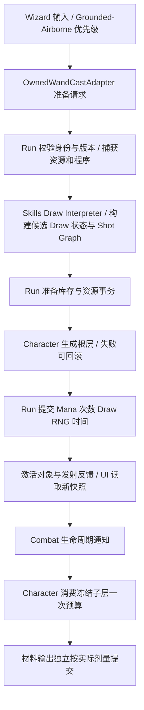

# Norn Noita 式硬核法术编程 V2 Implementation Plan

> **For agentic workers:** 本计划已按用户后续“你直接做完”授权连续实施T1—T10基线，不再因人工Gate停工；人工Gate未测部分仍不得写成通过。使用`superpowers:executing-plans`，本任务不派SubAgent、不建worktree、不自动commit。以下验收清单保留原设计和未验证边界，不能全部机械勾选。

**Goal:** 保留 Noita 式连续抽牌、Shot Scope、Wrapping、Trigger 的组合深度，在据点专用法术研究台公开执行结构、单步推演和回放；背包保持简洁编辑，让玩家把精力投入构筑与世界实验。

**Architecture:** 在 `Game.Skills` 增加可测试的有状态 Draw Interpreter，将一次操作构建成冻结的 Shot Graph、因果记录和待提交状态；`Game.Run` 持有每根法杖的执行状态、资源事务及已提交记录；`Game.Character` 按法杖时钟发射并报告未来事件；`Game.UI` 将同一份数据投影为源卡序、执行结构、牌堆步骤和周期视图。跨模块写命令继续通过 `Game.Core` EventBus。

**Tech Stack:** Unity 6.3 `6000.3.16f1`、URP 17.3.0、C#、Input System、UGUI、现有 Combat/Run/ElementField。

**Spec:** 设计与实现合并在本文件。第 1—7 节定义玩法和技术契约，第 8—10 节定义实施与验收；按仓库要求不另外创建 spec。

**状态：2026-10-18 T1—T10基线已实现并接入正式Hub，正在归档最终验证。** 连续Draw/Scope/Wrap/Trigger、根预付、双时间、Shuffle、动态Copy、寿命/终止触发、AlwaysCast/32槽、真实库存研究台和跨Scene回放均已有实现。正式Hub原629个RectTransform保持、Scene GUID保持；背包保留原布局，仅更新V2预览绑定。人工玩法理解/手感验收和Standalone未做，512弹集中生成仍有明显性能尖峰。Condition、SelfWet分支、CarryParent和固定槽Copy未选择，不纳入基线。最终证据见`docs/superpowers/evidence/2026-10-18-spell-v2-final/`及同阶段开发解析；早期各节的“尚未实施/等待Gate”是历史设计边界，以本段最新用户授权与真实证据为准。

## Global Constraints

- 采用当前工程技术栈、Input System、`CharacterController` 与现有 Assembly 方向；不为此引入 Lua、外部运行依赖或新 Assembly。
- 一份中文总计划；正式实现按阶段交付；每个 Task 更新同一份中文学习文档。
- 不改动 SpellKind 已发布的数值 0—3；新增枚举只能追加。现有法术和 Prefab GUID 保留，不删除重建脚本或手工生成 `.meta`。
- Gameplay 写入由权威服务完成；UI 不推进真实牌堆、Random 或资源。`Game.Combat` 不引用 Skills/Run/Character。
- 保留一个权威的安装卡序；图、步骤和时间视图都是解释器结果的投影。基础版不引入独立可编辑的 Node Graph，不让 UI 连线改变抽牌规则。
- 每项影响结果的规则都必须有玩家可访问的说明、来源和状态；UI 可折叠复杂信息，但不能通过隐藏作用域、跳过原因或付费路径制造难度。
- 完整工作台独立于背包 Canvas/布局，仅在 `HubReady` 且玩家位于指定研究区域时开放。背包不新增 Scope 图、步骤条或研究台按钮，不改变现有快捷键、三杖展示、拖拽、外框和作者装饰；V2 必要的数据接线与视觉改版分开审阅。
- Unity `Update`、输入空转、资源计时与 UI 热更新不增加每帧 `new`、LINQ、闭包或 Boxing；离散构建可分配但需复用 Buffer 并测量。
- 保留现有实例归属、出局资格、耗尽移除、材料数量守恒和撤离结算规则；本文只对明确列出的施法语义作调整。永久知识解锁不是本次新增卡牌的自动奖励。
- 现有 Warrior、Archer、普通远程敌人、Mage 和 Boss 的已完成能力均保留。旧作者程序不会因为全局默认切换而悄悄换语义。
- 使用独立 Sandbox；正式 Scene、手工布局、外观资源和旧存档先备份，再通过可审阅、可回滚的迁移工具接入。
- 本任务不使用 SubAgent；不自动 commit、push 或修改全局工具配置。

## Review Focus

1. **连续点击、切杖和暂停：** 不重复扣费、不重置牌堆骗取首发、不积压恢复后的连发；绑定 T6/T9 测试。
2. **最后一次卡被移除：** 已冻结的未来 Trigger 继续合法运行，下一发牌堆剔除消失实例，不能意外全杖重置；绑定 T4/T5 测试。
3. **编辑时已有投射物在飞：** 新程序不能改变旧 Graph，旧票据不能推进新程序的牌堆；绑定 T4/T7 测试。
4. **多层、复制和负 Mana：** 逐指令资源语义、复制目标与技术上限可预测；超限整次回滚，不静默裁剪；绑定 T2/T3/T8 测试。
5. **存档与材料：** 旧随机法杖、PendingRaid、世界拾取和混合材料数量不能在新字段传播中丢失或复制；绑定 T5/T9/T10 测试。
6. **看懂与信任：** 玩家能区分安装顺序、实际抽牌顺序、Scope 最终结算与未来事件；真实回放和假设预览不混淆，同源输入下解释和实际结果一致；绑定 T0/T3/T7 测试。
7. **据点专属与界面隔离：** 区外、Raid、过渡阶段及伪造成功事件都不能打开研究台；关闭研究台只释放自己的 Pause reason；背包样式/快速编辑、商店和仓库保持。副本记录回据点仍可读；绑定 T4/T5/T7 测试。

## 1. 玩家最终应当玩到什么

### 1.1 深度来自可以推演的程序规则

玩家能够配出：第一下普通弹、第二下另一种弹、第三下利用 Wrapping 接回强化弹的循环；把增伤留在父弹或移进 Trigger 子层；用 Multicast 建立多个输出，并用子作用域区分各组行为；用负 Mana 和施法延迟权衡持续输出。后续先加入已核对规则的 Copy，再审议条件与 Norn 扩展。

透明工作台直接展示：这一次读了哪几张卡、各归属哪个 Scope、为什么已有弹也得到后置增伤、子弹何时构建和释放、下一次从哪里开始。玩家仍要研究伤害、稳定性、Mana、射速、材料和地形之间的取舍；不要求先反复失败才能发现 Draw 的定义。公开规则会减少一部分“发现隐藏规则”的乐趣，这是本案主动接受的取舍。

这里不推断 Noita 开发者是否刻意用简洁 UI 迫使玩家研究源码；上轮验证的是脚本和行为探针，没有完整审计其全部 UI 与开发者意图。我们借鉴规则，并明确选择更充分的执行解释。

本案选择 **Noita 的核心语义 + Norn 的纯 C# 规则层和资源事务**。Lua 和 Native 的具体实现方式不需要一起照搬。上轮尚未恢复的 Noita 最低帧数、全部传播字段等，不冒称为已经精确复刻；下文将其明确规定为 Norn 自己的规则。

### 1.2 三条路线的取舍

| 路线 | 能得到什么 | 主要代价 | 决定 |
|---|---|---|---|
| 在现有单遍 Evaluator 上继续加 Modifier | 内容增加快 | 缺少跨次状态、Scope 和控制流，组合深度仍受限 | 不作为主路线 |
| 按 Noita Lua 逐行移植为共享可变 Runtime | 初始外观最相近 | 与现有冻结、库存事务、预览和测试难以一致 | 不采用 |
| 新建 Draw Interpreter，输出冻结 Graph 和候选状态 | 核心玩法可对齐，保留可测与回滚边界 | 需要贯通 Run、Character、UI 和存档 | 采用 |

### 1.3 可直接试玩的目标组合

以下 F 为普通发射，D 为强化，M2 为双重，T 为 Trigger，C 为复制卡。名称表示语义，不代表已经创建资产。

| 程序 | 玩家应观察到什么 |
|---|---|
| `[F火, F冰]` | 第一次火，第二次冰，完成一轮后重新装填 |
| `[F火, D]` | 第一发火；下一发尾部 D 经 Wrapping 接回先前火弹 |
| `[M2, F, D, F]` | 两个输出属于同一组，按该组最终强化处理 |
| `[D, T, F]` / `[T, D, F]` | 强化父层与强化子层的明确区别 |
| `[M2, T, M2, F, F, F]` | Trigger 内两发，外层另一发，结构可见 |
| `[AddMana, ReduceDelay, M2, F, F]` | Mana 持续性、单发速度和 Reload 形成可研究的取舍 |
| `[Gamma式Copy, F]` | 从当时 deck 末尾借用行为，后续正常抽到 F 时再走普通付费路径；界面显示实际借用目标 |

自身 Wet/Burning 分支、CarryParent 和固定安装槽寻址 Copy 保留为后续候选，不作为基础版的验收前提。先验证玩家能看懂和玩深已有规则，再决定新增语言能力。

### 1.4 上一版与 Noita 的差异，以及本轮处理

“Noita 式”不等于“完全相同”。以下区分来自本地原版 Lua 的确认、Norn 的工程适配和上一版的主动发明：

| 项目 | 已确认的 Noita 行为 / 证据边界 | 上一版 Norn 方案 | 本轮决定 |
|---|---|---|---|
| 核心组合规则 | 跨次 deck/hand/discard、嵌套 Draw、discard Wrapping、同 Scope 最终配置、独立 Trigger 子层 | 将这些规则接入冻结结果和资源事务 | 保留，成为工作台的首批可解释对象 |
| Copy 寻址 | Alpha 从当时 discard 首项→hand 首项→deck 首项查找；Gamma 取当时 deck 末项，否则 hand 末项 | First/Last/Next 按原始安装槽寻址 | 基线改为已核对的动态集合寻址；原固定槽方案暂缓，不能再称等价 Alpha/Gamma |
| 条件结构 | `IF_HP` 比较 HP 比例与 0.25，并扫描当时 deck；原脚本遇另一 IF 有特殊限制 | 先编译原槽位嵌套成员，再删除未选分支；另加 SelfWet/Burning | 属于 Norn 重新设计，移为候选扩展；不宣称复刻原条件执行器 |
| 父子传参 | 已核对的 Trigger 默认不自动继承父修正 | 新增 CarryParent 显式传参 | Norn 新玩法，暂缓；基础版只展示独立 Scope |
| 数值、时钟与寿命 | 部分 Native 最低帧、全部字段传播及生命周期边界尚未恢复 | 既有伤害公式、0.05s 下限、明确 max/clamp、寿命至少一步 | 保留为明确的 Norn 适配，提供可查看的公式与来源，不声称数值完全相同 |
| 物品与材料 | 原脚本可见有限次数和复制入口；不能据此推导 Norn 的库存、资格和供料规则 | 保留归属、本局资格、耗尽移除、真实材料守恒 | 保留 Norn 经济规则并单独显示；Copy 不能复活已移除实例或复制材料库存 |
| UI 与随机信息 | 没有完整恢复 Noita UI，也不能以源码证明其设计意图 | 基础预览、Scope 高亮和周期概览 | 本轮主要创新：同步执行图、逐步推演、参数溯源与真实记录；公开已确定的 Shuffle 顺序 |

基线 Copy 的递归规则以原 `check_recursion` 和脚本探针为对照，不沿用上一版随意设为 4 层的玩法默认。1024 步等技术预算仍独立存在，不能与 Copy 的语义递归计数混为一谈。

## 2. 当前证据与本次必须解决的限制

### 2.1 已有基础

静态核对基于工作区现状，Git HEAD `fd4aec38386ea8773ca25f5a241b16860b7bafa5`；工作区另有大量未提交工作，不以 HEAD 代替实际文件。Noita 研究包含 28 组 Lua 场景、60 条断言；这些证据用于规则讨论，不代替 Norn 测试。

| 当前入口 | 已确认行为 | V2 的接入点 |
|---|---|---|
| `Skills/CastEvaluator.cs` | 每次从 i=0 扫描；预算耗尽后仍能读后置 Multicast；逐 Emit Bake | 新解释器替代 Owned 模式读取语义 |
| `Skills/CastExecutionPlan.cs` | 已冻结完整未来层，存在深度/产出边界 | 延续冻结思路，改为 Scope Graph 与实例执行记录 |
| `Run/Wands/WandRuntimeState.cs` | 每杖 Mana 与固定 Cooldown | 增加 Draw 状态、两种时间及执行版本 |
| `Run/Spells/CastResourceService.cs` | 根预留全树次数，子层到触发时支付 Mana | 根阶段提交实际选中分支的 Mana、次数和 Draw 状态 |
| `Character/PlayerStates/PlayerWizardAttackState.cs` | 等 Animator 出手进度才调用一次发射 | Owned 路径改由法杖时钟发射，动画消费结果 |
| `UI/Inventory/WandProgramPanelView.cs` 等 | 仍使用旧 Evaluator 做预览 | 接入同一 V2 规则的只读模拟 |
| `Run/Hub/HubInteractionController.cs` + `HubAreaVolume.cs` | 商店/仓库按实际Box区域和HubReady授权；F交互走Core事件 | 新增同类研究站点；完整UI另开Canvas，不能靠背包全局按钮绕过范围 |
| `UI/Hub/HubNavigationView.cs` | 提示使用站点数值推算索引；面板覆盖仅识别背包/商店 | 新站点需要显式提示映射与研究面板覆盖识别，避免显示成旧实验区 |
| `Run/Core/RunPauseReason.cs` | `byte` Flags 已占满8位 | 新研究台独立Reason须先扩为ushort并保留旧位值，不能让第9位溢出为0 |
| `Run/Persistence/ProfileSaveMapper.cs` | 当前 Schema=13；保存五项随机法杖属性 | 增加 V2 固定属性及 Schema14 迁移 |
| `Run/Inventory/ItemOwnershipStore.cs` | 最后一次产出卡在提交候选时移除 | 下次 Draw 状态按实例过滤，不能当作普通编辑重置 |

### 2.2 为什么不能只替换一个 switch

如果仅修改 Evaluator：预览仍可能展示旧结果；根阶段仍按“整层总 Mana”拒绝，无法实现跳过昂贵卡；Trigger 子层仍会二次支付；卡耗尽后程序 Revision 更新又可能重置整个循环；快杖仍被 Animator 出手帧限制。

因此本案同时规定输入、纯规则、资源提交、未来执行和 UI。每次改规则都必须验证玩家完整路径，不能用“纯逻辑单测通过”宣称整套玩法已经交付。

## 3. V2 正式玩法规则

本节为待确认的具体方案。没有注明继承的数值均为本案初始建议。

### R01：每根法杖保存独立执行状态

保存 `deck`、本次 `hand`、`discard`、CycleIndex、CycleReloadDelta、RandomState、ExecutionRevision 与 ProgramRevision。列表存稳定卡实例对应的编译索引，不复制物品实体。解释候选可以暂时移动索引，只有根事务成功提交后才能替换真实状态。

切换选中杖不重置牌堆；携带中的非选中杖继续按现有携带规则恢复 Mana 与递减时间。场景往返使用同一 Session 状态；显式结束一次局/练习才按生命周期重置。丢弃再捡起同实例在同 Session 内保留资源与执行状态，不能回满。销毁实例后清理无主状态，不把“暂时未携带”当作销毁。

### R02：Draw 按调用结构执行

Root 请求 BaseDraws 次；普通 Emit 消费一次有效 Draw；Modifier 修改当前 Scope 并继续请求一次；Multicast 自身占用当前 Draw，再请求 `1 + ExtraDraws` 次。

保持旧资产的 ExtraDraws 语义：现有 Double=1、Triple=2 的配置不重解释为 1/2 发。`[M2,M2,F,F,F]` 对应三条输出。

Root Draw 结束就停止本次读取；后面的 Multicast 留给下一次，不通过扫描尾部重新开启已经结束的本次 Root。空槽跳过，不消费 Mana，不成为卡实例。

### R03：Wrapping 只回收 discard

Root Draw 不因遇到牌堆末尾而直接跨轮继续读取。Modifier、Multicast、Trigger 子 Draw 允许在空 deck 时回收 discard，并记下本次结束时需要 Reload。

当前 hand 不回收。没有可回收内容时结束这条 Draw 请求，不能凭空补齐输出。非 Shuffle 按原槽位排序；Shuffle 按本杖确定性 RNG 重排。预览不推进真实 RNG。

Root 收尾先把 hand 中仍合法的实例转入 discard；deck 已空或本次发生过 Wrapping 时，再将 discard 并回剩余 deck、统一排序/重排并进入 Reload。因此“下一轮牌堆已准备”与“等待尚未结束”可以同时成立。上述移动、次数耗尽过滤和 Cycle 更新均属于同一候选，成功提交才写真实状态；界面需显示中间推演步骤及最终等待状态。

### R04：Scope 完成后统一 Bake

一个 Scope 内先收集未烘焙的输出和 Modifier 操作，结束时统一生成该组的最终 EmitCommand。组内的先后输出都读取该组最终修正；控制流和 Mana 支付仍按执行顺序发生。

保留现有伤害通道、速度、Homing、Orbit 等数值公式，复用或抽出已有 Bake 规则。本次改变作用域和 Bake 时机，不同时无声改写所有伤害倍率。Homing/Orbit 的互斥覆盖顺序继续可追踪，不能因为 Scope 改动变成两个组件同时争夺速度。

### R05：Trigger 创建独立子 Scope

Trigger 在本次根构建中继续 Draw 指定数量，形成冻结子 Graph；子层从默认 Modifier 状态开始，不自动继承父增伤、速度、Spread 或运动模式。父子共享本次牌堆、Mana 和执行记录，但各自具有 Scope 配置。

子层不再在命中时重新解释卡序，也不从 SO 重新取值。当前 OnImpact、AfterDelay 保留其已发布事件条件，新增终止触发另见 R15。空子层退化为无 Payload 的普通产出，并在 Trace 中解释原因。

### R06：资源在构建时逐指令处理

正 Mana 成本不足：跳过该卡并继续在当前 deck 中寻找可执行内容；不支付该失败指令，不把整条程序预先判为失败。次数不足、缺少本局资格的卡也记录跳过原因；所有权/非法数据/过期请求则拒绝整个请求。

V2 允许受校验的有限负 ManaCost，支付结果钳制到 `[0, MaxMana]`，因此 AddMana 可用现有 Modify 类表达。拒绝 NaN、Infinity、非法枚举。旧 Legacy Evaluator 的非负钳制语义不变，新负成本卡仅进入 V2 内容集合。

父子普通动作的 Mana 与有限次数都在根提交时一次结算；未来 Trigger 不再支付同一批 Mana/次数。普通 Modifier/Multicast 继续采用现有本局资格规则；基线 Copy 也归入该资格类别，后续若启用 Condition/Carry 再扩展相同分类。安装与入局时统一处理，永久知识、具体实例和执行资源继续分开。

### R07：零输出的合法推进不等于 SpawnFailure

全是昂贵卡、控制指令或不能补满的 Draw，可能得到 0 条输出但仍合法推进了牌堆并支付了成功控制指令。结果类型区分 `Emitted`、`AdvancedWithoutEmission`、`Rejected`。

前两者可以提交合法状态与时间；Rejected 完全不提交。空法杖为 EmptyProgram，不持续生成失败票据。技术上限越界为 TooComplex，整次拒绝并保留原状态，不能静默截取前 64 发伪装成功。

### R08：分离 Cast Delay 和 Reload

新增固定属性 BaseCastDelay、BaseReloadTime、BaseSpreadDegrees、Shuffle，并保留 MaxMana、Regen、Capacity、BaseDraws。每 Scope 可累积 CastDelayDelta；根构建共享本轮 ReloadDelta。

建议初始规则：

```text
castInterval = max(0.05 s, BaseCastDelay + RootScope.CastDelayDelta)
reloadInterval = max(0.05 s, BaseReloadTime + 本轮累计 ReloadDelta)
非轮末：ReadyRemaining = castInterval
轮末或发生 Wrapping：ReadyRemaining = max(castInterval, reloadInterval)
```

两种剩余时间从根提交时同时递减。子层 CastDelay 不阻塞父下一发，子层对共享 Reload 的修改参与该轮周转。以上具体 max/clamp 是 Norn 的明确设计，并非声称已恢复 Noita 的全部 Native 时间公式。

CycleReloadDelta 跨这一轮的多次 Root 保留，每次候选从 before 状态继承并累加；在成功提交 Reload 请求、进入下一轮时清为0。发生多次回收也只在该 Root 收尾提交一次 Reload/Cycle 推进，不能每遇到空 deck 就立即清掉前序时间贡献。

旧 CastCooldown 迁移为 BaseCastDelay，旧 Reload 默认同值，避免突然加倍旧杖等待。新掉落初始建议：CastDelay 0.05—0.25s、Reload 0.2—1.2s；Mana 80—240、Regen 8—30/s 沿用现有范围。后续据实测调整，不把测试建议值冒充最终平衡。

### R09：Shuffle 改变排列，UI 公开已确定的结果

确定性 RNG 由会话种子和稳定实例身份生成，禁止 `string.GetHashCode()` 作为跨运行种子。每轮保存 RNG 状态与 CycleIndex；普通 UI 查看不消耗 RNG，取消或失败根请求也不消耗。

本案选择向玩家展示基于当前状态已经确定的 Shuffle 顺序；预览使用 RNG 副本，也可以解释后续回收时的确定性重排。反复打开界面不会换种子。随机杖的组合挑战来自排列改变后的构筑可靠性，而不强制保留“这一发抽到什么”的未知。这会改变 Shuffle 的体验，需要在 Gate3 单独试玩；若后续希望遮蔽未来顺序，必须另行作为玩法选择审议，不能偷偷让预览失真。

当前容量上限 16 在基础阶段保留；最终内容阶段扩展到 32，UI 使用可滚动程序轨道，法杖的背包物理占格不因程序容量改变。Always Cast 是固定法杖特性，与普通槽位实例分离，不消耗普通容量，不通过 UI 凭空产生物品。

### R10：编辑、耗尽和切场景分别处理

手动编辑产生新 ProgramRevision，重建 deck，并施加 `max(当前剩余等待, BaseReloadTime)` 的重编程等待；Mana 不回满、RNG 不重新抽种子。仅切换选中杖不产生该重建。

有限卡耗尽移除是本次事务的结果：按稳定实例 ID 过滤本次下一状态中的引用，保持剩余卡的执行进度，不按手动编辑重置整杖。旧飞行 Graph 只持有冻结结果，不因该卡消失取消。

跨 Scene 的 Session 保留当前杖状态；存档载入或明确开始新 Run 才按其生命周期初始化。当前游戏不把飞行对象恢复为可续执行存档；不新增局中 Save 入口来重置程序或逃避结算。

### R11：Owned 发射时钟与动画分开

Owned 法杖由输入意图和 ReadyRemaining 批准发射；动画收到成功发射后提供反馈，不再以 normalizedTime 阻挡每一发。单击保留按下瞬间瞄准；持续按住时每次被批准的一发采样当前瞄准，不无限排队。

仍通过 Grounded/Airborne 的共享攻击接缝处理 Dash 优先级。Owned 释放不强制切入旧攻击 State，接缝返回值继续表达“是否切换 FSM”，不能把成功发射误当作状态切换。保留边走边施、空中重力、跳跃与暂停 Guard。Legacy/Boss/Warrior/Archer 的动画和控制路径不借此删除。

Owned施法不独占移动FSM，同帧合法Jump可以与发射同时发生；Dash已取得更高优先级时延迟该次施法。这个选择是面向Noita式移动施法的手感调整，必须实际回归地面和空中输入，不能通过错误的接缝返回值偶然实现。

每个角色每帧最多批准一个根请求；卡顿后不补发过去所有错过的根操作。0.05s 是初始技术与手感下限，50ms 内的多发由 Multicast/Trigger 组织。

### R12：据点研究台中的预览、推演和真实回放有明确身份

本条的完整玩家界面只在第6.10节规定的据点研究区域打开；副本中不提供完整Trace/Scope界面。后台解释和有界记录照常工作，背包只保留现有简洁编辑及必要数值。开发用Review Window不作为正式玩家入口。

提供三种互不混淆的入口：“当前状态的下一发预测”“从头运行的假设模拟”“最近一次真实执行”。前两者使用同一解释器及状态副本，后者读取当次冻结记录，不重新解释当前卡序。只读按钮称“推演一步”，实际操作称“施放/试射”，不能把二者做成含义不明的同一个播放按钮。

下一发预测包含输入身份、ProgramRevision、ExecutionRevision、资源版本、条件快照及仿真时刻。世界或资源输入变化后先标记过期，再刷新；再次真实施放仍由 Run 重新采样和校验。逐步推演只推进显示游标，不推进真实 RNG、牌堆、Mana、次数、计时或材料。

周期模拟逐根应用候选状态，并按 R08 的理论 Ready 时间推进同一 Mana 恢复规则；图上明确假设“持续按住、按可发射时刻继续、无外界状态变化”。真实发射另受帧调度、输入和世界影响，不能将理论每秒伤害标作保证伤害。编辑前后对比必须说明两侧起点；新程序按 R10 重建牌堆并增加重编程等待，不能把重置收益伪装成只改一张卡的收益。

未来世界条件明确标注按当前快照估计，不预知敌人位置、碰撞结果、实际材料供应或外部随机输入。已知条件可以显示选中分支，未知条件显示候选分支和输入来源。Trigger 子结构的“已构建”不等于“已释放”；实际事件决定是否释放已冻结 Payload。

每次预览最多模拟 32 个根步骤和 1024 个总输出，截断处显示“继续循环/预览已到界”，不裁剪真实施法。当前正常根结果在 128 输出上限内可折叠展示，但必须能展开到每个输出和参数来源。详细 UI 见第 6 节。

### R13：基线 Copy 对齐已核对的动态集合寻址

基线先实现 Alpha 式和 Gamma 式两类借用。Alpha 按调用时的 `discard[0] → hand[0] → deck[0]` 顺序选择第一个存在项；Gamma 取调用时 deck 的最后一项，deck 为空时取 hand 最后一项。这里 C# 下标从 0 起，与 Lua 从 1 起的表示不同，集合优先级相同。Copy 自身已普通 Draw 到 hand 后，再解析目标；不能自动排除自身或将“当前集合”替换为“原始卡槽”。

支付 Copy 自身成本，直接调用借用目标的行为，不重复支付目标普通 Mana/有限次数，也不自动从 deck 移走目标。被借用的 Modifier/Multicast 引起继续 Draw 时，实际新抽到的卡仍普通付费。递归目标是否增加计数、何时拒绝，以原 `check_recursion`、其 `recursion_limit=2` 和固定输入探针为 golden 对照；普通 Trigger 深度不套用这个常量。

每次借用记录“Copy 卡 → 目标实例 → 目标所在集合与当时位置 → 产生的行为”；被借用卡不会在 UI 中伪装成普通离开牌堆。复制 Modifier/Multicast 使用统一执行入口，继续计入步骤和输出预算。还未实现的候选条件/Carry 不进入基线内容目录，不能用未知 Opcode 代替真实行为。

这是一项明确的玩法选择：强力有限卡可成为程序模板。现有耗尽移除仍保留，Copy 不复活已经消失的实例；只有构建时合法存在的目标可借用。复制不能生成物品、重新授予资格或扩张材料库存。每个实际材料输出仍获得独立真实剂量，剂量不足按现有 Partial/Empty 处理。

“借用目标行为”免去的是目标普通Mana/次数支付，不免除目标的合法归属和必要资格检查；当前实例在本局无资格时也不能通过Copy绕过。

上一版固定安装槽的 First/Last/Next/NextTwo 和 2/3 次重复不进入基础版。将来若需要这类更易寻址的卡，应单独命名和说明，与 Alpha/Gamma 式动态目标并存，避免同名不同义。全部有限卡的特殊用尽行为也不能凭“直接调用 action”就宣称完全复刻；Norn 的实例移除与资格规则仍是公开差异。

### R14：条件结构为后续候选扩展，非基础版承诺

以下保留上一版 Norn 方案供后续取舍，不是原 Noita 条件执行器的复刻。只有工作台和基线组合通过 Gate3 后，才决定是否实现；若追求原条件规则，应另补当前 deck 扫描的原版对照用例，而不能把下述编译成员表称作相同行为。

追加 `If / Else / EndIf` 指令类型，支持 HP 比例、当前 Mana 比例、施法者 Wet/Burning。阈值使用 `<=`，0.25 的边界明确测试。

世界状态在根准备时采样一次，通过纯数值 Snapshot 输入；子层在同次构建中使用该 Snapshot。HP/Wet/Burning 由 Character 对已有 HealthComponent/StatusController 的只读 API 获取，Skills 不访问 Scene。Mana 条件读取解释时的本次候选 Mana，可受前置 AddMana 影响。

运行时条件读取使用Core的同步查询事件：`SpellConditionQueryRequestedEvent` 携带InventoryId、ActorId、RequestId，`SpellConditionQueryResultEvent` 返回对应身份、Available、HpRatio、SelfWet、SelfBurning。Character的SnapshotBuilder在OnEnable/OnDisable订阅/解绑并预缓存本角色组件；Run根准备与UI只读预览通过同一查询得到输入，UI不引用Character。无对应提供者时，含世界条件的真实程序明确返回ConditionUnavailable；Review Window可使用标明“模拟”的显式输入。只在实际构建/打开或重算预览时查询，不逐帧找Scene对象。

完整编译匹配嵌套括号，最大 8 层，孤立 ELSE/END 或缺 END 在编辑器中定位到槽位并阻止编译。编译结果保存每个 IF 的真/假分支原始槽位成员表，运行时从当前 deck 移出未选分支尚未抽取的成员和该 IF 自身的 ELSE/END 标记，再继续 Draw；这些跳过的卡进入 discard，不扣 Mana/次数。ELSE/END 单独被抽到时仅继续 Draw，不重新选择分支。

这项规则同时定义 Shuffle/Wrapping：IF 只影响它运行时仍在 deck 的成员，不能撤回之前已经发出的弹，也不强行把 Shuffle 后的卡重新排成文本顺序。Wrap 后再次碰到 IF 会按当次 Snapshot/候选资源再选择。嵌套关系来自原始程序的匹配结果，不能对打乱后的临时列表做无条件的静态PC跳转。预览必须显示实际抽到的顺序和被移出的成员，帮助玩家识别随机杖对条件程序可靠性的影响。

### R15：消亡触发与寿命编程

追加 `PayloadTriggerMode.OnTermination`，只响应正常命中结束和寿命耗尽。场景卸载、事务回滚、角色停用或显式 Cancel 不触发攻击。Impact/Timer/Termination 对同一独占 Payload 最多释放一次。

Combat 增加不含 Skills 数据的通用终止原因与位置/方向通知；不能把现有 `Finished` 直接当作“死亡时必定放 Payload”，因为它也用于取消和销毁清理。

寿命修正可以增加/减少最终 Lifetime；下限为一次游戏 Simulation 步长，避免“0 秒”依赖 Destroy 的偶然回调顺序。Skyfall 的飞行寿命从真实 Projectile 激活开始计时，不从预警建立时开始。

### R16：CarryParent 是暂缓的 Norn 扩展

本条属于上一版主动新增的语言能力；本轮不作为基础玩法交付和 Gate3 的前提。先让玩家用独立父子 Scope 完成构筑，后续再评估显式传参是否增加值得付出的复杂度。

新 `CarryParent` 指令使玩家选择将父 Scope 的哪些最终修正传入当前子 Scope。初始 Mask 支持伤害、速度、Spread、运动，默认只包含伤害/速度；根层使用时是明确的无父上下文诊断，不修改全局。

Carry按普通Modifier的继续读取规则，在登记传参要求后请求一次Draw；根层没有父Scope时作为无修正操作记录诊断，但仍继续Draw并支付自己的合法成本。因此 `[T,CarryParent,M2,F,F]` 确实能把后面的双重纳入同一子层，而不是在Carry处停止。

保存父 Scope ID 与 Mask，在整图建立后按父子顺序 Finalize，从父最终配置获得参数，再合并子层自己的操作。只允许指向祖先，不允许反向依赖，图保持无环。它不会复制父 Mana、次数、CastDelay 或 Reload。

这样玩家能选择“父弹强化”“子弹强化”“用一张传参卡复用父强化”，Scope 本身成为编程素材，而不是代码中固定的继承开关。

### R17：技术边界保持明确

初始建议：每根 Root 最多 1024 个指令步骤、128 个输出，Scope/Trigger 深度 16；基线 Copy 的语义递归按 R13 原版对照。候选嵌套条件若获采用，分支深度为 8。步骤、栈和输出预算属于技术安全边界，与 Copy 的行为规则分开命名和测试。

同一世界初始最多 512 个受管理的活跃法术实体，包含 Projectile、StaticProjectile 和等待出生的 Skyfall 预约；Character 的统一生成预算负责预留、移交与归还，Combat 不反向引用服务。生成前检查整层所需余量，不能只生成一半又提交整笔成本。未来层因世界预算不足而不能释放时，消耗该层执行机会、结束其子树，并提供诊断；已经预付的法术资源不退款，未扣材料不凭空损失。附带VFX和粒子的成本另用Profiler实测，不能把实体数量上限当作全部Rendering预算。

这些是控制 CPU、Physics 和内存的技术上限，不用来删掉正常可推演的 Wrap/Copy 规则。最终数值必须通过高负载场景验证。

## 4. 关键数据结构与责任

### 4.1 Runtime 调用链



### 4.2 新结构的具体含义

| 结构 | 持有者/Assembly | 内容与读写边界 |
|---|---|---|
| `SpellProgram` | Skills，Run 持有冻结版本 | 已编译指令、实例 ID 映射、分支匹配/成员表、Definition 值快照；不读取场景 |
| `WandDrawSnapshot` | Skills 数据，Run 持有真实版本 | Deck/Discard 的只读索引数组、CycleIndex、CycleReloadDelta、RNG、ExecutionRevision；提交时整体替换 |
| `SpellExecutionInputs` | Character/Run 捕获后传入 Skills | 当前 Mana/Max、HP、Wet/Burning、实例次数与资格；没有 Collider/Transform 可写引用 |
| `ShotScopeBuffer` | Skills 一次候选构建 | Modifier 操作、输出草稿、父 Scope 与传参 Mask；Finalize 后不外泄可变引用 |
| `ShotExecutionGraph` | Skills 冻结输出，Run 票据持有 | 分层 EmitCommand、每输出的子层 ID、源实例与实际执行记录 |
| `SpellExecutionTrace` | Skills 构建，Run 只读保存 | 有界步骤、Draw 调用/返回、集合变化、Scope 开闭、资源与参数来源；按版本冻结 |
| `SpellParameterProvenance` | Skills 结果的一部分 | 基础值、贡献操作、覆盖顺序、最终值、贡献实例 ID；UI 不重算游戏公式 |
| `SpellBuildBuffer` | 每杖/服务复用 | 指令栈、候选索引和 Scope 工作区；失败清 Count，不污染真实状态 |
| `SpellBuildSummary` | Skills 值快照 | Outcome、ManaAfter、时间变化、是否轮末、步骤数及失败槽位 |
| `CastResourceReservation` | Run | 一个根候选及提交状态、冻结 Graph、每未来层的独占尝试位与材料配置 |
| `WandProgramReadModel` | Run 只读接口，UI 消费 | 程序/资源/条件输入版本、预测身份、下一卡、循环、计时、Scope 和失败信息；UI 无写接口 |
| `WandExecutionReplay` | Run 拥有，UI 只读 | 最近一次真实根执行的冻结输入/结果/Trace，以及后续层已释放/取消/未触发的观察记录 |

执行记录必须区分 `InvocationMode = Draw / BorrowedCopy / Intrinsic`、`ExecutionOwnerCardId`（谁承担本次指令成本）、`BehaviorSourceCardId`（借用谁的行为）与 `MaterialAttachmentSourceCardId`（从哪张定义的附着配置供料）。普通Draw时这些来源通常一致；Copy时不能把输出序号误当目标槽位，也不能因此同时扣掉目标次数。每个输出另有独立Material OutputId。

单个 Trace 步骤至少包含 StepId、ParentDrawRequestId、ScopeId、SourceCardInstanceId、InvocationMode、操作类别、来源/目标集合、候选 Mana 前后值、次数差分、跳过原因和对应输出 ID。Scope Close 后记录最终参数来源；普通发射、Copy 借用和未来释放具有不同身份。初始集合保存一次，后续保存移动差分，UI 单步时复用工作区还原，避免每步复制整副牌堆。

详细步骤采用有界可复用 Buffer；初始预算 16384 个 Trace 事件，属于展示记录预算，不能改变 1024 指令步骤的游戏结果。达到记录边界时保留完整结果、资源摘要和参数来源，标记“详细记录不完整”，禁止把缺失步骤拼成完整解释；Gate1 的全部正常范例必须有完整记录。研究台只在据点可用，因此Session诊断归档共享保留最近3次Root及其有界未来层状态；按法杖查找最近仍保留的记录，被淘汰时明确提示，不无界积累整个Run。

归档属于 `SinglePlayerInventorySession` 的只读诊断数据，不归属会在 `AdoptCommitted` 时重建的 Wand/Cast 服务。结算前移交冻结记录和取消/未触发状态，资源服务重建后研究台仍能读取上局记录；不得把历史 Mana、牌堆或票据恢复进当前权威状态。初版不写Profile存档，退出应用后不保证保留；丢失或耗尽的旧实例仅供历史查看，不能借此恢复物品。诊断淘汰不影响仍在运行的Gameplay票据和冻结Graph。

Character 通过 Core 的 `SpellExecutionObservedEvent` 报告 TicketId/LayerId/OutputId、执行阶段、通用原因码和 Simulation 时间；事件不包含 Skills 对象、UI View 或可写库存引用。Run 更新对应 Replay，UI 经只读接口消费。未来事件只更新“实际发生了什么”，不重新计算旧程序；编辑或耗尽后仍可从当次冻结来源看见历史卡片。

这些类型均为拟新增或拟扩展，名称是本计划锁定的接口，不暗示当前已存在。

### 4.3 拟定接口

```csharp
// Game.Skills：编译/解释与预览不实例化 Unity 对象。
bool SpellProgramCompiler.TryCompile(
    IReadOnlyList<SpellDefinition> definitions,
    in SpellProgramCompileInputs inputs,
    out SpellProgram program, out SpellProgramDiagnostic diagnostic);

bool SpellProgramMachine.TryBuild(
    SpellProgram program, WandDrawSnapshot before,
    in SpellExecutionInputs inputs, SpellBuildBuffer buffer,
    out SpellBuildSummary summary);

bool SpellProgramPreview.TrySimulate(
    SpellProgram program, WandDrawSnapshot before,
    in SpellExecutionInputs inputs, in SpellPreviewOptions options,
    SpellPreviewBuffer output);

// Game.Run：只读，不允许 UI 直接提交候选。
bool IWandLoadoutReadOnly.TryGetExecution(
    string wandId, out WandExecutionReadSnapshot state);

bool IWandLoadoutReadOnly.TryGetLastExecution(
    string wandId, out WandExecutionReplay replay);
```

接口所属类的方法使用 `public static` 或实例方法的选择：Compiler/Preview 为 static 纯辅助；Machine 为一次服务持有的实例，接收外部 Buffer，内部不持有 Scene 状态。返回 bool 只表示成功生成可说明的结果；Outcome 区分真正发射、无输出推进与拒绝。所有 `out` 失败分支都赋值。

Trace 与结果由同一次 Machine 构建产生。UI 的 ViewModel 只能做分组、展开、定位和格式化；禁止在 UI 中另写一套 Draw/Scope/Copy 规则。关闭详细记录也必须得到相同 Graph、ManaAfter、次数差分、RNG 和下一牌堆。预测先生成真实候选数据，再换成解释文本，不能从 Tooltip 推算结果。

## 5. 资源事务、材料与失效处理

### 5.1 根事务的完整提交单位

PrepareRoot 校验 InventoryId、SourceWandId、ProgramRevision、ExecutionRevision 与库存资源版本，取得当前实际数值，再运行候选解释。界面不能直接传“我已经花了多少”来改变权威资源。

候选包括 ManaAfter、有限卡次数差分、下一 Draw 状态、RNG、时间和 Graph。生成根层前锁住必要库存；成功生成后一起提交；失败则清理已经生成的对象和延迟请求，保留原 Mana、卡次数、牌堆、RNG、等待与 Revision。

根 `AdvancedWithoutEmission` 不要求伪造一次 Instantiate，仍按合法候选提交。非法/TooComplex 候选整笔不提交。相同 CallerId/RequestId 的重复 Complete 返回相同收据，不能多次推进循环。

Prepare期间同时标记本杖的执行预约，生成对象的Awake/事件重入不能从另一入口改写该杖资源。Complete先校验全部预约与版本，在不发布中间观察事件的区间内更新库存、杖状态和票据，再发布最终结果；不是先发“扣Mana成功”事件、再尝试提交可能失败的库存。

### 5.2 未来层不依赖可变法杖程序

PrepareLayer 只校验根已提交、票据/世界仍有效、层尚未尝试及父层执行资格；不再次支付该层 Mana，也不因切杖、卡耗尽或手动编辑而重新解释。

根提交后，旧弹继续使用冻结值。当前 Scene/Session 退出、施法者所属执行域结束时，取消其未执行票据。普通换杖或本局内合法丢杖不取消已支付的世界攻击。角色销毁的清理范围仍按 Caller 所有权处理，不能清除其他施法者的 Graph。

### 5.3 材料剂量保持真实守恒

Mana/法术次数在根预付；附着的真实材料仍在该输出层实际释放时按冻结的原容器配置取量，沿用现有 Ready/Partial/Empty/InvalidSource 状态和双端 Journal。

容器被移走或材料不足时，已预付的法术本体仍可释放，但附着材料按实际可供量产生；每一条复制输出都有独立预算，不能共享同一个 OutputId 或把同一份材料投入世界两次。未来层未尝试前不扣它的材料，不为 Copy 人工创造材料。

这项分开支付是 Norn 的材料经济规则，UI 必须在预览中明确区分“法术已预付”和“材料在释放时供应”。

### 5.4 版本与耗尽处理

库存数量变化不自动等于手动程序编辑。用稳定实例 ID 识别：本次提交导致的耗尽，由当前 Candidate 的映射过滤；外部安装/拆卸才重编译并施加重编程等待。

新程序、候选资源版本与票据都独立编号。旧 Graph 不写新 Draw 状态；旧输入缓存遇到版本失配时取消并显示原因，不把旧请求偷偷套用新卡序。

## 6. UI、内容与学习体验

### 6.1 核心定位：玩家可用的 Visual Debugger

法杖工作台把“程序是什么、怎样运行、为什么得到这个结果”放在一个同步界面中。玩家可以直接获知 Draw、Scope、Wrapping、Copy 的已定义规则，并通过自己的实验研究构筑收益。Rule transparency 是本轮主要产品能力，不能排到最后作为 Tooltip 美化。

安装卡序负责编辑；执行结构负责解释一次构建的结果；步骤和牌堆负责解释过程；周期负责解释连续施法。四者使用同一实例 ID 与 Scope ID 联动。仅给一张输出树会丢失牌堆变化、复制引用和跨次进度；仅给代码式日志又会让玩家难以建立整体结构。

基础版保留顺序卡牌的玩法，不改为自由连线的 Node Graph。任意连线会让玩家自然期待循环边、显式参数线和多父节点，而这些会改变原 Draw Interpreter 的语义。先交付只读的派生结构；点击节点定位源卡，拖拽仍在源卡序中完成。将来允许从结构图编辑时，必须提供明确且可逆的“图操作→原卡序操作”映射，再单独审议。

### 6.2 一个工作台、四个同步区域

建议采用“上方源卡序、中央执行结构、右侧原因检查器、下方执行轨道”的布局。窄窗口将右侧检查器移至下方，不能通过缩小字号挤进所有内容。完整工作台使用独立据点研究界面，按第6.10节授权后暂停打开。背包和战斗HUD保持当前布局，本轮不往其中加入完整运行结构、步骤或额外研究入口。

| 区域 | 直接看见什么 | 玩家可以做什么 |
|---|---|---|
| **源卡序** | 安装位置、卡类别、次数/资格、下一读取卡、AlwaysCast 固定区 | 现有拖拽安装/移动/拆卸；点击卡片定位执行步骤和贡献输出。可换行或滚动容纳 32 槽，原始顺序始终唯一 |
| **执行结构** | 当前 Root 的多个输出、父子 Scope 括号、触发条件、各层待结算/已冻结/已释放状态 | 展开 Payload；选中 Scope 看整组修正；选中输出反查来源卡。默认展示当前 Root，上一发/下一发由轨道定位 |
| **原因检查器** | 该卡执行了什么、实际消耗、Draw 请求、参数公式、覆盖来源、跳过/失败原因 | 查询“为何是 16”“为何不继承”“为何没抽到”。显示玩家业务语言，并保留可展开的英文 Scope/Draw/Copy 名称 |
| **执行轨道** | 当前 deck/hand/discard、Draw 调用栈、构建步骤；切周期视图后显示多次 Root、Mana 与 Cast/Reload | 单步前后、拖动推演游标；切换当前预测/假设模拟/真实回放。世界事件单独成轨，不与构建顺序混作同一时间尺度 |

研究台沿用上一版“边编辑边分析”的能力，同一根法杖的卡序经现有权威命令更新，背包再次打开时显示同一结果；没有一份单独保存的研究台法杖。选择查看对象不改变当前手持法杖。背包仍承担快速编辑，研究台承担深入理解；现有背包数值若依赖旧Evaluator，只在V2接入时调整其计算来源，不借此重排布局或增加信息密度。

执行结构使用嵌套分组与少量必要连线：实线表示当前结构归属，触发边标注“命中时/计时后”，Copy 引用用带目标说明的引用边，Modifier 贡献仅在选中时高亮。所有含义同时有文字或形状，颜色不承担唯一编码；常态不同时铺开全部贡献边。

### 6.3 用一根七卡法杖检验界面能否讲清规则

示例原卡序：`[M2, T, M2, F, D, F, F]`，BaseDraws=1。F 与 T 的基础伤害在本例中设为 10，D 为加 6；这些是便于读图的 Norn 演示值，不是 Noita 的真实伤害单位。M2 成本0、T成本10、D与F成本5，初始Mana80。

```text
安装卡序： 1 M2 | 2 T | 3 M2 | 4 F | 5 D | 6 F | 7 F

S0 · 根 Scope · 立即发射
├─ 2号触发弹：伤害10
│  └─ 命中后释放 S1 · 子 Scope · 本次已预先构建
│     ├─ 4号弹：10 + 5号增伤6 = 16
│     └─ 6号弹：10 + 5号增伤6 = 16
└─ 7号弹：伤害10
```

玩家点击 5 号 D 时，4、6 号输出及 S1 高亮，2、7 号保持普通显示。推演读到 4 号时展示“已登记，最终参数待 S1 结束”；读到 D 时展示“登记 S1 +6，并继续 Draw”；S1 结束后，两枚子弹统一显示 16。这能解释后置 Modifier，同时避免把它表现为已经射出的弹在时间上被倒改。

根构建完成后显示“本次根输出2枚、未来Payload2枚，根提交共30 Mana”。模拟命中时，S1 切换为“已释放”，不再扣 Mana、不重新 Draw；真实回放必须等真实事件才显示该状态。普通实验中 Trigger 也可能没有命中，界面持续显示“未触发”或明确的取消原因。

第二个验收例为 `[F,D]` 的第二次施法：初始 deck 仅有 D，discard 有 F。逐步看到 D 进入 hand→deck 为空→只回收 discard 的 F→F 正常付费→Scope 结算→Reload。D 留在本次 hand，不能被同次 Wrapping 再次回收。这个例子必须能从集合区域看懂，不能靠背一句“可以绕回去”。

本轮交互草图位于 `C:/Users/zhy/.codex/visualizations/2026/10/17/01a14a68-af60-7620-9b5f-af2cb638f9be/norn-wand-workbench.html`，包含上述两个固定 Trace、单步游标和卡片原因联动。它只表示研究面板内部，不代表全地图快捷打开权限；没有读取游戏存档、实现 Norn Interpreter 或生成 Unity UI。

### 6.4 公开完整的相关规则，按需要展开信息

默认打开时先给当前下一发的结构和简明结果，选中卡片再展开来源；“学习模式”常驻 Scope 名称与 Draw 说明，“紧凑模式”折叠相同子结构。两种模式只有呈现密度不同，使用同一执行规则。玩家不需要靠解锁、付费或查外部资料才能看到关键语义。

- **Hover/选择联动：** 卡→执行步骤→受影响输出可双向定位；点击结果值查看基础值、逐项加成、覆盖顺序及最终值。多张 Homing/Orbit 的后者覆盖规则也要可见。
- **可解释的读取：** 点选 M2 显示两条 Draw 请求；嵌套调用带返回位置。Copy 既标调用卡也标目标，显示目标当时属于哪个集合，不让引用看起来像把卡移出 deck。
- **失败有去向：** Mana 不足显示成本、当时余额与被跳过动作；耗尽、资格不足、非法数据、版本过期、技术预算分别说明。合法零输出要显示推进了哪些状态；拒绝则显示全部未提交。
- **编辑有反馈：** 拖放后重算假设预览并定位变化的 Scope，呈现输出、Mana 和时间差异；Undo/恢复也走正常编辑事务及 R10 的重编程等待，不提供免费回满或重置随机入口。
- **数量有层次：** 重复输出可合并为“同参数×N”，仍可展开每一项。超过预览边界显示截断提示；不能将未显示内容误称没有执行。

工作台不默认给最佳配方、自动排序或最优解推荐。公开规则和原因之后，玩家仍需自己选择目标、探索构筑空间并观察世界结果；将来的教学示例也不自动消耗或授予物品。

### 6.5 区分确定结果、假设输入与未来世界

| 信息 | 呈现承诺 |
|---|---|
| 当前牌堆、已确定 Shuffle、卡成本和已定义 Scope/Copy 规则 | 以冻结输入精确推演；展示起点与版本 |
| 尚未最终结算的输出 | 明确“待结算”，不提前显示成已经发生的攻击 |
| HP/状态条件、持续按住后的未来 Mana | 展示输入值、采样/仿真时刻和假设；输入变化时预测过期 |
| Trigger 的子程序 | 精确展示已构建内容与触发条件；未来是否触发单独标状态 |
| 碰撞目标、世界连锁反应、未来供料、外部随机 | 标明未知/范围/按当前供应估算，真实事件后补记观察结果 |
| 实际伤害、死亡与材料世界变化 | 通过实际 Gameplay 事件关联；面板中的发射伤害与目标最终受伤值分开显示 |

“让玩家完全理解法杖”指所有影响程序结果的相关规则有可访问的解释，不能承诺一张 UI 预知任意物理世界。底层实现细节如对象池容量、内存地址和 C# 调用栈留在开发工具；只有影响玩法结果的预算/拒绝原因进入玩家界面。

### 6.6 UI 是基础玩法的验收条件

至少完成以下六类任务后才能通过基础版 Gate3：预测连续两发；说明后置 D 为何影响同组两发；说明父子 Scope 隔离；解释 Wrapping 为什么不回收 hand；找到低 Mana 的跳过原因；区分预测和最近一次真实执行。高级阶段再增加动态 Copy 的目标定位与条件输入解释。

验证分两部分：自动化检查 ID/数值/状态与权威结果一致；开发者在不看源码的情况下先预测再试射，记录误读点。后者属于可用性证据，不能仅凭 UI PlayMode 断言通过就宣称“普通玩家都能理解”。初步可用性目标是看过简短入门说明即可完成任务；后续普通玩家试玩后再据实调整信息密度。

### 6.7 首批内容与暂缓内容

基础内容沿用已有 Fire/Ice/Poison/Sticky/WaterField/Meteor/Shield、Homing/Orbit/Gravity/Bounce 和 Multicast，增加 AddMana、ReduceCastDelay、ReduceReload。后续加入 AlphaCopy、GammaCopy、LifetimeShort、TerminationTrigger，并为每种规则补齐 UI 表达。

CopyFirst/CopyLast 固定槽位版、RepeatNext2、嵌套 If、SelfWet/SelfBurning、CarryParent 属于候选扩展，待 Gate3 后另行选择。内容目录不能提前把它们当作已批准的必做卡。每张正式定义写清 Draw、Scope、Mana、时间、次数和触发行为；组合通过 Interpreter 产生，不为每个配方写专用技能类。

### 6.8 准备三类测试法杖

| 类型 | 建议参数 | 学习目的 |
|---|---|---|
| 顺序实验杖 | 6 槽、Draw1、无 Shuffle、Mana200、Regen20、Cast0.15、Reload0.7 | 学跨次与 Wrapping |
| 作用域实验杖 | 12 槽、Draw1、无 Shuffle、Mana400、Regen40、Cast0.1、Reload0.8 | 学 Trigger、独立 Scope 与组强化 |
| 混沌研究杖 | 16 槽、Draw2、Shuffle、Mana300、Regen25、Cast0.05、Reload1.0 | 学可观察的随机顺序、低 Mana 跳过和动态 Copy |

这些是 Sandbox 的测试内容，不能直接替换正式奖励、免费发到玩家存档或视作最终掉落平衡。

### 6.9 外部素材依赖提前说明

本案功能实现无需用户提供新模型、动画、VFX 或音频。已有 Wizard、法杖、Projectile、UGUI、字体和 Shader 可复用。

| 可选素材 | 用途与建议 | Unity 设置/路径 | 可接受 fallback |
|---|---|---|---|
| 新指令图标 | 256×256 或 512×512 RGBA PNG，轮廓清楚、透明背景 | Sprite(2D/UI)、sRGB、Alpha、关闭 MipMap；`Assets/_Project/Art/UI/Spells/V2/` | 复用现有类别底图加短文字，不阻塞功能 |
| Scope/Trigger 连线样式 | UGUI Image 简单线条与括号 | 现有 Atlas 或程序生成 RectTransform | 使用嵌套缩进和颜色边框 |
| 新高级发射表现 | 首轮复用已有 Prefab/SFX | 不改共享 Prefab 的行为默认值 | 文本/颜色区分测试内容 |

美术完善需另行获取授权来源；不从 Noita 复制图标、音频或模型进入 Norn。

### 6.10 据点独立“法术研究台”：入口、场景与生命周期

**用户已明确的约束：** 背包法杖装备区继续做简洁编辑；完整执行逻辑另设界面；设施固定在据点截图红框区域；副本不能打开。以下按现有商店/仓库的F交互方式设计，不自动弹窗。用户进入区域后获得打开资格，离开区域不能远程打开。

**入口流程：** 走进研究区域→显示“F 法术研究台”→按F→Run校验身份、HubReady与真实范围→研究面板独立打开、暂停并解锁Cursor→选择法杖、编辑/推演/看记录→Esc或关闭按钮退出并恢复先前输入状态。查看和推演不消耗资源；卡序编辑仍按R10和既有库存命令生效。空法杖/没有保留记录时显示明确空态，不自动发放卡牌。

**空间位置：** 以本轮用户截图的红框内空地为作者定位依据，位于图中中央大建筑下方、道路旁的器具空地。截图副本归档于 `C:/Users/zhy/.codex/visualizations/2026/10/17/01a14a68-af60-7620-9b5f-af2cb638f9be/noita_research/hub_research_revision/hub-research-location-reference.png`。截图没有可精确换算的世界坐标标尺，本计划不编造XYZ；实现时在Hub审阅副本中选取对应地面，建立可调整Anchor和BoxCollider，提供Scene Gizmo供开发者确认边界。保留建筑、器具、地形、道路及原Collider，不清空红框重建场景；区域避免与商店、仓库或传送门重叠。

拟新增场景结构：`SpellResearchStation_法术研究台` 持有位置Anchor/现有风格标记；其子 `SpellResearchArea_研究区域` 使用 `HubAreaVolume` 和Trigger BoxCollider。Collider只表达使用许可，不新增实体墙或材料烘焙障碍。独立 `SpellResearchCanvas_法术研究台` 的面板初始隐藏，常驻Controller保持订阅，不因隐藏整个Canvas而丢失打开事件；提示Canvas是否可见不决定功能权限。正式Scene只在后期Gate后通过Undo/no-save接入，先在 `Assets/_Project/Scenes/Tests/SpellProgrammingV2HubReview.unity` 验证。

**Run权限与现有站点：** 在 `HubStationKind` 和 `HubInteractionKind` 末尾追加 `SpellResearch=3`，保留Warehouse=0、Shop=1、Expedition=2。新站点必须配置 `_spellResearchArea`，缺失/停用时拒绝，不能退回默认2m半径。`HubInteractionController` 和Session只读 `CanAccessSpellResearch` 是权限来源，除了HubReady还排除加载/转场/冻结，面板的公开Open入口也重新查询；不能信任过期或伪造的成功UI事件。不要用Time.timeScale==0单独拒绝，否则研究台自己的暂停会让已打开界面立刻失效。区域查询沿用 `HubAreaVolume.Contains`，正确处理父级旋转/缩放、禁用与半开边界。新的研究权限不赋予仓库/交易权限，也不将副本背包的原有编辑权限限制到研究区域。

**独立面板与暂停：** `SpellResearchController` 只拥有自己的Panel、打开状态和Pause reason；打开前授权，使用现有Close接口收起背包/商店/仓库，关闭时不重新拉起它们。`RunPauseReason : byte` 目前8位已满，须改为 `ushort` 并追加 `SpellResearch=1<<8`，旧1—128的数值不变；排查显式byte转换和序列化，不能让第9位截断成0，也不复用Inventory/Shop的位。先取得本面板暂停，再释放旧面板暂停，避免中间恢复Gameplay。Tab转回背包时两者互斥，Esc不同时打开其他菜单；关闭/OnDisable/Scene卸载只释放自身reason。

**副本与失效：** Exploring、Extracting、Settling、SaveFailed、Loading/SceneTransition均拒绝完整研究界面。出发、传送到区外、角色/区域停用、Session失效或场景卸载时关闭并取消拖拽，不在稳定帧重新创建预览。副本继续后台记录最后几次根执行，结算归档后可在据点查看；历史数据与当前预测分开展示。上一局未触发子层显示取消/未触发，不伪造已经释放。

**本设施的边界：** 研究区域只授予详细UI，不改变 `WorldActionsAllowed`、实验区范围、仓库权限或材料供应，不自动增加免费试射/无限Mana。真实世界效果在已有允许施法的副本或实验场景验证；面板中的单步操作只是只读推演。设施可以先复用现有器具、字体和标记，无需用户新增模型或贴图；独立美术若以后需要再提前列出素材要求。

## 7. 存档、旧程序与正式场景迁移

### 7.1 Schema14 的范围

新增固定属性：规则版本、CastDelay、Reload、Spread、Shuffle、AlwaysCast 内容 ID；保存到随机法杖快照并传播到拾取、交换、出售、回退、ProfileAssetSnapshot、PendingRaid 与据点地面记录。

Schema1—13 的旧杖：CastCooldown 映射 CastDelay，Reload 同值，Spread=0，Shuffle=false，AlwaysCast 为空。旧已拥有的 Mana/容量/Draw 和实例 ID 保留。Schema14 数据非法或超版本时拒绝读取并保留原档，不能借缺字段清空物品。

牌堆/当前 Mana/计时属于会话 Runtime；不把旧世界飞行 Graph 存进资产 DTO。一次 Session 内跨 Scene 保留；载入与局生命周期按 R10 初始化。切场景不通过“重建整个 Session”暗中回满。

### 7.2 Legacy 仅用于明确的旧作者程序

保留原 `CastEvaluator` API 与 Legacy Plan 路径，供旧 Enemy/Boss 和既有测试明确调用；新增 `SpellProgramMode` 数据标记，默认数值 0 保留旧作者资产语义。Owned 玩家法杖正式接入 V2 后统一走新机器，不让每根普通杖随机混合两套规则。

敌人和 Boss 迁入 V2 需要重审其程序、Mana Policy 与攻击节奏。本案只在最终阶段提供转换与对照工具，不把所有敌人的同名 SO 自动覆盖。Warrior/Archer 控制器与未来变形基础保持。

### 7.3 Scene 工具的写入约束

`Tools/Norn/Spell Programming V2/Prepare Sandbox` 创建独立 `SpellProgrammingV2Sandbox.unity`、专用内容和目录。工具只对空缺资产增量创建，记录改动清单，并恢复原打开场景。

正式应用时提供 `Apply to Current Scene (Undo, no save)`；开发者确认 Gate 后自己保存。新素材和定义有稳定 ContentId；不在共享 Prefab 上写场景 SpawnId，不为批量测试要求逐卡 Inspector 点选。

## 8. 文件地图与阶段依赖

### 8.1 新增源码位置

| 创建路径 | 责任 |
|---|---|
| `Assets/_Project/Scripts/Skills/Programming/SpellProgram.cs` | 冻结指令、跳转表与输入/诊断基础类型 |
| `.../Programming/SpellProgramCompiler.cs` | SO 到冻结描述；类型/数值/分支结构校验 |
| `.../Programming/WandDrawSnapshot.cs` | 牌堆、RNG 与执行版本的只读状态 |
| `.../Programming/ShotScopeBuffer.cs` | Scope 栈、操作记录与后置 Finalize |
| `.../Programming/SpellBuildBuffer.cs` | 候选状态及复用工作区 |
| `.../Programming/SpellProgramMachine.cs` | Draw/Wrap/资源解释主循环 |
| `.../Programming/SpellProgramOps.cs` | 基线动态 Copy；后续获选扩展的执行入口 |
| `.../Programming/SpellProgramPreview.cs` | 只读下一发/整轮模拟 |
| `.../Programming/SpellExecutionTrace.cs` | 有界步骤、调用关系、集合移动与跳过原因 |
| `.../Programming/SpellParameterProvenance.cs` | 参数贡献与覆盖顺序，供结果检查器读取 |
| `.../Programming/SpellProgramLimits.cs` | 统一技术上限与预览上限 |
| `Assets/_Project/Scripts/Run/Wands/WandExecutionState.cs` | 每杖执行状态、事务前后版本 |
| `Assets/_Project/Scripts/Run/Wands/WandExecutionReplay.cs` | 最近一次冻结根记录及后续层观察状态 |
| `Assets/_Project/Scripts/Run/Wands/WandExecutionReplayArchive.cs` | Session诊断归档，跨结算服务重建保留最近3次Root；不写存档、不恢复资源 |
| `Assets/_Project/Scripts/Character/Spells/OwnedWandFireScheduler.cs` | 已有优先级内的输入意图与 Ready 判定 |
| `Assets/_Project/Scripts/Character/Spells/SpellConditionSnapshotBuilder.cs` | 只读捕获 HP/Wet/Burning |
| `Assets/_Project/Scripts/Character/Spells/SpellRuntimeObjectBudget.cs` | 所有空间生成模式的统一预留、激活、回滚和归还 |
| `Assets/_Project/Scripts/Core/Events/SpellProgramQueryEvents.cs` | 条件输入的同步只读请求/结果，无Character或Skills引用 |
| `Assets/_Project/Scripts/Core/Events/SpellExecutionObservedEvent.cs` | 根/未来层执行观察值，不包含上层图类型 |
| `Assets/_Project/Scripts/UI/Wands/WandProgramWorkbenchPresenter.cs` | 同步源卡、Scope、步骤与选中来源；只管理显示状态 |
| `Assets/_Project/Scripts/UI/Wands/WandScopeGraphView.cs` | 输出与嵌套 Scope、触发/引用边、折叠与定位 |
| `Assets/_Project/Scripts/UI/Wands/WandProgramTraceView.cs` | Draw/集合步骤、构建与世界事件轨、周期模式 |
| `Assets/_Project/Scripts/UI/Wands/WandParameterSourceView.cs` | 选中卡/输出的规则、成本与参数来源 |
| `Assets/_Project/Scripts/UI/Hub/SpellResearchController.cs` | 独立研究面板的授权入口、互斥、暂停、退出与权限失效关闭 |
| `Assets/_Project/Scripts/Combat/Projectiles/ProjectileTerminationContext.cs` | 无上层依赖的通用终止通知 |
| `Assets/_Project/Editor/SpellProgrammingV2SandboxSetup.cs` | 独立测试资产与 Scene 工具 |
| `Assets/_Project/Editor/SpellProgrammingV2ReviewWindow.cs` | 初期规则演示、Trace 与批量迁移审阅 |
| `Assets/_Project/Editor/SpellResearchStationSetup.cs` | Hub审阅副本中的Anchor/区域/独立Canvas接线、正式Undo/no-save应用与布局审计 |
| `Assets/_Project/Docs/2026-10-18 法术编程V2开发解析（更新中）.md` | 每 Task 更新的同一份基础学习文档 |

表中 `.../Programming/` 均完整展开为 `Assets/_Project/Scripts/Skills/Programming/`。这些文件名是拟创建路径，不能当作现有文件链接。

### 8.2 必须联动的现有文件

- **Skills：** `SpellDefinition.cs`、`SpellKind.cs`、`WandLoadout.cs`、`CastModifierState.cs`、`EmitCommand.cs`、`CastExecutionPlan.cs`、`CastExecutionRecorder.cs` 与 Diagnostics。旧 `CastEvaluator.cs` 保留兼容入口，其 math 可抽成共享 Bake helper。
- **Core：** `Events/CastResourceEvents.cs`、`Events/WandResourceEvents.cs`，追加版本/结果字段和发射结果通知；`Events/HubInteractionEvents.cs`追加SpellResearch枚举值3；新增 `Events/SpellProgramQueryEvents.cs` 承接候选条件只读查询，所有事件仍为 struct。
- **Run/Hub/Core：** `Hub/HubDefinition.cs`、`Hub/HubInteractionController.cs`，新增站点与严格区域授权；`Core/RunPauseReason.cs`扩为ushort并追加独立位。`HubAreaVolume.cs`复用不改几何语义。
- **Run/Wands：** `WandDefinition.cs`、`WandRuntimeState.cs`、`WandLoadoutService.cs`、`WandProgramProjection.cs`、`IWandLoadoutReadOnly.cs`。
- **Run/Spells：** `CastResourceService.cs`、`CastResourceReservation.cs`、`RaidSpellEligibility.cs`、`SpellMaterialOutputService.cs`。
- **Run/Inventory：** `ItemOwnershipStore.cs`、`RuntimeItemState.cs`、`ItemCatalog.cs`，传播新固定属性并保留候选提交边界。
- **Run/Persistence：** `SinglePlayerSaveDto.cs`、`ProfileSaveMapper.cs`、`ProfileAssetSnapshot.cs`；核查 PendingRaid/RaidProfileOps 与回退快照的所有 DTO 拷贝路径。
- **Run/Loot/Runtime：** `DungeonWandRollProfile.cs`、`DungeonLootDropAdapter.cs`、`WorldItemSpawnPoint.cs`、`SinglePlayerInventorySession.cs`；交易入口 `Run/Trading/ShopTradeService.cs` 验证属性保留。
- **Character：** `Controllers/WizardController.cs`、`Spells/OwnedWandCastAdapter.cs`、`Spells/SpellCaster.cs`、`Spells/CastSpawnTransaction.cs`、`PlayerStates/PlayerWizardAttackState.cs`；基础 Grounded/Airborne 的接缝优先级须回归，不为 Owned 需求改坏全部角色。
- **Combat：** `Projectiles/ProjectileBase.cs`；旧 OnImpact/Timed/Finished 合约继续可用。
- **UI：** `Hub/HubNavigationView.cs`新增显式提示映射及独立面板覆盖识别；完整视图使用新ResearchController/Workbench视图，不嵌入背包。`Inventory/WandProgramPanelView.cs`、`Inventory/WandInventoryView.cs`、`WandEditorController.cs`、`SpellTooltipPresenter.cs`、`Wands/WandResourceHud.cs`、`Wands/HeldItemHud.cs`仅在V2数值/旧语义适配确有需要时修改数据接线，不改现有布局、拖放手感或增加详细Trace。

条件 SnapshotBuilder/查询事件仅在后续选择 R14 时创建；基础版不为暂缓的候选功能预建整套运行依赖。其余来源解释数据从 T1/T2 起就是规则结果的一部分，不能等 UI 实现时靠字符串反推。

研究站点内容使用 `Assets/_Project/Scenes/Tests/SpellProgrammingV2HubReview.unity` 和专用克隆的 `Assets/_Project/ScriptableObjects/SinglePlayer/HubSpellResearchReview.asset` 先审阅；克隆自当前Scene实际引用的HubDefinition，保留其他站点和实验配置。不要直接改共享旧Hub.asset影响历史场景。正式接入由工具把审阅结果明确应用到当前Hub，依照第7.3节Undo/no-save并给修改清单，不能只准备副本后声称正式据点已有入口。

测试入口使用现有 Skills、Run、Character、RunPlayMode 的 asmdef，不因目录新增复制一套 Assembly。执行时若发现额外的属性拷贝入口，先补入当前 Task 文件清单，不能以“没在清单里”省略传播。

## 9. 分阶段 Task 与验证契约

以下清单随实施更新。2026-10-18阶段一核心与多排格子工作台已完成自动验证（149 EditMode / 5 PlayMode），Editor Gate 1人工试玩尚未完成。用户认可视觉方向后继续T4隔离资源服务，当前最终回归250 EditMode / 48 PlayMode；T5与正式角色/据点接入仍未实施。T3保留旧调试版记录，T3a取消玩家计算侧栏，改为自动伸缩格子画布；详见同一living explainer。每Task最后更新解释文档，未实测内容保留边界。

### 阶段零：先确认玩家看见什么、能解释什么

**T0：透明工作台的交互与信息契约**

以第 6 节和本轮两个固定 Trace 草图为审阅材料，确认源卡序、执行结构、参数原因、集合步骤的联动。此阶段验证信息表达，不切换 Norn Runtime，不以草图代替真实解释器结果。

- [ ] 在草图中先预测七卡例的父子输出与增伤范围，再逐步核对；确认“构建完成”和“命中释放”的标记不会误读。
- [ ] 推演 `[F,D]` 第二发，指出哪些集合变化、为什么 hand 不被回收。
- [ ] 审阅当前预测/假设模拟/真实回放、Shuffle 信息公开程度、默认折叠层级与选中联动。
- [x] **交互方向 Gate0：** 用户已认可独立的详细界面，并明确“背包保持简洁、据点红框区域开放、副本不可打开”。这是设计方向确认，不代表已在Unity验证可用性或位置边界；不为相同方向重复请求确认。

### 阶段一：把核心规则做成可推演的机器

**T1：冻结指令、状态与编译校验**

创建 SpellProgram/Compiler、WandDrawSnapshot、BuildBuffer/Limits 和 Trace/Provenance 类型，扩展数据字段但不改变正式 Runtime。锁定上文 TryCompile/TryBuild 接口。现有枚举 0—3 不变；执行裁定：Copy=4发布推迟至T8，避免Legacy未实现分支不推进形成死循环；Compiler当前拒绝4。If/Else/EndIf/Carry 不提前发布内容或承诺枚举值。

- [x] `SpellProgramCompilerTests`：旧ExtraDraws=1编译为Draw2；NaN/Infinity、非法枚举/未启用指令拒绝并返回源槽；实例映射稳定。
- [x] 原生EditMode先观察契约和功能失败，再实现Compiler与冻结类型。
- [x] 反射/数组别名证明修改SO/原数组不改变冻结值；资源引用允许保留。
- [x] `SpellExecutionTraceContractTests`/Machine测试覆盖Step/Scope/DrawRequest/Output身份、致因卡、次数前后值、Trace开关和截断标记。BorrowedCopy的运行身份测试随T8启用Copy补齐，不伪造未实现调用。
- [x] Legacy CastEvaluator/CastModifierState共69项回归通过；解释文档已更新。

**T2：Draw、Scope、Wrapping、逐指令 Mana**

创建 Machine/ScopeBuffer，共享已有 Bake 数学。消耗一条指令前检查步骤上限；使用显式调用栈或受限递归，所有分支推进可证明。

- [x] `SpellProgramMachineTests`：`[A,B]`连续分别A/B；`[F,M2,F,F]`只读首F。
- [x] 嵌套Multicast输出3；`[M2,F]`不回收hand，输出1。
- [x] `[F,D]`回收discard；`[M2,F,D,F]`后置D使同Scope两弹均15。
- [x] Provenance覆盖合入Machine/Graph测试：同Scope贡献、Homing/Orbit覆盖和最终值；UGUI游标关闭前显示待结算。
- [x] Mana不足跳过、负Mana恢复逐条处理和MaxMana钳制通过。
- [x] 空输出推进、空程序拒绝、1025步骤/129输出/17子层整体拒绝，Before保持。
- [x] 原生RED→GREEN及Legacy回归；Review Window只读Preview。

**T3：冻结 Graph、只读预览与由真实规则驱动的工作台**

扩展 CastExecutionPlan 或提供 V2 Graph adapter，保持 Legacy TryBuild 入口。未来层使用 ID 链接，不靠可变 Payload List 再解释。建立 Preview 工具及独立 UGUI Sandbox Canvas，WorkbenchPresenter 接收真实 Machine 的 Trace/Graph。此时是标为“模拟样例”的纯规则工作台，尚不写真实玩家资源。

- [x] Machine/Graph测试覆盖父子独立参数、嵌套Trigger、源卡映射。
- [x] Noita `lua_detailed_results.jsonl/full_pipeline`八卡golden：读序与父子各2输出一致，Norn数值和秒单位独立声明。
- [x] 128通过/129拒绝；冻结Graph不受SO/作者卡序改动影响。
- [x] Preview连续100次不写Before和输入；显式区分当前下一发/FromBeginning假设。
- [x] 预览同一Machine与虚拟等待/恢复；UI读Trace/Graph，不另算玩法公式。
- [x] 当前调试工作台View/PlayMode覆盖双向选择、集合游标、Scope关闭、折叠、基础四输出全部可见；实际1920×1080三张截图已检查。
- [x] 玩家呈现方向：用户进一步明确取消右侧计算解释，用多排格子、触发连线和高亮表达规则；画布自动扩展，Slider缩放、滚动/平移与适应全部。用户已回复“可以，开始”，本次直接实施T3a，不重复确认方向。
- [ ] **Editor Gate 1：** 在 Unity 的独立工作台用真实规则手工跟踪顺序、Wrap、Scope、Trigger，再与源码探针对照。开发者确认规则与呈现一致后才接真实库存；若看不懂先改表示方式。此阶段不切换正式玩家路径。

**T3a：多排格子与可伸缩执行画布（本次获准实施）**

目标是让玩家观察卡牌之间的关系。上方法术序列、下方执行组和法术库使用相同格子组件；每组共享Scope参数，Trigger从实际父卡引出独立子排。取消右侧计算解释和常驻Scope/Output/Step/Mana公式/牌堆调试文本。保留简短的施放时/命中后/计时后/跳过标记。正式库存、背包、Hub区域仍在T7接入，本次仅替换独立工作台呈现，不跳过Gate。

实现取舍：内容画布随完整卡数和子层数量计算尺寸，Viewport适配屏幕；ScrollRect只管理实际缩放后的外层Extent，内层Drawing统一缩放，避免Scrollbar边界与视觉大小不一致。Slider围绕视野中心缩放，FitAll根据宽高约束取较小比例。平移与缩放仅改View，不重跑Machine。复杂构筑保留所有格子，可滚动查看；折叠仅隐藏子排，不删除Graph/Trace。预览区只显示实际读取卡的映射，空编辑槽仅在上方出现。

文件清单：新增Game.UI下`WandProgramGridProjection.cs`（Trace投影与完整布局）、`WandProgramCanvasViewport.cs`（Extent/缩放/平移）、`WandSpellCellView.cs`（统一格子）、`WandProgramSequenceView.cs`（源序列/法术库/控件）、`WandProgramLinkGraphic.cs`（触发折线）。修改现有`WandScopeGraphView.cs`为格子组池、`WandProgramWorkbenchLayout.cs`为自适应布局；Presenter只在必要处扩展只读交互。旧技术详情组件不再挂到玩家Canvas；Editor Review Window继续承担完整诊断。

资源依赖在编码前明确：复用现有SpellDefinition.Icon与项目法术图标，专用Sandbox资产缺图标时只填它们自己的引用；不改正式Spell资产。边框/连线采用UGUI Image/Graphic绘制，背景采用深色与金色轻边框，不需要用户提供模型/贴图/VFX/音频。字体沿用Microsoft YaHei/SimHei的OS字体fallback，本次不新增字体文件，不宣称最终跨平台美术打包完成。

- [x] 原生契约RED 8/3，功能RED 11/7后实现；旧计算区已从玩家Canvas移除。
- [x] 七卡根排1/2/7、命中排3/4/5/6，Modifier仅亮4/6，跳过卡灰态保留，空计时子组修复并回归。
- [x] 长排129指令、16层Trigger、双向滚动、FitAll、中心缩放、折叠恢复、Resize及小倍率内容收缩验证；View不推进Before。
- [x] 统一格子/法术库，无计算侧栏与调用编号；1920宽度直接显示16源槽，窄窗口横向滚动保留全部槽；Root变化才新建投影，控件池复用。
- [x] PlayMode 5/0，含真实Raycast、Slider回调、拖拽、128输出/16层触发、1920×1080与1280×960截图；Profiler marker有效，预热步进/缩放路径托管分配0B，不代表整帧或冷构建零分配。
- [x] 同一living explainer已追加Task3a；最终149 EditMode/5 PlayMode；16项保护Hash未变，正式Spell资产无新增改动，停在Gate1。

### 阶段二：把状态和资源接进每根真实法杖

**T4：根事务、票据、实例耗尽与材料边界**

改 Run 服务和 Core 请求的版本匹配，加入 WandExecutionState。准备/提交使用 Run 的权威候选；未来层只消费预算。

2026-10-18继续实施记录：用户“还没试玩，但这些美术呈现我认可”。人工试玩仍未完成，不改写Gate1为已通过；继续隔离服务验证，正式角色和Hub入口不启用。V2使用独立WandExecutionTransactionService，Legacy仍是正式调用入口；Session拥有归档，Editor增加临时内存库存窗口。当前旧固定属性只提供CastCooldown，服务Sandbox先将Cast/Reload基础值均取旧值；T5再加入真实独立属性与迁移，不能把T4称为整个阶段二完成。

- [x] `WandExecutionTransactionTests`：重复Complete与插入其他请求后的重试均不重复支付；过期版本、生成前取消及任一预约失效保持资源原值。收据窗口256条，窗口外旧请求拒绝且不重新执行。
- [x] 构建时预付普通子层Mana；触发前原杖Mana降为0，子层仍使用已支付Graph；根取消保留原状态。
- [x] 最后一次有限卡提交后移除；旧子Graph可执行；下一状态按ID过滤并保留冻结字段，不重置剩余循环；旧票据不写新程序。
- [x] `SpellMaterialOutputServiceTests`：多路普通输出总投入不超过实际取量；未来容器移走只影响材料供应；OutputId独立；未触发层不扣材料。Copy专属重复输出场景随T8启用再补。
- [x] 库存和本杖资源双预约覆盖准备→提交；失败清票据，两个调用者互不清理；更新同一学习文档。当前服务不新增世界订阅，真实Character订阅清理仍在T6。
- [x] 冻结根Trace与资源收据在同一次提交后对外可见；拒绝候选不进入已提交归档。耗尽后的历史使用冻结来源。
- [x] `WandExecutionReplayArchiveTests`：Session共享最多3条Root，按法杖查询；淘汰不取消真实票据，取消层有状态；AdoptCommitted保留归档，历史不复活物品且不进入Profile DTO。
- [ ] 扩展后补Owned TooComplex事务：当前16槽/无Copy时16层合法，无法由合法库存触发17层/129输出；Skills原有超限原子拒绝测试继续回归，服务映射分支已保留。不得用非法容量制造通过证据，随T8/T10可达内容补齐。

**T5：V2 法杖属性、随机掉落与 Schema14**

扩展 WandStats、Definition、RuntimeItemState 与所有传播入口；规则通过数据配置。创建一份只读迁移报告，迁移写入另存 Sandbox Profile，先保留旧档。

- [ ] `WandV2MigrationTests`：Schema13随机杖的五项旧值及ID不变，新值按 R08/R09 初始化；Schema1—12保留各自已有迁移路径；非法新值拒绝且原文件不动。
- [ ] `WandV2LifecycleTests`：选A→B→A、背包移动、丢弃再捡起、Scene往返都保留同实例状态；手动改卡施加重编程等待且不回Mana、不重设RNG；跨两次Root累积的CycleReloadDelta只在Reload提交时重置。
- [ ] `ProfileSaveMapperTests`/回退测试覆盖 Hub地面、交易、PendingRaid、撤离、死亡快照的属性传播；Schema14可保存恢复，旧版本程序不能静默接收新Schema。
- [ ] 结算/死亡/撤离触发 `AdoptCommitted` 重建资源服务前归档诊断；返回Hub后旧记录仍可读，当前牌堆/Mana按合法生命周期独立初始化。新档或Session结束清理归档，不伪造“未保存的上局回放”。
- [ ] **Editor Gate 2：** 在独立存档的服务Sandbox中，通过Review Window逐步执行真实库存请求，验证卡次数、低Mana推进、换杖和Scene往返；实际角色射出在阶段三接入。确认没有无限副本或重置资源漏洞。

### 阶段三：把工作台、真实发射与真实观察闭环接通

**T6：Owned 连续施法与 3C 优先级**

创建 OwnedWandFireScheduler，接入现有 Wizard 接缝。保留单击 aim snapshot，按住时逐发采样；动画仅反馈成功发射。按实际输入和资格触发离散构建，空转不造候选/闭包。

- [ ] `OwnedWandFireSchedulerTests`：0.05s与0.3s两杖实际被批准的发射序列不同，不被 Animator clip长度固定；卡顿帧不补发无上限请求。
- [ ] `OwnedWandV2PlayModeTests`：Dash优先、地面与空中移动/重力正确、单击aim不漂、按住逐发aim更新、切杖取消旧pending。
- [ ] 暂停拖拽、关UI、切场景、角色禁用不泄漏输入；旧非Owned Wizard路径和Warrior/Archer Smoke保持。
- [ ] 快杖、重杖各连续实玩30秒，记录真实释放间隔与动画结果；没测就不宣称射速闭环。
- [ ] Character 通过 Core 观察事件报告根激活、未来层释放/未释放/取消和世界时间；Run Replay 仅登记对应 Ticket/Layer/Output，不重新解释 SO。服务 Sandbox 的“资源已提交”不能显示为“世界已发射”。

**T7：据点研究区、独立工作台、预测身份与真实回放**

把T3工作台接入独立据点ResearchController与玩家V2 ReadModel，在Hub审阅副本按截图红框落位；现有背包保持简洁编辑和作者布局。先完成Core/Run站点枚举、严格区域授权与暂停位扩展，再接UI和场景。研究编辑使用现有库存命令和同一真实法杖实例，推演使用副本；UI不直接引用Character，不写真实牌堆。

- [ ] `WandV2ReadModelTests`：下一读卡、高亮来源、子Scope、Cast/Reload、低Mana跳过与真实下一发匹配。
- [ ] `WandExecutionReplayTests`：预测与实际同输入时一致；输入过期有标记；编辑后旧回放仍显示旧卡/参数；真实触发前不能标已释放；取消原因与身份匹配，旧记录替换有提示。
- [ ] `HubSpellResearchAccessTests`：HubReady且区内允许；区外、缺失/停用区域、父级旋转缩放、边界、错误身份、过期/伪造成功事件、冻结/转场、Raid阶段拒绝。研究站点不授予仓库/交易权限，原站点枚举值不变。
- [ ] 扩展 `Assets/_Project/Tests/Run/RunPauseCoordinatorTests.cs`：ushort第9位不截断、旧位值不变；研究/Inventory/Shop/SceneTransition叠加后只释放自己；重复Close/OnDisable不提前恢复Gameplay。
- [ ] `HubSpellResearchPlayModeTests`：走进区域→F→独立Panel→编辑/推演→Esc；Tab转回背包互斥、F不同时拾取/采集、Cursor/队列恢复正确；传送区外/出发/卸载自动关闭，Raid直接调用Open仍拒绝。
- [ ] HubNavigation提示改为显式Kind映射，不沿用1+(int)Kind将研究台错标为实验区；独立Controller常驻，关闭提示Canvas不破坏入口。区域标记与实际Box边界一致，不挡道路和旧传送门。
- [ ] `WandV2UiPlayModeTests`：编辑/拖拽/换杖后预览更新，连续开关不改真实状态；旧飞行弹不被编辑改写。
- [ ] 对背包作者层级/RectTransform/装饰和原三杖编辑做前后快照与Smoke；不增详细图、不借研究台恢复已删控件。商店/仓库原有打开、购买、存取与互斥回归使用 `HubAreaPlayModeTests` / `WarehouseShopWorkspacePlayModeTests`。
- [ ] 同一 Shader/运动数值只在 Skills 生成结果与来源；UI 不实现 Draw/Scope/Copy 逻辑。验证当前下一发、假设周期与最近真实执行可辨识，并回归公开 Shuffle 顺序的构筑体验。
- [ ] 热更新以条形 fill、已缓存标签和状态差分为主；参数文字在开面板/程序变动时生成，禁止每帧全树预览和字符串拼接。
- [ ] **Editor Gate 3：** 在Hub审阅副本按红框确认可走入的研究区域；F打开独立界面，不看源码完成第6.6节任务。关闭后进入允许施法的副本进行真实验证，返回据点读取归档；至少一个Wrap、一个后置Modifier和一个多层Trigger。核对副本无法打开完整界面、背包仍可简洁编辑。记录误读点；通过后才审议R14/R16候选扩展。

### 阶段四：基线高级指令；候选扩展单独选择

**T8：动态 Copy 与对应解释；按选择实施候选扩展**

优先实现 R13 的 Alpha/Gamma 式 Copy、资格分类和专用定义。基础内容与运行结构同步更新。R14/R16 为独立候选，未选择时不创建其运行脚本或新增内容；若选择，将下列候选验证纳入本 Task 的明确变更清单。

- [ ] `SpellProgramCopyTests`：Alpha 的集合优先级、Gamma 的动态末项、Copy 自身已进入 hand、deck 空时的回退/自引用，均与原 Lua 固定输入探针对照；递归拒绝可解释且不会误判整次 TooComplex。
- [ ] 目标普通 Mana/次数不重复支付；真实 Draw 时仍付费；不存在目标不复活；材料输出预算独立；Borrowed/Draw 的来源与资格分别正确，借用 Modifier/Multicast 的继续 Draw 不免除新卡成本。
- [ ] 工作台点 Copy 可见实际集合和目标位置，单步进入借用调用时源卡不被伪装移出 deck；玩家能在不看代码时定位两种 Copy 的差别。
- [ ] **若选 R14：** `SpellProgramConditionTests` 覆盖HP=.25/.2501、前置AddMana、未选分支零消耗、8层/9层边界、非法括号、Shuffle先读后分支及Wrap再次选择。编译成员表与Noita当前deck扫描的区别写入规则说明。
- [ ] **若选 R14：** 创建 SnapshotBuilder/查询事件，校验InventoryId/ActorId/RequestId、Available、暂停和提供者失效；同次子层不在未来重采样，实际Wet/Burning暴露与虚构Snapshot测试分别记录。
- [ ] **若选 R16：** `SpellProgramCarryTests` 验证默认不继承、显式Mask、父后置Modifier、DAG无反向依赖、时间/资源不复制；UI 显示额外参数来源，不能冒充默认Trigger行为。

**T9：终止触发、寿命与材料世界联动**

Combat引入通用终止原因，ProjectileBase寿命改为可明确识别原因的倒计时，避免只靠延迟Destroy猜原因。保持旧Impact/Timed/Finished事件合同。

- [ ] `ProjectileTerminationTests`：命中和寿命到点可触发；Cancel、事务回滚、Scene卸载不触发；同帧Impact/Timer/Termination只能消费一次对应预算。
- [ ] `SpellLifetimeV2PlayModeTests`：短寿命、Skyfall预警后出生、箭矢停留、父销毁和多层Trigger均无重复产出或泄漏。
- [ ] 以真实材料验证附着输出→供料→世界变化→回放的完整路径；若已选择SelfWet分支，再补实际入水→Snapshot→分支的闭环，不能只造一个Wet=true测试值。
- [ ] **Editor Gate 4：** 试玩动态Copy、短寿命和终止触发，检查用户是否能从界面说明并复现原因；已选择的候选扩展另列验收，未选择的不阻塞基础交付。

### 阶段五：完整内容、正式接入与性能封口

**T10：特性/容量、首批内容、迁移和整体验证**

增加AlwaysCast、V2随机特性、32槽轨道，提供新卡目录和三根实验杖；工具生成独立内容、修改清单和回退入口。AlwaysCast不额外普通Draw、不产出物品实例、不自动解锁永久知识；正成本免付、负成本按定义获得Mana，符合已采纳的Noita式入口规则。

- [ ] `WandV2TraitTests`：AlwaysCast Modifier不使Draw1变Draw2；AddMana只加一次；非法/失效固定内容拒绝；32槽边界和33槽拒绝。
- [ ] `SpellProgramContentContractTests`：全部新增SO有稳定ContentId、合法语义、Icon fallback和Tooltip；原Prefab/GUID不丢失；旧敌人/Boss程序仍显式Legacy，转换预览逐程序列出差异。
- [ ] 只在Gate通过后用Undo/no-save应用当前正式Scene，保留原布局；Stage1—4奖励和商店只引用合法目录，不免费填满背包。
- [ ] 跑现有Skills、Run、Character、RunPlayMode及新fixture；原Boss/远程敌人、库存、材料、保存和撤离测试纳入回归。
- [ ] 实测暖机后空转/按住无可用发射/资源Tick/UI热更新的GC Alloc；离散Build/Spawn分别记录分配与CPU，不能把局部Marker说成整帧零GC。
- [ ] 在20Hz单发、128输出Root、512活跃投射物、深Trigger/Copy、材料释放和连开UI条件下记录Profiler、物理成本和P95/P99帧时间。没有通过预算时先处理池化/活跃集/内容成本，再批准默认上限。
- [ ] **Editor Gate 5：** 正式Hub红框研究区→F研究/推演→关闭→背包简洁装备→出发→战斗/简洁编辑（详细界面不可开）→材料/Boss→撤离→回研究区看上局记录→保存/重开走完整流程；归档初版不持久化，重开后显示无历史。Standalone验证另记，不以Editor代替。

## 10. 验证工具、调试与回滚

### 10.1 测试命令的交付要求

执行时先从 `ProjectSettings/ProjectVersion.txt` 和本机已安装 Editor 确认精确 Unity 路径，复用项目 TestGate/Unity Test Runner；不要猜路径并并行启动多个Editor写同一项目。

每 Task 记录实际 `-runTests -testPlatform EditMode/PlayMode -testFilter <fixture> -testResults <任务目录XML>` 命令、退出码、XML结果与Editor日志。这里没有提前填写通过数量。已有Editor打开时优先使用现有TestGate或人工Test Runner，不强占项目锁。

### 10.2 常见失败与排查链

| 症状 | 先隔离什么 | 避免的误修 |
|---|---|---|
| 机器能Wrap，游戏总发第一张 | 服务是否每发重建Draw状态/ProgramRevision | 给更多BaseDraws掩盖状态丢失 |
| 快杖频率仍相同 | Animator是否仍控制Owned实际出手 | 只调Animator.speed假装实现法杖时钟 |
| 预览很强、真发失败 | UI是否走旧Evaluator/是否假设无限Mana | 放宽真实资源检查配合错误预览 |
| 子弹命中时又扣Mana | PrepareLayer是否保留旧支付入口 | 退款补偿重复支付，制造重入漏洞 |
| 耗尽一张整个循环重置 | 自有耗尽是否误判为用户编辑 | 保留已消失实例索引继续执行 |
| 复制后材料翻倍 | 是否复用了OutputId/同一预算引用 | 仅靠UI减少计数而不修账本 |
| 卸载Scene时爆出子弹 | 是否把OnDestroy/Finished当正常Termination | 延迟几帧Destroy逃避终止原因建模 |
| 多层组合卡死 | 哪个Opcode未推进/未计步骤，Scope边是否成环 | 无限增加递归上限 |

### 10.3 回滚方案

阶段一不改变正式路径，可停用V2工具；阶段二用新Schema的Sandbox副本验证；正式迁移前备份Profile、相关SO、Scene和.meta，并生成修改清单。只恢复本案记录的修改，不对整个脏工作区执行reset/clean。

旧Evaluator和明确Legacy作者程序在迁移期保留。若需回退已迁移存档，使用迁移前备份或专用降级导出，不让Schema13程序静默解析Schema14。取消V2未来票据时调用统一清理入口，材料账本按既有已扣/未扣状态结束，不能靠销毁GameObject声称账务已回滚。

## 11. 本轮设计交付与确认边界

本轮修订同一份计划，保留上一轮两个固定Trace草图作为研究面板内部示例，归档用户提供的区域截图并核对现有Hub/暂停/结算链路。没有修改C#、SO、Prefab、Scene、存档或正式玩法；草图检查不能代替Unity编译、PlayMode或Profiler。Noita规则比较来自本地原版脚本与已有探针，不推断开发者UI意图。

当前方向已明确：保留跨次Draw/Scope/Wrapping/Trigger；在据点独立研究台公开结构、推演、参数来源和回放；背包保持简洁，副本不能打开完整界面。相同解释器服务Gameplay和研究台；Copy采用动态集合寻址，公开确定的Shuffle，候选扩展暂缓。Norn的3D、库存和材料适配继续明确标注差异。

用户本轮的“可以”及具体入口约束作为交互方向Gate0，不重复请求同一方向确认；本次先把约束落实到可审阅计划。实施从T1开始，T3交付独立模拟工作台，T7接入据点区域和真实归档，正式Scene在后期Gate接入。每阶段仍按项目要求在Editor验证，位置和Collider边界在审阅副本确认，不以截图推算坐标代替落地验证。

## 12. 本次审阅的主要源码入口

- [当前单遍解释器](<F:/Develop Project/RPG/RPG/Assets/_Project/Scripts/Skills/CastEvaluator.cs:155>)：确认V2要替换的读取方式。
- [当前冻结执行树](<F:/Develop Project/RPG/RPG/Assets/_Project/Scripts/Skills/CastExecutionPlan.cs:31>)：复用冻结边界，重做Scope/实例映射。
- [根资源准备](<F:/Develop Project/RPG/RPG/Assets/_Project/Scripts/Run/Spells/CastResourceService.cs:54>)：Mana、次数、未来层票据的主要调整处。
- [每杖资源](<F:/Develop Project/RPG/RPG/Assets/_Project/Scripts/Run/Wands/WandRuntimeState.cs:6>)：增加状态和两种时间。
- [当前Wizard攻击状态](<F:/Develop Project/RPG/RPG/Assets/_Project/Scripts/Character/PlayerStates/PlayerWizardAttackState.cs:96>)：解除Owned射速对动画释放进度的依赖。
- [当前法杖Schema](<F:/Develop Project/RPG/RPG/Assets/_Project/Scripts/Run/Persistence/ProfileSaveMapper.cs:9>)：以Schema13为迁移起点。
- [材料输出账本](<F:/Develop Project/RPG/RPG/Assets/_Project/Scripts/Run/Spells/SpellMaterialOutputService.cs:21>)：复制与未来释放必须保持数量归属。
- [Noita完整拆解](<F:/Develop Project/RPG/RPG/Assets/_Project/Docs/2026-10-17 Noita法术编程系统完整拆解与源码学习.md>)：区分已观察语义与Native待核验部分。
- [Noita Alpha/Gamma 原始动作](<C:/Users/zhy/.codex/visualizations/2026/10/17/01a14a68-af60-7620-9b5f-af2cb638f9be/noita_research/extracted/data/scripts/gun/gun_actions.lua:9637>)：动态集合寻址，不能用原始槽位 First/Last 替代。
- [Noita IF_HP 原始动作](<C:/Users/zhy/.codex/visualizations/2026/10/17/01a14a68-af60-7620-9b5f-af2cb638f9be/noita_research/extracted/data/scripts/gun/gun_actions.lua:10647>)：HP阈值和当前deck扫描；本案嵌套条件是另行设计。
- [Noita 收尾与 Reload](<C:/Users/zhy/.codex/visualizations/2026/10/17/01a14a68-af60-7620-9b5f-af2cb638f9be/noita_research/extracted/data/scripts/gun/gun.lua:520>)：hand转discard，再按Reload条件回收准备下一轮。
- [据点区域权限](<F:/Develop Project/RPG/RPG/Assets/_Project/Scripts/Run/Hub/HubInteractionController.cs:17>)：HubReady和当前Scene区域是站点入口依据。
- [F交互输入](<F:/Develop Project/RPG/RPG/Assets/_Project/Scripts/Character/Interaction/HubInteractInput.cs:16>)：现有Input System链路和拾取/采集优先级。
- [暂停位定义](<F:/Develop Project/RPG/RPG/Assets/_Project/Scripts/Run/Core/RunPauseReason.cs:11>)：byte已满，追加独立研究位之前必须扩宽。
- [结算后的服务重建](<F:/Develop Project/RPG/RPG/Assets/_Project/Scripts/Run/Runtime/SinglePlayerInventorySession.cs:639>)：解释回据点归档不能依附旧Cast服务。

## 13. 设计自审补充与任务覆盖

### 13.1 最小数据字段约定

| 数据 | 拟新增字段/默认值 | 所属Task |
|---|---|---|
| `SpellDefinition` | `CastDelayDelta=0`、`ReloadDelta=0`、`LifetimeDelta=0`（秒），`TriggerDrawCount=1` | T1/T3/T9 |
| Copy定义 | `CopyTarget=AlphaCollectionFirst/GammaCollectionLast` enum；动态目标在调用时解析，不预编译成固定槽位 | T1/T8 |
| Condition定义（若选R14） | `ConditionKind`、`ConditionThreshold=.25f`；分支配对与成员列表由Compiler生成，不手填跳转地址 | T8候选 |
| Carry定义（若选R16） | `ParentChannels` Flags，初始伤害/速度；不包含资源/时间 | T8候选 |
| `WandDefinition / WandStats` | BaseCastDelay（由旧CastCooldown兼容）、BaseReloadTime、BaseSpreadDegrees、Shuffle、AlwaysCast列表；固定列表内部复制，不外泄可变数组 | T5/T10 |
| `WandDrawSnapshot` | Deck/Discard、CycleIndex、CycleReloadDelta、RandomState、ExecutionRevision；失败候选不提交 | T1/T4 |
| 角色条件输入（若选R14） | HpRatio、SelfWet、SelfBurning；Mana/MaxMana由权威杖状态提供 | T8候选 |
| Trace/参数来源 | Step/Scope/DrawRequest/Output ID、集合移动、资源差分、原因码、基础值/贡献/覆盖/最终值、Truncated | T1/T2/T3 |
| 预测/回放身份 | Inventory/Wand ID、Program/Execution/Resource版本、InputSnapshotId、模拟起点或真实TicketId、未来层观察状态 | T3/T4/T6/T7 |
| 据点研究入口 | 两个站点Kind追加SpellResearch=3；严格研究Area引用、Session只读权限、PauseReason扩ushort后新增1<<8 | T7 |
| Session诊断归档 | 最近3次Root共享有界队列；按法杖查最近保留记录，跨服务重建移交，不写Profile DTO | T4/T5/T7 |
| Schema14 | 新字段存在标记、固定属性与AlwaysCast稳定ContentId；SchemaVersion拒绝未来版本。实际采用Session显式选择Owned V2、作者SO保持Legacy，不另存可由物品随意切换的Mode字段 | T5/T10 |

所有float字段编译时校验有限值；层数、次数、Mask与Draw数量做范围校验。新增负Mana只适用于V2受校验内容，不能用旧asset漏检形成资源路径混用。

### 13.2 规则到任务的覆盖

| 规则 | 责任Task | 规则 | 责任Task |
|---|---|---|---|
| R01 每杖状态 | T1/T4/T5 | R02 Draw | T2 |
| R03 Wrapping | T2/T5 | R04 Scope | T2/T3 |
| R05 Trigger | T3/T4 | R06 资源 | T2/T4/T8 |
| R07 无输出推进 | T2/T4/T6 | R08 双时间 | T5/T6 |
| R09 Shuffle/特性 | T5/T10 | R10 生命周期 | T4/T5/T7 |
| R11 输入与动画 | T6 | R12 透明工作台/只读预览 | T0/T1/T2/T3/T7 |
| R13 动态Copy | T8 | R14 候选条件 | T8（另选） |
| R15 终止/寿命 | T9 | R16 候选Carry | T8（另选） |
| R17 技术上限 | T2/T3/T6/T9/T10 | 材料守恒 | T4/T9/T10 |
| 据点研究入口/背包边界 | T7 | 副本记录回Hub | T4/T5/T7 |

本轮自审重点为：唯一源卡序与派生图的关系、Scope最终结算、构建与未来释放的两种时序、动态Copy与静态槽位的差别、公开Shuffle的玩法影响、预测身份与假设、同源Trace/参数来源，以及原有的资源事务、耗尽过滤、Scene生命周期和生成预算。候选扩展不冒充Noita基线；UI记录预算不改变真实施法结果。

### 13.3 本轮设计草图验证范围

2026-10-18 使用本机 Headless Chromium 检查固定示例的单步前后、游标、卡片选择、Scope贡献联动、候选/提交Mana与模拟命中状态；在736/360/320px三种内部宽度和light/dark两种主题下完成检查，保存12张截图。自动检查记录227项断言，未出现JavaScript运行错误或整体横向溢出；另人工查看代表截图。记录位于研究目录的`ui_revision/workbench-verification.json`，计划引用与任务覆盖记录位于同目录`plan-revision-audit.json`。

这些证据只证明上一轮交互草图的指定操作和布局；固定Trace数据不是对真实Norn解释器的测试，也不证明普通玩家已理解规则。本轮用户已认可独立据点界面方向；区域接线、Unity编译、Gameplay/资源一致性、PlayMode、Profiler和玩家可用性仍未执行。本轮另外核对HubReady/真实Box授权、F输入、已满暂停位与AdoptCommitted服务重建，并以文件Hash检查本轮没有改动正式Hub、背包控制器/法杖Panel和所读核心脚本。
