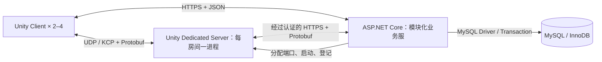

# Norn 2–4 人合作副本联机系统总体执行方案

> **执行方式：** 用户审核本计划后，使用 `superpowers:executing-plans` 在当前工作区按阶段实施；本任务未授权 SubAgent，不另建 worktree。每阶段完成后由开发者在 Unity Editor / 独立客户端中验收，再进入下一阶段。本文件包含设计依据与执行计划，不另建 spec。

**Goal：** 在保留现有单机 Demo 的基础上，实现 2–4 人连接独立服务器合作刷副本，支持权威战斗、共享材料世界、独立线上资产、可靠结算和断线重连。

**Architecture：** ASP.NET Core 模块化业务服负责账户、资产、组队、房间调度和结算；每个房间由一个 Unity Dedicated Server 进程运行权威模拟。MySQL 保存长期数据，实时通信采用 UDP / KCP，Gameplay 消息体采用 Protobuf；客户端负责输入、预测和表现。

**Tech Stack：** Unity 6000.3.16f1 / C#；ASP.NET Core / .NET 10 LTS；MySQL 8.4 LTS / InnoDB；Mirror + KcpTransport；Google.Protobuf；MySqlConnector + Dapper。Mirror 与数据库访问库属于本方案新增的工程建议，需随本计划一起审核，不代表用户在此前已逐项指定。

**Spec：** 本轮完整对话、用户确认的技术栈与线上资产隔离，以及仓库 `AGENTS.md`。日期：2026-10-20。

**当前状态（2026-10-23）：** N0、N1、N2本地阶段已验收。N2最终汇总`docs/superpowers/evidence/multiplayer/n2-final/acceptance.json`，N2Complete=true、CleanupPassed=true；真实MySQL业务58/58、相关EditMode91/91、玩家路径PlayMode6/6。正式入口为主菜单注册/登录→据点副本门F→匹配/成员准备/队长开始→独立DS Ready/一次性Ticket/认证连接区；单机仍须登录，线上资产与本地档隔离。两份最终可见D3D11 Client通过返回/同门重连/队长退出、真实业务中断Frozen后原DS恢复；连接稳态各120帧校准有效峰值0B。原三个.NET项目和全部版本保留。权威角色、移动/AI、战斗、共享世界及结算未实现；加密分配、两条native启动错误、Linux/公网/IL2CPP/D3D12仍未通过，RemoteGatePassed=false。**下一阶段N3，等待用户对N2集中确认，当前不开始N3。** 下文N1/N2-1/N2-2A状态与“暂不可用”保留为历史，最新以本段及第28节为准。

## 1. 已确认的边界与首版玩家体验

> **最新 N2-2A 进展（2026-10-22）：** 独立实例启动、Ready/Heartbeat、一次性 JoinTicket、旧连接替换、业务重启接管及 Frozen 门禁已通过本机验收：52 业务、87 EditMode、3 既有玩家路径 PlayMode；最终 Server/Client 原生产物均构建成功。证据见 `evidence/multiplayer/n2-2/acceptance.json`，实施与取舍见第26节。下面 N2-1 和前文 N1 状态保留作历史记录。当前仍无正式传送门房间 UI、权威角色或战斗，匹配继续关闭；下一步 N2-2B，N2 整体未完成。

> **N2-1进展（2026-10-22）：** 房间/ReadyRevision与Run快照/AssetLease/条件Epoch回滚已实现，42业务、83相关EditMode、3既有PlayMode回归通过。详见第25节、开发解析Task N2-1和`evidence/multiplayer/n2-1/acceptance.json`。N2整体未完成，真实RoomLauncher、Ready/Heartbeat、JoinTicket和正式匹配UI待N2-2，当前匹配仍不可用。

### 1.1 用户已经确认的选择

| 项目 | 确认内容 |
|---|---|
| 游戏规模 | 2–4 人合作副本，不扩展为 MMO 持续大世界 |
| 拓扑 | 独立副本服务器；任何一名玩家退出，其他玩家仍能继续 |
| 业务服 | ASP.NET Core |
| 副本服 | Unity Dedicated Server，Gameplay 使用 C# |
| 数据库 | MySQL |
| 实时通信 | UDP + KCP + Protobuf |
| 开发与部署 | 先本机开发，后续再租服务器 |
| 资产边界 | 首版线上角色资产与单机存档隔离，不导入单机装备、法杖和货币 |
| 工程目录 | 外层 `F:/Develop Project/RPG/` 下保持 `RPG / Server / Shared` 同级；Server 为业务服，RPG 为可构建 Client / Dedicated Server 的 Unity 工程 |
| 当前工作 | 已形成方案并授权 N0 基础工程；每个 Task 交代实际文件、项目版本、原理和验证结果 |

### 1.2 本方案补足的首版规则

下列内容是使方案可执行的建议默认值，需要随计划审阅，不冒充此前已经确认的玩法需求。

- 入口为“单机 / 联机”两个独立模式；线上整备界面读取线上资产，不复用本地 Profile 作为数据源。
- 首版通过房间列表或房间码邀请，最多 4 人；未开局可以加入，开局后仅允许原成员重连，暂不支持陌生玩家中途补位。
- 四名玩家先使用 Wizard 路径；保留 Warrior / Archer 和 NPC/Boss 的现有实现，不为联机清理它们。变形术的跨端支持列入相应法术验收。
- 首个联机内容是一张独立合作副本，包含普通遭遇、法杖施法、材料反应、Boss 与撤离结算；先用测试 Arena 证明链路，再装配正式地图。
- 队长只负责大厅准备和开始请求。队长退出后按加入顺序移交；队长没有关闭运行中副本的权限。
- 断线保留角色和席位 60 秒，停止接受该连接的输入，角色仍存在并可受伤；超过窗口按放弃处理。其他人继续游戏。
- 首版失败/放弃不带出本局新增收益，返还入局前资产；成功撤离提交合法的最终携带状态。此规则只作用于新增联机模式，不改现有单机死亡清算。
- 首版不开放玩家间资产转让。玩家丢出的入局资产仍绑定原持有者；副本生成的共享掉落可以竞争拾取，但一个实例只能被取走一次。这避免个人提前撤离与副本崩溃回滚组合导致复制资产。
- 副本进程崩溃时，首版结束该副本并按未结算成员的入局快照回滚；不承诺恢复同一场 Boss 战。已经完成的个人结算保留，不再次提交。

### 1.3 本期明确不做

MMO 地图分服、无缝跨服、Host Migration、跨副本交易、拍卖行、语音、公共随机匹配、PvP Lag Compensation、可任意加入的持续世界、整场物理 Rollback、商业级高可用容灾均不进入首版。世界/好友聊天等业务能力后续增量开发；不把“架构允许接入”描述成已经实现。

## 2. 选择、放弃与 trade-off 总表

“首版不采用”表示当前范围的取舍，不代表该技术无用或永久禁止。

| 部分 | 本方案选择 | 首版不采用 / 暂缓 | 原因与承担的代价 |
|---|---|---|---|
| 网络拓扑 | Dedicated Server，Server Authority | 玩家 Host / P2P / Relay 作为权威主机 | 满足玩家退出不结束副本；代价是需要独立计算资源和运维 |
| 业务框架 | ASP.NET Core，模块化单体 | Spring Boot、多个 Microservices | 用户已选 C# 路线，减少双语言维护；放弃本次同时系统学习 Java 的收益 |
| 副本运行环境 | Unity Dedicated Server | 普通 Java/.NET 重建整套战斗模拟 | 复用 Scene、Physics、AI、法术链；承担 Unity Runtime 的内存和生命周期约束 |
| 数据库 | MySQL 8.4 / InnoDB | PostgreSQL、SQL Server | 用户熟悉且当前需求能满足；不为了技术栈名称更换数据库，也不获得 PG 特有扩展能力 |
| 数据访问 | MySqlConnector + Dapper + 版本化 SQL | EF Core 作为首版 ORM、直接拼 SQL | 明确展示资产事务与锁范围，避免 Provider 版本耦合；需要自行维护 SQL 和迁移 |
| 实时传输 | KcpTransport 的 Reliable 与 Unreliable | 所有实时消息统一走 TCP；从零实现 ARQ | 可按消息时效选择交付方式，复用现有 KCP；需要管理更新频率、MTU、队列与带宽 |
| Unity 网络框架 | Mirror + KcpTransport | NGO + UTP、FishNet 默认 Transport、自研完整 Networking Framework | Mirror 与已选 KCP 的接合直接，复用连接/认证/对象生命周期；移动 Prediction 仍需适配，不能靠默认 NetworkTransform 宣称完成 |
| 消息体 | `.proto` 单一来源、Google.Protobuf 生成 C# | 手写两端 DTO、人工复制旧 Common/Protocol DLL | 保持消息契约一致；需要代码生成、版本和分配预算管理 |
| 业务接口 | HTTPS + JSON；服务间 HTTPS + Protobuf | 所有请求都强制经 KCP；首版引入 gRPC | Web API 调试与认证更直接；明确接受业务接口与实时协议两套入口 |
| 模拟同步 | 输入上报 + 权威 Snapshot + 本地移动 Prediction | 只广播客户端 Transform、Deterministic Lockstep | 防止客户端直接决定结果，适应 Unity Physics；需要输入历史、校正与插值 |
| 材料世界 | 服务器 CPU Grid 权威，客户端只读副本并渲染 | GPU PBF 作为服务器玩法权威；只同步水火 VFX | 无 Graphics Device 环境可运行，保留物质数量与反应；需要 Chunk 增量和多玩家 Interest |
| 长期资产 | MySQL 权威；局内有受控资产租约 | 把本地 JSON 当线上权威；每次攻击同步查库 | 保持安全边界和实时预算；需要入局移交、版本、租约、幂等结算 |
| 单机与联机 | 两套 Profile，复用领域规则 | 直接上传本地存档成为线上资产 | 用户已确认隔离；不能直接把单机已积累装备带入线上 |
| 房间隔离 | 一房间一个 Unity 进程 | 一进程多房间/多 PhysicsScene | 简化 static、EventBus 与故障隔离；更多进程启动和内存开销 |
| 部署 | 本机 → 受控远端私测 → 按负载拆机 | 初期 Kubernetes、自动跨区调度 | 先证明玩法闭环；容量扩展和商业公网加固另有明确 Gate |
| 周边中间件 | 首版 MySQL + 进程内有界状态 | Redis、Kafka、RabbitMQ、独立匹配集群 | 减少故障面；容量达到实际瓶颈后再按测量增加 |

.NET 10 是当前可选的 LTS 基线；方案编写时仅检测到系统 SDK **8.0.302**，N0-1 将准备项目本地 SDK **10.0.402** / Runtime **10.0.13**，保留原系统安装；实际安装与验证结果见第 15 节。[Microsoft 支持策略](https://dotnet.microsoft.com/en-us/platform/support/policy)

## 3. 进程、构建产物与部署



本机阶段四类进程都可以运行在一台电脑上；以后业务服、副本服、数据库可以同机，也可以分机。不同进程不共享对象引用，通过明确接口通信。Linux 是后续部署目标，不能将不同构建产物视为相同程序。

| 构建物 | 内容 | 运行要求 |
|---|---|---|
| Unity Client | 输入/UI/Rendering/客户端网络、预测、必要的静态碰撞数据 | 玩家电脑；首版 Windows x64 |
| Unity Server Build | Unity Runtime、权威场景、Physics、Gameplay、服务器网络 | 本机 Windows Server Build；后续 Linux x64 Server Build，无需 Unity Editor |
| ASP.NET Core Publish | 业务程序、依赖、配置；默认 framework-dependent | 对应 .NET / ASP.NET Core Runtime；无需 Unity Runtime |
| MySQL | 独立数据库服务及持久数据目录 | 由业务服通过驱动连接，不作为玩家客户端接口 |

服务器构建不能自动将单机代码变为联机，也不能假设 GPU Compute 能在无 Graphics Device 的构建中运行。[Unity Dedicated Server 构建](https://docs.unity3d.com/6000.3/Documentation/Manual/dedicated-server-build.html)、[优化与 Graphics Device 边界](https://docs.unity3d.com/6000.3/Documentation/Manual/dedicated-server-optimizations.html)

业务服采用一个可部署应用，内部按 Accounts、Profiles、Inventory、Parties、Rooms、Settlements 分模块。`RoomLauncher` 是内部模块，不先拆成微服务。副本通过独立子进程启动，业务服重启不能因父进程退出自动销毁已运行的副本；重启后通过数据库登记与服务器认证 Heartbeat 重新接管。

## 4. 状态权威与完整玩家链路

### 4.1 每份状态只有一个有效写入者

| 状态 | 权威 Owner | 客户端职责 / 其他服务职责 |
|---|---|---|
| 账户、登录 Session、角色归属 | 业务服 | 客户端提交请求，数据库持久化 |
| 仓库、钱包、未进入副本的装备 | 业务服 | UI 显示只读快照，通过请求改变 |
| 入局期间携带资产 | 有效 RoomEpoch 下的副本资产服务 | 业务服保留原始快照并锁定冲突操作；客户端仅预测界面 |
| 位置、HP、Status、Mana、冷却、法杖执行版本 | 副本服 | 客户端可以预测部分表现，不提交“最终结果” |
| AI、Boss 阶段、Projectile、掉落与材料世界 | 副本服 | 客户端渲染权威状态 |
| 结算记录与最终资产落库 | 业务服 | 验证服务器身份、局次、Epoch、版本和合法变化，再提交 Transaction |
| 连接、输入历史、插值缓存 | 各端局部运行状态 | 有界、可清理；不能据此发放长期资产 |

客户端永远不提交可直接采信的 Damage、奖励数量、可用 Mana、掉落归属或完整新 Profile。副本服也不能仅凭“来自服务器网络”的请求修改任意角色：其服务凭据绑定实例、房间、局次和 Epoch。

### 4.2 登录、入局、战斗与返回

1. 客户端通过 HTTPS 登录，业务服验证账户并返回短期 Session；客户端不保存明文密码。
2. 读取线上角色与资产版本，在大厅请求创建/加入房间；开始前锁定四人席位和 ContentManifestHash。
3. 业务服在 Transaction 中为参与角色建立资产租约与入局快照，再分配副本实例。启动失败时按相同 Epoch 回滚租约，不能吞掉装备。
4. 副本启动后以实例凭据领取入局快照；Ready 成功后，业务服向各成员签发一次性 JoinTicket。Ticket 默认 60 秒过期，绑定 PlayerId、RoomId、RoomEpoch、Build/Protocol/Content 版本。
5. 客户端完成 Transport 连接与入场认证。服务器以连接上下文决定 ActorId，不信任请求里自报的 OwnerId。通过认证前只接受有限的握手消息。
6. 接收实体、库存、法杖执行状态、Boss 和材料世界 Baseline；客户端确认 SnapshotId 后进入可操作状态。
7. 玩家输入 → 副本校验 → 移动/施法/Physics/材料反应 → 权威事件与 Snapshot → 本地预测校正、远端插值和表现。
8. 在服务器开放的出口请求撤离；服务器冻结该成员的结算候选，业务服验证并持久化。成功确认前保留候选和租约，失败可重试。
9. 客户端收到已提交结果后回线上整备界面；其余队友继续副本。若响应丢失，查询同一结算 ID 的状态，不重新执行奖励生成。

### 4.3 ID、版本与租约

| 字段 | 意义与规则 |
|---|---|
| PlayerId / ItemInstanceId | 服务器创建的长期身份，数据库唯一；ContentId 仍表示物品定义，不代替实例 ID |
| RoomId / RunId | 大厅房间与一次实际副本分别标识，不混成一项 |
| RoomEpoch | 同一房间实例更替的 fencing token；旧进程即使恢复也不能提交新结果 |
| NetEntityId | 本局网络实体身份，可映射 Mirror netId；不能使用 GetInstanceID 作为跨端身份 |
| ConnectionEpoch | 同一玩家重连后递增，旧连接与旧输入失效 |
| InputSequence / CommandId | 输入排序、离散指令去重；相同 ID 配不同内容直接拒绝 |
| InventoryVersion / ProgramRevision | 拒绝基于旧库存或旧法杖程序的写操作 |
| SettlementId | 对每名成员一次最终结算稳定不变；重试返回同一结果 |

实例 Heartbeat 初始 15 秒一次，租约 120 秒；副本无法续租超过 60 秒后进入 Frozen，停止权威 Gameplay Tick 与新的资产提交，继续连接管理并通知玩家等待。这是服务故障保护，不是某名玩家的菜单暂停。业务服判定失效后先推进 Epoch/冻结提交资格，再恢复未结算成员资产；副本重新获得网络后也不能越过 fencing。上线时使用服务端时间判定租约，不信任客户端时间。

## 5. 实时协议、Networking Framework 与分配预算

### 5.1 版本与契约

采用 Mirror **v96.11.3** 作为首轮兼容验证版本，引用官方发布包/固定 tag，不从 master 浮动拉取。Google.Protobuf **3.34.2**、对应 protoc **34.2**、MySqlConnector **2.6.2**、Dapper **2.1.79** 作为候选锁定版本；N0 必须验证包实际下载内容、依赖、安全通告与 Unity API 兼容性，并形成带 Hash 的 dependency-lock.json。发现不兼容时不静默升级，记录原因与替代版本后更新本计划。

这些版本是可查的候选，不是声称已经在本工程验证。[Mirror 发布页](https://github.com/MirrorNetworking/Mirror/releases/tag/v96.11.3)、[Google.Protobuf 包](https://www.nuget.org/packages/Google.Protobuf/3.34.2)、[MySqlConnector 包](https://www.nuget.org/packages/MySqlConnector/2.6.2)、[Dapper 包](https://www.nuget.org/packages/Dapper/2.1.79)

共享协议采用普通 C# Class Library，项目 SDK 为 `Microsoft.NET.Sdk`，TargetFramework 为 `netstandard2.1`；不采用 ASP.NET Core Web 项目，不启动 HTTP 服务。业务服项目才使用 `Microsoft.NET.Sdk.Web` / `net10.0`。`.NET Standard 2.1` 是共享库的 API 兼容约束，不是第三个服务端 Runtime；业务服能使用 .NET 10，不代表 Unity 可以引用任意 net10.0 类库。[Microsoft .NET Standard](https://learn.microsoft.com/en-us/dotnet/standard/net-standard)

共享协议全部位于外层 `Shared/Protocol/`：`.proto` 放在 `Protos/`，只生成到 `Runtime/Generated/`。同一个目录同时提供 .NET Class Library 项目和本地 UPM Package：`Game.NetworkProtocol.csproj` 显式编译 `Runtime/` 源码，`Runtime/Game.NetworkProtocol.asmdef` 则供 Unity 编译同一份源码，设置 noEngineReferences。`package.json` 仅描述 Unity 的包入口，不是另一个业务服务。此处修订取代此前“生成代码放在 Unity Assets、共享项目向内链接”的落点，保证共享源码归 Shared 所有。

业务服通过 ProjectReference 引用 `../../Shared/Protocol/Game.NetworkProtocol.csproj`，该相对路径从 `Server/Norn.Business/` 起算；将类库加入 Server 解决方案只是便于 IDE 管理，不会移动其磁盘位置。Unity 的 `RPG/Packages/manifest.json` 添加 `com.norn.network-protocol` 本地依赖 `file:../../Shared/Protocol`；路径从 `RPG/Packages/` 起算。Unity 中在 Packages 下显示该源码，不再在 Assets 中生成或复制另一份协议源码，也不同时导入 Game.NetworkProtocol.dll。[Unity 本地 Package 路径](https://docs.unity3d.com/6000.3/Documentation/Manual/upm-localpath.html)

Protobuf 的三个组成分别管理，避免把“协议文件”和“运行库”混为一谈：

| 组成 | 位置与使用方 | 维护方式 |
|---|---|---|
| 消息 Schema 与生成代码 | `Shared/Protocol/Protos/*.proto`、`Runtime/Generated/*.cs` | 人工修改 Schema；固定 protoc 版本统一生成 C#，生成文件不手改 |
| protoc 编译器 | `Shared/Protocol/Tools/protoc/<version>/` 开发工具缓存 | 由 `RPG/Tools/Networking/GenerateProtocol.ps1` 获取并校验版本/Hash，不作为游戏运行依赖；缓存不提交 |
| Google.Protobuf Runtime | 业务服/共享 csproj 通过 NuGet；Unity 通过 `RPG/Assets/ThirdParty/Networking/Protobuf/` 导入兼容的 DLL 与必要依赖 | 不是重新实现 Protobuf，不新建顶层 Protobuf 工程；两端固定同版本，N0 验证 Client / Server 构建 |

`Shared/Protocol/Directory.Build.props` 将类库的 .NET bin/obj 输出定向到外层 `Server/.artifacts/Protocol/`，避免 UPM 源码目录被构建中间代码污染；csproj 显式列出 Runtime 源码，避免重复编译。`Server/Directory.Packages.props` 不会自动覆盖同级 Shared 项目，因此 Shared 的 Google.Protobuf 版本也必须显式锁定，并由工具与 dependency-lock.json、Unity DLL 版本交叉核对。运行 dotnet 工具时以外层 Server 为工作目录，使 Server/global.json 生效。

所有生成和校验脚本按自身位置计算 UnityRoot、WorkspaceRoot，不能依赖开发者从哪个目录双击或调用，也不能硬编码 F 盘。两端保留各自编译流程，任何一端更新 Schema 后均须生成并构建验证；不手动复制旧 MyMMO 的 Common.dll/Protocol.dll。[Protobuf C# 代码生成](https://protobuf.dev/reference/csharp/csharp-generated/)

业务 HTTPS 的 JSON body 使用这些生成消息的 ProtoJSON 映射，由 JsonFormatter/JsonParser 转换；不额外手写一套字段含义不同的 Unity DTO。它属于离散请求路径，允许正常解析分配；实时 Tick 的二进制 Codec 另按分配 Gate 验证。

Protobuf 仅规定自定义消息体。Mirror 自己的握手、时间同步、对象生成和批处理 Header 使用其原协议；不声称每个网络字节都是 Protobuf。通过自定义 NetworkMessage Serializer 将 MessageKind 与受限长度的 Protobuf payload 接入，不把 Protobuf 对象再次逐字段交给 Mirror 自动序列化。[Mirror NetworkMessage 扩展](https://mirror-networking.gitbook.io/docs/manual/guides/communications/network-messages)

客户端和副本同时校验 ProtocolVersion、BuildVersion、ContentManifestHash，不匹配就拒绝进入。新增字段使用新 field number；删除字段保留 reserved；不复用编号，不将 .NET 类型名当作线上消息 ID。[Protobuf 官方说明](https://protobuf.dev/overview/)

### 5.2 交付语义与容量

| 消息 | 交付策略 | 应用层约束 |
|---|---|---|
| 移动输入 | Unreliable，带序号和最近 3 个输入帧冗余 | 服务器排序去重，拒绝异常前跳和过期输入；丢包不能令角色永久保持按键 |
| Cast / Interact / Extract | Reliable，带 CommandId | 重复只返回旧结果；队列有界，校验 Actor、版本、距离和时机 |
| 移动/HP/Mana/动作 Snapshot | Unreliable，带 Tick、最后已处理 InputSequence | 新快照可以替代旧快照；重要状态也包含在重连 Baseline |
| Spawn / Despawn / Boss 阶段事件 | Mirror 生命周期 + 可靠 Gameplay 事件 | 状态以最新 Snapshot/Baseline 收敛，事件另有去重序号 |
| 库存收据、结算状态 | Reliable；长期结果再从业务服查询 | 可靠传输不代表业务只执行一次 |
| Chunk Baseline / Delta | 有界分块 Reliable，带基线与修订号 | 保留独立应用队列和限速；缺版本请求补基线 |

普通单消息体目标不超过 900 bytes；UDP 包目标不超过 1200 bytes，必须测量实际 Header 与加密开销，不能将此数字当作所有网络的保证。大世界状态按 Chunk/Page 分块，不发送一个巨型完整世界 Protobuf。

首轮容量配置为：4 名玩家、64 个同时存活的敌人、256 个权威 Projectile；每玩家 128 帧输入历史、256 条待处理离散指令，每客户端 256 条控制消息和最多 4 MiB 世界待发页。以上是实验上限，不是容量证明。队列满时合并可替代的移动 Snapshot、对新的离散操作返回 Busy；世界页超限则取消该次基线并重新同步。不能静默丢库存收据或让集合无限增长。Projectile 容量在施法 Reservation 提交前校验，容量不足拒绝本次对应输出并遵循现有取消/回滚语义，不能扣完资源再少发一半弹。

Mirror KCP 的 Reliable 与 Unreliable 不等于任意数量的独立可靠流。控制消息优先于尚未入 Transport 的世界分块；批量数据限制在途窗口，不能靠“高优先级”绕过已经排队的可靠消息。N0/N5 必须注入丢包验证是否拖慢控制消息。KCP 的确认与重传由现有库负责，不自研 ARQ。[KCP 最佳实践](https://github.com/skywind3000/kcp/wiki/KCP-Best-Practice)

### 5.3 不虚报 Zero GC 与安全能力

禁止在新增 Update/Tick 热路径直接 new 消息、ToByteArray、创建闭包、LINQ 或 Boxing。高频 Protobuf 使用预热消息池、预分配 Writer/Buffer、固定上限及尽量平坦的数值字段；重复 primitive 容器复用容量。嵌套消息解析、ByteString、RepeatedField 清空后再填充都要实际测分配，不能以“用了对象池”代替证据。

若第三方序列化或 Transport 仍持续分配，就记录为未解决的 Gate，修复或调整该路径后再验收；不擅自降低仓库 Zero GC 要求。连接、加载和离散输入允许的分配与每 Tick 持续分配分开报告。

HTTPS 负责业务认证与加密。KCP 本身不提供加密或服务器身份认证。远端非回环测试采用 Mirror EncryptionTransport 包装 KCP，并通过 HTTPS 业务接口下发期望服务器公钥指纹，在其验证 callback 中核对，不能使用默认 Off 验证模式。**已知风险：该 Transport 官方文档说明当前加密实现有明显分配。** N0 保存其分配基线，N8 的远端验收要求消除持续热路径分配或选择经过验证的等价成熟实现；不能宣称默认组件已同时满足加密与 Zero GC。Gate 失败则继续受控本地开发，不能把未解决版本当作公网完成版。[EncryptionTransport 官方说明](https://mirror-networking.gitbook.io/docs/manual/transports/encryption-transport)

## 6. 模拟时钟、移动与战斗

### 6.1 时钟基线

| 项目 | 起始值 | 解释 |
|---|---|---|
| 权威 Gameplay / Physics Tick | 30 Hz | 每步固定 1/30 秒；不是客户端 Rendering FPS |
| 输入采样/发送 | 30 Hz | 从 Input System 收集；离散按键保留直到被消费 |
| Actor Snapshot | 15 Hz | 每 2 个权威 Tick 一次，降低带宽 |
| 材料模拟 | 10 Hz | 当前 P7/P8 Grid Profile 已为 10 Hz，每 3 个权威 Tick 推进一次 |
| 远端插值缓冲 | 初始 100 ms，可按 RTT/Jitter 调整 | 以少量显示延迟换取连续性，不能让自己的输入也固定等待该缓冲 |
| 输入历史 | 128 帧、固定 Ring Buffer | 用于本地移动校正，超过窗口时硬校正并记录 |
| 每帧最大补跑 | 3 个权威 Tick | 防止无界追债；超时记录 Overload，不通过变大 deltaTime 假装补齐 |

这些是实验起点，N3/N8 可以基于证据修订配置；不承诺尚未测过的 30 Hz 容量。

在线权威模拟由 `AuthorityTickDriver.Update()` 中的固定步长累加器驱动：输入消费 → 角色/AI 与投射物运动准备 → Physics.Simulate → 碰撞/触发与 Status → 到期材料 Tick → 生成 Snapshot。在线场景使用 Script Simulation，避免自动 Physics 与手动 Simulate 重复；CharacterController.Move 仍从 Update 调用，遵守仓库规则。

Physics.Simulate 不会替项目调用 FixedUpdate，因此 ProjectileBase 当前 FixedUpdate 内的追踪/环绕必须抽成显式 Tick；寿命与定时触发也要摆脱渲染帧时间。单机保留原 Update/FixedUpdate 驱动，在线代码不能双重推进。退出在线场景必须恢复 Physics simulationMode 与时间设置。[Physics.Simulate API](https://docs.unity3d.com/6000.3/Documentation/ScriptReference/Physics.Simulate.html)

### 6.2 三种客户端对象职责

- 本地玩家：立即运行移动 Prediction；收到权威位置、垂直速度、Grounded、Dash/动作阶段和已处理输入序号后，恢复运动快照并重放尚未确认的输入，模型做有限平滑。
- 远端玩家与敌人：从 Snapshot 插值，不读取本机 Input，不运行权威 AI、伤害或资源提交。
- 预测 Projectile / VFX：仅作表现，由 CommandId 对应权威生成结果；被拒绝则撤销表现，不在客户端扣敌人 HP 或产生真实材料。

Prediction 只重放本地运动，不对整场 Physics、Boss、材料和其他玩家做 Rollback。动态碰撞造成的误差接受服务器纠正，不能假设相同 Seed 能令不同设备的 Unity/GPU 模拟逐帧相同。Mirror 默认 NetworkTransform 仅可用于 N0 显示验证，不能替代 N3 的完整输入校正验收。

### 6.3 战斗和法杖

服务器沿现有库存执行路径验证 Owned Wand、版本、资格、Mana、次数和 Reservation，再运行 SpellProgramCompiler / SpellProgramMachine，冻结命令与 Trigger payload，最后交给 SpellCaster 与 ProjectileBase。保留 CastEvaluator 给 NPC/Boss 的独立只读程序；不能退回旧的玩家 RunSpellSession 路线。

施法请求只携带 WandInstanceId、CommandId、瞄准意图和声明的版本。服务器从该连接绑定的角色取得真实数据，并验证瞄准原点与角色距离、方向和 Line of Sight；不接受客户端提供伤害、Prefab 路径或剩余资源。

在线攻击以 `ActionTimeline` 的权威 Tick 决定出手、命中窗口和结束；归一化的 Authoring 时间先由 Editor 与动画 Clip 时长导出。客户端 Animator 跟随 ActionStartTick/ActionId 播放。单机原 normalizedTime 路径保留；服务器不能因无画面而停止出手，也不能由客户端动画事件授予命中。

不能把“不依赖 Animator 决定出手”误写成“删除服务器所有 Animator”。若近战命中 Box 的位置依赖武器骨骼，首版服务器保留必要的姿态 Animator 并设置 AlwaysAnimate，仅去掉 Renderer 等表现部分；Timeline 仍决定窗口，姿态只提供受控命中几何。N4 核对姿态采样与 Hit Window，并覆盖同一渲染帧补跑多个 Tick 的情况。后续若改为离线烘焙的命中轨迹，需要独立评审，不能现在用静止武器 Box 替代原攻击。

DamageRequest → IDamageable/HealthComponent → Damage/Death Event 仍是唯一伤害漏斗。Replica 通过专门的状态应用入口更新本地读模型和表现，不能调用 ReceiveHit 再算一次伤害。现有局部 GetInstanceID 继续用于进程内 UI 过滤，由适配层映射 NetEntityId，不把保存契约和本地 ID 全部改名。

## 7. 材料世界同步与 Gameplay 一致性

服务器选择当前 CPU Grid 路线，包括实际启用的液体数量、Fire Cell、固定固体、Gas 和反应状态。客户端接收只读副本，GPU 可用于表面重建或纯视觉细节，不能另外形成可扣血/耗材的玩法权威。该选择有意放弃服务器原样运行 GPU PBF；GPU PBF 保留给原单机或独立实验路径。

当前 P7/P8 Grid Profile 的 `_tickRate` 为 10，`_waterSimulationMode` 为 GridLiquid；兼容策略也保留 GpuPbf 与 LegacyCell。联机配置显式指定 Grid，不依赖 Headless 下静默硬件回退来决定正式 Gameplay。

多玩家 Activity/Interest 采用四名角色需求的并集，加上服务器已有 Projectile、持续 Fire 和反应活动源。不能只跟随队长、单个 Camera，或用四人平均坐标代替并集；两名玩家分开后各自区域仍要推进。Interest 决定向某客户端发送哪些区域，不应让无人可见但尚在反应的世界停止 Gameplay。

每个 Chunk 的消息包含 WorldEpoch、ChunkKey、Generation、BaseRevision、NewRevision、SnapshotId。Baseline 在确定的 Tick T 冻结，复制出有界发送页，同时保留 T 之后的 Delta 日志。客户端完整安装基线后，按修订应用增量，确认后启用相关交互。

缺修订、校验失败、实体尚未 Spawn 或日志被覆盖时，进入有界等待或请求新基线，不猜测补齐。客户端收到旧 Generation 消息直接丢弃，防止 Chunk 回收重建后旧包污染新世界。对数量和材料 ID 做一致性校验，不对视觉三角形逐帧相等作承诺。

N5 必须验收：玩家 A 放水，B 看见且接触结果一致；B 放火，双方看到同一反应与数量变化；掉落材料与库存扣减同一事务提交；断线重连恢复当前世界，而非从开局 Seed 各自重演。

## 8. MySQL 模型、事务与故障恢复

使用 InnoDB、utf8mb4；ID/归属/版本/余额为结构化列，变长法杖程序和物品扩展属性可以用版本化 JSON。货币用整数最小单位，不用浮点数；不把全账号塞成一个每次覆盖的大 JSON。数据库不承担每 Tick 的位置、HP、Projectile 和材料更新。[MySQL 8.4 LTS](https://dev.mysql.com/doc/refman/8.4/en/faqs-general.html)、[InnoDB Transaction](https://dev.mysql.com/doc/refman/8.4/en/innodb-introduction.html)

| 表 / 聚合 | 关键字段或约束 |
|---|---|
| Accounts / AuthSessions | Username 唯一、PasswordHash；Session Token 仅保存摘要和到期时间，日志不输出凭据 |
| Characters | AccountId、OnlineProfileVersion、最后安全整备点；没有客户端直写的离线位置 API |
| Items / ItemLocations | InstanceId 唯一、OwnerCharacterId、ContentId、Revision；一个实例只能有一个有效位置 |
| Wallets / WandPrograms | Balance、Version；WandInstanceId、ProgramRevision、SchemaVersion、程序内容 |
| Parties / PartyMembers | RoomCode、Leader、最多 4 席；成员变更与 ReadyRevision 防止旧准备状态开局 |
| Runs / RunMembers | RunId、RoomEpoch、EntrySnapshot、状态；每成员最多一个活动资产租约 |
| ServerInstances / AssetLeases | 实例身份、端口、Heartbeat、到期时间、Epoch；AssetLeases 以 CharacterId 为主键复用一行，保证每角色最多一个活动资产租约；续租与提交使用条件更新 |
| Settlements | UNIQUE(RunId, PlayerId)、SettlementId 唯一、RequestHash、结果；同 ID 异内容拒绝 |
| SchemaMigrations | Version 唯一、脚本 Hash；上线迁移可追溯，不直接改生产表掩盖差异 |

入局使用短 Transaction 验证版本、锁定携带资产并记录 EntrySnapshot，不跨整场副本持有数据库事务或行锁。其他业务写请求先检查租约，避免仓库、商店与局内同时修改同一资产。

结算在单个 Transaction 中检查成员状态和 RoomEpoch，校验变更来自有效实例、实例 ID 唯一、资源变化受服务端规则约束，再更新资产、写结算结果、结束租约并提交。首次插入幂等键与资产变更同事务完成。网络投递可重试，业务效果至多一次；断线时客户端查询最终状态，不以“没有收到回包”判断没入库。

首版没有玩家间转让，因此异常副本可以对未结算成员恢复 EntrySnapshot 而不复制已转给别人的入局物品。若以后开放交易或自由转交，必须先增加独立持久化转移账本与托管事务，不能沿用该回滚规则。

DS→业务接口断开时，结算候选先保存在实例的可恢复本地 journal，再发送并按相同 SettlementId 重试。候选中不保存账户口令；业务端数据库结果仍是最终依据。数据库长时间不可用时暂停新入局和资产提交，不让客户端覆盖旧版本。

副本崩溃恢复按 RunMembers 逐个裁决：已提交成员保留结果，其余成员在旧 Epoch 失效后回滚入局资产。MySQL 自身丢失数据与机器磁盘损坏不由进程 journal 保证，N8 要单独演练数据库备份恢复；本计划不宣称零数据丢失高可用。

## 9. 当前源码证据、Assembly 与文件改造清单

### 9.0 工作区、项目类型与路径约定

外层 `F:/Develop Project/RPG/` 是协作工作区，不等于目前的 Git 根。当前 Git 根仍为内层 `F:/Develop Project/RPG/RPG/`；不能为了沿用 Git 边界把业务服放入 Unity 项目。截图中的 Shared 名称作为本计划唯一共享目录名，不再交替使用 Common。

```text
F:/Develop Project/RPG/
├─ RPG/                                  Unity 工程：生成 Client 与 Dedicated Server 两种程序
│  ├─ Assets/_Project/Scripts/
│  │  ├─ Networking/                      连接、认证、Codec 与 Transport 适配
│  │  └─ Multiplayer/                     线上玩法装配、客户端/服务器职责适配
│  ├─ Assets/ThirdParty/Networking/
│  │  ├─ Mirror/                          网络框架与 KCP Transport
│  │  └─ Protobuf/                        Unity 使用的 Google.Protobuf DLL 与依赖
│  ├─ Packages/manifest.json              引用 ../../Shared/Protocol 本地 Package
│  ├─ Tools/Networking/                   生成、校验、构建与联调脚本
│  └─ docs/superpowers/plans/             本计划所在位置
├─ Server/                               ASP.NET Core 业务服源码，不是 Unity 副本服源码
│  ├─ Norn.Online.sln
│  ├─ Norn.Business/                      ASP.NET Core Web 项目，net10.0
│  │  ├─ Norn.Business.csproj
│  │  ├─ Program.cs
│  │  └─ appsettings.json                 仅非秘密配置
│  ├─ Norn.Business.Tests/                .NET 测试项目
│  ├─ global.json
│  ├─ Directory.Packages.props
│  └─ .artifacts/                         忽略的 .NET 构建输出
└─ Shared/
   └─ Protocol/                          同一源码同时供 .NET 与 Unity 编译
      ├─ Game.NetworkProtocol.csproj      C# Class Library，netstandard2.1
      ├─ Directory.Build.props            .NET 输出位置与构建约束
      ├─ package.json                     本地 UPM Package 的描述文件
      ├─ Protos/                          common/accounts/rooms/inventory/combat/world.proto
      ├─ Runtime/
      │  ├─ Game.NetworkProtocol.asmdef
      │  └─ Generated/                    protoc 唯一 C# 输出目录
      └─ Tools/protoc/                     不提交的固定版本工具缓存
```

这些是目标文件与目录，不代表本轮已经创建。Shared 首版只放消息与纯 C# 契约，不放账户服务、数据库 Repository、UnityEngine 组件或全局消息分发器；网络分发由各端适配层负责。后续确需共享独立规则时再评审具体模块，不预先创建通用杂物库。Unity 副本服源码保留在 RPG 中，通过构建角色和明确依赖分离客户端与服务器专用逻辑；源码共用不等于程序或运行进程共用。

后文路径采用明确的组件前缀：`Server/...`、`Shared/...` 均从外层工作区起算；`Assets/...`、`Packages/...`、`Tools/...`、`docs/...` 从内层 Unity 根起算。禁止把前两者误建到 `RPG/RPG/` 下。实施前的版本管理必须覆盖三个目录并能还原一致版本；目前内层仓库不会自动跟踪同级目录。本计划不自动迁移 .git、不重写现有历史，不把 Server/Shared 未纳入版本管理的问题隐去。

### 9.1 当前已经核对的迁移切点

| 当前文件 | 已确认事实 | 本计划要求的改造 |
|---|---|---|
| [PlayerControllerBase.cs](</F:/Develop Project/RPG/RPG/Assets/_Project/Scripts/Character/Controllers/PlayerControllerBase.cs>) | 自建 InputSystem_Actions，统一读输入，静态 Current 表示单玩家，Time.timeScale 暂停 | 分离输入来源、模拟和表现；Current 只保留本地玩家语义，服务器用 ActorRegistry |
| [EnemyPerception.cs](</F:/Develop Project/RPG/RPG/Assets/_Project/Scripts/Character/Enemy/EnemyPerception.cs>) | AI 直接读取 PlayerControllerBase.Current | 通过只读角色列表选目标，保留高度圆柱与滞回，不只追队长 |
| [PlayerWizardAttackState.cs](</F:/Develop Project/RPG/RPG/Assets/_Project/Scripts/Character/PlayerStates/PlayerWizardAttackState.cs>) | 出手依赖 Animator.normalizedTime 与 ArrowSpawnTime | 在线改为 ActionTimeline 权威 Tick，单机保留原有路径 |
| [WandExecutionTransactionService.cs](</F:/Develop Project/RPG/RPG/Assets/_Project/Scripts/Run/Spells/WandExecutionTransactionService.cs>) | Run 拥有 Reservation、版本、资源与有限收据窗口 | 复用领域语义，每个线上 Actor 单独持有；连接上下文生成 CallerId，不能按客户端自报值选择他人资产 |
| [SpellProgramMachine.cs](</F:/Develop Project/RPG/RPG/Assets/_Project/Scripts/Skills/Programming/SpellProgramMachine.cs>) | 解释器构建候选，不拥有真实库存；仍引用 UnityEngine | 放在 Unity 副本服执行，不强行搬进 ASP.NET Core；维持现有预算与冻结 Trigger 语义 |
| [ProjectileBase.cs](</F:/Develop Project/RPG/RPG/Assets/_Project/Scripts/Combat/Projectiles/ProjectileBase.cs>) | Update 管寿命/Timed Trigger，FixedUpdate 管追踪/环绕，Physics 回调产生伤害 | 在线显式 Step，避免手动 Physics 下漏推进或双推进；Replica 仅表现 |
| [HealthComponent.cs](</F:/Develop Project/RPG/RPG/Assets/_Project/Scripts/Combat/Damage/HealthComponent.cs>) | GetInstanceID 用于本地 Damage/Death Event 过滤 | 增加受控 Replica 状态应用入口，网络 ID 在适配层映射 |
| [ElementWorldRuntime.cs](</F:/Develop Project/RPG/RPG/Assets/_Project/Scripts/ElementField/Runtime/ElementWorldRuntime.cs>) | 自有 Update 累加器、单 InterestPosition、Grid/PBF 路由 | 显式外部 Step、多人 Interest 并集、权威导出与 Replica 应用，禁止客户端再跑数量模拟 |
| [RunPauseCoordinator.cs](</F:/Develop Project/RPG/RPG/Assets/_Project/Scripts/Run/Runtime/RunPauseCoordinator.cs>) | Pause Reason 最终控制 Time.timeScale 和 Cursor | 单机保留，在线菜单只释放本地输入/Cursor，不暂停服务器或网络时钟 |
| [SinglePlayerInventorySession.cs](</F:/Develop Project/RPG/RPG/Assets/_Project/Scripts/Run/Runtime/SinglePlayerInventorySession.cs>) / [ProfileSaveRepository.cs](</F:/Develop Project/RPG/RPG/Assets/_Project/Scripts/Run/Persistence/ProfileSaveRepository.cs>) | 围绕本地 Profile/文件仓库装配资产 | 线上新增 Session 与只读投影，不让本地 Repository 写线上资产 |

当前 Packages/manifest.json 有 Multiplayer Center，但没有 Mirror / NGO / FishNet 的实际 Networking Runtime。本方案不能写成“已有联网底座只需接上数据库”。当前旧架构导览路径不存在，源码导航采用本轮确认存在的 [A1–A3 学习资料](</F:/Develop Project/RPG/RPG/Assets/_Project/Docs/Norn搜打撤、法术编程/2026-10-20 A1-A3 全局架构场景流程与拾取实现 学习资料.md>)；历史指南不作为当前执行链路的替代证据。

### 9.2 新增模块的依赖方向

| Assembly | 第一方依赖 | 职责 |
|---|---|---|
| Game.NetworkProtocol | 无，noEngineReferences；第三方 Google.Protobuf | Shared/Protocol 中生成的消息契约；Unity 经本地 UPM、.NET 经 csproj 编译同源 Runtime 代码 |
| Game.Networking | Core、NetworkProtocol；第三方 Mirror/Transport | 编解码、连接、认证、时间与有界消息队列，不引用 Character/Run/ElementField |
| Game.Multiplayer | Core、NetworkProtocol、Networking、Combat、Skills、Run、Character、ElementField、Materials | 在线场景装配、连接→Actor 映射和跨领域请求适配；不修改领域内部字典 |

现有九个领域模块不反向引用 Game.Multiplayer 或 Mirror。Game.Core 不增加上层依赖。Character / Combat / Run / ElementField 提供各自受控接口；UI/Rendering 继续通过事件、只读契约和请求工作。网络包只在适配层转成进程内 EventBus 的 struct 事件，EventBus 本身不跨进程。

拆成三套新 Assembly 的代价是多维护几组显式契约，收益是业务服可编译纯协议、Codec 不被角色/库存实现牵连，Gameplay 不依赖 Mirror。首版不继续拆更多任务专用程序集；若后续出现新的真实领域依赖，再单独评审。

### 9.3 新文件落点与责任

下列均为执行期计划创建，本轮没有创建项目或代码。目录按职责命名，不使用 N0/N1 等阶段名作为生产资源目录。

| 路径 | 责任 / 交付 |
|---|---|
| `Shared/Protocol/Protos/{common,accounts,rooms,inventory,combat,world}.proto` | 身份、业务 JSON 映射、服务间和实时消息的单一 Schema；JSON 接口使用同一 Schema 的 ProtoJSON 映射 |
| `Shared/Protocol/Game.NetworkProtocol.csproj`、`Directory.Build.props` | 普通 Class Library，target netstandard2.1，显式编译 Runtime 源码，bin/obj 移出 UPM 目录；不引用 UnityEngine 或 ASP.NET Core |
| `Shared/Protocol/package.json`、`Runtime/Game.NetworkProtocol.asmdef`、`Runtime/Generated/*.cs` | 本地 UPM 包与 Unity 消息契约程序集；生成文件由脚本维护，人工不改生成代码 |
| `Shared/Protocol/Tools/protoc/<version>/` | 固定版本代码生成器缓存，不提交、不随游戏部署 |
| `Assets/ThirdParty/Networking/Mirror/`、`Assets/ThirdParty/Networking/Protobuf/` | 固定版本依赖与许可；保留上游文件与其 .meta，不复制示例场景到正式目录 |
| `Assets/_Project/Scripts/Networking/Game.Networking.asmdef` | 网络基础层 Assembly |
| `Networking/Runtime/NornNetworkManager.cs`、`ConnectionSession.cs` | 包装 Mirror 启停、连接状态与有限认证状态机 |
| `Networking/Protocol/ProtoMessageCodec.cs`、`ProtoMessagePool.cs`、`OutboundMessageQueue.cs` | 限长解码、可复用 Buffer、消息复位、优先级和速率预算 |
| `Networking/Authentication/JoinTicketAuthenticator.cs`、`ServerKeyValidator.cs` | 入场认证与服务器指纹校验；不把完整日志写成凭据泄漏渠道 |
| `Assets/_Project/Scripts/Multiplayer/Game.Multiplayer.asmdef` | 联机场景组合层 Assembly |
| `Multiplayer/Runtime/OnlineClientBootstrap.cs`、`DedicatedServerBootstrap.cs`、`AuthorityTickDriver.cs` | 各构建角色初始化、配置、唯一 Tick 调度、退出时恢复 Unity 全局状态 |
| `Multiplayer/Actors/NetworkActorRegistry.cs`、`PlayerInputBridge.cs`、`ActorSnapshotBridge.cs`、`LocalMovementPrediction.cs` | 身份绑定、输入队列、读模型 Snapshot、校正与插值接合 |
| `Multiplayer/Combat/ServerCastBridge.cs`、`ProjectileReplicationBridge.cs`、`CombatEventReplicationBridge.cs` | 连接意图转成领域请求，将权威结果转成网络快照，不另算一套伤害 |
| `Multiplayer/World/WorldInterestCoordinator.cs`、`WorldReplicationCoordinator.cs` | 四人兴趣并集、Chunk 基线与增量传输、重连版本屏障 |
| `Multiplayer/Inventory/OnlineInventoryBridge.cs`、`Services/RunSettlementClient.cs`、`RunSettlementJournal.cs` | 线上只读库存连接、权威结算请求与可恢复重试 |
| `Assets/_Project/Scripts/Core/Contracts/GameplayExecutionMode.cs`、`PlayerSimulationFrame.cs`、`ICombatActorRosterReadOnly.cs`、`IAuthorityTickParticipant.cs` | 与 Transport 无关的模式、运动快照、角色查询和显式模拟契约；同职责的值类型与接口放在所属文件内 |
| `Assets/_Project/Scripts/Core/Events/OnlineGameplayRequestEvents.cs` | 进程内带 ActorId 的受控请求/收据事件，struct + IGameEvent |
| `Assets/_Project/Scripts/Combat/Timing/ActionTimeline.cs`、`ActionTimelineDefinition.cs` | 权威动作时序及 Authoring 数据，不依赖 Networking |
| `Assets/_Project/Scripts/Run/Online/OnlineInventorySession.cs`、`OnlineDungeonAssetService.cs`、`OnlineInventoryReadModel.cs` | 在 Run 内复用 ItemOwnershipStore、法杖事务与资产规则；Authority 与 Replica 入口分开 |
| `Assets/_Project/Scripts/ElementField/Replication/WorldReplicationSource.cs`、`WorldReplicaStore.cs`、`WorldReplicaFrame.cs` | 由世界 Owner 导出受控状态；Replica 写入口只接受已验证网络修订 |
| `Assets/_Project/Scripts/UI/Online/OnlineLobbyController.cs`、`OnlineInventoryViewBinding.cs`、`OnlineConnectionStatusView.cs` | 登录组队、线上资产只读绑定、重连/结算状态；不引用 Character 或 Mirror |
| `Server/Norn.Online.sln`、`Server/Norn.Business/Norn.Business.csproj`、`Program.cs`、`appsettings.json` | .NET 10 模块化业务服务解决方案、入口与非秘密配置；ProjectReference 指向同级 Shared |
| `Server/Norn.Business/Features/Accounts/{AccountEndpoints,AccountService,AuthSessionRepository}.cs` | 注册、PasswordHasher 验证、短期 Session 与限流 |
| `Server/Norn.Business/Features/Inventory/{InventoryEndpoints,InventoryService,InventoryRepository}.cs` | 线上 Profile、仓库、钱包与版本校验 |
| `Server/Norn.Business/Features/Rooms/{RoomEndpoints,RoomService,RoomLauncher,RoomLeaseService}.cs` | 队伍/Ready、子进程启动、端口分配、JoinTicket、租约与重启后重接管 |
| `Server/Norn.Business/Features/Runs/{RunEntryService,SettlementService,SettlementRepository}.cs` | 入局快照、Epoch、幂等结算和孤儿局次恢复 |
| `Server/Norn.Business/Infrastructure/MySqlConnectionFactory.cs`、`Migrations/001_InitialOnlineSchema.sql` | 连接池边界、SQL Migration 与 Hash 记录；连接字符串不进入仓库 |
| `Server/Norn.Business/Content/ContentManifestValidator.cs` | 读取 Editor 导出的不可变内容清单，校验版本和资产变更，不加载 Unity SO |
| `Assets/_Project/Editor/Networking/OnlineBuildTools.cs`、`ContentManifestExporter.cs`、`OnlineSceneSetup.cs` | 在 Game.Project.Editor 内生成两端构建、内容清单和显式场景装配 |
| `Assets/_Project/ScriptableObjects/World/Multiplayer/{OnlineNetworkProfile,CoopDungeonDefinition}.asset` | Tick、容量、地图入口、掉落/退出等可审阅配置；Unity 创建 .meta |
| `Assets/_Project/Scenes/Tests/MultiplayerAuthorityLab.unity` | 两客户端 + 无画面服务器的最小验证图 |
| `Assets/_Project/Scenes/Multiplayer/{OnlineLobby,CoopDungeon}.unity` | 正式线上入口与合作副本，复用既有环境资产，不复制一套单机资产权威 |
| `Assets/_Project/Prefabs/Multiplayer/{OnlineWizard,OnlineDungeonRoot}.prefab` | 网络身份与在线装配，模型/Animator/Projectile 引用复用既有内容 |
| `Tools/Networking/{GenerateProtocol,Run-UnityChecks,Run-OnlineAcceptance,Start-LocalOnline,Stop-LocalOnline}.ps1` | 确定性生成、测试、启动和按本次实例清单停止进程；不按进程名批量杀用户程序 |
| `Tools/Networking/dependency-lock.json`、`Server/Directory.Packages.props`、`Server/global.json` | 锁依赖版本/Hash 与实际安装的 SDK，不使用浮动版本 |
| `Assets/_Project/Tests/Networking/`、`Tests/MultiplayerPlayMode/`、`Server/Norn.Business.Tests/` | 网络规则、多人 Unity 路径、实际 MySQL 事务集成测试 |
| `Assets/_Project/Docs/2026-10-20 联机系统开发解析（更新中）.md` | 实施期唯一阶段讲解文档，每个 Task 完成后更新，不把计划写成已完成记录 |

表中 `Networking/...`、`Multiplayer/...` 是各自 `Assets/_Project/Scripts/` 下目录的简写；其他路径按 9.0 的组件前缀规则定位。表中同一行后续未带完整前缀的文件，属于该行明确说明的父目录。

### 9.4 必须修改的既有文件

| 既有路径 | 改动边界 |
|---|---|
| `Assets/_Project/Scripts/Character/Controllers/PlayerControllerBase.cs`、`WizardController.cs` | 输入与显式模拟入口、不同角色职责、预测快照；单机原模式默认不变 |
| `Assets/_Project/Scripts/Character/PlayerStates/PlayerWizardAttackState.cs`、共享移动 States | 在线 deltaTime/动作时钟从参数取得，Snapshot 包含所有影响重放的运动状态；不在每帧创建 State |
| `Assets/_Project/Scripts/Character/Controllers/EnemyControllerBase.cs`、`Enemy/EnemyPerception.cs`、`Enemy/States/{EnemyAttackState,EnemyRangedAttackState,EnemyHurtState}.cs`、`Enemy/Boss/Runtime/{WizardBossController,BossCastState}.cs` | 在线仅服务器推进 AI；多目标查询；敌人近战/远程出手、Hurt 与 Boss cast 都跟随统一时钟，不能残留对无 Animator 的依赖 |
| `Assets/_Project/Scripts/Character/Spells/{OwnedWandCastAdapter,SpellCaster,OwnedWandFireScheduler}.cs` | 输入与执行分离、权威/预测对象区分、服务器 Caller 与冻结执行结果 |
| `Assets/_Project/Scripts/Combat/Projectiles/{ProjectileBase,ThrownContainerProjectile}.cs`、`Melee/MeleeHitDetector.cs`、`Status/{AreaDamage,StatusController}.cs`、`Damage/HealthComponent.cs` | 显式 Tick、单一伤害权威、Replica 应用；投掷重试、近战查询、区域伤害和 Status 不能在自动 Update 中重复推进；保留离散生成和现有 NPC/Archer 使用方式 |
| `Assets/_Project/Scripts/Run/Spells/WandExecutionTransactionService.cs`、`Inventory/ItemOwnershipStore.cs` | 只增加线上 Session 可复用的受控入口；不公开可任意修改的字典，不绕过 Reservation |
| `Assets/_Project/Scripts/ElementField/Runtime/ElementWorldRuntime.cs` 及其 Activity/InventoryTransfers partial | 外部 Tick 模式、多人 Interest、复制观察点与数量事务结果；原单机自动驱动保留 |
| `Assets/_Project/Scripts/Run/Runtime/RunPauseCoordinator.cs` | 根据执行模式选择世界暂停或仅本地输入暂停 |
| `Assets/_Project/Scripts/UI/DemoMainMenuController.cs`、现有库存 View 的绑定入口 | 增加独立线上入口并绑定线上读模型；不将 UI 变成资产 Owner |
| `Assets/_Project/Scripts/{Rendering/Game.Rendering,UI/Game.UI}.asmdef` | 服务器构建排除表现部分，必须先确认不存在反向引用；不手动删 Package 来掩盖依赖 |
| `Packages/manifest.json` / `packages-lock.json`、`.gitignore`、`AGENTS.md` / `CLAUDE.md` | 记录本地 Shared UPM、实际依赖、构建输出/secret 排除、新 Assembly 依赖和维护入口；Server/Shared 也须有对应忽略与版本记录 |

现有 SinglePlayerProfile 可以作为 Run 内部可复用的资产聚合类型，类名不等于必须读取本地存档；线上 Session 必须使用线上数据与内存服务装配。业务服只引用纯协议/内容契约，不引用整个 Game.Run 或 UnityEngine。

## 10. 阶段任务与可执行验收

所有阶段均执行“失败用例 → 最小实现 → 必要自动测试 → 完整玩家路径 → 开发者 Gate”。以下测试名、接口和脚本为执行期约定，本轮没有实际运行它们。每完成一个 Task，在唯一联机讲解文档中写清症状/证据、原理、责任边界、取舍、验证与限制。

### N0：验证选型能在当前工程运行

**目标：** 先排除 Unity/Transport/Protobuf/Headless 的硬性不兼容，再展开正式开发。

**主要文件：** dependency-lock、GenerateProtocol、Test-OnlineFoundation；NetworkProtocol、ProtoMessageCodec/Pool；NornNetworkManager、DedicatedServerBootstrap；MultiplayerAuthorityLab、TransportLoad/Allocation/Authenticated Lab、HeadlessGridLab；对应 Editor Build/Verification 工具、Server 解决方案及 Smoke Tests。

**实际接口与阶段边界：** `ProtoMessageCodec.TryDecode(RealtimeMessageKind kind, ArraySegment<byte> payload, out ProtocolMessageLease lease, out ProtocolDecodeFailure failure)`；lease 必须释放回池，非法长度不入 Gameplay。N0 的 `DedicatedServerBootstrap.Start()` 在 UNITY_SERVER 下根据 OnlineNetworkProfile 启动 Manager；负载 Probe 以显式参数启动并写 Ready 报告。原先拟定的房间配置路径/实例标识/ServerLaunchOptions 属于 N2 实例调度，不伪称已在 N0 实现。

- [x] 准备 .NET 10 SDK 和 Unity 对应 Windows Server Build Support，记录工具版本；实际使用 10.0.402，保留系统 8.0.302，Linux 模块/运行另验收。
- [x] 固定 Mirror/Protobuf 等候选版本与许可；按 9.0 建立同级 Server/Shared 和本地 UPM 引用，确认两端编译同一份 Runtime 源码且没有重复第一方协议 DLL/Assembly；两个 Schema 连续生成校验一致，Player Protobuf 3.34.2.0、Shared 输出未污染 UPM。Mirror 四处本地差异另锁 Hash。
- [x] Codec 复用字段/UnknownFields、超长、版本、损坏与租借边界已测；实际用例为 `ProtoCodecTests.ReusedMessage_DoesNotKeepPreviousFields`、`OversizedPayload_IsRejectedBeforeRenting`、`ProtocolVersionMismatch_IsRejected` 等，原始 RED/GREEN 保留。
- [x] 独立 Server + 可见双 Client 委托 GUI Gate 通过；最终四 Client 认证前 Ping/认证后有界 Snapshot 通过，A 先退出而 B/C/D 和 Server 继续。
- [x] 四 Client ×30 请求/s 的 Codec/Transport 容量、分配和帧调度通过；5% 丢包同测；文本 positive control 有分配。EncryptionTransport 功能/错误指纹拒绝通过、CPU/GC 基线已保存，持续分配留 N8，远端 Gate 仍未通过。
- [x] 用无 Graphics Device 的真实 Server Build 验证 Grid 初始化和 10 Hz 推进；N0-3：Null Graphics / GridLiquid，40 Tick / 4.0026 秒，128 GMU 守恒且液体格 Y=5→0；证据见第 19 节。

**验证：** Visual Studio Test Explorer 运行业务测试，Unity Test Runner 运行 Networking EditMode；`Tools → Norn → Online` 的 Verify Shared Protocol / Run Transport Load Verification / Run Authenticated Snapshot Verification / Run Packet Loss Verification / Run Encrypted Transport Verification / Run Headless Grid Verification 运行真实构建。内部 Test-OnlineFoundation 自动化补真实 HTTP，固定白名单请求复用相同 Editor 菜单；原计划中两个抽象脚本名未另造重复入口。输出原始 XML/JSON、包 Hash、Server 日志和必要的 Profiler trace。

**开发者 Gate：** 在本机实际看到两个客户端连同一进程、错版本被拒、无画面 Grid 可推进；基础热路径不满足预算则不进入正式模拟改造。加密风险允许登记到 N8，但必须显式保持“尚未通过远端验收”。

### N1：账户、线上 Profile 与 MySQL 事务

**主要文件：** Server Features/Accounts、Inventory、Migrations、ContentManifestValidator；ContentManifestExporter；UI OnlineLobbyController 的登录/角色读取部分。

**接口：** `AccountService.LoginAsync(LoginRequest request, CancellationToken ct)`；`InventoryService.GetProfileAsync(PlayerId player, CancellationToken ct)`；`TryApplyInventoryAsync(PlayerId player, uint expectedVersion, InventoryOperation operation, string commandId, CancellationToken ct)`。接口只从认证上下文取得 PlayerId。

- [x] 创建只供测试的 MySQL Schema，加入索引/唯一约束和版本化迁移；使用 PasswordHasher 而非自制密码算法。
- [x] 写并通过 `OnlineProfileTests.LocalSave_IsNeverImported`、`InventoryTransactionTests.ConcurrentMove_OnlyOneVersionCommits`、`RepeatedCommand_ReturnsOriginalResult`。集成测试连接真实隔离 MySQL，不能用内存 Repository 替代事务测试。
- [x] 导出 ContentManifest，验证客户端/副本/业务服一致的 ContentId 与版本；不存在的内容 ID 不能生成物品。N1是身份清单/构建Gate，正式副本握手在N2接入；三个实际构建的resources.assets均包含同一Hash。
- [x] 让本机客户端登录并查看线上新角色；业务服/客户端及MySQL真实重启后资产仍存在，原5个单机档 Hash 不变。按第24节修正主菜单登录、Portal玩法选择与跨Scene Session。

**验证：** 在外层 Server 目录执行 `dotnet test Norn.Online.sln --configuration Release --filter "Category=DatabaseIntegration|Category=Accounts"`；`Run-OnlineAcceptance.ps1 -Case OnlineProfileIsolation`。

**开发者 Gate：** Editor 中单机/联机入口确实隔离；错误密码、过期 Session、旧版本写入失败且不改变资产。

### N2：房间、入场、实例生命周期与资产租约

**实际文件：** RoomService、RoomMatchmakingService、RoomLauncher、RoomInstanceService/Supervisor、RunEntryService；JoinTicketAuthenticator、RoomNetworkManager；OnlineRoomClient/Profile、RoomInstanceBootstrap、OnlineInventorySession；Core OnlineRoomEvents与Run DungeonEntryChoiceGate。原拟独立LeaseService/ServerKeyValidator的责任分别收在RunEntryService/RoomInstanceService，不另建空类。

**接口：** `RoomService.StartRunAsync(PartyId party, uint readyRevision, CancellationToken ct)`；`RoomLauncher.StartAsync(RunLaunchDescriptor launch, CancellationToken ct)`；`ValidateAndConsumeJoinTicketAsync(JoinTicket ticket, ServerInstanceId instance, CancellationToken ct)`。

- [x] 覆盖`FifthPlayer_IsRejected`、`JoinTicket_CannotBeReplayedForAnotherActor`、`StartFailure_ReleasesOnlyMatchingEpochLease`和`OldServerEpoch_CannotRenewOrAdmit_AndLeaseExpiryReleasesAssets`。N2没有战利品结算，原计划名字中的Settle留N6，不冒称已实现。
- [x] 四人准备/并发启动一次/唯一资产快照在真实MySQL测试通过；Ready后才发票，旧连接替换与迟到包绑定校验、席位上限和角色唯一性通过。最终可见GUI为两人，不能说四人GUI已测。
- [x] 结构化ProcessStartInfo、无Shell/后台DS、PID+UTC启动Ticks+路径/端口登记与精确清理通过；实例密钥不进入参数/公开日志。
- [x] 新Host接管同DS、无效路径/端口冲突/45秒Ready超时回收通过；最终原生实际中断触发60秒Frozen，重启恢复同PID，见n2-final。

**实际验证：** `n2-final/acceptance.json`及分项TRX/XML/GUI/GC/cleanup；没有实现原拟`Run-OnlineAcceptance -Case RoomLifecycle`入口。现有库存移动事务在租约期间拒绝新修改，重复已提交收据保持幂等；尚无线上商店接口，不把库存测试写成商店已经实现。

**开发者 Gate：** 两名玩家入同局，队长退出后另一人继续；故意令 Server Build 路径无效后，两人的装备仍可使用且没有永久租约。

**Gate结果：** 已通过。真实GUI队长进程退出后B继续收包；无效Build/端口冲突恢复由当前完整真实MySQL测试及n2-2故障证据固定。最终开发库AssetLeases=0、活动实例端口=0，自己的进程与监听已退出，原系统MySQL保持Running。用户要求在完整N2后集中确认；确认前不进入下方N3。

### N3：角色身份、移动 Prediction 与多人 AI

**主要文件：** AuthorityTickDriver、NetworkActorRegistry、PlayerInputBridge、LocalMovementPrediction；PlayerControllerBase/共享 States；EnemyControllerBase/EnemyPerception；Core 运动契约。

**接口：** `PlayerControllerBase.Simulate(in PlayerSimulationFrame input, float deltaTime)`、`CaptureMovementSnapshot()`、`RestoreMovementSnapshot(in PlayerMovementSnapshot snapshot)`；`ICombatActorRosterReadOnly.TryGetActor(int index, out CombatActorSnapshot actor)`。Snapshot 必须包含垂直速度、Dash 阶段、Grounded/坡面和影响后续重放的预算/计时器。

`IAuthorityTickParticipant.StepAuthority(float deltaTime, uint serverTick)` 作为显式推进契约，Driver 以预注册的有界列表按模拟阶段调用；Authority/Prediction/Replica 的登记分开，不在每 Tick 扫描 Scene。现有方法需要保留兼容 wrapper 时，由 wrapper 转调这个唯一实现。

- [ ] 先覆盖 `ActorAuthorityTests.RemoteActor_DoesNotReadLocalInput`、`InputTests.DuplicateOrOldEpoch_DoesNotAdvanceTwice`、`PredictionTests.Reconcile_ReplaysOnlyUnacknowledgedInputs`、`EnemyTargetTests.TwoPlayers_SelectsValidTargetWithHysteresis`。
- [ ] 统一在线 Tick 与手动 Physics；抽出显式运动状态，禁用在线旧自动路径，确认没有双 Move 或双 Simulate。
- [ ] 实现本地预测、服务器确认/重放、远端插值；Snapshot 有界，断线自动清输入而非永久前进。
- [ ] 在线打开菜单只停止本地输入；AI、其他玩家、网络收发仍推进。关闭在线场景恢复单机时间和 Physics 模式。

**验证：** `Run-OnlineAcceptance.ps1 -Case MovementPrediction`。网络测试组合为 RTT 0/100/200 ms，Jitter 0/20/40 ms，丢包 0/1/3%；这些是注入档位，不是真实公网统计。

**开发者 Gate：** 用真实键鼠验证双玩家走/跳/Dash/坡面、菜单、离开/重连前的输入清理；不能仅凭两个 Transform 在屏幕移动通过。

### N4：权威施法、Projectile、Status 与 Boss

**主要文件：** ActionTimeline/Definition；ServerCastBridge、ProjectileReplicationBridge、CombatEventReplicationBridge；现有 WandExecutionTransactionService、SpellCaster、ProjectileBase、HealthComponent、StatusController 与 Boss Cast。

**接口：** `OnlineDungeonAssetService.TryExecuteCast(ulong actorId, in CastIntent intent, out CastReceipt receipt)`；`ProjectileBase.StepAuthority(float deltaTime, uint serverTick)`；`HealthComponent.ApplyReplicatedState(in HealthReplicaSnapshot state)`。后者只应用服务器结果并发布本地表现事件，不重新 Resolve 伤害。

- [ ] 写并通过 `CastAuthorityTests.ForeignWand_IsRejected`、`SameCommand_ConsumesManaOnce`、`InsufficientMana_DoesNotSpawn`、`InvalidAimOrigin_IsRejected`、`ProjectileTests.ReplicaCollision_DoesNotDealDamage`。
- [ ] 用数据化 Timeline 驱动玩家/普通敌人/Boss 出手；法师投射物链验证无 Animator 仍可执行，依赖武器骨骼的近战保留必要姿态求值并核对命中 Box；同时抽出投射物寿命、Timed Trigger、追踪/环绕，以及近战查询、AreaDamage、Status 与投掷重试的显式 Tick。
- [ ] 冻结 Trigger 执行计划，复制权威输出与终止原因；预测效果以 CommandId 对应、确认或撤销。
- [ ] Boss 在服务器选择目标和切阶段；客户端只播放。验证双方同时施法、误报伤害被拒、同队投射物行为及角色死亡。
- [ ] 保留 NPC CastEvaluator 以及 Warrior/Archer 的单机完整链；不将后续变形路径删除。

**验证：** `Run-OnlineAcceptance.ps1 -Case AuthoritativeCombat`，回归现有 Combat/Skills/Character 测试；录制输入→许可→Reservation→出手→命中→UI 的完整链路。

**开发者 Gate：** 双客户端看到同一 HP/Boss 阶段；关闭客户端伤害脚本不影响服务器结果；服务器法师不播放动画仍按正确时间施法，近战武器姿态与命中几何没有因裁剪失真。

### N5：共享材料世界、数量与 Chunk 恢复

**主要文件：** ElementWorldRuntime partial、WorldReplicationSource、WorldReplicaStore/Frame、WorldInterestCoordinator、WorldReplicationCoordinator；联机 Grid Profile。

**接口：** `WorldReplicationSource.TryCaptureBaseline(in WorldReplicaRequest request, WorldReplicaBuffer target, out WorldReplicaHeader header)`；`WorldReplicaStore.TryApply(in WorldReplicaFrame frame, out WorldReplicaFailure reason)`；`ElementWorldRuntime.StepAuthority(float deltaTime, uint serverTick)`。Buffer 复用，读模型不暴露真实 Store 的写权限；世界每个权威 Tick 接收固定 deltaTime，内部仍按 10 Hz 累加器决定何时实际推进材料，不能在 Driver 和世界两边各扣一次时间。

- [ ] 写并通过 `WorldReplicationTests.MissingRevision_RequestsBaseline`、`OldChunkGeneration_IsDiscarded`、`TwoSeparatedPlayers_KeepBothAreasActive`、`ClientReplica_DoesNotRunReactions`。
- [ ] 实现 10 Hz 单写者 Grid 模拟、四人 Interest 并集和全体未结束活动源；服务器不创建材质/Renderer/Compute 依赖。
- [ ] 实现冻结 Baseline + 增量日志屏障、受限分块和重连恢复；对全部启用 Gameplay 材料类型验证数量与状态。
- [ ] 双人交叉施法验证水/火及材料反应、角色接触 Status；使一名玩家离开视野/远离队长，另一侧反应仍完成。
- [ ] 同时发送大基线与连续操作，验证可靠队列未拖住关键指令；超过容量时明确失败或重新请求，不能静默丢数量。

**验证：** `Run-OnlineAcceptance.ps1 -Case SharedMaterialWorld`，对同 WorldEpoch/Revision 比较服务器与客户端的材料 ID/数量 Checksum。

**开发者 Gate：** 玩家看到的水火与角色受到的反应一致；不是仅有同步 VFX。原单机材料生成、投掷、反应和收回回归通过。

### N6：共享掉落、资产结算与失败恢复

**主要文件：** OnlineDungeonAssetService、OnlineInventoryBridge、RunSettlementClient/Journal；SettlementService/Repository；OnlineInventoryViewBinding；共享掉落代理。

**接口：** `TryPickup(ulong actorId, ulong worldItemId, uint expectedRevision, ulong commandId, out PickupReceipt receipt)`；`SettlementService.CommitAsync(SettlementRequest request, ServerIdentity identity, CancellationToken ct)`。相同 SettlementId 与 RequestHash 返回既有结果；内容不同则冲突。

- [ ] 覆盖 `PickupTests.TwoPlayers_OnlyOneReceivesInstance`、`InventoryFull_DoesNotConsumeWorldDrop`、`SettlementTests.ResponseLost_RetryDoesNotDuplicate`、`SameIdDifferentBody_IsRejected`、`ServerCrash_RestoresOnlyUnsettledMembers`。
- [ ] 掉落由副本创建稳定实例 ID，所有权转移走现有候选→验证→提交语义；禁止客户端本地生成奖励，禁止跨玩家转让入局物品。
- [ ] 实现结算 journal、Transaction 与租约结束；落库成功后再释放客户端回大厅，响应丢失时可查询状态。
- [ ] 故障注入：断业务连接、数据库暂时不可达、在提交前/后终止进程、重复发送请求；检查库存守恒、租约及已提交结果。

**验证：** 在外层 Server 目录执行 `dotnet test Norn.Online.sln --configuration Release --filter "Category=SettlementIntegration"`；`Run-OnlineAcceptance.ps1 -Case LootSettlementRecovery`。

**开发者 Gate：** 真实拾取→背包→满包拒绝→撤离→线上仓库→重启恢复完整通过；明确复核首版失败/放弃规则是否符合体验后再进入 N7。

### N7：断线重连、地图切换与正式副本流程

**主要文件：** ConnectionSession、OnlineClientBootstrap、ActorSnapshotBridge、WorldReplicationCoordinator、OnlineConnectionStatusView；OnlineLobby/CoopDungeon、服务器 Scene 装配。

- [ ] 覆盖 `ReconnectTests.OldConnectionCannotControlActor`、`BaselineIncludesCurrentBossAndMaterialState`、`LeaderDisconnect_DoesNotEndRun`、`SceneChange_DropsOldEpochMessages`。
- [ ] 重连获取新 Ticket/ConnectionEpoch，恢复原 Actor 和携带状态；不能重新发初始装备或刷新 Mana。60 秒后原席位退出，本局其余成员继续。
- [ ] 转场以服务器 SceneEpoch 为准；清理旧网络实体、订阅和待处理材料页，新的 Baseline 完整后才启用输入。
- [ ] 在正式合作图验收四人准备→普通战斗→材料反应→Boss→个人撤离/队友继续→返回线上整备。
- [ ] 业务服重启但副本存活、队长退出、一个客户端崩溃、最后一人离开等情况下，检查 Room/Run/Lease 状态最终收敛。

**验证：** `Run-OnlineAcceptance.ps1 -Case ReconnectAndFullRun`。使用独立 Client Build 与真实 Scene，不以同 Editor 中的多个对象代替多个进程。

**开发者 Gate：** 开发者手动完成至少一次四人全流程与一次中途断线重连，确认菜单、UI、拾取权限、Boss 与回程均正常。

### N8：性能、Linux 构建与受控远端私测

**主要文件：** OnlineBuildTools、Start/Stop-LocalOnline、Server 配置与服务启动脚本、网络 Profile、性能采集与加密路径整改；部署操作说明附在本文件对应记录中。

- [ ] 构建 Linux x64 Dedicated Server 与 ASP.NET Core Publish；以目标 OS 验证本地/受控机器运行依赖，不要求远端安装 Unity Editor。
- [ ] 验证 HTTPS、服务间身份、服务器公钥指纹、Ticket 重放、尺寸/速率上限；修复已登记的加密持续分配。任何 Gate 未过，远端验收仍标为未完成。
- [ ] 记录硬件、Scene/Content 版本和负载；预热后采集至少 60 秒稳态及 10 分钟持续游玩，分别报告 Gameplay、网络/Codec、材料、Physics 与全帧数据。
- [ ] 起始目标：服务器 Tick P95 ≤20 ms、P99 <33.3 ms；新增稳态 Tick/Codec/复制路径 0 B GC Alloc。长时间离散事件分配单列，全帧结果另报，不能将 marker 的 0 B 宣称为整帧 0 B。
- [ ] 普通小场景稳态目标 ≤64 KiB/s/客户端，不含首次/重连 Baseline；Baseline 初始限速 256 KiB/s/客户端。实际材料压力图超标时基于证据调整预算/表现粒度，不能降低服务器数量与反应权威。
- [ ] 同机四客户端只用于联调；测服务器容量时分离客户端渲染负载，按每房间 CPU/内存/带宽和峰值启动开销评估可运行房间数。
- [ ] 验证 MySQL 备份恢复、业务服重启后接管、端口冲突、日志轮转、优雅停止；不创建自动云资源或购买服务器。

**验证：** `Run-OnlineAcceptance.ps1 -Case LinuxDeploymentAndSoak`。保存原始 Profiler、带宽日志、数据库一致性报告和 Build Hash；实际远端上传/服务公开须在成果可审阅后取得相应授权。

**开发者 Gate：** 本机完整功能、Linux 运行、加密/分配与故障恢复全部有证据后，才评估租用规格。资源预算不通过时明确停在哪个 Gate，不承诺仅凭“4 人”就能用某个固定云配置。

## 11. Editor 设置、依赖与回归范围

### 11.1 外部资源依赖

本功能不要求用户提供新的模型、贴图、Noise/Normal、VFX、音效或字体。角色/Projectile/Animator/材料表现复用当前正式资产；新增大厅与连接状态使用现有 UGUI 和字体，允许临时文本/基础控件。需要的新配置、Prefab 与 Scene 由 Editor 工具显式创建，不能手写新 .meta。

软件依赖是 .NET 10 SDK、匹配版本的 Unity Server Build Support、固定 Networking/Protobuf 包与 MySQL；这些属于执行阶段准备，本轮没有安装。若后续要求专用联机地图美术或图标，先补用途、格式/通道、尺寸、Import Settings、目标路径和 fallback，再执行相关 Task。

### 11.2 你需要在 Unity Editor 中做的事

| 范围 | 明确操作与理由 |
|---|---|
| Assembly | 导入固定依赖，核对三套新 Assembly 和现有九模块依赖；出现循环引用时先修边界，不给 Core 引入上层 |
| Network Root | 在测试/线上场景装配 NornNetworkManager、KcpTransport、认证器；远端模式再配置带服务器公钥验证的加密包装 |
| 角色 Prefab | OnlineWizard 配置 NetworkIdentity、Actor Adapter；服务器不创建 Input/Camera 连接，Replica 不执行资源和伤害 |
| 世界配置 | 明确 Grid 模式、10 Hz、多玩家兴趣源与 Replica 模式；不把渲染 Compute 作为服务器初始化前提 |
| Animator/Timeline | 生成并核对动作 Clip 时长及归一化出手窗口；客户端观察播放是否与服务器动作 Tick 一致 |
| UI | 独立线上登录/大厅/库存绑定，显示连接与结算状态；本地开菜单不暂停其他人，不允许 UI 直写库存 |
| Build Profiles | Client 保留既有单机入口并添加线上入口；Server 使用专门 Bootstrap/合作图，排除 UI/Rendering 与仅客户端逻辑 |
| 验收 | 每阶段分别运行 Server Build、Client A、Client B；最终四客户端。编辑器单场景 Play 成功不是多人验收 |

首版不改原 Hub/Home/P7/P8 的稳定加载路径、现有 ContentId 与存档字段；旧角色和敌人 Prefab 作为保留路径回归。新生产 Scene 放 Scenes/Multiplayer，测试图放 Scenes/Tests。

### 11.3 回归与性能证据

| 测试层 | 必须覆盖的结果 |
|---|---|
| .NET 单元测试 | Schema/版本、Session、输入/请求去重、租约/Epoch、结算状态机 |
| 真实 MySQL 集成 | 并发资产修改、唯一约束、Transaction 回滚、相同结算重试、恢复与备份 |
| Unity EditMode | Codec 池复位、Actor 映射、Timeline、Prediction、世界修订、领域原测试 |
| Unity PlayMode | 真实输入/许可/Reservation/世界结果/UI、暂停、Scene 清理、Replica 不造成伤害 |
| 独立多进程 | 两人到四人，队长退出、进程关闭、重连、网络故障与结算丢响应 |
| 原单机完整路径 | 菜单→Hub→Home/P7/P8→施法/投掷/拾取→死亡/胜利/返回→存档/UI；Warrior/Archer/NPC/Boss 路径保留 |
| Profiler | 指明构建、设备、负载、预热、采集时长与 marker/全帧边界；第三方分配不隐藏 |

证据按职责保存在 `docs/superpowers/evidence/multiplayer/`，包含每阶段 manifest、原始 XML/JSON、日志与 Profiler；secret、完整 Token、密码和数据库连接字符串不入库。每个阶段记录已有基线失败，不通过删除原有测试来换绿。

## 12. 风险、拒绝的捷径与回滚方式

| 观察到的症状 / 风险 | 优先查证 | 不采用的捷径 | 正确处理与回滚 |
|---|---|---|---|
| 另一玩家控制了本机角色 | ConnectionEpoch、ActorRegistry、Input Role | 仅在 Camera 上加 isLocalPlayer 判断 | 输入/模拟/表现全部按角色职责分离；回退在线 Prefab，单机路径保留 |
| 无画面服务器不施法 | Timeline、Animator 依赖、显式 Tick | 强制所有服务器播放完整 Animator 当最终修复 | 用权威 Timeline；对照原动画窗口验收，必要时停在 N4 |
| 火球寿命或追踪速度翻倍/不动 | 自动 Update/FixedUpdate 与手动 Simulate 次数 | 随意乘 deltaTime 修正 | 每种模式唯一驱动，显式迁移相关计时与运动方法 |
| 一人开菜单全体停住 | Time.timeScale、RunPauseCoordinator | 客户端和服务器都忽略暂停但继续偷读 UI 输入 | 在线本地输入锁与世界时钟分离，退出恢复全局设置 |
| 两人远离后一侧世界停止 | Interest 并集、活动源、Chunk 生命周期 | 只同步队长区域或只发粒子特效 | 服务器按全体 Gameplay 需求推进，客户端按关注范围接收 |
| 重连后材料数量跳变 | SnapshotId、Generation、BaseRevision、增量日志 | 用开局 Seed 重演或直接接受缺页数据 | 重新建立有版本屏障的基线；容量不足则明确重试 |
| 结算重复或资产被复制 | 幂等键/RequestHash 与资产是否同事务、Epoch | 仅依赖 TCP/KCP 保证一次 | 同事务、唯一约束、fencing；不允许首版跨玩家转让绕过回滚条件 |
| 加密后持续 GC | 第三方调用栈、Buffer 生命周期、实际构建 | 只展示不含 Transport 的 marker | 修复/替换经过验证的底层实现，不通过 N8，保持本地开发状态 |
| 同机测试帧率低 | 客户端 Rendering 与服务器 CPU 分项 | 直接认定服务器规格不足 | 分离负载测量；以单房间 Tick/内存/带宽决定拆机与容量 |

执行前保存本次改动清单、必要 Scene/Prefab Hash 和数据库 Schema/备份。回滚以功能开关隐藏线上入口、停止本次记录的实例、撤回本阶段新增/修改文件为单位；不使用 git reset/clean 覆盖用户工作，不删除未识别资产。MonoBehaviour 重命名必须连同原 .meta 移动；数据库变更优先前向修复或明确可逆迁移，不删库伪装回滚。

当前工作区已有大量未提交改动，不能把它们并入联机阶段提交。每个 Task 只暂存自己的文件，使用 Conventional Commits；本计划不会自动提交或推送。

## 13. Review Focus 与完成定义

以下五类高影响条件分别由 N2、N3、N5、N6、N8 的测试固定：

1. 旧连接/旧实例恢复后仍尝试写资产：必须被 ConnectionEpoch/RoomEpoch 拒绝。
2. 双重模拟或预测重放产生真实伤害/资源消耗：必须只有权威侧提交，预测仅改变允许的局部状态。
3. 基线期间世界继续变化且 Chunk 被回收：客户端必须得到同一 Generation 的连续状态，否则重新同步。
4. 数据库已提交但客户端未收到结果：重试或重启查询同一结算，不再次发奖，也不回滚已提交成员。
5. 加密/序列化在稳态产生持续分配：不能因局部 Gameplay marker 为零就宣布全功能通过。

本计划的“首版完成”要求：2–4 人独立进程合作副本、队长退出可继续、权威战斗与材料反应、线上资产隔离、拾取与可靠结算、断线重连、原单机回归、明确的 Linux/性能/安全验证结果全部满足对应 Gate。未通过项必须保留为未完成，不能用技术栈已安装替代玩家闭环。

方案形成时的交付仅为：确认已选技术与放弃项、源码切点、可执行阶段、测试和部署边界，并自查文档一致性。它不表示上述联机功能已实现。当前已进入 N0-1，实际进度以第 15 节和联机开发解析为准，后续仍不跳过 Editor Gate。

## 14. 本轮方案验证记录

- 已将用户确认项与方案新增建议分开：技术栈/独立副本/本地先行/线上资产隔离为已确认，Mirror、起始容量、Tick 和失败处理默认值为本方案建议。
- 已读取当前工程版本、Packages、关键 Assembly、正式 Grid Profile 与关键生产脚本；本机 SDK 实际为 8.0.302，没有安装新的 SDK 或联网依赖。
- 已检查文档内 12 个本地源码/学习资料链接实际存在、N0–N8 阶段连续、44 个执行步骤均未勾选、Markdown Fence 成对，无未决占位或 UTF-8 解码错误。
- 自查修正了普通敌人/近战/区域伤害/投掷的旧时钟残留、Game.Multiplayer 的直接 Protocol 依赖、材料 StepAuthority 接口一致性，以及租约失联后的 Frozen 行为。
- 后续目录澄清已同步：以外层 RPG / Server / Shared 同级布局为准，Shared 是 netstandard2.1 Class Library + 本地 UPM 源码包；Schema、生成代码、protoc 缓存、运行库位置和 .NET 工作目录均已说明。引用方案尚待 N0 实际编译验证，不冒充已建立项目或已导入 Package。
- 验证范围仅为方案与源码静态核对、文档结构和路径检查。没有执行本文列出的未来测试脚本，没有构建业务服/副本服，没有创建数据库，没有运行多人或性能测试。

## 15. N0-1 工程基础执行记录（2026-10-20）

用户授权构建基础框架，并要求完成后说明每个项目、版本与选择原因。本次先交付独立业务服、纯共享协议、测试项目、协议生成、Unity 本地 Package 引用及本地启停工具；账户 / 资产规则和真实合作副本继续按后续阶段推进，不把工程骨架等同多人系统。

使用 `codex/online-foundation` 分支，在原工作区直接实施，不创建 worktree，不使用 SubAgent，不提交或推送。外层 Server / Shared 各初始化本地仓库，保持原 Unity 仓库与历史不变。无数据库密码、线上账户或外部服务资源变更。

已完成 .NET 10.0.402 / Runtime 10.0.13 项目本地准备；三个项目 Release 构建 0 警告 / 0 错误，10 个集成用例从预期 404 失败转为全部通过；协议连续两次生成校验一致。真实 Kestrel 进程已验证正常 Ping、版本不匹配 409 与超大包 413；锁定依赖还原与业务服发布成功；当前直接 / 传递依赖通告查询未报告已知漏洞。最终结果与原始证据位于 `docs/superpowers/evidence/multiplayer/n0-1/`，文件职责与版本解释见联机开发解析。

实施时原 Unity 工程由用户 Editor 持有锁，没有关闭或双开。用户于北京时间 2026-10-20 23:12:46 执行 Verify Shared Protocol，通过截图及生成报告确认 Unity 6000.3.16f1、实际 Protobuf 3.34.2.0、二进制 / ProtoJSON 往返与无 UnityEngine 引用，N0-1 Editor Gate 已通过。Dedicated Server Build Support 仍未安装；Server Build、KCP、多客户端、Headless Grid 与 GC / 性能证据保持未通过。

同次学习补充已明确：.NET 10 是 LTS 系列，netstandard2.1 是 API 标准，Protobuf / 测试包不能一概称为最新 LTS。2026-10-20 官方 Protobuf 最新稳定组合为 3.36.2 / protoc 36.2；当前 3.34.2 / 34.2 保持为已验证固定基线，本轮没有进行升级或宣称旧版优于新版。完整从零创建顺序、模板参数、手写配置、生成、两端引用和日常验证已补入唯一联机开发解析；2026-10-21 根据用户要求改为 IDE/Editor 手动操作，不再用终端命令作为教学过程。

## 16. N0-2 最小实时通信执行细化（2026-10-21）

**授权与范围：** 用户已明确要求继续下一步。本节细化已授权 N0，不变更总体技术选型，不重复要求确认；继续在原分支实施，不使用 SubAgent，不提交。先完成可独立构建的 KCP/Protobuf 实验入口，再交给开发者 Gate，不越过 Gate 开发正式角色、战斗或数据库。

**完成后的可见效果：** 独立 Windows Server 进程监听本地 KCP；两个独立客户端各自收发有界 Protobuf Ping；停止任一客户端不会结束服务器，另一个仍能收取回复。这不是 Host 模式，也不把业务服当作实时副本服。当前实验使用连通性消息，不宣称已经认证或同步 Gameplay Snapshot。

**前置条件：** 不需要用户提供模型、贴图或音频；界面使用开发用 IMGUI，复用空测试场景。已核对 Unity 6000.3.16f1 对应 Windows Server Build Support 不在本机 PlaybackEngines 中；已请用户用 Unity Hub 安装，代码、依赖和测试不依赖该操作，真实 Server Build 验收依赖它。Mirror 固定官方 v96.11.3，导入源码、Editor/Weaver 依赖及原始 .meta/许可证，不导入 Examples/Tests，不修改上游代码；Protobuf 版本保持不变。

**执行顺序与文件：**

1. 固定 Mirror 安装包来源与 SHA-256，导入 `Assets/ThirdParty/Networking/Mirror/`；核对 asmdef、Weaver 与 KcpTransport 真实 API 后接入，避免凭记忆写新版接口。
2. 建立 `Assets/_Project/Scripts/Networking/Game.Networking.asmdef`，只依赖 Core、NetworkProtocol、Mirror；运行时代码放在 `Protocol/{ProtoMessagePool,ProtoMessageCodec,ProtobufEnvelope}.cs` 与 `Runtime/{ConnectionSession,NornNetworkManager}.cs`。Codec 采用限长解析和受限 Lease 生命周期，先验证错误版本、未知类型、超限、截断与复用字段不残留。
3. 在 `Shared/Protocol/Protos/common.proto` 增加实时消息种类枚举，现有消息字段不变；补 `Runtime/ProtocolMessageReset.cs` 作为生成类 partial 重置扩展，防止 MergeFrom 留下上次字段或 UnknownFields。注释说明与生成器私有字段的耦合，编译和复用测试负责发现漂移。重新生成 `Common.cs`，不手改生成文件。
4. 建立 `Assets/_Project/Scripts/Multiplayer/Game.Multiplayer.asmdef`，当前只依赖 Core、NetworkProtocol、Networking；新增 `Runtime/{OnlineNetworkProfile,DedicatedServerBootstrap,OnlineClientBootstrap}.cs`，负责角色装配、实验状态与开发界面，不引用角色/资产实现。配置以 ScriptableObject 资产表达，客户端不创建服务端权威数据。
5. 在既有 `Game.Project.Editor` 内新增 `Networking/{OnlineSceneSetup,OnlineBuildTools}.cs`：显式菜单创建 `Scenes/Tests/MultiplayerAuthorityLab.unity` 与 `ScriptableObjects/World/Multiplayer/OnlineNetworkProfile.asset`；构建菜单仅包含实验场景，分别生成 Windows Client 和 Windows Dedicated Server，不覆盖正式 Build Scene List。工具拒绝覆盖未保存场景、已有未知资产，不自动进入 Play 或保存用户当前场景。
6. 新增 `Assets/_Project/Tests/Networking/Game.Networking.Tests.asmdef` 和 `ProtoCodecTests.cs`，先运行 RED，再实现 GREEN；扩充既有 `ProjectTestRunner` 的明确程序集白名单以运行这些测试。必要时增加握手/连接状态测试；不把 Editor 单进程自循环当作真实多人证据。
7. 更新 Editor asmdef、AGENTS/CLAUDE 中新模块依赖、dependency-lock、唯一联机学习文档与 `docs/superpowers/evidence/multiplayer/n0-2/`。教学使用 Unity 菜单、Inspector、Build Profiles、资源管理器启动程序，源码和 Schema 注释解释边界。

**协议与生命周期：** Mirror 负责其内置握手/批处理；自定义 Envelope 为种类加受限字节段，消息体为 Protobuf。接收时先检查种类/长度，再租借消息；解析/版本失败要立刻归还，成功由调用方在 finally 释放。Pool 有固定容量，满时明确失败，不无限分配。自定义 Writer/Reader 显式限制长度，不能让自动生成 Reader 先根据恶意长度分配大数组。Lease 带租借代次，旧 Lease 的重复释放不能释放新借用。实验只开放回环连接；无业务 JoinTicket/加密，不作为公网服务。

**Trade-off：** 采用既定 Mirror/KCP 减少连接和 Transport 自研成本；保留低频 Ping 作为最小可验证链路，不提前实现账号认证和场景复制。池化消息不等于整个链路零分配：字符串、错误和第三方 Transport 仍须实际 Profiler 测量，N0 高频/加密/Headless Grid 子项保持独立未完成。IMGUI 仅开发实验使用，不代替正式 UI。

**验证与 Gate：** 单元测试覆盖 Lease 释放/耗尽、字段与未知字段清理、非法长度/类型、解析异常、缺省/错误版本、中文往返和发送预算；Unity 编译无错误；两个独立 Client + Dedicated Server 实测并保留日志，退出一个客户端后另一客户端请求计数继续。模块缺失或 Editor 有未保存场景时记录阻塞证据，完成其他工作，交给开发者手动操作。不以普通 Client 的 batchmode 启动冒充 Dedicated Server Build。

**回滚/排错：** 只移除本次新增网络模块、测试资产与 Mirror 导入，恢复本次 asmdef/Schema 修改；不使用 reset/clean，不动正式单机场景。排错先检查 Console 编译和 Weaver，再检查端口/KCP、消息种类和协议版本，最后查业务规则；不以关闭校验掩盖问题。

### 16.1 执行裁定与进展

- 沿用整体计划作为唯一规格，不另建 spec/工作树或使用 SubAgent；细化 N0-2 只覆盖认证前探测，N0 的认证后 Snapshot、Headless Grid 与性能子项保留未完成。
- 实际 Unity 测试发现 `System.Runtime.CompilerServices.Unsafe` 缺失。此前“Unity 自带 Unsafe”的说明不成立，原工程 AI Assistant 提供的是 Editor 专用依赖。补官方 NuGet 6.1.2 的 netstandard2.0 Runtime，记录包/DLL/固定提交许可证摘要；Protobuf 版本未升级。原 Editor 实际选择 AI 插件的 6.0.3.0，Player 使用项目提供的 6.0.0.0；两种环境分别验证，不修改 PackageCache。
- 新增 `Multiplayer/Runtime/OnlineLabProbe.cs` 作为显式参数启用的进程报告器，验证真正 Server 构建角色与 Null Graphics，普通启动禁用；新增 `Editor/Networking/OnlineEditorRequests.cs` 复用现有 Editor 的同一菜单工具，明确请求、场景干净且测试未运行时才接受。
- 用户操作 Hub 安装模块期间，使用隔离最小工程编译同源 Runtime、Mirror、Editor 工具和测试，不双开原工程。其最初漏带 Unity 内置模块的问题通过补回原工程同一模块清单解决，不修改上游源码。隔离工程不是新生产组件。
- 纯 CLR Codec 测试 RED 为 16 失败/2 通过，GREEN 为 18/18；真实 Unity 隔离测试 23/23，原工程 Editor 测试也为 23/23。原 .NET 业务服回归 10/10。测试器曾临时切换为空场景，已通过既有安全恢复请求恢复已保存 Hub，不保存/丢弃用户场景。
- 隔离工程中，正式工具创建 SO/场景并输出 Windows Client 和真正 Windows Dedicated Server，两者 Build Report 均成功、0 错误。三个独立进程经 KCP 验证：A 收到 6 次回复后退出，B 继续收到 13 次，B 退出后 Server 仍存活；Server 报告确认 UNITY_SERVER 与 Null Graphics。三个本次启动进程均已清理。
- 原工程资产已由原 Editor 的正式工具创建，GUID 由 Unity 生成，不拷贝隔离工程的脚本 GUID 覆盖原项目。原工程 Client/Server 构建与最终交接记录继续补记；开发者可见操作 Gate 仍需本人审阅。
- 原工程最终构建：Client 为 Succeeded/0 错误；Dedicated Server 为 Succeeded/1 错误项，日志为历史已存在的 ANGRYMESH URPLit 模板 `_SHADOWS_SOFT` 重复声明，提取证据并保留上游模板，不声称零错误构建通过。原工程三个进程 KCP 实测通过：A 收到 6 次后退出，B 继续收到 14 次，B 退出后 Server 仍存活，最后回复距结束约 0.27 秒。Server 报告确认真实 Server 角色/Null Graphics；本次进程已清理。
- 自查没有将运行时 Lease/借用 Buffer 跨回调保存，没有修改正式单机场景或全局 Build Scene List，没有引入 .NET/UnityEngine 反向依赖，也没有把本次自动测试代替开发者可见界面 Gate。详细证据、来源指纹和剩余项在 `docs/superpowers/evidence/multiplayer/n0-2/manifest.json`；N0 整体未完成。

## 17. N0-2 构建错误收尾与开发者验收准备（2026-10-21）

用户要求继续按计划推进，并明确本阶段尚未手动验收，先处理本阶段问题。本轮继续 N0-2，不进入认证、Snapshot、Headless Grid 或数据库实现，不新增资源依赖、不升级框架、不使用 SubAgent。

1. 保留原有 Server 构建 `Succeeded / Errors=1` 与重复关键字日志，先通过已打开 Editor 的正式构建入口复核当前状态，不结束用户 Editor、不双开原工程、不保存或丢弃用户场景。
2. 根因假设：第三方 `Assets/ANGRY MESH/Stylized Pack - Common/Shaders/ASE_Template_URPLit.shader` 的 Forward/GBuffer 各同时包含旧、新两组 `_SHADOWS_SOFT` 声明；`ase_srp_cond` 是供 Amplify 模板生成器使用的注释，不会替 Unity 原生导入执行版本过滤。当前固定 URP 17.3.0，拟仅移除这两个 Pass 中已过时的简单声明，保留包含 LOW/MEDIUM/HIGH 的完整集合，并添加中文原理注释；不改变 Vertex/Fragment 计算、Material 属性或 Shader GUID。
3. 在同一原工程重新构建 Windows Dedicated Server 与 Client，分别记录 Result/Errors、时间和源文件指纹，检查新增日志是否仍含重复关键字。若构建失败先按真实输出定位，不将删除 Library、隐藏 Shader 或更改日志级别作为修复。
4. 使用现有探针做一次 Server + 两 Client 回归，确认本次新构建仍能通信；只启动并清理由本次实例清单登记的进程。此自动检查仍不替代开发者的可见窗口验收。
5. 在联机开发解析记录症状、证据、根因、取舍、实际验证及剩余 Gate；基础指南补充 Shader Variant / 构建报告的基础解释和 Editor 操作。回滚仅撤销本轮两个关键字块，不删除第三方包或修改正式场景。

该补丁只为当前 URP 17.3 工程维护，不承诺修复第三方模板对所有历史 URP 版本的兼容；后续更新该资源包需要复查这两个关键字块。开发者手动 Gate 与 N0 的高频分配、认证后 Snapshot、无画面 Grid 子项继续独立标记，不能由构建成功推导为已通过。

诊断细化：未修改源码的首次增量 Server 构建已返回 Succeeded / Errors=0，但静态检查仍能在两个 Pass 中检出重复声明。因此在既有 `OnlineBuildTools.cs` 增加 `Verify Lab Shader Import` 菜单，强制重新导入这一份已知 Shader，并保存 `ShaderUtil` 消息；`OnlineEditorRequests.cs` 仅增加对应固定白名单命令。先记录重新导入的实际结果，再应用补丁，防止将缓存命中误当修复证据。该诊断不创建新项目/Assembly，也不引入 Runtime 依赖。

本轮结果：强制导入从 1 个重复关键字错误变为 0 错误，2 个弃用 Warning 保留；原工程 Server / Client 均 Succeeded / Errors=0。新产物三进程 A=6 / B=14 次回复，A 退出后 B 持续通信，两个客户端退出后 Server 仍存活，本次进程均已清理。46 个场景与 Build Scene List 指纹未变。证据位于 `docs/superpowers/evidence/multiplayer/n0-2-build-cleanup/`。

仍有两条既有 Built-in Resource 初始化报错出现在 Server 启动日志，调用源未确认，留在 N0 Headless 兼容待查清单，不以通信成功判定无害。不升级或删除引擎/第三方 Package 来绕过问题。N0-2 可见窗口 Gate 继续等待开发者，N0 的剩余子项和 N1 均未在本轮实施。

## 18. N0-2 委托验收与 Server 启动兼容排查（2026-10-21）

用户再次要求继续，并明确答复“你自行验收”。本轮由 Codex 执行可见 Client 的连接、计数与退出检查，不再要求用户重复点击；记录为委托执行的 GUI 验收，不能以后台探针替代 GUI 证据。继续使用原工程与原有技术版本，无新资源需求、不使用 SubAgent、不提交或推送。

1. 校验现有构建指纹，启动本轮独立 Server 与两个正常可见 Client；Client 不传自动连接探针参数。仅对登记的 Client 窗口点击 Connect / Quit，保存连接前、连接后、A 退出后 B 继续计数的截图及日志。结束后只清理本次创建的进程，不更改单机存档或用户设置。
2. 对比原工程与隔离工程的 `RuntimeInitializeOnLoads.json` 和启动日志。当前发现 Server 与 Standalone 的自定义宏集合不同：Standalone 有 APP_UI_EDITOR_ONLY，Server 没有；上游 App UI 通过这个宏控制 Runtime Assembly。另有单机 UI 的 PortalTransitionFade 全局初始化会创建 Canvas / Image。以上先视为待验证的启动依赖假设，不能仅凭日志邻近就判定根因。
3. 先做单变量构建/运行对照：让 Server 使用现有 App UI Editor Only 意图，检查启动方法和报错数量变化；若仍有错误，再沿自有 UI 初始化定位。只在证据支持时修改 `OnlineBuildTools.cs` 的 Server 构建配置、自有 UI 的 Server 初始化边界或相应 asmdef；保留 Client 和 Editor 的现有功能，不修改 PackageCache。每个变量独立留存 Build Report、启动方法与 Server 日志。
4. 修复后复测真实 Server 的角色、Ready、两 Client 持续通信与退出行为；若改变自有 Runtime/Assembly，补对应 Unity 编译/测试。更新开发解析与基础指南，解释 Target / Subtarget、Scripting Define Symbols、RuntimeInitializeOnLoadMethod 与 asmdef 边界。

回滚按本轮文件逐项撤销，不删除 Package 或 Library。GUI 验收、启动日志、N0 剩余的 Headless Grid / 高频分配 / 认证后 Snapshot 分开登记；委托验收通过不等于 N0 整体完成，更不等于已实现账户、数据库或合作玩法。

执行对照 A：Server 构建通过（Errors=0），额外编译宏使 App UI 的 3 个启动方法从清单消失（57 → 54），但两条 Built-in Resource Error 仍在。因此这一步修正了 Server 的冗余依赖边界，不能把它写成原始 native 报错的根因。对照 B 仅给 `PortalTransitionFade.Install` 加 `UNITY_EDITOR || !UNITY_SERVER` 启动边界，保留 Editor/Client 的原逻辑，再检查报错变化。

执行结果：对照 B 启动方法数为 53，黑幕入口移除，2 条 native 报错仍在。两个假设都不能解释其直接原因，停止继续猜测改动。用户委托的可见 GUI 验收已通过：A 正常按钮连接并退出后，B 的 Replies 从 66 → 226 → 272，B 也通过按钮退出，Server 继续运行；测试实例全部清理。最后 Server / Client 重新构建均 Errors=0，新产物三进程回归 A=6 / B=14 通过，Client 黑幕启动入口仍在。46 个场景、Build Scene List 和 ProjectSettings.asset 指纹未变。详细证据与范围在 `docs/superpowers/evidence/multiplayer/n0-2-gui-startup/`；N0 整体仍未完成。

## 19. N0-3 真实 Server 的 CPU Grid 10 Hz 验证（2026-10-21）

用户继续授权按计划推进，并要求每轮结束明确汇报当前完成项与下一步。本轮执行既定 N0 的 Headless Grid 子项，不改账户/数据库或正式玩法。沿用本地 Unity、Mirror 与协议版本，无新美术/音效/字体依赖，不使用 SubAgent、不另建 worktree、不提交。

**结果定义：** 从原工程独立构建真正 Windows Dedicated Server；运行时必须 `UNITY_SERVER` 且使用 Null Graphics；由既有 `ElementWorldRuntime.Update` 的固定累加器推进明确配置的 GridLiquid 世界，而非手动循环调用 Tick 或依赖硬件 fallback。注入一笔有界水量，验证已落入世界、向下移动、总量守恒，以及测量窗口内 WorldTick 约为 10 Hz。结果输出机器可读报告与原始日志，不推导为多人世界同步或整个进程 Zero GC。

**架构与取舍：** 新实验只涉及材料世界，诊断组件放在已有 `Game.ElementField` 的 Diagnostics；场景装配仍属 `Game.Project.Editor`。无需让 `Game.Multiplayer` 为这次单领域验证新增依赖，也不把测试推进塞进网络层。使用单独的 `Scenes/Tests/HeadlessGridLab.unity` 与 `Tests/Fixtures/Networking/HeadlessGrid/` 配置，旧通信场景和正式 Hub/P7/P8 均不修改。真实世界仍是唯一写入者，探针通过公开写入队列/只读查询观察；不直接改 Store，也不引入正式 AuthorityTickDriver。

**准确文件与工作顺序：**

1. 新增 `Scripts/ElementField/Diagnostics/HeadlessGridProbeProfile.cs`：ScriptableObject 保存预热/测量时间、帧率、注水位置/数量、扫描范围与 Hz 容差；注明单位和实验边界。
2. 新增同目录 `HeadlessGridProbe.cs`：仅显式实验参数启动，激活预先装配的世界，记录真实自动 Tick 与材料结果，单次输出 JSON 并按检查结果退出；普通客户端和 Editor 不自动运行。热路径不创建对象/数组、无 LINQ/装箱。
3. 新增 `Editor/Networking/HeadlessGridSceneSetup.cs`：显式创建场景和 fixture，克隆已验证 P7 CPU Grid Profile，缩小有界容量，保留实际材料路由/固体/气体配置；仅创建 Collider 地面和 Interest Point，不创建 Camera、Light、Renderer、Material、Compute/GPU Runtime。Unity 生成全部 .meta。
4. 扩展 `OnlineBuildTools.cs`：复用 Server Build 逻辑，增加专门的 Grid Server 菜单与独立输出/报告，显式仅打包新实验场景。`OnlineEditorRequests.cs` 增加对应固定白名单入口，保留原场景保护。
5. 使用真实进程验证正确配置，并执行明确的错误配置拒绝用例，记录 IsInitialized、请求/有效后端、测量秒数、Tick、液体初始/末量和下落证据。运行相关已有世界测试；不为可逆菜单改动编写镜像测试。
6. 更新唯一联机开发解析及独立基础指南，解释 Headless、GPU fallback、固定 Tick、帧率与 Hz 的关系，记录所有新增脚本和 GUI 操作。回滚只涉及新实验文件与工具入口，不撤销既有正式系统。

**限制：** 原来的 2 条 native Built-in Resource 启动报错继续单列，不因材料验证成功而判为无害；高频 Codec/Transport 分配、加密、认证后 Snapshot、多玩家 Interest、网络世界复制、Linux 和完整单机玩家路径都不是本轮通过项。如果实际材料初始化暴露新的依赖，先留存具体失败，再在此节记录最小裁定，不隐式切换 GPU/PBF 或修改正式 Profile。

执行裁定：现有世界没有公开 Profile，首次编译暴露诊断代码错误假定了该 API。改为在 `ElementWorldRuntime.cs` 提供两个同 Assembly 内部只读值 `ConfiguredTickRate` / `ConfiguredWaterSimulationMode`，供探针准确读取实际绑定配置，不公开可变 SO，也不增加跨 Assembly 契约。世界的 Update / Tick 行为保持原实现。负向真实进程检查使用期望 20 Hz、实际配置 10 Hz 的输入，必须报告 ConfiguredTickRateMismatch 并退出 1；正向使用 10 Hz 并验证自动推进与材料状态。

操作补充：新增 `Editor/Networking/HeadlessGridVerification.cs`，提供 Run Headless Grid Verification 菜单，依次启动并收集上述负向/正向 Server 检查。以 Editor update 非阻塞轮询，45 秒超时或 Domain Reload 时只清理自己启动的子进程；结果写入 `Tools/Networking/.artifacts/headless-grid`。`OnlineEditorRequests` 增加同菜单的固定请求名，工具不要求用户学习终端启动参数。

**最终证据（2026-10-21）：** 最终 Server Build Succeeded / Errors=0；正反向进程检查均符合预期。负向配置 10 / 期望 20 Hz，拒绝于 ConfiguredTickRateMismatch，退出 1；正向 DedicatedServer=true、GraphicsDevice=Null、请求/实际均 GridLiquid，测量 4.0025559 秒推进 40 Tick（9.993614 Hz），世界总计 60 Tick，水量 128 GMU / Pending=0，严格比较液体格后下落 Y=5→0。120 个测量帧记录的 GC 峰值为 0 B，既有材料/液体 Tick 诊断各为 0/60 分配 Tick；不外推到高频网络、加密或长时负载。相关既有 EditMode 24/24 通过。首轮下落条件过宽的证据保留在 first-run，修正后重新构建/运行。最终证据目录 `docs/superpowers/evidence/multiplayer/n0-3-headless-grid`；N0-3 子项通过，N0 整体继续进行中。

## 20. N0-4 高频 Codec/KCP 的可复现负载基线（2026-10-21）

用户继续授权 N0。此次先完成可复现的容量/分配/调度观测，保持 N0 总 Gate；若第三方持续分配实测不为零，就登记未通过项，不降低零分配要求、不提前实施正式玩法。无新资产/软件依赖、不升级版本、不使用 SubAgent、不提交或推送。

**设计：** 新建 TransportLoadLab 与单独 fixture，复用真正 NornNetworkManager / KcpTransport / Protobuf Codec。服务端为 Windows Dedicated Server，四个普通 Client 以 batchmode/nographics 运行，不冒充 Server，不含 IMGUI/Camera，排除实验界面持续拼字造成的混淆。每 Client 30 条请求/秒，最长每帧补发 3 条，池容量固定 64、连接容量 4；3 秒预热，A 测 6 秒后退出，B/C/D 测 10 秒，Server 在四连接到齐后测 14 秒，检查四个客户端曾同时连接、最终退出后 Server 继续至报告。分别运行无文本和固定非空文本两轮，禁止把前者结果说成字符串解析也无分配。

**文件与边界：** `Networking/Runtime/ConnectionSession.cs` 将现有逐包最小间隔改为有界 Token Bucket（默认 20/s、Burst=4；负载实验明确 60/s、Burst=8），允许网络聚合，仍拒绝重复/逆序、无效或回退时间、超预算。先写真实行为失败测试 `Tests/Networking/ConnectionSessionTests.cs`。`NornNetworkManager.cs` 增加显式探测文本/预算配置、最多三次发送补跑、可开关 Codec 分配/耗时计数与连接统计；Networking 不新增 Gameplay 依赖，不移除 loopback 准入。Codec 的计数只包围编码/解码，第三方 Send/收包及全帧由独立记录器观察。

新增 `Multiplayer/Diagnostics/TransportLoadProfile.cs` 与 `TransportLoadProbe.cs` 负责 SO 参数、角色装配、预热/测量、固定容量帧间隔采样和报告；FrameInterval P95/P99 是帧间隔，不伪称 CPU Tick 时间。新增 `Editor/Networking/TransportLoadTools.cs` 负责显式创建隔离场景/fixture、两种 Build 和非阻塞五进程验收，两轮结果与退出码归档；超时/重载只清理自身进程。OnlineBuildTools 复用现有显式 Scene Build，OnlineEditorRequests 增加对应固定白名单。全部新 .meta 由当前 Unity 生成，保护原 47 个场景及全局设置。

**验证顺序：** Session 合理批到达 / 去重 / 时间 / 容量测试先 RED 再 GREEN；现有 Codec/Envelope 回归；原工程真实 Client/Server 构建 0 错误；先数值再文本两轮四 Client，记录实际发送/回复率、四连接容量、A 退出后其他 Client 活跃、Server 退出码、Codec operations/allocated bytes/耗时、全帧 GC 和帧间隔分位数。区分 FunctionalPassed 与 ZeroAllocationPassed，不用连通成功覆盖分配失败。Shader/native 原日志、已有场景与项目设置 Hash、所有自有进程退出均需记录。

**取舍与后续：** 使用现有库建立精确基线，放弃凭对象池或源码注释直接宣布 Zero GC；不在测量前擅自重写 Socket/引入 native 插件。若持续分配得到确认，后续依据实际调用边界选择成熟可维护方案再验收。EncryptionTransport 尚未启用，本轮不伪造其分配测量；认证后 Snapshot、Linux、MySQL 与 2 条既有 native 启动错误继续保留。回滚只撤本节新增实验及 Manager/Session 改动，保留此前已通过的 N0-1/2/3。

**测量裁定：** 首轮两种消息功能均通过，但文本 Codec 的 `.NET` 字节差值为 0。新增 1 KiB 已知数组分配校准后，旧计数方法在当前 Unity Runtime 仍返回 0，测试 RED；首轮 Codec 字节值无效，原证据保留 first-run。新增 `Networking/Diagnostics/CodecAllocationMeter.cs` 与对应测试，采用 Unity 官方 GC.Alloc / CollectOnlyOnCurrentThread 示例的逐事件采集，固定 128 条 native 容量，启动时校准、预热后测量，容量不足或不可用则 invalid / -1。报告改为 CodecAllocationEvents、CodecAllocationCounterValid、CodecCalibrationEvents、DotNetControlBytes，不把事件数当 bytes。该调整不改 Codec 或 Transport 算法，须重新 Build/Run。

**对 N0-3 证据的更正：** 既有 World/Grid 的每 Tick 日志也使用相同 `.NET` API，所以其 0/60 只能保留为原始无效读数，不能证明局部 Tick 零分配。N0-3 的独立 ProfilerRecorder 全帧 120 帧峰值 0 B、真实 Grid 初始化/10 Hz/守恒/下落仍是独立证据，不受此计数器问题影响。本轮不为修复诊断引入 ElementField→Networking 反向依赖，后续另行处理旧诊断入口。

## 21. N0 后续执行裁定：完成全部本地 Gate（2026-10-21）

用户明确要求“继续执行，直到 N0 全部完成，不要反复确认”，因此继续在已批准的总体架构内完成剩余子项，按实际失败推进修正，不将下列步骤写成提前通过。保留用户原 Editor、场景和单机状态，不使用 SubAgent、worktree、提交或公网部署。

**N0-4 已确认基线：** 经正向校准的五进程 numeric/text 两轮功能均通过；numeric Server Codec=0 事件、全帧峰值 3379 B，text Server Codec=1078 事件/1078 次请求。四连接容量和 A 提前退出链路已实测。数值链路仍未通过零分配，不能进入正式模拟改造；文本轮是明确产生分配的 positive control，不作为高频 Gameplay 数据形状。最终实时 Snapshot 只用有界平坦数值字段，聊天等字符串是离散业务能力，不把持续文本探测当作已优化的路径。

**21.1 Socket 边界整改与验证。** kcp2k 上游 README 及当前源码说明 Server SendTo/ReceiveFrom 有分配；保留 KCP、Cookie、批处理、重传与 Mirror 协议不改。新增 `Networking/Transport/WindowsDatagramIo.cs`，在 Windows loopback 实验通过系统 ws2_32 的同步非阻塞 recv/recvfrom/send/sendto 读写现有 Socket，使用预分配 byte[]，不引入外部 native DLL、unsafe 指针或新 Socket 生命周期。地址仅允许 127.0.0.1；Windows sockaddr_in 的 family/端口字节序明确验证，WSAEWOULDBLOCK 不抛异常，不在热路径构造 EndPoint。非 Windows 继续普通 KCP，本轮不虚报 Linux Zero GC。

先用真实 UDP 往返与已校准分配事件测试定位托管 Socket 路径，再替换为上述系统调用并观察 GREEN。新增 NornKcpTransport 作为现有 KcpTransport 的派生适配器，Raw IO 子类沿原虚方法接合；连接 EndPoint 在启动时建固定池，连接活跃期间不可复用。为维持上游既有 RawReceiveFrom 扩展接口，仅将 KcpServer.newClientEP 可见性由 private 改为 protected 并记录局部补丁，不改 KCP 算法/连接逻辑。增加 Transport Early/Late 范围的校准事件计数，避免把 Codec 与整个 Transport 混为一谈。新建单独优化实验 Scene，保留原 TransportLoadLab 作为可复现基线；重建真实 Server/Client，四人 numeric 必须满足稳态路径零分配，text 必须仍检测到分配。

**21.2 Headless 启动输入对照。** 保留两条 native Built-in Resource 原日志，以一次构建只更改 Server Rendering 输入的对照定位是否由项目默认 URP/Quality 资产加载触发。若修改构建输入，必须在 finally 恢复全部设置、核对原始 Hash，客户端继续原 Rendering 设置。不得靠过滤日志清零，也不得用无画面普通 Client 替代真实 Server。

**21.3 认证后有界 Snapshot。** N1 账户尚未实现，N0 使用明确标为 local development 的短生命周期测试凭据接入 Mirror NetworkAuthenticator，拒绝错协议/错误凭据/认证前 Gameplay 消息，服务器绑定临时 ActorId，客户端不自行声明权威身份。Shared 新增独立 lab.proto：认证请求/应答与固定数值 Snapshot，不改已有 Ping 字段含义；字段逐项中文行尾注释、重新生成唯一 C#，同步 reset。Snapshot 只携带临时 ActorId、ServerTick 与已接受 Ping 序号，是传输/身份边界实验，不提前实现 RPG 移动、背包或业务账户。测试两 Client 认证后收取有界 Snapshot，一人退出另一人继续；wrong-version / wrong-credential / pre-auth 三种真实进程负向均无 Snapshot。鉴权分配仅发生连接边界；数值稳态另测 Zero GC。

**21.4 加密与总复核。** 本地额外测量 EncryptionTransport，使用受控公钥指纹校验，保存分配/耗时基线。按原方案，其加密分配整改允许留给 N8，N0 结束时仍明确未通过远端验收；不能偷偷取消加密或降低远端 Gate。重跑协议生成重复性、.NET/Unity 版本与引用边界、业务/网络测试、最终多进程与无画面 Grid。核实错误版本拒绝和独立存活后再更新 N0 全部检查项；无外部发布或部署动作。

**执行补充：** 数值四 Client、三种开发认证负向和认证后 15 Hz Snapshot 均实测通过常态稳态零分配。另行按第 5 节的丢包要求注入双向每 20 个发送 Datagram 丢 1 个，功能通过但 Server 捕获 3 次分配；独立 full allocation-callstack 诊断把增长点定位到 Mirror 时间插值 SortedList（该高开销采集轮触发限流/断开，原样保留，不作性能结果）。32 项 Burst 回归先 RED=6 个事件，改为 Server 连接建立时预留 64 项、Client 启动时预留公开时间缓存；不改插值算法或拒绝上限，不把它与项目 Protobuf Snapshot 混称。Networking 37 + 世界 24 + 设置 5 共 66 项 EditMode 已通过，须以最终构建继续运行丢包和认证。

Headless 对照已排除默认/Quality RP、URP Global Settings 和纯 Client Resources，完整 Error stack 设置仍没有为该 native 日志提供调用栈；临时文件/资源及 Project Settings 全部恢复并校验。新增显式诊断 Build 菜单仅用于上述对照，不把排除 Resources 设为默认构建行为。Server 的 UserSettingsService 个人音量/全屏启动入口独立排除：这是客户端职责边界修正，仍须查看实际日志，不预先认定是两条 native 错误的根因。

## 22. N0 最终本地验收与交接（2026-10-21 21:16）

最终正常配置使用原项目 Rendering/Resources 输入，未移除 URP Global Settings；所有最终 Build Report 的 RenderingInputsIsolated / ClientResourcesExcluded 均 false。Grid 的 RenderGraphSettings 缺失拒绝已通过撤回不受支持的输入隔离解决；原始失败保留 n0-9-startup。RP 恢复按 GUID 重新加载 native Asset，再还原原设置字节，不使用已被卸载的托管引用。

最后一次数值总复核还捕获 64 B，完整 trace 指向 Batcher Queue 的首次容量申请；三 Timestamp 回归先 RED=1 事件，构造时预留原本首次增长的 4 项后 GREEN=0，batch 边界不变，登记第四个 Mirror 补丁。另发现补发循环与跳过判断两次读时钟的竞态窗口，改为同一 `now`，保留每帧最多三条/服务端限流/SkippedProbes=0 要求；一次文本 Skipped=1 的失败原样保留，不能从现有历史数据断言它必然由该窗口引起。诊断 Profiler 在 Ready 前启用、Burst=64；正常最终轮始终 Burst=8，不能混用作容量证据。

| 验收项 | 最终结果与证据 |
|---|---|
| 工程、生成与 Runtime | 三个原 .NET 项目保留；Google.Protobuf 3.34.2 / protoc 34.2；唯一 Runtime/Generated、两次校验一致；Unity binary/ProtoJSON/纯契约验证通过 |
| .NET / Unity 测试 | 业务 10/10；EditMode 67/67：Networking 38、世界 24、设置 5；真实 Kestrel 版本/超长拒绝通过 |
| 四 Client 数值与文本 | 数值五进程功能/稳态零分配；文本五进程功能通过且每个 Codec 观察到分配，Skipped=0 |
| 丢包与身份边界 | 双向每 20 Datagram 丢 1 个，五进程功能/稳态零分配；三种认证负向拒绝，四个唯一 ActorId、约 15 Hz/10-byte Snapshot，五进程稳态零分配 |
| 加密 | 临时公钥 List 指纹实际开启，错误指纹拒绝；功能通过；Server 峰值 38,308 B、Client 11,268 B/帧，零分配未通过，N8 必须整改 |
| Headless Grid | Null Graphics / GridLiquid；40 Tick / 4.002676 s = 9.993314 Hz；128 GMU、Pending=0、液体格 Y=5→0；120 帧峰值 0 B；错误 20 Hz 期望值被拒绝 |
| 源码/设置保护 | 15 个依赖/补丁/Player DLL Hash 通过；50 个保护文件未变，Rendering/Resources 恢复；Editor 回到 clean/non-Play 的 MultiplayerAuthorityLab，实验进程/凭据已清理 |

汇总 JSON 中 LocalN0Passed=true；EncryptedZeroAllocationPassed=false、RemoteGatePassed=false、LinuxValidated=false、MySqlImplemented=false。两条 native Built-in Resource Error 仍未定位，不能宣称 Server 无错；它保留到正式 Gameplay/远端兼容检查，加密整改按既定 N8 Gate 执行。本次可以进入不依赖正式副本模拟的 N1 业务基础工作；没有借 N0 结果提前接入现有角色/战斗/世界复制。

下一步 N1：先检查本机 MySQL 开发环境，再建立独立线上 Schema/版本迁移、Accounts/Online Profile、PasswordHasher 与数据库事务集成测试；使用 Visual Studio/数据库 GUI 讲解“是什么、为什么、怎么操作”。不导入单机资产，不以内存 Repository 冒充 MySQL 事务通过。

## 23. N1 实施细化：独立线上账号与资产（2026-10-21）

用户已明确要求继续 N1，沿用批准的业务/数据库/资产隔离架构，无需重复确认。现有本机 MySQL 8.0.33 服务正在运行；Norn 使用独立 portable MySQL 8.4 LTS、127.0.0.1:13384 和项目私有数据目录，不升级/停止/连接写入既有实例。官方当前提供 8.4.13 ZIP，下载后核对官方 MD5 并记录本地 SHA256（MD5 仅用于下载完整性，不称作签名认证）；保留 GPL 许可。MySqlConnector 2.6.2 / Dapper 2.1.79 按原候选固定。没有新美术、音效或用户提供素材要求，复用现有 UI 字体与组件。

### 23.1 职责、数据与取舍

- ASP.NET Core 继续模块化单体。新增 Accounts/Inventory/Content/Infrastructure/Migrations，不新建微服务或第四个 .NET 项目。Shared 增加纯 C# HTTP JSON DTO/Manifest 契约；实时 `.proto` 不承载登录密码，不改 N0 KCP 实验。HTTP DTO 字段与 Unity JsonUtility 保持一致，业务端严格拒绝未定义字段，尤其不接受本地存档/客户端指定 PlayerId 或余额。
- Session 使用系统 RNG 生成 opaque Bearer token；DB 只存 SHA256 摘要、所属账号与过期 UTC，Client 仅内存保存。PasswordHasher 使用 ASP.NET Core 内置实现，错误密码/不存在用户给同类错误，接口配置有界 Rate Limiter。选择可撤销的 DB Session 而非额外 JWT/RefreshToken 协议，代价是认证请求需查库；单机 Demo 不读这些数据。
- Accounts 唯一规范化 Username；Characters 每账号一名线上角色、Version、SafeHub；Wallets 独立整数余额；Items/ItemLocations 分开，InstanceId 唯一、位置唯一。新账号初始金钱为 0，初始物品由业务服固定规则从 Manifest 选择，不能由注册请求上传。N1 只做仓库/背包间的实例位置移动，不伪称已经实现 Run 格子形状/法杖编辑/结算。
- 变更事务先锁角色行 `FOR UPDATE`，先查已提交 CommandReceipt，再比对 expectedVersion，验证物品归属/内容/目标位置，更新位置与版本，写 receipt 后 Commit。相同 commandId 同内容返回原收据，异内容拒绝；拒绝/异常回滚。快照读取使用同一事务的一致视图。SQL 全部参数化，Dapper 每条命令显式传 Transaction 与 CancellationToken。
- 迁移表记录版本和脚本 SHA256；MySQL DDL 不承诺事务原子回滚，脚本失败不写成功版本并阻止启动，使用命名锁串行化迁移。迁移与 Runtime 使用不同本地凭据/权限；不开公网监听、不把连接串/凭据放进仓库或日志。开发实例可停/启，用户可用数据库 GUI 检查表。
- ContentManifest 从正式 ItemDefinition 目录导出稳定 ContentId/Kind/显示名与版本，排序后计算 SHA256；不复制本地玩家存档。业务端启动加载并验证，Unity Client/Server 构建前验证同一清单；未知 ContentId 或不匹配版本/Hash 拒绝。该清单是 N1 物品身份契约，不冒充完整 Gameplay 数值/地图/Shader 内容签名，N2/N4 再扩展入场与模拟配置。

### 23.2 文件与顺序

1. **N1-1 数据库与账户**：`Tools/Networking` 的本地 MySQL 生命周期工具/忽略的实例配置；`Server/Directory.Packages.props`、`Norn.Business.csproj` 锁依赖；`Infrastructure/{OnlineOptions,OnlineDatabase,SchemaMigrator}.cs`、`Migrations/001_online.sql`、`Features/Accounts/{AccountEndpoints,AccountService,SessionAuthenticationHandler}.cs`、`Program.cs` 装配。先加真实路由/数据库失败测试，再实现。
2. **N1-2 内容与事务**：`Shared/Protocol/Runtime/Business/OnlineContracts.cs`、`ContentManifest.cs`；`Server/Content/ContentManifestValidator.cs`、`Features/Inventory/{InventoryEndpoints,InventoryService}.cs`；`Tests/{OnlineDatabaseFixture,OnlineProfileTests,InventoryTransactionTests}.cs`；Editor `ContentManifestExporter.cs`。真实 MySQL 验证唯一性、密码/Session、并发只提交一次、重试幂等/异内容拒绝、他人物品与未知内容拒绝、失败后无半写入、重启持久性。
3. **N1-3 Unity 完整路径**：`Core/Online` 只读 View/Event 契约；`Networking/Business` UnityWebRequest HTTP Adapter；`Multiplayer/Accounts` 装配和 Session 生命周期；`UI/Online/OnlineLobbyController.cs` 请求/展示；Editor 显式生成 OnlineLobby 与配置资产/构建/验收工具。UI 不引用 Networking/Multiplayer，Core 不引用 DTO，模块间通过 EventBus 的请求/只读投影通知。登录 UI 使用 UGUI/Input System，密码遮蔽，不用 OnGUI 每帧拼字。

### 23.3 验证、交接与回滚

- 先保存原正式场景、设置、单机存档与 N0 保护文件 Hash；不自动保存/丢弃用户 Dirty Scene，不改全局 Build Scene List。业务测试默认 N0 配置无数据库仍可运行；N1 集成测试显式连接新建的隔离 test Schema，不以内存 Repository 取代事务。
- 验收用户路径：注册→错误密码拒绝→登录→读取线上角色/实例→移动一件物品→退出/重启业务服和 Client→同账号资产/版本保留；过期/注销 Session 拒绝、旧版本写入拒绝、不改变单机存档。Editor/独立 Client 验证，不能仅以测试宿主响应代替可见 UI。
- 测试产物归档 `docs/superpowers/evidence/multiplayer/n1-*`，每 Task 更新现有两份学习文档，新增依赖来源/版本/GUI 导入、表结构/事务/密码原理、文件责任和 Debug 路径。运行内部自动化不要求用户学习终端步骤。
- 回滚：停本任务登记的业务/MySQL 子进程，关闭 Online 配置，撤销本阶段新增接口/装配/UI及 Shared DTO；只清理已登记的 Norn 临时测试目录/Schema，不碰旧 MySQL 服务、既有数据、单机存档或 N0 证据。数据库迁移失败先看版本表/原日志，不自动 DROP 现有开发库重建。

**N1-3 装配细化：** 登录/Profile 使用 `Prefabs/UI/Online/OnlineLobby.prefab` 作为主菜单 Overlay，另有 `Scenes/Tests/OnlineAccountLab.unity` 独立检查场景，替代为 N1 单独增加一张正式场景。主菜单按钮仅 Instantiate 组合 Prefab 并隐藏原面板，关闭后回原菜单，不触发 Hub/单机 Session；UI 不引用 Prefab 内的 Multiplayer 实现。这样 Editor 主菜单也能直接进入线上界面，无需改全局 Build Scene List。仅修改原 P7_MainMenu 的一个新增按钮/Prefab 引用，保存修改前 Hash 和副本，不重建或覆盖原场景。N1 Client Build 入口沿用原已启用的场景路径并保留首场 MainMenu，Build 参数传递场景数组，原全局列表不变。此细化保留计划的线上/单机入口隔离和可见验收，减少 Scene 切换引入的额外状态。

## 24. N1 入口修正：主菜单认证、传送门选择玩法（2026-10-22）

**用户最新裁定优先于23节旧入口：** 主菜单是登录/注册；单机也必须先登录。进入据点后，在P7/P8等副本传送门按F弹出“单机进入 / 匹配 / 取消”。主菜单不再有“联机模式”按钮，也不从主菜单直接匹配。用户已要求继续并明确上述行为，按这次裁定执行，不再重复申请相同范围的确认。此前数据库/事务证据继续保留；旧主菜单截图只作为历史，不代表新入口已验收。

### 24.1 设计与取舍

1. **认证与玩法分开。** 独立Application Session组合对象持Token，DontDestroyOnLoad跨主菜单/据点/副本；UI销毁不会注销。只在内存保留，不写单机档或PlayerPrefs；显式注销/过期/程序退出才清身份。客户端时间检查用于UX，真正的身份判断仍由业务服完成。主菜单“进入据点”重新读取Profile成功才切Scene，断网/401拒绝；Editor直接开Hub仅是作者测试路径，不作为打包后登录入口。
2. **主菜单UI单独装配。** 新建AccountMenu Prefab，用户名/密码/注册/登录/进入据点/注销，保留设置与退出；隐藏旧Play面板，移除此前新增的“联机模式”按钮。原背景/音频/SceneTransition和Build Scene List保留。旧OnlineLobby仅留独立账户诊断Scene做资产事务教学，不作为生产联机入口。
3. **传送门仍拥有进入资格。** P7/P8 HubPracticePortal与正式HubExpeditionPortal第一次Interact只申请选择。Core事件携带PortalId/Actor/目标配置，UI显示，Run独占Pending与Pause Reason；取消只释放自己的暂停。选单机时再次验证角色、范围、Run状态，之后调用原保存/过渡链；匹配不调用HubPracticeSession/Depart，不导入单机携装。返回据点/撤离门不弹玩法选择，P8重试路径保留。
4. **N2边界明确。** 匹配按钮发送有PortalId的独立意图；尚无Room/JoinTicket时显示“匹配暂不可用”，不伪造进房或启动本地副本。未登录/过期给登录状态提示。N2在相同接口接房间服务；这次不提前实现完整队列、Lease或Dedicated Server调度。
5. **为什么不用UI直接LoadScene。** UI不知道单机保存是否成功，也无权发放线上资产。Run验证选择和空间资格后再进入原流程，才能保留失败不丢装备、取消不出发和多次F不重复进入。EventBus只加只读HasSubscribers检查，缺失UI时fail closed且不拿暂停，避免无法关闭的空白暂停。

### 24.2 准确文件与顺序

- Core：扩展 `Online/OnlineLobbyEvents.cs` 的Observe/EnterHub与菜单命令/HubReady事件；新增 `Online/DungeonEntryEvents.cs`；EventBus提供只读订阅存在检查。Core不依赖Run/Multiplayer。
- Multiplayer：`Accounts/OnlineAccountClient.cs`增加独立Application生命周期、只读状态重放、到期检查、业务验证后的HubReady通知及显式匹配未开放响应；新增 `Accounts/OnlineAccountBootstrap.cs` 只负责组合/唯一实例，不引用UI或Run。旧Lab保持Scene生命周期，不让其整个Canvas意外DontDestroy。
- UI：新增 `Online/AccountMenuController.cs`、`Online/DungeonEntryDialogController.cs`；修改 `DemoMainMenuController.cs`，主菜单开始/继续必须通过业务验证，不再StartOnline。对话框仅发布选择，字体、UGUI Listener和EventBus正确释放，不在Update拼字符串。
- Run：新增 `Runtime/DungeonEntryChoiceGate.cs`统一同门Pending/Actor/暂停的生命周期；修改HubPracticePortal、HubExpeditionPortal接Gate；RunPauseReason新增独立bit；SinglePlayerRunCoordinator提供窄的选择暂停请求/释放接口。原TryEnter保存/加载链不重写，不改StageExitPortal/HomePortal。
- Editor/资产：扩展OnlineAccountTools显式迁移新Prefab/移除旧按钮/更新主菜单引用；新增 `Prefabs/UI/Online/AccountMenu.prefab` 与 `Resources/Online/DungeonEntryDialog.prefab`（Unity生成meta）；原OnlineLobby/Lab保留。所有Scene操作先检查Dirty并恢复原SceneSetup，不修改正式Hub/P7/P8场景文件或全局Build Scene List。必要的工具白名单/只读状态报告同步更新。
- Tests：UI EditMode覆盖未认证/网络失败不可进入据点；Run EditMode覆盖缺Presentation不暂停、重复F只有一个选择、错误Actor/旧PortalId拒绝、取消释放、匹配不触发单机回调、单机再验证范围；PlayMode实际F→弹框→取消/单机→P7/P8→返回，使用MemoryFiles/ScenePreview隔离玩家档。实际独立Client再跑登录、跨场景保留和退出/重启；保留原26业务与相关网络测试。

### 24.3 验收、资产依赖与回滚

不需要用户额外模型/贴图/音效/字体；复用既有主菜单背景/UGUI与系统CJK字体，Arial只作最终fallback。记录修改前主菜单、设置、正式场景和单机档Hash；本轮仅计划内主菜单可变。新业务后端不用新增包或升级版本。

验收必须包含未登录无法进入据点、错误密码失败、登录成功后业务确认进入、Session跨Scene而UI不跨Scene、Portal按F显示选择、取消恢复输入/镜头、选择单机仍经过原保存/过门、匹配暂不可用不出发/不改资产，以及原返回门/P8重试不被改成入口选择。单机也需登录意味着业务服不可用时不能从正式菜单进入；这是用户明确选择的trade-off，不悄悄保留离线入口。N1本地完成不推导为N2匹配、公网或D3D12兼容完成。

## 25. N2 实施细化：先固定房间与资产事务，再连接真实实例（2026-10-22）

### 25.1 本轮 N2-1 的职责与取舍

本轮落实第10节N2的第一段基础：业务服持有2–4人房间、席位、队长、ReadyRevision；开局事务固化线上Profile快照并取得每角色唯一AssetLease。Room不是Unity Scene，Run不是Room；一次失败后同一Room可以开始另一个Run，而旧Epoch必须失去释放新租约的资格。全部状态保存在MySQL，不靠业务进程内Dictionary保证角色唯一性。成员变化清除全员Ready，Ready变化推进Revision；Ready记录资产版本，准备之后移动过物品的人必须重新准备。

为了可验证地分阶段交付，N2-1只开放受`Online:RoomsEnabled`控制的房间HTTP接口（默认关闭）；Prepare/FailStart是业务内部Service，不向Client暴露“伪启动成功”。正式传送门仍明确显示暂不可用，直到N2-2实际完成进程启动、Ready和JoinTicket。不会把测试中的入局预留误称为真实联机。初版房间显式创建/按RoomId加入，下一段在同一Service之上组合自动匹配，不重新实现席位规则。

Room写事务先锁专用RoomMutationGate单行，再读写Party、最后按CharacterId排序锁角色；Inventory只锁角色，不反向取得Room锁，因此没有Room/Inventory交叉锁顺序。选择短事务的全局串行化，是本机小规模首版便于推导并发正确性的trade-off；不适合大规模匹配，后续可按队列分区。绝不跨启动进程、HTTP或整场副本持有数据库锁。

### 25.2 文件、执行顺序与验证

1. Shared增加`Protocol/Runtime/Business/RoomContracts.cs`（纯C# DTO）；Server增加`Migrations/002_rooms.sql`（增量迁移，不改已应用001）、`Features/Rooms/{RoomEndpoints,RoomService,RoomTransactions}.cs`、`Features/Runs/RunEntryService.cs`。修改Program组合、OnlineOptions开关与InventoryService租约冲突检查。沿用现有3个.NET项目和全部版本，不新增ASP.NET项目、不修改实时proto。
2. Tests增加`RoomAdmissionTests.cs`与`RunEntryTests.cs`，扩展OnlineFactory按测试显式启用Rooms。先见HTTP 404/行为失败，再实现。真实MySQL覆盖第五人/并发最后席位、同角色不能双房、ReadyRevision与成员变化、队长转移、2人下限、并发开局只建一个Run、快照与资产版本、移动/入局竞争、条件回滚和业务Host重启后状态仍在。Ticket重放、旧连接、进程失败/45秒超时、旧实例续租/提交留N2-2，不提前勾选。
3. Unity只重新导入Shared源与相关回归，不接入尚未就绪的房间UI，不改正式Scene/Prefab/Build Scene List。无需用户提供模型、贴图、音效或其他新资产。N2-2再配置真实Server构建与启动Profile。
4. 实际证据归档`docs/superpowers/evidence/multiplayer/n2-1/`；更新已有开发解析Task与基础指南的Room/Run/Lease/Ready概念、Visual Studio Test Explorer与配置界面操作。回滚时关闭RoomsEnabled即可阻断新房间，不删除数据库表/快照；失败预留只按RunId+Epoch条件释放，不能直接清空AssetLeases。

### 25.3 下一段 N2-2 的完成条件

RoomLauncher用结构化ProcessStartInfo启动独立Dedicated Server，登记PID/启动时间/路径/端口；Ready后才发60秒一次性JoinTicket，实例凭据绑定Run/Room/Epoch，真实入场认证后接Core只读房间状态与UI。完成实例重接管、端口占用、无效Build路径和45秒超时恢复，再做两个Client/队长退出验收。N2-1完成不代表N2阶段完成；N3权威角色、移动和战斗仍未实现。

回滚按本节新文件和菜单差异逐项撤销，保留原meta/GUID；不删除数据库、玩家档、Library或第三方包。学习文档的基础概念/点击步骤与实施失败记录分别放基础指南/联机解析，最终按新入口重写当前操作说明，旧证据注明历史。

## 26. N2-2执行细化：真实实例控制与入场认证（2026-10-22）

沿用户“继续开发”授权执行既定N2，不再次确认已批准技术栈。先验证控制与认证链，之后接正式Portal房间UI；若本轮只完成前一子步，必须保留N2未完成与正式匹配关闭，不能以诊断Lab代替产品验收。无新增美术/音频/字体需求，无SubAgent/worktree/提交。

1. **数据库/业务组合。** 新增003_instances.sql扩展Run/Room状态，并建ServerInstances、JoinTickets；不改001/002历史Hash。InstanceOptions、RoomInstanceService负责持久化状态/实例凭据摘要/Ready/Heartbeat/Ticket一次性兑换；RoomLauncher负责结构化ProcessStartInfo、受控端口范围、仅明确配置的Build路径与实例工作目录；Supervisor负责重接管、45秒Ready超时/进程退出/120秒租约到期失效。进程启动不持数据库Transaction；全局Room Gate仅包短SQL。HostedService关闭不杀副本，异常结束按匹配Epoch回收未变更资产。仍不提供Client任意释放租约接口。
2. **共享与实时边界。** Shared新增InstanceContracts.cs，HTTP保持JSON；新增join.proto描述Ticket请求/认证回复，字段同行中文注释。握手是一次性分配路径，不入每Tick对象池；现有pooled Schema不变，ProtocolMessageReset不需要增加非池化类型。Ticket绑定Player/Room/Run/Epoch/Protocol/Build/Manifest，60秒有效，数据库只存摘要；实例密钥经子进程环境传入，不放命令行/日志/JSON。Ready领取有界入局快照；每次成功兑换递增ConnectionEpoch，DS拒绝迟到旧响应并断开旧连接。
3. **Unity组合。** 新增Networking的RoomNetworkManager、JoinTicketAuthenticator与有界Envelope；与N0 Manager/实验凭据分离，保持原实验回归。Multiplayer新增实例Bootstrap、OnlineInventorySession及显式诊断Probe。UNITY_SERVER按启动描述配置KCP，监听成功/Manifest匹配后Ready；15秒Heartbeat，60秒续租失败后Frozen，拒绝新准入并提供后续N3 Tick门禁。当前没有Gameplay Tick，不伪称已经冻结权威战斗。Client诊断仅本机回环，公网加密与Fingerprint Gate继续N8，不把明文Ticket部署公网。
4. **Editor与构建。** 显式Create Room Lifecycle Lab / Build Room Client / Build Room Dedicated Server，只使用隔离测试Scene，保留正式Scene/Build Scene List与原Rendering/Resources。业务本机GUI增加非敏感实例配置，默认Rooms/Instances均关闭；验收工具显式启动启用实例的本机业务进程，不提前打开产品匹配。
5. **测试与验收。** 先观察Ticket未Ready/错Player/重放/过期、旧Epoch续租、重复启动、端口冲突、Ready超时的失败，再真实MySQL实现。使用可控服务端TimeProvider做45/120秒边界，不称为真实等待测试。构建并实际运行Unity Dedicated Server与两客户端，验证Ready领取快照、认证与Protobuf往返、断旧连接、关闭一Client另一继续；业务真实重启后核对同一DS存活/继续Heartbeat与Ticket。无效Build路径、真实占用端口不得遗留租约。N2-1原42业务、83相关EditMode/3原玩家流程回归保留；GC/Native错误和远端限制单列。证据存n2-2，两个学习文档更新Task与基础概念/GUI操作。

**本地权限与回滚：** 只启动本任务明确登记的子进程，结束前核对PID/UTC启动Ticks/归一化路径，不按名称扫杀。Loopback业务/UDP端口与原系统MySQL分离。同级Server/Shared通过本Task暂存复制，编辑前读取当前源，不重放N2-1旧副本。关闭Rooms/Instances阻止新入局；历史快照与迁移保留，不直接回退旧可执行文件打开新Schema。

**本轮结果与下一步：** N2-2A 本地控制/认证子步通过，三个.NET项目和全部依赖版本保持原值。最终独立原生产物在修复消息ID冲突后重新构建并完成整条复验，不能引用首轮代替最终轮。N2-2B 先补长期实例的 Ticket 申请频率/历史数量边界，再接 Portal 自动组房、成员/Ready、取消与认证后的 Client 生命周期；应通过 Core 的意图事件和只读视图连接 UI/Run 与 Multiplayer，不增加反向程序集依赖。不提前打开正式匹配，不跨入 N3 的角色同步。

## 27. N2剩余工作执行细化与最终验收（2026-10-22）

用户明确要求整个N2完成后集中确认，授权自行验收各子步；本节落实既定产品入口，不再新增中途确认Gate。无新美术/声音/字体需求，沿用现有UGUI和字体；不使用SubAgent、worktree、提交或推送。

1. **匹配与滞留房间。** 增量004迁移增加队列房间标记/成员LastSeen与成员LastTicket时间，不改001–003。新增RoomMatchmakingService及HTTP match/presence；在同一Room Gate内选择同Dungeon的Open队列房间或创建，最多4人、重复请求恢复当前房间。90秒无心跳只清理Open大厅成员，重新指派队长/清Ready；不按大厅超时回收Starting/Running资产。相比Client先列房再Join，单事务避免抢最后席位竞争与重复建房；首版不做评分/地域算法。
2. **Ticket边界。** 同成员最短5秒申请间隔持久化，生成新票时删除该成员旧票（包含已消费票），数据库每实例最多4票；被删除票仍然验证失败，不依赖保存无限消费历史防重放。真实MySQL覆盖并发/旧票/限频/数量；原重连测试按新契约推进Clock。
3. **架构与UI。** Core新增不含Token的房间意图/只读视图/入场确认事件；Run的DungeonEntryChoiceGate在匹配进行中禁止单机，并在已认证入场时释放自己的Pause Reason。Multiplayer新增OnlineRoomClient，复用OnlineAccountClient创建受限认证HTTP、不向UI暴露Token；F匹配→自动组房→2–4成员准备→队长开始→轮询Ready→新票→Mirror认证。UI扩展原DungeonEntryDialog，显示成员/队长/准备/开始/取消、断开/重连；失败明确显示，绝不切单机。
4. **Client生命周期。** 新增独立OnlineRoom连接展示Scene/资源配置（不是P7/P8玩法复制）。仅认证成功后切到此Scene；N2只展示已认证身份/连接，不生成假Gameplay。临时断线保留席位，按钮重取票后同Actor新ConnectionEpoch；返回据点只断本机连接，不请求解锁他人资产或杀DS，原席位暂保留至实例结束，可从同一门重新接入。N3再加入权威角色和真实Dungeon加载。所有显式构建加入所需Scene，不改全局Build Scene List。
5. **Editor/验证。** Room工具创建生产连接Scene与房间UI资源、显式Build主菜单Client；正常本机业务菜单在N2最终Gate通过后启用Rooms/Instances，诊断菜单保留。先RED观察新匹配HTTP缺失/限频无效，再GREEN；Unity测试覆盖Gate匹配中禁止单机、迟到事件、取消与入场释放。完整真实业务PlayMode走登录→F→房间/取消→单机回归；原生双Client实际组队/准备/开始/入场/重连/退出，结合N2-2A故障注入证据。记录GC稳态窗口与控制UI离散分配，不能拿旧0B充数。
6. **收尾与回滚。** 更新两个学习文档的每个新脚本/版本/取舍/IDE及Editor点击步骤；汇总n2-final证据与未通过的N8边界。只恢复本轮Hash核对过的设置/存档，保留历史迁移；关闭Rooms/Instances阻断新入局，不删数据库。完成后集中汇报N2工作、验证/限制与下一步N3，并由用户确认后进入N3。

**执行发现与裁定：** 原生日志显示旧Game.Networking.ProtobufEnvelope与Mirror.ObjectDestroyMessage的16位ID均为44385；这不影响无实体Ping实验，却会影响N3实体生命周期。正式Room链新增RoomProtocolEnvelope并复用原有有界序列化，新增与全部Mirror内置消息的ID冲突测试，先观察实际处理器使用旧类型时失败。保留N0历史Lab协议/证据，不用ReplaceHandler压掉冲突告警；本轮不宣称修复所有旧实验Wire兼容。Native诊断25秒启动观察窗口曾过早超时，随后两Client实际均认证/往返；仅调整探针等待到45秒并保留该次工具超时记录，不改变Ticket60秒、Ready45秒或认证10秒安全限制。

## 28. N2完整收尾与N3前确认（2026-10-23）

第27节已执行完毕，`evidence/multiplayer/n2-final/acceptance.json`的N2Complete=true、CleanupPassed=true。58真实MySQL业务/91相关EditMode/6玩家路径PlayMode均零失败；当前Schema1–4共17表，Generated三文件一致。最终两份正常Build零错误，原Rendering/Resources与全局Build Scene List保持，Client实际注册登录→Hub F→同门匹配→分别Ready→显式队长Start→DS Ready/Ticket/Actor1、2认证成功。A返回后B继续，同门重入Actor1/Epoch2；真实业务中断后Frozen关闭CanSimulate，普通本机业务重启接管原PID54652恢复；队长实际进程退出后B继续。具体分项、日志与截图存native-portal，不拿N2-2A或首轮记录替代。

首轮原生GC峰736B没有通过；实际Player调用栈定位到两个继承OnGUI的自动布局。正式UGUI组合对Manager/Transport设置useGUILayout=false；连接Prefab/Test Lab在Awake前DualMode=false，并报告实际NativeSocket。修复后重新跑91/6、重建两端、重跑最终窗口，两端RawIO真实启用，校准有效120帧峰0B。窗口仅覆盖连接稳态，控制HTTP/Server Heartbeat/Gameplay不在该结论中；第三方版本/4个Mirror补丁未变。旧连接槽迟到包污染与Session到期大厅暂停均实际RED→GREEN，失败证据留存。

保护与清理审计通过：本Task原设置/主菜单和5个真实单机档Hash未变，Shared无bin/obj污染或重复DLL；开发库AssetLease/活动端口归零，五个自身进程身份已退出、5080/13384及房间UDP无监听，系统MySQL仍Running，Editor为非Play且干净的P7_MainMenu。没有使用SubAgent/worktree/commit/push；没有新增.NET项目或升级包。逐文件责任、基础原理、trade-off和Profiler Debug已写两个现有学习文档。

**集中确认后的下一步：** N3先做CharacterController/States/AI的现有推进链阅读与详细实施计划，约定Actor/Input/Snapshot/Epoch契约及Authority/Prediction/Replica唯一推进、时间/Physics恢复与资源加载规则，然后分步实现并验证走跳Dash/坡面、服务器校正重放、远端Interpolation、多玩家AI与断线清输入。当前不开始N3。N4战斗、N5共享材料、N6结算和N8加密分配/两条native启动错误/Linux公网IL2CPP/D3D12仍待开发或验证，不能因N2Complete而勾选这些Gate。
