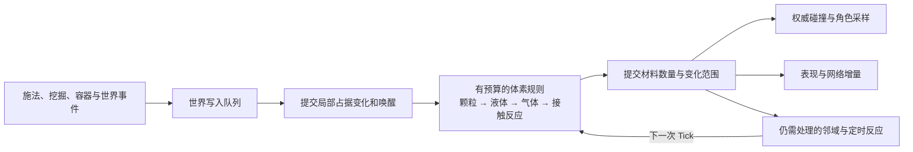

# Norn 三维元素物质世界底层架构设计

**目标**　让一个 Norn 副本的地形、积水、颗粒和气体都成为可查询、可改变、能影响玩法的材料。内存随世界内容和编辑量增长，模拟工作主要随活动区域及其边界增长。玩家对任意地方挖掘、投放、采集或施法，都经过同一套底层合同。

**核心设计**　用统一的三维体素坐标表达位置和占据。固定地形、静止蓄积、动态材料各自使用适合的数据布局。只有有输入、有通量、有反应或拓扑改变的区域进入材料 Tick。所有改变经过同一个世界提交入口，碰撞、角色状态、渲染与联机读取提交后的结果。

设计依据来自 [Noita 原版与原生程序研究](<../../../Assets/_Project/Docs/2026-11-20 Noita元素物质世界实现研究与Norn三维设计借鉴.md>)。本文给出 Norn 的设计取舍，具体格距、容量和预算需在开发中以已有世界负载校准。

## 1. 统一坐标、定义和所有权

以 `Vector3Int` 作为逻辑格坐标，Y 向上，全副本共享原点与基础格距。区块键和区块内坐标由整数除法计算，负坐标使用向下整除。逻辑格尺寸决定最小可表达的洞口与材料接触距离。工作区块主要用于寻址、记录活动和存储，存档、联机 Interest 和渲染更新可以有不同的分组粒度。P7 的 0.25 m 基础格和 10 Hz 可提供第一组对照参数，格距与 Tick 频率仍是配置。新底层的活跃交界以同一基础格计算。静止材料的压缩与表现 LOD 不改变这条规则。[世界坐标工具](../../../Assets/_Project/Scripts/ElementField/World/ElementWorldCoordinates.cs) · [现有 P7 参数](../../../Assets/_Project/ScriptableObjects/World/Online/Materials/P7_OnlineCPU_ElementWorldProfile.asset#L15)

每个材料有一份定义，由 `ScriptableObject` 编辑，在世界创建时烘成可按 `MaterialId` 索引的只读表。单格只存身份、实际数量和发生变化的局部状态。火源寿命、受损进度、待反应时间只有规则用到时才分配。已有 `MaterialId` 是序列化身份，应保留数值和旧内容映射。同一种泥土在地层里可以固定，受挖掘后可以转换为松散泥土。规则与数据共享在材料定义层，旧存档仍从稳定的材料身份找到其定义。[现有 MaterialId](../../../Assets/_Project/Scripts/Materials/MaterialId.cs#L7)

| 定义项 | 决定的行为 | 配置例子 |
|---|---|---|
| 运动模式与支撑策略 | 固定、颗粒、液体、气体，以及可选的整块脱落。支撑变化是否唤醒由策略决定 | 天然岩层固定且可破坏。松沙下落。明确可断裂的冰板才进入有界支撑检查 |
| 占据方式与容量 | 阻挡哪些物质、角色能否通过、每格可装多少、是否允许共享空间或混合 | 岩石占满。部分装水的格仍有气体空间。能混合的液体才使用额外成分记录 |
| 相对密度与置换许可 | 能挤开谁、允许哪个方向、同密度如何处理 | 沙可向下置换水，重液可下沉到轻液下方。固定岩石和压实颗粒不参与普通液体置换 |
| 输运参数 | 每步可移动量、颗粒斜落、液体铺展、气体扩散、浮升和寿命 | 水易铺开，黏液每步转移较少，某种气体可以有上升倾向 |
| 破坏抗性与产物 | 哪些工具可破坏、何时从固定变成颗粒或空气、是否产生可拾取物 | 镐可清掉土，酸可腐蚀部分石材，碎石术可以生成松散石屑 |
| 反应与接触属性 | 匹配标签、邻接条件、冷却或受热后的产物、玩家接触到的剂量 | 水遇热源变蒸汽，毒气以头部浓度计算暴露，油的沾染与点燃分别处理 |

密度用于排序或置换资格。**数量与占据分开。** 水和颗粒可用定点体积表示占用，气体的存量与浓度有各自的标尺，`Fire/Legacy` 的强度字段单独解释。通用采集入口按材料定义与容器规则换算，跨域转化由规则写明源与产物，避免把不同标尺的 GMU 当成一个同质总量。[现有数量边界](../../../Assets/_Project/Scripts/ElementField/Runtime/ElementWorldRuntime.MaterialPhases.cs#L28)

## 2. 世界怎么存

统一的读接口把坐标解析到唯一所有者。以一格天然石头为例，查询先查区块编辑数据，再回到地图基底。玩家挖出一格空气后，要能区分「这个位置没有编辑」和「这个位置已明确变空」。这项区别在内存、存档和联机增量中都要保留。

| 世界内容 | 权威表示 | 什么时候需要逐格工作 |
|---|---|---|
| 空区与固定岩层 | 环境空气隐含。天然石材用同质 Chunk 或连续材料段作为基础数据，后加稀疏覆盖 | 固定岩层只响应查询与显式改变。挖洞只记录空格覆盖及与它接壤的面，远处同材质岩层不进入重力队列 |
| 最近有变化的材料 | 只为活跃范围租用连续数组与工作位图。多数格只有主材料与数量，有明确混合需求时才挂额外成分 | 输入、位移、可继续反应或边界变化使它活跃。只对候选材料及邻居执行规则 |
| 已休眠的材料 | 保存静态或冻结状态。无连续倒计时的同质区域可压成区间。几何允许时，稳定水体可用连通盆地、液位容量和精确总量描述 | 通道、进出量、水位或边界发生变化时唤醒相关部分，或按入口和出口直接更新稳定域账本 |
| 气体与火等稀疏状态 | 气体只记录实际蒸汽或毒气的数量。正常环境空气来自隐含空隙。火源与到期事件用稀疏状态 | 局部梯度、通气变化、到期或实际接触驱动工作。无烟空洞只提供可通行空间 |

压缩表示仍要回答指定格内有什么、剩多少空间、哪一面可通。单一高度无法表达上下两层水或水中石梁。高度段和盆地容量表示仅用于能证明连通性与数量都可恢复的区域，复杂交界使用局部体素。静水接到一个开口时，先把边界纳入活动域。大量深水可继续由稳定域保存，流出多少就从同一份数量扣多少。地形变化切断盆地时，先准备受影响连通范围的划分和容量，再转交对应材料量。准备未完成时推迟这一笔提交。任意一份水在同一时刻只归一个所有者，激活、压缩与归档都保持这一点。[现有稳定水域数量模型](../../../Assets/_Project/Scripts/ElementField/Liquids/Stable/StableLiquidRegion.cs#L38)

地图端可以通过离线烘焙或编辑器导入生成可编辑岩层的基底。运行时，阻挡采样来自已提交的逻辑占据。Unity 场景中独立的门、道具或实体仍可参与物理查询。属于可编辑地形的碰撞体由地形数据生成，避免原始场景 Collider 在真洞口位置留下旧阻挡。

## 3. 一个 Tick 怎样工作

1. **确定本步工作。** 收集本步已接收的世界命令和到期事件。区块用活动位图记录候选格，同一坐标重复唤醒只增加一次。写入、移动结果或边界变化唤醒直接受影响的格，跨 Chunk 时把相邻边纳入。已经注册的反应或寿命按到期时间进入候选列表。一个静止格被玩家看到时可以读取和渲染，模拟仍取决于候选状态。
2. **先提交外部拓扑，再推进材料规则。** 先处理挖掘、冻结或投放请求产生的可见改变，再按颗粒、液体、气体、接触反应推进。移动读取最近已提交的格状态并有明确的格序与方向优先级。相同权重的侧向选择可由世界格坐标和 Tick 轮换，避免水永远往世界坐标的某个固定方向偏。第一版使用可重复的 CPU 顺序，证明冲突规则后再考虑互不重叠区的并行。
3. **限制单份材料每步能走多远。** 本步可转移的数量从源格启动时的可移动额扣减，今步新进入目标的量默认留到下一步。空气中的瀑布、沙束和喷射可配置有限的连续下落步数，让远距离下落有合适的速度。飞溅用插值和粒子连续呈现，实际途中材料只在确有玩法需要时转为带数量的离格包，命中时归还给世界。
4. **用有上限的预算推进，并给延迟工作保留位置。** 每个世界和每个活跃区都有步数预算。达到预算后，未处理的候选仍保留，轮转处理并追踪最老任务等待。重复唤醒可以合并。占据有变化或存在持续通量的区块继续活跃。足够时间无通量、无到期工作时才休眠。远处区域保存当前材料和待恢复状态，回到活动边界后从该状态继续。
5. **只发布实际改变。** 源、目的地和连带置换先一起验证容量与权限，再提交扣除与增加。地形形状、接触、显示和网络由提交值推导。失败时，本次实际占据和材料总量维持上一笔提交，待处理请求可以延后或返回失败。现有容器的库存预约、World 互斥与异常边界由这层继续保证。[现有 World 事务入口](../../../Assets/_Project/Scripts/ElementField/Runtime/ElementWorldRuntime.Transactions.cs#L16)

专用缓存可允许不同线程并行读提交快照。同一时刻两个工作者争一个目的格时只能有一个提交权。将来并行以「实际可能写到的邻域互不冲突」为前提，再用稳定规则合并跨区块的申请。

## 4. 各类材料的局部规则

**固定固体。** 自然生成的石、泥层、砂岩可以固定在任意高度。破坏由工具强度、材料抗性和产物定义决定。打破一格石头，最小改变是岩石占据转为空气，并唤醒周围的水、砂、气体。确实配置为「失去支撑会脱落」的材料才做局部连通检查。大范围坍塌属于独立玩法预算。

**颗粒。** 先尝试直接向下，遇到障碍时才找斜下方。斜向需要可通的经过面，防止从两块贴紧的岩石之间穿角。砂砾的铺展倾向和静止坡度可以按规则调节。颗粒要进入水格时，先确认材质允许置换，以及有位置接收全部被挤开的水，然后再一次性交换占据和液体。若沙源格刚释放，可以让水进入源格。周围无容量且没有明确的容积处置规则时，沙等待。例子中的沙按整格占据，后续确有细粒混合需求时再定义额外容量规则。

**液体。** 向下优先，堵住时依相邻液位差横向调平。以定点数量分若干次转移，单格容量、材质黏稠度和本步最大通量决定每步能过多少。不同液体先看混合与置换规则，彼此不相容的液体可以凭密度分层。独立流体槽或压力计算只有明确玩法需要时再引入。对于汲水、角色触碰和液面绘制，统一从真实量及几何计算。

**气体。** 在固体和液体留下的可用空间里传播。气体字段保存实际物种数量，根据浓度差和材料浮升倾向沿六个面传输。液体填入、冰封或石头被放进同一位置时，先把要挤走的气体向可达的局部空间转移。只有材料允许排出、衰减或反应消耗时才能把量记到对应出口。容量不足时优先保留原状态并等邻域变化。绘制读取密度场与遮挡，现有烟雾手感和 GPU 成本可以独立调整。

**反应。** 通过材料 ID 或 Tag 找出候选规则，再验证接触方向、第三个邻格、等待条件和产物空间。反应表给出消耗与生成量、允许落点和真实副作用。蒸汽可以是实际产物，也可以由规则额外生成纯视觉雾，角色伤害只看权威数量和材料定义。记录有方向的反应时保留输入顺序。匹配后对同一接触的申请去重，所有源与产物统一提交。带计时的冷凝、燃烧和衰减登记后续时间，休眠的物质可以因此重新被唤醒。

## 5. 基础合同与 Norn 接入位置

`Game.ElementField` 负责材料 Store、规则、调度和写权。`Game.Materials` 负责身份和定义，`Game.Rendering` 读取快照或变化列表。DS 与单机使用同一套提交与模拟规则，Authority 模式接现有时钟，Replica 安装权威结果并更新表现。

| 合同 | 调用方看到的结果 |
|---|---|
| 查询世界格或体积范围 | 已提交的材料组成、数量、容量、阻挡和支撑。读操作不创建新页，不唤醒模拟 |
| 提交挖掘、投放、采集或区域转换 | 类型明确、带数量的输入，成功时取得本次提交结果，失败或延迟可追踪。同一区块中同时移动、收取和相变按同一权威顺序核算 |
| 订阅变化范围 | 受影响的逻辑格、占据变化与内容版本。用于边界唤醒、近处碰撞更新、表面重建、气体密度上传和网络入队。各消费者分别跟踪自己的更新进度 |
| 快照／恢复 | 世界基底身份与版本、已编辑覆盖、材料数量和必要的局部状态。一笔编辑成空气的覆盖、未处理的本地命令或动作消耗，在相应恢复合同中有明确归属 |

对角色和法术，逻辑占据决定可站、可走、可命中。局部生成的表面 Collider 服务 Unity Physics，拓扑事务在近处碰撞数据就绪后才发布该变更，让世界查询、真实碰撞和可见开口使用同一份占据。材质显示按独立预算读取同一个提交结果。水面插值和体积雾可继续沿用现有渲染器，通过只读适配查询新状态。采集、毒气剂量和其他伤害通过现有权威入口实施。

对联机，静态地形用带版本的基底，服务端按已提交的 Chunk 更新发送稀疏编辑、数量和必要状态。客户端首次进入 Interest 时先得到可重建的一致数据，之后消费对应版本的增量。拓扑版本、材料提交 Revision 与 GPU 脏版本各有不同用途。客户端验证并安装后 ACK，Frozen 与恢复沿用现有权威时间和版本边界。材料或地形基底不一致时，应请求有效基线。渲染可晚于权威模拟，容器数量、角色伤害和碰撞依然从权威状态读取。[N5 世界复制和恢复](<2026-10-29 N5共享材料世界与分块恢复实施计划.md>) · [现有 Replica 装配](../../../Assets/_Project/Scripts/ElementField/Runtime/ElementWorldRuntime.Replica.cs)

## 6. 从现有底层迁移的顺序

1. **先确定统一世界合同。** 在 `ElementWorldRuntime` 后明确坐标、可编辑占据、原生数量、写入事务和变化范围。以只读适配保留现有角色、容器、表现和 N5 入口。把从场景 Collider 获得的环境采样与可编辑体素的权威占据明确接合。[World Runtime 当前查询与拓扑通知](../../../Assets/_Project/Scripts/ElementField/Runtime/ElementWorldRuntime.MaterialPhases.cs#L28) · [Collider 采样入口](../../../Assets/_Project/Scripts/ElementField/Runtime/ElementFieldSolidBaker.cs)
2. **建立固定基底与活跃页。** 实现显式空气覆盖、区块局部写入、工作位图与跨块唤醒。地形占据和实际 Collider 首先就由同一份数据驱动。静止液体的容量曲线、局部扩张与压缩可以参考 Norn 已有实现，接入新世界合同后保持单一数量所有者。
3. **接入颗粒、液体与气体规则。** 新权威优先验证相邻格和少量局部操作。通过新合同替换原有跨 Solver 耦合。旧 `GridLiquid` 和新表示只在边界明确的数据交接中同时出现。交接前仍由旧表示管理，迁移提交后由新表示接管，迁移根据旧格的实际数量与体积标尺转换，在可达的新格内结算，逐材料核对总量和整数余数。容量不足或数据无法解释时保留旧所有者。保留水面厚度、连续运动和现有体积雾的读取方式。气体可先迁移占据与调度接口，再根据 CPU 通量、上传和绘制的实际成本调各层。
4. **接入反应、角色采样和正式复制。** 在同一提交上逐项接回转换、暴露、法术和容器。Authority/Replica 的基底、覆盖与版本满足恢复合同后才把区域迁入新版。迁移以可选择的世界配置推进，区块换表示时数量可对照，失败可留在已接管的旧表示或回到上一次完整提交。

设计验收围绕通用不变量展开。相同开洞在远处附加更多不变材料后，应访问相同范围的邻格。静态存储占用主要来自基底、覆盖和冷数据。每步 CPU 工作主要来自活跃候选、到期事件和本次写入触达的边界。改变活跃区域数量时，报告每步访问格、实际写入、工作等待、驻留字节、网格/Collider 重建和 GPU 上传，区分 CPU Solver、复制与客户端表现。跨 Chunk 的同一原子移动要满足容量上限，重复输入和失败重试应得到一致账本。新底层的验收依据是这些可观测结果。

**主要取舍**　活跃区同一逻辑格让沙水气交界更容易正确。如果液体从现有 0.5 m 改到 0.25 m，相同三维体积最多涉及 8 倍格数，格距与活动界面大小需要一起校准。先通过休眠、区域压缩和工作预算减少访问量，必要时再考虑只在均质内部采用更粗表示。细孔连通、混合、吞吐和联机数量由统一的逻辑格合同约束。
