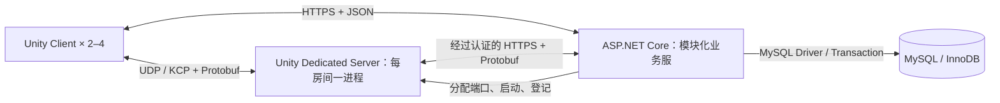

# Norn 2–4 人合作副本联机系统总体执行方案

> **执行方式：** 用户审核本计划后，使用 `superpowers:executing-plans` 在当前工作区按阶段实施；本任务未授权 SubAgent，不另建 worktree。每阶段完成后由开发者在 Unity Editor / 独立客户端中验收，再进入下一阶段。本文件包含设计依据与执行计划，不另建 spec。

**Goal：** 在保留现有单机 Demo 的基础上，实现 2–4 人连接独立服务器合作刷副本，支持权威战斗、共享材料世界、独立线上资产、可靠结算和断线重连。

**Architecture：** ASP.NET Core 模块化业务服负责账户、资产、组队、房间调度和结算；每个房间由一个 Unity Dedicated Server 进程运行权威模拟。MySQL 保存长期数据，实时通信采用 UDP / KCP，Gameplay 消息体采用 Protobuf；客户端负责输入、预测和表现。

**Tech Stack：** Unity 6000.3.16f1 / C#；ASP.NET Core / .NET 10 LTS；MySQL 8.4 LTS / InnoDB；Mirror + KcpTransport；Google.Protobuf；MySqlConnector + Dapper。Mirror 与数据库访问库属于本方案新增的工程建议，需随本计划一起审核，不代表用户在此前已逐项指定。

**Spec：** 本轮完整对话、用户确认的技术栈与线上资产隔离，以及仓库 `AGENTS.md`。日期：2026-10-20。

**状态：** 方案已形成，尚未批准实施；本轮只新增本文件。当前没有联机代码、依赖安装、数据库建库、服务器构建、Profiler 或多人运行结果。文中参数是起始设计值，验收目标不是已取得的性能结论。

## 1. 已确认的边界与首版玩家体验

### 1.1 用户已经确认的选择

| 项目 | 确认内容 |
|---|---|
| 游戏规模 | 2–4 人合作副本，不扩展为 MMO 持续大世界 |
| 拓扑 | 独立副本服务器；任何一名玩家退出，其他玩家仍能继续 |
| 业务服 | ASP.NET Core |
| 副本服 | Unity Dedicated Server，Gameplay 使用 C# |
| 数据库 | MySQL |
| 实时通信 | UDP + KCP + Protobuf |
| 开发与部署 | 先本机开发，后续再租服务器 |
| 资产边界 | 首版线上角色资产与单机存档隔离，不导入单机装备、法杖和货币 |
| 当前工作 | 形成执行方案，解释选择、放弃项和 trade-off；不编码 |

### 1.2 本方案补足的首版规则

下列内容是使方案可执行的建议默认值，需要随计划审阅，不冒充此前已经确认的玩法需求。

- 入口为“单机 / 联机”两个独立模式；线上整备界面读取线上资产，不复用本地 Profile 作为数据源。
- 首版通过房间列表或房间码邀请，最多 4 人；未开局可以加入，开局后仅允许原成员重连，暂不支持陌生玩家中途补位。
- 四名玩家先使用 Wizard 路径；保留 Warrior / Archer 和 NPC/Boss 的现有实现，不为联机清理它们。变形术的跨端支持列入相应法术验收。
- 首个联机内容是一张独立合作副本，包含普通遭遇、法杖施法、材料反应、Boss 与撤离结算；先用测试 Arena 证明链路，再装配正式地图。
- 队长只负责大厅准备和开始请求。队长退出后按加入顺序移交；队长没有关闭运行中副本的权限。
- 断线保留角色和席位 60 秒，停止接受该连接的输入，角色仍存在并可受伤；超过窗口按放弃处理。其他人继续游戏。
- 首版失败/放弃不带出本局新增收益，返还入局前资产；成功撤离提交合法的最终携带状态。此规则只作用于新增联机模式，不改现有单机死亡清算。
- 首版不开放玩家间资产转让。玩家丢出的入局资产仍绑定原持有者；副本生成的共享掉落可以竞争拾取，但一个实例只能被取走一次。这避免个人提前撤离与副本崩溃回滚组合导致复制资产。
- 副本进程崩溃时，首版结束该副本并按未结算成员的入局快照回滚；不承诺恢复同一场 Boss 战。已经完成的个人结算保留，不再次提交。

### 1.3 本期明确不做

MMO 地图分服、无缝跨服、Host Migration、跨副本交易、拍卖行、语音、公共随机匹配、PvP Lag Compensation、可任意加入的持续世界、整场物理 Rollback、商业级高可用容灾均不进入首版。世界/好友聊天等业务能力后续增量开发；不把“架构允许接入”描述成已经实现。

## 2. 选择、放弃与 trade-off 总表

“首版不采用”表示当前范围的取舍，不代表该技术无用或永久禁止。

| 部分 | 本方案选择 | 首版不采用 / 暂缓 | 原因与承担的代价 |
|---|---|---|---|
| 网络拓扑 | Dedicated Server，Server Authority | 玩家 Host / P2P / Relay 作为权威主机 | 满足玩家退出不结束副本；代价是需要独立计算资源和运维 |
| 业务框架 | ASP.NET Core，模块化单体 | Spring Boot、多个 Microservices | 用户已选 C# 路线，减少双语言维护；放弃本次同时系统学习 Java 的收益 |
| 副本运行环境 | Unity Dedicated Server | 普通 Java/.NET 重建整套战斗模拟 | 复用 Scene、Physics、AI、法术链；承担 Unity Runtime 的内存和生命周期约束 |
| 数据库 | MySQL 8.4 / InnoDB | PostgreSQL、SQL Server | 用户熟悉且当前需求能满足；不为了技术栈名称更换数据库，也不获得 PG 特有扩展能力 |
| 数据访问 | MySqlConnector + Dapper + 版本化 SQL | EF Core 作为首版 ORM、直接拼 SQL | 明确展示资产事务与锁范围，避免 Provider 版本耦合；需要自行维护 SQL 和迁移 |
| 实时传输 | KcpTransport 的 Reliable 与 Unreliable | 所有实时消息统一走 TCP；从零实现 ARQ | 可按消息时效选择交付方式，复用现有 KCP；需要管理更新频率、MTU、队列与带宽 |
| Unity 网络框架 | Mirror + KcpTransport | NGO + UTP、FishNet 默认 Transport、自研完整 Networking Framework | Mirror 与已选 KCP 的接合直接，复用连接/认证/对象生命周期；移动 Prediction 仍需适配，不能靠默认 NetworkTransform 宣称完成 |
| 消息体 | `.proto` 单一来源、Google.Protobuf 生成 C# | 手写两端 DTO、人工复制旧 Common/Protocol DLL | 保持消息契约一致；需要代码生成、版本和分配预算管理 |
| 业务接口 | HTTPS + JSON；服务间 HTTPS + Protobuf | 所有请求都强制经 KCP；首版引入 gRPC | Web API 调试与认证更直接；明确接受业务接口与实时协议两套入口 |
| 模拟同步 | 输入上报 + 权威 Snapshot + 本地移动 Prediction | 只广播客户端 Transform、Deterministic Lockstep | 防止客户端直接决定结果，适应 Unity Physics；需要输入历史、校正与插值 |
| 材料世界 | 服务器 CPU Grid 权威，客户端只读副本并渲染 | GPU PBF 作为服务器玩法权威；只同步水火 VFX | 无 Graphics Device 环境可运行，保留物质数量与反应；需要 Chunk 增量和多玩家 Interest |
| 长期资产 | MySQL 权威；局内有受控资产租约 | 把本地 JSON 当线上权威；每次攻击同步查库 | 保持安全边界和实时预算；需要入局移交、版本、租约、幂等结算 |
| 单机与联机 | 两套 Profile，复用领域规则 | 直接上传本地存档成为线上资产 | 用户已确认隔离；不能直接把单机已积累装备带入线上 |
| 房间隔离 | 一房间一个 Unity 进程 | 一进程多房间/多 PhysicsScene | 简化 static、EventBus 与故障隔离；更多进程启动和内存开销 |
| 部署 | 本机 → 受控远端私测 → 按负载拆机 | 初期 Kubernetes、自动跨区调度 | 先证明玩法闭环；容量扩展和商业公网加固另有明确 Gate |
| 周边中间件 | 首版 MySQL + 进程内有界状态 | Redis、Kafka、RabbitMQ、独立匹配集群 | 减少故障面；容量达到实际瓶颈后再按测量增加 |

.NET 10 是当前可选的 LTS 基线；本机本轮只检测到 SDK **8.0.302**，执行 N0 时需要准备 .NET 10 SDK，不能假设已经安装。[Microsoft 支持策略](https://dotnet.microsoft.com/en-us/platform/support/policy)

## 3. 进程、构建产物与部署

本机阶段四类进程都可以运行在一台电脑上；以后业务服、副本服、数据库可以同机，也可以分机。不同进程不共享对象引用，通过明确接口通信。Linux 是后续部署目标，不能将不同构建产物视为相同程序。

| 构建物 | 内容 | 运行要求 |
|---|---|---|
| Unity Client | 输入/UI/Rendering/客户端网络、预测、必要的静态碰撞数据 | 玩家电脑；首版 Windows x64 |
| Unity Server Build | Unity Runtime、权威场景、Physics、Gameplay、服务器网络 | 本机 Windows Server Build；后续 Linux x64 Server Build，无需 Unity Editor |
| ASP.NET Core Publish | 业务程序、依赖、配置；默认 framework-dependent | 对应 .NET / ASP.NET Core Runtime；无需 Unity Runtime |
| MySQL | 独立数据库服务及持久数据目录 | 由业务服通过驱动连接，不作为玩家客户端接口 |

服务器构建不能自动将单机代码变为联机，也不能假设 GPU Compute 能在无 Graphics Device 的构建中运行。[Unity Dedicated Server 构建](https://docs.unity3d.com/6000.3/Documentation/Manual/dedicated-server-build.html)、[优化与 Graphics Device 边界](https://docs.unity3d.com/6000.3/Documentation/Manual/dedicated-server-optimizations.html)

业务服采用一个可部署应用，内部按 Accounts、Profiles、Inventory、Parties、Rooms、Settlements 分模块。`RoomLauncher` 是内部模块，不先拆成微服务。副本通过独立子进程启动，业务服重启不能因父进程退出自动销毁已运行的副本；重启后通过数据库登记与服务器认证 Heartbeat 重新接管。

## 4. 状态权威与完整玩家链路

### 4.1 每份状态只有一个有效写入者

| 状态 | 权威 Owner | 客户端职责 / 其他服务职责 |
|---|---|---|
| 账户、登录 Session、角色归属 | 业务服 | 客户端提交请求，数据库持久化 |
| 仓库、钱包、未进入副本的装备 | 业务服 | UI 显示只读快照，通过请求改变 |
| 入局期间携带资产 | 有效 RoomEpoch 下的副本资产服务 | 业务服保留原始快照并锁定冲突操作；客户端仅预测界面 |
| 位置、HP、Status、Mana、冷却、法杖执行版本 | 副本服 | 客户端可以预测部分表现，不提交“最终结果” |
| AI、Boss 阶段、Projectile、掉落与材料世界 | 副本服 | 客户端渲染权威状态 |
| 结算记录与最终资产落库 | 业务服 | 验证服务器身份、局次、Epoch、版本和合法变化，再提交 Transaction |
| 连接、输入历史、插值缓存 | 各端局部运行状态 | 有界、可清理；不能据此发放长期资产 |

客户端永远不提交可直接采信的 Damage、奖励数量、可用 Mana、掉落归属或完整新 Profile。副本服也不能仅凭“来自服务器网络”的请求修改任意角色：其服务凭据绑定实例、房间、局次和 Epoch。

### 4.2 登录、入局、战斗与返回

1. 客户端通过 HTTPS 登录，业务服验证账户并返回短期 Session；客户端不保存明文密码。
2. 读取线上角色与资产版本，在大厅请求创建/加入房间；开始前锁定四人席位和 ContentManifestHash。
3. 业务服在 Transaction 中为参与角色建立资产租约与入局快照，再分配副本实例。启动失败时按相同 Epoch 回滚租约，不能吞掉装备。
4. 副本启动后以实例凭据领取入局快照；Ready 成功后，业务服向各成员签发一次性 JoinTicket。Ticket 默认 60 秒过期，绑定 PlayerId、RoomId、RoomEpoch、Build/Protocol/Content 版本。
5. 客户端完成 Transport 连接与入场认证。服务器以连接上下文决定 ActorId，不信任请求里自报的 OwnerId。通过认证前只接受有限的握手消息。
6. 接收实体、库存、法杖执行状态、Boss 和材料世界 Baseline；客户端确认 SnapshotId 后进入可操作状态。
7. 玩家输入 → 副本校验 → 移动/施法/Physics/材料反应 → 权威事件与 Snapshot → 本地预测校正、远端插值和表现。
8. 在服务器开放的出口请求撤离；服务器冻结该成员的结算候选，业务服验证并持久化。成功确认前保留候选和租约，失败可重试。
9. 客户端收到已提交结果后回线上整备界面；其余队友继续副本。若响应丢失，查询同一结算 ID 的状态，不重新执行奖励生成。

### 4.3 ID、版本与租约

| 字段 | 意义与规则 |
|---|---|
| PlayerId / ItemInstanceId | 服务器创建的长期身份，数据库唯一；ContentId 仍表示物品定义，不代替实例 ID |
| RoomId / RunId | 大厅房间与一次实际副本分别标识，不混成一项 |
| RoomEpoch | 同一房间实例更替的 fencing token；旧进程即使恢复也不能提交新结果 |
| NetEntityId | 本局网络实体身份，可映射 Mirror netId；不能使用 GetInstanceID 作为跨端身份 |
| ConnectionEpoch | 同一玩家重连后递增，旧连接与旧输入失效 |
| InputSequence / CommandId | 输入排序、离散指令去重；相同 ID 配不同内容直接拒绝 |
| InventoryVersion / ProgramRevision | 拒绝基于旧库存或旧法杖程序的写操作 |
| SettlementId | 对每名成员一次最终结算稳定不变；重试返回同一结果 |

实例 Heartbeat 初始 15 秒一次，租约 120 秒；副本无法续租超过 60 秒后进入 Frozen，停止权威 Gameplay Tick 与新的资产提交，继续连接管理并通知玩家等待。这是服务故障保护，不是某名玩家的菜单暂停。业务服判定失效后先推进 Epoch/冻结提交资格，再恢复未结算成员资产；副本重新获得网络后也不能越过 fencing。上线时使用服务端时间判定租约，不信任客户端时间。

## 5. 实时协议、Networking Framework 与分配预算

### 5.1 版本与契约

采用 Mirror **v96.11.3** 作为首轮兼容验证版本，引用官方发布包/固定 tag，不从 master 浮动拉取。Google.Protobuf **3.34.2**、对应 protoc **34.2**、MySqlConnector **2.6.2**、Dapper **2.1.79** 作为候选锁定版本；N0 必须验证包实际下载内容、依赖、安全通告与 Unity API 兼容性，并形成带 Hash 的 dependency-lock.json。发现不兼容时不静默升级，记录原因与替代版本后更新本计划。

这些版本是可查的候选，不是声称已经在本工程验证。[Mirror 发布页](https://github.com/MirrorNetworking/Mirror/releases/tag/v96.11.3)、[Google.Protobuf 包](https://www.nuget.org/packages/Google.Protobuf/3.34.2)、[MySqlConnector 包](https://www.nuget.org/packages/MySqlConnector/2.6.2)、[Dapper 包](https://www.nuget.org/packages/Dapper/2.1.79)

`.proto` 放在 `Shared/Protocol/Protos/`，统一生成到 `Assets/_Project/Scripts/NetworkProtocol/Generated/`。独立的 `Shared/Protocol/Game.NetworkProtocol.csproj` 链接同一份生成源码，供 ASP.NET Core 编译；Unity 用 `Game.NetworkProtocol.asmdef` 编译。两端使用同版本 Protobuf Runtime，不手动复制旧 MyMMO 的 Common.dll/Protocol.dll。

业务 HTTPS 的 JSON body 使用这些生成消息的 ProtoJSON 映射，由 JsonFormatter/JsonParser 转换；不额外手写一套字段含义不同的 Unity DTO。它属于离散请求路径，允许正常解析分配；实时 Tick 的二进制 Codec 另按分配 Gate 验证。

Protobuf 仅规定自定义消息体。Mirror 自己的握手、时间同步、对象生成和批处理 Header 使用其原协议；不声称每个网络字节都是 Protobuf。通过自定义 NetworkMessage Serializer 将 MessageKind 与受限长度的 Protobuf payload 接入，不把 Protobuf 对象再次逐字段交给 Mirror 自动序列化。[Mirror NetworkMessage 扩展](https://mirror-networking.gitbook.io/docs/manual/guides/communications/network-messages)

客户端和副本同时校验 ProtocolVersion、BuildVersion、ContentManifestHash，不匹配就拒绝进入。新增字段使用新 field number；删除字段保留 reserved；不复用编号，不将 .NET 类型名当作线上消息 ID。[Protobuf 官方说明](https://protobuf.dev/overview/)

### 5.2 交付语义与容量

| 消息 | 交付策略 | 应用层约束 |
|---|---|---|
| 移动输入 | Unreliable，带序号和最近 3 个输入帧冗余 | 服务器排序去重，拒绝异常前跳和过期输入；丢包不能令角色永久保持按键 |
| Cast / Interact / Extract | Reliable，带 CommandId | 重复只返回旧结果；队列有界，校验 Actor、版本、距离和时机 |
| 移动/HP/Mana/动作 Snapshot | Unreliable，带 Tick、最后已处理 InputSequence | 新快照可以替代旧快照；重要状态也包含在重连 Baseline |
| Spawn / Despawn / Boss 阶段事件 | Mirror 生命周期 + 可靠 Gameplay 事件 | 状态以最新 Snapshot/Baseline 收敛，事件另有去重序号 |
| 库存收据、结算状态 | Reliable；长期结果再从业务服查询 | 可靠传输不代表业务只执行一次 |
| Chunk Baseline / Delta | 有界分块 Reliable，带基线与修订号 | 保留独立应用队列和限速；缺版本请求补基线 |

普通单消息体目标不超过 900 bytes；UDP 包目标不超过 1200 bytes，必须测量实际 Header 与加密开销，不能将此数字当作所有网络的保证。大世界状态按 Chunk/Page 分块，不发送一个巨型完整世界 Protobuf。

首轮容量配置为：4 名玩家、64 个同时存活的敌人、256 个权威 Projectile；每玩家 128 帧输入历史、256 条待处理离散指令，每客户端 256 条控制消息和最多 4 MiB 世界待发页。以上是实验上限，不是容量证明。队列满时合并可替代的移动 Snapshot、对新的离散操作返回 Busy；世界页超限则取消该次基线并重新同步。不能静默丢库存收据或让集合无限增长。Projectile 容量在施法 Reservation 提交前校验，容量不足拒绝本次对应输出并遵循现有取消/回滚语义，不能扣完资源再少发一半弹。

Mirror KCP 的 Reliable 与 Unreliable 不等于任意数量的独立可靠流。控制消息优先于尚未入 Transport 的世界分块；批量数据限制在途窗口，不能靠“高优先级”绕过已经排队的可靠消息。N0/N5 必须注入丢包验证是否拖慢控制消息。KCP 的确认与重传由现有库负责，不自研 ARQ。[KCP 最佳实践](https://github.com/skywind3000/kcp/wiki/KCP-Best-Practice)

### 5.3 不虚报 Zero GC 与安全能力

禁止在新增 Update/Tick 热路径直接 new 消息、ToByteArray、创建闭包、LINQ 或 Boxing。高频 Protobuf 使用预热消息池、预分配 Writer/Buffer、固定上限及尽量平坦的数值字段；重复 primitive 容器复用容量。嵌套消息解析、ByteString、RepeatedField 清空后再填充都要实际测分配，不能以“用了对象池”代替证据。

若第三方序列化或 Transport 仍持续分配，就记录为未解决的 Gate，修复或调整该路径后再验收；不擅自降低仓库 Zero GC 要求。连接、加载和离散输入允许的分配与每 Tick 持续分配分开报告。

HTTPS 负责业务认证与加密。KCP 本身不提供加密或服务器身份认证。远端非回环测试采用 Mirror EncryptionTransport 包装 KCP，并通过 HTTPS 业务接口下发期望服务器公钥指纹，在其验证 callback 中核对，不能使用默认 Off 验证模式。**已知风险：该 Transport 官方文档说明当前加密实现有明显分配。** N0 保存其分配基线，N8 的远端验收要求消除持续热路径分配或选择经过验证的等价成熟实现；不能宣称默认组件已同时满足加密与 Zero GC。Gate 失败则继续受控本地开发，不能把未解决版本当作公网完成版。[EncryptionTransport 官方说明](https://mirror-networking.gitbook.io/docs/manual/transports/encryption-transport)

## 6. 模拟时钟、移动与战斗

### 6.1 时钟基线

| 项目 | 起始值 | 解释 |
|---|---|---|
| 权威 Gameplay / Physics Tick | 30 Hz | 每步固定 1/30 秒；不是客户端 Rendering FPS |
| 输入采样/发送 | 30 Hz | 从 Input System 收集；离散按键保留直到被消费 |
| Actor Snapshot | 15 Hz | 每 2 个权威 Tick 一次，降低带宽 |
| 材料模拟 | 10 Hz | 当前 P7/P8 Grid Profile 已为 10 Hz，每 3 个权威 Tick 推进一次 |
| 远端插值缓冲 | 初始 100 ms，可按 RTT/Jitter 调整 | 以少量显示延迟换取连续性，不能让自己的输入也固定等待该缓冲 |
| 输入历史 | 128 帧、固定 Ring Buffer | 用于本地移动校正，超过窗口时硬校正并记录 |
| 每帧最大补跑 | 3 个权威 Tick | 防止无界追债；超时记录 Overload，不通过变大 deltaTime 假装补齐 |

这些是实验起点，N3/N8 可以基于证据修订配置；不承诺尚未测过的 30 Hz 容量。

在线权威模拟由 `AuthorityTickDriver.Update()` 中的固定步长累加器驱动：输入消费 → 角色/AI 与投射物运动准备 → Physics.Simulate → 碰撞/触发与 Status → 到期材料 Tick → 生成 Snapshot。在线场景使用 Script Simulation，避免自动 Physics 与手动 Simulate 重复；CharacterController.Move 仍从 Update 调用，遵守仓库规则。

Physics.Simulate 不会替项目调用 FixedUpdate，因此 ProjectileBase 当前 FixedUpdate 内的追踪/环绕必须抽成显式 Tick；寿命与定时触发也要摆脱渲染帧时间。单机保留原 Update/FixedUpdate 驱动，在线代码不能双重推进。退出在线场景必须恢复 Physics simulationMode 与时间设置。[Physics.Simulate API](https://docs.unity3d.com/6000.3/Documentation/ScriptReference/Physics.Simulate.html)

### 6.2 三种客户端对象职责

- 本地玩家：立即运行移动 Prediction；收到权威位置、垂直速度、Grounded、Dash/动作阶段和已处理输入序号后，恢复运动快照并重放尚未确认的输入，模型做有限平滑。
- 远端玩家与敌人：从 Snapshot 插值，不读取本机 Input，不运行权威 AI、伤害或资源提交。
- 预测 Projectile / VFX：仅作表现，由 CommandId 对应权威生成结果；被拒绝则撤销表现，不在客户端扣敌人 HP 或产生真实材料。

Prediction 只重放本地运动，不对整场 Physics、Boss、材料和其他玩家做 Rollback。动态碰撞造成的误差接受服务器纠正，不能假设相同 Seed 能令不同设备的 Unity/GPU 模拟逐帧相同。Mirror 默认 NetworkTransform 仅可用于 N0 显示验证，不能替代 N3 的完整输入校正验收。

### 6.3 战斗和法杖

服务器沿现有库存执行路径验证 Owned Wand、版本、资格、Mana、次数和 Reservation，再运行 SpellProgramCompiler / SpellProgramMachine，冻结命令与 Trigger payload，最后交给 SpellCaster 与 ProjectileBase。保留 CastEvaluator 给 NPC/Boss 的独立只读程序；不能退回旧的玩家 RunSpellSession 路线。

施法请求只携带 WandInstanceId、CommandId、瞄准意图和声明的版本。服务器从该连接绑定的角色取得真实数据，并验证瞄准原点与角色距离、方向和 Line of Sight；不接受客户端提供伤害、Prefab 路径或剩余资源。

在线攻击以 `ActionTimeline` 的权威 Tick 决定出手、命中窗口和结束；归一化的 Authoring 时间先由 Editor 与动画 Clip 时长导出。客户端 Animator 跟随 ActionStartTick/ActionId 播放。单机原 normalizedTime 路径保留；服务器不能因无画面而停止出手，也不能由客户端动画事件授予命中。

不能把“不依赖 Animator 决定出手”误写成“删除服务器所有 Animator”。若近战命中 Box 的位置依赖武器骨骼，首版服务器保留必要的姿态 Animator 并设置 AlwaysAnimate，仅去掉 Renderer 等表现部分；Timeline 仍决定窗口，姿态只提供受控命中几何。N4 核对姿态采样与 Hit Window，并覆盖同一渲染帧补跑多个 Tick 的情况。后续若改为离线烘焙的命中轨迹，需要独立评审，不能现在用静止武器 Box 替代原攻击。

DamageRequest → IDamageable/HealthComponent → Damage/Death Event 仍是唯一伤害漏斗。Replica 通过专门的状态应用入口更新本地读模型和表现，不能调用 ReceiveHit 再算一次伤害。现有局部 GetInstanceID 继续用于进程内 UI 过滤，由适配层映射 NetEntityId，不把保存契约和本地 ID 全部改名。

## 7. 材料世界同步与 Gameplay 一致性

服务器选择当前 CPU Grid 路线，包括实际启用的液体数量、Fire Cell、固定固体、Gas 和反应状态。客户端接收只读副本，GPU 可用于表面重建或纯视觉细节，不能另外形成可扣血/耗材的玩法权威。该选择有意放弃服务器原样运行 GPU PBF；GPU PBF 保留给原单机或独立实验路径。

当前 P7/P8 Grid Profile 的 `_tickRate` 为 10，`_waterSimulationMode` 为 GridLiquid；兼容策略也保留 GpuPbf 与 LegacyCell。联机配置显式指定 Grid，不依赖 Headless 下静默硬件回退来决定正式 Gameplay。

多玩家 Activity/Interest 采用四名角色需求的并集，加上服务器已有 Projectile、持续 Fire 和反应活动源。不能只跟随队长、单个 Camera，或用四人平均坐标代替并集；两名玩家分开后各自区域仍要推进。Interest 决定向某客户端发送哪些区域，不应让无人可见但尚在反应的世界停止 Gameplay。

每个 Chunk 的消息包含 WorldEpoch、ChunkKey、Generation、BaseRevision、NewRevision、SnapshotId。Baseline 在确定的 Tick T 冻结，复制出有界发送页，同时保留 T 之后的 Delta 日志。客户端完整安装基线后，按修订应用增量，确认后启用相关交互。

缺修订、校验失败、实体尚未 Spawn 或日志被覆盖时，进入有界等待或请求新基线，不猜测补齐。客户端收到旧 Generation 消息直接丢弃，防止 Chunk 回收重建后旧包污染新世界。对数量和材料 ID 做一致性校验，不对视觉三角形逐帧相等作承诺。

N5 必须验收：玩家 A 放水，B 看见且接触结果一致；B 放火，双方看到同一反应与数量变化；掉落材料与库存扣减同一事务提交；断线重连恢复当前世界，而非从开局 Seed 各自重演。

## 8. MySQL 模型、事务与故障恢复

使用 InnoDB、utf8mb4；ID/归属/版本/余额为结构化列，变长法杖程序和物品扩展属性可以用版本化 JSON。货币用整数最小单位，不用浮点数；不把全账号塞成一个每次覆盖的大 JSON。数据库不承担每 Tick 的位置、HP、Projectile 和材料更新。[MySQL 8.4 LTS](https://dev.mysql.com/doc/refman/8.4/en/faqs-general.html)、[InnoDB Transaction](https://dev.mysql.com/doc/refman/8.4/en/innodb-introduction.html)

| 表 / 聚合 | 关键字段或约束 |
|---|---|
| Accounts / AuthSessions | Username 唯一、PasswordHash；Session Token 仅保存摘要和到期时间，日志不输出凭据 |
| Characters | AccountId、OnlineProfileVersion、最后安全整备点；没有客户端直写的离线位置 API |
| Items / ItemLocations | InstanceId 唯一、OwnerCharacterId、ContentId、Revision；一个实例只能有一个有效位置 |
| Wallets / WandPrograms | Balance、Version；WandInstanceId、ProgramRevision、SchemaVersion、程序内容 |
| Parties / PartyMembers | RoomCode、Leader、最多 4 席；成员变更与 ReadyRevision 防止旧准备状态开局 |
| Runs / RunMembers | RunId、RoomEpoch、EntrySnapshot、状态；每成员最多一个活动资产租约 |
| ServerInstances / AssetLeases | 实例身份、端口、Heartbeat、到期时间、Epoch；AssetLeases 以 CharacterId 为主键复用一行，保证每角色最多一个活动资产租约；续租与提交使用条件更新 |
| Settlements | UNIQUE(RunId, PlayerId)、SettlementId 唯一、RequestHash、结果；同 ID 异内容拒绝 |
| SchemaMigrations | Version 唯一、脚本 Hash；上线迁移可追溯，不直接改生产表掩盖差异 |

入局使用短 Transaction 验证版本、锁定携带资产并记录 EntrySnapshot，不跨整场副本持有数据库事务或行锁。其他业务写请求先检查租约，避免仓库、商店与局内同时修改同一资产。

结算在单个 Transaction 中检查成员状态和 RoomEpoch，校验变更来自有效实例、实例 ID 唯一、资源变化受服务端规则约束，再更新资产、写结算结果、结束租约并提交。首次插入幂等键与资产变更同事务完成。网络投递可重试，业务效果至多一次；断线时客户端查询最终状态，不以“没有收到回包”判断没入库。

首版没有玩家间转让，因此异常副本可以对未结算成员恢复 EntrySnapshot 而不复制已转给别人的入局物品。若以后开放交易或自由转交，必须先增加独立持久化转移账本与托管事务，不能沿用该回滚规则。

DS→业务接口断开时，结算候选先保存在实例的可恢复本地 journal，再发送并按相同 SettlementId 重试。候选中不保存账户口令；业务端数据库结果仍是最终依据。数据库长时间不可用时暂停新入局和资产提交，不让客户端覆盖旧版本。

副本崩溃恢复按 RunMembers 逐个裁决：已提交成员保留结果，其余成员在旧 Epoch 失效后回滚入局资产。MySQL 自身丢失数据与机器磁盘损坏不由进程 journal 保证，N8 要单独演练数据库备份恢复；本计划不宣称零数据丢失高可用。

## 9. 当前源码证据、Assembly 与文件改造清单

### 9.1 当前已经核对的迁移切点

| 当前文件 | 已确认事实 | 本计划要求的改造 |
|---|---|---|
| [PlayerControllerBase.cs](</F:/Develop Project/RPG/RPG/Assets/_Project/Scripts/Character/Controllers/PlayerControllerBase.cs>) | 自建 InputSystem_Actions，统一读输入，静态 Current 表示单玩家，Time.timeScale 暂停 | 分离输入来源、模拟和表现；Current 只保留本地玩家语义，服务器用 ActorRegistry |
| [EnemyPerception.cs](</F:/Develop Project/RPG/RPG/Assets/_Project/Scripts/Character/Enemy/EnemyPerception.cs>) | AI 直接读取 PlayerControllerBase.Current | 通过只读角色列表选目标，保留高度圆柱与滞回，不只追队长 |
| [PlayerWizardAttackState.cs](</F:/Develop Project/RPG/RPG/Assets/_Project/Scripts/Character/PlayerStates/PlayerWizardAttackState.cs>) | 出手依赖 Animator.normalizedTime 与 ArrowSpawnTime | 在线改为 ActionTimeline 权威 Tick，单机保留原有路径 |
| [WandExecutionTransactionService.cs](</F:/Develop Project/RPG/RPG/Assets/_Project/Scripts/Run/Spells/WandExecutionTransactionService.cs>) | Run 拥有 Reservation、版本、资源与有限收据窗口 | 复用领域语义，每个线上 Actor 单独持有；连接上下文生成 CallerId，不能按客户端自报值选择他人资产 |
| [SpellProgramMachine.cs](</F:/Develop Project/RPG/RPG/Assets/_Project/Scripts/Skills/Programming/SpellProgramMachine.cs>) | 解释器构建候选，不拥有真实库存；仍引用 UnityEngine | 放在 Unity 副本服执行，不强行搬进 ASP.NET Core；维持现有预算与冻结 Trigger 语义 |
| [ProjectileBase.cs](</F:/Develop Project/RPG/RPG/Assets/_Project/Scripts/Combat/Projectiles/ProjectileBase.cs>) | Update 管寿命/Timed Trigger，FixedUpdate 管追踪/环绕，Physics 回调产生伤害 | 在线显式 Step，避免手动 Physics 下漏推进或双推进；Replica 仅表现 |
| [HealthComponent.cs](</F:/Develop Project/RPG/RPG/Assets/_Project/Scripts/Combat/Damage/HealthComponent.cs>) | GetInstanceID 用于本地 Damage/Death Event 过滤 | 增加受控 Replica 状态应用入口，网络 ID 在适配层映射 |
| [ElementWorldRuntime.cs](</F:/Develop Project/RPG/RPG/Assets/_Project/Scripts/ElementField/Runtime/ElementWorldRuntime.cs>) | 自有 Update 累加器、单 InterestPosition、Grid/PBF 路由 | 显式外部 Step、多人 Interest 并集、权威导出与 Replica 应用，禁止客户端再跑数量模拟 |
| [RunPauseCoordinator.cs](</F:/Develop Project/RPG/RPG/Assets/_Project/Scripts/Run/Runtime/RunPauseCoordinator.cs>) | Pause Reason 最终控制 Time.timeScale 和 Cursor | 单机保留，在线菜单只释放本地输入/Cursor，不暂停服务器或网络时钟 |
| [SinglePlayerInventorySession.cs](</F:/Develop Project/RPG/RPG/Assets/_Project/Scripts/Run/Runtime/SinglePlayerInventorySession.cs>) / [ProfileSaveRepository.cs](</F:/Develop Project/RPG/RPG/Assets/_Project/Scripts/Run/Persistence/ProfileSaveRepository.cs>) | 围绕本地 Profile/文件仓库装配资产 | 线上新增 Session 与只读投影，不让本地 Repository 写线上资产 |

当前 Packages/manifest.json 有 Multiplayer Center，但没有 Mirror / NGO / FishNet 的实际 Networking Runtime。本方案不能写成“已有联网底座只需接上数据库”。当前旧架构导览路径不存在，源码导航采用本轮确认存在的 [A1–A3 学习资料](</F:/Develop Project/RPG/RPG/Assets/_Project/Docs/Norn搜打撤、法术编程/2026-10-20 A1-A3 全局架构场景流程与拾取实现 学习资料.md>)；历史指南不作为当前执行链路的替代证据。

### 9.2 新增模块的依赖方向

| Assembly | 第一方依赖 | 职责 |
|---|---|---|
| Game.NetworkProtocol | 无，noEngineReferences；第三方 Google.Protobuf | 生成的消息契约；可以由 Unity 和 .NET 各自编译 |
| Game.Networking | Core、NetworkProtocol；第三方 Mirror/Transport | 编解码、连接、认证、时间与有界消息队列，不引用 Character/Run/ElementField |
| Game.Multiplayer | Core、NetworkProtocol、Networking、Combat、Skills、Run、Character、ElementField、Materials | 在线场景装配、连接→Actor 映射和跨领域请求适配；不修改领域内部字典 |

现有九个领域模块不反向引用 Game.Multiplayer 或 Mirror。Game.Core 不增加上层依赖。Character / Combat / Run / ElementField 提供各自受控接口；UI/Rendering 继续通过事件、只读契约和请求工作。网络包只在适配层转成进程内 EventBus 的 struct 事件，EventBus 本身不跨进程。

拆成三套新 Assembly 的代价是多维护几组显式契约，收益是业务服可编译纯协议、Codec 不被角色/库存实现牵连，Gameplay 不依赖 Mirror。首版不继续拆更多任务专用程序集；若后续出现新的真实领域依赖，再单独评审。

### 9.3 新文件落点与责任

下列均为执行期计划创建，本轮没有创建项目或代码。目录按职责命名，不使用 N0/N1 等阶段名作为生产资源目录。

| 路径 | 责任 / 交付 |
|---|---|
| `Shared/Protocol/Protos/{common,accounts,rooms,inventory,combat,world}.proto` | 身份、业务 JSON 映射、服务间和实时消息的单一 Schema；JSON 接口使用同一 Schema 的 ProtoJSON 映射 |
| `Shared/Protocol/Game.NetworkProtocol.csproj` | 链接同一生成源码，target netstandard2.1；不引用 UnityEngine |
| `Assets/_Project/Scripts/NetworkProtocol/Game.NetworkProtocol.asmdef`、`Generated/*.cs` | Unity 消息契约程序集；文件由生成脚本维护，人工不改生成代码 |
| `Assets/ThirdParty/Networking/Mirror/`、`Assets/ThirdParty/Networking/Protobuf/` | 固定版本依赖与许可；保留上游文件与其 .meta，不复制示例场景到正式目录 |
| `Assets/_Project/Scripts/Networking/Game.Networking.asmdef` | 网络基础层 Assembly |
| `Networking/Runtime/NornNetworkManager.cs`、`ConnectionSession.cs` | 包装 Mirror 启停、连接状态与有限认证状态机 |
| `Networking/Protocol/ProtoMessageCodec.cs`、`ProtoMessagePool.cs`、`OutboundMessageQueue.cs` | 限长解码、可复用 Buffer、消息复位、优先级和速率预算 |
| `Networking/Authentication/JoinTicketAuthenticator.cs`、`ServerKeyValidator.cs` | 入场认证与服务器指纹校验；不把完整日志写成凭据泄漏渠道 |
| `Assets/_Project/Scripts/Multiplayer/Game.Multiplayer.asmdef` | 联机场景组合层 Assembly |
| `Multiplayer/Runtime/OnlineClientBootstrap.cs`、`DedicatedServerBootstrap.cs`、`AuthorityTickDriver.cs` | 各构建角色初始化、配置、唯一 Tick 调度、退出时恢复 Unity 全局状态 |
| `Multiplayer/Actors/NetworkActorRegistry.cs`、`PlayerInputBridge.cs`、`ActorSnapshotBridge.cs`、`LocalMovementPrediction.cs` | 身份绑定、输入队列、读模型 Snapshot、校正与插值接合 |
| `Multiplayer/Combat/ServerCastBridge.cs`、`ProjectileReplicationBridge.cs`、`CombatEventReplicationBridge.cs` | 连接意图转成领域请求，将权威结果转成网络快照，不另算一套伤害 |
| `Multiplayer/World/WorldInterestCoordinator.cs`、`WorldReplicationCoordinator.cs` | 四人兴趣并集、Chunk 基线与增量传输、重连版本屏障 |
| `Multiplayer/Inventory/OnlineInventoryBridge.cs`、`Services/RunSettlementClient.cs`、`RunSettlementJournal.cs` | 线上只读库存连接、权威结算请求与可恢复重试 |
| `Assets/_Project/Scripts/Core/Contracts/GameplayExecutionMode.cs`、`PlayerSimulationFrame.cs`、`ICombatActorRosterReadOnly.cs`、`IAuthorityTickParticipant.cs` | 与 Transport 无关的模式、运动快照、角色查询和显式模拟契约；同职责的值类型与接口放在所属文件内 |
| `Assets/_Project/Scripts/Core/Events/OnlineGameplayRequestEvents.cs` | 进程内带 ActorId 的受控请求/收据事件，struct + IGameEvent |
| `Assets/_Project/Scripts/Combat/Timing/ActionTimeline.cs`、`ActionTimelineDefinition.cs` | 权威动作时序及 Authoring 数据，不依赖 Networking |
| `Assets/_Project/Scripts/Run/Online/OnlineInventorySession.cs`、`OnlineDungeonAssetService.cs`、`OnlineInventoryReadModel.cs` | 在 Run 内复用 ItemOwnershipStore、法杖事务与资产规则；Authority 与 Replica 入口分开 |
| `Assets/_Project/Scripts/ElementField/Replication/WorldReplicationSource.cs`、`WorldReplicaStore.cs`、`WorldReplicaFrame.cs` | 由世界 Owner 导出受控状态；Replica 写入口只接受已验证网络修订 |
| `Assets/_Project/Scripts/UI/Online/OnlineLobbyController.cs`、`OnlineInventoryViewBinding.cs`、`OnlineConnectionStatusView.cs` | 登录组队、线上资产只读绑定、重连/结算状态；不引用 Character 或 Mirror |
| `Server/Norn.Online.sln`、`Norn.Business/Norn.Business.csproj` | .NET 10 模块化业务服务解决方案与入口 |
| `Server/Norn.Business/Features/Accounts/{AccountEndpoints,AccountService,AuthSessionRepository}.cs` | 注册、PasswordHasher 验证、短期 Session 与限流 |
| `Server/Norn.Business/Features/Inventory/{InventoryEndpoints,InventoryService,InventoryRepository}.cs` | 线上 Profile、仓库、钱包与版本校验 |
| `Server/Norn.Business/Features/Rooms/{RoomEndpoints,RoomService,RoomLauncher,RoomLeaseService}.cs` | 队伍/Ready、子进程启动、端口分配、JoinTicket、租约与重启后重接管 |
| `Server/Norn.Business/Features/Runs/{RunEntryService,SettlementService,SettlementRepository}.cs` | 入局快照、Epoch、幂等结算和孤儿局次恢复 |
| `Server/Norn.Business/Infrastructure/MySqlConnectionFactory.cs`、`Migrations/001_InitialOnlineSchema.sql` | 连接池边界、SQL Migration 与 Hash 记录；连接字符串不进入仓库 |
| `Server/Norn.Business/Content/ContentManifestValidator.cs` | 读取 Editor 导出的不可变内容清单，校验版本和资产变更，不加载 Unity SO |
| `Assets/_Project/Editor/Networking/OnlineBuildTools.cs`、`ContentManifestExporter.cs`、`OnlineSceneSetup.cs` | 在 Game.Project.Editor 内生成两端构建、内容清单和显式场景装配 |
| `Assets/_Project/ScriptableObjects/World/Multiplayer/{OnlineNetworkProfile,CoopDungeonDefinition}.asset` | Tick、容量、地图入口、掉落/退出等可审阅配置；Unity 创建 .meta |
| `Assets/_Project/Scenes/Tests/MultiplayerAuthorityLab.unity` | 两客户端 + 无画面服务器的最小验证图 |
| `Assets/_Project/Scenes/Multiplayer/{OnlineLobby,CoopDungeon}.unity` | 正式线上入口与合作副本，复用既有环境资产，不复制一套单机资产权威 |
| `Assets/_Project/Prefabs/Multiplayer/{OnlineWizard,OnlineDungeonRoot}.prefab` | 网络身份与在线装配，模型/Animator/Projectile 引用复用既有内容 |
| `Tools/Networking/{GenerateProtocol,Run-UnityChecks,Run-OnlineAcceptance,Start-LocalOnline,Stop-LocalOnline}.ps1` | 确定性生成、测试、启动和按本次实例清单停止进程；不按进程名批量杀用户程序 |
| `Tools/Networking/dependency-lock.json`、`Server/Directory.Packages.props`、`Server/global.json` | 锁依赖版本/Hash 与实际安装的 SDK，不使用浮动版本 |
| `Assets/_Project/Tests/Networking/`、`Tests/MultiplayerPlayMode/`、`Server/Norn.Business.Tests/` | 网络规则、多人 Unity 路径、实际 MySQL 事务集成测试 |
| `Assets/_Project/Docs/2026-10-20 联机系统开发解析（更新中）.md` | 实施期唯一阶段讲解文档，每个 Task 完成后更新，不把计划写成已完成记录 |

表中 `Networking/...`、`Multiplayer/...` 是各自 `Assets/_Project/Scripts/` 下目录的简写，其余路径从仓库根目录起算。

### 9.4 必须修改的既有文件

| 既有路径 | 改动边界 |
|---|---|
| `Assets/_Project/Scripts/Character/Controllers/PlayerControllerBase.cs`、`WizardController.cs` | 输入与显式模拟入口、不同角色职责、预测快照；单机原模式默认不变 |
| `Assets/_Project/Scripts/Character/PlayerStates/PlayerWizardAttackState.cs`、共享移动 States | 在线 deltaTime/动作时钟从参数取得，Snapshot 包含所有影响重放的运动状态；不在每帧创建 State |
| `Assets/_Project/Scripts/Character/Controllers/EnemyControllerBase.cs`、`Enemy/EnemyPerception.cs`、`Enemy/States/{EnemyAttackState,EnemyRangedAttackState,EnemyHurtState}.cs`、`Enemy/Boss/Runtime/{WizardBossController,BossCastState}.cs` | 在线仅服务器推进 AI；多目标查询；敌人近战/远程出手、Hurt 与 Boss cast 都跟随统一时钟，不能残留对无 Animator 的依赖 |
| `Assets/_Project/Scripts/Character/Spells/{OwnedWandCastAdapter,SpellCaster,OwnedWandFireScheduler}.cs` | 输入与执行分离、权威/预测对象区分、服务器 Caller 与冻结执行结果 |
| `Assets/_Project/Scripts/Combat/Projectiles/{ProjectileBase,ThrownContainerProjectile}.cs`、`Melee/MeleeHitDetector.cs`、`Status/{AreaDamage,StatusController}.cs`、`Damage/HealthComponent.cs` | 显式 Tick、单一伤害权威、Replica 应用；投掷重试、近战查询、区域伤害和 Status 不能在自动 Update 中重复推进；保留离散生成和现有 NPC/Archer 使用方式 |
| `Assets/_Project/Scripts/Run/Spells/WandExecutionTransactionService.cs`、`Inventory/ItemOwnershipStore.cs` | 只增加线上 Session 可复用的受控入口；不公开可任意修改的字典，不绕过 Reservation |
| `Assets/_Project/Scripts/ElementField/Runtime/ElementWorldRuntime.cs` 及其 Activity/InventoryTransfers partial | 外部 Tick 模式、多人 Interest、复制观察点与数量事务结果；原单机自动驱动保留 |
| `Assets/_Project/Scripts/Run/Runtime/RunPauseCoordinator.cs` | 根据执行模式选择世界暂停或仅本地输入暂停 |
| `Assets/_Project/Scripts/UI/DemoMainMenuController.cs`、现有库存 View 的绑定入口 | 增加独立线上入口并绑定线上读模型；不将 UI 变成资产 Owner |
| `Assets/_Project/Scripts/{Rendering/Game.Rendering,UI/Game.UI}.asmdef` | 服务器构建排除表现部分，必须先确认不存在反向引用；不手动删 Package 来掩盖依赖 |
| `Packages/manifest.json` / `packages-lock.json`、`.gitignore`、`AGENTS.md` / `CLAUDE.md` | 记录实际依赖、构建输出/secret 排除、新 Assembly 依赖和维护入口 |

现有 SinglePlayerProfile 可以作为 Run 内部可复用的资产聚合类型，类名不等于必须读取本地存档；线上 Session 必须使用线上数据与内存服务装配。业务服只引用纯协议/内容契约，不引用整个 Game.Run 或 UnityEngine。

## 10. 阶段任务与可执行验收

所有阶段均执行“失败用例 → 最小实现 → 必要自动测试 → 完整玩家路径 → 开发者 Gate”。以下测试名、接口和脚本为执行期约定，本轮没有实际运行它们。每完成一个 Task，在唯一联机讲解文档中写清症状/证据、原理、责任边界、取舍、验证与限制。

### N0：验证选型能在当前工程运行

**目标：** 先排除 Unity/Transport/Protobuf/Headless 的硬性不兼容，再展开正式开发。

**主要文件：** dependency-lock、GenerateProtocol、Run-UnityChecks、Run-OnlineAcceptance；NetworkProtocol、ProtoMessageCodec/Pool；最小 NornNetworkManager、DedicatedServerBootstrap；MultiplayerAuthorityLab；Server 解决方案及 Smoke Tests。

**接口：** `ProtoMessageCodec.TryDecode(MessageKind kind, ArraySegment<byte> payload, out ProtocolMessageLease lease)`；lease 必须释放回池，非法长度不入 Gameplay。`DedicatedServerBootstrap.StartServer(ServerLaunchOptions options)` 接收配置路径/房间标识，返回 Ready 或明确错误。

- [ ] 准备 .NET 10 SDK 和 Unity 对应 Server Build Support，记录工具版本；确认当前 8.0.302 不被误用为 .NET 10。
- [ ] 固定 Mirror/Protobuf 等候选版本与许可；建立单一 Schema 生成，连续生成两次文件内容一致。
- [ ] 写 `ProtoCodecTests.ReusedMessage_DoesNotKeepPreviousFields`、`OversizedPayload_IsRejectedBeforeParsing`、`ProtocolVersionMismatch_IsRejected`，先观察失败，再接通 Codec。
- [ ] 独立 Server Build + 两个 Client Build 做认证前 Ping/认证后有界 Snapshot；停止任一客户端，服务器和另一客户端继续。
- [ ] 验证高频 Codec/Transport 的容量、分配与帧调度；单列 EncryptionTransport 已知分配，保存 CPU/GC 证据和整改项。
- [ ] 用无 Graphics Device 的真实 Server Build 验证 Grid 初始化和 10 Hz 推进；不能用 Editor Play 代替此证据。

**验证：** `Run-OnlineAcceptance.ps1 -Case ProtocolSmoke`，以及 `Run-UnityChecks.ps1 -Suite NetworkingEditMode`。输出原始 XML/JSON、包 Hash、Server 日志和 Profiler 记录。

**开发者 Gate：** 在本机实际看到两个客户端连同一进程、错版本被拒、无画面 Grid 可推进；基础热路径不满足预算则不进入正式模拟改造。加密风险允许登记到 N8，但必须显式保持“尚未通过远端验收”。

### N1：账户、线上 Profile 与 MySQL 事务

**主要文件：** Server Features/Accounts、Inventory、Migrations、ContentManifestValidator；ContentManifestExporter；UI OnlineLobbyController 的登录/角色读取部分。

**接口：** `AccountService.LoginAsync(LoginRequest request, CancellationToken ct)`；`InventoryService.GetProfileAsync(PlayerId player, CancellationToken ct)`；`TryApplyInventoryAsync(PlayerId player, uint expectedVersion, InventoryOperation operation, string commandId, CancellationToken ct)`。接口只从认证上下文取得 PlayerId。

- [ ] 创建只供测试的 MySQL Schema，加入索引/唯一约束和版本化迁移；使用 PasswordHasher 而非自制密码算法。
- [ ] 写并通过 `OnlineProfileTests.LocalSave_IsNeverImported`、`InventoryTransactionTests.ConcurrentMove_OnlyOneVersionCommits`、`RepeatedCommand_ReturnsOriginalResult`。集成测试连接真实隔离 MySQL，不能用内存 Repository 替代事务测试。
- [ ] 导出 ContentManifest，验证客户端/副本/业务服一致的 ContentId 与版本；不存在的内容 ID 不能生成物品。
- [ ] 让本机客户端登录并查看线上新角色；业务服/客户端重启后资产仍存在，原单机档 Hash 不变。

**验证：** `dotnet test Server/Norn.Online.sln --configuration Release --filter "Category=DatabaseIntegration|Category=Accounts"`；`Run-OnlineAcceptance.ps1 -Case OnlineProfileIsolation`。

**开发者 Gate：** Editor 中单机/联机入口确实隔离；错误密码、过期 Session、旧版本写入失败且不改变资产。

### N2：房间、入场、实例生命周期与资产租约

**主要文件：** RoomService/Launcher/LeaseService、RunEntryService；JoinTicketAuthenticator；ServerKeyValidator；OnlineClientBootstrap；OnlineInventorySession。

**接口：** `RoomService.StartRunAsync(PartyId party, uint readyRevision, CancellationToken ct)`；`RoomLauncher.StartAsync(RunLaunchDescriptor launch, CancellationToken ct)`；`ValidateAndConsumeJoinTicketAsync(JoinTicket ticket, ServerInstanceId instance, CancellationToken ct)`。

- [ ] 先覆盖 `RoomAdmissionTests.FifthPlayer_IsRejected`、`JoinTicket_CannotBeReplayedForAnotherActor`、`StartFailure_ReleasesOnlyMatchingEpochLease`、`OldServerEpoch_CannotRenewOrSettle`。
- [ ] 实现四人准备、启动一次、服务器 Ready 后发 Ticket、断开旧连接、席位上限和角色唯一实例。
- [ ] 子进程使用结构化 ProcessStartInfo 参数，不拼接 shell；Windows 后台无可见窗口。登记本次 PID/端口/实例，不按进程名扫杀。
- [ ] 业务进程重启后重新接管仍存活实例；启动失败、端口冲突和 Ready 超时 45 秒时有可审阅错误与资产恢复记录。

**验证：** `Run-OnlineAcceptance.ps1 -Case RoomLifecycle`；数据库集成测试验证资产锁定期间商店/仓库冲突请求被拒。

**开发者 Gate：** 两名玩家入同局，队长退出后另一人继续；故意令 Server Build 路径无效后，两人的装备仍可使用且没有永久租约。

### N3：角色身份、移动 Prediction 与多人 AI

**主要文件：** AuthorityTickDriver、NetworkActorRegistry、PlayerInputBridge、LocalMovementPrediction；PlayerControllerBase/共享 States；EnemyControllerBase/EnemyPerception；Core 运动契约。

**接口：** `PlayerControllerBase.Simulate(in PlayerSimulationFrame input, float deltaTime)`、`CaptureMovementSnapshot()`、`RestoreMovementSnapshot(in PlayerMovementSnapshot snapshot)`；`ICombatActorRosterReadOnly.TryGetActor(int index, out CombatActorSnapshot actor)`。Snapshot 必须包含垂直速度、Dash 阶段、Grounded/坡面和影响后续重放的预算/计时器。

`IAuthorityTickParticipant.StepAuthority(float deltaTime, uint serverTick)` 作为显式推进契约，Driver 以预注册的有界列表按模拟阶段调用；Authority/Prediction/Replica 的登记分开，不在每 Tick 扫描 Scene。现有方法需要保留兼容 wrapper 时，由 wrapper 转调这个唯一实现。

- [ ] 先覆盖 `ActorAuthorityTests.RemoteActor_DoesNotReadLocalInput`、`InputTests.DuplicateOrOldEpoch_DoesNotAdvanceTwice`、`PredictionTests.Reconcile_ReplaysOnlyUnacknowledgedInputs`、`EnemyTargetTests.TwoPlayers_SelectsValidTargetWithHysteresis`。
- [ ] 统一在线 Tick 与手动 Physics；抽出显式运动状态，禁用在线旧自动路径，确认没有双 Move 或双 Simulate。
- [ ] 实现本地预测、服务器确认/重放、远端插值；Snapshot 有界，断线自动清输入而非永久前进。
- [ ] 在线打开菜单只停止本地输入；AI、其他玩家、网络收发仍推进。关闭在线场景恢复单机时间和 Physics 模式。

**验证：** `Run-OnlineAcceptance.ps1 -Case MovementPrediction`。网络测试组合为 RTT 0/100/200 ms，Jitter 0/20/40 ms，丢包 0/1/3%；这些是注入档位，不是真实公网统计。

**开发者 Gate：** 用真实键鼠验证双玩家走/跳/Dash/坡面、菜单、离开/重连前的输入清理；不能仅凭两个 Transform 在屏幕移动通过。

### N4：权威施法、Projectile、Status 与 Boss

**主要文件：** ActionTimeline/Definition；ServerCastBridge、ProjectileReplicationBridge、CombatEventReplicationBridge；现有 WandExecutionTransactionService、SpellCaster、ProjectileBase、HealthComponent、StatusController 与 Boss Cast。

**接口：** `OnlineDungeonAssetService.TryExecuteCast(ulong actorId, in CastIntent intent, out CastReceipt receipt)`；`ProjectileBase.StepAuthority(float deltaTime, uint serverTick)`；`HealthComponent.ApplyReplicatedState(in HealthReplicaSnapshot state)`。后者只应用服务器结果并发布本地表现事件，不重新 Resolve 伤害。

- [ ] 写并通过 `CastAuthorityTests.ForeignWand_IsRejected`、`SameCommand_ConsumesManaOnce`、`InsufficientMana_DoesNotSpawn`、`InvalidAimOrigin_IsRejected`、`ProjectileTests.ReplicaCollision_DoesNotDealDamage`。
- [ ] 用数据化 Timeline 驱动玩家/普通敌人/Boss 出手；法师投射物链验证无 Animator 仍可执行，依赖武器骨骼的近战保留必要姿态求值并核对命中 Box；同时抽出投射物寿命、Timed Trigger、追踪/环绕，以及近战查询、AreaDamage、Status 与投掷重试的显式 Tick。
- [ ] 冻结 Trigger 执行计划，复制权威输出与终止原因；预测效果以 CommandId 对应、确认或撤销。
- [ ] Boss 在服务器选择目标和切阶段；客户端只播放。验证双方同时施法、误报伤害被拒、同队投射物行为及角色死亡。
- [ ] 保留 NPC CastEvaluator 以及 Warrior/Archer 的单机完整链；不将后续变形路径删除。

**验证：** `Run-OnlineAcceptance.ps1 -Case AuthoritativeCombat`，回归现有 Combat/Skills/Character 测试；录制输入→许可→Reservation→出手→命中→UI 的完整链路。

**开发者 Gate：** 双客户端看到同一 HP/Boss 阶段；关闭客户端伤害脚本不影响服务器结果；服务器法师不播放动画仍按正确时间施法，近战武器姿态与命中几何没有因裁剪失真。

### N5：共享材料世界、数量与 Chunk 恢复

**主要文件：** ElementWorldRuntime partial、WorldReplicationSource、WorldReplicaStore/Frame、WorldInterestCoordinator、WorldReplicationCoordinator；联机 Grid Profile。

**接口：** `WorldReplicationSource.TryCaptureBaseline(in WorldReplicaRequest request, WorldReplicaBuffer target, out WorldReplicaHeader header)`；`WorldReplicaStore.TryApply(in WorldReplicaFrame frame, out WorldReplicaFailure reason)`；`ElementWorldRuntime.StepAuthority(float deltaTime, uint serverTick)`。Buffer 复用，读模型不暴露真实 Store 的写权限；世界每个权威 Tick 接收固定 deltaTime，内部仍按 10 Hz 累加器决定何时实际推进材料，不能在 Driver 和世界两边各扣一次时间。

- [ ] 写并通过 `WorldReplicationTests.MissingRevision_RequestsBaseline`、`OldChunkGeneration_IsDiscarded`、`TwoSeparatedPlayers_KeepBothAreasActive`、`ClientReplica_DoesNotRunReactions`。
- [ ] 实现 10 Hz 单写者 Grid 模拟、四人 Interest 并集和全体未结束活动源；服务器不创建材质/Renderer/Compute 依赖。
- [ ] 实现冻结 Baseline + 增量日志屏障、受限分块和重连恢复；对全部启用 Gameplay 材料类型验证数量与状态。
- [ ] 双人交叉施法验证水/火及材料反应、角色接触 Status；使一名玩家离开视野/远离队长，另一侧反应仍完成。
- [ ] 同时发送大基线与连续操作，验证可靠队列未拖住关键指令；超过容量时明确失败或重新请求，不能静默丢数量。

**验证：** `Run-OnlineAcceptance.ps1 -Case SharedMaterialWorld`，对同 WorldEpoch/Revision 比较服务器与客户端的材料 ID/数量 Checksum。

**开发者 Gate：** 玩家看到的水火与角色受到的反应一致；不是仅有同步 VFX。原单机材料生成、投掷、反应和收回回归通过。

### N6：共享掉落、资产结算与失败恢复

**主要文件：** OnlineDungeonAssetService、OnlineInventoryBridge、RunSettlementClient/Journal；SettlementService/Repository；OnlineInventoryViewBinding；共享掉落代理。

**接口：** `TryPickup(ulong actorId, ulong worldItemId, uint expectedRevision, ulong commandId, out PickupReceipt receipt)`；`SettlementService.CommitAsync(SettlementRequest request, ServerIdentity identity, CancellationToken ct)`。相同 SettlementId 与 RequestHash 返回既有结果；内容不同则冲突。

- [ ] 覆盖 `PickupTests.TwoPlayers_OnlyOneReceivesInstance`、`InventoryFull_DoesNotConsumeWorldDrop`、`SettlementTests.ResponseLost_RetryDoesNotDuplicate`、`SameIdDifferentBody_IsRejected`、`ServerCrash_RestoresOnlyUnsettledMembers`。
- [ ] 掉落由副本创建稳定实例 ID，所有权转移走现有候选→验证→提交语义；禁止客户端本地生成奖励，禁止跨玩家转让入局物品。
- [ ] 实现结算 journal、Transaction 与租约结束；落库成功后再释放客户端回大厅，响应丢失时可查询状态。
- [ ] 故障注入：断业务连接、数据库暂时不可达、在提交前/后终止进程、重复发送请求；检查库存守恒、租约及已提交结果。

**验证：** `dotnet test Server/Norn.Online.sln --configuration Release --filter "Category=SettlementIntegration"`；`Run-OnlineAcceptance.ps1 -Case LootSettlementRecovery`。

**开发者 Gate：** 真实拾取→背包→满包拒绝→撤离→线上仓库→重启恢复完整通过；明确复核首版失败/放弃规则是否符合体验后再进入 N7。

### N7：断线重连、地图切换与正式副本流程

**主要文件：** ConnectionSession、OnlineClientBootstrap、ActorSnapshotBridge、WorldReplicationCoordinator、OnlineConnectionStatusView；OnlineLobby/CoopDungeon、服务器 Scene 装配。

- [ ] 覆盖 `ReconnectTests.OldConnectionCannotControlActor`、`BaselineIncludesCurrentBossAndMaterialState`、`LeaderDisconnect_DoesNotEndRun`、`SceneChange_DropsOldEpochMessages`。
- [ ] 重连获取新 Ticket/ConnectionEpoch，恢复原 Actor 和携带状态；不能重新发初始装备或刷新 Mana。60 秒后原席位退出，本局其余成员继续。
- [ ] 转场以服务器 SceneEpoch 为准；清理旧网络实体、订阅和待处理材料页，新的 Baseline 完整后才启用输入。
- [ ] 在正式合作图验收四人准备→普通战斗→材料反应→Boss→个人撤离/队友继续→返回线上整备。
- [ ] 业务服重启但副本存活、队长退出、一个客户端崩溃、最后一人离开等情况下，检查 Room/Run/Lease 状态最终收敛。

**验证：** `Run-OnlineAcceptance.ps1 -Case ReconnectAndFullRun`。使用独立 Client Build 与真实 Scene，不以同 Editor 中的多个对象代替多个进程。

**开发者 Gate：** 开发者手动完成至少一次四人全流程与一次中途断线重连，确认菜单、UI、拾取权限、Boss 与回程均正常。

### N8：性能、Linux 构建与受控远端私测

**主要文件：** OnlineBuildTools、Start/Stop-LocalOnline、Server 配置与服务启动脚本、网络 Profile、性能采集与加密路径整改；部署操作说明附在本文件对应记录中。

- [ ] 构建 Linux x64 Dedicated Server 与 ASP.NET Core Publish；以目标 OS 验证本地/受控机器运行依赖，不要求远端安装 Unity Editor。
- [ ] 验证 HTTPS、服务间身份、服务器公钥指纹、Ticket 重放、尺寸/速率上限；修复已登记的加密持续分配。任何 Gate 未过，远端验收仍标为未完成。
- [ ] 记录硬件、Scene/Content 版本和负载；预热后采集至少 60 秒稳态及 10 分钟持续游玩，分别报告 Gameplay、网络/Codec、材料、Physics 与全帧数据。
- [ ] 起始目标：服务器 Tick P95 ≤20 ms、P99 <33.3 ms；新增稳态 Tick/Codec/复制路径 0 B GC Alloc。长时间离散事件分配单列，全帧结果另报，不能将 marker 的 0 B 宣称为整帧 0 B。
- [ ] 普通小场景稳态目标 ≤64 KiB/s/客户端，不含首次/重连 Baseline；Baseline 初始限速 256 KiB/s/客户端。实际材料压力图超标时基于证据调整预算/表现粒度，不能降低服务器数量与反应权威。
- [ ] 同机四客户端只用于联调；测服务器容量时分离客户端渲染负载，按每房间 CPU/内存/带宽和峰值启动开销评估可运行房间数。
- [ ] 验证 MySQL 备份恢复、业务服重启后接管、端口冲突、日志轮转、优雅停止；不创建自动云资源或购买服务器。

**验证：** `Run-OnlineAcceptance.ps1 -Case LinuxDeploymentAndSoak`。保存原始 Profiler、带宽日志、数据库一致性报告和 Build Hash；实际远端上传/服务公开须在成果可审阅后取得相应授权。

**开发者 Gate：** 本机完整功能、Linux 运行、加密/分配与故障恢复全部有证据后，才评估租用规格。资源预算不通过时明确停在哪个 Gate，不承诺仅凭“4 人”就能用某个固定云配置。

## 11. Editor 设置、依赖与回归范围

### 11.1 外部资源依赖

本功能不要求用户提供新的模型、贴图、Noise/Normal、VFX、音效或字体。角色/Projectile/Animator/材料表现复用当前正式资产；新增大厅与连接状态使用现有 UGUI 和字体，允许临时文本/基础控件。需要的新配置、Prefab 与 Scene 由 Editor 工具显式创建，不能手写新 .meta。

软件依赖是 .NET 10 SDK、匹配版本的 Unity Server Build Support、固定 Networking/Protobuf 包与 MySQL；这些属于执行阶段准备，本轮没有安装。若后续要求专用联机地图美术或图标，先补用途、格式/通道、尺寸、Import Settings、目标路径和 fallback，再执行相关 Task。

### 11.2 你需要在 Unity Editor 中做的事

| 范围 | 明确操作与理由 |
|---|---|
| Assembly | 导入固定依赖，核对三套新 Assembly 和现有九模块依赖；出现循环引用时先修边界，不给 Core 引入上层 |
| Network Root | 在测试/线上场景装配 NornNetworkManager、KcpTransport、认证器；远端模式再配置带服务器公钥验证的加密包装 |
| 角色 Prefab | OnlineWizard 配置 NetworkIdentity、Actor Adapter；服务器不创建 Input/Camera 连接，Replica 不执行资源和伤害 |
| 世界配置 | 明确 Grid 模式、10 Hz、多玩家兴趣源与 Replica 模式；不把渲染 Compute 作为服务器初始化前提 |
| Animator/Timeline | 生成并核对动作 Clip 时长及归一化出手窗口；客户端观察播放是否与服务器动作 Tick 一致 |
| UI | 独立线上登录/大厅/库存绑定，显示连接与结算状态；本地开菜单不暂停其他人，不允许 UI 直写库存 |
| Build Profiles | Client 保留既有单机入口并添加线上入口；Server 使用专门 Bootstrap/合作图，排除 UI/Rendering 与仅客户端逻辑 |
| 验收 | 每阶段分别运行 Server Build、Client A、Client B；最终四客户端。编辑器单场景 Play 成功不是多人验收 |

首版不改原 Hub/Home/P7/P8 的稳定加载路径、现有 ContentId 与存档字段；旧角色和敌人 Prefab 作为保留路径回归。新生产 Scene 放 Scenes/Multiplayer，测试图放 Scenes/Tests。

### 11.3 回归与性能证据

| 测试层 | 必须覆盖的结果 |
|---|---|
| .NET 单元测试 | Schema/版本、Session、输入/请求去重、租约/Epoch、结算状态机 |
| 真实 MySQL 集成 | 并发资产修改、唯一约束、Transaction 回滚、相同结算重试、恢复与备份 |
| Unity EditMode | Codec 池复位、Actor 映射、Timeline、Prediction、世界修订、领域原测试 |
| Unity PlayMode | 真实输入/许可/Reservation/世界结果/UI、暂停、Scene 清理、Replica 不造成伤害 |
| 独立多进程 | 两人到四人，队长退出、进程关闭、重连、网络故障与结算丢响应 |
| 原单机完整路径 | 菜单→Hub→Home/P7/P8→施法/投掷/拾取→死亡/胜利/返回→存档/UI；Warrior/Archer/NPC/Boss 路径保留 |
| Profiler | 指明构建、设备、负载、预热、采集时长与 marker/全帧边界；第三方分配不隐藏 |

证据按职责保存在 `docs/superpowers/evidence/multiplayer/`，包含每阶段 manifest、原始 XML/JSON、日志与 Profiler；secret、完整 Token、密码和数据库连接字符串不入库。每个阶段记录已有基线失败，不通过删除原有测试来换绿。

## 12. 风险、拒绝的捷径与回滚方式

| 观察到的症状 / 风险 | 优先查证 | 不采用的捷径 | 正确处理与回滚 |
|---|---|---|---|
| 另一玩家控制了本机角色 | ConnectionEpoch、ActorRegistry、Input Role | 仅在 Camera 上加 isLocalPlayer 判断 | 输入/模拟/表现全部按角色职责分离；回退在线 Prefab，单机路径保留 |
| 无画面服务器不施法 | Timeline、Animator 依赖、显式 Tick | 强制所有服务器播放完整 Animator 当最终修复 | 用权威 Timeline；对照原动画窗口验收，必要时停在 N4 |
| 火球寿命或追踪速度翻倍/不动 | 自动 Update/FixedUpdate 与手动 Simulate 次数 | 随意乘 deltaTime 修正 | 每种模式唯一驱动，显式迁移相关计时与运动方法 |
| 一人开菜单全体停住 | Time.timeScale、RunPauseCoordinator | 客户端和服务器都忽略暂停但继续偷读 UI 输入 | 在线本地输入锁与世界时钟分离，退出恢复全局设置 |
| 两人远离后一侧世界停止 | Interest 并集、活动源、Chunk 生命周期 | 只同步队长区域或只发粒子特效 | 服务器按全体 Gameplay 需求推进，客户端按关注范围接收 |
| 重连后材料数量跳变 | SnapshotId、Generation、BaseRevision、增量日志 | 用开局 Seed 重演或直接接受缺页数据 | 重新建立有版本屏障的基线；容量不足则明确重试 |
| 结算重复或资产被复制 | 幂等键/RequestHash 与资产是否同事务、Epoch | 仅依赖 TCP/KCP 保证一次 | 同事务、唯一约束、fencing；不允许首版跨玩家转让绕过回滚条件 |
| 加密后持续 GC | 第三方调用栈、Buffer 生命周期、实际构建 | 只展示不含 Transport 的 marker | 修复/替换经过验证的底层实现，不通过 N8，保持本地开发状态 |
| 同机测试帧率低 | 客户端 Rendering 与服务器 CPU 分项 | 直接认定服务器规格不足 | 分离负载测量；以单房间 Tick/内存/带宽决定拆机与容量 |

执行前保存本次改动清单、必要 Scene/Prefab Hash 和数据库 Schema/备份。回滚以功能开关隐藏线上入口、停止本次记录的实例、撤回本阶段新增/修改文件为单位；不使用 git reset/clean 覆盖用户工作，不删除未识别资产。MonoBehaviour 重命名必须连同原 .meta 移动；数据库变更优先前向修复或明确可逆迁移，不删库伪装回滚。

当前工作区已有大量未提交改动，不能把它们并入联机阶段提交。每个 Task 只暂存自己的文件，使用 Conventional Commits；本计划不会自动提交或推送。

## 13. Review Focus 与完成定义

以下五类高影响条件分别由 N2、N3、N5、N6、N8 的测试固定：

1. 旧连接/旧实例恢复后仍尝试写资产：必须被 ConnectionEpoch/RoomEpoch 拒绝。
2. 双重模拟或预测重放产生真实伤害/资源消耗：必须只有权威侧提交，预测仅改变允许的局部状态。
3. 基线期间世界继续变化且 Chunk 被回收：客户端必须得到同一 Generation 的连续状态，否则重新同步。
4. 数据库已提交但客户端未收到结果：重试或重启查询同一结算，不再次发奖，也不回滚已提交成员。
5. 加密/序列化在稳态产生持续分配：不能因局部 Gameplay marker 为零就宣布全功能通过。

本计划的“首版完成”要求：2–4 人独立进程合作副本、队长退出可继续、权威战斗与材料反应、线上资产隔离、拾取与可靠结算、断线重连、原单机回归、明确的 Linux/性能/安全验证结果全部满足对应 Gate。未通过项必须保留为未完成，不能用技术栈已安装替代玩家闭环。

本轮文档完成的定义仅为：确认已选技术与放弃项、源码切点、可执行阶段、测试和部署边界，并自查文档一致性。它不表示上述联机功能已实现。下一步是用户审核本计划中的新增默认规则和工程选项，随后按 N0 开始实施，不跳过 Editor Gate。

## 14. 本轮方案验证记录

- 已将用户确认项与方案新增建议分开：技术栈/独立副本/本地先行/线上资产隔离为已确认，Mirror、起始容量、Tick 和失败处理默认值为本方案建议。
- 已读取当前工程版本、Packages、关键 Assembly、正式 Grid Profile 与关键生产脚本；本机 SDK 实际为 8.0.302，没有安装新的 SDK 或联网依赖。
- 已检查文档内 12 个本地源码/学习资料链接实际存在、N0–N8 阶段连续、44 个执行步骤均未勾选、Markdown Fence 成对，无未决占位或 UTF-8 解码错误。
- 自查修正了普通敌人/近战/区域伤害/投掷的旧时钟残留、Game.Multiplayer 的直接 Protocol 依赖、材料 StepAuthority 接口一致性，以及租约失联后的 Frozen 行为。
- 验证范围仅为方案与源码静态核对、文档结构和路径检查。没有执行本文列出的未来测试脚本，没有构建业务服/副本服，没有创建数据库，没有运行多人或性能测试。
